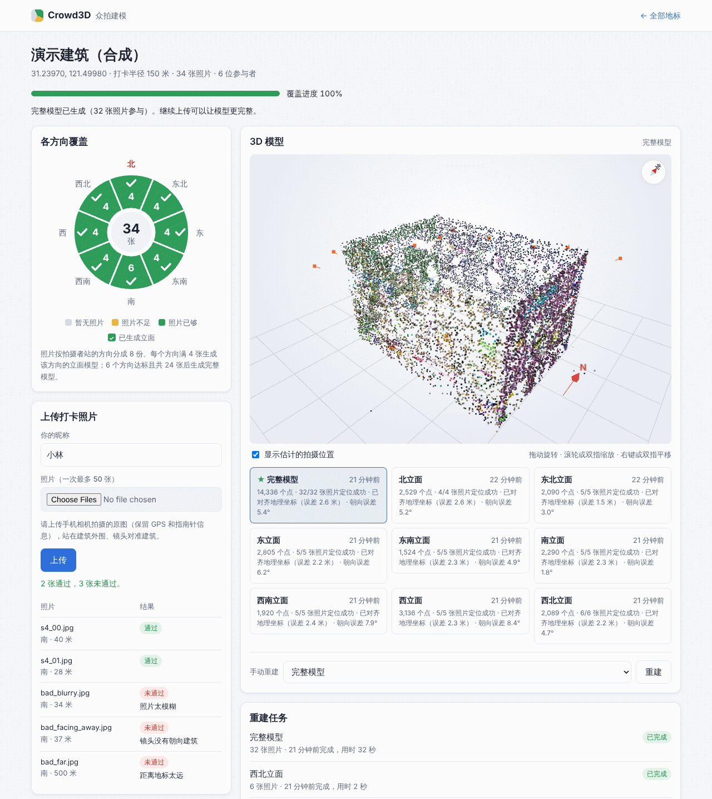
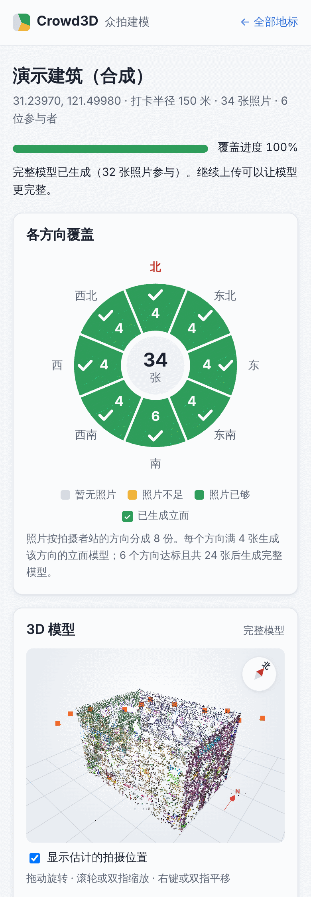
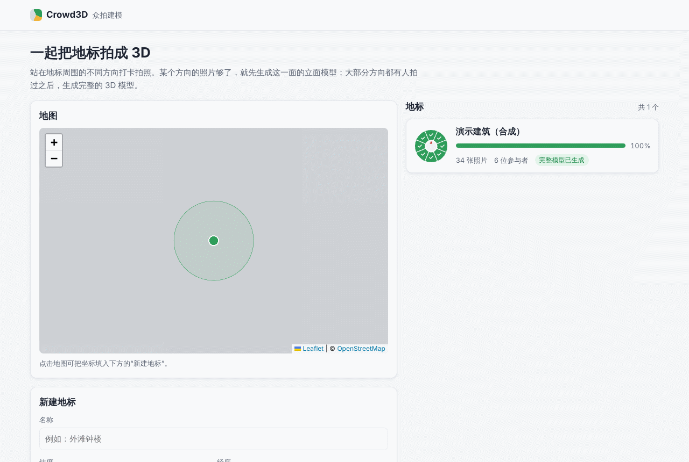

# Crowd3D：众包打卡照片 → 地标三维模型（原型）

不同的用户在著名建筑前打卡，从不同角度上传照片。系统自动判断每张照片是从建筑的哪一侧、朝哪个方向拍的。照片还不够时，先重建能拍到的那一面（**立面模型**）。照片覆盖了大部分方向后，再重建整栋建筑（**全景模型**）。模型以地标中心为原点，单位是米，北向对齐。

在点云之上，原型还能生成一个**风格化的"玩具"模型**（GLB）。它走"结构优先"的路线，参照 Hover 的做法：

- **框架先取自地图。** OpenStreetMap 的 Simple 3D Buildings 分件（`building:part`）变成参数化积木。每块积木带一个屋顶原语（平顶、单坡、双坡、四坡、攒尖、穹顶、洋葱顶……），每个参数都记下来源。
- **照片按规则修改地图上的值。** 证据有三路：天空轮廓线、SfM 点、三维直线。
  - 至少两路一致时自动采用（D15）；改高度时还要读到这块积木自己的屋顶（D27）。
  - 照片量出立面的凹凸（D24）。
  - 证据足够强时把 OSM 的高度往上纠正、加上倾斜、给缺高度的部分补出体块（D25）；每处纠正都可以撤销。
- **模型一律是素模**（浅冷灰加淡斜纹）。决定 D29（产品负责人，2026-11-03）放弃了给模型上照片颜色，上色代码已删。照片只用来把模型放准，并在配准通过时核验、修正形状（上一条）。画风可以整套替换素模色、描边和光影。

这是一个只用 CPU 的最小原型。后端是 Python（FastAPI + SQLite + pycolmap），前端是不需要构建的原生 JS 页面。另带一个能生成"真值"的合成数据生成器，用于测试和演示。

相关文档：
- 完整的技术架构见 [docs/ARCHITECTURE.md](docs/ARCHITECTURE.md)，第 11 节逐个模块对照原型和生产架构。
- 风格化模型见 [docs/STYLIZED_MODEL.md](docs/STYLIZED_MODEL.md)。
- 结构优先的设计、判定规则和实测结果见 [docs/STRUCTURE_FIRST.md](docs/STRUCTURE_FIRST.md)，产品里的结构见其中 §2.9。
- 画风见 [docs/ART_DIRECTION.md](docs/ART_DIRECTION.md)。
- 外部评审采纳了什么、没采纳什么、测出了什么，见 [docs/REVIEW_ADOPTION.md](docs/REVIEW_ADOPTION.md)。

> **现状**：上传、校验、重建、发布这条链路已经接进服务和网页。结构优先也接进了作业系统：有 OSM 分件快照的地标，每个发布的模型会自动生成一个 GLB，地标页链到它。但今天每个真实众包模型都过不了配准门，产品又只用一种可商用的天空掩码，所以产品给出的都是 OSM 分件的素模，没有照片量出的数字（模型本来就不上色，D29）。详见"原型的局限"。D30（2026-11-04）：别人只能看到上传者同意公开的照片的拍摄位置，取整到 1 米、1°，不带昵称；视觉定位做好了，但测试集上代价超标，默认关，见下面"D30"一节。D31（2026-11-03）加了照片资格和立面按注册张数过门，全新运行按事先写好的标准是 FAIL，见下面"D31"一节。

## 快速开始

需要 Python ≥ 3.11（开发时用 3.13）。运行 Web 测试还需要 Node ≥ 22（开发时用 v22），可选：测试用到了 `mock.timers` 的 Date 模拟和 `node --test` 的通配符，旧版本跑不了。

```bash
python3 -m venv .venv
. .venv/bin/activate
pip install -r requirements.txt

python -m pytest -q -m "not slow"   # 快速测试，不需要真实照片
python -m pytest -q                 # 加上慢测试（真实 COLMAP、端到端验收、风格化作业端到端）
```

启动服务，然后运行演示：

```bash
python -m crowd3d.api --seed-demo   # http://127.0.0.1:8000 ，创建地标 demo-building
python scripts/demo.py              # 另开一个终端
```

`demo.py` 会生成合成照片，然后按一个故事分阶段上传。整个过程在 4 核 CPU 上约 1 分钟：

1. 游客1 在北侧拍了 4 张 → 生成北立面模型；
2. 更多游客拍了东北、东、东南、南 → 每面各生成一个立面模型；
3. 一位游客补齐了剩下几面 → 生成剩下的立面模型和全景模型（32 张照片）；
4. 几张不合格的照片 → 逐张显示拒绝原因。

终端里会打印文字版罗盘、作业状态和模型质量。最后给出查看地址，例如 `http://127.0.0.1:8000/landmark.html?id=demo-building`。在浏览器里可以看到罗盘、共同完成者、作业列表、模型列表和 three.js 点云查看器。首页 `http://127.0.0.1:8000/` 是地图和地标列表。

常用参数：

- `python -m crowd3d.api`：`--data-dir DIR`（默认 `./data` 或 `$CROWD3D_DATA_DIR`）、`--reconstructor fake`（不跑 COLMAP，秒出假模型，适合调界面）、`--host`、`--port`。
  数据目录里的 `public_id.salt` 是公开 id 和撤回凭证的密钥，要和数据库一起备份。密钥和数据库对不上时（设了或改了 `$CROWD3D_PUBLIC_ID_SALT`、文件被删或被换），只要还有照片公开着位置，服务就拒绝启动，免得已经发出的撤回凭证全部失效、这些照片却继续公开。恢复原来的密钥即可；密钥确实丢了，就运行 `python -m crowd3d.consent forget-lost-salt --data-dir DIR`，它撤回所有照片的位置公开，再改用现在的密钥（D30）。
- `python scripts/demo.py`：`--users N`（参与的游客数）、`--size 800x600`（照片越大越慢，默认 640x480）、`--seed 1`（换一组照片；同一组照片重复上传会被判为重复）、`--landmark ID`（新建或使用另一个地标）、`--server URL`、`--photos DIR`、`--share-location`（游客同意公开照片的拍摄位置，默认不公开，D30）。
- 自己生成照片，再从网页手动上传：`python -m crowd3d.synthetic --out /tmp/photos --size 640x480`。照片的 EXIF 带 GPS 和指南针朝向，目录里有 `manifest.json` 记录真值。

> 网页从 CDN 加载 Leaflet、three.js 和 OSM 地图瓦片，所以浏览器需要能访问外网。

### 风格化模型

**服务会自动生成。** 地标满足下面三条时，每发布一个 COLMAP 模型，作业系统就排一个风格化作业：
- 地标目录（`Settings.structure_catalog`，默认 `eval/landmarks.json`）里有它的 OSM 分件快照和轮廓。目录里的 13 个地标都有。
- 地标 id 等于目录里的 slug（例如 `florence-baptistery`），或者在 `Settings.structure_bindings` 里绑定了 slug。
- 目录里的中心在地标的打卡半径内。

GLB 放在 PLY 旁边。地标页的模型列表里会出现"风格化模型 · 素模（照片未对齐）"或"风格化模型 · 素模（照片已对齐）"的链接（两种都是素模，区别是照片的配准有没有被接受），生成中显示"风格化生成中"。演示地标 `demo-building` 不在目录里，`--reconstructor fake` 也不写稀疏地图，所以演示不会生成 GLB。

**也可以用脚本处理单个模型。** 需要两样输入：
- 一个已重建的作业，或者 MegaDepth-X 格式的参考场景（`--scene DIR`）。作业目录默认会被清理。`keep_work_dirs` 没有命令行参数，也没有环境变量，要在代码里用 `Settings(keep_work_dirs=True)` 启动服务。基准（`scripts/benchmark.py`）默认会保留作业目录。
- 地标在 `eval/landmarks.json` 里的条目：坐标、OSM 轮廓文件和分件快照（`osm_parts`）。外轮廓拉伸时，高度标签来自轮廓 GeoJSON；结构优先时，来自分件快照里每个分件的标签。条目里只有 Wikidata 编号，脚本用不到 Wikidata 的高度。

输出必须写到仓库外（或被 git 忽略的 `data/`）：GLB 里没有照片像素，但摆放位置和照片量出的数字来自有许可要求的照片，照片缓存里还有照片衍生的天空掩码和线段：

```bash
python scripts/stylize_model.py --job-dir data/work/<作业> --meta data/models/<地标>/<模型>.json \
    --landmark florence-baptistery --out data/stylized
```

地标有分件快照时（目录的 `osm_parts`，或用 `--osm-parts FILE` 指定别的快照），脚本默认走结构流水线 `crowd3d.structure_pipeline`。它和服务的风格化作业是同一个入口：
- OSM 分件做体块；
- 照片的配准被接受时，用 A+R 天空掩码、SfM 点和三维直线做 D15 判定；
- D25 按 `--d25` 执行：`auto`（默认）只在有两种可商用天空掩码时跑，所以今天不跑；`survey` 只量不改；`off` 不跑。

`--no-structure` 退回外轮廓拉伸。摘要 JSON 的 `structure_run` 写明跑了什么、没跑的原因。天空掩码和线段缓存在 `<out>/cache`。

crowd3d 只认 A+R 一种天空掩码（`structure_pipeline.PRODUCT_MASKS`），别的掩码名一律拒绝，没有绕过的开关。研究用的掩码（例如 Dm+R）只在仓库外的研究脚本里用，因为它们的许可没有确认可以商用（见 [docs/REVIEW_ADOPTION.md](docs/REVIEW_ADOPTION.md) 第 1 节）。

`--snap-from <旧摘要或 GLB>` 复用旧版本的吸附，重新发布时模型不漂移。流水线模型（`--job-dir`）要先通过现在的吸附门重新核对；参考场景（`--scene`）存下的吸附原样复用。

输出包括 GLB、摘要 JSON 和调试用的俯视草图（`<slug>-topdown.png`，标出拍到的墙）；有 D25 纠正时另有一份 OSM 修正建议（`<slug>-osm_fix_suggestions.json`）。

查看方法：
- 查看器 `web/stylized.html?model=<GLB 的地址>&theme=<画风>` 只接受同源地址或相对路径。可选画风是 `default`、`storybook`、`dusk`、`blueprint`，画风只换素模色、描边和光影。D29 之前写的、带照片颜色的旧 GLB 也显示成素模。
- 加上 `&poses=<地标的 /poses 地址>`（同源，地标页的风格化链接自动带上）会在素模上画出同意公开的照片在哪儿拍、朝哪拍（D30，`web/photoposes.js`）：模型重建的照片画成视锥（橙色，要有测出的高度、俯仰、横滚和视角，否则只在地上画朝向扇形），手机 GPS + 罗盘的照片在地上画朝向扇形（黄色，标"手机 GPS + 罗盘（未经模型核对）"）。2σ 范围超过 10 米的照片一律在地上画出范围圆；点选一张看卡片（来源、离中心的位置、朝向、2σ 范围、这个来源实测落在范围内的比例、取整说明）。"从这张照片的角度看"只给有测出的高度、俯仰、横滚和视角的照片，EXIF 照片没有。其余参数：`photos=0`（先不显示）、`photo=<公开 id>`（选中）、`view=<公开 id>`、`err=1`（画出所有照片的范围）、`cluster=0`、`fit=model`。
- 服务生成的 GLB 在 `/files/models/<地标>/<模型>.glb`，地标页直接链过去。
- 脚本写出的 GLB 服务不提供（`/files/models` 只读 `data/models`）。可以在仓库根目录起一个静态服务器（例如 `python -m http.server`），再打开 `/web/stylized.html?model=/data/stylized/florence-baptistery.glb`。

## 截图

以下截图来自真实服务（COLMAP 重建）：先运行 `scripts/demo.py`，再在网页上传 2 张合格照片和 3 张不合格照片。截图环境不能访问外网，所以地图底图是灰色占位。截图比风格化链接和"GPS 对齐残差"的改名都早。

**地标页（桌面）**：
- 左侧是 8 个方向的覆盖罗盘：数字为照片数，✓ 表示已生成立面模型。下面是上传结果，未通过的照片逐张显示原因。
- 右侧是全景模型的点云，以地标中心为原点、北向对齐。红色 N 箭头和右上角的指南针指向北。截图里的橙色点是旧版画的重建估计拍摄位置；D30 起只画上传者同意公开的照片（取整到 1 米、1°，可以关掉），"公开的拍摄位置"表也只列这些照片：来源、离中心的位置、朝向和 2σ 范围，不显示上传者和时间。



**手机版地标页（单列布局）** 和 **首页（地图、地标卡片、新建地标）**：

<p>
  
  
</p>

## 工作原理

```
上传 ─▶ 读 EXIF ─▶ 校验 ─▶ 入库（扇区）─▶ 覆盖规划 ─▶ 重建作业（COLMAP）─▶ 地理配准 ─▶ 发布质量门 ─▶ PLY + 元数据 ─▶ 网页
                                                                                          │
                               （风格化作业，在子进程里）OSM 分件框架 + 照片证据 + 风格化 ◀─┘ ─▶ GLB ─▶ 风格化查看器
```

### 点云链路（已接进服务）

1. **读 EXIF**（`exif.py`）：GPS、指南针朝向（`GPSImgDirection`）、焦距、机型、拍摄时间。
2. **校验**（`validation.py`）：所有不通过的原因一起返回，不会遇到第一个就停。拒绝码有：
   - `no_exif`、`no_gps`、`no_landmark`、`too_far`（超出地标半径）
   - `facing_away`（指南针朝向偏离"相机→地标"方向超过 60°）
   - `not_subject`（D31：相机离建筑的 OSM 主轮廓超过 50 m，并且估算建筑占画面不到 1/3。占比由 GPS 位置、OSM 分件和焦距算出，不看像素、不用罗盘；焦距缺失或不合理时按 28 mm 算。见 `subject.py`）
   - `too_small`（短边 < 480 px）
   - `too_blurry`（拉普拉斯方差，按 800 px 归一化）
   - `duplicate`（dHash 汉明距离 ≤ 4）
   - `unreadable_image`
   - 另外，`ingest.py` 在两种情况下给出 `too_large`，并且只返回这一个码：文件超过 25 MB；或者不是 JPEG、超过 5000 万像素。
   - 警告码不会导致拒绝：`no_heading`（没有指南针，无法检查朝向）、`magnetic_heading`（朝向是磁北，没有做磁偏角修正）、`subject_unchecked`（地标没有绑定 OSM 轮廓，或者分件快照读不出来，没有检查建筑是不是照片主体）。
   - 每张照片存下 `outline_distance_m` 和 `subject_share`，以后改阈值可以重判；已经收下的照片不回头重判。
3. **扇区**（`coverage.py`）：地标四周分成 8 个罗盘扇区（N、NE……NW）。照片归入"地标中心→拍摄者"方位所在的扇区，也就是拍摄者看到的那一面。
4. **覆盖规划**（`coverage.plan_jobs`，纯函数）：
   - 某个扇区有 ≥ 4 张合格照片时，触发**立面作业**，输入是该扇区的照片，加上相邻扇区 10° 以内的照片。
   - 总数 ≥ 24 张、就绪扇区也够时，触发**全景作业**。
     - 默认要 6 个就绪扇区。
     - 照片满 48 张后，没有照片的方向算作拍不到，要求降为 max(⌈0.75A⌉, A−2, 2)，A 是有照片的扇区数。
   - 之后照片继续增长，立面每多 3 张、全景每多 8 张就重建一次。失败的作业也计入，要等再增长够了才会重试。
5. **作业**（`jobs.py`）：单个后台线程按顺序执行（SfM 很吃 CPU）。
   - 作业做完后会重新规划一次，所以作业运行期间新到的照片不会被漏掉。
   - 服务重启时，未完成的作业会重新排队。但进程已经在同一个作业中途退出过 2 次的，直接记为失败，不再重跑。
   - 只有一条替换规则（`jobs.superseded_by`）：旧作业晚完成时，不会盖掉同一目标更新的已发布模型。已发布的模型含有这次没有的照片、而且这些照片上传得更晚时，这次的模型存为未发布，作业以"已完成"结束并写明原因。
   - 风格化作业排在重建作业后面，见下一节。
6. **重建**（`reconstruct.py`）：
   - pycolmap 提取 SIFT 特征。不超过 60 张时做穷举匹配，更多时按 GPS 做空间匹配。
   - **特征缓存**（`landmark_map.py`，`Params.feature_cache`，默认开）：每个地标一个缓存。它按处理图的 sha256 原样存下 COLMAP 写过的特征、匹配和两视图几何。作业开始前把已有的行写进自己的数据库，COLMAP 只算新的。建图读到的数据库和不用缓存时逐字节相同（验证了 46 个作业），核心五栋的作业 CPU 少了 59.7%。
   - 然后做增量建图，而且不止建一次：不超过 30 张时用 3 个种子各建一次；更多时，只有结果可疑（超过 5% 的相机被标记，或平均罗盘误差超过 20°）才再建一次。最后留下未标记相机最多的模型。建图每次仍从零开始。从目标上一个模型续建（`Params.map_continue`）做了，但开发集验证没过，默认关。
   - 少于 12 张、并且每台相机都有 35 mm 等效焦距时，固定使用 EXIF 焦距。原因是一个近似平面的立面只有几张照片，定不准焦距。
7. **地理配准**（`reconstruct.georegister`，纯 numpy）：
   - 用相机的右向量和相机中心的分布估计重力方向。直接平均"上"向量会因为仰拍偏差约 10°。
   - 用鲁棒的 2D 相似变换把相机中心对齐到 GPS，偏航角再按反方差和指南针融合。没有指南针时，用"伪罗盘"：假设每张照片都朝地标中心拍。
   - 最后按 1.6 m 的拍摄高度确定 z。
   - 输出 ENU 坐标（x=东，y=北，z=上，单位米），以及每张照片估计出的位置和朝向。也就是说，照片的方位由 SfM 自动判断，不只依赖手机的 EXIF。
   - GPS 不够用时，`georegistered` 为 false。不够用的情况包括：内点太少、分布太窄、预计尺度误差太大，或者和罗盘偏航相差超过 40°。这时偏航只靠罗盘或伪罗盘，尺度是粗估的，在真实建筑上常偏大 1.5–2.4 倍。按注册率过门时质量门不检查这一项，所以这种模型也可能发布；D31 的按张数过门要求它为 true。
   - **地理锚点**（`anchor.py`）：配准结果另存成一条锚点记录，和 SfM 自己的局部坐标分开：从局部坐标到 ENU 的相似变换，以及偏航、尺度、水平位置、高度、倾斜各自的 1σ 和来源；每台相机也另记局部位姿。σ 按平方和加上一组下限（`dev-core5-v1`，只在开发集上拟合）。锚点只是把已有的配准记下来，不带来新的偏航或尺度来源，所以模型的绝对位置没有变准。风格化的吸附门和 API 的 `geo` 块读它；质量门只记录、不拦。
   - 配准之后，`camera_flags` 逐台检查相机。离自己的 GPS 超过内点阈值（至少 10 m）、并且和自己的罗盘相差超过 45° 的，标为"双胞胎"，常见于长得像的两个立面。有 2 台以上时，重建会切断它们和其余照片的匹配，再建一次图。
8. **发布质量门**（`qa.py`）：只和产品本来就知道的东西比较（照片的 GPS 和罗盘、地标中心和半径），不需要真值。检查项和门槛：

   | 检查 | 门槛 |
   |---|---|
   | 注册相机 | 至少 3 台；注册率立面 ≥ 60%，全景 ≥ 70%。立面注册率不够时，注册 ≥ 6 台并且地理配准拟合上了 GPS（`georegistered` 为 true）也算过（D31，`qa_face_min_registered`）；`checks["registration_path"]` 记下走的是 `fraction` 还是 `count` |
   | 点数 | ≥ 300 |
   | 平均重投影误差 | ≤ 2.5 px |
   | 双胞胎相机 | ≤ 10% |
   | 带可疑标记的相机 | ≤ 20% |
   | 各相机罗盘偏差的中位数 | ≤ 25° |
   | 点云水平中位点离地标中心 | ≤ 半径的一半 |
   | 全景模型的覆盖 | 就绪扇区数和全景作业的要求相同，每个扇区至少 2 台未标记的注册相机 |

   没过门时：
   - PLY 和 `.json` 照样写盘，`.json` 里 `published` 为 false；
   - 作业记为失败，并写明原因；
   - 之前发布过的版本继续显示；没有的话，这个目标暂时没有模型。

   过门模型里被标记的相机，其位姿不公开。
9. **输出**：
   - `models/<地标>/<模型>.ply` 是带颜色的点云。
   - 同名 `.json` 里有注册数、点数、GPS 残差、朝向误差、每个相机的位姿（ENU 和局部坐标）、是否发布（`published`）、质量门结果、各阶段耗时、地理锚点（`anchor`）和带版本的输入（`inputs`：照片数、其中最新的上传时间、照片集的 sha256）。
   - 发布的 COLMAP 模型另把稀疏模型和 `map.json` 存进 `maps/<地标>/models/<模型>/`，每个目标留最新的 2 个。风格化作业读它。

### 风格化模型（结构优先；作业系统、脚本和基准共用一个入口）

风格化的入口有三个，都调用 `crowd3d.structure_pipeline`：
- **作业系统**（`jobs.py`）：地标有分件快照时，每个发布的 COLMAP 模型排一个风格化作业。
  - 重建作业优先；没有重建作业排队时，才开始风格化作业。
  - 作业在子进程里跑（`python -m crowd3d.structure_pipeline run --spec`），2 个线程，`stylize_timeout_s`（1200 s）一到就杀掉。
  - 子进程读模型存下的地图和照片的处理图，只写自己的工作目录和照片缓存，不碰数据库。
  - 风格化模型过了自己的质检，才写出 GLB。服务把它放到 PLY 旁边，记进 `ModelRecord.stylized`。
  - 目标已经显示更新的模型时，作业以说明结束。子进程失败或超时，作业失败，不写 GLB。
- `scripts/stylize_model.py`：处理单个模型。
- `scripts/benchmark.py`：把测试集上每个发布的模型都风格化一次（基准里产品自己的风格化作业是关的）。

**结构流水线做什么**（[docs/STRUCTURE_FIRST.md](docs/STRUCTURE_FIRST.md) §2.9）：读分件快照并核对 sha256 → 用 `stylize.register_scene` 吸附、过配准门 → 配准被接受、并且分件不超过 60 个时才跑判定器（D15）→ D25 只在有两种可商用天空掩码时跑（今天不跑）→ 发布门检查 → 风格化。没有分件快照时，退回外轮廓拉伸。

**只有一种天空掩码（A+R）时**：天空轮廓线这一路既不能核验也不能投票；D15 不采用整栋外框；D25 不跑。D15 只剩一种组合：SfM 点和三维直线一致，并且读到这块积木自己的屋顶。今天每个真实众包模型都过不了配准门，判定器根本不跑，所以产品给出的都是 OSM 分件的素模。

下面第 1–8 步说明整套设计。在结构流水线里，判定（第 3 步）和 D25（第 5 步）只在配准被接受时才跑。

1. **框架**（`structure.py`）。读地标的 OSM 快照，保留落在主轮廓里的 `building:part`。每块变成"底高到檐口的棱柱 + 屋顶原语"。
   - 高度取自 `height`、`building:levels`、`roof:height` 等标签。
   - 标签缺了，就用屋顶形状的约定比例（D17），或者 3 m 的"高度待定"矮台（D13）。
   - 每个参数都记下来源和状态（体块登记表 v2）。Wikidata 的总高永远不用于单个分件。
   - 快照在 `eval/osm/<slug>.parts.osm`，由 `scripts/trim_osm_parts.py` 从整块下载裁出。
2. **照片证据**。三路共用同一套位姿：
   - 天空轮廓线（`skyline.py`，基于 A+R 天空掩码）；
   - SfM 点；
   - 三维直线（`lines3d.py`）。
3. **判定**（`judge.py`，D15）。下面几个条件都满足，才自动采用照片值：
   - 至少两路给出数值，而且所有给出数值的通道两两相差 ≤ max(1 m, 5%)；
   - 方向相同；
   - 没有顶到搜索边界；
   - 共同尺度没确立时，还要通过尺度无关检查；
   - 父件的改动已被接受；
   - 改高度时（往上、往下都算），一致的证据里还要有一路读到这块积木自己的屋顶（D27）：三维直线的屋脊或顶点，或者这块积木的屋面拟合（`roof_fit.py`，和 D25 同一个拟合，而且离轮廓 ≥ 2 m 的格子里要有点，看得到屋顶本身）。只有天空轮廓线加三维直线的檐口、或者天空轮廓线加 SfM 点的最高处（0.98 分位），都不够，开工单。

   细高构件，以及坐标工单还没结的时候，一律不自动采用。条件不满足时保留地图值，并开一张工单。
4. **立面凹凸**（`relief.py`）。用照片的点量出壁柱、檐带、凹进的开间等。
   - 有 G-R1…G-R7 七道守卫，例如 G-R7 要求量到的边离杆子、树干这类独立物体 ≥ 0.3 m；还有"合并开间"检查。
   - 有三维直线核对的元素照常建。
   - 只凭点建的元素（三维直线只在偶然水平的，即 D24 元素），要求模型自己的数据能确立共同尺度；不满足时不建这类元素。
5. **强证据纠正 OSM**（`correct.py`、`correct_measure.py`、`tilt.py`，D25）。纠正三类值：
   - 分件高度和屋顶高，只往上改（D25-H）；
   - 塔的倾斜（D25-T）；
   - "高度待定"矮台和空隙的体块（D25-B）。

   前提是证据级的配准盒子和尺度无关的参照，并且一致的证据里要有一路读到这块积木自己的屋顶（屋面拟合，或三维直线的屋脊、顶点）。盒子太宽时只采用下界。D25 要两种天空掩码，所以产品里不跑。

   每处纠正都带地图原值和全部数字，可以逐条撤销。另外输出一份建议的 OSM 修正报告；OSM 本身不改。
6. **吸附、配准门和观测判定**（`stylize.py`）。门决定照片证据（D15、D24、D25）能不能用；D29 之前它也决定上色。
   - 模型先按窗口搜索吸附到 OSM 轮廓上。偏航窗口按模型报的偏航 σ 定；模型有地理锚点时用锚点的 σ。
   - 然后过配准门。门本身没有参考位姿，量不了真实误差，它检查的是：
     - 吸附后墙点到轮廓的中位距离 ≤ 1.5 m；
     - 逐边核验：有票的边里 ≥ 60% 的中位距离 < 3 m，通过的边方向至少差 30°；
     - 偏航别名：另一个差不多一样贴合的摆放，如果会把墙上的照片或相机挪动 ≥ 1.5 m，就拒绝；
     - 任务 #73 加的三条（流水线模型才查）：窗口被建筑的对称周期截短、或者模型没报偏航 σ 时拒绝；吸附后相机到自己 EXIF GPS 的中位距离超过 max(20 m, 3 × 锚点在相机处的水平 σ) 时拒绝；
     - 另外还检查 GPS 深度、相机位移、倾斜和可见性。

     基准事后拿参考位姿判"对/错"：相机 ≤ 1.5 m、三维墙点 ≤ 1.5 m 算对。
   - 过门以后判定哪些墙算拍到：要有 ≥ 2 台相机看到、墙上有足够的 SfM 点、拟合的墙面贴着这个面，再按照片之间是否一致、去掉天空和植被，得出每面墙的观测掩码。D24 只在拍到的墙上量，结构指标的"拍到面积"只算它们。照片的颜色只用来判断看到的是不是同一面墙，不进模型；每个面都是素模（D29）。
   - 不过门时整栋不用照片证据：判定器从同一批照片得出的结论（D15 采用、照片核验）全部撤回，没有墙算拍到，不建 D24。D25 的纠正则按配准等级保留，所以素模上也可能带着照片纠正。
7. **诚实检查**。三道检查各管一层：
   - `check_honesty` 查流程本身执行的约束：每个面都有来源、外观都是素模、只有墙能标"拍到"、"高度待定"矮台全是素模、每个凹凸元素都有记录；
   - `audit_model` 用点和相机独立复核拍到的墙的点支撑和遮挡，并核对 D24 的凹凸几何、D25 的每个纠正值都和各自的记录一致；
   - `audit_glb` 只看发布出去的 GLB 字节：没有图片、贴图和纹理坐标，每个节点的来源、每个照片值的证据和记录都对得上。

   这些检查用来抓程序 bug：它们核对记录完整、和模型一致，但不用记录里的数字把判定规则重算一遍，所以挡不住自洽地伪造的记录（D26）。

   另外，`structmetrics.py` 统计每个数字来自 OSM、约定、占位值还是照片。
8. **查看**。GLB 每个节点的 extras 都带来源和证据。在 `web/stylized.html` 里点选一块积木，可以看到它的来源卡片，例如"形状：OpenStreetMap 志愿者测绘"或"照片纠正地图（自动）"。
   - 画风文件在 `web/themes/*.json`。
   - 查看器按面的种类画素模：屋顶一种颜色，其余一种，都带淡斜纹；换画风不用重跑风格化。
   - 画风的校验只查斜纹看得见（ΔE00 ≥ 3，按查看器真实的光照算）和格式，见 [docs/ART_DIRECTION.md](docs/ART_DIRECTION.md)。

## D30：别人照片的拍摄位置（2026-11-03 决定，11-04 验证）

**产品负责人的决定**（原话："别人照片的位置取整到 1m、朝向取整到 1°，并且不返回用户 ID。只要用户同意分享位置信息，我们必须不能浪费（做出粗糙的推断）"）：

- 别人看到的照片位置取整到 1 米、朝向取整到 1°，不返回用户 ID。
- 只显示上传者明确同意分享位置的照片：默认不同意，以前的照片都算不同意。
- "不能浪费"，开发这边的理解：
  - 不显示粗糙的推断，例如"朝着地标中心"这种猜出来的朝向；
  - 每张同意的照片都尽量放准：在已发布的模型里就用模型重建出的位姿，不在就用视觉定位放进地标已存的地图；手机 GPS + 罗盘只作标明了的后备；
  - 放不准就不显示。

**同意和撤回**：

- 地标页上传区有一个勾选框"公开这些照片的拍摄位置、朝向和视角"。它默认不勾，每次打开页面、每次上传以后都会变回不勾。
- 旁边的说明写明这些事：位置取整到 1 米、朝向到 1°；不带昵称和时间；要等这里下一次建模结束后才显示；怎样撤回；剩下的风险。风险有两条：这里上传的人少时，别人能猜出哪几行是你的；任何人都能用手动重建或几张上传让下一次建模很快开始。
- 只有通过校验的照片才记下同意（`share-location-v2`）。
- 上传结果给每张公开的照片一个撤回凭证，只给这一次，浏览器把它存在本机。地标页可以撤回一张或全部，撤回马上生效（`POST /api/photos/{id}/share_location`）。
- 凭证由部署密钥算出，所以密钥（数据目录里的 `public_id.salt`）要和数据库一起备份。
- 共同完成者只列昵称，不给每人的照片数，免得和公开的位置对上号。

**别人看到什么**（`GET /api/landmarks/{id}/poses`；地标页的"公开的拍摄位置"表和点云上的标记；风格化查看器在素模上画出来）：

- 每行有这些字段：
  - 公开 id：用部署密钥算的 12 位，不是库内 id；
  - 来源；
  - 位置：取整到 1 米，坐标是地标 ENU；
  - 朝向、俯仰、横滚：取整到 1°；
  - 水平视角：取整到 5°；
  - 宽高比；
  - 2σ 范围：按取整放宽，再向上取整。

  每行没有上传者、时间、模型或扇区。
- 来源，按先后选：
  1. 模型重建（`sfm`）：坐标系定准了的已发布模型里、没被标记的相机；
  2. 与模型比对（`loc`）：视觉定位，现在关着（见下面）；
  3. 手机 GPS + 罗盘（`exif`）：只用标为真北的罗盘。这一行标"手机 GPS + 罗盘（未经模型核对）"，没有高度，画在地上，带这个来源实测落在范围里的比例。
- 列表是一张快照：只含最近一次重建作业结束前上传的照片。

**扣下不显示的**（宁可没有位姿，也不画粗糙的）：

- 只有 GPS、没有可用罗盘的照片；
- 罗盘是磁北或没标注的照片：这类罗盘常差 90° 左右；
- 坐标系没定准的模型里的相机：这种模型只有先验、没有吸附；
- 被标记的相机，例如离自己的 GPS 太远、和罗盘对不上；
- 定位关着时，以前存下的视觉定位结果。

基准把"扣下的位姿本来是对的"记成 `photo_pose_withheld_right`，这就是不显示粗糙位姿的代价：每次运行 dev 10.5 张、test 5 张。同时挡掉的错位姿是 dev 17.5 张、test 14.5 张。

**测出了什么**（指标第 8 版；commons-ten-v1 的 D31 全新运行在 716de16 上补算，两次重复的中位数，假定每张通过的照片都同意。完整的表在 [docs/BENCHMARK.md](docs/BENCHMARK.md) 6.12 节）：

| 现在的产品（定位关着） | dev（核心五栋） | test（留出五栋） |
|---|---|---|
| 通过的照片 | 460 | 399 |
| 显示位姿的（模型重建 / 手机 GPS + 罗盘） | 317（277 / 40） | 179.5（134 / 45.5） |
| 有参考位姿的里面：对 / 错（10 米 / 15°） | 142.5 / 78.5 | 62 / 34.5 |
| 落在自己 2σ 范围里 | 86% | 88% |
| 手机 GPS + 罗盘：有参考的里对的 | 5.5 / 10.5 | 1 / 14 |

- 显示的位姿约三分之一离参考超过 10 米或 15°。但 86–88% 落在它们自己标出的 2σ 范围里：范围是诚实的，只是宽。
- 手机 GPS + 罗盘的位姿在留出集上几乎都不准：14 张有参考的只有 1 张在 10 米 / 15° 内，82% 在范围里。
- 和 D31 的打分比，138 个张次变了，每个都有解释：
  - 69 个是磁北或没标注的罗盘不再显示；
  - 37 个是坐标系没定准的模型里的相机不再显示；
  - 32 个是取整以后判定跨过了对错的线。

  `photo_pose_*` 以外的指标一个都没变。
- 在一次真实全新运行的数据副本上读了所有不用登录的接口：没有库内 id、密钥、撤回凭证、GPS、上传时间或精确的相机位置。

**视觉定位：做了，默认关**（`crowd3d/localize.py`，`Settings.localize_photos`）。不在任何已发布模型里的同意照片，用 PnP 定位到地标已存的地图里（要有 EXIF 焦距）。是否打开由事先写好的标准 `eval/criteria/d30-v1.json` 决定。

- **结论：保持关闭。** 原因有两个：
  - 代价规则没过：定位要用掉运行 CPU 的 26.7%（dev）和 66.5%（test），上限是 25%。圣家堂一栋每次花约 1,300 CPU 秒，一张也没定位上。
    - 只有 test 这一条是稳的。分母是前一天 D31 运行的 CPU，分子是第二天测的；同样的工作，第二天要多用约 1.5 倍 CPU（洗礼堂定位关着的对照运行，每一步都一起慢），看来是机器慢了。按这个倍数换算，dev 约 17–19%，会过；test 约 41–46%，仍然不过。
  - `run` 还不给运行里的定位位姿打分，所以"显示的等于测的"这一条核对没过。
- 准确和隐私的守卫都过了：有参考位姿的定位位姿没有一张显示错，没有错面，没有泄漏。
- 打开的话能多出什么：每次运行约 860 张通过的照片里，多放准 9 张（约 1%），在勃兰登堡门、洗礼堂、比萨和印度门上。
  - 这 9 张里 4 张今天没有位姿，5 张今天只有手机 GPS + 罗盘的位姿（其中 2 张是错的）。
  - 能核对的 6 张全对。
- 证据很少。另一个更大的测试是"留一法"：160 张参考照片，先从地图里拿掉再定位。接受的 110 张里 24% 是错的，一半是定位器自己的错。
- 打开之前要做四件事：
  - 一个便宜得多的定位器，或者负责人明确决定接受这个代价（要写明是看过这些结果之后的决定）；
  - 再测代价时，定位的 CPU 和运行的 CPU 在同一台机器、同一段时间里测（或者带一个对照运行按倍数换算），并把对照写在结果旁边；
  - 基准给运行里的定位位姿打分；
  - 重复几次全新运行的开 / 关对比。原因是一次打开定位的运行里，模型的轮廓转角从 1.6° 变成了 10.2°，不知道是不是偶然。

**提交**：29dcd01、3e900fa（关掉别人照片位置的泄漏）；cba72fe、d231ae3（上传时同意、撤回）；a1491d3、d5e51fa（显示规则和打分，指标第 8 版）；c81ddaa、18cdf01（`/poses` 接口和地标页）；e64661b、26379eb（素模上的图层）；e9d80a3、f25c871、962c056、133858a（视觉定位）；eb99645、190dcb4（定位作业，默认关）；d3e90a6、716de16（基准的 `rescore --localize` 和标准 `d30-v1`）；d2502e8（结果和文档）；b46fdad（`localize_photos` 保持关闭）；之后一个提交写明代价判定里机器速度的漂移。

**还等产品负责人答复的两个问题**（现在用的是默认答复）：

1. 只有手机 GPS + 罗盘的位姿要不要显示？
   - 默认：只显示罗盘标为真北的，标"手机 GPS + 罗盘（未经模型核对）"，附上这个来源实测落在范围里的比例（按来源分开、给最低和最高的一栋，不是一个合并的数）。磁北或没标注的不显示，只有 GPS 的从来不画。
   - 数据：上面说的，留出集 14 张里只有 1 张在 10 米 / 15° 内。D31 的运行里，有参考的磁北位姿 23 个张次，本来对的 4 个、错的 19 个，现在都不显示了。
   - 另两种选法：两种罗盘都显示，各带自己的范围；或者一张都不显示，只等模型重建或视觉定位放准。
2. 共同完成者的昵称和公开位置会不会对上号？
   - 默认：保留昵称、去掉每人的照片数，公开位置只在一次重建作业结束时更新，勾选框旁边写明剩下的风险。
   - 另一种选法：有公开位置的地标不显示昵称。

## D31：照片资格和立面按张数过门（2026-11-03）

**产品负责人的决定**（原话："照片只有建筑占据主体（或 与被拍摄的建筑 50m 以内）才能算合格的。照片方向集中的建筑，能不能只做照片集中的那一面？反正模型主体你都是从 osm 上面拉下来的。"）：

- 照片资格是定了的：建筑是照片的主体，或者相机离被拍的建筑 50 m 以内，照片才合格。
- "只做照片集中的那一面"是负责人问"能不能"，下面是开发这边的做法：系统本来就按面建立面模型，原来的质量门要立面注册率 ≥ 60%，SfM 只连上一部分照片的面就被扔掉（例如林肯纪念堂东面 30 张里注册上 10 张）。模型主体本来就来自 OSM，所以立面也可以按注册上的张数判，没注册上的照片只是没有 SfM 位姿。

**改了什么**（提交 fcb4fbd、0ebbcc1、081e928、09f7621）：

1. **照片资格**（`crowd3d/subject.py`，拒绝码 `not_subject`）。50 m 量的是相机 EXIF GPS 到建筑 OSM 主轮廓的水平距离，在楼里算 0。"主体"用几何估算：从 GPS 位置看地标的 OSM 分件，建筑在水平或竖直方向上占视场的比例，取大的那个，≥ 1/3 算主体。不看像素，不用罗盘（罗盘只管原来的 `facing_away`）。两条满足一条就合格。地标没有绑定 OSM 轮廓时不查，照片带警告 `subject_unchecked`，网页上写"没有检查建筑是不是照片主体"。只对新上传生效，每张照片存下距离和占比，以后改阈值可以重判。
2. **立面按张数过门**（`qa.py`）。立面注册率不到 60% 时，注册 ≥ 6 张（`qa_face_min_registered`）、并且地理配准拟合上了 GPS，注册这一项也算过。点数 ≥ 300 等其余检查一条不变，全景模型不走这条路。模型的质量门结果记下走的是哪条路（`registration_path`：`fraction` 或 `count`）。
3. **基准**：印度门的参考修成第 2 版，13 台和自己的 GPS 隔着拱门、照片又证明不了参考对的参考相机标成未验证（[docs/BENCHMARK.md](docs/BENCHMARK.md) 7.3 节）。通过标准 `eval/criteria/d31-v1.json` 在全新运行之前写好，对比的是 F。

**全新运行的结果**（2026-11-03 到 11-04，提交 09f7621，每栋 2 次，和 F 比；样本内：阈值是看了 F 在这十栋上的运行定的，留出五栋对 D31 只是复现测量）。完整的表在 [docs/BENCHMARK.md](docs/BENCHMARK.md) 6.11 节。

- **结论是 FAIL。** dev（核心五栋）全部通过；留出五栋那一对有三条规则不过；synthetic-v1、mdx-two-v1 是证据不足（和 F 自己比自己一样缺数据）。不过的三条：
  - 圣家堂新显示的南面、西南面两个按张数过门的立面，位姿是对的，墙却偏离 OSM 轮廓：建筑局部 1.5 m 内放错的墙 0.5 → 15 m，地理 5 m 外放错的墙 34.5 → 65 m。这两个模型 F 的运行里就建出来了，是原来的 60% 规则拦下的。
  - 印度门西面新显示的模型（按 60% 的比例过门）在地图上放得对，墙却离轮廓 1.5–5 m，局部 1.5 m 内放错的墙 0 → 19.9 m。
  - 匈牙利国会大厦西面锚点的水平 σ 说小了（22 个可核对的模型里 1.5 个在 3σ 外，上限 5%）。这在 F 里就有，只是 F 只有 4 个可核对的模型，判不出来；D31 到了 22 个，才判得出。
- **照片资格**：接收的照片数和每个拒绝原因的张数，每栋每次都和离线重放一样，十栋每次运行 911 → 859 张。逐张追到 F 的运行里，被去掉的 52 张 F 接收过的照片，在两次运行里只丢了一个对的位姿（勃兰登堡门第 2 次）；每次运行同时去掉 2–3 个错的位姿，以及勃兰登堡门一个坏的西北立面（它 6 台有参考的相机全是粗差）。没有一栋对的位姿变少。
- **按张数过门**：两次运行共发布 59 个这样的立面模型，它们自己的位姿对 513 / 609 = 0.842（F 已发布立面的标尺是 0.745），没有一个转反（错面）。十栋合并、有参考位姿的照片里对的每次运行 167.5 → 210.0 张。
- **F 里没有模型的三栋留出建筑**：
  - **林肯纪念堂：有了。** 每次运行发布 2 个东面模型（第 39、44 个请求，10/29、10/32 张注册），都是按张数过门的，显示第 44 个。10 张照片由 SfM 定位，都有参考位姿，第 1 次对 5 张、第 2 次对 4 张。连只靠 GPS 和罗盘的一起算，22 张有位姿的照片里对 5 / 4、错 17 / 18；F 是 18 张里对 3 张，全靠 GPS 和罗盘。这是最弱的新模型，它们自己的相机只对 19 / 39。
  - **印度门：有了。** 每次运行发布 4 个：西面第 31、45 个请求（按张数，后来被替换），东面第 52 个（16/25）和西面第 52 个（18/30）（按 60% 的比例，最后显示的是这两个）。每次运行 44 张照片有 SfM 位姿，能拿修正后的参考核对的 17 张里对 16、错 1。东面的 16 张核对不了，那一侧的参考相机全在标成未验证的 13 台里；按旧参考，东面模型读成转反了。F 在这里没有 SfM 定位的照片，靠 GPS 和罗盘的 3 张都对。
  - **悉尼歌剧院：没有。** 两次都没有发布的模型，也没有 SfM 定位的照片；它没有参考位姿，对错量不了。
- 被资格规则去掉的照片（每次运行，两次一样）："标出"是被判 `not_subject` 的全部照片，"新去掉"是其中 F 接收过的（其余的 F 本来就因为别的原因拒了）：

  | 建筑 | 标出 | 新去掉 |
  |---|---|---|
  | 勃兰登堡门 | 6 | 5 |
  | 比萨斜塔 | 3 | 3 |
  | 匈牙利国会大厦 | 5 | 5 |
  | 林肯纪念堂 | 7 | 4 |
  | 印度门 | 25 | 21 |
  | 悉尼歌剧院 | 15 | 14 |
  | 洗礼堂、亚琛、圣母教堂、圣家堂 | 0 | 0 |
  | mdx-two-v1 的亚琛 | 2 | 0 |
  | **合计** | 63 | 52 |

  合成集的建筑没有绑定轮廓，只带警告，一张没去掉。

**还等产品负责人答复的两个取法**（现在用的是默认值，都是 `Settings` 字段）：

1. "主体"的门槛：默认占画面 1/3（`subject_min_share` = 0.33）。估算偏低，拿有参考位姿的照片核对，1/3 最接近建筑真的占了半个画面。另一个选项是 1/2。50 m 是负责人给的数（`subject_max_distance_m`），量的是相机 GPS 到 OSM 主轮廓。
2. 没有绑定 OSM 轮廓的地标：默认不查，照片带警告"没有检查建筑是不是照片主体"。另一个选项是地标先绑定轮廓，才收照片。

## HTTP API

所有接口都是 JSON。时间是 unix 秒，角度是度，距离是米。字段的完整定义见 `crowd3d/api.py`。

| 方法 | 路径 | 说明 |
|---|---|---|
| GET | `/api/health` | `{"ok": true, "reconstructor": "colmap"}` |
| GET | `/api/landmarks` | `{"landmarks": [LandmarkSummary]}`：进度、扇区状态、最新全景模型 |
| POST | `/api/landmarks` | `{id?, name, lat, lon, radius_m?}` → 201 LandmarkSummary；id 重复返回 409，参数非法返回 422。不给 id 时由名称生成 slug，中文名生成 `lm-xxxxxxxx` |
| GET | `/api/landmarks/{id}` | LandmarkDetail：在 Summary 的基础上加共同完成者（只有昵称，按昵称排序，不给每人的照片数，D30）、每个类型/扇区的最新模型、最近 20 个重建作业（风格化作业不在列表里）、阈值；不存在返回 404。不含逐张照片的信息（D30：谁在哪儿拍的、相机的精确位姿都不公开） |
| GET | `/api/landmarks/{id}/poses` | 公开的拍摄位置（D30，`crowd3d.photo-poses` 第 2 版，见下面）；不存在返回 404 |
| POST | `/api/photos` | multipart：`files`（1–50 个）、`user_id`、`landmark_id`（可选，不给时按 GPS 自动匹配地标）、`share_location`（可选布尔值，默认 false：上传者同意公开这些照片的拍摄位置、朝向和视角，D30）→ `{"results": [UploadResult], "triggered_jobs": [JobInfo]}`。UploadResult 的 `share_location` 说这张照片的位置是否公开（照片通过、并且勾选了才算）；公开时 `public_id` 是这张照片在公开位置里的 id，`manage_token` 是撤回用的凭证，只在这次响应里给一次。照片本身的校验失败放在每个文件的结果里，不作为 HTTP 错误返回。请求本身出错时仍返回 HTTP 错误：`user_id` 非法、文件数不在 1–50 或 `share_location` 不是布尔值返回 422，`landmark_id` 不存在返回 404，请求体超过上限返回 413 |
| POST | `/api/photos/{photo_id}/share_location` | `{share: false, token}` → `{photo_id, share_location: false}`：上传者凭上传时拿到的 `manage_token` 撤回位置公开（D30）。凭证不对返回 403（照片存不存在都一样），格式不对或 `share` 不是 false 返回 422（只能在上传时同意），照片不存在返回 404 |
| POST | `/api/landmarks/{id}/rebuild` | `{kind: "face"\|"full", sector?}` → 202 JobInfo；照片数没达到最低要求返回 409，kind 或 sector 非法返回 422 |
| GET | `/api/jobs/{job_id}` | JobInfo（kind 取值：face / full / stylize；status 取值：queued / running / done / failed；风格化作业的 `model_id` 是它处理的模型；失败作业的 `error` 里的服务器路径和照片的库内 id 换成 `<path>`、`<id>`，原文只留在库里） |
| GET | `/files/models/<地标>/<模型>.ply` | 点云文件。风格化作业生成的 `.glb` 也在这里。旁边的 `.json`、`.style.json` 不提供（里面有每张照片的位姿） |
| GET | `/`、`/landmark.html?id=…` | 网页（`web/` 目录） |
| GET | `/stylized.html?model=<GLB 地址>&theme=<画风>&poses=<地址>` | 风格化查看器（静态页面）。`model` 和 `poses` 只接受同源地址或相对路径，跨域地址会被忽略；`poses` 是地标的公开拍摄位置，画在素模上 |

公开的拍摄位置（`GET /api/landmarks/{id}/poses`，D30）只有一种受众，没有参数：
- 只列上传时勾选了同意、并且通过校验的照片；库里没有同意记录的（包括 D30 之前的所有照片）都不列。
- 每行只有 `id, src, p, yaw, pitch, roll, hfov, aspect, sp, sy`：`id` 是用部署密钥算的 12 位 HMAC（不是库内 id），`src` 是 `sfm`（模型重建）、`loc`（与模型比对：视觉定位作业把照片定位到地标的已存地图里，`Settings.localize_photos` 默认关，关着时没有，以前存下的定位结果也不显示）或 `exif`（只用指南针标为真北的手机 GPS + 罗盘，没有高度）；位置取整到 1 米，朝向、俯仰、横滚取整到 1°，水平视角取整到 5°，`sp`/`sy` 是 2σ 范围，按取整放宽后向上取整。按 `id` 排序，不带上传者、时间、模型或扇区。拿不准的（只有 GPS、磁北或没标的指南针、框架没定住的模型、被标记的相机）不列，只计入 `counts.not_determined`。
- 坐标是地标 ENU（米），也就是风格化 GLB 的坐标系：风格化作业接受了外轮廓吸附的模型，相机（以及定位到它里面的照片）跟着吸附移动。
- `loc` 行来自视觉定位作业存下的结果（定位作业是内部的：不在上传结果、详情里，`/api/jobs/{id}` 对它返回 404）；结果一存下就算，但照片和其他行一样要在快照里。
- 这是一张快照：只含最近一次重建作业（立面或全景，成功或失败）结束前上传的照片（`as_of` 是那个时刻），所以单独一次上传不会让列表变化；撤回同意则马上生效。但任何人都能让下一次作业很快结束（手动重建，或者自己上传几张照片），所以一个新昵称刚出现时，紧接着出现的行仍可能和它对上；勾选框旁边的说明写明了这一点（同意版本 `share-location-v2`）。
- `uncertainty.measured_coverage` 是各来源在基准测试地标上实测落在范围内的比例（commons-ten-v1 测试集，D31 全新运行按 D30 规则重算，两次运行合计：模型重建 146/165，单栋单次最低 1/10、最高 13/13；手机 GPS + 罗盘 23/28，最低 1/2、最高 1/1；与模型比对在测试集上还没有有参考的定位位姿，没实测，而且视觉定位关着）。D30 的验证在 716de16 上重算了一遍，逐张相同。`rule_calibrated_here` 说这个来源的误差规则是不是用这些地标的照片标定的：EXIF 是（样本内，地标页写明"不是独立检验"），模型重建不是。`counts` 给出快照里通过的照片数、同意公开的、显示的、各来源的和没显示的。

ModelInfo（Summary 的最新全景模型、Detail 的模型列表）有两块和风格化、地理位置有关：
- `stylized`：
  - `status` 为 `ready` 时，`url` 指向 `/files/models/…/<模型>.glb`，`registration` 是 `{accepted, reason}`（`reason` 也照上面换掉路径和库内 id），`label` 是"素模（照片已对齐）"或"素模（照片未对齐）"（D29 前前者叫"风格化（照片已对齐）"），`poses_url` 是地标的公开拍摄位置（风格化查看器的链接带上 `&poses=`），`snapped` 说这个 GLB 的外轮廓吸附有没有被接受（接受了，这个模型的相机在公开拍摄位置里跟着吸附移动，点云却没动，所以地标页不在它的点云上画拍摄位置，改为提示去风格化模型里看）；生成中时 `snapped` 为 `null`；
  - `status` 为 `pending` 时，风格化作业正在排队或运行；
  - 没有、也不会有风格化模型时为 null。
- `geo`：按现在的下限算出的地理锚点。
  - 字段：`level`（full / prior_only / none）、各分量的 1σ `sigma`、来源 `source`、`calibration_id`、点中位处的水平和竖直 σ `position_sigma_m`、`calibrated`；
  - `calibrated` 只在标定 id 列在 `Settings.calibrated_anchor_ids` 里时为 true。这个列表现在是空的，所以地标页不显示"位置 ±X 米（1σ）"；
  - 锚点出现之前的模型为 null。只供显示，质量门不读它。

结构框架本身没有 API，也没有"重新风格化"的接口。

## 项目结构

```
crowd3d/
  config.py           Settings：产品阈值（照片数、校验、发布质量门）、数据目录、产品里的风格化
  params.py           算法内部参数（重建、特征缓存、续建、地理锚点下限、校验、质量门），可以整套替换，基准用它比较参数组
  geo.py              ENU 局部坐标、方位、距离
  exif.py             读写 EXIF（GPS、指南针、焦距、机型）
  records.py          Landmark / PhotoRecord / Job / ModelRecord
  validation.py       照片校验（拒绝码、警告码、模糊度、dHash）
  subject.py          照片资格（D31）：相机到建筑 OSM 主轮廓的距离、估算建筑占画面的比例、地标绑定的建筑
  coverage.py         扇区、覆盖状态、作业规划（纯函数）
  store.py            SQLite 存储（线程安全）
  jobs.py             JobRunner：后台作业线程（重建作业、风格化作业、视觉定位作业：默认关）、带版本的输入、唯一的替换规则
  ingest.py           单个上传：校验 → 入库 → 保存原图和处理图
  reconstruct.py      ColmapReconstructor、地理配准、双胞胎检测、FakeReconstructor
  anchor.py           地理锚点 GeoAnchor：局部坐标到 ENU 的相似变换，每个分量的 σ 和来源
  landmark_map.py     地标的持久地图：特征和匹配缓存、已发布模型的稀疏地图、续建的底模（默认关）
  qa.py               发布质量门（立面可按注册张数过门，D31；地理锚点的检查只记录）
  synthetic.py        光线投射渲染的合成建筑和照片（含 6 类坏照片）
  api.py              FastAPI 应用和命令行入口
  photoposes.py       每张照片的拍摄位置、朝向、视角和误差范围，以及别人看到的取整行（基准的 photo_pose_* 按它打分）
  localize.py         视觉定位（D30）：纯函数部分（哪些照片、哪些地图、配对、门槛和对称歧义检查、选模型、转 ENU、记录）和 COLMAP 部分（ColmapLocalizer：读已存地图、特征、匹配、PnP）
  structure_pipeline.py  结构优先的唯一入口（命令行、基准、风格化作业的子进程）；只认 A+R 天空掩码
  scene_io.py         读作业或已存地图的稀疏模型和模型 JSON（按锚点放到 ENU）、吸附先验、点的轨迹、轮廓
  stylize.py          风格化：体块、吸附和配准门（含 #73 的三条）、观测判定（哪些墙算拍到）、素模 GLB、诚实检查
  structure.py        OSM building:part → 参数化积木（屋顶原语、来源登记表、无照片的结构检查）
  skyline.py          天空掩码（A+R）和天空轮廓线证据
  lines3d.py          三维直线证据
  judge.py            D15 判定器：两路一致自动采用（改高度要读到自己的屋顶，D27）、工单、配准被拒时撤回
  roof_fit.py         屋面拟合和它的可用条件（D25 和 D15 共用）
  relief.py           D24：照片实测的立面凹凸
  correct.py          D25：纠正规则、记录、撤销、发布门、OSM 修正建议
  correct_measure.py  D25 的测量：配准盒子、墙顶、屋顶读数
  tilt.py             D25-T 的倾斜通道
  structmetrics.py    结构指标：多少细节、每个数字来自哪里
web/
  index.html、landmark.html   地图首页、地标页（罗盘、上传、共同完成者、公开的拍摄位置、作业、模型和风格化链接、三维点云查看器）
  index.js、landmark.js       两个页面的逻辑
  api.js                      接口调用和错误码的中文文案
  viewer.js、framing.js       three.js 点云查看器和取景
  compass.js                  覆盖罗盘
  status.js、models.js        作业状态、模型排序和风格化链接
  poses.js                    公开拍摄位置（`/poses`）的解析和中文文案
  photoposes.js               素模上的公开拍摄位置图层（视锥、地上的朝向扇形和范围圆、卡片、从照片角度看）
  ui.js、style.css            公共组件和样式
  stylized.html、stylized.js  风格化 GLB 查看器（来源卡片、画风切换、照片拍摄位置图层）
  themes.js、themes/          画风文件（素模色、描边、光影）和画风校验
  tests/                      node 单元测试
scripts/
  demo.py                     分阶段上传的演示
  stylize_model.py            从一个作业或参考场景生成风格化 GLB（有分件快照时走结构流水线）
  benchmark.py                在冻结测试集上跑完整产品链路并记录指标（run / compare / report / rescore / posediff / calibration）
  eval_real_landmark.py       单栋建筑的评测：按众包方式上传，和参考答案比较；全部指标的定义
  fetch_commons_landmark.py   从 Wikimedia Commons 取一栋建筑的测试照片（只要 EXIF 自带 GPS 的）
  materialize_testset.py      按冻结清单把测试集照片取到仓库外，逐张核对 sha256
  trim_osm_parts.py           从整块 OSM 下载裁出分件快照（裁后建出的结构和整块完全相同才写）
  replay_map_views.py         持久地图第 2a 步的离线重放：从一张图切出扇区视图（结论是不做 2b）
  export_for_splatting.py     把 COLMAP 模型导出给 3D 高斯泼溅训练工具
eval/
  landmarks.json              地标目录：坐标、OSM 轮廓、分件快照（osm_parts）、Wikidata 事实
  osm/                        OSM 外轮廓（GeoJSON）和裁剪后的分件快照（<slug>.parts.osm，13 个地标），ODbL
  testsets/                   冻结的测试集清单（只有元数据）
  splits/                     开发 / 留出划分（commons-ten-v1-holdout-v1.json）
  criteria/                   compare --criteria 的通过标准（review-v1.json；D31 的 d31-v1.json；D30 视觉定位的 d30-v1.json）
  configs/                    基准的参数组（default、fast、cache、continue；D30 全新运行用的 d30-localize：默认值加上打开视觉定位）
  results/                    每次运行的数字结果和 LEADERBOARD.md；B0、F、ablation-v5 拆分格子、D31 的全新运行（d31*）、D30 的补算（d30-a*；打开定位的 B 和两次全新运行在 d30-localize/）
tests/                pytest；test_e2e.py 是端到端验收、test_e2e_stylize.py 是风格化作业端到端（都是 slow），test_web.py 调用 node 测试
docs/                 ARCHITECTURE、STYLIZED_MODEL、STRUCTURE_FIRST、ART_DIRECTION、BENCHMARK、REAL_WORLD_EVAL、
                      REVIEW_ADOPTION（外部评审的采纳和最终评测）、VISUAL_LOCALIZATION（视觉定位的设计，§10 是 D30 实现的部分和测量）、
                      PHOTOREAL_LOCAL（本地训练 3DGS）
```

数据目录（`Settings.data_dir`，默认是 `./data`）：

```
photos/<地标>/<照片>.jpg       原图（只保存通过校验的照片）
photos/<地标>/<照片>.proc.jpg  处理图：已按 EXIF 方向转正，长边 ≤ 1600，EXIF 只保留焦距和机型
models/<地标>/<模型>.ply/.json 模型和元数据
models/<地标>/<模型>.glb       风格化作业的 GLB（旁边的 .style.json 是它的摘要，不对外提供）
maps/<地标>/cache.sqlite3      特征和匹配缓存（不淘汰，每张照片约 1.1–1.7 MB）
maps/<地标>/models/<模型>/     已发布 COLMAP 模型的稀疏模型和 map.json（每个目标留最新 2 个）
maps/<地标>/structure-cache/   风格化作业的照片缓存（天空掩码、线段）
maps/<地标>/subject-<sha12>.npz  照片资格用的建筑采样点（按分件快照的 sha256 命名，D31）
work/<作业>/                   COLMAP 工作目录；风格化作业用 work/<作业>.<第几次>/
crowd3d.sqlite3
```

不合格的上传只在数据库里留下记录（原因、位置），不保存图片。文件名一律用 uuid，不使用客户端传来的文件名。`maps/` 下的东西都不对外提供。

## 配置

产品阈值在 `crowd3d/config.py` 的 `Settings` 里。命令行只开放了数据目录和重建器两项，其余字段在代码里构造 `Settings(...)` 时修改。环境变量 `CROWD3D_STRUCTURE_CATALOG` 可以换一个地标目录，设成空值就关掉风格化作业。

其他参数：
- `crowd3d/params.py` 的 `Params`：算法内部参数，例如 GPS 和罗盘的 σ、RANSAC 门槛。和这一轮有关的几项：
  - `feature_cache`（默认 True）：地标特征缓存；
  - `map_continue`（默认 False）：从目标上一个模型续建，开发集验证没过；`map_rebuild_ratio`（1.5）、`map_max_continuations`（4）等是它的规则；
  - 地理锚点的下限：`anchor_yaw_floor_deg` 7.35°、`anchor_scale_floor` 0.352（log 尺度）、`anchor_xy_floor_m` 3.1 m、`anchor_tilt_floor_deg` 1.94°，高度 σ `anchor_z_sigma_m` 1.5 m，这组下限叫 `anchor_calibration_id` = `dev-core5-v1`。
- 基准的 `eval/configs/*.json` 只写要改的字段，没写的保持默认值。可以改的有：重建器、`Params`，以及 `Settings` 的产品阈值。不能改的是数据放在哪、进程怎么跑、产品自己的风格化步骤和只供显示的字段：`data_dir`、`reconstructor`、`inline_jobs`、`keep_work_dirs`、`max_job_attempts`、`stylize_published`、`structure_catalog`、`structure_bindings`、`stylize_timeout_s`、`calibrated_anchor_ids`。
- 风格化和结构优先各模块的参数，都在代码里：
  - `crowd3d/stylize.py` 的 `StyleParams`（默认 `DEFAULT_PARAMS`），包括 #73 的三个开关 `snap_use_anchor`、`snap_refuse_clipped_window`、`snap_max_gps_median_m`（20 m），默认都开；
  - `crowd3d/structure_pipeline.py` 的 `Limits`（每个模型 1200 s、4096 MB、最多判 60 个分件，D25 `auto`，掩码只有 A+R）；
  - `crowd3d/structure.py` 的 `StructureParams`（`DEFAULT_STRUCTURE`）；
  - `crowd3d/relief.py` 的 `ReliefParams`（`DEFAULT_RELIEF`）；
  - `crowd3d/lines3d.py` 的 `LinesParams`（`DEFAULT_LINES`）。

| 字段 | 默认值 | 含义 |
|---|---|---|
| `data_dir` | `$CROWD3D_DATA_DIR` 或 `data` | 数据目录 |
| `num_sectors` | 8 | 扇区数，0 号以正北为中心，顺时针编号 |
| `face_min_photos` | 4 | 一个扇区有多少张合格照片才生成立面模型 |
| `face_rebuild_growth` | 3 | 立面模型每多几张照片重建一次 |
| `face_margin_deg` | 10 | 立面作业额外使用相邻扇区多少度以内的照片 |
| `full_min_photos` / `full_min_sectors` | 24 / 6 | 生成全景模型需要的照片总数和就绪扇区数 |
| `full_reachability_min_photos` | 48 | 照片达到这个数以后，仍然没有照片的方向算作"拍不到"，不再等它 |
| `full_rebuild_growth` | 8 | 全景模型每多几张照片重建一次 |
| `default_radius_m` | 150 | 新建地标的默认打卡半径 |
| `max_heading_offset_deg` | 60 | 指南针朝向偏离地标方向的上限 |
| `min_image_side_px` | 480 | 照片短边的最小像素数 |
| `blur_min_laplacian_var` | 30 | 模糊度阈值（在长边 ≤ 800 px 的灰度图上计算） |
| `duplicate_max_hamming` | 4 | dHash 距离不超过此值即判为重复 |
| `max_upload_bytes` | 25 MB | 单个文件的大小上限 |
| `max_image_pixels` | 5000 万 | PNG / WebP 的像素上限，超过判为 `too_large`（这两种格式按原尺寸解码，太大会占满内存）。JPEG 不受这项限制 |
| `subject_max_distance_m` | 50 | 照片资格（D31）：相机 GPS 离建筑 OSM 主轮廓不超过这个距离（米），照片就合格。设得很大等于关掉这条规则 |
| `subject_min_share` | 0.33 | 照片资格（D31）：离得更远时，估算建筑占画面（宽或高）的比例要到这个数，否则判 `not_subject`。取 1/3 而不是 1/2，是因为估算偏低：拿有参考位姿的照片核对，1/3 最接近建筑真的占了半个画面 |
| `subject_default_focal_35mm` / `subject_min_focal_35mm` / `subject_max_focal_35mm` | 28 / 10 / 1200 | 照片资格估算视场用的 35 mm 等效焦距：EXIF 没有或不在 [10, 1200] mm 时按 28 mm 算 |
| `processing_max_side_px` | 1600 | 送入 SfM 的处理图长边上限 |
| `reconstructor` | `$CROWD3D_RECONSTRUCTOR` 或 `colmap` | `colmap` 或 `fake` |
| `camera_height_m` | 1.6 | 假定的拍摄高度（手机的 GPS 高度太不准，不用） |
| `inline_jobs` | False | 在请求内同步执行作业（测试用） |
| `keep_work_dirs` | False | 保留每个作业的 COLMAP 数据库和模型（每张照片约 1.5 MB）；风格化脚本的 `--job-dir` 需要 |
| `max_job_attempts` | 2 | 同一个作业最多尝试几次：进程崩溃中断它这么多次后，判为失败，不再重跑 |
| `stylize_published` | True | 发布的模型自动排风格化作业（地标要有分件快照） |
| `structure_catalog` | `eval/landmarks.json`（`$CROWD3D_STRUCTURE_CATALOG`，空值为关） | 带分件快照的地标目录 |
| `structure_bindings` | {} | 地标 id → 目录 slug，给 id 不等于 slug 的地标用（目录中心仍要在地标半径内） |
| `stylize_timeout_s` | 1200 | 风格化子进程的时间上限，超时就杀掉，这个模型没有 GLB |
| `localize_photos` | False | 视觉定位作业（D30）：把同意公开位置、但没有显示中的 SfM 相机的照片用 PnP 定位到地标的已存地图里，只用于显示（`/poses` 的 `loc`）。上传请求里只做便宜的判断，作业在没有重建作业排队时才跑，有重建作业排队就在两张照片之间停下。D30 的验证里代价规则不过（定位用掉运行 CPU 的 0.267 和 0.665，上限 0.25；dev 那一条落在机器速度的漂移之内，稳的是 test 那一条），所以保持关闭，见"D30"一节。关掉后以前存下的 `loc` 位姿马上都不显示（记录留着，再打开时照旧显示），发现定位错了就靠它撤下 |
| `localize_batch` | 50 | 一个定位作业最多试几张照片，其余的留给下一个作业 |
| `calibrated_anchor_ids` | ()（空，关） | 通过留出集标定的锚点标定 id；只有列在这里，`ModelInfo.geo.calibrated` 才为 true、地标页才显示"位置 ±X 米（1σ）" |
| `qa_min_registered_fraction` / `qa_full_min_registered_fraction` | 0.6 / 0.7 | 发布质量门：立面 / 全景模型的最低注册率 |
| `qa_face_min_registered` | 6 | 发布质量门（D31）：立面注册率不够时，注册这么多张、并且地理配准拟合上了 GPS，注册这一项也算过；其余检查不变，全景模型不适用 |
| `qa_min_points` | 300 | 发布质量门：最少点数 |
| `qa_max_reprojection_error_px` | 2.5 | 发布质量门：平均重投影误差的上限 |
| `qa_max_twin_fraction` | 0.1 | 发布质量门：双胞胎相机（GPS 和罗盘都对不上）的比例上限 |
| `qa_max_flagged_fraction` | 0.2 | 发布质量门：带任何可疑标记的相机比例上限 |
| `qa_max_compass_error_deg` | 25 | 发布质量门：各相机与罗盘偏差的中位数上限 |

## 测试

分四层：合成数据上的自动化测试（每张照片的真实位姿都已知）、真实 COLMAP 的端到端验收、Web 的 node 测试，以及在冻结测试集上跑的基准（含 10 栋著名建筑的真实照片）。

- `python -m pytest -q -m "not slow"`：1054 个快速测试，都不需要真实照片。覆盖范围：
  - 点云链路：地理计算、EXIF、校验、规划、存储、作业（含风格化作业和替换规则）、上传、API、发布质量门（`qa.py`）、合成数据。
  - D30 第一步（`test_api.py`）：任何不需要登录的 GET（含失败作业的错误信息）都不给出照片的库内 id、服务器路径、照片的 GPS 经纬度、方位和距离、朝向、上传时间或相机的位姿（精确到 0.1 m，或整米并排写出），上传者只出现在共同完成者列表里；扫描的是整段响应文本，字符串里的数字也算；`/files/models` 只提供 `.ply` 和 `.glb`。
  - D30 第二步，上传时同意公开位置（`test_api.py`、`test_store.py`、`test_ingest.py`）：`share_location` 只有为真时才记下同意（现在是 `share-location-v2`，它和 `share-location-v1` 公开的内容一样，只是说明里多写了剩下的风险，所以 v1 的同意仍然有效），不传、空值、`false`、`0`、`off` 都算不同意，非布尔值返回 422；没通过的照片不记同意、不给凭证；旧库的照片读出来是"未同意"；撤回凭证只对自己那张照片有效，撤回后同意清空；公开 id 的密钥文件 `<data_dir>/public_id.salt` 权限 0600、重启不变、换数据目录就不同、任何地址都取不到，数据目录放进网页目录时服务拒绝启动；密钥和数据库绑定：还有照片公开着位置时，换了环境变量里的密钥、删掉或换掉密钥文件，服务都拒绝启动，也不另生成密钥，换回原来的密钥后旧凭证照样能撤回；没有照片公开时改用新密钥并记警告；`forget-lost-salt` 在没有数据库、服务正在运行或密钥没变时拒绝执行，执行后所有照片的位置都不再公开、照片本身保留；共同完成者只给昵称、按昵称排序；基准上传时每张照片都带同意（`test_eval_real.py`）。
  - D30 第三步，照片位姿的规则和打分（`test_photoposes.py`、`test_eval_real.py`、`test_benchmark.py`）：坐标系没定准的模型（没能用 GPS 配准、没有被接受的吸附）里的相机和被标记的相机不显示、记成扣下，吸附过的显示；只有真北罗盘的 EXIF 才显示，高度为空；定位结果排在 SfM 和 EXIF 之间，误差范围不小于模型自己的相机，定位到没定准的模型或被标记的照片都扣下；俯仰、横滚由存下的局部位姿经地理锚点算出（锚点对不上就为空），视角由焦距比和处理后照片的宽高比算；别人看到的行只有白名单里的键，取整的边界（12.5 → 13、359.6° → 0、61° → 60）和误差范围向上取整都钉住，只收同意公开的照片、按 id 排序；基准按这一行打分，取整翻转、`wrong_share`、`loc_wrong_face`、扣下的对错都有测试。
  - D30 第四步，公开的拍摄位置接口（`test_api.py`、`test_photoposes.py`、`test_jobs.py`、`test_structure_pipeline.py`）：`/poses` 只列同意公开、通过的照片，每行正好等于它内部位姿的公开行，`id` 等于上传时给的 `public_id`；没同意的、库里同意版本不认识的都不列，没通过的照片勾了同意也没有 `public_id`；列表是最近一次重建作业结束时的快照，只有上传不会变，撤回马上生效；风格化作业记下的吸附（或旧记录旁边 `.style.json` 里的）接受了才移动相机，也让没定准的模型的相机能显示，拒绝的吸附、没有 GLB 的模型都不算；任何辅助函数都不把拒绝的吸附当作定住了坐标系；`uncertainty` 引用测试集上实测的比例，带最低和最高的一栋一次，EXIF 标明是样本内；任何人都能让快照提前更新（匿名手动重建，或者别人自己上传几张照片让作业开始），新出现的那一行就是新昵称的（同意说明写明了这一点）；`share-location-v1` 的同意仍然列出。泄漏扫描也扫 `/poses`（行之外的部分和其他接口一样扫，没同意的相机不出现在任何一行的 1 米内）和服务提供的点云文件。
  - D30 第五步，视觉定位的记录（`test_store.py`、`test_jobs.py`、`test_photoposes.py`）：`localizations` 表每张照片一行，JSON 位姿原样存取，再写一次就整行替换，按地标取；只给通过且同意公开位置的照片写（没同意、没通过、同意版本不认识、地标不对、照片不存在都不写），撤回同意或清掉全部同意时定位结果一并删除，之后也写不进去；老数据库打开时自动建表；`JOB_LOCALIZE` 和风格化一样排在重建作业之后、不重新规划、不重建（视觉定位关着时，留下的定位作业什么也不做就结束）；存储的 `LocRecord` 给出的位姿和它的 JSON 形式一样。
  - D30 第六步，视觉定位的纯函数部分（`test_localize.py`）：只试同意公开、通过、有 EXIF 35 mm 焦距和处理图、没有显示中的 SfM 相机的照片（没同意的、同意版本不认识的、没通过的不试也不留记录；相机被标记的、注册在候选地图里的、没有焦距的、没有处理图的、地标没有候选地图的各记原因；坐标系没定准的模型里扣下的相机照常去试；候选地图没变就不重试）；候选地图只取每个目标最新的已发布模型，要坐标系定准（吸附被接受也算，拒绝的不算）、有地理锚点、特征版本一致；`maps_key` 和顺序无关，规则版本变了就重试；配对是候选地图里每张不同的照片（不和自己配），超过上限按离 GPS 的远近取；每道门槛（对应数、内点数、内点率、重投影、对称歧义的次优位姿比、焦距核对差 20%、焦距比 0.3–8、半径、高度、光轴偏离）在门槛上通过、刚过门槛就拦下，变异检查 38 个都拦住；主解必须用 EXIF 焦距，自由焦距的解只作核对、永远不当位姿，核对没解出来也不给位姿；次优位姿按米（乘锚点尺度）和度判断是不是另一个位姿；跨模型取内点最多的、同数时全景优先，另一个接受的模型内点过半而朝向差超过 25° 时判歧义；位姿经模型的地理锚点转 ENU，和模型自己的相机一致（俯仰、横滚也一致），地图图像对不上模型相机时整张地图不用；离自己 GPS 太远只记成冲突、不拦（参数打开才拦）；记录里的位姿正好是 photoposes 要的键，photoposes 给出 loc 位姿、误差范围是模型的 sfm 范围和 1.5 m / 0.7° 按平方和合成。
  - D30 第七步，视觉定位的 COLMAP 部分（`test_localize.py`，在编出来的数据上直接跑 pycolmap）：2D-3D 对应按"查询关键点 + 三维点"去重，地图关键点没有三维点或越界的不算；焦距固定时解出来的焦距就是给的值、离群点不进内点，自由焦距能估出真值；位姿经地理锚点转 ENU 后和真值一致；EXIF 焦距是实际的 1.5 倍（裁剪过的照片）时焦距核对拦下；另一个面的对应占两成时次优位姿检查拦下；对应不够 30 个时一次也不解；`read_two_view_geometry` 按要的顺序给出匹配；特征缓存里按另一个顺序存的图像对也能写进来，收获时每个图像对按它当初算的顺序存；处理图不见了、没有地图、地图照片的处理图全不见了、要求停下或过了截止时间时不动 COLMAP；COLMAP 读不了的查询、一个特征都没有的查询、地图照片全读不了的查询都记为跳过（不算定位失败），不出错；没存下的地图不读，读不了的地图让查询记为没有地图，记录仍按候选地图的 `maps_key` 存，下一个作业不再试（按读进来的地图存就会每次重试），`maps_key` 不收读进来的地图；假重建器没有定位器。
  - D30 第八步，视觉定位作业（`test_jobs.py`、`test_api.py`、`test_store.py`，用一个假定位器）：`Settings.localize_photos` 默认关，关着或用假重建器（没有地图）时不建定位作业；打开后，重建作业结束后建一个定位作业，只试同意公开、有 EXIF 焦距、没有显示中的 SfM 相机的照片，没有焦距的记成跳过，没同意的和模型显示着的照片不留记录，记录都用候选地图的 `maps_key`，工作目录删掉，日志只有数量、没有照片 id；再规划一次或重启都不再建作业，新发布一个模型（候选地图变了）时全部重试；有重建作业排队时作业在两张照片之间停下，剩下的不留记录、由排在重建后面的下一个作业接着试（inline 和后台线程两种都测）；读不进来的地图（真实 `load_sparse_maps` 拒掉）让查询记为没有地图、仍按候选地图的键存，所以不会有第二个作业；定位作业失败后（包括定位器对某张照片什么也没给），要等有重建或风格化作业结束才再建；每个作业最多试 `localize_batch` 张；作业中途撤回同意的照片留不下记录；坐标系没定准的地图只有在它的风格化 GLB 的吸附被接受后才拿来定位（拒绝的吸附不算，用的是和 `/poses` 同一份吸附）；上传请求不返回定位作业，`/api/jobs/{id}` 对它返回 404，详情里也没有；定位结果在 `/poses` 里是这张照片的 `loc` 行，正好等于内部位姿的公开行，撤回后行和记录马上消失；撤回同意的两条语句在一个事务里，删定位结果失败时同意也不改；在同一个数据目录上用 `localize_photos` 关着启动服务时，存下的 `loc` 行都不显示，这张照片和从没定位过一样（退回 EXIF 或算没确定），记录留着，再打开时同样的行回来、也不排新作业。
  - D30 第九步，视觉定位的基准（`test_eval_real.py`、`test_benchmark.py`）：给了定位记录时，接受的按来源 `loc` 打分，汇总多一个 `loc` 块：记录按状态和原因、显示出的定位位姿的对错（离自己 GPS 太远的那些单独再数一遍）、每张定位出的照片原来显示什么和前后的对错、试过的照片按类别、每张地图上的对错和地图自己相机的误差（定位器自己的计数不会盖掉这张表，重名就报错），只有计数和模型 id；补算的定位用的吸附就是打分用的那些（给了重新风格化就用它的，否则用运行自己的）：吸附被接受的未定准地图成为候选地图，它的相机算显示中，照片不试也不留记录；`photo_pose_loc_wrong` 数定位出的错位姿；通过标准 `d30-v1`：两条零门槛（定位错、看错面）在一栋的一次重复上违反就不过，没有参考位姿的建筑（悉尼歌剧院）点名留出、有参考却没有值的仍是 INSUFFICIENT，写错的零门槛读不进来；错误比例的守卫逐栋看，定位 CPU 超过运行 CPU 的四分之一就不过，提高和覆盖只报告（比例的报告行带 B 的个数和 Wilson 区间）。
  - D30 第十步（`test_benchmark.py`）：D30 全新运行用的配置 `eval/configs/d30-localize.json` 和默认配置只差 `localize_photos` 一项，默认值仍是关。
  - D31：照片资格（`test_subject.py`：50 m 和 1/3 的边界、在楼里和内院、焦距约定和缺省焦距、EXIF 方向、缓存、绑定；`test_validation.py`、`test_ingest.py`），立面按张数过门（`test_qa.py`：6 张过、5 张不过，没拟合上 GPS 不过，点数照查，全景模型不适用），印度门参考第 2 版和 `d31-v1` 的规则（`test_eval_real.py`、`test_benchmark.py`）。
  - 这一轮新加的：地理锚点（`test_anchor.py`）、特征缓存和已存地图（`test_landmark_map.py`）、重建输出的金样测试（`test_recon_golden.py`，固定 `RECON_OUTPUT_VERSION`）、#73 吸附门（`test_snap_gate73.py`）、结构流水线（`test_structure_pipeline.py`）、照片位姿（`test_photoposes.py`）、分件快照裁剪（`test_trim_osm.py`）、扇区视图重放（`test_replay_map_views.py`）。
  - 风格化：配准门、观测掩码和诚实检查（`stylize.py`）；D29 的钉子测试（`test_d29_pins.py`）钉住删上色代码时不许变的东西：观测掩码、墙的判定、墙段切分，墙、倒角、底面节点的网格和每块积木屋顶三角形的集合。
  - 结构优先：OSM 分件和屋顶原语（`test_structure.py`、`test_structure_stylize.py`）、天空轮廓线和 D15 判定（`test_skyline_judge.py`、`test_d15.py`）、三维直线、D24 立面凹凸（`test_relief.py`、`test_d24.py`）、D25 纠正（`test_d25.py`、`test_d25_measure.py`、`test_d25_publish.py`），以及结构指标。
  - 基准和测试集脚本的纯函数（`test_benchmark.py`、`test_eval_real.py`、`test_materialize_testset.py`、`test_fetch_commons.py`）。
  - Web 的 node 测试。
- `python -m pytest -q -m slow`：27 个慢测试，大多跑真实 COLMAP：
  - 重建：单个立面、全景、空间匹配、焦距先验、照片顺序不影响结果、用特征缓存的作业只算新的、续建（开关打开时）。
  - 特征缓存：COLMAP 跳过写进去的特征和图像对，算出的其余部分相同。
  - `tests/test_e2e_stylize.py`：通过 HTTP API 上传合成方盒的两面，两个立面作业先重建，然后每个发布的模型在子进程里风格化，地标页的模型带着服务提供的 GLB 和配准标签。上传时同意公开位置、再撤回两张：作业记录里的吸附和摘要一致，`/poses` 正好是其余照片的公开行（带模型量出的俯仰和视角），撤回的照片不出现，`/poses`、详情和 GLB 的 JSON 块里都没有库内 id，详情和 GLB 里也没有公开 id，GLB 的 JSON 块里也没有任何相机（包括撤回的两张）的精确位置（吸附前后都查，精确到 0.1 m）。
  - 视觉定位（`tests/test_localize.py`，D30 第七步）：真实的重建作业用合成方盒东面 6 张里的 4 张建模、发布、存地图（GPS 没有噪声，所以模型的地理锚点就是真值的坐标系）；留下的 2 张定位到离真值 0.5 m、1° 以内，对面的一张因为匹配太少不给位姿，同一张照片没有 EXIF 焦距时不试；地图照片的特征来自重建作业存下的缓存；每张图像的 COLMAP 相机都带 EXIF 焦距先验（处理图里没有焦距标签的那张由定位器自己写，和重建作业一样）；这次匹配的图像对按图像 id（也就是上传）顺序存进缓存，以后的重建作业能直接用；再跑一次时特征和图像对全部来自缓存、位姿完全相同；第一张以后要求停下，其余的留给下一次；关键点数和 `points2D` 数对不上的地图图像不拿来匹配，全对不上时查询记为没有能配的地图照片；走到这一步却没有 EXIF 焦距的照片不试；地图里的一张照片对着同一张地图里的其他照片定位，用的全是重建作业按它自己的顺序存下的图像对，回到它的 SfM 相机 0.1 m、0.3° 以内；模型相机和地图图像对不上时，整张地图不用。
  - 视觉定位作业（`tests/test_localize.py`，D30 第八步）：同样的方盒立面，打开 `localize_photos`、用产品自己的定位器；重建作业结束后排的定位作业把留下的 2 张同意公开的照片定位到离真值 0.5 m、1° 以内，对面的一张不给位姿，没有焦距的记成跳过，没同意的和地图照片不留记录，记录都用候选地图的键；`/poses` 里这 2 张是 `loc` 行，正好等于内部位姿的公开行；日志只有数量、没有照片 id，工作目录删掉；再规划、重启、在同一个数据目录上启动服务都不再建作业，`/api/jobs/{id}` 对定位作业返回 404；撤回同意后记录和行都没有了。
  - `rescore --localize`（`tests/test_benchmark.py`，D30 第九步）：合成方盒两面的一次真实 COLMAP 运行记下来以后补算两遍：不加 `--localize` 时，建模之后才上传的那张照片按 EXIF 显示；加了以后它定位出来，离真值 1 m 内，去掉地图自己的朝向误差后朝向差 1° 内，`photo_pose_loc_wrong` 和看错面都是 0；除了这张照片，别的数和指标都和不加时一样；运行目录逐字节不变；每次重复写一份 `loc.json`，这栋楼的特征库做完就删；从别的重复填过的特征库再跑一遍时地图照片的特征直接拿来、位姿相同，库里一张地图照片的关键点被截短后它不拿来匹配。
  - #73：记录下的 69 个对抗错误通过，开关打开后全部被拒。
  - `tests/test_e2e.py`。端到端测试用 640x480 的合成照片，8 面各 4 张，外加 6 张坏照片，通过 HTTP API 上传，按以下门槛验收：
    - 先上传北面，只触发一个立面作业，得到已地理配准的立面模型；
    - 再上传其余照片，全景模型要满足：注册率 ≥ 80%，已地理配准，GPS 残差 < 5 m，朝向误差 < 10°，≥ 80% 的相机离真值 < 5 m，≥ 1000 个点，点云水平中位数离原点 < 6 m；
    - 坏照片逐一被拒，原因与预期一致；
    - 这些门槛只适用于合成数据的小噪声（GPS σ 2 m、罗盘 σ 8°）。
- `node --test 'web/tests/*.test.mjs'`：120 个，119 个通过，1 个跳过。跳过的那个用 Khronos glTF 校验器检查风格化 GLB，要设 `GLTF_VALIDATOR` 和 `STYLIZED_GLB` 才跑。覆盖范围：罗盘、API 封装和中文文案、模型列表（风格化链接和标签、"GPS 对齐残差"）、作业轮询、三维取景、风格化查看器（来源卡片、D24 和 D25 的文案）、画风校验，以及用假 DOM 跑的首页和地标页（D30：位置公开的勾选框每次打开页面和每次上传后都不勾，只有勾了才发 `share_location`，撤回凭证存在本机并能撤回，服务器拒收凭证时这张照片留在列表里、提示位置可能仍然公开，同意文案里取整、风险（包括任何人都能用手动重建或上传让下一次建模很快开始）、撤回和"下一次建模结束后才显示"的说法都有测试钉住，文案和 `records.LOCATION_CONSENT_CURRENT`（`share-location-v2`）绑在一起，共同完成者不显示张数；公开拍摄位置表只来自 `/poses`、只随完整刷新取，列出来源、位置、朝向和 2σ 范围，本机公开的照片标"你的"，覆盖率只引用服务器给的实测数（合计、最低和最高的一栋一次，EXIF 写明不是独立检验，服务器没说的不写），不认识的版本或来源不画；没有整数 2σ 范围的行不画也不列；风格化链接只带同源的 `&poses=`；当前模型的风格化 GLB 吸附过时，点云上不画拍摄位置、开关藏起来，改为说明原因；素模上的图层（`photoposes.test.mjs`）：只读第 2 版、只用服务器给的值（不再取整，不合理的可选值当作没测出，不补默认值），每行只留白名单里的键；视锥要测出的高度、俯仰、横滚、视角和宽高比，EXIF 一律画在地上；2σ 范围超过 10 米就画范围圆；"从这张照片的角度看"对 EXIF 和缺任一测量值的照片关闭并说明原因，打开时相机放到这一行的位置、朝向和视角；卡片和图例写明取整、2σ 范围和各来源实测落在范围内的比例（EXIF 写明不是独立检验，与模型比对写"还没有实测"），不写拍摄者和时间；图例的张数来自服务器的 `counts`）。
- 最近一次完整运行：D30 的结果和文档进仓库时（2026-11-04，716de16 之后的第十步）。快速测试 1,054 个、慢测试 27 个全部通过；node 测试 119 个通过、1 个跳过。快速测试比 D31 之后（950 个）多了 104 个，都是 D30 的测试。
- **基准**（`scripts/benchmark.py`，不在 pytest 里，要先把照片取到仓库外）：同一批冻结的照片按真实用户的方式走完整条产品链路，记录发布、配准、风格化、结构和诚实检查的指标，并和参考答案、OSM 轮廓比较。用法、指标含义和噪声基线见 [docs/BENCHMARK.md](docs/BENCHMARK.md)，结果和结论见 [docs/REAL_WORLD_EVAL.md](docs/REAL_WORLD_EVAL.md) 和 [docs/REVIEW_ADOPTION.md](docs/REVIEW_ADOPTION.md)，全部运行的汇总见 [eval/results/LEADERBOARD.md](eval/results/LEADERBOARD.md)。
  - 三个测试集：`synthetic-v1`（合成，几分钟）、`mdx-two-v1`（早期两栋建筑的 49 张真实 GPS 照片）、`commons-ten-v1`（10 栋著名建筑的 1,045 张 Wikimedia Commons 照片，每张自己的 EXIF 都带 GPS）。
  - 开发 / 留出划分（`eval/splits/commons-ten-v1-holdout-v1.json`）：开发集是核心五栋（洗礼堂、亚琛、勃兰登堡门、比萨斜塔、圣母教堂）加上整个 synthetic-v1 和 mdx-two-v1，只在这里调参。留出集是另外五栋（圣家堂、匈牙利国会大厦、林肯纪念堂、印度门、悉尼歌剧院），只用事先写明的冻结提交跑：基线 B0 和候选 F 各两次重复，之后 D31 的候选也跑了两次。D31 的阈值是看了 F 在这五栋上的运行定的，所以这五栋对 D31 已经"烧掉"，那两次只是复现测量，不是留出检验。
  - 指标第 7 版加了地图上的位置误差、轮廓的支持覆盖（主要指标是建筑局部 1.5 m 的 `cov_local_supported_m_1p5`）、锚点 σ 的标定、旧输入盖掉新输入的次数和运行代价。`compare --criteria review-v1`（外部评审采纳计划）或 `--criteria d31-v1`（D31，对比的是 F）按通过标准判 PASS / FAIL / INSUFFICIENT；`d31-v1` 另有六项要读运行产物的核对，`compare` 只列出名字（[docs/BENCHMARK.md](docs/BENCHMARK.md) 6.2、6.11 节）。
  - 最终评测（F 对 B0）：硬守卫在两个划分上都是 0；dev 是 FAIL（主要指标 134.85 → 136.8 m，没超出噪声，而 dev 要求显著变好）；test 是 INSUFFICIENT（有数据的规则都通过，但三栋没有发布的模型）。作业 CPU 秒核心五栋少 59.7%。
  - D31 的全新运行（D31 对 F，`d31-v1`）：dev PASS，test FAIL，synthetic-v1、mdx-two-v1 INSUFFICIENT（和 F 自己比自己一样缺数据），所以是 FAIL。见上面"D31"一节和 [docs/BENCHMARK.md](docs/BENCHMARK.md) 6.11 节。
  - D30 的视觉定位（`d30-v1`，同一批 D31 产物上的配对补算：A 不定位，B 定位）：synthetic-v1、mdx-two-v1 PASS，commons-ten-v1 的 dev、test 都 FAIL（定位 CPU 超了运行的 25%；dev 只超一点，落在机器速度的漂移之内，稳的是 test），定位位姿没有一张错；所以 `localize_photos` 保持关闭。指标第 8 版（按别人看到的那一行打分）的基线是 `d30-a*`。见上面"D30"一节和 [docs/BENCHMARK.md](docs/BENCHMARK.md) 6.12 节。
  - 风格化配准门：修复前放过了 51 个模型里的 31 个（0.608），可核对的 28 个里有 19 个其实放错了；修复后一个都不过。F 上可参评的真实模型 dev 58 个、test 6 个，也一个都没过。
  - 基准经结构流水线风格化，结果里有 `struct_*` 指标。真实模型上 `struct_checked`、`struct_d15_adopted`、`struct_photo_share` 都是 0，因为配准都被拒、判定器不跑；结构的守卫也都是 0。早期的结构优先参考结果（洗礼堂、亚琛、比萨）记在 [docs/STRUCTURE_FIRST.md](docs/STRUCTURE_FIRST.md)。
  - 大约每 7 张 Commons 照片只有 1 张带 GPS（各建筑中位数 15.3%）；带 GPS 的照片里约 2/5 还带罗盘。
  - 照片各有许可，只有元数据（标题、作者、许可、坐标、哈希、数字结果）进仓库；照片、点云、GLB 和截图都不进仓库。OSM 分件快照（ODbL）进仓库。

## 原型的局限

- **真实照片只测了十栋建筑，阈值是样本内的。** 发布质量门、风格化配准门、#73 的开关和锚点下限都是在开发集（核心五栋、合成集、mdx-two-v1）上定的；D31 的占比 1/3、按张数的 6 张和印度门参考的修正，还看了留出五栋上 F 的运行。留出五栋先只用冻结的提交跑过 B0 和 F，F 有三栋（林肯纪念堂、印度门、悉尼歌剧院）一个模型都不发布，所以那时留出集上的通过标准和标定都是"证据不足"（[docs/REVIEW_ADOPTION.md](docs/REVIEW_ADOPTION.md)）。D31 的全新运行在这五栋上只是复现测量：林肯纪念堂、印度门有了模型，悉尼歌剧院仍然没有。
- **按张数发布的立面，墙可能偏离轮廓（D31）。** 质量门没有一项拿墙和 OSM 轮廓比。D31 全新运行里，圣家堂新显示的南面、西南面两个按张数过门的立面，位姿对，墙却大段不在轮廓 1.5 m 内（地理坐标里超出 5 m），test 上的两条覆盖守卫因此不过；林肯纪念堂的两个张数模型，自己的相机只对 19 / 39。
- **公开的拍摄位置，范围诚实但宽（D30）。** 显示的位姿约三分之一离参考超过 10 米或 15°，86–88% 落在自己标出的 2σ 范围里。手机 GPS + 罗盘那一行在留出集上 14 张有参考的只有 1 张在 10 米 / 15° 内。同意公开的照片里，dev 每次运行约 3/10、test 约一半只有 GPS、没有可用的罗盘，不显示。视觉定位能多放准的很少（约 1%），代价又超标，默认关。
- **模型没有颜色（D29，2026-11-03）。** 产品负责人决定放弃给模型上照片颜色，上色代码已删：GLB 里没有贴图，每个面都是素模，地标页的标签都是"素模（…）"。靠颜色才认得出的地标（洗礼堂的黑白条纹）只剩形状。照片拍到哪些墙只用于 D24 和结构指标，屋顶从不算拍到。
- **真实众包模型用不上照片证据。** 配准门要求相机位置误差 ≤ 1.5 m；拍摄者离墙 40–90 m 时，只靠 OSM 轮廓和手机 GPS 证明不了这么准，所以真实建筑的模型一个都过不了门，D15、D24 用不上这些照片（D29 前：一面墙都不上色）。八边形这类轮廓（洗礼堂）在锚点的偏航 σ 下，窗口会被对称周期截短，众包模型的吸附都会被拒。要让照片证据进来，需要不靠轮廓的偏航和尺度来源（[docs/VISUAL_LOCALIZATION.md](docs/VISUAL_LOCALIZATION.md) 的视觉定位；D30 只实现了给照片定位、只用于显示的那一小块，不给模型提供偏航和尺度），或者产品决定放宽标准。
- **模型在地图上的位置不确定度现在报出来了，而且很宽。** API 的 `geo` 块给出每个分量的 σ。尺度 σ 的中位数约 ±43%；在核心五栋上，点中位处的水平 σ 中位数是 16.9 m（7.7–47.1 m），大部分来自尺度。F 在留出集上标定证据不足，匈牙利国会大厦的水平 σ 还说小了（6 个模型里 4 个在 3σ 外）。D31 的全新运行在留出集上有 22 个可核对的模型：四个分量的 2σ 覆盖都过，3σ 外的比例只有水平位置不过（1.5 / 22，全是匈牙利国会大厦西面）。所以地标页的"位置 ±X 米（1σ）"仍然关着。锚点也没让位置变准：地理相机误差的中位数 dev 6.58 m、test 15.07 m，评审之前是 5.99 m、15.78 m。
- **配准门的已知漏洞（任务 #73）已经修了，但"0 个错误通过"仍只对已记录的运行和对抗用例成立。**
  - 现在门读锚点的偏航 σ；窗口被对称周期截短、或者模型没报偏航 σ 时拒绝；吸附后相机离自己 EXIF GPS 的中位距离太远（> max(20 m, 3 × 锚点的水平 σ)）时拒绝。对抗用例里错误通过从 69 个降到 0 个。代价是精确别名那组里本来对的 78 个通过只剩 16 个。
  - `scripts/stylize_model.py --snap-from` 复用旧吸附前，流水线模型要先按现在的门重新核对。
  - 几处吸附门检查（决定能不能用照片证据）还没有回归测试。真实模型没有一个走到门的"通过"分支，所以开关的好处在真实数据上看不出来。

  D25 也依赖这一点：近圆形的轮廓（洗礼堂有 23 个对称别名）上，纠正要在所有别名转角下都成立才采用。
- **框架几乎全部来自 OSM，照片的贡献很小。** 结构优先让模型认得出来了，例如亚琛的分件、穹顶和尖顶，但形状主要是 OSM 志愿者画的。照片的贡献：
  - 洗礼堂：打开 D24 以后，85 个数字里有 36 个来自照片，大多是立面凹凸。
  - 亚琛：D24 的尺度条件不满足，没有打开；D25 只纠正了一处，唱诗堂顶高"至少 36.26 m"（OSM 写 32 m），照片数字从 0% 升到 0.21%。
  - 比萨：D25-T 只在参考模型上通过，量出倾斜 4.59°，朝 177.0°（公开值约 3.97°）。已发布的众包模型都不带倾斜：它们只拍到塔的一面，点云轴不够准。
  - 洗礼堂上 D25 没有改任何值。
  - 以上数字都来自参考场景（全部照片、已知位姿），而且另用了研究用的第二种天空掩码 Dm+R。只用产品的 A+R 时，洗礼堂和亚琛的参考场景上照片数字都是 0，D25 不跑。众包等级上的 D25-H 和 D25-B 本来也关着。

  OSM 没画分件的建筑，只能把外轮廓拉伸成体块；标签缺了的地方，用约定比例或 3 m 的"高度待定"矮台代替。只在 Wikidata 有条目、地图上没有轮廓的地标还不支持。
- **结构优先接进了产品，但只给出 OSM 分件的素模。**
  - 产品给的：有分件快照的地标（目录里 13 个），每个发布的 COLMAP 模型一个 GLB，带 OSM 分件的体块、屋顶原语和来源，标"素模（照片未对齐）"。风格化作业的子进程 CPU 中位数 4.9 s、最多 19.7 s，峰值内存不超过 300 MB（核心五栋的 20 个模型）。
  - 产品不给的：照片量出的数字（照片颜色 D29 起本来就不给）。原因有两个：每个真实众包模型都过不了配准门，判定器不跑；只有一种可商用的天空掩码，按"两种掩码"的规则，D25 不跑，天空轮廓线一路不起作用。
  - 没有分件快照的地标不出 GLB。
  - 没有"重新风格化"的入口：这个功能上线以前发布的模型，以及分件快照或风格化代码改了以后的模型，要等下一次发布才有新的 GLB。
- **D24 和 D25 按放宽后的标准运行（D26，2026-10-28）。** 对抗加固做了五轮也没有收敛，产品负责人决定放宽标准：
  - 只为合成攻击场景或伪造记录加的守卫都删掉了，D25 也不再往下改高度。真实数据的结果和清理前逐项相同，发布出去的 GLB 二进制部分逐字节相同。
  - 已知能骗过 D25 的合成情形：树冠盖满平顶、脚手架网围住"高度待定"矮台、网加临时顶棚的整体围护。它们会发布比真值高的值或下界。完整列表见 [docs/STRUCTURE_FIRST.md](docs/STRUCTURE_FIRST.md) §2.4.8 第十五部分。
  - 发布检查不防伪造记录。
  - D15 改高度现在要读到这块积木自己的屋顶（D27，2026-10-28）。合成场景里，离墙很近的脚手架网顶、女儿墙不再被当成檐口采用；代价是屋顶从地面看不见的平顶分件，以及小于约 8 m × 8 m 的分件（除非三维直线量到屋脊或顶点），D15 不再改。树冠盖在屋顶上时，树冠上的点能拟合出一个"屋面"，D15 仍可能采用树冠的高度。
- **全景模型在真实建筑上一次都没发布过**，每栋却要花 15–24 分钟反复尝试。不设上限跑完的勃兰登堡门和圣母教堂也没发布。游客只拍"好看的那一面"，很多方向几乎没有照片。
- **采集端**：
  - 只收相机原图：没有 EXIF 判 `no_exif`，EXIF 里没有 GPS 判 `no_gps`。截图、修图软件或聊天软件转存的副本，通常两样都没有。
  - 手机浏览器从相册选图时，可能会去掉 GPS，Android 上很常见。Commons 上也只有约 1/7 的照片带 GPS。
  - 不支持 HEIC，因为没有安装 HEIF 插件。
  - 磁北朝向只给出警告，没有做磁偏角修正。
- **几何**：
  - 重力方向的估计假设手机竖直拿、地面大致水平，单个立面可能残留几度的倾斜。勃兰登堡门的模型相对参考的中位倾斜是 3.4°，原因没查清。
  - 无法地理配准时，回退方案的尺度比较粗略。
  - 重建只输出稀疏点云，没有稠密重建和 3DGS。[docs/PHOTOREAL_LOCAL.md](docs/PHOTOREAL_LOCAL.md) 说明怎样导出数据，在本地用 GPU 训练 3DGS。
- **重建**：只用 CPU，单线程串行。特征和匹配现在有地标级缓存，但建图每次仍从零开始，没有增量注册：续建做了，可是开发集验证没过（版本连续性 56%，要求 90%；先试续建再从零重建，净省的 CPU 为零），默认关。用缓存时，不设上限跑完勃兰登堡门（150 张照片）要 1,345 s 墙钟，圣母教堂（111 张）要 3,953 s。
- **服务**：单机 SQLite 加本地文件，一个数据目录只能由一个服务进程使用。没有账号、鉴权、限流和内容审核，`user_id` 只是一个表单字段。单次请求最多 50 × 25 MB，超出时在写盘前返回 413。模型点云、风格化 GLB 和同意公开的照片的取整位姿（D30）对所有人公开；没同意的照片什么位姿都不公开。公开位姿的快照可以被任何人用手动重建或几张上传提前更新，上传的人少时公开的行可能和新出现的昵称对上（D30 一节）。进程崩溃中断的作业最多重跑 1 次，同一个作业被中断 2 次（`max_job_attempts`）后判为失败。`work/` 目录在作业结束后自动清理（`keep_work_dirs` 可保留）。`maps/` 下的特征缓存不淘汰，每张照片约 1.1–1.7 MB。
- **基准**：`scripts/benchmark.py` 的默认数据目录写死成开发机上的一个临时目录，在别的机器上要设 `CROWD3D_TESTSET_ROOT`、`CROWD3D_BENCH_DIR` 或每次传参数；新重建器要改代码注册；风格化的参数还不能通过配置调；逐照片指标还不按"没见过的摄影师"分开报。
- **网页**：依赖 CDN 和 OSM 公共瓦片。地标页点云上画的是全部公开的拍摄位置，不按立面分开；风格化模型吸附过的，点云上不画（点云没有跟着吸附移动），改为提示去风格化模型里看。

## 下一步

外部评审采纳计划的结论和下一步见 [docs/REVIEW_ADOPTION.md](docs/REVIEW_ADOPTION.md) 第 5、6 节。

D31 的全新运行按 `d31-v1` 是 FAIL（见上面"D31"一节）：照片资格的两个默认取法，以及按张数过门新显示的立面墙放偏了以后还要不要保留这条路，都等产品负责人决定。

D30 的两个问题（只有手机 GPS + 罗盘的位姿要不要显示、共同完成者的昵称要不要留）现在用默认答复，等负责人决定；视觉定位按 `d30-v1` 保持关闭（见上面"D30"一节）。

1. **视觉定位**（[docs/VISUAL_LOCALIZATION.md](docs/VISUAL_LOCALIZATION.md)；D30 只做了给同意公开的照片定位、只用于显示的那一块，默认关，§10）：新照片对已配准的地标级模型做绝对定位，让没有 GPS 的照片加入模型，同时提供不依赖轮廓的偏航和尺度。D30 测出的第一个障碍是代价：每张查询要和地图里每张照片匹配，大多数最后配不上，先要做检索。这是唯一能改变绝对位置和配准门结果的路，也是照片证据（D15、D24、D25）进入真实众包模型的前提。底子已经有了：每个已发布模型的稀疏地图存在 `data/maps/<地标>/models/` 下，锚点是独立的记录。
2. **单掩码的决定（D28）**：要么保留"两种掩码"的规则（现在的默认），要么让 A+R 单独算一路、门槛更严，后者要有自己的一轮验证。先要一个研究开关，把 A+R 自己的读数报出来才能权衡。另一条路是查清 Dm+R 或 C+R 的许可，得到第二种可商用的掩码。
3. **续建要一个更好的接受规则**：例如只在照片数超过 30 张时续建（小照片集保留三个种子的多样性），接受续建的门槛不用 `suspicious()` 的 5%，再定完整模型的重试规则（[docs/BENCHMARK.md](docs/BENCHMARK.md) 6.8 节末尾）。改完要重新过开发集验证。
4. **评审里需要 GPU 的阶段**：GPU 特征和匹配（如 ALIKED + LightGlue）、稠密重建或 3D Gaussian Splatting。这台机器只有 4 核 CPU，验证不了；到有 GPU 的机器上时，同一个划分和 `review-v1` 可以直接拿来比。
5. **留出证据太少**：F 在五栋里有三栋一个模型都不发布；D31 之后只有悉尼歌剧院没有模型，但可核对的模型够 3 个的也只有圣家堂、印度门两栋，仍凑不出标定要求的"至少 3 栋、每栋至少 3 个模型"，而且这五栋对 D31 已经"烧掉"了。要加建筑，发一个新的测试集或划分版本，并用真实建筑做一次小规模实地采集，重新校准阈值，包括 GPS σ、模糊度和重复判定。
6. **引导拍摄**（方向 B）：采集端改为页面内拍摄，同时记录 GPS 精度、指南针和重力方向（DeviceOrientation），提示"还缺哪几面、哪几块积木还没被拍到"。
   - 这样可以绕开相册丢失 GPS 的问题，提高重力和朝向的先验。
   - 照片能给框架提供的证据也会更多。
7. **产品的缺口**：加"重新风格化"的入口；在现有的发布质量门之上，加"新版本模型不比旧版本差"的比较；完整模型一次都没发布过却占大量作业时间，要改它的重试规则。
8. **照片位姿的公开接口**（任务 #87，D30，见上面"D30"一节）：已经做完并验证。上传时同意、撤回，`/poses` 接口，地标页的表和点云标记，素模上的图层，指标第 8 版按别人看到的那一行打分。还没做的：视觉定位默认关（要一个便宜得多的定位器、`run` 给运行里的定位位姿打分、重复的全新开 / 关对比，再按 `d30-v1` 重判）；定位表里旧地图键下的记录没人删（照片后来有了 SfM 位姿时不显示，但留在库里）；没有焦距或地图的照片每次候选地图变了都要建一个定位作业记一遍跳过；负责人的两个问题还用默认答复。
9. **平台**：改用 Postgres + 对象存储，加作业队列和多个 worker，加账号、限流、人脸和车牌打码、隐私收紧，以及反作弊。

各阶段的路线图见 [docs/ARCHITECTURE.md](docs/ARCHITECTURE.md) 第 10 节。
