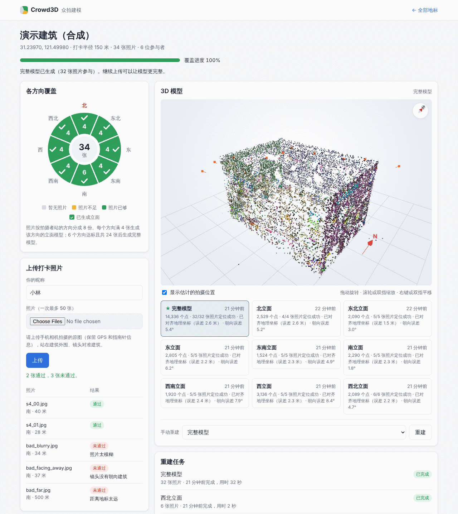
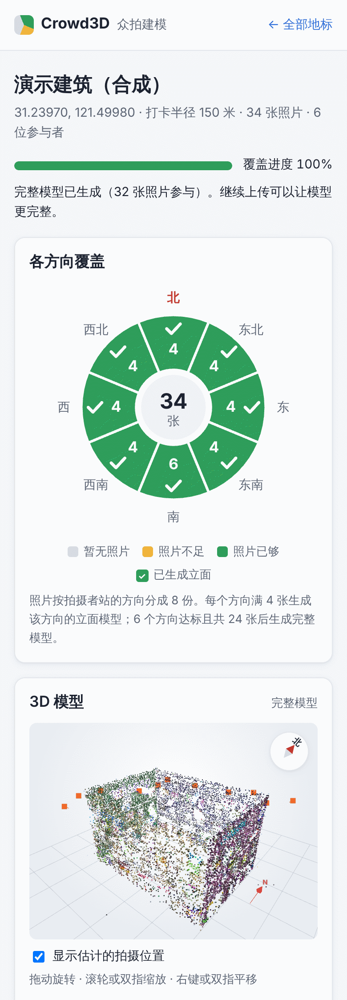
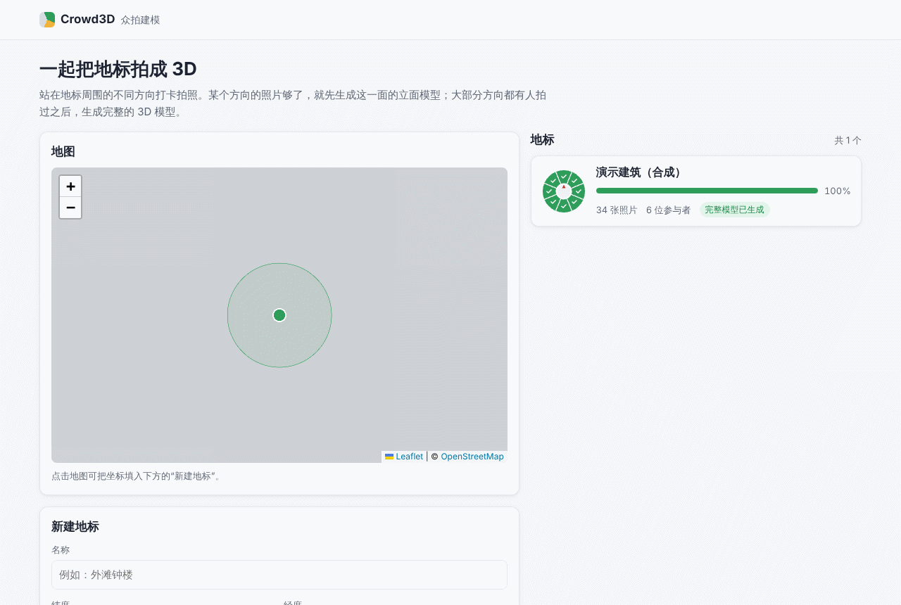

# Crowd3D：众包打卡照片 → 地标三维模型（原型）

不同的用户在著名建筑前打卡，从不同角度上传照片。系统自动判断每张照片是从建筑的哪一侧、朝哪个方向拍的。照片还不够时，先重建能拍到的那一面（**立面模型**）。照片覆盖了大部分方向后，再重建整栋建筑（**全景模型**）。模型以地标中心为原点，单位是米，北向对齐。

在点云之上，原型还能生成一个**风格化的"玩具"模型**（GLB）。它走"结构优先"的路线，参照 Hover 的做法：

- **框架先取自地图。** OpenStreetMap 的 Simple 3D Buildings 分件（`building:part`）变成参数化积木。每块积木带一个屋顶原语（平顶、单坡、双坡、四坡、攒尖、穹顶、洋葱顶……），每个参数都记下来源。
- **照片按规则修改地图上的值。** 证据有三路：天空轮廓线、SfM 点、三维直线。
  - 至少两路一致时自动采用（D15）。
  - 照片量出立面的凹凸（D24）。
  - 证据足够强时纠正 OSM 的高度和倾斜（D25）；每处纠正都可以撤销。
- **颜色只来自照片真正拍到的部分。** 没拍到的地方显示为素模（灰色斜纹）。画风可以整套替换。

这是一个只用 CPU 的最小原型。后端是 Python（FastAPI + SQLite + pycolmap），前端是不需要构建的原生 JS 页面。另带一个能生成"真值"的合成数据生成器，用于测试和演示。

相关文档：
- 完整的技术架构见 [docs/ARCHITECTURE.md](docs/ARCHITECTURE.md)，第 11 节逐个模块对照原型和生产架构。
- 风格化模型见 [docs/STYLIZED_MODEL.md](docs/STYLIZED_MODEL.md)。
- 结构优先的设计、判定规则和实测结果见 [docs/STRUCTURE_FIRST.md](docs/STRUCTURE_FIRST.md)。
- 画风见 [docs/ART_DIRECTION.md](docs/ART_DIRECTION.md)。

> **现状**：上传、校验、重建、发布这条链路已经接进服务和网页。风格化和结构优先目前只能从脚本或代码里调用，还没有接进作业系统，详见"原型的局限"。

## 快速开始

需要 Python ≥ 3.11（开发时用 3.13）。运行 Web 测试还需要 Node ≥ 22（开发时用 v22），可选：测试用到了 `mock.timers` 的 Date 模拟和 `node --test` 的通配符，旧版本跑不了。

```bash
python3 -m venv .venv
. .venv/bin/activate
pip install -r requirements.txt

python -m pytest -q -m "not slow"   # 快速测试，4 核 CPU 上约 10 分钟
python -m pytest -q                 # 加上慢测试（真实 COLMAP、端到端验收、D25 遮挡物场景）
```

启动服务，然后运行演示：

```bash
python -m crowd3d.api --seed-demo   # http://127.0.0.1:8000 ，创建地标 demo-building
python scripts/demo.py              # 另开一个终端
```

`demo.py` 会生成合成照片，然后按一个故事分阶段上传。整个过程在 4 核 CPU 上约 1 分钟：

1. 游客1 在北侧拍了 4 张 → 生成北立面模型；
2. 更多游客拍了东北、东、东南、南 → 每面各生成一个立面模型；
3. 一位游客补齐了剩下几面 → 生成剩下的立面模型和全景模型（32 张照片）；
4. 几张不合格的照片 → 逐张显示拒绝原因。

终端里会打印文字版罗盘、作业状态和模型质量。最后给出查看地址，例如 `http://127.0.0.1:8000/landmark.html?id=demo-building`。在浏览器里可以看到罗盘、共同完成者、作业列表和 three.js 点云查看器。首页 `http://127.0.0.1:8000/` 是地图和地标列表。

常用参数：

- `python -m crowd3d.api`：`--data-dir DIR`（默认 `./data` 或 `$CROWD3D_DATA_DIR`）、`--reconstructor fake`（不跑 COLMAP，秒出假模型，适合调界面）、`--host`、`--port`。
- `python scripts/demo.py`：`--users N`（参与的游客数）、`--size 800x600`（照片越大越慢，默认 640x480）、`--seed 1`（换一组照片；同一组照片重复上传会被判为重复）、`--landmark ID`（新建或使用另一个地标）、`--server URL`、`--photos DIR`。
- 自己生成照片，再从网页手动上传：`python -m crowd3d.synthetic --out /tmp/photos --size 640x480`。照片的 EXIF 带 GPS 和指南针朝向，目录里有 `manifest.json` 记录真值。

> 网页从 CDN 加载 Leaflet、three.js 和 OSM 地图瓦片，所以浏览器需要能访问外网。

生成风格化模型需要两样输入：
- 一个已重建的作业，或者 MegaDepth-X 格式的参考场景（`--scene DIR`）。作业目录默认会被清理。`keep_work_dirs` 没有命令行参数，也没有环境变量，要在代码里用 `Settings(keep_work_dirs=True)` 启动服务。基准（`scripts/benchmark.py`）默认会保留作业目录。
- 地标在 `eval/landmarks.json` 里的条目：坐标和 OSM 轮廓文件。高度标签来自轮廓 GeoJSON。条目里只有 Wikidata 编号，脚本用不到 Wikidata 的高度。

输出必须写到仓库外（或被 git 忽略的 `data/`），因为贴图来自有许可要求的照片：

```bash
python scripts/stylize_model.py --job-dir data/work/<作业> --meta data/models/<地标>/<模型>.json \
    --landmark florence-baptistery --out data/stylized
```

输出包括 GLB、摘要 JSON 和调试图。

查看方法：
- 查看器 `web/stylized.html?model=<GLB 的地址>&theme=<画风>` 只接受同源地址或相对路径。可选画风是 `default`、`storybook`、`dusk`、`blueprint`。
- Crowd3D 服务不提供 GLB 文件（`/files/models` 只给 `.ply`）。
- 可以在仓库根目录起一个静态服务器（例如 `python -m http.server`），再打开 `/web/stylized.html?model=/data/stylized/florence-baptistery.glb`。

**注意：这个脚本只做外轮廓拉伸，不读 OSM 分件，也不做立面凹凸。** 没有分件就算不出三维直线，G-R3 会拒掉所有凹凸元素，D24 也要求分件框架。

要得到结构优先的模型，必须在代码里完成下面几步。仓库里还没有现成的入口：
1. 用 `crowd3d.structure.load_osm_structure(<OSM XML 快照>, <轮廓 GeoJSON>, lat, lon)` 建出地图框架。仓库里只有轮廓 GeoJSON，没有分件的 XML 快照。
2. 用 `crowd3d.judge.judge_landmark` 跑 D15 判定。
3. 用 `crowd3d.correct_measure.correct_landmark` 跑 D25 纠正。
4. 把结果作为 `SceneInput.structure` 传给 `stylize_landmark`。

只有这样，才会有 D25 的 OSM 修正建议文件。

## 截图

以下截图来自真实服务（COLMAP 重建）：先运行 `scripts/demo.py`，再在网页上传 2 张合格照片和 3 张不合格照片。截图环境不能访问外网，所以地图底图是灰色占位。

**地标页（桌面）**：
- 左侧是 8 个方向的覆盖罗盘：数字为照片数，✓ 表示已生成立面模型。下面是上传结果，未通过的照片逐张显示原因。
- 右侧是全景模型的点云，以地标中心为原点、北向对齐。红色 N 箭头和右上角的指南针指向北，橙色点是重建估计出的拍摄位置。



**手机版地标页（单列布局）** 和 **首页（地图、地标卡片、新建地标）**：

<p>
  
  
</p>

## 工作原理

```
上传 ─▶ 读 EXIF ─▶ 校验 ─▶ 入库（扇区）─▶ 覆盖规划 ─▶ 重建作业（COLMAP）─▶ 地理配准 ─▶ 发布质量门 ─▶ PLY + 元数据 ─▶ 网页
                                                                                          │
                                       （目前由脚本调用）OSM 分件框架 + 照片证据 + 风格化 ◀─┘ ─▶ GLB ─▶ 风格化查看器
```

### 点云链路（已接进服务）

1. **读 EXIF**（`exif.py`）：GPS、指南针朝向（`GPSImgDirection`）、焦距、机型、拍摄时间。
2. **校验**（`validation.py`）：所有不通过的原因一起返回，不会遇到第一个就停。拒绝码有：
   - `no_exif`、`no_gps`、`no_landmark`、`too_far`（超出地标半径）
   - `facing_away`（指南针朝向偏离"相机→地标"方向超过 60°）
   - `too_small`（短边 < 480 px）
   - `too_blurry`（拉普拉斯方差，按 800 px 归一化）
   - `duplicate`（dHash 汉明距离 ≤ 4）
   - `unreadable_image`
   - 另外，`ingest.py` 在两种情况下给出 `too_large`，并且只返回这一个码：文件超过 25 MB；或者不是 JPEG、超过 5000 万像素。
   - 警告码不会导致拒绝：`no_heading`（没有指南针，无法检查朝向）、`magnetic_heading`（朝向是磁北，没有做磁偏角修正）。
3. **扇区**（`coverage.py`）：地标四周分成 8 个罗盘扇区（N、NE……NW）。照片归入"地标中心→拍摄者"方位所在的扇区，也就是拍摄者看到的那一面。
4. **覆盖规划**（`coverage.plan_jobs`，纯函数）：
   - 某个扇区有 ≥ 4 张合格照片时，触发**立面作业**，输入是该扇区的照片，加上相邻扇区 10° 以内的照片。
   - 总数 ≥ 24 张、就绪扇区也够时，触发**全景作业**。
     - 默认要 6 个就绪扇区。
     - 照片满 48 张后，没有照片的方向算作拍不到，要求降为 max(⌈0.75A⌉, A−2, 2)，A 是有照片的扇区数。
   - 之后照片继续增长，立面每多 3 张、全景每多 8 张就重建一次。失败的作业也计入，要等再增长够了才会重试。
5. **作业**（`jobs.py`）：单个后台线程按顺序执行（SfM 很吃 CPU）。作业做完后会重新规划一次，所以作业运行期间新到的照片不会被漏掉。服务重启时，未完成的作业会重新排队。但进程已经在同一个作业中途退出过 2 次的，直接记为失败，不再重跑。
6. **重建**（`reconstruct.py`）：
   - pycolmap 提取 SIFT 特征。不超过 60 张时做穷举匹配，更多时按 GPS 做空间匹配。
   - 然后做增量建图，而且不止建一次：不超过 30 张时用 3 个种子各建一次；更多时，只有结果可疑（超过 5% 的相机被标记，或平均罗盘误差超过 20°）才再建一次。最后留下未标记相机最多的模型。
   - 少于 12 张、并且每台相机都有 35 mm 等效焦距时，固定使用 EXIF 焦距。原因是一个近似平面的立面只有几张照片，定不准焦距。
7. **地理配准**（`reconstruct.georegister`，纯 numpy）：
   - 用相机的右向量和相机中心的分布估计重力方向。直接平均"上"向量会因为仰拍偏差约 10°。
   - 用鲁棒的 2D 相似变换把相机中心对齐到 GPS，偏航角再按反方差和指南针融合。没有指南针时，用"伪罗盘"：假设每张照片都朝地标中心拍。
   - 最后按 1.6 m 的拍摄高度确定 z。
   - 输出 ENU 坐标（x=东，y=北，z=上，单位米），以及每张照片估计出的位置和朝向。也就是说，照片的方位由 SfM 自动判断，不只依赖手机的 EXIF。
   - GPS 不够用时，`georegistered` 为 false。不够用的情况包括：内点太少、分布太窄、预计尺度误差太大，或者和罗盘偏航相差超过 40°。这时偏航只靠罗盘或伪罗盘，尺度是粗估的，在真实建筑上常偏大 1.5–2.4 倍。质量门不检查这一项，所以这种模型也可能发布。
   - 配准之后，`camera_flags` 逐台检查相机。离自己的 GPS 超过内点阈值（至少 10 m）、并且和自己的罗盘相差超过 45° 的，标为"双胞胎"，常见于长得像的两个立面。有 2 台以上时，重建会切断它们和其余照片的匹配，再建一次图。
8. **发布质量门**（`qa.py`）：只和产品本来就知道的东西比较（照片的 GPS 和罗盘、地标中心和半径），不需要真值。检查项和门槛：

   | 检查 | 门槛 |
   |---|---|
   | 注册相机 | 至少 3 台；注册率立面 ≥ 60%，全景 ≥ 70% |
   | 点数 | ≥ 300 |
   | 平均重投影误差 | ≤ 2.5 px |
   | 双胞胎相机 | ≤ 10% |
   | 带可疑标记的相机 | ≤ 20% |
   | 各相机罗盘偏差的中位数 | ≤ 25° |
   | 点云水平中位点离地标中心 | ≤ 半径的一半 |
   | 全景模型的覆盖 | 就绪扇区数和全景作业的要求相同，每个扇区至少 2 台未标记的注册相机 |

   没过门时：
   - PLY 和 `.json` 照样写盘，`.json` 里 `published` 为 false；
   - 作业记为失败，并写明原因；
   - 之前发布过的版本继续显示；没有的话，这个目标暂时没有模型。

   过门模型里被标记的相机，其位姿不公开。
9. **输出**：`models/<地标>/<模型>.ply` 是带颜色的点云。同名 `.json` 里有注册数、点数、GPS 残差、朝向误差、每个相机的位姿、是否发布（`published`）、质量门结果和各阶段耗时。

### 风格化模型（结构优先；目前由脚本和代码调用）

风格化的入口有三个：
- `scripts/stylize_model.py`：处理单个模型。
- `scripts/benchmark.py`：把测试集上每个发布的模型都风格化一次。
- 在代码里调用 `crowd3d.stylize.stylize_landmark(SceneInput)`。

**这两个脚本都只走外轮廓拉伸。** 下面第 1–5 步只在代码里传入 `SceneInput.structure` 时才执行，传入的结构要先跑过 `judge.judge_landmark`（D15）和 `correct_measure.correct_landmark`（D25），见"快速开始"。基准也不传点的二维观测，所以不做立面凹凸。

1. **框架**（`structure.py`）。读地标的 OSM 快照，保留落在主轮廓里的 `building:part`。每块变成"底高到檐口的棱柱 + 屋顶原语"。
   - 高度取自 `height`、`building:levels`、`roof:height` 等标签。
   - 标签缺了，就用屋顶形状的约定比例（D17），或者 3 m 的"高度待定"矮台（D13）。
   - 每个参数都记下来源和状态（体块登记表 v2）。Wikidata 的总高永远不用于单个分件。
2. **照片证据**。三路共用同一套位姿：
   - 天空轮廓线（`skyline.py`，基于天空掩码）；
   - SfM 点；
   - 三维直线（`lines3d.py`）。
3. **判定**（`judge.py`，D15）。下面几个条件都满足，才自动采用照片值：
   - 至少两路给出数值，而且所有给出数值的通道两两相差 ≤ max(1 m, 5%)；
   - 方向相同；
   - 没有顶到搜索边界；
   - 共同尺度没确立时，还要通过尺度无关检查；
   - 父件的改动已被接受。

   细高构件，以及坐标工单还没结的时候，一律不自动采用。条件不满足时保留地图值，并开一张工单。
4. **立面凹凸**（`relief.py`）。用照片的点量出壁柱、檐带、凹进的开间等。
   - 有 G-R1…G-R7 七道守卫，例如 G-R7 要求量到的边离杆子、树干这类独立物体 ≥ 0.3 m；还有"合并开间"检查。
   - 有三维直线核对的元素照常建。
   - 只凭点建的元素（三维直线只在偶然水平的，即 D24 元素），要求模型自己的数据能确立共同尺度；不满足时不建这类元素。
5. **强证据纠正 OSM**（`correct.py`、`correct_measure.py`、`tilt.py`，D25）。纠正三类值：
   - 分件高度和屋顶高（D25-H）；
   - 塔的倾斜（D25-T）；
   - "高度待定"矮台和空隙的体块（D25-B）。

   前提是证据级的配准盒子和尺度无关的参照。往上改时，必须读到这块积木自己的屋顶，还要看到它自己的墙升到改后的檐口。盒子太宽时只采用下界。

   每处纠正都带地图原值和全部数字，可以逐条撤销。另外输出一份建议的 OSM 修正报告；OSM 本身不改。
6. **吸附、配准门和上色**（`stylize.py`）。
   - 模型先按窗口搜索吸附到 OSM 轮廓上。
   - 然后过配准门。门本身没有参考位姿，量不了真实误差，它检查的是：
     - 吸附后墙点到轮廓的中位距离 ≤ 1.5 m；
     - 逐边核验：有票的边里 ≥ 60% 的中位距离 < 3 m，通过的边方向至少差 30°；
     - 偏航别名：另一个差不多一样贴合的摆放，如果会把墙上的照片或相机挪动 ≥ 1.5 m，就拒绝；
     - 另外还检查 GPS 深度、相机位移、倾斜和可见性。

     基准事后拿参考位姿判"对/错"：相机 ≤ 1.5 m、三维墙点 ≤ 1.5 m 算对。
   - 过门才给墙上色。只用拍到的像素，量化到固定的调色板；墙上的小洞可以用这面墙的实测颜色补（D12）；没拍到的地方是素模。
   - 不过门时整栋都是素模。判定器从同一批照片得出的结论（D15 采用、照片核验）也全部撤回。D25 的纠正则按配准等级保留，所以素模上也可能带着照片纠正。
7. **诚实检查**。三道检查各管一层：
   - `check_honesty` 查流程本身执行的约束；
   - `audit_model` 用点和相机独立重算覆盖、平面、高度、遮挡、配准、补洞，以及 D24 / D25 的记录；
   - `audit_glb` 只看发布出去的 GLB 字节，核对每个节点的来源、每个照片值的证据和记录、纹素来源图集。

   另外，`structmetrics.py` 统计每个数字来自 OSM、约定、占位值还是照片。
8. **查看**。GLB 每个节点的 extras 都带来源和证据。在 `web/stylized.html` 里点选一块积木，可以看到它的来源卡片，例如"形状：OpenStreetMap 志愿者测绘"或"照片纠正地图（自动）"。
   - 画风文件在 `web/themes/*.json`。
   - 换画风时，查看器按颜色表逐色替换，不用重跑风格化。
   - 画风有校验规则，例如素模色和实拍色要分得开（ΔE00 ≥ 7.5），见 [docs/ART_DIRECTION.md](docs/ART_DIRECTION.md)。

## HTTP API

所有接口都是 JSON。时间是 unix 秒，角度是度，距离是米。字段的完整定义见 `crowd3d/api.py`。

| 方法 | 路径 | 说明 |
|---|---|---|
| GET | `/api/health` | `{"ok": true, "reconstructor": "colmap"}` |
| GET | `/api/landmarks` | `{"landmarks": [LandmarkSummary]}`：进度、扇区状态、最新全景模型 |
| POST | `/api/landmarks` | `{id?, name, lat, lon, radius_m?}` → 201 LandmarkSummary；id 重复返回 409，参数非法返回 422。不给 id 时由名称生成 slug，中文名生成 `lm-xxxxxxxx` |
| GET | `/api/landmarks/{id}` | LandmarkDetail：在 Summary 的基础上加共同完成者、每个类型/扇区的最新模型、最近 20 个作业、最近 200 张照片（含估计的位置和朝向）、阈值；不存在返回 404 |
| POST | `/api/photos` | multipart：`files`（1–50 个）、`user_id`、`landmark_id`（可选，不给时按 GPS 自动匹配地标）→ `{"results": [UploadResult], "triggered_jobs": [JobInfo]}`。照片本身的校验失败放在每个文件的结果里，不作为 HTTP 错误返回。请求本身出错时仍返回 HTTP 错误：`user_id` 非法或文件数不在 1–50 返回 422，`landmark_id` 不存在返回 404，请求体超过上限返回 413 |
| POST | `/api/landmarks/{id}/rebuild` | `{kind: "face"\|"full", sector?}` → 202 JobInfo；照片数没达到最低要求返回 409，kind 或 sector 非法返回 422 |
| GET | `/api/jobs/{job_id}` | JobInfo（status 取值：queued / running / done / failed） |
| GET | `/files/models/<地标>/<模型>.ply` | 点云文件 |
| GET | `/`、`/landmark.html?id=…` | 网页（`web/` 目录） |
| GET | `/stylized.html?model=<GLB 地址>&theme=<画风>` | 风格化查看器（静态页面）。`model` 只接受同源地址或相对路径，跨域地址会被忽略 |

风格化模型和结构框架还没有 API：服务不会生成 GLB，不会返回 GLB 的地址，`/files/models` 也只提供 `.ply`。

## 项目结构

```
crowd3d/
  config.py           Settings：产品阈值（照片数、校验、发布质量门）和数据目录
  params.py           算法内部参数（重建、校验、质量门），可以整套替换，基准用它比较参数组
  geo.py              ENU 局部坐标、方位、距离
  exif.py             读写 EXIF（GPS、指南针、焦距、机型）
  records.py          Landmark / PhotoRecord / Job / ModelRecord
  validation.py       照片校验（拒绝码、警告码、模糊度、dHash）
  coverage.py         扇区、覆盖状态、作业规划（纯函数）
  store.py            SQLite 存储（线程安全）
  jobs.py             JobRunner：后台作业线程
  ingest.py           单个上传：校验 → 入库 → 保存原图和处理图
  reconstruct.py      ColmapReconstructor、地理配准、双胞胎检测、FakeReconstructor
  qa.py               发布质量门
  synthetic.py        光线投射渲染的合成建筑和照片（含 6 类坏照片）
  api.py              FastAPI 应用和命令行入口
  stylize.py          风格化：体块、吸附和配准门、上色、素模、D12 补洞、GLB、诚实检查
  structure.py        OSM building:part → 参数化积木（屋顶原语、来源登记表、无照片的结构检查）
  skyline.py          天空掩码和天空轮廓线证据
  lines3d.py          三维直线证据
  judge.py            D15 判定器：两路一致自动采用、工单、配准被拒时撤回
  relief.py           D24：照片实测的立面凹凸
  correct.py          D25：纠正规则、记录、撤销、发布门、OSM 修正建议
  correct_measure.py  D25 的测量：配准盒子、墙顶、屋顶读数
  tilt.py             D25-T 的倾斜通道
  structmetrics.py    结构指标：多少细节、每个数字来自哪里
web/
  index.html、landmark.html   地图首页、地标页（罗盘、上传、排行、作业、模型、三维点云查看器）
  index.js、landmark.js       两个页面的逻辑
  api.js                      接口调用和错误码的中文文案
  viewer.js、framing.js       three.js 点云查看器和取景
  compass.js                  覆盖罗盘
  status.js、models.js        作业状态和模型排序
  ui.js、style.css            公共组件和样式
  stylized.html、stylized.js  风格化 GLB 查看器（来源卡片、画风切换）
  themes.js、themes/          画风文件和画风校验
  tests/                      node 单元测试
scripts/
  demo.py                     分阶段上传的演示
  stylize_model.py            从一个作业或参考场景生成风格化 GLB
  benchmark.py                在冻结测试集上跑完整产品链路并记录指标（run / compare / report）
  eval_real_landmark.py       单栋建筑的评测：按众包方式上传，和参考答案比较
  fetch_commons_landmark.py   从 Wikimedia Commons 取一栋建筑的测试照片（只要 EXIF 自带 GPS 的）
  materialize_testset.py      按冻结清单把测试集照片取到仓库外，逐张核对 sha256
  export_for_splatting.py     把 COLMAP 模型导出给 3D 高斯泼溅训练工具
eval/
  landmarks.json              地标目录：坐标、OSM 轮廓、Wikidata 事实
  osm/                        OSM 外轮廓快照（GeoJSON，ODbL）
  testsets/                   冻结的测试集清单（只有元数据）
  configs/                    基准的参数组
  results/                    每次运行的数字结果和 LEADERBOARD.md
tests/                pytest；test_e2e.py 是端到端验收（slow），test_web.py 调用 node 测试
docs/                 ARCHITECTURE、STYLIZED_MODEL、STRUCTURE_FIRST、ART_DIRECTION、BENCHMARK、
                      REAL_WORLD_EVAL、VISUAL_LOCALIZATION（视觉定位，只有设计）、PHOTOREAL_LOCAL（本地训练 3DGS）
```

数据目录（`Settings.data_dir`，默认是 `./data`）：

```
photos/<地标>/<照片>.jpg       原图（只保存通过校验的照片）
photos/<地标>/<照片>.proc.jpg  处理图：已按 EXIF 方向转正，长边 ≤ 1600，EXIF 只保留焦距和机型
models/<地标>/<模型>.ply/.json 模型和元数据
work/<作业>/                   COLMAP 工作目录
crowd3d.sqlite3
```

不合格的上传只在数据库里留下记录（原因、位置），不保存图片。文件名一律用 uuid，不使用客户端传来的文件名。

## 配置

产品阈值在 `crowd3d/config.py` 的 `Settings` 里。命令行只开放了数据目录和重建器两项，其余字段在代码里构造 `Settings(...)` 时修改。

其他参数：
- `crowd3d/params.py` 的 `Params`：算法内部参数，例如 GPS 和罗盘的 σ、RANSAC 门槛。
- 基准的 `eval/configs/*.json` 只写要改的字段，没写的保持默认值。可以改的有：重建器、`Params`，以及 `Settings` 的产品阈值（`data_dir`、`reconstructor`、`inline_jobs`、`keep_work_dirs`、`max_job_attempts` 除外）。
- 风格化和结构优先各模块的参数，都在代码里：
  - `crowd3d/stylize.py` 的 `StyleParams`（默认 `DEFAULT_PARAMS`）；
  - `crowd3d/structure.py` 的 `StructureParams`（`DEFAULT_STRUCTURE`）；
  - `crowd3d/relief.py` 的 `ReliefParams`（`DEFAULT_RELIEF`）；
  - `crowd3d/lines3d.py` 的 `LinesParams`（`DEFAULT_LINES`）。

| 字段 | 默认值 | 含义 |
|---|---|---|
| `data_dir` | `$CROWD3D_DATA_DIR` 或 `data` | 数据目录 |
| `num_sectors` | 8 | 扇区数，0 号以正北为中心，顺时针编号 |
| `face_min_photos` | 4 | 一个扇区有多少张合格照片才生成立面模型 |
| `face_rebuild_growth` | 3 | 立面模型每多几张照片重建一次 |
| `face_margin_deg` | 10 | 立面作业额外使用相邻扇区多少度以内的照片 |
| `full_min_photos` / `full_min_sectors` | 24 / 6 | 生成全景模型需要的照片总数和就绪扇区数 |
| `full_reachability_min_photos` | 48 | 照片达到这个数以后，仍然没有照片的方向算作"拍不到"，不再等它 |
| `full_rebuild_growth` | 8 | 全景模型每多几张照片重建一次 |
| `default_radius_m` | 150 | 新建地标的默认打卡半径 |
| `max_heading_offset_deg` | 60 | 指南针朝向偏离地标方向的上限 |
| `min_image_side_px` | 480 | 照片短边的最小像素数 |
| `blur_min_laplacian_var` | 30 | 模糊度阈值（在长边 ≤ 800 px 的灰度图上计算） |
| `duplicate_max_hamming` | 4 | dHash 距离不超过此值即判为重复 |
| `max_upload_bytes` | 25 MB | 单个文件的大小上限 |
| `max_image_pixels` | 5000 万 | PNG / WebP 的像素上限，超过判为 `too_large`（这两种格式按原尺寸解码，太大会占满内存）。JPEG 不受这项限制 |
| `processing_max_side_px` | 1600 | 送入 SfM 的处理图长边上限 |
| `reconstructor` | `$CROWD3D_RECONSTRUCTOR` 或 `colmap` | `colmap` 或 `fake` |
| `camera_height_m` | 1.6 | 假定的拍摄高度（手机的 GPS 高度太不准，不用） |
| `inline_jobs` | False | 在请求内同步执行作业（测试用） |
| `keep_work_dirs` | False | 保留每个作业的 COLMAP 数据库和模型（每张照片约 1.5 MB）；风格化 `--job-dir` 需要 |
| `max_job_attempts` | 2 | 同一个作业最多尝试几次：进程崩溃中断它这么多次后，判为失败，不再重跑 |
| `qa_min_registered_fraction` / `qa_full_min_registered_fraction` | 0.6 / 0.7 | 发布质量门：立面 / 全景模型的最低注册率 |
| `qa_min_points` | 300 | 发布质量门：最少点数 |
| `qa_max_reprojection_error_px` | 2.5 | 发布质量门：平均重投影误差的上限 |
| `qa_max_twin_fraction` | 0.1 | 发布质量门：双胞胎相机（GPS 和罗盘都对不上）的比例上限 |
| `qa_max_flagged_fraction` | 0.2 | 发布质量门：带任何可疑标记的相机比例上限 |
| `qa_max_compass_error_deg` | 25 | 发布质量门：各相机与罗盘偏差的中位数上限 |

## 测试

分四层：合成数据上的自动化测试（每张照片的真实位姿都已知）、真实 COLMAP 的端到端验收、Web 的 node 测试，以及在冻结测试集上跑的基准（含 10 栋著名建筑的真实照片）。

- `python -m pytest -q -m "not slow"`：905 个快速测试，都不需要真实照片。覆盖范围：
  - 点云链路：地理计算、EXIF、校验、规划、存储、作业、上传、API、发布质量门（`qa.py`）、合成数据。
  - 风格化：配准门和诚实检查（`stylize.py`）。
  - 结构优先：OSM 分件和屋顶原语（`test_structure.py`、`test_structure_stylize.py`）、天空轮廓线和 D15 判定（`test_skyline_judge.py`、`test_d15.py`）、三维直线、D24 立面凹凸（`test_relief.py`、`test_d24.py`）、D25 纠正（`test_d25*.py`），以及结构指标。这部分有大量伪造记录和对抗场景的回归测试。
  - 基准和测试集脚本的纯函数（`test_benchmark.py`、`test_eval_real.py`、`test_materialize_testset.py`、`test_fetch_commons.py`）。
  - Web 的 node 测试。
- `python -m pytest -q -m slow`：30 个慢测试，其中 13 个跑真实 COLMAP，17 个是 D25 的遮挡物场景（脚手架网、树冠、顶棚的各种变体）。COLMAP 测试包括单个立面、全景、空间匹配、焦距先验、照片顺序不影响结果，以及 `tests/test_e2e.py`。端到端测试用 640x480 的合成照片，8 面各 4 张，外加 6 张坏照片，通过 HTTP API 上传，按以下门槛验收：
  - 先上传北面，只触发一个立面作业，得到已地理配准的立面模型；
  - 再上传其余照片，全景模型要满足：注册率 ≥ 80%，已地理配准，GPS 残差 < 5 m，朝向误差 < 10°，≥ 80% 的相机离真值 < 5 m，≥ 1000 个点，点云水平中位数离原点 < 6 m；
  - 坏照片逐一被拒，原因与预期一致；
  - 这些门槛只适用于合成数据的小噪声（GPS σ 2 m、罗盘 σ 8°）。
- 最近一次运行：
  - 快速测试：2026-10-28 在提交 acd2069 上 905 个全部通过，用时 616 s（4 核 CPU，同时还有别的任务在跑）。D25 的 17 个慢测试也全部通过。
  - 整个 `python -m pytest -q`（含慢测试）：上一次完整运行是 2026-10-24 在提交 1d6055b 上，当时共 487 个，全部通过，用时 250 s。当前提交上没有重跑 COLMAP 慢测试。
- `node --test 'web/tests/*.test.mjs'`：88 个，87 个通过，1 个跳过。跳过的那个用 Khronos glTF 校验器检查风格化 GLB，要设 `GLTF_VALIDATOR` 和 `STYLIZED_GLB` 才跑。覆盖范围：罗盘、API 封装和中文文案、模型列表、作业轮询、三维取景、风格化查看器（来源卡片、D24 和 D25 的文案）、画风校验，以及用假 DOM 跑的首页和地标页。
- **基准**（`scripts/benchmark.py`，不在 pytest 里，要先把照片取到仓库外）：同一批冻结的照片按真实用户的方式走完整条产品链路，记录发布、配准、风格化和诚实检查的指标，并和参考答案、OSM 轮廓比较。三个测试集：`synthetic-v1`（合成，几分钟）、`mdx-two-v1`（早期两栋建筑的 49 张真实 GPS 照片）、`commons-ten-v1`（10 栋著名建筑的 1,045 张 Wikimedia Commons 照片，每张自己的 EXIF 都带 GPS）。用法、指标含义和噪声基线见 [docs/BENCHMARK.md](docs/BENCHMARK.md)，结果和结论见 [docs/REAL_WORLD_EVAL.md](docs/REAL_WORLD_EVAL.md)，全部运行的汇总见 [eval/results/LEADERBOARD.md](eval/results/LEADERBOARD.md)。
  - 当前结果只有核心五栋：洗礼堂、亚琛、勃兰登堡门、比萨斜塔、圣母教堂；另外五栋还没跑。
    - 修复前，风格化配准门放过了 51 个模型里的 31 个（0.608），可核对的 28 个里有 19 个其实放错了。
    - 修复后 0 个过门：没有错放，但真实照片一面墙都不上色。
  - 基准的风格化步骤还不读 OSM 分件，所以排行榜上没有结构优先的指标。结构优先的结果（洗礼堂、亚琛、比萨）记在 [docs/STRUCTURE_FIRST.md](docs/STRUCTURE_FIRST.md)。
  - 大约每 7 张 Commons 照片只有 1 张带 GPS（各建筑中位数 15.3%）；带 GPS 的照片里约 2/5 还带罗盘。
  - 照片各有许可，只有元数据（标题、作者、许可、坐标、哈希、数字结果）进仓库；照片、点云、GLB 和截图都不进仓库。

## 原型的局限

- **真实照片只测了五栋建筑。** `commons-ten-v1` 有 10 栋，但只跑了核心五栋，每栋最多 2 次，照片多的建筑还撞到了每栋 1 小时的上限。发布质量门和风格化配准门的阈值是在这几栋建筑上定的，属于样本内结果。见 [docs/REAL_WORLD_EVAL.md](docs/REAL_WORLD_EVAL.md)。
- **真实照片的风格化模型目前全是素模。** 配准门要求相机位置误差 ≤ 1.5 m；拍摄者离墙 40–90 m 时，只靠 OSM 轮廓和手机 GPS 证明不了这么准，所以五栋真实建筑一面墙都不上色。要恢复上色，需要不靠轮廓的偏航和尺度来源（[docs/VISUAL_LOCALIZATION.md](docs/VISUAL_LOCALIZATION.md) 的视觉定位，只有设计），或者产品决定放宽标准。
- **"0 个错误通过"只对已记录的运行成立。** 验证还发现三个问题，都还没修（任务 #73）：
  - 配准报出的偏航不确定度很大或缺失时，门会接受转错 44–180° 的对称别名解。对抗用例可以复现，真实模型没碰到。
  - 有几处决定上色的检查没有回归测试。
  - `scripts/stylize_model.py --snap-from` 复用旧吸附时，跳过了新加的检查。

  D25 也依赖这一点：近圆形的轮廓（洗礼堂有 23 个对称别名）上，纠正要在所有别名转角下都成立才采用。
- **框架几乎全部来自 OSM，照片的贡献很小。** 结构优先让模型认得出来了，例如亚琛的分件、穹顶和尖顶，但形状主要是 OSM 志愿者画的。照片的贡献：
  - 洗礼堂：打开 D24 以后，85 个数字里有 36 个来自照片，大多是立面凹凸。
  - 亚琛：D24 的尺度条件不满足，没有打开；D25 只纠正了一处，唱诗堂顶高"至少 36.26 m"（OSM 写 32 m），照片数字从 0% 升到 0.21%。
  - 比萨：D25-T 只在参考模型上通过，量出倾斜 4.59°，朝 177.0°（公开值约 3.97°）。已发布的众包模型都不带倾斜：它们只拍到塔的一面，点云轴不够准。
  - 洗礼堂上 D25 没有改任何值。
  - 以上数字都来自参考场景（全部照片、已知位姿）。众包等级上的 D25-H 和 D25-B 仍然关闭，核心五栋的众包发布模型上，D25 一处都没改。

  OSM 没画分件的建筑，只能把外轮廓拉伸成体块；标签缺了的地方，用约定比例或 3 m 的"高度待定"矮台代替。只在 Wikidata 有条目、地图上没有轮廓的地标还不支持。
- **结构优先还没有接进产品。**
  - `scripts/stylize_model.py` 和基准都还不传 OSM 分件（`SceneInput.structure`），走的仍是外轮廓拉伸：屋顶是平的，斜塔不斜，勃兰登堡门是实心盒子，也不做立面凹凸。配准门没过时，有 OSM 高度就按 OSM，没有就用 15 m 的默认高度。
  - 结构优先的参考运行用的是仓库外的脚本；仓库里没有调用 `judge_landmark` 和 `correct_landmark` 的入口，分件的 OSM XML 快照也不在仓库里。
  - 作业系统和 API 都不生成风格化模型。
- **D25 还没有通过最后一轮独立核查。** 第三轮核查（2026-10-25）发现 5 个问题。第四轮修了其中 4 个，第四轮独立核查正在进行：
  - 已修：
    - D25-B 现在要读到体块自己的屋顶：轮廓内 ≥ 2 m 的格子里要有屋面点。合成场景里脚手架网的各种变体都被拒绝，真的体块照常建。
    - U2 在地图檐口以上只认留在墙面上的点，所以树冠和顶棚被拒绝。
    - U2 去掉了被更高分件挡住的格子，不会再把邻楼的墙当成自己的墙。
    - 分件 G5 记录有天空轮廓线证据时，不能再空着过发布门。
  - 没改：D15 本身会把离墙 1 m 以内的脚手架网顶当成檐口采用。合成测试里，地图写对了的 10 m 附楼被改成 12.09 m。要改 D15，等产品负责人决定。
  - 几何上分不开：贴着墙面的平整围护（网或围挡，带不带临时顶棚都一样）。只有可商用的脚手架语义掩码才能拦住它，目前还没有这样的模型。
  - U2 的参数只在两座参考建筑和合成场景上核过。亚琛唱诗堂下界的余量只剩 0.20 m。只从地面拍到、看不见屋顶的"高度待定"矮台，D25-B 建不出体块。
  - 前几轮的其他未决问题见 [docs/STRUCTURE_FIRST.md](docs/STRUCTURE_FIRST.md) §2.4.8 第十四到十七部分。
- **D24 的审计还有缺口**（任务 #85），例如伪造檐带记录。
- **全景模型在真实建筑上一次都没发布过**，每栋却要花 15–24 分钟反复尝试。游客只拍"好看的那一面"，很多方向几乎没有照片。
- **采集端**：
  - 只收相机原图：没有 EXIF 判 `no_exif`，EXIF 里没有 GPS 判 `no_gps`。截图、修图软件或聊天软件转存的副本，通常两样都没有。
  - 手机浏览器从相册选图时，可能会去掉 GPS，Android 上很常见。Commons 上也只有约 1/7 的照片带 GPS。
  - 不支持 HEIC，因为没有安装 HEIF 插件。
  - 磁北朝向只给出警告，没有做磁偏角修正。
- **几何**：
  - 重力方向的估计假设手机竖直拿、地面大致水平，单个立面可能残留几度的倾斜。勃兰登堡门的模型相对参考的中位倾斜是 3.4°，原因没查清。
  - 无法地理配准时，回退方案的尺度比较粗略。
  - 重建只输出稀疏点云，没有稠密重建和 3DGS。[docs/PHOTOREAL_LOCAL.md](docs/PHOTOREAL_LOCAL.md) 说明怎样导出数据，在本地用 GPU 训练 3DGS。
- **重建**：只用 CPU，单线程串行。一栋 100–150 张照片的建筑在 4 核 CPU 上要 45–50 分钟。每次重建都从零开始，没有复用特征和匹配，也没有增量注册。
- **服务**：单机 SQLite 加本地文件，一个数据目录只能由一个服务进程使用。没有账号、鉴权、限流和内容审核，`user_id` 只是一个表单字段。单次请求最多 50 × 25 MB，超出时在写盘前返回 413。照片的估计位姿（已过质检、未被标记的）和模型点云对所有人公开。进程崩溃中断的作业最多重跑 1 次，同一个作业被中断 2 次（`max_job_attempts`）后判为失败。`work/` 目录在作业结束后自动清理（`keep_work_dirs` 可保留）。
- **基准**：`scripts/benchmark.py` 的默认数据目录写死成开发机上的一个临时目录，在别的机器上要设 `CROWD3D_TESTSET_ROOT`、`CROWD3D_BENCH_DIR` 或每次传参数；新重建器要改代码注册；风格化的参数还不能通过配置调。
- **网页**：依赖 CDN 和 OSM 公共瓦片。立面模型的相机叠加只画本扇区的照片。

## 下一步

1. **完成 D25**：第四轮独立核查结束后，修掉它发现的问题。另外请产品负责人决定"D15 往上采用是否也要求读到屋顶"。
2. **照片位姿图层**（正在开发，分支还没合并）：在三维模型上画出每张照片的拍摄位置和朝向，支持"从这张照片的位置看"。
   - 测试集上的通过率：SfM 模型约 20–68%，只有 EXIF 的建筑 5–32%。无法定方位的照片算失败，主要原因是约 61% 的照片没有罗盘。
   - 合并前要先定隐私规则：别人的照片位置取整到 10 m，朝向取整到 10°，并且不返回用户 ID。
3. **引导拍摄**（方向 B）：采集端改为页面内拍摄，同时记录 GPS 精度、指南针和重力方向（DeviceOrientation），提示"还缺哪几面、哪几块积木还没被拍到"。
   - 这样可以绕开相册丢失 GPS 的问题，提高重力和朝向的先验。
   - 照片能给框架提供的证据也会更多。
4. **视觉定位**（[docs/VISUAL_LOCALIZATION.md](docs/VISUAL_LOCALIZATION.md)，只有设计）：让没有 GPS 的照片加入模型，同时提供不依赖轮廓的偏航和尺度。这是真实照片恢复上色的前提。
5. **把结构优先接进产品**：
   - `scripts/stylize_model.py` 和基准读 OSM 分件；
   - 作业系统在发布点云后自动生成风格化模型；
   - API 返回 GLB 的地址；
   - 补上剩下的配准门问题（#73）和 D24 审计缺口（#85）。
6. **跑完 `commons-ten-v1` 的另外五栋**，并用真实建筑做一次小规模实地采集，按 ARCHITECTURE.md 的质量指标重新校准阈值，包括 GPS σ、模糊度和重复判定。
7. **重建升级**：
   - 每个地标持久保存一个特征和匹配数据库，支持增量注册；
   - 使用 GPU 特征和匹配（如 ALIKED + LightGlue）；
   - 做稠密重建或 3D Gaussian Splatting 用于展示；
   - 在现有的发布质量门之上，加上"新版本模型不比旧版本差"的比较。
8. **平台**：改用 Postgres + 对象存储，加作业队列和多个 worker，加账号、限流、人脸和车牌打码、隐私收紧，以及反作弊。

各阶段的路线图见 [docs/ARCHITECTURE.md](docs/ARCHITECTURE.md) 第 10 节。
