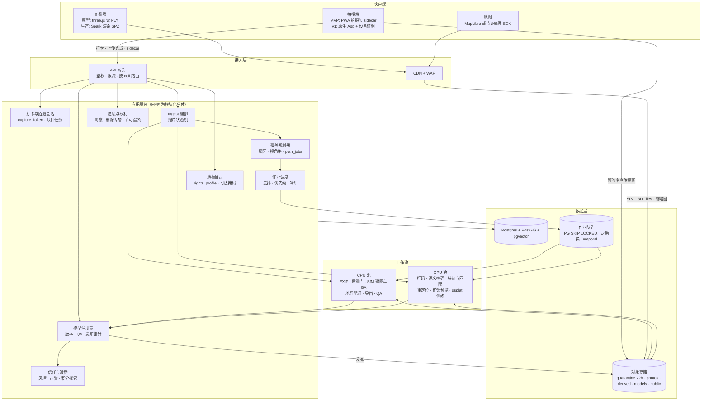
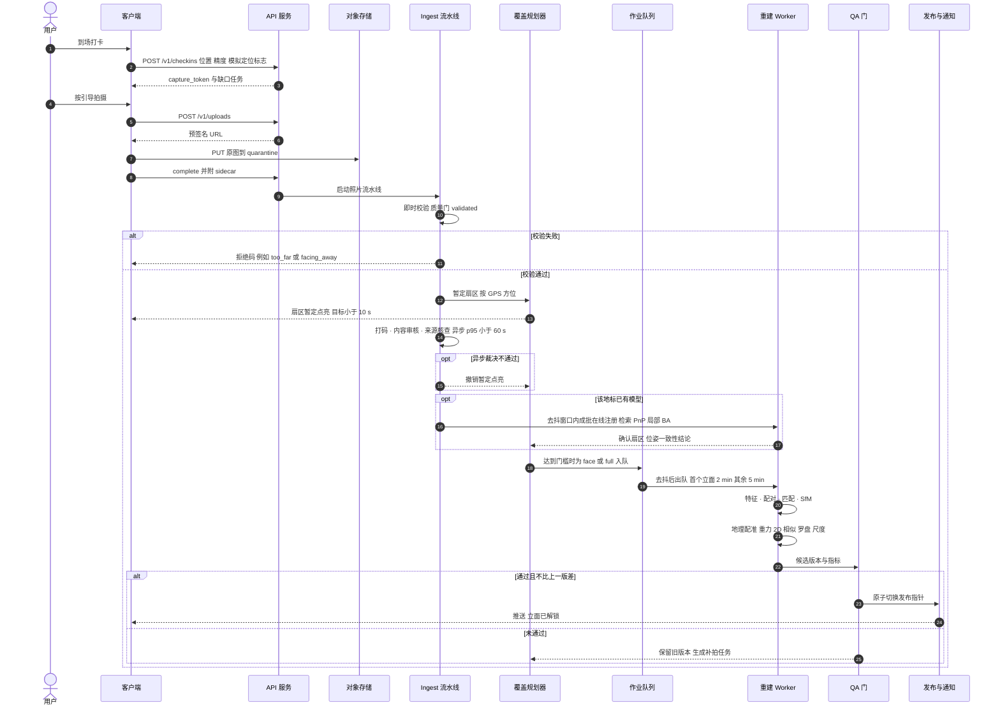
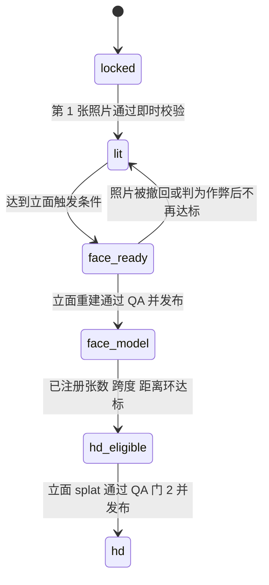

# Crowd3D 众筹地标 3D：技术架构

> 版本：2026-10-21。本文合并了三份架构草案（产品视角、重建与机器学习视角、平台信任与合规视角），起点是本仓库正在实现的 CPU 原型。原型的契约见 `PROTOTYPE_SPEC.md`，下文称"原型"或 M0。本文给出从原型到生产的完整路径。
>
> **标注约定**
> - **【实测】**：在本仓库容器里（pycolmap 4.2.1）实际跑过。
> - **【仿真】**：草案作者用 numpy 蒙特卡洛（300–500 次）得到的结果，本文没有重跑。
> - **【估算】**：工程估计，上线前要做基准测试。
> - **【待核实】**：来源之间有冲突，或者查不到一手来源。
> - 法规部分是工程角度的整理，**不构成法律意见**，上线前要请当地律师确认。
> - 所有阈值都是参数。原型里，产品阈值在 `crowd3d/config.py` 的 `Settings`；算法常量在 `crowd3d/reconstruct.py` 和 `crowd3d/validation.py` 的模块常量里（对照表见 §11.1）。文中给的是初始值，并写明怎么校准。
> - 三份草案有分歧的地方，正文里就地裁决（标"**裁决**"），汇总见附录 A。"草案 1/2/3"指合并前的三份内部草案，读者不需要看原文：每条裁决先给结论，再给理由。
> - 英文缩写和术语（p95、fail-closed、PITR、SKIP LOCKED、Chamfer 等）的白话解释见附录 B。

---

## 0. 一句话概述与核心体验

**一句话**：一起拍，一起建。很多人在同一座地标周围各拍几张照片，系统把这些照片汇总起来，先一面一面地"点亮"建筑立面，照片够了再合成整栋楼的 3D 模型。模型带真实尺寸、朝向正北。参与的人都记为共同完成者，地标收进个人图鉴。

**打个比方**：这像是众筹拼一幅巨型拼图。每个人带来几块拼图（不同角度的照片）。系统先把能拼上的那面墙拼出来给大家看；缺哪块，就提示附近的人"去西北角站着拍一张"；拼图凑够了，整栋楼就立起来了。

### 0.1 核心循环与体验目标

| 步骤 | 用户看到的 | 时间目标 |
|---|---|---|
| 发现 | 地图上每个地标带一个 8 格迷你罗盘（显示各面进度）和"缺口任务"图标 | 首屏 p95 < 1.5 s |
| 到场打卡 | "你在 XX 的东南侧，这面还缺 3 张" | — |
| 引导拍摄 | 取景框叠加罗盘：已拍过的视角变暗，缺口高亮，提示"向右走约 5 m 再拍"（MVP 默认调起原生相机，引导改在打开相机前显示，§3.2） | 端上即时 |
| 上传 | 每张照片当场显示通过或拒绝，附中文原因 | 单张校验 p95 < 3 s |
| 点亮 | 罗盘上对应扇区从灰变琥珀色（浅色，表示"暂定"） | 照片通过即时校验（validated，§2.1）后 p95 < 10 s 暂定点亮 |
| 解锁立面 | 推送"东南立面已生成" | 达到条件后 p50 < 10 min |
| 完整模型 | 图鉴卡片升级，显示共同完成者名单，生成分享卡 | 达到条件后 p50 < 2 h |

体验好坏主要看两个延迟：**扇区点亮不超过 10 s**，**首个立面模型 p50 不超过 10 min**。

### 0.2 与已有产品的差别

- **Microsoft Photosynth**（2008–2017）能把多人的照片拼在一起，但没有进度，也没有玩法。
- **Scaniverse** 是单人扫描。2025 年 2 月报道时，它的全球 splat 地图已有 5 万多个地点（[Voices of VR](https://voicesofvr.com/?p=14813)），但不合并多人的数据。
- **Niantic VPS** 用 Pokémon GO 玩家的 AR 扫描（约 300 亿份）训练定位服务。玩家看不到成果，还引发了数据用途争议（见 §7.6）。
- **Snapchat Local Lenses、Mapillary/OpenSfM、Rekrei** 分别做了城市 AR、街景众包和文物众包重建。
- **Hover**（房屋测量 App）证明了这条路在消费级手机上走得通：引导拍摄，用手机 GPS 和罗盘做先验，跑 SfM，再用已知的门窗尺寸定尺度。
- **空白**：还没有产品把很多用户的照片合并成同一个模型，同时把"进度"做成玩法。本产品的差异点就是**多人合并、进度可见、可以收藏**。

### 0.3 关键技术决定（摘要）

1. **覆盖分两层**。用户看到的是 8 个罗盘扇区（沿用原型）。系统内部按"方位 15° × 距离 3 环"划分视角格来计数，所以在同一位置连拍刷不出进度。
2. **照片不够也有东西看**。1 张出 2.5D 浮雕，4 张出立面点云，再往上依次是立面卡片、立面 splat、完整模型。还没覆盖的面，用 OSM 建筑轮廓拉伸出的灰色体块打底。
3. **完整模型的条件按"可达扇区"算**：`K = max(⌈0.75A⌉, A−2)`，A 是能拍到的扇区数。A=8 时 K=6，和原型一致；沿街只能拍到 2–4 面的建筑也能完成。
4. **几何主干用 COLMAP 4.2（BSD 许可）**。前馈 3D 基础模型（VGGT、MapAnything 等）只做三件事：稀疏场景兜底、提供初始化、出即时预览。
5. **定方位的流程**：EXIF 和传感器给先验，SfM 给相对位姿，视觉估计重力方向，再做 2D 相似变换，最后融合罗盘、尺度和 OSM 轮廓。不用 3-D Sim3，因为相机分布在一小段弧上时，它会把模型算歪几十度。
6. **增量更新**。新照片先在线注册进现有模型，分钟级完成；照片数涨到上一版的 1.5 倍才全量重建。仅这一条就能让每个成熟地标的 GPU 成本降到约 1/5。
7. **写实层用 gsplat（Apache-2.0）**，加上每张图的外观嵌入和瞬态掩码，用来处理游客照片里的光照差异和路人。
8. **许可证决定选型**。生产路径只用可商用的代码和权重。效果最强的前馈模型权重里，很多是非商用许可（§4.2）。
9. **奖励只给"在场且有用"的照片**。照片要能注册进模型，位姿要和 GPS、罗盘一致；积分先托管，满足条件后再发放。
10. **隐私和合规先行**。未打码的原图 72 h 内删除；公开的模型不带相机位姿。中国大陆作为独立的区域单元（cell），由境内主体运营；在那之前，全球版不收中国大陆的地标。

---

## 1. 总体架构图



各层职责：

- **客户端**负责引导拍摄，并附带一份传感器 sidecar（GPS 精度、罗盘、俯仰、IMU 重力、时间戳），原图直传对象存储，不经过 API 服务器。查看器只从 CDN 读取已发布的文件。
- **接入层**负责鉴权和限流，并按用户所在区域把请求路由到对应的 cell。鉴权分阶段：M0.5 和 MVP-a 用服务端签发的会话令牌（MVP-a 另加邀请码），MVP-b 起用 OIDC（§5.2）。
- **应用服务**在 MVP 阶段是一个"模块化单体"：一个进程，内部分模块，模块之间只通过函数接口和事件表（outbox）通信。到 v1 再按负载拆开。原型里 `coverage.plan_jobs` 这种纯函数直接保留，作为覆盖规划器的核心。
- **工作池**分 CPU 和 GPU 两个池。SfM 建图和光束法平差（BA）主要吃 CPU；打码、特征提取、3DGS 训练吃 GPU。两个池分开扩缩，避免 GPU 闲着等 CPU。
- **数据层**：Postgres 存元数据、位姿（加密列）、同意记录和审计日志；对象存储按敏感度分桶（§5.6）；队列先直接用 Postgres，不额外引入组件。
- **区域单元（cell）**：CN、EU、US 各有一套独立的数据平面，跨 cell 只流转已发布的公开模型。打个比方，就像连锁店各有各的仓库，只有成品可以跨店调货。

---

## 2. 数据流与时序

从上传到发布的主流程：上传 → 校验 → 分扇区 → 触发 → 重建 → 地理配准 → 发布。



图中只画了一张照片触发重建的情形。实际上入队是"达到门槛"时才发生的，多数照片只走到在线注册为止。

### 2.1 照片状态机

每一步都是幂等的，状态变化只追加写入 `photo_events` 表。

```
received → quarantined → validated → anonymized → moderated → provenance_checked
        → accepted | held(人工) | rejected(原因码)
validated → anonymize_failed → anonymized（重试成功）
                             → expired_unprocessed → rejected(privacy_timeout)
accepted → registered(model_version) → credited
registered → rejected(off_topic)（异步相关性裁决不通过，§3.2）
任一状态 → withdrawn（用户撤回或注销，触发 §7.5 的删除传播）
```

`photos.status` 的取值就是上图的状态名：`received`、`quarantined`、`validated`、`anonymize_failed`、`expired_unprocessed`、`anonymized`、`moderated`、`provenance_checked`、`accepted`、`held`、`rejected`、`registered`、`credited`、`withdrawn`。

| 阶段 | 做什么 | 资源 | 目标耗时 |
|---|---|---|---|
| validated | 原型 `validate_photo` 的全部检查（EXIF、GPS、半径、朝向、分辨率、模糊、dHash），生产再加 §3.2 的新增项 | CPU | < 2 s |
| anonymized | 人脸和车牌打码，同时输出人物和车辆掩码（供 SfM 和 3DGS 使用）。打码图写入 `photos/` 后，流水线**立即主动删除** quarantine 里的原图 | GPU | < 1 s |
| anonymize_failed | 打码服务故障或 fail-closed（§5.9）时停在这里，按退避重试；原图仍在 quarantine，计时不停 | — | — |
| expired_unprocessed | 原图到了删除期限（见下）仍未打码成功，原图被删；照片转为 `rejected(privacy_timeout)`，通知用户重拍，**不扣信誉、不记违规** | — | — |
| moderated | NSFW、暴力、OCR 文本、截图检测；冷启动时的建筑像素占比 | GPU/CPU | < 1 s |
| provenance_checked | 互联网图片索引比对、C2PA、EXIF 取证、设备证明、模拟定位标志 | CPU | < 5 s |
| registered | 进入在线注册或重建后做视觉重定位和位姿一致性检查（§6.2）；有模型时的相关性裁决（`off_topic`）也在这之后异步做 | GPU | 随批次 |

敏感区域地理围栏不在这个流水线里判：它前移到签发上传地址之前（§6.5 第 3 条）。

**原图删除的计时**：72 h 从对象**写入 quarantine 的时刻**开始算，与打不打码无关。三道保障：
1. 打码成功后流水线立即删除原图（正常路径，通常几秒内）。
2. 每小时一次的清理任务，删除写入时间超过 70 h 的对象，并把对应照片转为 `expired_unprocessed`。这是 72 h 承诺的主要保证。
3. 对象存储的生命周期规则设为 2 天，只作兜底。生命周期规则不能单独保证 72 h：S3 会把到期时间取整到下一个 UTC 午夜，而且删除是异步的，可能延迟。

§5.8 的 P1 告警"quarantine 里有对象超过 72 h"按写入时间算，有了第 2 条，它报出来的就是真故障。

**裁决（同步还是异步）**：草案 1 要求"照片被接受后 10 s 内点亮扇区"，草案 3 主张"先收后判，裁决异步，p95 < 60 s"。两者不冲突：**扇区点亮只依赖 validated 这一步（同步，几秒）**，点亮状态标为"暂定"；后面的打码、审核、来源核查和在线注册异步完成，结论出来后再改为"确认"或撤销。用户马上能看到反馈，风控也不打折扣。注意 `accepted` 是异步裁决之后的状态，所以全文的"点亮"指标都从 validated 起算，不从 accepted 起算。

### 2.2 重建作业的步骤与缓存

```
plan → snapshot(inputs_hash) → features(GPU，按照片缓存) → pairs → match(GPU，按图对缓存)
→ pose(COLMAP 增量或全局；可选前馈预览) → georegister → QA 门 1
→ train(gsplat，按需) → QA 门 2 → export(PLY 主文件、SPZ、3D Tiles)
→ 权利与合规门 → publish(原子切换指针) → credits
```

| 阶段 | 缓存键（保证幂等） | 算力 | 主要产物 |
|---|---|---|---|
| 摄入 | sha256(原图) | CPU | PhotoRecord、拒绝原因 |
| 特征 | (photo_sha, extractor@version, max_side) | GPU-S；原型用 CPU SIFT | 关键点、描述子、全局向量、掩码 |
| 匹配 | (图对, matcher@version) | GPU-S | 两视图几何和内点数 |
| 建图 | (landmark, kind, sector, image_set_hash) | CPU 建图机或 GPU-L | 稀疏模型 |
| 配准 | 同上，加先验版本 | CPU | `T_sfm→enu = (s, R, t)` 和各来源诊断 |
| 3DGS | (稀疏模型版本, 训练配置) | GPU-L | `.spz` 和外观嵌入 |

数据层最重要的一项升级是：**每个地标持久保存一个 COLMAP database**（`landmarks/<id>/colmap.db`），作为特征和匹配的缓存。作业的工作目录只放重建输出。这样增量注册和重建都不用重复提特征、重复匹配。原型每个作业仍有自己的数据库（`work/<job_id>/database.db`），但已有地标级的特征和匹配缓存（`crowd3d/landmark_map.py`，`data/maps/<id>/cache.sqlite3`，`Params.feature_cache`，默认开）：作业开始前把缓存里这些照片的特征、这些图像对的匹配和两视图几何原样写进自己的数据库，COLMAP 只算新的，算完再把新的写回缓存。键是处理图的 sha256 加特征版本（pycolmap 版本和提取参数），图像对另加两台 COLMAP 相机的签名和匹配版本；数据库的内容和不用缓存时逐字节相同（[BENCHMARK.md](BENCHMARK.md) 6.7）。发布的模型另把稀疏模型和 `map.json`（地理锚 GeoAnchor、输入版本）存到 `data/maps/<id>/models/<model_id>/`，每个目标留最新两个，供续建和风格化用。建图默认仍然每次从零开始；打开 `Params.map_continue`（持久地图第 1b 步，默认关）后，作业从它的目标当前显示的模型的已存地图续建：把那个模型换成本作业数据库里的图像、相机 id，pycolmap 增量建图从它继续，只注册新照片（旧相机也参与光束法平差），地理配准和逐相机检查照旧；保住底模 95% 已注册照片、不可疑、看错立面的相机少于 2 台才接受，否则照常从零建图。照片数到上次从零重建的 1.5 倍、连续续建 4 次、或续建的模型没过质量门（重跑一次从零）时从零重建。每个模型的 `meta.map` 记模式（scratch、continued、continued->scratch）、原因、底模和相对它的移动（共同相机位置中位数和朝向变化中位数；§3.6 的 2 m / 3° 只用来复核）。续建在 dev 上的验证没通过（[BENCHMARK.md](BENCHMARK.md) 6.8：小照片集的续建版本质量变差、版本连续性 56%、净省 CPU 为零），所以默认仍关。

**并发与一致性**：`colmap.db` 是 SQLite 文件，不能由多个进程同时写，也不能直接在对象存储上打开。规则如下：

- **单写者租约**：每个地标一把租约，用按 `landmark_id` 取的 Postgres advisory lock，或 `landmarks` 表上的租约列（持有者、到期时间，worker 定期续约）。在线注册和离线重建都要先拿到租约，所以同一地标上两者串行执行；重建期间到来的新照片排进下一个在线批次。
- **拉取与回传**：持有租约的 worker 把当前版本拉到本地盘，在本地读写；写完先跑 `PRAGMA integrity_check`，再按内容寻址回传（`derived/<landmark>/colmap/<sha256>.db`），最后原子更新指针 `landmarks.colmap_db_key` 和版本号 `colmap_db_version`。
- **损坏恢复**：校验失败或指针丢失时回退到上一份快照；最坏情况下从 `photos/` 的处理图重新提特征，因为这些数据本来就可以重算。

---

## 3. 关键算法

### 3.1 扇区划分

**公式**（原型 `coverage.sector_for_bearing`）：

```
β = 从地标中心指向相机的方位角（ENU 平面，正北 0°，顺时针）
    原型用 geo.local_bearing_distance 计算，和 ENU 坐标一致
W = 360° / N                      # N = 8 时 W = 45°
s = floor(((β + W/2) mod 360) / W)
```

扇区 0 以正北为中心，顺时针依次是 N、NE、E、SE、S、SW、W、NW。照片落在哪个扇区，就等于拍摄者站在建筑的哪一侧，也就是他看到的是哪个立面。

**暂定扇区与确认扇区**：上传时只能用 GPS 算 β，所以先记为"暂定"，用于即时点亮。照片注册进 SfM 模型以后，用估计出的 ENU 位置重算一次，记为"确认"。UI 上的进度可以分两层显示：浅色表示暂定，实色表示确认。

为什么需要确认这一步：GPS 误差会把扇区边界附近的照片分错。用 GPS 算出的方位误差约为 `σ_b ≈ σ_gps / d`（d 是相机到中心的距离，单位弧度）。照片在宽度为 W 的扇区内均匀分布时，

```
P(分错扇区) ≈ 2σ_b / (W·√(2π)) ≈ 0.8 · σ_b / W
```

| GPS 误差 σ | 距中心 d | σ_b | 分错概率 |
|---|---|---|---|
| 5 m（GPS） | 30 m | 9.5° | ≈ 17% |
| 5 m（GPS） | 80 m | 3.6° | ≈ 6% |
| 约 1 m（SfM 注册后） | 30 m | 1.9° | ≈ 3% |

（草案 2 写的是"SfM 后 P < 2%"。按同一公式，d = 30 m 时约 3%，d 超过约 50 m 才降到 2% 以下，这里按公式改正。）边界两侧 ±10° 内的照片本来就会同时用于相邻两个立面（原型的 `face_margin_deg = 10`），所以分错的代价不大，影响的主要是进度显示。

#### 视角格（内部计数层）

扇区是给用户看的。系统内部再细分一层：

- **方位档**：每 15° 一档，共 24 档。档的起点与扇区边界对齐（从 −W/2 = −22.5° 开始切），这样每个扇区正好 3 档：

  ```
  az_index = floor(((β + W/2) mod 360) / 15)          # 0..23
  扇区 s ↔ az_index ∈ {3s, 3s+1, 3s+2}
  档的中心角 = (15·az_index + 7.5 − W/2) mod 360        # 例：az_index 1 的中心是 0°（正北）
  ```

  API（`cells[{az, ring, ...}]`）里的 `az` 就是 `az_index`，同时返回档的中心角。档宽必须能整除扇区宽 W；N = 8 时 W = 45°，15° 满足。
- **距离环**：按地标半径 R 的比例切 3 环，不用固定米数，否则小地标（R 可能只有 50–60 m）的外环是空的，大地标的环又太粗：近环 `[0, 0.3R)`，中环 `[0.3R, 0.7R)`，**远环** `[0.7R, R]`。R = 150 m 时边界是 45 m 和 105 m，接近早先草案用的固定值 40 m 和 100 m。比例写进 `Settings.cell_ring_fracs = (0.3, 0.7)`。
- **术语**：全文"远环"只指第 3 环。R 以外、1.5 km 以内、朝向对准地标的照片叫"**天际线照片**"（§3.2）：它们参与特征匹配、注册和配对豁免（§3.3.5），但**不参与**扇区计数、视角格和 c_eff。
- **计数口径**：每个格的有效张数先按"用户 × 拍摄会话"封顶，再按整格封顶：

  ```
  n_eff(cell) = min( Σ_{用户 u, 会话 k} min(n_{u,k,cell}, 3),  C_cell )      # C_cell = 6
  c_eff(s)    = Σ_{cell ∈ s} n_eff(cell)
  ```

  参数写进 `Settings`：`cell_cap_per_session = 3`、`cell_cap = 6`。一个人站在原地连拍最多算 3 张；多人在同一格拍，最多算 6 张。每个扇区的 c_eff 上限是 3 档 × 3 环 × 6 = 54，奖励自然落到新视角上。
- **用哪个位置算格**：和扇区一样分两套。`coverage_cells` 只存**确认**口径（照片注册后用 SfM 估计的 ENU 位置算）；**暂定**口径（用 GPS 算）不落表，由覆盖规划器从 `photos` 实时计算，用于即时点亮和触发判断。

#### 可达掩码

设 `a_s ∈ {0,1}` 表示扇区 s 能不能拍到（例如紧贴别的建筑、对着河面的那一侧就拍不到），`A = Σ a_s`。

- MVP：由运营人工填写。
- v2：用 OSM 建筑轮廓加步行路网自动推断。若某扇区方向、半径 R 范围内的可步行区域面积为 0，则 `a_s = 0`，再由人工复核。

#### 扇区状态

| 状态 | 条件（初始值） | 显示 | 与原型的对应 |
|---|---|---|---|
| locked | c = 0 | 灰色 | 相同 |
| lit | c ≥ 1 | 琥珀色加计数，提供 2.5D 浮雕预览 | `partial` |
| face_ready | 见 §3.3.1 的触发条件 | 绿色 | `face_ready`（原型只看计数 ≥ 4） |
| face_model | 立面模型通过 QA 并已发布 | 绿色加勾 | `has_face_model` |
| hd_eligible | 已注册 ≥ 12 张，方位跨度 ≥ 25°，覆盖 ≥ 2 个距离环。**满足时触发立面 3DGS 训练** | 绿色加勾，金色虚线边（"写实版制作中"） | 新增 |
| hd | 立面 splat 通过 QA 门 2 并已发布（展示状态） | 金边 | 新增 |



### 3.2 照片校验规则与阈值

原型的做法是：所有检查都跑一遍，把**所有**不通过的原因一起返回，而不是遇到第一个就停。生产沿用这一点。

| 检查 | 方法 | 原型阈值（`config.py`） | 生产阈值 | 结果码 |
|---|---|---|---|---|
| 文件大小 | 字节数 | ≤ 25 MB | 同 | `too_large` |
| 可读 | PIL 解码 | 能解码 | 加 HEIC 支持 | `unreadable_image` |
| 有无位置 | EXIF GPS | 必须有 | sidecar 优先，EXIF 兜底；相册导入允许无 GPS，但必须能视觉重定位 | `no_gps` |
| 附近地标 | 按位置查找 | 半径内 | 同（PostGIS `ST_DWithin`） | `no_landmark` |
| 距离 | 到中心的 ENU 距离 | ≤ radius（默认 150 m） | 同；R 以外、1.5 km 以内且朝向对准的照片按"天际线照片"接收（§3.1：参与注册和配对，不计入扇区和视角格） | `too_far` |
| 朝向 | 罗盘方向与"相机指向中心"方向之差 | ≤ 60° | 同；罗盘为磁北（Ref = M）时先用 WMM 换算成真北 | `facing_away` |
| 分辨率 | 短边像素 | ≥ 480 | < 720 拒绝；720–1080 接收但给警告 | `too_small`；`low_resolution`（警告） |
| 模糊 | 灰度图 Laplacian 方差（先缩到长边 800 px） | ≥ 30 | ≥ 30，且 ≥ 本地标中位数 × 0.25；另用 FFT 方向能量比 > 3 判断运动模糊 | `too_blurry` |
| 曝光 | 直方图 | — | 像素值 < 5 或 > 250 的占比 ≤ 25%，平均亮度在 [35, 225]；夜景（太阳高度角 < −6°）不拒绝，打上 night 外观标签 | `bad_exposure` |
| 重复（本地标） | 64 位 dHash | Hamming ≤ 4 | 同 | `duplicate` |
| 连拍 | 全局描述子（MegaLoc 或 DINOv2） | — | 同一用户、余弦相似度 ≥ 0.97、时间差 < 10 s，视为一组连拍。**在去抖窗口结束时统一挑选**：每组留最清晰的一张正常计分，其余标 `burst_duplicate`，不计分，但仍可参与重建。这样不需要在更清晰的照片后到时回头拒收已接受的照片，也没有积分回滚 | `burst_duplicate`（标签，不拒收） |
| 盗图 | 跨用户比对和互联网索引比对 | — | 见 §6.1 | `found_online` |
| 相关性 | — | — | 冷启动时：建筑像素占比 ≥ 15%，在 moderated 阶段判；已有模型时：注册成功，或与已注册图有 ≥ 30 个内点，在 §2.1 的 registered 之后**异步裁决**，不通过再转 rejected | `off_topic` |
| 遮挡 | 语义分割 | — | 人和车占比 > 40% 时不进几何重建，只打标签 | 标签 |
| 编辑或裁剪 | 尺寸与机型宽高比是否一致，Software 字段 | — | 不一致时关闭焦距先验，按单张图自标定 | 警告 |
| 镜头 | 35 mm 等效焦距 | — | < 18 mm（超广角）改用 OPENCV 畸变模型；> 150 mm（数字变焦）给警告 | — |
| 罗盘 | EXIF 有无方向 | 无则警告 | 同 | `no_heading`、`magnetic_heading`（警告） |

**生产新增的结果码**：`found_online`、`location_spoof_suspected`、`relocalization_mismatch`、`nsfw`、`off_topic`、`sensitive_area`、`rate_limited`、`consent_missing`、`archival`（拍摄时间距上传超过 30 天：照片可以收，但没有在场奖励）、`unverified_device`、`bad_exposure`、`privacy_timeout`（原图过期前没能打码，§2.1）；警告码 `low_resolution`；标签 `burst_duplicate`。原型已有的 9 个拒绝码和 2 个警告码保持原义。

**端上预检**：客户端在拍摄时就本地检查模糊、朝向（与地标方位相差不超过 60°）和近重复，不合格的当场提示重拍，不上传。

**采集端 GPS 丢失问题**：Android 的照片选择器会去掉照片里的位置信息，Google 把这个问题标为 "Won't fix (Intended behavior)"（[issuetracker](https://issuetracker.google.com/issues/243294058)）。原型用的是网页文件上传，到了真机上，Android 用户可能大量触发 `no_gps`。解决办法：MVP 不再依赖照片 EXIF 里的位置，而是由页面在拍摄时用 Geolocation 加 [DeviceOrientation](https://developer.mozilla.org/en-US/docs/Web/API/DeviceOrientationEvent/absolute) 生成 sidecar。出图有两种方式，各有代价：

- **方式 A：页面内拍摄**（`getUserMedia` 取景，再用 canvas 截帧或 `ImageCapture.takePhoto()` 出图）。好处是取景框上能叠加罗盘引导。代价是这样得到的图片**没有 EXIF**：没有 `FocalLength`、`FocalLengthIn35mmFilm`、`Make/Model`，`MediaTrackCapabilities` 也不提供焦距，所以 §3.5.1 的焦距先验在这条路上拿不到，要靠 sidecar 的 `intrinsics` 字段补（见下）。iOS Safari 不支持 `ImageCapture.takePhoto()`，只能从视频流截帧，分辨率受视频流限制。**最低要求：视频流短边 ≥ 1080 px**（例如请求 1920×1080 或 1440×1080）；协商不到就提示用户改用方式 B。
- **方式 B：调起原生相机**（`<input type="file" accept="image/*" capture="environment">`）。原生相机写的 EXIF 焦距和机型会保留下来；GPS 和朝向不依赖照片 EXIF，由页面在按下拍摄按钮时同时采集的 sidecar 补齐。代价是取景框上不能叠加引导，引导只能在打开相机之前显示（"向右走约 5 m 再拍"）。
- **MVP 默认用方式 B**，因为焦距先验对少量照片的立面模型影响很大（§11.3 第 1 条）；方式 A 作为可选的"引导拍摄模式"。

**sidecar 的 `intrinsics` 字段**：`{f35, source: exif | device_table | unknown}`。方式 A 按机型查一张"主摄 35 mm 等效焦距表"：Android Chrome 可以从 UA Client Hints 的 `model` 拿到机型；iOS 的 UA 不含具体机型，通常只能标 `unknown`。标为 `unknown`（即 `focal_unknown`）的照片不写焦距先验，不固定焦距，只按 §3.5.1 的规则做自标定。

**相机航向的换算**：DeviceOrientation 的 `alpha` 是绕设备 z 轴的**逆时针**角，描述的是设备 y 轴（顶边）的朝向，不是相机光轴。竖握手机拍照时，后摄光轴是设备的 −z 方向，直接把 `alpha` 或 `webkitCompassHeading` 当作相机航向会出错。正确做法是用 `alpha`、`beta`、`gamma` 组成完整的旋转矩阵 `R = Rz(α)·Rx(β)·Ry(γ)`，求出 −z 轴的水平方位（从北顺时针）：

```
d_x = −cos α · sin γ − sin α · sin β · cos γ
d_y = −sin α · sin γ + cos α · sin β · cos γ
heading = atan2(d_x, d_y)                        # 竖握正对北方（α=0, β=90°, γ=0）时为 0°
```

- 光轴方位与屏幕横竖无关；`screen.orientation.angle` 用来把重力向量换到图像坐标系（区分横拍和竖拍）。
- Android Chrome 用 `deviceorientationabsolute` 事件，`alpha` 以北为参照（实现上一般是磁北）。iOS 的 `alpha` 一般不以北为参照，要先用 `webkitCompassHeading`（设备顶边相对磁北的顺时针方位）求出参照偏移，再代入上式。iOS 必须在用户手势里调用 `requestPermission()`。
- 两个平台的结果都统一标为磁北（`heading_ref = M`），由服务端用 WMM 换算成真北（原型已有的 `magnetic_heading` 警告码可以直接复用）。

### 3.3 触发与重建策略

#### 3.3.1 立面触发（重建前，只看计数，成本低）

M0：扇区内已接受照片数 ≥ `face_min_photos = 4`。

生产要求同时满足三条：

- `c_eff(s) ≥ T_face`（初始值 4）；
- 占用的视角格 ≥ 2；
- 按 GPS 算的方位跨度 ≥ 15°。

**为什么是 4 张**：手机主摄等效焦距约 26 mm，水平视场角 = 2·atan(18/26) ≈ 69°，30 m 外一张能拍下约 41 m 宽，一般建筑的立面能拍全。三角化需要 10°–30° 的视差，所以在半径 30 m 的圆弧上每走约 5 m（方位约 10°）拍一张。一个 45° 的扇区里取 4 个站位，两两之间的视差正好落在 10°–30°。另外建议每个扇区补 1–2 张远环（§3.1 的第 3 环）照片，把屋顶轮廓拍进去，帮助全局配准。

**T_face 的校准**：MVP 先用 4。上线后按 c_eff 分桶记录立面任务的成功率，取能让 `P(重建成功且 QA 通过 | c_eff ≥ T) ≥ 80%` 的最小 T。经验上 T 会落在 4–6 之间【待核实，需要数据】。

**裁决（触发条件与验收条件）**：草案 1 的条件是计数类的（c_eff、格数、跨度 15°），草案 2 的条件是几何类的（注册数、基线、三角化角）。两者作用在不同阶段：**计数类条件决定"值不值得跑一次重建"**，在重建前、只用 GPS 就能算；**几何类条件决定"重建结果能不能发布"**，放在 QA 门里（§3.8）。跨度门槛重建前取 15°、重建后取 10°，因为重建前用的是 GPS 方位，本身有约 10° 的噪声。

#### 3.3.2 完整模型触发

```
F          = 可达扇区中 face_ready 的个数
K          = max(⌈0.75·A⌉, A − 2)            # A ≥ 2 时才定义完整模型
full_ready = (F ≥ K) 且 (Σ_{可达 s} c_raw(s) ≥ T_face·K)
```

- `c_raw(s)` 是扇区 s 的**原始**已接受照片数（不做视角格封顶），Σ 只对可达扇区求和。
- 第二个条件其实**由第一个条件自动满足**：每个 face_ready 扇区都有 `c_raw ≥ c_eff ≥ T_face`，所以 F ≥ K 时 Σ c_raw ≥ T_face·K。保留它只是为了和原型的 `full_min_photos` 对应；运营想单独抬高照片总数下限时，把它配成大于 T_face·K 的值才有作用。系数写成 T_face 而不是固定的 4，这样 T_face 校准成 5 或 6 时两者不会脱节。
- `A − 2` 这一项在 N = 8 时从不起作用（A ≤ 8 时它不大于 ⌈0.75A⌉，A = 8 时两者相等），只有 N 更大、A ≥ 12 时才会比 ⌈0.75A⌉ 大。保留它是为了将来细分扇区时"最多允许缺 2 面"。
- **A = 1**（只有一面能拍到，例如两侧和背面都贴着别的建筑）：不定义完整模型，这个地标永远只有立面模型；图鉴里它的"完成"状态就是"立面解锁"，UI 上不显示完整模型进度条。

| 可达扇区 A | 8 | 7 | 6 | 5 | 4 | 3 | 2 |
|---|---|---|---|---|---|---|---|
| 需要的 face_ready 扇区 K | 6 | 6 | 5 | 4 | 3 | 3 | 2 |
| 最少照片数 T_face·K（T_face = 4） | 24 | 24 | 20 | 16 | 12 | 12 | 8 |

A = 8、T_face = 4 时 K = 6、T_face·K = 24，正好等于原型的 `full_min_sectors = 6`、`full_min_photos = 24`（原型里这两个条件同样是后者被前者蕴含）。

**裁决**：草案 2 建议完整模型的门槛是"注册 ≥ 40 张，角度覆盖 ≥ 270°"。但很多地标只有 2–4 面能拍到（例如沿街建筑），按 270° 永远完不成。所以**触发用草案 1 的 K 公式**，验收时的角度覆盖也按可达扇区折算（§3.8）。草案 2 的"≥ 40 张"改为 3DGS 写实层的门槛（§3.4）。

#### 3.3.3 重建节奏

| 规则 | 原型（M0） | 生产 |
|---|---|---|
| 新照片 | 只更新计数 | 已有模型时，**先在线注册**（§3.6）：在去抖窗口结束时成批注册，分钟级，更新位姿、确认扇区、视角格和防作弊结论，不重建 |
| 首个立面 | face_ready 时立即建 | face_ready 后只做 2 min 的短去抖（把同一批正在上传的照片合进来），然后以优先级 ① 执行；2 min 去抖加 p50 < 5 min 的建模，合起来满足 §0.1 的"首个立面 p50 < 10 min" |
| 立面重建 | 新增 ≥ 3 张 | `n ≥ max(n_last + 3, ⌈1.5 · n_last⌉)`，冷却 ≥ 1 h |
| 首个完整模型 | full_ready 时立即建 | 同，优先级 ② |
| 完整模型重建 | 新增 ≥ 8 张 | `n ≥ max(n_last + 8, ⌈1.5 · n_last⌉)`，**或者**又有新扇区变成 face_ready；冷却 ≥ 6 h |
| 去抖 | 无 | 地标最后一次上传后等 5 min（settle window），把同一批上传合进一个作业；首个立面例外，只等 2 min（见上）。参数 `settle_s = 300`、`settle_first_face_s = 120` |
| 合并排队 | 同一目标有排队或运行中的作业时不再新建 | 同；作业开始执行前，输入集可以继续更新 |
| 完整模型出现后 | 立面照样单独重建 | 已进入完整模型最大连通分量的扇区**不再单独重建**，立面视图改为从完整模型按扇区裁剪；只有没进去的扇区继续单独建 |
| 优先级 | 先进先出 | ① 某扇区的首个立面 > ② 首个完整模型 > ③ 立面重建 > ④ 完整模型重建 > ⑤ 3DGS |
| 失败 | 失败也算一次尝试，要等照片再增长才重试 | 按 `error_kind` 区分（§5.9）：**数据错误**（照片不重叠、注册数不足，即原型的 `ReconstructionResult.ok = False`）记一次尝试，等照片增长后再触发；**基础设施错误**（OOM、抢占、网络，即原型里抛出的异常）按指数退避重试 3 次，仍失败进死信队列 |
| 删除触发 | 无 | 有照片被撤回的版本标记为 `contains_deleted`，30 天内重建；这类重建不受不退化门的"不减"条款约束，重建不出合格版本时下架（§3.8） |
| 3DGS | 无 | 单独排队，只给有人浏览的地标训练；能微调就不重训（§3.6） |

原型的 `plan_jobs` 是纯函数，生产保留它来回答"该不该建"，外面再套一个 `JobScheduler` 管去抖、优先级和冷却。

**裁决（重建节奏）**：草案 1 用 `max(3, 0.25·n_prev)` 和 `max(8, 0.15·n_prev)` 的增长阈值，加每日上限；草案 2 用"增长 ≥ 20% 或 ≥ 25 张，至多每 6 h 一次"；草案 3 用"增长到 1.5 倍，加冷却期"。**选草案 3 的几何增长**，理由是成本：一个完整模型从 24 张长到 300 张，重建点是 24 → 36 → 54 → 81 → 122 → 183 → 275，再加上新扇区触发的重建，一共约 8 次，约 300 GPU-min（按 §9.1 的混合单价 $1.5/GPU-h，约 $7.5）；按原型的线性阈值则要约 35 次完整模型加 88 次立面重建，约 1,500 GPU-min（约 $38）【估算，§9.3】。体验上的损失由在线注册补上：新照片几分钟内就能在模型里看到自己的相机位置。冷却期取草案 2 和草案 3 一致的 6 h。

#### 3.3.4 位姿后端路由

**本表是位姿后端选择的唯一来源**，§3.3.6 和 §3.6 只引用它。n 是本次作业的输入照片数，立面和完整模型用同一张表；每次离线重建都按当时的 n 重新选后端。

| 输入规模 n | 后端 | 说明 |
|---|---|---|
| n < 4 | 不建模 | 只出 L1 浮雕和拍摄任务 |
| 4 ≤ n < 300 | COLMAP 增量式，加 GPS 位置先验 | 立面和小型完整模型都走这里。n ≤ 12 时并行跑一条前馈（VGGT-1B-Commercial 或 map-anything-apache），导出为 COLMAP 格式后再做 BA，两条结果走同一套配准和 QA，按 §3.8 的指标选优。注册率 < 60% 时，用前馈模型的位姿作 `PosePrior` 重跑，或只用它补注册失败的图 |
| 300 ≤ n ≤ 3000 | COLMAP 4 global mapper（GLOMAP） | GLOMAP 作者称它比 COLMAP 增量式快几个数量级、精度相当（[GLOMAP](https://arxiv.org/abs/2407.20219)）。4.2 起默认 `multiple_models=True`，各连通分量分别返回，正好用来隔离对称结构造成的错误子图 |
| n > 3000 | hierarchical mapper | 4.2 起有完整的 pycolmap 绑定 |
| 即时预览 | 前馈模型 | 阈值一到，1 分钟内给出粗点云；正式模型随后替换 |

前馈模型的输入限制在 64–100 张关键帧以内，按检索多样性挑选。VGGT 在 H100 上 100 帧需 3.12 s、21 GB 显存，200 帧需 8.75 s、40.6 GB，输入最大边 518 px（[VGGT 论文 Table 9](https://arxiv.org/abs/2503.11651)）。草案 2 称 2026 年 5 月的一次修复让同等显存可多跑 2–3 倍帧数（见 [vggt](https://github.com/facebookresearch/vggt) 仓库）【待核实】。

**裁决（前馈模型的定位）**：三份草案一致认为前馈模型不做主干。理由有三：可商用的权重只有少数几个（§4.2）；不做 BA 时精度只有中等；COLMAP 的亚像素 BA 和多连通分量处理更成熟。

#### 3.3.5 配对策略（决定成败和成本）

```
候选图对 = 空间近邻 ∪ 检索近邻 ∪ 同扇区或相邻扇区内的穷举 − 疑似对称结构的图对
```

- **空间近邻**：`pycolmap.match_spatial`，`SpatialPairingOptions(ignore_z=True, max_num_neighbors=50, max_distance=2·radius)`。原型在 60 张以上时已经这样做（`max_num_neighbors=30, max_distance=80 m`）。
- **检索近邻**：MegaLoc 全局描述子，取 top-30。
- **同扇区或相邻扇区**：N ≤ 60 时穷举。
- **剔除对面立面的图对**：两台相机都在 3 倍轮廓半径以内，且它们相对地标中心的方位相差 > 120°，就不配对，因为站在对面的两个人物理上看不到同一面墙。远环照片（§3.1 的第 3 环）和天际线照片不受这条限制，它们可能同时拍到屋顶和多个立面。
- **方向校验**：两台相机的 GPS 间距 > 3σ 时，用本质矩阵分解出的平移方向和 GPS 方向比较，夹角 > 45° 的图对丢弃。

**裁决**：草案 3 主张对这类图对"降权而不删除"。但 COLMAP 的配对是二元的（配或不配），没有现成的降权接口。所以采用草案 2 的"在配对阶段剔除"，并加上远环和天际线照片的豁免，回应草案 3 担心的误删问题。

#### 3.3.6 建图器参数

后端按 §3.3.4 的路由表选，这里只列各后端的参数：

| 后端（适用规模见 §3.3.4） | 选择 | 关键参数 |
|---|---|---|
| 增量式（4 ≤ n < 300，含在线注册） | incremental | `use_prior_position=True`、`use_robust_loss_on_prior_position=True`、固定 `random_seed`、设 `max_runtime_seconds`；照片 < 12 张且全部有焦距先验时固定焦距（原型已这样做） |
| 全局式（300 ≤ n ≤ 3000） | global（GLOMAP） | `multiple_models=True` |
| 分层式（n > 3000） | hierarchical | — |
| BA 加速 | Caspar（4.1 新增的 GPU BA） | 官方称在中大规模问题上比 Ceres CUDA 快 1–2 个数量级 |

（版本特性见 [COLMAP CHANGELOG](https://github.com/colmap/colmap/blob/main/CHANGELOG.rst)。上述 pycolmap 选项名，以及 `GlobalPipelineOptions.multiple_models` 默认为 True、`ImageReaderOptions.mask_path`，已在本容器的 pycolmap 4.2.1 中确认存在【实测】。）

### 3.4 单面模型与完整模型

#### 3.4.1 渐进式表示：照片越多，看到的越好

| 级别 | 数据量 | 表示 | 生成方式 | 体积与延迟【估算】 | 说明 |
|---|---|---|---|---|---|
| 底座 | 始终显示 | OSM 轮廓拉伸的灰色体块。高度取 `building:height`，没有就用 `levels × 3 m`，都没有默认 15 m | 预计算 | < 50 KB | 已覆盖的立面"贴"到体块上；需署名 [© OpenStreetMap contributors（ODbL）](https://www.openstreetmap.org/copyright) |
| L0 | 1 张 | 照片卡片，加上在地图上画出的视锥 | 无需计算 | 0 | 用户马上看到自己的照片出现在罗盘上 |
| L1 | 1–3 张 | 2.5D 浮雕：单目度量深度图加视差动效 | [DA3-Metric（Apache-2.0）](https://github.com/ByteDance-Seed/Depth-Anything-3) | < 1 MB，GPU 上 < 30 s | 标注"预览"，**绝不混入正式模型** |
| L2 | face_ready（≥ 4 张） | 立面点云 | M0：COLMAP；生产：COLMAP，必要时前馈兜底 | 原型：ASCII PLY（`write_ply` 写的是 `format ascii 1.0`，体积约为二进制的 2.5 倍）；生产：二进制 little-endian PLY 1–5 MB，另出 SPZ；p50 < 5 min | **原型做到这一级** |
| L2.5 | 立面模型通过 QA | 立面卡片：用 RANSAC 拟合主竖直平面，挑一张最清晰、最正对的照片，做单应矫正后贴到平面上，并做曝光归一化 | CPU | < 1 MB | 便宜又好看，适合当"解锁一面"的视觉奖励 |
| L3 | 状态 hd_eligible 时训练；通过 QA 门 2 并发布后扇区变为 hd | 立面 3DGS，用轮廓平面裁剪 | gsplat，带外观嵌入和瞬态掩码，7k–15k 次迭代 | 约 30 万个高斯：PLY 约 70 MB，SPZ 约 7 MB | 只有通过 QA（留出视角 PSNR、漂浮物比例）才发布，否则继续显示立面卡片 |
| L4 | full_ready | 完整模型点云；已注册 ≥ 40 张且表面覆盖 ≥ 50% 时出完整 3DGS，加粗略网格（用于缩略图和碰撞） | 同上，加 LOD | SPZ 10–40 MB，流式加载 | [SPZ 约为 PLY 的 1/10，MIT 许可](https://github.com/nianticlabs/spz)；[Spark 2.0 支持流式 LOD](https://www.worldlabs.ai/blog/spark-2.0?hl=en-US) |

**裁决（立面 3DGS 的门槛）**：草案 1 认为已注册 12 张就出立面 splat；草案 2 认为 4–10 张图训练 3DGS 会严重过拟合，主张 ≥ 40 张才训练，立面先用卡片。**折中做法**：立面 3DGS 在扇区达到 hd_eligible（≥ 12 张、跨度 ≥ 25°、≥ 2 个距离环）时**尝试**训练，但只有通过 §3.8 的 3DGS 门槛才发布、扇区才变为 hd，否则立面卡片继续保留。过不过拟合交给 QA 门用留出视角来判断，不靠拍脑袋的张数。完整模型的 3DGS 沿用草案 2 的 ≥ 40 张。

**各表示的取舍**：点云体积小、生成快，但看起来不像照片，适合当"施工中"的状态。浮雕能即时反馈，但几何是单张照片推测出来的。Splat 最逼真，但要 GPU 训练，移动端要控制在约 100 万个高斯以内，并在 LOD 中降低球谐阶数。网格只做辅助用途。

#### 3.4.2 相邻立面怎么拼

1. 两个立面因为 ±10° 的边界余量共享已注册照片时，用共享相机做视觉对齐，再合并：
   - 共享 ≥ 3 台**不共线**的相机：用 `align_reconstructions_via_proj_centers`（或 `align_reconstructions_via_points`）估计 3D 相似变换。
   - 只共享 2 台：3D 相似变换定不下来（绕两点连线的旋转不可观测）。但两个模型都已重力对齐到 ENU，只差偏航、尺度和水平平移这 4 个自由度，用 2 个相机中心做 2D 相似对齐即可，复用原型的 `fit_similarity_2d`；高度两边都已按地面或相机高度定好，不再估计。
   - 只共享 1 台或没有：按第 2 条处理。
2. 不共享照片时，只按 GPS 和 OSM 轮廓把它们并排摆放，**不做几何融合**，以免暴露 5 m 级的错位。UI 上标为"**拼合预览**"。同时针对相邻扇区之间缺少的"桥接视角"（扇区边界 ±10° 内）生成拍摄任务。
3. 完整模型出现后，立面模型改为完整模型的"裁剪视图"，按相机的确认扇区和点的法向方位来选，不再单独重建，避免两套几何互相矛盾。原型的离线重放（`scripts/replay_map_views.py`，[BENCHMARK.md](BENCHMARK.md) 6.9）：从完整模型作业留下的最好连通块切出的扇区视图，过了质量门的比立面模型准（显示的看错立面相机 26 对 101），但多数扇区的照片不在那个连通块里，单用视图发布的立面少（88 对 126），视图加立面模型兜底的混合方案立面多（150）却多显示 5 台看错立面的相机，所以暂不改（不做 2b）。

联合 SfM 失败时，拼合预览就是兜底：每个立面模型都已配准到同一个 ENU 坐标系，直接放在一起就能看，接缝处的误差大约等于 GPS 误差（3–5 m）。

#### 3.4.3 不做生成式补全

缺失的面显示为"待解锁"，不用生成模型去"脑补"。原因有三：第一，补出来的面会削弱玩法（用户没理由去拍了）；第二，众包模型被当作"真实记录"，掺入生成内容会误导；第三，在中国要按《人工智能生成合成内容标识办法》加标识（§7.8），欧盟 AI Act 第 50 条也有类似义务。

### 3.5 自动判断照片方位：EXIF 先验 + SfM + 重力 + 2D 相似变换

**直观解释**：SfM 就像几个人互相看对方的照片来推算"我们各自站在哪儿"。它能算出所有相机之间的相对位置和朝向，但整体是"漂浮"的：不知道哪边是北、哪边是上、一个单位是多少米。地理配准就是给这个漂浮的模型找到一个变换（缩放 s、旋转 R、平移 t），把它放进以地标中心为原点的 ENU 坐标系（x 朝东、y 朝北、z 朝上，单位米）。手机 GPS 和罗盘告诉我们大致位置和朝向，但都有误差，所以要分步、按可信度融合。

记号：`cam_from_world = (R, t)`，相机中心 `c = −Rᵀt`。在世界坐标系下，相机右向为 `r = Rᵀe_x`，上向为 `u = −Rᵀe_y`，前向为 `f = Rᵀe_z`。

#### 3.5.1 先验与误差模型

- **GPS 水平误差**：开阔天空下，智能手机通常在 4.9 m 半径内（[gps.gov](https://www.gps.gov/systems/gps/performance/accuracy/)），折合每个轴 σ 约 2 m；靠近高楼会退化到 5–15 m。有 `GPSHPositioningError` 或 sidecar 精度时，用它定 σ；没有时**生产默认 σ = 6 m**（原型已按此实现：默认 `GPS_SIGMA_M = 6.0`，有 `GPSHPositioningError` 时按它定 σ）。**手机给出的高程不用**，σ 有 10–20 m。
- **罗盘**：读取 `GPSImgDirection` 和它的 Ref，默认 σ_h = 15°。依据是 ETH 一项关于磁异常的研究，在室内精确真值下航向 RMSE 为 17.4°（[ETH Research Collection](https://www.research-collection.ethz.ch/handle/20.500.11850/664089)）。完整模型出现后，估计这个地标的罗盘系统偏差 `b_L = circmean(h_i − ψ_i^enu)`，之后的立面模型改用去偏后的读数；`b_L` 的绝对值 > 10° 时，把该地点标为"磁干扰点"。
- **磁偏角**：Ref = M 时，`h_true = h_mag + D(lat, lon, date)`，D 取自 [WMM（NOAA/BGS）](https://www.ncei.noaa.gov/products/world-magnetic-model)。北京一带约 −7° 到 −8°。
- **焦距**：COLMAP 用的是 CIPA 对角线公式 `f_px = f35 / 43.27 · hypot(w, h)`（[bitmap.cc](https://github.com/colmap/colmap/blob/main/src/colmap/sensor/bitmap.cc)），而不是 `f35/36 · max(w, h)`。而且只有 `FocalLengthIn35mmFilm`、没有 `FocalLength` 时，COLMAP 不采用这个焦距【实测】。原型现在靠处理图同时保留这两个字段拿到先验（§11.3 第 1 条）；但只有 35 mm 字段的照片、以及页面内拍摄的无 EXIF 照片（§3.2），仍会退回默认值 1.2·max(w, h)。所以生产在 `extract_features` 之后自己写入内参，不依赖 COLMAP 解析 EXIF：

  ```python
  # camera_mode=AUTO 时，EXIF 的机型、焦距、尺寸都相同的图共用一台相机，无 EXIF 的图各自一台【实测】，
  # 所以要按 camera_id 遍历，而不是按图片逐张改。
  # w、h 必须取 database 里相机的尺寸，即 COLMAP 实际读到的处理图尺寸（≤ 1600 px）；
  # 不要用 PhotoRecord.width/height，那是原图尺寸，4000 px 的原图会把焦距算大 2.5 倍。
  # f35_of：处理图文件名 → 35 mm 等效焦距（EXIF，或 sidecar.intrinsics.f35；focal_unknown 时为 None）
  names_by_cam = collections.defaultdict(list)
  db = pycolmap.Database.open(db_path)
  try:
      for image in db.read_all_images():
          names_by_cam[image.camera_id].append(image.name)
      for cam_id, names in names_by_cam.items():
          f35s = {f35_of.get(n) for n in names}
          if len(f35s) != 1 or None in f35s:      # 焦距未知或组内不一致：不写先验，交给自标定
              continue
          cam = db.read_camera(cam_id)
          w, h = cam.width, cam.height
          cam.params = [f35s.pop() / 43.27 * math.hypot(w, h), w / 2, h / 2, 0.0]   # SIMPLE_RADIAL
          cam.has_prior_focal_length = True
          db.update_camera(cam)
  finally:
      db.close()
  ```

  （这段代码在本容器的 pycolmap 4.2.1 上跑过【实测】。）共享内参的分组由 `camera_mode=AUTO` 完成，等价于按 `(make, model, 焦距, w, h)` 分组；组内 ≥ 3 张图时自标定更稳。没有焦距先验的相机（`focal_unknown`）不固定焦距，即使照片 < 12 张也一样。
- **时间**：`DateTimeOriginal` 加 `OffsetTimeOriginal` 换算成 UTC，再算太阳高度角，用于外观分簇（白天、黄昏、夜间、季节）。
- **重力**：EXIF 里没有。**自有拍摄端应在 sidecar 里记录每张照片的 IMU 重力向量**，这是提升精度最便宜的办法。COLMAP 4.x 的 `PosePrior` 已有 `gravity` 字段，GLOMAP 也支持按重力对齐的旋转平均。

#### 3.5.2 第一步：确定"哪边是上"（重力）

按可信度从高到低：

| 来源 | 方法 | 预期精度 |
|---|---|---|
| G1 IMU | 客户端记录相机坐标系下的重力，用 `Rᵀ` 转到世界坐标系后做鲁棒平均 | 约 1° |
| G2 竖直消失点 | 每张图用 LSD 检测线段，RANSAC 求竖直消失点（至少 8 条接近竖直的线段支持），再用 `Rᵀ` 转到世界坐标系 | 建筑场景约 1–2°【估算】 |
| G3 地面平面 | 对相机下方的点做 RANSAC 平面拟合，要求法向与平均 up 向量夹角 < 30° | 地面有纹理时约 1–3° |
| G4 右向量特征值法 | `g = argmin Σ(r_i·g)²`，即 `Σ r_i r_iᵀ` 最小特征值对应的特征向量。人拿手机基本不横滚，所以右向量是水平的；俯仰角不影响它 | 要求航向有足够跨度 |
| G5 平均 up 向量 | `ū = normalize(Σ u_i)` | 单立面时偏差约等于平均仰拍角 |

【仿真】6 台相机，横滚噪声 2–3°，误差为中位数 / 90 分位：

| 场景 | G5 平均 up | G4 右向量 |
|---|---|---|
| 45° 扇区，仰拍 5–12°（即 M0 合成数据） | 8.4° / 9.7° | 2.6° / 8.5° |
| 45° 扇区，仰拍 10–30° | 19.7° / 23.5° | 3.7° / 12.5° |
| 5° 扇区（所有人站在同一位置） | 19.9° / 23.4° | 16° / 64°（退化） |
| 完整一圈，24 张 | 3.5° / 7.5° | 0.95° / 2.1° |

**原型的现状**：`reconstruct.estimate_up` 已经不是单纯的 G5。它取"同时最垂直于相机右向量和相机中心分布"的方向（G4 加上"拍摄者站在差不多同一高度"这个约束），只用很弱的权重拉向平均 up，以确定符号并稳住退化情形；结果偏离平均 up 超过 30° 时退回 G5。单立面不受仰拍偏差影响这一点有单测覆盖（`test_estimate_up_single_facade_is_not_biased_by_pitch`）。所以草案 2 指出的"平均 up 有系统偏差"问题在当前代码里已经处理。

**生产做法**：对可用来源的单位向量做 Huber 加权平均（权重 1/σ²），任意两个来源夹角 > 5° 时记 `gravity_inconsistent`。MVP 加上 G3；v1 加上 G2 和 G1（需要自有拍摄端）。

#### 3.5.3 第二步：水平对齐（4 自由度的鲁棒 2D 相似变换）

先把重力转到 +z。取相机中心的水平坐标 `p_i = (x_i, y_i)` 和 GPS 的 ENU 坐标 `q_i = (e_i, n_i)`，用复数表示：`z_i = x_i + i·y_i`，`w_i = e_i + i·n_i`；带 ~ 的量表示减去加权质心。闭式解：

```
a = Σ ω_i·conj(z̃_i)·w̃_i / Σ ω_i·|z̃_i|²
s = |a|,   θ = arg(a),   t = w̄ − a·z̄,   ω_i = 1/σ_i²
```

- **RANSAC**：最小样本是 2 台相机，要求两者 GPS 间距 ≥ 3σ。N ≤ 30 时枚举所有组合（最多 435 对），否则采样 500 次。内点条件：残差 ≤ max(3σ_i, 10 m)。然后在内点上用 Huber 损失（k = 1.345σ）做 IRLS。原型的 `robust_similarity_2d` 是同一思路，内点阈值固定为 9 m。
- **理论精度**：`σ_θ ≈ σ_s/s ≈ σ_gps / (D_rms·√N)`，D_rms 是相机到其质心的 RMS 距离。45° 弧、半径 35 m 时 D_rms ≈ 8.7 m；N = 6、σ = 5 m 时 σ_θ ≈ 13°。也就是说，**单个立面只靠 GPS 定朝向，误差在 10° 量级**，必须融合下面几个先验。
- **对齐 RMSE 的期望值**：即使模型完美，RMSE 也约为 `σ_gps·√((2N−4)/N) ≈ √2·σ_gps`。σ = 5 m 时约 7 m。验收门要按这个设（§3.8）。

#### 3.5.4 第三步：融合罗盘定偏航

重力对齐后，SfM 中的航向定义为 `ψ_i = atan2(f_x, f_y)`（从 +y 顺时针量）。坐标系逆时针旋转 θ 后，航向变为 ψ_i − θ。所以：

```
θ_c = circmean(ψ_i − h_i),         σ_θc ≈ σ_h / √N   （下限 3°）
θ*  = arg( e^{iθ_g}/σ_θg² + e^{iθ_c}/σ_θc² )
```

- 同一地点的罗盘误差高度相关（磁异常），所以 σ_θc 要设下限 3°；有 `b_L` 时先去偏。
- θ_g 与 θ_c 相差 > 20° 时记为偏航冲突，相信 σ 更小的一方，并降低 `georeg_level`。
- 原型的 `compass_yaw` 加反方差加权融合已实现这一步（鲁棒圆均值，丢弃偏离 > 3σ 的读数）。

#### 3.5.5 第四步：融合尺度（在对数空间）

| 来源 | 估计方式 | 相对误差 σ_rel【估算】 |
|---|---|---|
| GPS | 3.5.3 得到的 s | σ_gps / (D_rms·√N) |
| 相机离地高度 | `1.6 / median(h_i^sfm)`，需要 G3 地面平面 | 约 0.12/√N |
| 米制深度 | `median(d_metric / d_sfm)`，d_metric 取自 DA3-METRIC-LARGE 或 map-anything-apache | 约 0.1，需要基准测试 |
| OSM 边长 | 立面平面的宽度除以对应 OSM 轮廓边的长度 | 约 0.05 |
| 已知构件尺寸（备选） | 门、窗、台阶等标准尺寸，Hover 的做法 | 未评估 |

```
log s* = Σ w_k·log s_k / Σ w_k,    w_k = 1/σ_k²
```

任意两个来源之比的对数绝对值 > 0.25 时，打上 `scale_inconsistent`。

#### 3.5.6 第五步：定高度

有 G3 地面平面时，把地面设为 z = 0；否则让相机 z 的中位数等于 1.6 m（与 M0 的 `camera_height_m` 一致）。SfM 估出离地 > 6 m 的相机（观景台、楼上拍的）不参与高度先验。

#### 3.5.7 可选第六步：吸附到 OSM 建筑轮廓（对立面模型最有用）

1. 取法向接近水平（与重力的点积绝对值 < 0.2）、高度在 1–4 m 的点，投影到 xy 平面，提取立面线段。
2. 与 [OSM](https://www.openstreetmap.org/copyright) 建筑轮廓边（ODbL 许可，需署名"© OpenStreetMap contributors"）做 2D ICP，只优化 θ 和 t。
3. 接受条件：chamfer 距离的中位数下降，且 θ 的修正量 ≤ 10°、t 的修正量 ≤ 8 m。

预期能把立面方向修正到约 1–2°【估算，受 OSM 描图精度限制】。

#### 3.5.8 为什么不直接用 3-D Sim3

1. **短弧上相机中心近似共线**。绕弦轴的旋转完全不可观测，只能靠高程差来定；而真实高程差只有厘米级，噪声却有 10–20 m。
2. **完整一圈时相机近似共面**。平面的倾斜仍然由高程噪声决定，倾斜误差约为 `atan(σ_v / (R·√(N/2)))`。
3. **倾斜会通过最小二乘耦合到尺度和偏航**。

【仿真】σ_h = 5 m，σ_v = 15 m，半径 28–40 m，500 次；中位数 / 90 分位：

| 几何 | Sim3 倾斜 | Sim3 偏航 | Sim3 尺度误差 | 2D 相似偏航 | 2D 相似尺度误差 |
|---|---|---|---|---|---|
| 45° 弧，N = 6 | 67° / 92° | 13.5° / 38° | 42% / 108% | 11.3° / 28.7° | 18% / 45% |
| 45° 弧，N = 12 | 51° / 78° | 7.2° / 18° | 21% / 53% | 6.2° / 16.8° | 13% / 29% |
| 90° 弧，N = 12 | 41° / 69° | 3.9° / 10° | 9% / 22% | 3.8° / 9.2° | 7% / 17% |
| 360° 一圈，N = 24 | 9.1° / 16.7° | 1.2° / 3.0° | 2.3% / 5.5% | 1.2° / 2.8° | 2.0% / 5.0% |

结论：**倾斜必须由视觉重力决定，不能靠 GPS 高程**；**立面模型只靠 GPS 时偏航和尺度都不够准**，必须加 3.5.4、3.5.5 和 3.5.7 的先验；完整一圈的模型只用 GPS 就已经够好。三份草案和原型规格在"不用 3-D Sim3"这一点上一致。

#### 3.5.9 回退与配准等级

当 `D_rms < 3σ_gps`（例如所有人站在同一位置拍）时，GPS 定不了尺度。此时：偏航取罗盘加轮廓吸附；尺度取高度、米制深度、OSM 三者的融合；平移取 GPS 质心。

结果字段 `georeg_level ∈ {full, prior_only, none}`。原型的布尔值 `georegistered` 等价于 `georeg_level == "full"`。原型在 GPS 基线不足时已经退回到"罗盘定偏航、用相机到场景距离估尺度"，并返回 `georegistered=False`，对应 `prior_only`。

#### 3.5.10 每张照片的方位结果拿来做什么

每台注册成功的相机得到 ENU 位置和真北航向（原型 `ReconstructionResult.cameras`，API 中的 `estimated_enu`、`estimated_heading_deg`）。用途：

- 重算确认扇区和视角格（§3.1）；
- 防作弊：位置与 GPS 是否一致（§6.2）；
- 估计地标罗盘偏差 `b_L`；
- 在模型里画出"你在这里拍的"视锥，让用户觉得"我的照片真的用上了"，也能直观检验配准对不对。**视锥只对照片主人本人显示**，其他人只看到按视角格聚合的热力图（隐私原因见 §7.2）。

### 3.6 增量更新

**在线路径（分钟级，按批处理）**：每张新照片都会走，但不是逐张注册，而是在去抖窗口（§3.3.3）结束时把这一批一起注册。大模型每注册一张图都要完整加载一次重建结果，逐张做到不了"分钟级"。执行前要拿到该地标的单写者租约（§2.2）。

1. 新照片通过质量门，提取特征，写入地标级 database。
2. 配对：与检索 top-20 的已注册图，加上 30 m 内、方位 ±45° 的空间近邻。
3. 注册：调用 `incremental_mapping(..., input_path=<当前工作模型>)`，设 `options.fix_existing_frames=True`，完成注册、三角化和局部 BA，已有相机不动。
4. 用当前的 `T_sfm→enu` 算出 ENU 位姿，更新覆盖度和确认扇区。
5. 判定：内点 ≥ 50 且内点率 ≥ 0.2 视为注册成功；再按 §6.2 判断位姿一致性。**注册成功且位置一致的照片，就是"视觉验证打卡"**。

在线注册的产物是该地标的**内部工作模型**（working model）：它**不算新的 `model_version`，不过 QA 门，不发布**，只用来更新位姿、确认扇区、视角格和防作弊结论。对外发布的版本只来自离线路径。

**离线路径（全量重建）**：触发条件见 §3.3.3。

- 先在工作模型（已含在线注册的新照片）上做一次全局 BA；如果漂移或指标下降，就按当前张数从 §3.3.4 的路由表重新选后端，从头重建。
- **坐标系稳定**：新版本通过共同相机对齐到旧版本，保证 ENU 坐标不跳动。共同相机位姿变化的**中位数** > 2 m 或 > 3° 时转人工复核，同时检查 §3.8 的"与上一版 Chamfer ≤ 2 m"；更小的变化自动接受。众包模型按 1.5 倍几何增长重建时，亚米级、1° 以内的变化很常见，不应转人工。3DGS 能否微调另看更严的一档（见下面的 5 cm 和 0.1°）。
- **不退化门**：新版本的各项指标不能比旧版本差 5% 以上，否则不发布（§3.8）。**例外**：删除触发的重建只检查几何正确性，不检查"不减"条款；重建不出合格版本时下架，不保留含删除数据的旧版本（§3.8）。

**3DGS 更新**：

- 新增图片 < 20%，且旧相机位姿变化 < 5 cm 和 0.1° 时，从上一版高斯继续微调 5k–10k 次迭代；否则重新训练。
- 只是加了照片、几何没变时，可以冻结高斯，只优化新图的外观嵌入，约 1–2 分钟。

**建筑本身变了**（脚手架、装修、节日装饰）：表现为一批新照片注册不进旧模型，但彼此之间可以注册。按时间聚类连通分量，标记"立面变更"事件，模型分版本保存。

**版本记录**：`model_version`、`parent_version`、`image_set_hash`、`pipeline_version`、`weights_provenance`（用了哪些模型权重及其许可，供法务审计）。

### 3.7 众包照片的外观差异处理

游客照片的光照、季节、白平衡各不相同，还有路人、车辆遮挡。处理分四层：

1. **几何层不受外观影响**：语义掩码（人、车、天空）作为 SfM 的特征掩码传入（`ImageReaderOptions.mask_path`），打码区域也一并屏蔽，它们本来就是会动的物体，屏蔽后几何反而更干净。夜景照片匹配困难时用 ALIKED 或 LoMa；仍然注册不上，就不进几何，只用于外观。
2. **写实层吸收外观差异**：gsplat 的 `app_opt=True`（每张图一个外观嵌入，属实验特性），或 `post_processing="bilateral_grid"` 吸收曝光和白平衡差异（两者都在 gsplat 的 `simple_trainer` 里）。思路源自 [NeRF-W](https://arxiv.org/abs/2008.02268)。
3. **瞬态物体**：
   - 第一层：语义掩码，用 Mask2Former 或 OneFormer。
   - 第二层：鲁棒损失，参考 [SpotLessSplats](https://arxiv.org/abs/2406.20055) 或 [WildGaussians](https://arxiv.org/abs/2407.08447)（代码 MIT，依赖需另行核查）。
   - 天空用独立的背景球，或直接遮掉。
4. **规范外观与变体**：默认渲染用参考图的嵌入（白天、清晰、正对的照片），或白天簇嵌入的均值。用外观嵌入、EXIF 时间和太阳高度角做 k-means，分出白天、黄昏、夜景等外观簇。某个外观簇的照片 ≥ 12 张、分布在 ≥ 3 个扇区时，解锁"夜景版""雪景版"之类的**外观变体收藏**。这样就把"光照不一致"这个技术难题变成了玩法。

**评测协议**：每 8 张留出 1 张，按 NeRF-W 的做法，在左半幅优化外观嵌入、在右半幅评测。

### 3.8 质量指标与上线门槛

**QA 门 1（几何）和 QA 门 2（写实）**。任何一道门没过，都保留旧版本、发告警，并把输入差异归因到具体照片和用户（删除触发的重建除外，见表后）。

| 指标 | 定义 | 立面 | 完整模型 | M0 e2e 验收 |
|---|---|---|---|---|
| 注册 | 注册数 / 输入数 | ≥ 4 且 ≥ 60% | 最大连通分量 ≥ T_face·K 张且 ≥ 70% | ≥ 80% |
| 连通覆盖 | 最大连通分量覆盖的确认扇区 | — | ≥ K 个 face_ready 扇区；可达方位的 15° 档中 ≥ 75% 有 ≥ 2 台已注册相机 | — |
| 重投影误差 | 均值，像素（1600 px 图） | ≤ 1.5（> 2.5 直接失败） | 同 | 记录 |
| 点云 | 点数；track 长度中位数 | ≥ 1000；≥ 3 | ≥ 5000；≥ 3 | ≥ 1000 点 |
| 三角化角 | 中位数 | ≥ 2° | ≥ 3° | — |
| 方位跨度 | SfM 相机方位跨度，或基线 / 中位深度 | ≥ 10°，或 ≥ 0.15 | — | — |
| 对齐 RMSE | 相机中心与 GPS 的 2D 残差 | ≤ max(2.5·√2·σ̂, 12 m) | 同 | < 5 m |
| 对齐内点率 | — | ≥ 70% | ≥ 80% | — |
| 航向 MAE | 与去偏后罗盘的差 | ≤ 25° | ≤ 20° | < 10° |
| 偏航一致性 | GPS 偏航与罗盘偏航之差 | ≤ 20° | ≤ 10° | — |
| 重力一致性 | 各来源两两夹角 | ≤ 5° | ≤ 3° | — |
| 尺度一致性 | 各来源比值对数的最大绝对值 | ≤ 0.25 | ≤ 0.15 | — |
| 轮廓贴合（有 OSM 轮廓时） | 立面点到 OSM 边的中位距离 | ≤ 4 m | ≤ 3 m，且 IoU ≥ 0.6 | — |
| 镜像嫌疑 | SfM 航向与罗盘相差 150–210° 的相机占比 | ≤ 10% | ≤ 5% | — |
| 相机位置 | 已注册相机距真值 5 m 以内的比例 | — | — | ≥ 80%（只有合成数据有真值） |
| 场景位置 | 点云水平位置中位数到原点的距离 | 在地标半径内 | 同 | < 6 m |
| 3DGS | 留出视角 PSNR / LPIPS；漂浮物（1.5 倍包围盒以外的高斯）占比 | ≥ 18 dB / ≤ 0.35；≤ 2% | 同 | — |
| 不退化 | 与上一版比较 | 注册数不减、已覆盖扇区不减、PSNR 下降 ≤ 0.5 dB、与上一版 Chamfer 距离 ≤ 2 m、各指标变差不超过 5%（删除触发的重建例外，见下） | 同 | — |

**删除触发的重建（不退化门的例外）**：版本因照片撤回被标为 `contains_deleted` 后要在 30 天内重建（§3.3.3、§7.5）。这类重建按定义会少掉照片，注册数必然下降，已覆盖扇区也可能下降；如果照常过不退化门，它会被拦下，含已删除数据的旧版本反而继续公开，违反删除承诺。所以：

1. **只检查几何正确性**：重投影误差、对齐 RMSE 和内点率、镜像嫌疑、重力一致性、3DGS 漂浮物占比。跳过"注册数不减""已覆盖扇区不减""各指标变差不超过 5%"和 Chamfer、PSNR 的版本比较。
2. **通过**：照常发布，取代含删除数据的版本。
3. **不通过，或剩余照片已不满足 face_ready / full_ready**：发布指针回退到更早一个不含被删照片的版本；没有这样的版本，就回退为"无模型"（扇区退回 lit，完整模型退回各立面模型或拼合预览）。
4. **无论哪种结果**，含被删照片的版本都要下线：删除 `public/` 和 `models/` 里的对应文件，并清除 CDN 缓存。**不允许为了保住展示效果而继续公开含删除数据的版本**。整个过程计入 §7.5 的 30 天 SLA。

**裁决（对齐 RMSE 和航向门槛）**：草案 1 和草案 3 沿用原型的 RMSE < 5 m、航向 MAE ≤ 10–15°；草案 2 指出，真实 GPS（σ ≈ 5 m）下，即使模型完美，RMSE 也约 7 m；罗盘 σ = 15° 时，完美模型的航向 MAE 也约 0.8σ ≈ 12°。**选草案 2 的放宽门槛**，因为它衡量的是"模型错没错"，而不是"传感器噪声大不大"。原型 e2e 的 < 5 m 和 < 10° 仍然有效，因为合成数据的噪声小（GPS σ = 2 m，罗盘 σ = 8°，见 `synthetic.generate_dataset`），预期 RMSE 约 2.8 m、航向 MAE 约 6.4°。真实数据的精细精度改由轮廓贴合、偏航一致性和镜像嫌疑率来把关。

**裁决（注册率）**：草案 1 要求最大连通分量 ≥ 85%，草案 2 要求 ≥ 70–80%，草案 3 要求 ≥ 60%。立面取 60%、完整模型取 70%（草案 2）。理由：真实众包照片中总有一部分注册不上，门槛太高会卡住整个模型的发布；质量由其他几何指标把关，没注册上的照片会收到"未能用于建模"的反馈。

**裁决（3DGS PSNR）**：草案 1 和草案 3 写 ≥ 20 dB，草案 2 写 ≥ 18 dB 加 LPIPS ≤ 0.35。众包照片的外观差异大，采用 18 dB 作为初始下限，加上"不比上一版差 0.5 dB 以上"（草案 1、3 一致），上线后按人工评分校准【待核实】。

**评测集**：

- **原型现状（2026-10-24）**：`scripts/benchmark.py` 在三个冻结测试集上跑完整的产品链路（上传校验 → 作业 → COLMAP → 地理配准 → QA 门 → 风格化），说明见 [BENCHMARK.md](BENCHMARK.md)，结果见 [REAL_WORLD_EVAL.md](REAL_WORLD_EVAL.md)。
  - `synthetic-v1`（合成，有生成器真值）、`mdx-two-v1`（MegaDepth-X 两栋建筑的 49 张真实 GPS 照片）、`commons-ten-v1`（10 栋著名建筑的 1,045 张 Wikimedia Commons 照片）。
  - **和产品的上传规则一致，只收相机原图里自己的 EXIF 带 GPS 的照片**，不模拟 GPS 或罗盘。罗盘、焦距可有可无，只统计（commons-ten-v1 里 38.9% 带罗盘、95.0% 带焦距、0 张带 GPS 精度）。Commons 分类下的照片大约每 7 张只有 1 张带 GPS（各建筑中位数 15.3%）。
  - 参考答案：MegaDepth-X 的 COLMAP 参考模型（commons-ten-v1 里 549 张照片有位姿），校正到 OSM 轮廓上；没有参考时只用不依赖 GPS 的 OSM 轮廓检查。
  - 指标只在一处定义（`scripts/eval_real_landmark.METRICS`，`metric_schema_version` = 7），包括风格化配准门的通过率和对错（`style_*`）、照片位姿（`photo_pose_*`）、和参考比的地理误差、轮廓覆盖、不确定度标定和运行代价（docs/BENCHMARK.md 第 7 节）。结果只存数字（`eval/results/`），照片和衍生物不进仓库。
  - 核心五栋上，风格化配准门修复前放过 51 个模型里的 31 个、其中 19 个放错；修复后 0 个过门。另外五栋还没跑。
- **生产计划**：20 个地标，照片来自 Commons 的 CC0、CC BY 图片加自己采集的照片。用全量图做 COLMAP 重建作为伪真值，每个扇区下采样 k ∈ {4, 8, 16} 张做测试。指标：注册率、RRA@5°、RTA@5°、AUC@30、对齐 RMSE、航向 MAE、重力误差、尺度误差、镜像嫌疑率。参评后端：COLMAP-SIFT、COLMAP-ALIKED+LightGlue、GLOMAP、VGGT-1B-Commercial、MapAnything-apache、DA3-BASE。非商用模型只作为上限参照。新后端按 BENCHMARK.md 第 5 节注册成重建器，在同一批冻结测试集上和基线比较。

### 3.9 拍摄任务（缺口视角）

**MVP（基于视角格）**：

1. 对每个可达但还没 face_ready 的扇区，以及缺少桥接视角的相邻扇区边界，列出 `n_cell = 0` 的格。
2. 目标点 = 地标中心 + ENU 偏移（取该格的方位中心和距离环中心）。目标点必须能吸附到 20 m 内的 OSM 可步行道路上，否则丢弃，避免把人引到车道或禁区。
3. 任务 7 天后过期；当地 22:00 到 6:00 不推送拍摄任务。
4. 只有照片注册成功、且估计位姿落在目标格内，才算完成任务。

**v1（基于表面覆盖的 next-best-view）**：把 OSM 轮廓按高度 H 拉伸（H 取 `building:height`，没有时取点云 z 的 95 分位），切成 1 m² 的网格。一个格子被 ≥ 3 台相机看到、视线与法向夹角 < 60°、且至少有一对相机的三角化角 ≥ 5°，就算覆盖。把未覆盖的格子聚类，沿法向在 `d = max(15 m, 1.2H)` 处生成拍摄点，例如"站到西北 315° 方向、距离约 40 m 处，横屏拍摄，画面要包含屋顶线"。

**随机拍摄挑战**也从缺口任务里抽：服务端随机指定一个缺口方位和距离带。网上很难恰好找到这种冷门视角的照片，所以它同时是防作弊手段（§6.2）。

---

## 4. 模型与算法选型

### 4.1 按阶段选型

"可商用"指的是代码和权重都允许商用；⚠️ 表示有附加条件或尚未核清。

| 阶段 | 原型用 | 生产推荐 | 备选 | 许可证与商用限制 | 来源 |
|---|---|---|---|---|---|
| 采集客户端 | 网页文件上传，读 EXIF | MVP：PWA 拍摄加 sidecar（默认调起原生相机，可选页面内拍摄，§3.2）；v1：原生 App，带设备证明 | 小程序（中国） | — | [DeviceOrientation](https://developer.mozilla.org/en-US/docs/Web/API/DeviceOrientationEvent/absolute)、[Android 丢 GPS](https://issuetracker.google.com/issues/243294058)、[Play Integrity](https://developer.android.com/google/play/integrity/overview)、[App Attest](https://developer.apple.com/documentation/devicecheck/establishing-your-app-s-integrity) |
| 位置与朝向先验 | EXIF GPS、`GPSImgDirection`、35 mm 焦距（`exif.py`） | sidecar 优先（GPS 精度、罗盘精度、IMU 重力），EXIF 兜底；WMM 磁偏角 | — | WMM 公开 | [WMM](https://www.ncei.noaa.gov/products/world-magnetic-model)、[gps.gov](https://www.gps.gov/systems/gps/performance/accuracy/) |
| 质量门 | Laplacian 方差、dHash（`validation.py`） | 加曝光、运动模糊、全局描述子近重复（pgvector 检索） | — | 见下面各行 | — |
| 全局描述子与检索 | 无 | MegaLoc（输出 8448 维）→ PCA 白化降到 512 维（在冷启动的 Commons 集上拟合，按版本记录）→ pgvector `halfvec(512)` 加 HNSW 索引 | DINOv2（384、768、1024 或 1536 维，同样降到 512） | MegaLoc：MIT（训练数据需核查）⚠️；DINOv2：Apache-2.0。pgvector 的 HNSW 索引上限是 `vector` 2000 维、`halfvec` 4000 维，8448 维不降维建不了索引 | [MegaLoc](https://github.com/gmberton/MegaLoc/blob/main/LICENSE)、[DINOv2](https://github.com/facebookresearch/dinov2/blob/main/LICENSE)、[pgvector](https://github.com/pgvector/pgvector) |
| 隐私打码 | 无 | EgoBlur（人脸、车牌） | — | 代码 Apache-2.0，权重需核查；**避免 Ultralytics YOLO（AGPL-3.0，网络服务也受约束）** | [EgoBlur HF](https://huggingface.co/projectaria/EgoBlur)、[EgoBlur LICENSE](https://github.com/facebookresearch/EgoBlur/blob/main/LICENSE)、[Ultralytics](https://github.com/ultralytics/ultralytics/blob/main/LICENSE) |
| 语义与瞬态掩码 | 无 | Mask2Former 或 OneFormer；交互式用 SAM 2 | — | 代码 MIT，ADE20K、Cityscapes 等训练数据条款需核查 ⚠️；SAM 2 Apache-2.0；**SegFormer 仅限研究 ❌** | [Mask2Former](https://github.com/facebookresearch/Mask2Former/blob/main/LICENSE)、[OneFormer](https://github.com/SHI-Labs/OneFormer/blob/main/LICENSE)、[SAM 2](https://github.com/facebookresearch/sam2/blob/main/LICENSE)、[SegFormer](https://github.com/NVlabs/SegFormer/blob/master/LICENSE) |
| 局部特征与匹配 | CPU SIFT；≤ 60 张穷举，> 60 张按 GPS 空间匹配 | ALIKED-N16Rot + LightGlue（COLMAP 4.0 起通过 ONNX 原生支持） | LoMa（COLMAP 4.2 已集成，论文称在 HardMatch 上比 LightGlue 高 18.6 mAA）；**不用 SuperPoint** | ALIKED BSD-3；LightGlue Apache-2.0；LoMa 代码 MIT、权重未单独声明 ⚠️；SuperPoint 学术非商用 ❌ | [ALIKED](https://github.com/Shiaoming/ALIKED/blob/main/LICENSE)、[LightGlue](https://github.com/cvg/LightGlue/blob/main/LICENSE)、[LoMa 论文](https://arxiv.org/abs/2604.04931)、[LoMa](https://github.com/davnords/loma)、[SuperPoint](https://github.com/magicleap/SuperPointPretrainedNetwork/blob/master/LICENSE)、[COLMAP 4.2 报道](https://radiancefields.com/colmap-4.2.0-adds-multi-component-global-mapping-and-loma-learned-matching) |
| SfM（小集、增量注册） | pycolmap 4.2.1 增量式，CPU | COLMAP 增量式，加位置先验和自写内参 | 前馈兜底 | BSD | [COLMAP](https://github.com/colmap/colmap)、[LICENSE](https://github.com/colmap/colmap/blob/main/LICENSE) |
| SfM（大集） | — | COLMAP 4 global mapper（GLOMAP，已并入主仓库，4.2 支持多连通分量）；> 3000 张用 hierarchical；Caspar GPU BA | 独立 GLOMAP 仓库 | BSD / BSD-3 | [CHANGELOG](https://github.com/colmap/colmap/blob/main/CHANGELOG.rst)、[COLMAP 4.0 报道](https://radiancefields.com/colmap-4.0-introduces-major-performance-and-infrastructure-updates)、[GLOMAP 论文](https://arxiv.org/abs/2407.20219)、[GLOMAP LICENSE](https://github.com/colmap/glomap/blob/main/LICENSE) |
| 前馈 3D 基础模型（兜底、初始化、预览） | — | VGGT-1B-Commercial；map-anything-apache（可输入内参、位姿等先验，直接输出米制尺度，内存优化后 140 GB 显存可跑 2000 视角） | 研究对照：π³/Pi3X、DUSt3R/MASt3R、VGGT-Ω、VGG-T³、HunyuanWorld-Mirror（也能输出 3DGS） | VGGT-1B-Commercial：可商用，**需申请，排除军事用途** ⚠️；`map-anything-apache`：Apache-2.0；其余见 §4.2 | [vggt](https://github.com/facebookresearch/vggt)、[map-anything](https://github.com/facebookresearch/map-anything) |
| 稀疏、对称场景 | — | 先分立面重建，再借 GPS 合并；方位剪枝；多连通分量；在自有数据上训练对称结构分类器 | Long-Tail Internet Photo Reconstruction（CVPR 2026，在 MegaDepth-X 上微调 VGGT/π³）；Doppelgangers++ | 长尾微调权重源自非商用底座，仓库无 LICENSE，**仅研究** ❌；Doppelgangers++ CC BY-NC-SA ❌ | [CVPR 论文](https://openaccess.thecvf.com/content/CVPR2026/html/Li_Long-Tail_Internet_Photo_Reconstruction_CVPR_2026_paper.html)、[arXiv](https://arxiv.org/abs/2604.22714)、[MegaDepth-X](https://megadepth-x.github.io/)、[Doppelgangers++](https://arxiv.org/abs/2412.05826) |
| 米制尺度与单目深度 | 无（用 GPS 定尺度） | DA3-METRIC-LARGE（米制深度 = `focal·out/300`）；L1 浮雕用 DA3-Metric | MoGe、Metric3D | DA3 的 BASE、SMALL、METRIC-LARGE、MONO-LARGE 为 Apache-2.0；Giant、Nested 为 CC BY-NC ❌；LARGE 各来源冲突，按非商用处理；MoGe MIT、Metric3D BSD-2（代码；权重需核查） | [DA3](https://github.com/ByteDance-Seed/Depth-Anything-3)、[DA3-BASE](https://huggingface.co/depth-anything/DA3-BASE)、[MoGe](https://github.com/microsoft/MoGe/blob/main/LICENSE)、[Metric3D](https://github.com/YvanYin/Metric3D/blob/main/LICENSE) |
| 重力 | `estimate_up`（右向量加中心分布） | IMU sidecar > 竖直消失点 > 地面平面 > 右向量（§3.5.2） | — | 自研 | — |
| 地理配准 | 鲁棒 2D 相似变换加罗盘融合（`georegister`） | 加尺度融合、OSM 轮廓吸附、地标级罗盘去偏、`georeg_level` | 3-D Sim3 ❌（§3.5.8） | OSM 为 ODbL，需署名 | [OSM](https://www.openstreetmap.org/copyright) |
| 绝对定位与在场证明 | GPS 半径加朝向检查 | 自建 SfM 重定位（检索 + PnP） | OrienterNet（照片对 OSM 求位置和航向）；Cross3R（2026 年 5 月，卫星、无人机、地面照片联合求 6DoF）；Niantic Spatial VPS 2.0、ARCore Geospatial API（商业服务） | OrienterNet CC-BY-NC ❌；Cross3R 许可未核查；ARCore Geospatial 依赖街景覆盖，**中国大陆不能指望** | [OrienterNet](https://github.com/facebookresearch/OrienterNet/blob/main/LICENSE)、[ARCore Geospatial](https://developers.google.com/ar/develop/geospatial) |
| 写实重建 | — | gsplat：MCMC 策略（高斯数上限：完整模型 1.0–1.5M，立面 300k），30k 次迭代，`antialiased=True`，外观嵌入或 bilateral grid。论文称比原版实现最多少 10% 训练时间、省 4 倍显存 | WildGaussians、SpotLessSplats 的方法；**不用 Inria 3DGS 和 2DGS 参考实现** | gsplat Apache-2.0；WildGaussians MIT（依赖需核查）；Inria 3DGS、2DGS 参考实现仅限非商业 ❌ | [gsplat](https://github.com/nerfstudio-project/gsplat)、[gsplat 论文](https://arxiv.org/abs/2409.06765)、[Inria 3DGS](https://github.com/graphdeco-inria/gaussian-splatting/blob/main/LICENSE.md) |
| 网格（可选，用于 AR 遮挡、缩略图） | — | gsplat 的 2DGS 模式加 TSDF 融合，或 COLMAP MVS 加 Poisson 网格化与纹理（4.0 新增） | — | Apache-2.0 / BSD | [CHANGELOG](https://github.com/colmap/colmap/blob/main/CHANGELOG.rst) |
| 分发格式 | ASCII PLY（`write_ply`） | 二进制 little-endian PLY 作主文件，SPZ 为主要分发格式，3D Tiles 做 LOD；预留 glTF 导出 | glTF `KHR_gaussian_splatting`（2026 年 2 月为 Release Candidate，是否已正式批准【待核实】） | SPZ MIT | [SPZ](https://github.com/nianticlabs/spz)、[Khronos 公告](https://www.khronos.org/news/permalink/khronos-announces-gltf-gaussian-splatting-extension) |
| Web 渲染 | three@0.160.0 PLYLoader | Spark（需 three.js r180 及以上） | — | MIT | [Spark](https://github.com/sparkjsdev/spark)、[Spark 2.0](https://www.worldlabs.ai/blog/spark-2.0?hl=en-US) |
| 底图 | Leaflet 1.9.4 加 OSM 公共瓦片 | 海外：MapLibre 加自托管 PMTiles；中国：持证底图 SDK（GCJ-02） | — | OSM 公共瓦片不适合生产流量 | [OSM 瓦片政策](https://operations.osmfoundation.org/policies/tiles/) |
| 地标目录 | 手工创建（`POST /api/landmarks`） | Wikidata（坐标、遗产身份、建筑师）加 OSM 轮廓，人工复核 | — | Wikidata CC0；OSM ODbL | [Wikidata Licensing](https://www.wikidata.org/wiki/Wikidata:Licensing) |
| 冷启动影像 | 合成数据（`synthetic.py`） | Wikimedia Commons 的 CC0、CC BY、CC BY-SA 照片 | — | 按许可谱系发布（§7.4） | [Commons 地理搜索](https://c.enwp.org/wiki/Commons:Search_by_location)、[CommonsMetadata](https://www.mediawiki.org/wiki/Extension:CommonsMetadata/en) |
| 队列与工作流 | 进程内单线程 `JobRunner` | Postgres 队列（`SKIP LOCKED`），v1 换 Temporal | Celery、Redis Streams | — | — |
| 数据库 | SQLite | Postgres 16 + PostGIS + pgvector | — | — | — |
| 对象存储 | 本地目录 | S3 兼容，分桶（§5.6） | — | — | — |

**裁决（队列）**：草案 1 用 Redis Streams 或 Celery，草案 3 用 Postgres 队列。**选 Postgres 队列**：MVP 每天只有几百个作业，Postgres 本来就要用，少一个组件就少一类故障；到 v1 需要长流程编排（删除传播、多步 DAG、断点续跑）时再换 Temporal。Redis 只用于限流和会话。

### 4.2 许可证核查表

草案 2 于 2026-10 做的工程核查，加上草案 1、3 的补充。**这不是法律意见**。

| 组件 | 代码许可 | 权重许可 | 能否商用 | 来源 |
|---|---|---|---|---|
| COLMAP（≥ 4.0 已含 GLOMAP） | new BSD | — | ✅ | [LICENSE](https://github.com/colmap/colmap/blob/main/LICENSE)、[CHANGELOG](https://github.com/colmap/colmap/blob/main/CHANGELOG.rst) |
| GLOMAP（独立仓库） | BSD-3 | — | ✅ | [LICENSE](https://github.com/colmap/glomap/blob/main/LICENSE) |
| ALIKED | BSD-3 | 随仓库发布 | ✅ | [LICENSE](https://github.com/Shiaoming/ALIKED/blob/main/LICENSE) |
| LightGlue | Apache-2.0 | 搭配 SuperPoint 的权重受 SuperPoint 许可约束 | ✅（不用 SuperPoint 时） | [LICENSE](https://github.com/cvg/LightGlue/blob/main/LICENSE) |
| SuperPoint | Magic Leap 学术非商用 | 同 | ❌ | [LICENSE](https://github.com/magicleap/SuperPointPretrainedNetwork/blob/master/LICENSE) |
| LoMa | MIT（matcher 部分沿用 LightGlue 的 Apache-2.0） | 未单独声明 | ⚠️ 需确认 | [README](https://github.com/davnords/loma) |
| VGGT-1B（原版） | VGGT License | CC-BY-NC-4.0 | ❌ | [HF](https://huggingface.co/facebook/VGGT-1B) |
| **VGGT-1B-Commercial** | VGGT License（2025-07-29） | 可商用；需申请；排除军事等用途 | ✅ 有条件，下游授权要传递"排除军事"条款 | [README](https://github.com/facebookresearch/vggt)、[LICENSE](https://github.com/facebookresearch/vggt/blob/main/LICENSE.txt) |
| VGGT-Ω（显存约为 VGGT 的 30%） | — | HF 标注 fair-noncommercial-research-license，需申请访问 | ❌ | [HF](https://huggingface.co/facebook/VGGT-Omega)、[arXiv](https://arxiv.org/abs/2605.15195) |
| VGG-T³ | — | 未找到许可 | 按不可用处理 | [arXiv](https://arxiv.org/abs/2602.23361) |
| MapAnything | Apache-2.0 | `map-anything`：CC-BY-NC 4.0；**`map-anything-apache`：Apache-2.0** | ✅ 仅 apache 版 | [README](https://github.com/facebookresearch/map-anything) |
| π³ / Pi3X | BSD-3 | CC BY-NC 4.0（HF 上 Pi3 卡片写 BSD-2，与 GitHub 冲突，以 GitHub 为准） | ❌ | [README](https://github.com/yyfz/Pi3) |
| Depth Anything 3 | Apache-2.0 | Giant、Nested：CC BY-NC；**LARGE 冲突**（README 写 CC BY-NC，[HF DA3-LARGE-1.1 卡片](https://huggingface.co/depth-anything/DA3-LARGE-1.1)写 Apache，按非商用处理）；BASE、SMALL、METRIC-LARGE、MONO-LARGE：Apache-2.0 | 部分 ✅ | [README](https://github.com/ByteDance-Seed/Depth-Anything-3)、[DA3-BASE](https://huggingface.co/depth-anything/DA3-BASE) |
| DUSt3R / MASt3R | CC BY-NC-SA 4.0，另有训练数据集条款 | 同 | ❌ | [dust3r](https://github.com/naver/dust3r/blob/main/LICENSE)、[mast3r](https://github.com/naver/mast3r/blob/main/LICENSE)、[repo](https://github.com/naver/mast3r) |
| Doppelgangers++ | CC BY-NC-SA 4.0 | 同 | ❌ | [LICENSE](https://github.com/doppelgangers25/doppelgangers-plusplus/blob/main/LICENSE) |
| MegaDepth-X 微调权重 | 仓库无 LICENSE 文件 | 源自非商用的 π³/VGGT | ❌ 仅研究 | [项目页](https://megadepth-x.github.io/) |
| HunyuanWorld-Mirror | 腾讯社区许可 | 同 | ⚠️ **不适用于欧盟、英国、韩国**；月活 > 100 万须另行申请；输出不得用于改进其他模型 | [License.txt](https://github.com/Tencent-Hunyuan/HunyuanWorld-Mirror/blob/main/License.txt) |
| OrienterNet | CC-BY-NC | 同 | ❌ | [LICENSE](https://github.com/facebookresearch/OrienterNet/blob/main/LICENSE) |
| Inria 3DGS / 2DGS 参考实现 | Gaussian-Splatting License（仅研究和评估） | — | ❌ | [3DGS](https://github.com/graphdeco-inria/gaussian-splatting/blob/main/LICENSE.md)、[3DGS repo](https://github.com/graphdeco-inria/gaussian-splatting)、[2DGS](https://github.com/hbb1/2d-gaussian-splatting/blob/main/LICENSE) |
| **gsplat** / nerfstudio | Apache-2.0 | — | ✅ | [gsplat](https://github.com/nerfstudio-project/gsplat/blob/main/LICENSE)、[nerfstudio](https://github.com/nerfstudio-project/nerfstudio/blob/main/LICENSE) |
| WildGaussians | MIT | — | ✅（依赖需核查） | [LICENSE](https://github.com/jkulhanek/wild-gaussians/blob/main/LICENSE) |
| SAM 2 / DINOv2 | Apache-2.0 | 同 | ✅ | [sam2](https://github.com/facebookresearch/sam2/blob/main/LICENSE)、[dinov2](https://github.com/facebookresearch/dinov2/blob/main/LICENSE) |
| MegaLoc | MIT | 训练数据需核查 | ✅ / ⚠️ | [LICENSE](https://github.com/gmberton/MegaLoc/blob/main/LICENSE) |
| Mask2Former / OneFormer | MIT | ADE20K、Cityscapes 等训练数据条款需核查 | ✅ 代码 / ⚠️ 权重 | [Mask2Former](https://github.com/facebookresearch/Mask2Former/blob/main/LICENSE)、[OneFormer](https://github.com/SHI-Labs/OneFormer/blob/main/LICENSE) |
| SegFormer | NVIDIA Source Code License（仅研究和评估） | 同 | ❌（MegaDepth-X 流水线用的就是它） | [LICENSE](https://github.com/NVlabs/SegFormer/blob/master/LICENSE) |
| Ultralytics YOLO | AGPL-3.0 | 同 | ⚠️ 网络服务也受 copyleft 约束；避免使用，或购买商业许可 | [LICENSE](https://github.com/ultralytics/ultralytics/blob/main/LICENSE) |
| EgoBlur | Apache-2.0 | 需核查 | ✅ 代码 | [LICENSE](https://github.com/facebookresearch/EgoBlur/blob/main/LICENSE) |
| MoGe / Metric3D | MIT / BSD-2 | 需核查 | ✅ 代码 | [MoGe](https://github.com/microsoft/MoGe/blob/main/LICENSE)、[Metric3D](https://github.com/YvanYin/Metric3D/blob/main/LICENSE) |
| SPZ / Spark | MIT | — | ✅ | [SPZ LICENSE](https://github.com/nianticlabs/spz/blob/main/LICENSE)、[Spark](https://github.com/sparkjsdev/spark) |
| NVIDIA GeForce 驱动（RTX 4090 等消费卡） | NVIDIA GeForce 驱动软件许可 | — | ⚠️ 许可第 2.8 条写明 GeForce 软件"不授权用于数据中心部署"，第 2.7 条不允许用它提供商业托管服务（2026-10 查看的版本）；放在 IDC 或机房给商业服务用有许可风险。机房托管选 L40S、L4 等数据中心卡，4090 只用于办公室内的研发工作站 | [NVIDIA 驱动许可](https://www.nvidia.com/en-us/drivers/geforce-license/) |

（草案 3 写"pi3、VGGT-Omega、HunyuanWorld-Mirror、OrienterNet、各类 in-the-wild 3DGS 本草案未核验"；这些已由草案 2 核查，以上表为准。）

### 4.3 许可政策

- 生产路径（包括生成伪标签、蒸馏数据）**不得经过任何非商用权重**。非商用模型只在隔离的研究沙箱里当上限参照。
- 维护一个模型与权重注册表，带许可元数据；CI 拦截不允许商用的组件进入生产配置。
- 每个模型版本记录 `weights_provenance`。
- 未决问题：非商用模型的"输出"能不能用于商用产品的评测和标注？本文的保守立场是**不能**（§12.3）。

---

## 5. 系统组件与部署

### 5.1 设计原则

| 原则 | 落地方式 |
|---|---|
| 隐私默认关闭（fail closed） | 打码服务不可用时，照片一律留在隔离区，不进入重建，也不公开；原图仍按写入时间 72 h 删除（§2.1） |
| 体验上先收后判（fail open） | 上传先进隔离区并立即返回；扇区暂定点亮；其余裁决异步完成（p95 < 60 s） |
| 先证明有用，再给奖励 | 积分托管，照片注册进已发布模型且位姿一致后才发放 |
| 测量和展示分开 | 内部保留精确的 ENU→WGS84 变换；对外发布物按地区降精度，并去掉相机位姿 |
| 可重建、可追溯 | 输入集哈希、`pipeline_version`、按内容寻址的产物；发布时原子切换指针 |
| 许可清单化 | 模型和权重注册表带许可元数据，CI 拦截 |
| 按区域划分 cell | CN、EU、US 的数据平面互相独立，跨 cell 只流转已发布的公开模型 |
| 纯函数做决策 | 覆盖计算、作业规划、积分计算都写成纯函数（原型的 `plan_jobs` 就是），便于测试和重放 |

### 5.2 三个阶段的部署形态

| | 原型（M0；M0.5 起） | MVP-a 内测 | MVP-b 封闭 beta | v1（公开发布）及以后 |
|---|---|---|---|---|
| 进程 | 单个 FastAPI 进程，内含后台线程 `JobRunner` | 模块化单体 API 加 Worker 进程 | 同，API 2 副本 | 按负载拆服务；K8s 或托管 batch |
| 计算 | 4 核 CPU，无 GPU | 1 台 GPU 服务器加 2 个 CPU worker | 同，按需加卡 | CPU 池和 GPU 池分别自动扩缩；GPU 用 spot 实例 |
| GPU 选型 | — | 云上或机房托管用 L40S、L4 等数据中心卡；RTX 4090 只能放在办公室当研发工作站（GeForce 驱动许可禁止数据中心部署，§4.2） | 同 | 同 |
| 数据库 | SQLite | Postgres 16 + PostGIS + pgvector（托管或单机加 PITR） | 同 | 跨可用区，PITR，RPO ≤ 5 min |
| 文件 | 本地 `data/` 目录 | S3 兼容对象存储，分桶 | 同 | 同，加 CDN |
| 队列 | 进程内 `queue.Queue` | Postgres `SKIP LOCKED` | 同 | Temporal |
| 区域 | 单机 | 单 cell，1 个城市 | 单 cell（中国大陆以外的一个国家，或境内主体合规后的中国 cell） | EU、US 两个 cell；中国 cell 单独建设 |
| 鉴权 | M0：无，`user_id` 是表单字段；M0.5：服务端会话令牌，写操作校验所有者（§10） | 邀请码加服务端会话令牌 | OIDC（Apple、Google、邮箱）；中国用手机号 | 加设备证明绑定 |
| 打码 | M0：无；M0.5：可开关（CPU） | EgoBlur 强制开启，打码后才放行（fail-closed） | 加 canary 集回归和召回率告警 | 同 |

**裁决（编排平台）**：草案 3 主张 MVP 阶段不要过早上 K8s，一台 GPU 服务器加 Postgres 就够用，采纳。

### 5.3 组件职责

| 组件 | 职责 | 依赖 |
|---|---|---|
| 地标目录 | 地标 CRUD、轮廓、可达掩码、`rights_profile`、敏感区域黑名单 | PostGIS、Wikidata、OSM |
| 打卡与拍摄会话 | 地理围栏判定 `d ≤ R + min(acc, 50 m)`；敏感区围栏检查（命中不签发，§6.5）；签发 `capture_token`；下发缺口任务 | 风控 |
| Ingest 编排 | 照片状态机（§2.1）；调用质量门、打码、审核、来源核查 | CPU/GPU 池 |
| 覆盖规划器 | 暂定/确认扇区、视角格、c_eff、K、`plan_jobs`（纯函数） | — |
| 作业调度 | 去抖、合并、优先级、冷却、几何增长 | 队列 |
| 重建 Worker | 特征、配对、匹配、SfM、配准、导出；在线注册 | 地标级 COLMAP database |
| 3DGS Worker | gsplat 训练和微调；每 2k 次迭代存 checkpoint | GPU、对象存储 |
| QA 门 | §3.8 的全部指标；不退化检查；渲染 8 个标准视角跑内容审核 | — |
| 模型注册表 | 版本、发布指针、许可谱系、署名清单 | — |
| 信任与激励 | 风控信号、声誉、积分托管、贡献份额、图鉴 | 只追加的 ledger |
| 隐私与权利 | 同意记录、删除传播、数据导出、审计日志 | 持久化工作流 |
| 内容审核 | 举报、人工审核台（只看打码后的图）、DSA/DMCA 流程 | — |
| 通知 | 推送 `sector_lit`、`face_published`、`full_published`、`mission_nearby` | — |

### 5.4 API

**v0（原型契约）**：`/api/health`、`/api/landmarks`、`/api/landmarks/{id}`、`POST /api/photos`、`POST /api/landmarks/{id}/rebuild`、`/api/jobs/{id}`、`/files/models/...`。原型的 v0 没有鉴权，`user_id` 只是表单字段：任何人都能冒用别人的 `user_id` 上传、刷积分；可以绕过 `capture_token`、sidecar 和在场证明；还能反复调用 rebuild 打满 CPU 和 GPU。所以：

- **M0.5 加最小鉴权**：服务端签发不透明的会话令牌（或 HMAC 签名的 `user_id` cookie）。所有写操作和 DELETE 都要校验令牌对应的用户与资源所有者一致；`rebuild` 只对管理员开放并限流；未带令牌的请求，`PhotoInfo` 的 `estimated_*` 一律返回 null。这样 M0.5 的"只对本人返回精确位姿"和 `DELETE /api/users/{id}` 才有"本人"可言。
- **MVP 阶段 v0 只读**：继续作为现有 Web UI 的兼容层，但 `POST /api/photos` 和 `POST /api/landmarks` 关闭，写入必须走 `/v1/checkins → /v1/uploads → complete`；`/files/models` 只提供已发布的公开文件（§11.3）。

**v1**：

| 方法 | 路径 | 说明 |
|---|---|---|
| GET | `/v1/landmarks?bbox=&limit=` | 摘要：进度、8 个扇区状态（暂定和确认）、`full_state`、缩略图 |
| GET | `/v1/landmarks/{id}` | 与原型 `LandmarkDetail` 兼容，另加 `sector_mask`、各扇区最高可用级别 |
| GET | `/v1/landmarks/{id}/coverage` | 视角格 `cells[{az, az_center_deg, ring, n_eff}]`（`az` 即 §3.1 的 `az_index`）和当前任务 `missions[]` |
| POST | `/v1/checkins` | `{landmark_id, fix:{lat, lon, acc, ts}, heading, mock, device_pubkey, attestation}` → `{checkin_id, verified, capture_token, missions}`。`capture_token` 是 JWT，有效 15 分钟，绑定设备密钥、地标、nonce 和推荐任务。fix 落在敏感区围栏内时不签发（`sensitive_area`） |
| POST | `/v1/uploads` | 签发前再按 fix 位置查一次敏感区围栏，命中就不签发；否则返回预签名分片上传 URL，客户端直传 `quarantine/`，带 `x-amz-checksum-sha256` |
| POST | `/v1/uploads/{id}/complete` | `{capture_token, sidecar:{lat, lon, acc, heading, heading_ref, heading_acc, pitch, gravity, intrinsics:{f35, source}, ts, device, sig}, attestation}` → 原型 `UploadResult` 加 `{cell, lit, verdict}`。`intrinsics` 见 §3.2；`sig` 是设备密钥对 `sha256(image) ‖ nonce ‖ fix ‖ ts` 的签名 |
| GET | `/v1/landmarks/{id}/models?kind=&sector=&level=` | 已发布模型 |
| GET | `/v1/models/{id}/manifest` | 各 LOD 资源 URL、`enu_origin`（按地区降精度）、许可、署名清单、贡献者前 N 名 |
| GET | `/v1/me/collection`、`/v1/me/contributions`、`/v1/me/photos` | 图鉴、贡献份额、本人照片（含本人的精确位姿） |
| DELETE | `/v1/photos/{id}`、`/v1/me` | 撤回照片或注销账号，触发删除传播（§7.5） |
| GET | `/v1/me/export` | 导出本人照片和元数据 |
| POST | `/v1/reports` | 举报（隐私、版权、违规内容） |

**设备密钥与 token 时效（MVP 是 PWA，没有设备证明）**：

- PWA 用 WebCrypto 生成**不可导出**的 ECDSA P-256 密钥（`extractable: false`），私钥存在 IndexedDB 里；`/v1/checkins` 提交公钥，`capture_token` 绑定这把公钥。它只能证明"是同一个浏览器"，证明不了真机或真实位置，所以 v1 公开发布时由 App Attest / Play Integrity 取代（§6.2）。
- token 校验的是**拍摄时间**，不是 `complete` 的到达时间：`sidecar.ts` 必须落在 token 的 15 分钟有效期内，并且 sidecar 由该设备密钥签名。地标现场网络常常很差，`complete` 可以晚到，最多 24 h；超过 24 h 按相册导入处理（V = 0.3，§6.3）。

**裁决**：草案 1 设计了 `POST /v1/captures` 和 `/v1/captures/{sid}/photos`，草案 3 设计了 `checkins → capture_token → uploads → complete`。**选草案 3 的流程**：拍摄会话就是 `capture_token`，把"打卡"和"会话"合成一步，少一个资源；token 同时绑定设备和 nonce，可以直接用于在场证明。草案 1 的 sidecar 字段和返回值扩展（`cell`、`lit`）并入 `complete`。

**埋点事件**：`map_view, landmark_open, checkin_{ok,fail}, capture_start, photo_captured, upload_done, photo_validated{accepted,reasons}, photo_registered, sector_lit, model_published{kind,level}, model_view, share_{create,open}, mission_{shown,accepted,done}`。

### 5.5 数据模型（Postgres + PostGIS，扩展原型的 records）

原型 `Landmark`、`PhotoRecord`、`Job`、`ModelRecord` 的字段**语义全部保留**，但有几处改名或并入加密列，对照表在 SQL 之后。

```sql
landmarks(id text pk, name, name_i18n jsonb, center geography(point), radius_m,
          footprint geography(polygon) null, height_m null,
          sector_mask smallint[8] default '{1,1,1,1,1,1,1,1}',   -- 可达掩码 a_s
          status text,                 -- active | hidden | restricted
          region_cell text,            -- CN | EU | US
          rights_profile jsonb,        -- §7.11
          colmap_db_key null, colmap_db_version int,   -- 地标级 COLMAP database 的当前快照（§2.2）
          wikidata_qid null, created_at)

users(id, display_name, region_cell, age_band, consent_version,
      public_attribution_optin bool, secondary_use_optin bool,   -- 二次用途单独同意，默认 false
      created_at)
user_keys(user_id pk, wrapped_dek bytea, kms_key_id, created_at, destroyed_at null)
                                       -- 每用户一把数据密钥，用所在 cell 的 KMS 主密钥包裹（§7.2）
devices(id, user_id, platform, attestation_key_hash, integrity_level, bound_at)

checkins(id, user_id, landmark_id, at, lat, lon, accuracy_m, mock_flag bool,
         verified_by text)            -- gps | sfm（照片注册后补验）
capture_sessions(id, user_id, landmark_id, checkin_id null, device_id null, token_nonce,
                 source text,         -- in_app | gallery | commons
                 mission_id null, started_at)

photos(id, landmark_id, user_id, session_id, capture_source,     -- in_app | gallery | commons
       status,                        -- §2.1 的状态名：received | quarantined | validated | anonymize_failed
                                      --   | expired_unprocessed | anonymized | moderated | provenance_checked
                                      --   | accepted | held | rejected | registered | credited | withdrawn
       reasons text[], warnings text[],                           -- 沿用原型的结果码
       pos_enc bytea,                 -- 加密：{lat, lon, alt, acc, bearing_deg, distance_m}（用户 DEK，§7.2）
       heading_deg, heading_ref, pitch_deg,                       -- 罗盘读数，明文（不含位置）
       sector_provisional, sector_confirmed,                      -- 明文只到扇区（45°）
       cell_az smallint, cell_ring smallint, novelty real,        -- 明文只到视角格（15° 档 × 距离环）
       phash,                         -- 沿用原型字段名，存的是 64 位 dHash
       global_desc halfvec(512), desc_model text,                 -- 例：megaloc@1+pca512@v3（§4.1）
       width, height, focal_35mm, intrinsics_source,              -- width/height 是原图尺寸；exif | device_table | unknown
       captured_at, uploaded_at,
       privacy_status,                                            -- pending | blurred | failed
       canonical_key, processed_key, quarantine_key null, quarantine_written_at,
       license text, attribution text null, consent_version,      -- Commons 来源时署名必填
       est_pose_enc bytea null,       -- 加密：{enu, heading_deg}（原型 PhotoInfo 的 estimated_*）
       registered_version_id null,
       verdict text,                  -- verified | mismatch | unregistrable | provisional
       risk_flags text[])
photo_events(photo_id, at, stage, outcome, detail jsonb)          -- 只追加

coverage_cells(landmark_id, az smallint, ring smallint, n int, n_eff int, updated_at,
               primary key (landmark_id, az, ring))
                                       -- 只存确认口径；az 即 §3.1 的 az_index，n_eff 按 §3.1 封顶

jobs(id, landmark_id, kind, sector null, level,                   -- relief | points | card | splat
     status,                          -- queued | running | succeeded | failed | dead
     priority, photo_ids text[], input_hash, idempotency_key unique, pipeline_version, not_before,
     attempts int default 0, max_attempts int default 3,
     locked_by text null, lease_until timestamptz null, heartbeat_at timestamptz null,  -- SKIP LOCKED 租约
     last_error_kind text null,       -- infra | data（§5.9）
     error text null, dead_lettered_at timestamptz null,
     created_at, started_at, finished_at, gpu_seconds, cost_usd)

model_versions(id, landmark_id, job_id, kind, sector null, level, version int, parent_version,
               inputs_hash, image_set_hash, num_photos int, pipeline_version, weights_provenance jsonb,
               metrics jsonb,             -- 原型 ReconstructionResult.to_meta() 加 §3.8 指标
               georeg_level, license_out, region_policy,
               status,                    -- candidate | published | superseded | rejected | withdrawn
               asset_keys jsonb,          -- ply | spz | tiles | card | thumb
               contains_deleted bool, created_at, published_at, superseded_by)
landmark_current(landmark_id, kind, sector, version_id)            -- 发布指针，原子切换

model_contributions(model_id, user_id, n_photos, share real, primary key (model_id, user_id))
missions(id, landmark_id, sector, az, ring, target geography(point), expires_at, status)
collection_items(user_id, landmark_id, state, variants text[], first_at, updated_at)
ledger(id, user_id, kind, ref_id, amount, state, at)              -- 只追加；state: escrow | released | void
reputation(user_id, verified int, violations int, score real, tier)
reports(id, target_type, target_id, reporter_id, reason, status, decision_code, at)
dsar_requests(id, user_id, type, opened_at, db_unlinked_at, objects_deleted_at, status)
audit_log(id, at, actor, action, target, prev_hash, hash)         -- 哈希链，只追加
```

**原型字段 → 新列**（没列出的字段同名保留）：

| 原型字段 | 新列 | 说明 |
|---|---|---|
| `Landmark.lat`、`lon` | `landmarks.center` | `geography(point)` |
| `PhotoRecord.lat`、`lon`、`alt` | `photos.pos_enc` 里的 `lat`、`lon`、`alt` | 加密保存。`alt` 保留但不用作先验（手机高程 σ 有 10–20 m，§3.5.1） |
| `PhotoRecord.bearing_deg`、`distance_m` | `photos.pos_enc` | 加地标中心坐标就能还原米级拍摄位置，所以不再明文存；明文只留 `cell_az`、`cell_ring` 和扇区 |
| `PhotoRecord.sector` | `sector_provisional`、`sector_confirmed` | 拆成暂定和确认两列 |
| `PhotoRecord.status` | `photos.status` | 原型的 accepted / rejected 扩成 §2.1 的状态枚举 |
| `PhotoRecord.phash` | `photos.phash` | 名字沿用，内容是 64 位 dHash |
| `PhotoRecord.original_path` | `quarantine_key` | 原图只在 quarantine 留到打码完成，最长 72 h |
| `PhotoRecord.processed_path` | `processed_key` | 另加打码规范图 `canonical_key` |
| `PhotoInfo.estimated_enu`、`estimated_heading_deg`（API） | `photos.est_pose_enc` | 加密保存 |
| `Job.error` | `jobs.error` 加 `last_error_kind` | 区分基础设施错误和数据错误（§5.9） |
| `ModelRecord.ply_path` | `model_versions.asset_keys.ply` | — |
| `ModelRecord.meta` | `model_versions.metrics` | — |
| `ModelRecord.num_photos`、`created_at` | `model_versions.num_photos`、`created_at` | 同名保留 |

### 5.6 存储分层

| 桶 / 表 | 内容 | 加密与访问 | 保留期 |
|---|---|---|---|
| `quarantine/` | 未打码原图 | KMS 加密，只有流水线服务账号能读，审核员也看不到 | **从写入起 ≤ 72 h**：打码成功后流水线立即删除；每小时的清理任务删除超过 70 h 的对象；生命周期规则（2 天）只作兜底（§2.1） |
| `photos/` | 打码后的规范图（长边 2048）和处理图（长边 1600） | 私有 | 照片存续期间；账号删除后 ≤ 30 天 |
| `derived/` | 局部特征、掩码、地标级 COLMAP database 的内容寻址快照（§2.2） | 私有，低频存储 | 可随时重算；只留当前快照和上一份 |
| `models/` | PLY 主文件、稀疏模型、QA 报告 | 私有 | 最新版加上一版 |
| `public/` | SPZ、3D Tiles、缩略图（无 EXIF、无相机） | CDN | 长期；含已删除照片的版本按 §3.8 下线并清除 CDN 缓存 |
| Postgres | 元数据、位姿（加密列，§7.2）、全局描述子、同意记录、审计 | PITR，RPO ≤ 5 min | 见 §7.1；PITR 窗口和对象存储的非当前版本保留期都 ≤ 30 天（§7.5） |

**裁决（原图保留）**：草案 2 担心只留打码图会影响将来更换特征提取器后重新提取。打码区域本来就要从特征里屏蔽（§3.7），长边 2048 的打码规范图足够重新提取特征，所以**未打码原图 72 h 内删除**（草案 1、3 一致），不保留。

### 5.7 Worker 规格【估算，需要基准测试】

| 队列 | 机型 | 负载 | 单位耗时 |
|---|---|---|---|
| cpu-ingest | 2 vCPU / 4 GB | 质量门、EXIF、哈希 | 约 0.1 s/图 |
| gpu-s | L4 或 A10G 24 GB | 打码、语义掩码、ALIKED+LightGlue、检索、≤ 64 帧前馈 | 打码约 0.1 s/图；语义掩码约 0.15 s/图；NSFW 和全局描述子约 0.03 s/图；特征约 0.05 s/图；匹配约 10 ms/对（每张新照片约 30 对）。合计约 0.65 s/图，§9.2 和 §9.5 都用这个数；VGGT 50 帧在 H100 上 1.04 s / 11.4 GB（论文） |
| cpu-map | 16–32 vCPU / 64 GB | 增量或全局建图、BA | 300 张：增量式 5–15 min，全局 1–3 min |
| gpu-l | L40S 48 GB，或 A100/H100 80 GB | 3DGS；100–200 帧前馈 | 3DGS 30k 次迭代、约 100 万个高斯：20–40 min（L4 约慢一倍）；VGGT 200 帧约 41 GB |
| 原型 | 4 核 CPU | ≤ 40 张 640×480 图 | 几分钟，不需要 GPU |

### 5.8 可观测性与 SLO

- **技术栈**：OpenTelemetry 负责链路追踪，一条 trace 贯穿一张照片的所有阶段，以及一次重建的完整 DAG；指标进 Prometheus，日志进 Loki，看板用 Grafana。
- **关键指标**：
  - 漏斗：`photo_stage_total{stage,outcome}`、`upload_reject_total{reason}`。
  - 风控：`fraud_flag_total{signal}`、`relocalization_verdict_total{verdict}`。
  - 性能与成本：`stage_duration_seconds{stage}`、`job_gpu_seconds_total{kind,gpu}`、`job_cost_usd{kind}`。
  - 模型质量：`model_qa{metric=registered_ratio|alignment_rmse_m|heading_mae_deg|psnr}`。
  - 隐私：`anonymizer_canary_recall`、`dsar_open{type}`、`dsar_age_days`。
  - 分发：`cdn_bytes_total{cell}`。
- **SLO**：预签名上传接口 p99 < 500 ms；扇区点亮 p95 < 10 s；从上传到全部裁决 p95 < 60 s；达到门槛后，即时预览 p95 < 5 min，立面模型 p95 < 15 min，完整模型 p95 < 2 h；CDN 可用性 99.9%；删除请求：数据库解绑 ≤ 24 h，全部完成 ≤ 30 天。
- **告警**：
  - P1：打码 canary 召回率 < 98%（同时自动 fail-closed）；quarantine 里有对象**写入**超过 72 h 未删（清理任务在 70 h 就该删掉它，所以这条报出来就是真故障，§2.1）。
  - P2：队列龄 > 30 min；1 小时内作业失败率 > 10%；QA 指标回归；`fraud_flag` 突增超过 3σ。
- **审计**：读取 quarantine、审核决定、删除、导出，都写入哈希链式的只追加日志，保留期不少于 6 个月（中国要求）。

### 5.9 运行故障处理

| 故障 | 检测 | 处理 |
|---|---|---|
| 打码服务故障或模型回归 | canary 召回率 | fail-closed：停止从 quarantine 放行，不发布，照片停在 `anonymize_failed`；72 h 计时从写入 quarantine 算，照常进行。停机超过 70 h 时，清理任务删除未处理的原图，照片转为 `rejected(privacy_timeout)`，通知用户重拍，不扣信誉（§2.1） |
| GPU 显存不足（VGGT 200 帧要 40 GB） | 退出码 | 先降级为分块或 `memory_efficient` 推理，再不行走 COLMAP 路径 |
| spot 实例被抢占 | 终止通知、心跳 | gsplat 每 2k 次迭代写 checkpoint 到对象存储；作业带心跳，抢占后续跑 |
| 重复提交或重放 | 幂等键 `sha256(landmark, kind, sector, sorted(photo_ids), pipeline_version)` | 直接跳过 |
| 队列积压 | 队列龄 | 合并作业、扩容，降级为只出即时预览 |
| 部分写入 | checksum 校验 | 先写按内容寻址的对象，再原子切换指针 |
| 基础设施错误（`last_error_kind = infra`：OOM、抢占、网络、原型里抛出的异常） | `attempts`、心跳超时 | 指数退避重试 3 次，然后进死信队列（`status = dead`）并告警 |
| 数据错误（`last_error_kind = data`：照片不重叠、注册数 < 3，即原型的 `ReconstructionResult.ok = False`） | 作业结果 | 不重试；记一次尝试，等照片增长后由 `plan_jobs` 再触发（§3.3.3） |
| 删除传播中断 | 删除请求的龄 | 持久化工作流，每一步可重试，按 30 天 SLA 监控 |
| 删除触发的重建失败，或删后不再达标 | QA 门结果；`contains_deleted` 版本的龄 | 下架：发布指针回退到不含被删照片的旧版本，没有就回退为"无模型"；删除对应发布文件并清除 CDN 缓存（§3.8） |
| 数据库故障 | 健康检查 | 跨可用区部署，PITR，RPO ≤ 5 min |
| 进程重启 | 启动时扫描 | 遗留的 queued/running 作业重新排队（原型 `JobRunner.start` 已这样做） |

---

## 6. 反作弊、激励与信任

原则：**奖励只发给几何上可信、而且对模型有用的贡献**。

### 6.1 威胁模型

| 攻击 | 检测信号 | 阈值与处理 |
|---|---|---|
| GPS 伪造 | Android `Location.isMock()`（API 31+，[文档](https://developer.android.com/reference/android/location/Location#isMock())）；iOS 15+ `isSimulatedBySoftware`（对部分第三方伪造工具检测不到，[Apple 论坛](https://developer.apple.com/forums/thread/803179)，只能当信号，不能当证明）；相邻两次打卡的隐含速度；IP 国家与 GPS 国家不一致；GPS 精度；**照片注册后的位置与 GPS 偏差** | 相邻两次打卡的隐含速度按距离分档：距离 < 50 km 时 > 150 km/h、距离 ≥ 50 km 时 > 1000 km/h（快于航班），才判为疑似瞬移。高铁（300–350 km/h）和短途航班（700–900 km/h）都不会被误判。命中后**先只记风险标记**，再结合 `isMock`、IP 国家和视觉重定位结论决定是否冻结奖励；确认的瞬移累计 3 次冻结 7 天并转人工。注册位置偏差 > 100 m 判为 `relocalization_mismatch` |
| 上传网上找来的照片 | 互联网索引（每个地标 500 张：Commons、Flickr CC，可选反向图片搜索）：64 位 dHash（与原型相同的哈希；原型字段名叫 `phash`）Hamming ≤ 6，或全局描述子余弦 ≥ 0.92 且单应内点率 ≥ 0.6；EXIF 取证（Software 字段、JPEG 量化表与机型不符、分辨率不在该机型的列表里）；跨用户余弦 ≥ 0.99 | 判为 `found_online`；提供"这是我的照片"申诉通道，申诉成功按相册导入处理 |
| 相册旧照冒充现场 | `capture_token` 时间窗；sidecar 时间与 EXIF 时间差 > 2 min；拍摄时间距上传 > 30 天 | 按相册导入（V = 0.3）或 `archival` 处理，可以参与建模 |
| 重复上传或轻度改图 | 原型的 dHash ≤ 4 扩展到全库，再加全局描述子和几何验证 | 只有首次上传者计分；跨账号重复记一次违规 |
| 同一位置刷量 | 视角格上限；新颖度 | 新颖度降到 0.1；每日和每扇区计分上限（§6.4） |
| 多账号（Sybil） | 设备证明密钥、手机号（中国）、设备指纹（只做风控，不展示） | 每台经证明的设备只能绑定 1 个领奖账号 |
| 投毒或 AI 生成图 | 3 次构建都注册不上；版本之间几何突变 | 标记；QA 门 2 拦截（Chamfer > 2 m 或 PSNR 降 > 1 dB），按输入差异归因到用户，转人工 |
| 越狱或 root 设备 | Play Integrity 不满足 `MEETS_DEVICE_INTEGRITY`；App Attest 失败 | 照片可以收，V ≤ 0.3 |

### 6.2 在场证明（分层）

1. **拍摄会话**：`capture_token`（15 分钟，按拍摄时间校验）加设备签名，证明照片是这台设备在这个时段拍的。v1 原生 App 把 `sha256(image) || token_nonce || fix || ts` 交给 App Attest 断言签名；MVP 的 PWA 用 WebCrypto 生成的不可导出密钥签名（§5.4），只能证明"同一个浏览器"。签名放在 sidecar 里，不写进 EXIF。
2. **随机拍摄挑战**：服务端从缺口扇区里随机指定方位和距离带（例如"NW，30–50 m"），和拍摄任务是同一件事（§3.9）。
3. **视觉重定位**（地标已有模型时）：
   - 按全局描述子取 top-20 参考图，做局部匹配和 PnP-RANSAC（1600 px 下重投影误差 ≤ 4 px）。内点 ≥ 50 且内点率 ≥ 0.2 判为注册成功。
   - 位姿一致性：水平位置与 GPS 之差 ≤ max(30 m, 2.5 × gps_acc)，朝向与罗盘（先做磁偏角修正）之差 ≤ 35°。
   - 结论三种：`verified`；`mismatch`（内点很多但位置偏差 > 100 m，属于强作弊信号；30–100 m 之间记为可疑，转抽查）；`unregistrable`（中性，不惩罚）。
   - **注意**：视觉重定位只能证明"照片拍的是这里"，不能证明"这个人现在在这里"。网上的真实照片也能重定位成功，所以必须和第 1、2 条以及互联网索引一起用。
4. **硬件来源凭证**：Pixel 10 的相机会给所有 JPEG 加 C2PA Content Credentials，达到 C2PA Assurance Level 2（[Google](https://security.googleblog.com/2025/09/pixel-android-trusted-images-c2pa-content-credentials.html)），可以作为强正向信号。Galaxy S25 只给 AI 编辑过的图加，不能作为在场证据。
5. **冷启动**（还没有任何模型）：先和 Commons 冷启动集比对；比对不上的照片记为 `provisional`，积分托管最长 30 天。

**裁决（位姿一致性阈值）**：草案 1 用"偏差 > 50 m 可疑"，草案 2 用"残差 < 3σ 为验证通过"，草案 3 用"≤ max(30 m, 2.5 × 精度) 一致，> 100 m 强作弊"。采用草案 3 的分档，因为它随 GPS 精度自适应，并且把"可疑"和"强信号"分开处理；草案 1 的 50 m 落在可疑区间内。

**裁决（MVP 有没有设备证明）**：设备证明（App Attest、Play Integrity）只有原生 App 能用，而 MVP 是 PWA。MVP 是邀请制闭测，作弊动机低，所以 MVP 阶段 PWA 拍摄、带有效 `capture_token`（按拍摄时间校验，§5.4）且结论为 `verified` 的照片记 V = 1.0。MVP 的 `verified` 由**在线注册**给出（§3.6 第 5 步：注册成功且位姿一致），MVP-a 就有；地标还没有模型时，只看 `capture_token`，记为 `provisional`，积分按第 5 条托管。v1 路线图里的"视觉重定位在场证明"是把这一步扩展成独立服务，加上互联网索引和随机拍摄挑战联合判定。**v1 公开发布时，V = 1.0 必须有设备证明**，未经证明的设备最多 V = 0.3（结果码 `unverified_device`）。

### 6.3 积分、贡献份额与声誉

**单张积分**：

```
P = 10 · V · N · D
V（可信度）= 1.0 已验证在场；0.3 相册导入或未验证；0 判定作弊
N（新颖度）= 注册前：1 / (1 + n_cell_before)       # 该格第 1 张为 1，第 2 张为 0.5……
            注册后：clip(1 − max_overlap, 0.1, 1)  # max_overlap = 与已注册照片共视 3D 点的最大比例
D（需求度）= 1 + 2·[所在扇区未达 face_ready] + 1·[命中当前拍摄任务]
```

**裁决**：草案 1 用视角格计数算新视角权重，草案 3 用共视比例算新颖度。两者用在不同时刻：**上传时只有 GPS，用草案 1 的格计数先给一个暂定值；照片注册后改用草案 3 的共视比例**（更准）。草案 1 的任务奖励倍数（locked ×3、partial ×2、桥接 ×2）并入 D，只保留一套公式。

**托管**：照片注册进**已发布**的模型版本、且位姿一致后，积分才从 escrow 变为 released。30 天内仍然没有模型的，先发放 50%。

**贡献份额**（共同完成者名单）：

```
share_u(m) = Σ_{p ∈ u, p 已注册进 m} N_p  /  Σ_{p 已注册进 m} N_p
```

每个模型版本存一份快照（`model_contributions`）。名单显示前 N 名，其余显示"及另外 X 位"，只列照片注册进该版本的人。特别徽章：每个扇区的"首位点亮者"；"补全者"，即照片触发了首个完整模型的用户。

**图鉴状态**：未发现 → 已到访（打卡）→ 已收集（≥ 1 张 `verified` 照片）→ 立面解锁（个人贡献过的扇区数 n/A）→ 完整模型。城市套装（例如"外滩 12 栋"）；外观变体收藏（§3.7）。

**声誉**（Beta 平滑）：

```
R = (α + v) / (α + β + v + w·f),   α = β = 2,  w = 5
v = 已验证照片数，f = 确认的违规次数
```

- R < 0.4：影子降权，不计分，100% 人工抽查。
- 0.4 ≤ R < 0.8：正常，抽查 10%。
- R ≥ 0.8 且 v ≥ 50：trusted，抽查 1%，可以参与加权众审。

**连续参与与排行**：用"周连续"而不是"日连续"，因为旅行是零散的，日连续会诱导刷图和不安全的拍摄。排行榜按地标分，不做全球榜，降低作弊动机。

### 6.4 限流与计分上限

| 维度 | 阈值 |
|---|---|
| 上传（按用户或设备） | 60 张/小时、300 张/天；新账号（注册 < 7 天或 R < 0.6）100 张/天 |
| 计分上限 | 同一用户、同一地标每天 20 张；同一扇区每人 8 张。超出的照片仍然用于重建，只是不计分 |
| 打卡 | 每 5 分钟 1 次，加速度检查 |
| 新建地标 | 每人每天 3 个，需审核；**中国 cell 关闭用户新建**，只用持证底图的 POI（§7.8） |
| 读 API（按 IP） | 20 rps，突发 50 |

**裁决**：草案 1 的计分上限是每人每地标每天 40 张，草案 3 是 20 张。按草案 1 自己的建议，一次拍摄 6–12 张，20 张已覆盖两次完整拍摄，取 20 张。

### 6.5 内容审核

1. **打码**：用 [EgoBlur](https://huggingface.co/projectaria/EgoBlur)（Meta，Apache-2.0，基于 FasterRCNN 的人脸和车牌检测）。阈值按召回率调：人脸大于 20 px 时召回率 ≥ 99%（对标 Mapillary 自称的 >99%，[Mapillary](https://blog.mapillary.com/update/2019/09/12/protecting-privacy-better-maps.html)）。检测框外扩 20%，先高斯模糊再做 8×8 马赛克，保证不可逆。每天用 canary 集回归，召回率低于 98% 就 fail-closed。人物掩码交给 SfM 和 3DGS，路人不会被"烘焙"进模型。
2. **分类器**：NSFW 得分 ≥ 0.8 直接拒绝，0.5–0.8 转人工；暴力、仇恨符号；OCR 识别电话号码、二维码、广告，做打码或拒绝，中国 cell 另外接违法违规信息词表；截图和梗图检测；相关性（既重定位不上、图文相似度又低，判 `off_topic`）。
3. **敏感区域**：原图是客户端用预签名 URL 直传的，服务端看到位置时文件已经写进存储，所以"不落盘"只能靠把检查前移：
   - `/v1/checkins` 和 `/v1/uploads` 在签发 `capture_token` 和预签名 URL 之前，按 fix 位置检查敏感区地理围栏，命中就不签发（`sensitive_area`）。
   - sidecar 或 EXIF 位置落在围栏内的照片（例如打卡后走进了围栏），在 `complete` 阶段立即删除对象，并写审计日志。
   - 这类照片不进入处理（包括打码和审核），并立即删除。
4. **人工审核**：审核员只能看到打码后的图；封号需两人复核；SLA 24 h；每个决定都留原因码，这些原因码同时作为 DSA 要求的处理理由说明（statement of reasons）。
5. **模型级审核**：发布前渲染 8 个标准视角，跑同一套分类器，拦截被烘焙进模型的不雅涂鸦等内容。
6. **举报与下架**：照片、模型、地标都有举报入口。欧盟按 DSA 第 16、17 条走；美国走 DMCA 指定代理；中国走网信举报渠道。

---

## 7. 隐私、版权与合规

> 以下是工程角度的整理，**不构成法律意见**。这些要求会直接决定数据模型和部署方式，事后补救的代价很高，所以放在架构里先行设计。

### 7.1 数据清单与保留

| 数据 | 敏感度 | 保留 | 谁可见 |
|---|---|---|---|
| 未打码原图 | 高（第三人的人脸和车牌、EXIF GPS） | ≤ 72 h | 只有系统 |
| 打码规范图 | 中 | 照片存续期间 | 本人和审核员；公开需要单独同意 |
| GPS、罗盘、时间 | 高：PIPL 的"行踪轨迹"、CPRA 的精确定位 | 照片存续期间，加密列 | 本人；对外只给扇区 |
| SfM 相机位姿 | 高，相当于精确位置加时间 | 随模型版本；删除时立即解绑 | 本人；公开模型不含相机 |
| 打卡轨迹 | 高 | 90 天后聚合成"去过的地标"集合 | 本人 |
| 设备证明、IP、日志 | 中 | ≥ 6 个月（实现时取 190 天；《网络安全法》要求日志留存不少于 6 个月，180 天可能不足 6 个自然月） | 安全团队 |
| 打码后的 3D 模型 | 低 | 长期 | 公开 |

### 7.2 隐私工程措施

- 人脸和车牌在 ingest 阶段就打码，之后所有环节只用打码后的图。
- 对外提供的所有文件去掉 EXIF。
- 发布物不包含 COLMAP 的 `images.bin` 和相机位姿。
- **他人看不到你的精确位置**：原型的 `PhotoInfo` 把每张照片的 `user_id`、`estimated_enu` 和 `uploaded_at` 一起公开，等于公开了"某人某时在某处，精确到米"。M0.5 起改为：本人（凭会话令牌，§5.4）看到精确位姿，其他人只看到扇区和视角格热力图。
- **数据库里也不留可还原位置的明文**：地标中心坐标是公开的，再加上方位角和距离就能还原米级拍摄位置，配上 `user_id` 和 `captured_at` 就是 §7.1 的"行踪轨迹"。所以 GPS、方位角、距离、估计位姿都放进加密列（§5.5 的 `pos_enc`、`est_pose_enc`），明文只留取整后的扇区（45°）、视角格（15° 档加距离环）。精确值只在 worker 内存里解密使用，不写日志。
- 原图默认不公开展示。

**密钥管理**：

- **层级**：每个 cell 一把独立的 KMS 主密钥（CN、EU、US 互不共享，密钥不出 cell）；每个用户一把数据密钥（DEK），用所在 cell 的主密钥包裹后存在 `user_keys` 表（信封加密）。该用户的 `pos_enc`、`est_pose_enc` 都用这把 DEK 加密。
- **删除即销毁（crypto-shredding）**：账号删除时销毁该用户的 DEK。PITR 备份和对象版本里残留的密文随之不可读，不必等备份过期。单张照片的删除不销毁 DEK，靠备份保留期 ≤ 30 天兜底（§7.5）。
- **轮换**：主密钥每年自动轮换；轮换后新数据用新版本加密，旧 DEK 在后台重新包裹。DEK 本身不轮换（换 DEK 要重写全部密文），疑似泄露时单独重新加密该用户的数据。
- **谁能解密**：只有 ingest、重建、在线注册这几个 worker 的服务账号，以及代表用户本人读取自己数据的 API 路径。运营和分析人员没有解密权限；紧急访问需要两人审批。每次解密调用都记入 KMS 审计日志。

### 7.3 同意矩阵

参考 [PIPL](https://www.cac.gov.cn/2021-08/20/c_1631050028355286.htm) 和 GDPR。

| 目的 | 欧盟法律基础 | 中国 PIPL | 默认 |
|---|---|---|---|
| 核心服务：上传、重建、收集 | 合同，[Art 6(1)(b)](https://gdpr-info.eu/art-6-gdpr/) | 为订立、履行合同所必需（第 13 条第 1 款第（二）项），不需要同意 | 必需 |
| 精确位置处理 | 合同 | 敏感个人信息（第 28 条），需单独同意（第 29 条） | 打卡时单独弹窗 |
| 公开署名 | 同意 | 同意 | 关闭，默认显示化名 |
| 公开原图 | 同意 | 公开个人信息需单独同意（第 25 条） | 关闭 |
| 训练通用 ML 模型、对外授权数据 | 同意 | 单独同意 | **关闭** |
| 照片中的路人 | 正当利益 6(1)(f)，以打码作为平衡措施 | PIPL 没有"正当利益"这一依据。打码前（原图最多保留 72 h）的处理依据**待律师确认**，候选是第 13 条第 1 款第（六）项"依照本法规定在合理的范围内处理个人自行公开或者其他已经合法公开的个人信息"（路人出现在公共场所是否属于"已经合法公开"本身有争议）；打码后只是**降低了识别性**，只打脸和车牌是否构成第 73 条的"匿名化"（无法识别且不能复原）待评估 | 不适用 |

PIPL 英文译本可参考 [DigiChina](https://digichina.stanford.edu/work/translation-personal-information-protection-law-of-the-peoples-republic-of-china-effective-nov-1-2021/)。

### 7.4 贡献许可与许可谱系

- **照片**：贡献者保留版权，授予平台一份非独占、全球、免费、可转授权的许可，用于处理、存储、生成衍生 3D 模型和展示。原图默认不公开；用户可以选择把自己的照片以 CC BY、CC BY-SA 或 CC0 公开。
- **模型**：在地标权利允许的范围内（§7.11），默认以 **CC BY 4.0** 发布，署名写"© Crowd3D contributors"，并链接到该版本的署名页（CC BY 允许以合理方式署名）。
- **撤回的边界**：CC 许可不可撤销。某个模型版本一旦以 CC BY 发布，别人已经下载的副本仍然可以按 CC BY 合法使用；用户删除照片后，平台只能停止分发含这张照片的版本，并在下一版中移除它（§7.5）。**同意文案和贡献许可里必须写明这一点**，例如："已经以 CC BY 发布的模型版本，无法撤回他人已获得的许可；删除后我们会停止分发这些版本，并在下一版中移除你的照片。"
- **许可谱系**：输出许可取所有输入中最严格的一个，排序为 CC0 < CC BY < CC BY-SA。只要有一张 BY-SA 输入，输出就是 BY-SA，并附署名清单。这是保守做法：带颜色的 splat 很可能被认定为照片的改编作品（[CC BY-SA 4.0 法律文本](https://creativecommons.org/licenses/by-sa/4.0/legalcode.en)）。NC 输入不进入可商用的构建。
- **备选方案对比**：纯平台许可（类似 Niantic）商业上最灵活，但用户信任最低；ODbL 式 share-alike 最能保护公共资源，但会让商业合作变复杂；CC BY 在信任、生态和商业之间比较平衡。

### 7.5 删除与"反学习"

- **删除请求**：24 h 内解绑数据库里的位姿和署名，30 天内删完下面清单里的所有副本。GDPR 要求一个月内答复（[Art 12(3)](https://gdpr-info.eu/art-12-gdpr/)、[Art 17](https://gdpr-info.eu/art-17-gdpr/)）。
- **删除清单**（每一项是删除工作流里的一步，可单独重试，§5.9）：
  1. 对象存储：`quarantine/` 里的原图（如果还在）、`photos/` 的规范图和处理图、`derived/` 下这张照片的特征缓存和掩码。
  2. 地标级 `colmap.db`：这张图在 `images`、`keypoints`、`descriptors`、`matches`、`two_view_geometries`、`pose_priors` 里的行。按 §2.2 拿租约改写后回传新快照，并删除含这张图的旧快照。
  3. Postgres：`global_desc`（pgvector）、近重复索引（dHash）和互联网索引里的条目；`pos_enc`、`est_pose_enc` 加密列；`model_contributions` 里的署名。
  4. 已发布模型：相关版本标记为 `contains_deleted`，30 天内按 §3.8 的例外规则重建，重建不出合格版本就下架；旧版本文件从 `models/` 和 `public/` 删除，并清除 CDN 缓存。一次完整模型重建约 $0.9（§9.2），成本完全承受得起。
  5. 备份：账号删除时销毁该用户的 DEK（crypto-shredding，§7.2），备份里的密文随即不可读；单张照片的删除靠备份保留期兜底，PITR 窗口和对象存储的非当前版本保留期都设为 ≤ 30 天。
- **已发布的 CC BY 版本**：删除只能停止今后的分发，不能撤回别人已经获得的许可（§7.4）。
- **数据导出**：可以导出本人的照片和元数据（[Art 20](https://gdpr-info.eu/art-20-gdpr/)）。

### 7.6 透明度：Pokémon GO 的教训

**事实**：Niantic 在 2024 年 11 月宣布建设大型地理空间模型，称只有 PokéStop 扫描功能的 AR 数据参与训练。2025 年 5 月 Pokémon GO 卖给 Scopely 后，AI 和地图业务拆分为 Niantic Spatial。2026 年有报道称，Niantic Spatial 与国防承包商 Vantor 合作，引发了对约 300 亿份扫描数据用途的质疑；双方否认转移了扫描数据，但 Vantor 对"其模型是否用这些数据训练过"的说法有所松动（[GodIsAGeek 转述 Trouw/Ars](https://godisageek.com/2026/06/pokemon-go-scans-niantic-spatial-military-drones/)、[Niantic Spatial](https://en.wikipedia.org/wiki/Niantic_Spatial)、[GeekWire](https://www.geekwire.com/2026/from-pokemon-go-to-physical-ai-niantic-spatial-unveils-its-global-3d-mapping-platform/)）。

**对策**：

1. 在拍摄界面就写明所有用途。
2. 二次用途单独同意（默认关闭）。
3. 在服务条款里承诺：公司被并购后，用途限制对继受方继续有效；否则用户在交割前有 60 天的删除窗口。
4. 公开"数据用途登记册"和年度透明度报告（政府请求、下架、二次用途）。
5. 明确不做军事或国防授权。`VGGT-1B-Commercial` 的许可本身就排除军事用途，下游授权必须传递这一限制。

### 7.7 未成年人

- 中国：不满 14 周岁者的个人信息属于敏感个人信息，需监护人同意（PIPL 第 28、31 条）。
- 欧盟：默认 16 岁，成员国可下调到 13 岁（[GDPR Art 8](https://gdpr-info.eu/art-8-gdpr/)）。
- 美国：13 岁以下适用 [COPPA](https://www.ftc.gov/legal-library/browse/rules/childrens-online-privacy-protection-rule-coppa)。
- **建议**：账号最低年龄按地区设为 14（CN）、16（EU，按国家可配置）、13（US）；排行榜和公开署名限 16 岁以上。

### 7.8 中国大陆

1. **是否构成测绘**：《测绘法》第二条把测绘定义为对"地表人工设施的形状、大小、空间位置及其属性等进行测定、采集、表述"以及处理和提供（[全文](https://www.fadada.com/article/detail-16002)）。带真实尺度、做了地理配准的建筑模型很可能落在这个定义里。
   - 第二十七条：测绘资质管理制度。
   - 第五十五条：无资质测绘，没收违法所得和测绘成果，并处约定报酬 1–2 倍的罚款。
   - 第八条：外国组织在境内测绘，需经国务院测绘地理信息主管部门会同军队测绘部门批准。
   - 第五十一条：外国组织违反第八条擅自测绘的，没收违法所得、测绘成果和测绘工具，处 10 万–50 万元罚款；情节严重的，处 50 万–100 万元罚款，并限期出境或驱逐出境。
2. **互联网地图服务**（《地图管理条例》，[全文](https://zh.wikisource.org/wiki/%E5%9C%B0%E5%9B%BE%E7%AE%A1%E7%90%86%E6%9D%A1%E4%BE%8B)）：
   - 第三十三条：提供"地理位置定位、地理信息上传标注"服务需要测绘资质。用户上传带位置的照片、用户新建地标，都可能被认定为这类服务。2021 年版测绘资质分类里有"互联网地图服务"这一专业类别（[甘肃资质审查清单](https://zrzy.gansu.gov.cn/zrzy/c110607/202604/174311457/files/731255670c5a48b3946004019d34db9e.docx)）。
   - 第三十四条：存放地图数据的服务器必须设在境内。
   - 第三十五条：收集用户个人信息需明示目的、方式和范围，并经同意。
   - 第三十八条：使用经审核批准的地图，核查新增内容，并按规定备案。
   - 第十五、二十一、二十二条：公开地图要送审，取得并标注审图号。
3. **公开精度和不得表示的内容**：《公开地图内容表示规范》（自然资规〔2023〕2 号，有效期 5 年，[gov.cn](https://www.gov.cn/zhengce/zhengceku/2023-02/17/content_5741977.htm)）。
   - 第十九条：境内地图的平面精度不得优于 10 m，高程精度不得优于 15 m。
   - 第二十条：不得表示军事设施、核电站、国家安全要害部门等。
   - 第二十二条：遥感影像分辨率不得优于 0.5 m。
   - **冲突点**：原型的验收要求 `alignment_rmse_m < 5`，如果对外公开绝对地理配准，精度就优于 10 m 了。
   - **中国 cell 的对策**：3D Tiles 的 `root.transform` 和 SPZ 只发布以地标中心为原点的局部坐标；锚点只用持证底图里 POI 的 GCJ-02 坐标，并且降精度；不暴露相机的地理位姿；精确变换只保存在境内数据库里。单栋建筑在局部坐标下的"形状、大小"是否还受其他限制，需要向省级自然资源主管部门确认【待核实】。
4. **GCJ-02 坐标**：GB 20263 第 4.1 条要求导航电子地图在公开前做空间位置技术处理，并由指定机构用规定方法统一实施（[阿里云引述](https://developer.aliyun.com/article/1579198)）。持证地图服务商使用 GCJ-02，WGS-84 的点直接叠上去会偏 100–700 m（[Wikipedia](https://en.wikipedia.org/wiki/Restrictions_on_geographic_data_in_China)）。**对策**：内部统一用 WGS-84，只在显示层转换；不自己实现偏移算法，一律调用持证服务商 SDK 的坐标转换。
5. **外资准入**：2024 年版负面清单（2024-11-01 施行，[NDRC](https://www.ndrc.gov.cn/xxgk/jd/jd/202409/t20240907_1392878.html)）继续禁止外资投资"真三维地图和导航电子地图编制"等测绘业务（[China Briefing](https://www.china-briefing.com/news/chinas-foreign-investment-negative-list-guide/)）。中国版必须由内资主体运营。
6. **个人信息**（[PIPL](https://www.cac.gov.cn/2021-08/20/c_1631050028355286.htm)）：
   - 生物识别信息、行踪轨迹和未满 14 周岁者的信息属于敏感个人信息（第 28 条），需单独同意（第 29 条）。
   - 出境需满足第 38 条的条件之一；达到网信部门规定数量的，要本地化存储（第 40 条）。
   - 删除义务（第 47 条）；处理敏感信息、公开、出境前要做个人信息保护影响评估（第 55 条）。
   - 用户规模巨大的平台另有义务（第 58 条）。
7. **数据出境与重要数据**：
   - 《促进和规范数据跨境流动规定》（2024）：自当年 1 月 1 日起累计向境外提供不满 10 万人的个人信息可以免申报，**但这个豁免不含敏感个人信息**。敏感个人信息（同样按当年 1 月 1 日起累计）不满 1 万人需签标准合同或做认证，满 1 万人需申报安全评估（[CAC](https://www.cac.gov.cn/2024-03/22/c_1712776611775634.htm)）。
   - 《网络数据安全管理条例》2025-01-01 施行（[CAC](https://www.cac.gov.cn/2024-09/30/c_1729384452126506.htm)）。
   - 《自然资源领域数据安全管理办法》（2024）：重要数据须境内存储，确需出境的要做安全评估，存储重要数据需落实三级等保（[汉坤解读](https://hankunlaw.com/portal/article/index/cid/8/id/14079.html)）。
   - 2025 年 5 月印发《地理信息数据分类分级工作指南（试行）》（[新京报](https://www.bjnews.com.cn/detail/1746605413129026.html)）。
   - **对策**：中国 cell 不做任何原始数据出境。
8. **其他**：
   - App 备案（工信部 2023 年 105 号文，[澎湃](https://www.thepaper.cn/newsDetail_forward_24155262)）。
   - 网络日志留存不少于 6 个月；信息发布服务要求实名（《网络安全法》，2025 年修正、2026-01-01 施行后条号顺延；[CAC 第三章](https://www.cac.gov.cn/2016-11/07/c_1119867116_2.htm)，[修正说明](https://www.news.cn/politics/20251028/b3400522666a4b3f8c844b9fa6c31131/c.html)）。中国 cell 用手机号实名。
   - 《人脸识别技术应用安全管理办法》2025-06-01 施行，针对的是"识别个体身份"（[新华网](https://www.news.cn/politics/20250321/ea3d56716acd40c585bee9052a5c6a7b/c.html)）。只检测、不识别的打码大概率不在适用范围内，但要有书面论证。
   - 如果将来用生成式方法"补全缺失立面"，需要按《人工智能生成合成内容标识办法》（2025-09-01 施行）加显式和隐式标识（[普华永道](https://www.pwccn.com/zh/tmt/method-identifying-synthetic-content-generated-ai-sep2025.pdf)）。本架构不做生成式补全（§3.4.3）。
   - ARCore Geospatial 依赖街景覆盖（[Google 文档](https://developers.google.com/ar/develop/geospatial)），在中国大陆不可用，所以定位和防作弊以自建 SfM 注册为主。

**裁决（中国大陆策略）**：草案 1 主张在境内部署、用持证底图、只发布局部坐标，并事先取得法律意见；草案 3 主张全球版先屏蔽中国大陆地标，中国版另设内资主体。**采用草案 3 的结构，并吸收草案 1 的技术措施**：

- 全球版在找到境内合规路径之前，用地理围栏屏蔽中国大陆地标。理由：境外平台把境内建筑做成带地理配准的模型，可能触碰《测绘法》第八条和第五十一条；负面清单禁止外资做真三维地图。
- 中国版作为独立的内资主体，部署在境内云区域，形成独立 cell，由持有互联网地图服务资质的伙伴承担地图和审图环节；关闭用户新建地标，地标只来自持证 POI；采用上面第 3、4 条的降精度和局部坐标措施。
- 我们没有查到专门规定"用户上传照片生成的 3D 模型"如何适用这些法规的条文，**上线前必须取得法律意见**。首发市场是待决问题（§12.3 第 1 条）。

### 7.9 欧盟

- **GDPR**：
  - 适用范围：向欧盟用户提供服务即适用（[Art 3](https://gdpr-info.eu/art-3-gdpr/)）；欧盟境内没有机构的，要指定欧盟代表（[Art 27](https://gdpr-info.eu/art-27-gdpr/)）。
  - 照片只有在"以特定技术手段处理以识别特定个人"时才算生物识别数据（[Recital 51](https://www.activemind.legal/legislation/gdpr/recital-51)），只检测、不识别的打码不构成第 9 条意义上的处理。
  - 大规模处理位置数据，并系统性地拍摄公共区域，建议做 [DPIA（Art 35）](https://gdpr-info.eu/art-35-gdpr/)。
  - 数据泄露 72 h 内通报（[Art 33](https://gdpr-info.eu/art-33-gdpr/)）；隐私默认设计（[Art 25](https://gdpr-info.eu/art-25-gdpr/)）。
- **跨境传输**：欧盟普通法院 2025-09-03 在 *Latombe*（T-553/23）案中维持了欧美数据隐私框架（DPF）（[IAPP](https://iapp.org/news/a/european-general-court-dismisses-latombe-challenge-upholds-eu-us-data-privacy-framework)），但案件已上诉至欧盟法院（C-703/25 P，[WilmerHale](https://www.wilmerhale.com/en/insights/blogs/wilmerhale-privacy-and-cybersecurity-law/20251201-european-court-of-justice-to-review-challenge-to-eu-us-data-privacy-framework)）。**对策**：EU cell 的数据留在欧盟区域，标准合同条款（SCC）作为后备。
- **DSA**：托管服务需要 notice-and-action（第 16 条）和处理理由说明（第 17 条）。微型和小型平台可以豁免部分在线平台的额外义务（第 19 条），但第 16、17 条仍然适用（[DSA 透明度库说明](https://transparency.dsa.ec.europa.eu/page/legal-information)、[EUR-Lex](https://eur-lex.europa.eu/eli/reg/2022/2065/oj)）。
- **著作权与全景自由**：全景自由是 InfoSoc 指令第 5(3)(h) 条下的**可选**例外，各国范围不同：法国的例外很窄，只适用于**自然人**所做的复制，并排除任何商业用途（《知识产权法典》L122-5 条第 11 项；[EPRS](https://epthinktank.eu/2016/07/21/freedom-of-panorama/)），平台公司本身不能援引；意大利没有一般性的全景自由。意大利《文化遗产法典》第 107–108 条规定，商业复制国有文化财产需要授权并付费，例如威尼斯法院对 Ravensburger "维特鲁威人"拼图案的判决（[IAL](https://ial.uk.com/vitruvian-man-developments/)）。
- **AI Act**：第 50 条对合成内容的标识义务，生效时间可能被 Digital Omnibus 调整【待核实】。只有做生成式补全时才相关。

### 7.10 美国

- **著作权**：[17 U.S.C. §120(a)](https://www.law.cornell.edu/uscode/text/17/120) 允许对从公共场所可见的已建成建筑制作"图片、照片或其他图像表现"。3D 模型是否属于"pictorial representation"还没有判例，风险中低【待核实】。建筑上的雕塑和壁画是独立作品，不适用这条例外。
- **隐私**：
  - CPRA：半径 1,850 英尺以内的定位属于敏感个人信息，消费者有"限制使用"的权利；其他州多为 1,750 英尺，而且常常要求事先同意（[BCLP](https://www.bclplaw.com/en-US/events-insights-news/precise-geolocation-recent-trends-and-enforcement.html)）。
  - **BIPA**：*Colombo v. YouTube*（2023）允许针对 YouTube 人脸模糊功能的 BIPA 诉请继续审理；各地区法院在"不能识别个人的面部扫描"是否适用 BIPA 上有分歧（[MoFo](https://www.mofo.com/pdf/resources/insights/240503-getting-bipa-right-biometric-identifiers-must-identify)）。2026 年 10 月 Apple Photos 案的裁定大部分对原告有利，但认定裁剪后的人脸图像不算生物识别标识（[MLex](https://www.mlex.com/mlex/articles/2535955)）。
  - **对 BIPA 的对策**：检测器只输出检测框，不提取关键点或 embedding，不保存任何人脸模板；在隐私政策里披露；请律师评估。
- **平台责任**：[Section 230](https://www.law.cornell.edu/uscode/text/47/230)；DMCA 安全港要求向版权局登记指定代理并定期续期（[DMCA 目录](https://www.copyright.gov/dmca-directory/)）。

### 7.11 每个地标的"权利引擎"

`landmarks.rights_profile` 在冷启动和上线前按地标计算：

```
country, fop_profile(commercial | noncommercial | none),
fop_beneficiary(any | natural_person_only),        # 例外是否只惠及自然人
architect_death_year, completion_year,
heritage_regime(例如 IT-108), sensitive_zone, region_cell, publish_policy

publish_policy =
  blocked        若 sensitive_zone
  view_only      若 heritage_regime 要求授权 且 无授权
  collect_only   若 建筑仍在版权期内 且 (fop_profile = none 或 fop_beneficiary = natural_person_only)
                                                    # 可以收照片，不公开发布模型
  cc_by_nc       若 建筑仍在版权期内 且 fop_profile = noncommercial 且 fop_beneficiary = any
  cc_by / by_sa  其他情况（按 §7.4 许可谱系）
```

例：法国的全景自由是 `noncommercial` 且 `natural_person_only`，平台公司不能援引，按上面的规则落到 `collect_only`，而不是 `cc_by_nc`；意大利没有一般性的全景自由（`none`），也是 `collect_only`，国有文化财产另受 `heritage_regime` 约束。

全景自由的数据来源可以参考 [Commons:Freedom of panorama](https://commons.wikimedia.org/wiki/Commons:Freedom_of_panorama)。注意：Commons 这条政策只决定 Commons 能不能托管，**不等于我们的 3D 衍生物就合规**。建筑师信息和去世年份取自 Wikidata（P84、P570），用于计算版权期。

---

## 8. 冷启动

1. **地标清单**：从 [Wikidata（CC0）](https://www.wikidata.org/wiki/Wikidata:Licensing) 取有坐标（P625）的建筑类条目，按 sitelinks 数衡量知名度，同时取遗产身份（P1435）、建筑师（P84）及其去世日期（P570）供权利引擎使用。与 OSM 建筑轮廓匹配后人工复核，半径取 `max(质心到轮廓顶点的距离) + 30 m`。首批选 1 个城市的 20–50 个地标。OSM 轮廓只在内部使用，不公开派生数据库，以避开 ODbL 的 share-alike 义务（是否构成 "Produced Work" 见 §12.3）。
2. **开放照片**：用 Commons 的 `list=geosearch&gscoord=lat|lon&gsradius=…&gsnamespace=6`（[Commons:Search by location](https://c.enwp.org/wiki/Commons:Search_by_location)）检索，用分类 `Category:<地标>` 补充；用 `prop=imageinfo&iiprop=extmetadata` 取许可和作者（[CommonsMetadata](https://www.mediawiki.org/wiki/Extension:CommonsMetadata/en)）。
   - 只收 CC0、CC BY、CC BY-SA 和公有领域；用到 BY-SA 照片的模型按 BY-SA 发布并附署名清单。
   - Commons 上的坐标分"拍摄位置"和"对象位置"两种，**只有拍摄位置能作为位姿先验**。
   - 没有 GPS 的老照片，如果能视觉重定位进模型，也可以用。
3. **用途隔离**：`source = commons` 的照片参与重建，充当视觉重定位的底图，用于近重复检测和互联网索引，但**不计入扇区点亮和奖励**。地图上可以显示"开放影像预览"（L2 或 L3），标为"尚未被玩家点亮"。否则热门地标一上线就是"已完成"，玩法就没了。
4. **全景自由**：法国、意大利等国对建筑没有完整的全景自由（[Commons:Freedom of panorama](https://commons.wikimedia.org/wiki/Commons:Freedom_of_panorama)）。这些国家仍在版权期内的现代建筑，`publish_policy` 由 §7.11 的权利引擎规则算出（法国、意大利都落到 `collect_only`：可以收照片，但不公开发布模型），这里不另写结论。
5. **一次性成本**：用 Commons 的 CC0、CC BY 照片冷启动 500 个地标，约 400 GPU 小时【估算】。
6. **评测集复用**：冷启动的 20 个地标同时作为 §3.8 的评测集。

---

## 9. 成本与规模估算

### 9.1 假设（需要实测校准）

- **成熟地标**：入选 300 张（约 450 张上传）。**长尾地标**：入选 60 张，主要只有扇区模型，约 30% 能跑出 1–2 次小规模完整模型。
- **每张照片的存储**：规范图 0.8 MB、处理图 0.5 MB、特征缓存 1.0 MB、缩略图和描述子 0.05 MB，合计约 **2.4 MB**。原图 72 h 内删除，不计入。
- **每个成熟地标的模型存储**：1.5M 个高斯的 3DGS，PLY 约 370 MB（每个高斯约 236–248 B，即 59–62 个 float32），SPZ 约 37 MB，3D Tiles 约 50 MB，上一版发布物约 90 MB，8 个扇区模型共约 80 MB，合计约 **0.63 GB**。
- **GPU 参考**：gsplat 在 A100 上跑 MipNeRF360 的 30k 次迭代约 19.4 min、5.6 GB；MCMC 变体（约 1M 个高斯）15.4 min、1.98 GB（[gsplat](https://arxiv.org/abs/2409.06765)）。按 L40S 接近 A100、L4 约为其 1/2–1/3 的吞吐推算【估算】。
- **单价**：L4（g6.xlarge）$0.80/h，L40S（g6e.xlarge）$1.86/h（us-east-1 按需，[Holori g6](https://calculator.holori.com/aws/ec2/g6.xlarge/us-east-1)、[Holori g6e](https://calculator.holori.com/aws/ec2/g6e.xlarge/us-east-1)）。S3 标准存储 $0.023/GB·月，IA $0.0125（[Cloudian 汇总](https://cloudian.com/blog/5-components-of-aws-s3-storage-pricing.md)）。
- **统一口径**：§9.2 的单次作业按实际机型的单价算；其余汇总（§3.3.3、§9.3–9.5）一律用**混合单价 $1.5/GPU-h**（按需，L40S 为主、L4 为辅），spot 按 **$0.9/GPU-h**。
- **每张照片的 GPU 耗时**（L4，§5.7）：打码 0.1 s + 语义掩码 0.15 s + NSFW 和全局描述子 0.03 s + 局部特征 0.05 s + 在线注册匹配约 30 对 × 10 ms = 0.3 s，合计约 **0.65 s**。§9.2 和 §9.5 都从这个数推出。

### 9.2 单次作业 GPU 估算

| 作业 | 组成 | GPU-min | 成本（按需） |
|---|---|---|---|
| 单张照片 | 预处理（打码、语义掩码、NSFW、全局描述子、局部特征）约 0.35 s，加在线注册匹配约 0.3 s，共约 0.65 s（L4，§9.1） | 0.011 | $0.00015 |
| 扇区模型（约 40 张） | 匹配和位姿 1 min，加 gsplat 7k 次迭代约 5 min（L4） | 6 | $0.08 |
| 小规模完整模型（< 100 张） | 匹配 3 min（L4），加 15k 次迭代约 13 min（L40S） | 16 | $0.45 |
| 完整模型（300 张） | 检索匹配约 9k 对，4 min（L4）；GLOMAP 在 CPU 上约 3 min；30k 次迭代约 25 min（L40S）；渲染 QA 2 min | 31 | $0.90 |
| 前馈即时预览（300 帧） | VGGT 或 MapAnything 分块推理 | < 1 | < $0.03 |

### 9.3 重建调度：决定成本的关键

- **原型**：扇区每增 3 张、完整模型每增 8 张就重建，是线性的。
- **生产**：几何增长加冷却（§3.3.3）。
- **效果**：成熟地标约 **300 GPU-min，约 $7.5**；线性策略约 35 次完整模型加 88 次扇区模型，约 **1,500 GPU-min，约 $38**（按 §9.1 的混合单价 $1.5/GPU-h）。

### 9.4 100 个与 1 万个地标

**上传量假设**：1 万个地标的规模下，回填完成后的稳态每月约 30 万张上传（约 1 万张/天）；3DGS 只随重建一起训练，每月约 5% 的地标重建一次。GPU 按 §9.1 的混合单价 $1.5/GPU-h（spot $0.9）计。

| 项目 | 100 个地标（按全部成熟计） | 1 万个地标（20% 成熟 + 80% 长尾） |
|---|---|---|
| 照片与模型存储 | 100 × 1.35 GB ≈ **135 GB**（约 $3/月） | 2000 × 1.35 + 8000 × 0.37 ≈ **5.7 TB**（约 $95–130/月） |
| 累计 GPU | 100 × 300 = **3 万 GPU-min（约 500 GPU-h）**，约 $750（spot 约 $450） | 2000 × 300 + 8000 × 60 ≈ **108 万 GPU-min（约 1.8 万 GPU-h）**，约 $2.7 万（spot 约 $1.6 万） |
| 稳态 GPU | 很小 | 每月约 5% 的地标重建一次，加上删除触发的重建，约 **$450/月**；每张照片的预处理和在线注册另计约 30 万 × 0.65 s ≈ 54 GPU-h，约 $80/月 |
| 硬件形态 | 1 台 L40S（云上或机房托管）连续跑约 3 周；4090 只适合办公室里的研发工作站（§4.2） | 按 30 天回填，平均约 25 卡并发，spot 自动扩缩 |
| CDN 流量（每次浏览约 15 MB） | 每月 2 万次浏览，约 0.3 TB，约 $25/月 | 每月 200 万次浏览，约 30 TB，约 **$1.5k–2.6k/月**（按 $0.05–0.085/GB 计，CloudFront 官价未核实；S3 直接出网首档约 $0.09/GB） |
| 人工审核 | 抽查为主，接近 0 | 每月 30 万张上传，3% 转人工，每张 20 s，约 50 h/月（约 0.3 个全职） |
| 数据库 | 可忽略 | 约 160 万行照片；全局描述子用 `halfvec(512)`（每条约 1 KB，§4.1），约 1.6 GB，HNSW 索引另需同一量级的空间（若误用 fp32 的 `vector(512)` 则约 3.3 GB）；托管 PG 约 $200–600/月 |

### 9.5 日吞吐示例（草案 2 的口径）

**上传量假设**：1,000 个活跃地标，每天 3 万张照片（是 §9.4 稳态的 3 倍），平均每个模型 300 张；每天约 150 个地标需要训练 3DGS（远多于 §9.4 的"每月 5% 地标重建一次"）。GPU 按 §9.1 的混合单价 $1.5/GPU-h 计。

- gpu-s：3 万张 × 0.65 s（§9.1）≈ 5.4 GPU 小时/天，加即时预览和重试，按 ≤ 12 GPU 小时/天规划（草案 2 的口径），1 张卡够用，配 2 张留余量。
- cpu-map：草案 2 按每天约 500 次全量重建估算，需要 4–6 台 16 vCPU 机器。按 §3.3.3 的几何增长加 6 h 冷却，重建次数会明显少于这个数【估算】。
- gpu-l：只为有浏览需求的地标训练 3DGS，约 150 次/天 × 30 min ≈ 75 GPU 小时/天，需要 4–5 张卡，约 $3.4k/月。**在这个量级下，3DGS 占 GPU 成本的 80% 以上。**

§9.4 的稳态 GPU 约 $530/月，本节约 $3.9k/月（gpu-l 约 $3.4k 加 gpu-s 约 $0.5k），相差约 7 倍，原因是两者的假设不同（上传量差 3 倍，3DGS 训练次数差约 10 倍），不是算法有出入。

### 9.6 成本杠杆（按影响从大到小）

1. 重建调度（几何增长、冷却、完整模型出现后不再单独建立面）。
2. 3DGS 的迭代次数和高斯数量上限（MCMC 把上限设为 1M，显存和时长都明显下降）；只为有浏览需求的地标训练；能微调就不重训。
3. 首屏下载字节数（LOD0 ≤ 5 MB）。
4. spot 实例比例（每 2k 次迭代存 checkpoint）。

只要用了几何增长的重建调度，在 §9.4 的上传量假设下，1 万个地标规模的 GPU 就不再是成本大头，大头变成 CDN 流量和人工审核；如果 3DGS 训练量接近 §9.5 的水平，3DGS 的 GPU 成本（每月约 $3.4k）会和 CDN 处于同一量级，第 2 条的杠杆就变得关键。MVP 先把"每个已发布立面的 GPU 成本"作为单位经济指标，建立基线后逐月压低。

---

## 10. 路线图（原型 → MVP → v1 → v2）

时间都是【估算】。

| 阶段 | 时间 | 范围 | 关键交付 | 退出标准 |
|---|---|---|---|---|
| **原型 M0**（进行中） | — | 单机、CPU、合成数据 | 按 `PROTOTYPE_SPEC.md` 实现：8 扇区，阈值 4/24/6，增长阈值 3/8；GPS 加罗盘校验和拒绝码；COLMAP（CPU）立面和完整模型点云；重力加 2D 相似变换配准；罗盘 UI；three.js PLY 查看器；合成数据 e2e | e2e 验收通过：证明"一面一面点亮"和地理配准可行 |
| **原型 M0.5** | 1–3 周 | 原型上的增量修改；除鉴权外不破坏契约（加鉴权后，未带令牌的写请求会被拒绝，现有 Web UI 要同步改为先取令牌） | **最小鉴权**：服务端签发不透明会话令牌（或 HMAC 签名的 `user_id` cookie），所有写操作和 DELETE 校验令牌与资源所有者一致，`rebuild` 只对管理员开放并限流，未带令牌时 `PhotoInfo` 的 `estimated_*` 为 null（§5.4）；焦距：自写内参，合成数据的真实焦距改为不等于 COLMAP 默认值（§11.3 第 1 条）；立面模型加地面平面重力（G3）；`DELETE /api/photos/{id}`、`DELETE /api/users/{id}`（只能删本人），删除时把相关模型标为过期；可开关的打码步骤（EgoBlur，CPU 上约 1 s/张）；`capture_source`、`license`、`consent_version` 字段；限流中间件和 `audit_log` 表；`PhotoInfo` 只对本人返回精确位姿；扩展结果码；QA 结果写 JSON；`write_ply` 改为二进制 little-endian（three.js 的 PLYLoader 两种都能读）；新增合成场景"扇区边界与真实 GPS 噪声"（§11.1）；用 1 栋真实建筑的手机照片跑一遍 | 新增测试：立面倾斜 < 3°，焦距先验误差 < 3%；边界场景下暂定与确认扇区的重算正确；真实照片的立面和完整模型按 §3.8 生产门槛记录指标；删除传播可演示；未带令牌不能写入、删除，也看不到精确位姿 |
| **MVP-a 内测** | 4–6 周 | 1 个城市、10 个地标、30 名测试者、2 周 | 最简鉴权（邀请码加会话令牌）；EgoBlur 强制开启，打码后才放行（MVP-a 就用真实照片，路人必须先打码）；PWA 拍摄（默认调起原生相机）加 sidecar；Postgres/PostGIS 和对象存储；1 台 GPU 服务器加 2 个 CPU worker；PG 队列；地标级持久 COLMAP database；`match_spatial` 加 `use_prior_position`；在线增量注册（其结果就是 MVP 的 `verified` 判据，§6.2）；暂定/确认扇区；视角格和 c_eff；可达掩码（人工）；去抖、优先级、冷却、几何增长；QA 门和版本不退化；罗盘去偏、尺度融合、`georeg_level`；语义掩码和打码掩码；L1 浮雕和立面卡片；基础版拍摄任务；图鉴和贡献份额；Commons 冷启动 10 个地标；埋点 | ≥ 6 个地标拿到 ≥ 4 个立面模型；≥ 3 个地标拿到完整模型或拼合预览；≥ 40% 的测试者去了第二个地标 |
| **MVP-b 封闭 beta** | 再 4–6 周 | 100 个地标、约 1k 名用户；中国大陆以外的 1 个国家，或境内主体合规后的中国 cell | OIDC；打码的 canary 集回归和召回率告警；去重和互联网索引；ALIKED+LightGlue 和检索配对；global mapper；对面立面剪枝；DPIA、服务条款与贡献许可；人工审核台 | ≥ 30 个地标的完整模型通过 QA；成本 ≤ $10/地标；作弊率可度量 |
| **v1 公开发布** | 3–4 个月 | 1 万个地标、约 10 万 MAU，EU 和 US 两个 cell | 原生 App 加设备证明；前馈路由（VGGT-1B-Commercial / map-anything-apache）和即时预览；DA3 尺度；OSM 轮廓吸附；gsplat 3DGS（外观加瞬态）；SPZ 加 Spark（three 升到 r180 以上）；3D Tiles LOD；OSM 体块底座；视觉重定位在场证明（独立服务，联合互联网索引和随机拍摄挑战；MVP 已用在线注册结果做 `verified`）；声誉和积分托管；K8s 或托管 batch，spot GPU 自动扩缩；Temporal；pgvector 检索；DSA/DMCA 流程；SLO 看板；分享视频；推送 | SLO 连续 4 周达标；删除请求 ≤ 30 天完成；确认的滥用率 < 1% |
| **v2** | 之后 | 规模化和新区域 | 中国 cell（内资主体加持证伙伴，降精度发布）；外观变体收藏；自动可达掩码；基于表面覆盖的 next-best-view；用户同意数据加 Commons CC0/CC BY 在 VGGT-1B-Commercial 上复现长尾微调；小程序；多城市；开放数据导出（用户主动选择 CC BY-SA） | 合规评估通过 |
| **不做**（至少到 v2 之前） | — | — | 用户自建地标（中国 cell 永久关闭）、室内、CAD 导出、AR 放置、全球排行榜、生成式补全、商业化授权 | — |

### 10.1 成功指标

| 类别 | 指标 | MVP 目标 |
|---|---|---|
| 北极星 | **每周解锁的立面数**（通过 QA 并发布的立面模型） | 内测第 4 周 ≥ 30 |
| 漏斗 | 打卡 → 开始拍摄 → ≥ 1 张被接受 → ≥ 1 张被注册 | 接受率 ≥ 85%；接受后的注册率 ≥ 75% |
| 体验延迟 | 照片通过即时校验（validated）到扇区暂定点亮；首个立面模型 | p95 < 10 s；p50 < 10 min |
| 完成度 | 首次贡献后 30 天内拿到 ≥ 1 个立面模型的地标占比；从首张照片到完整模型所需照片数的中位数 | ≥ 60%；≤ 60 张 |
| 效率 | 每张照片带来的平均新颖度 N；任务格照片占比 | 均值 ≥ 0.5；≥ 30% |
| 质量 | §3.8 门槛通过率；完整模型 3DGS 留出视角 PSNR | ≥ 90%；≥ 18 dB |
| 留存与传播 | 贡献者 D30；分享率；每次分享带来的新用户 | ≥ 25%；≥ 15%；≥ 0.3 |
| 成本 | 每个已发布立面的 GPU 成本 | 建立基线，逐月下降 |
| 信任与安全 | 抽检打码召回率；举报处理时长；可疑照片比例 | ≥ 98%；< 72 h；< 2% |

---

## 11. 本仓库原型与架构的对应关系

### 11.1 逐模块对应

| 原型文件 | 原型里做什么 | 对应生产组件 | 原型简化了什么 / 生产怎么改 |
|---|---|---|---|
| `crowd3d/config.py` | `Settings`：产品阈值和数据目录（算法常量在 `reconstruct.py`、`validation.py`，见下方第二张表） | 配置服务 + 每地标参数（`sector_mask`、`rights_profile`） | 全局常量改为按地标、按区域可配；新增 `cell_az_deg=15`、`cell_ring_fracs=(0.3,0.7)`、`cell_cap_per_session=3`、`cell_cap=6`、`growth_factor=1.5`、`settle_s=300`、`settle_first_face_s=120`、冷却期、默认 GPS σ = 6 m |
| `crowd3d/geo.py` | ENU、方位、距离、球面公式 | 同，加 WMM 磁偏角 | 中国 cell 的 GCJ-02 只在显示层由持证 SDK 转换，不进这里 |
| `crowd3d/exif.py` | 读 EXIF（GPS、罗盘、焦距、机型），写 EXIF | 元数据解析 | 加 sidecar（GPS 精度、罗盘精度、IMU 重力）、HEIC、`OffsetTimeOriginal`、`GPSHPositioningError` |
| `crowd3d/records.py` | `Landmark`、`PhotoRecord`、`Job`、`ModelRecord` | §5.5 数据模型 | 字段语义保留，改名和并入加密列的见 §5.5 的对照表；`sector` 拆成暂定和确认 |
| `crowd3d/validation.py` | 9 个拒绝码（`ingest.py` 另有 `too_large`）、2 个警告码，所有原因一起返回；**只收带 EXIF 和 GPS 的相机原图**（`no_exif`、`no_gps`，截图和转存副本被拒） | Ingest 质量门（§3.2） | 加曝光、运动模糊、全局描述子近重复、相关性、来源核查；阈值按地标自适应；有 sidecar 时位置不再依赖照片 EXIF，相册导入的无 GPS 照片靠视觉重定位（只有设计：[VISUAL_LOCALIZATION.md](VISUAL_LOCALIZATION.md)） |
| `crowd3d/coverage.py` | 扇区公式、`compute_coverage`、`select_face_photos`、`plan_jobs`（纯函数） | 覆盖规划器 | 加视角格、c_eff、可达掩码、K 公式；只按 GPS 分扇区 → 暂定/确认两层；`plan_jobs` 保持纯函数，外面套 `JobScheduler` |
| `crowd3d/store.py` | SQLite 存储 | Postgres + PostGIS + pgvector；对象存储 | 表一一对应；路径改为对象键 |
| `crowd3d/jobs.py` | 单线程 `JobRunner`；同一目标不重复排队；作业结束后重新规划；重启时重新排队；inline 模式供测试；发布的模型若地标有 OSM 分件快照（`Settings.structure_catalog`，地标 id 等于目录 slug 或在 `structure_bindings` 里绑定，目录中心要在地标半径内），排一个风格化作业（`JOB_STYLIZE`，`Job.model_id`）：重建作业优先，没有重建作业排队时才在子进程里跑 `crowd3d.structure_pipeline`（`stylize_timeout_s` = 1200 s，2 线程），读模型的已存地图和照片处理图；子进程只写自己的工作目录和照片缓存，不碰数据库，GLB 由本进程放到 PLY 旁边并记进 `ModelRecord.stylized`；目标已显示更新的模型时作业以说明结束，子进程失败或超时作业失败、不写 GLB | 作业调度 + PG 队列（之后 Temporal）+ CPU/GPU 池 | 线性增长阈值 → 几何增长加冷却、去抖、优先级；单线程 → 多 worker |
| `crowd3d/reconstruct.py` | `ColmapReconstructor`：SIFT，≤ 60 张穷举、更多张按 GPS 空间匹配，增量建图（小集多种子重试），< 12 张固定焦距，35 mm 焦距先验直接写入数据库，无焦距信息的照片各用一台相机；`georegister`：`estimate_up`、带每张照片 σ 的 `robust_similarity_2d`、`yaw_prior`（罗盘，否则伪罗盘）反方差融合、永不镜像、相机高度定 z；`camera_flags` 标出与自身 GPS 和罗盘都矛盾的相机（对称建筑的双胞胎立面），切断其匹配后重建；`FakeReconstructor`；`RECON_OUTPUT_VERSION`：重建输出的版本，能改变输出的改动要加 1（`tests/test_recon_golden.py` 固定，基准 `rescore` 按它放行） | 重建 Worker（§2.2、§3.3–3.5） | 每次从零 → 地标级持久 database 加在线注册；CPU SIFT → ALIKED+LightGlue；无尺度融合和轮廓吸附；输出 ASCII PLY → 二进制 |
| `crowd3d/landmark_map.py` | 地标的持久地图第一步：特征和匹配缓存 `FeatureCache`（按处理图 sha256、特征版本、相机签名、匹配版本存 COLMAP 原样的行，作业前写入、匹配后收回），发布模型的稀疏模型和 `map.json`（`save_map`，每个目标留两个）；第 1b 步续建的底模 `MapBase`（`jobs.JobRunner._map_plan` 选，`ColmapReconstructor._continue` 续建，`Params.map_continue`） | §2.2 地标级 `colmap.db`、§3.6 增量更新 | SQLite 文件、单写者、不淘汰；生产按 §2.2 用租约和内容寻址快照；删照片时要删它在缓存里的行（§7.5；原型没有删照片功能） |
| `crowd3d/qa.py` | 发布质量门 `assess`：注册率、点数、重投影误差、双胞胎相机比例、罗盘中位误差、点云中心离地标距离、完整模型的扇区覆盖；不过则不发布、保留旧模型，被标记的相机不显示估计位姿 | QA 门（§3.8） | 阈值在两座真实建筑上定，之后在 commons-ten-v1 核心五栋上检验（都是样本内）；全景模型在真实建筑上从没通过；加"新版本不比旧版本差"的比较和 3DGS 指标 |
| `crowd3d/ingest.py` | 上传 → 读 EXIF → 找地标 → 校验 → 存原图和处理图 | Ingest 编排、隔离区、打码 | 原图永久保存 → 隔离区 72 h；处理图保留 `FocalLength`、`FocalLengthIn35mmFilm` 和机型（两个焦距字段都要在，COLMAP 才采用先验，§11.3） |
| `crowd3d/api.py` | `/api/*` 全部接口；`--seed-demo` | API 网关 + 服务；`/api` 作为 v0 兼容层 | 无鉴权（`user_id` 是表单字段，rebuild 任何人可调）→ M0.5 会话令牌，MVP 起 v0 只读（§5.4）；`PhotoInfo` 公开他人照片的估计位姿（已过质检、未被标记的）；`/files/models` 只提供 `.ply` 和风格化的 `.glb`、全公开（`.json`、`.style.json` 不提供）；`ModelInfo.stylized`（`status` ready / pending、`url`、`registration`、`label`）、`JobInfo.model_id` 是新增字段；请求体超过 50 × 25 MB 在落盘前返回 413 |
| `crowd3d/synthetic.py` | 光线投射生成合成建筑和照片，含 6 类坏照片 | 回归测试和评测集的一部分 | 已按 CIPA 对角线公式写 `FocalLengthIn35mmFilm`，并同时写 `FocalLength`；真实焦距已改为 0.8·max(w, h)（`FOCAL_FACTOR`，相机距离 20–26 m），不再等于 COLMAP 的默认值，焦距先验丢失会被测试发现（§11.3 第 1 条）。GPS 噪声 2 m、罗盘噪声 8°，比真实情况小；而且 GPS 噪声截断在 3σ 以内、会重抽直到仍落在相机自己的扇区（`_noisy_gps`），相机离扇区边界至少 4°（`SECTOR_EDGE_MARGIN_DEG`），所以 e2e **永远不会出现** §3.1 分析的扇区误判（真实情况约 17%），也测不到暂定扇区和确认扇区的逻辑。M0.5 加一个合成场景：关闭重抽、相机贴近扇区边界、GPS σ = 5 m，用来验证 `face_margin_deg` 的兜底和注册后按估计位置重算扇区。演示地标坐标（31.2397, 121.4998，上海浦东）只是合成数据的示意，真实上线前遵守 §7.8 |
| `web/index.html`、`web/index.js` | Leaflet 地图（由 `index.js` 从 unpkg 加载，带 SRI，CDN 慢时不阻塞页面）、地标卡片、"新建地标"表单 | 地图首页 | OSM 公共瓦片 → MapLibre + PMTiles 或持证底图；新建地标需审核（中国 cell 关闭） |
| `web/landmark.html`、`web/landmark.js` | 罗盘、上传、结果表、共同完成者、作业列表（风格化作业标"（风格化）"）、模型列表（有风格化版本的模型旁边链到 `stylized.html`，标签"风格化（照片已对齐）"或"素模（照片未对齐）"，生成中显示"风格化生成中"）；有作业运行时每 3 s、只有排队作业时每 10 s 轮询（`web/status.js`） | 地标详情页和拍摄页 | 文件上传 → 调起原生相机或页面内拍摄，加 sidecar；轮询 → 推送或 SSE；加拍摄任务、图鉴 |
| `web/compass.js` | SVG 罗盘，扇区按状态着色，有立面模型的打勾 | 罗盘组件 | 加暂定/确认两层、视角格热力、hd 状态 |
| `web/viewer.js` | three.js 0.160 PLY 查看器，ENU (x,y,z) → three (x, z, −y)，北箭头和地面网格 | 查看器 | 升级 three ≥ r180 并接入 Spark；SPZ；LOD；本人视锥；OSM 体块底座 |
| `web/api.js`、`web/ui.js`、`web/style.css` | 接口封装、中文文案（结果码翻译）、样式 | 同 | 新结果码的中文文案 |
| `web/tests/*.mjs`、`tests/test_*.py` | 单元和集成测试；COLMAP 相关的标为 `slow` | CI | 加依赖许可证检查（§4.3）和 §3.8 的 QA 指标回归 |
| `tests/test_e2e.py`、`scripts/demo.py`、`README.md` | 合成数据端到端验收和演示 | 回归基线 | e2e 门槛只适用于合成噪声（§3.8） |
| `crowd3d/params.py` | 算法参数的唯一入口 `Params`（原来散在 `reconstruct.py`、`validation.py`、`qa.py` 的常量），默认值 = 产品出厂值；各模块调用时读 `params.current()`；配置名有白名单 | 参数服务 + 每地标、每区域覆盖 | 评测配置（`eval/configs/`）已经用它；风格化的 `StyleParams` 还不在白名单里 |
| `crowd3d/stylize.py`、`scripts/stylize_model.py`、`web/stylized.html`、`web/stylized.js`、`web/themes/*.json` | 风格化低多边形模型：体块、吸附到 OSM 轮廓和配准门、观测判定、立面程序、诚实 QA、GLB；查看器和可换的画风主题（[STYLIZED_MODEL.md](STYLIZED_MODEL.md)、[ART_DIRECTION.md](ART_DIRECTION.md)） | 风格化 worker 和查看器 | 流水线里每个发布的模型（地标有 OSM 分件快照时）由风格化作业自动出 GLB（`crowd3d.structure_pipeline`，结构优先，只用 A+R 一种天空掩码）；没拍到的面只出素模；真实照片的模型目前全部过不了配准门（[REAL_WORLD_EVAL.md](REAL_WORLD_EVAL.md)） |
| `crowd3d/structure.py` | 结构优先的体块：OSM `building:part`（Simple 3D Buildings）解析成参数化积木（棱柱 + 按 `roof:shape` 的屋顶原语），每个参数带来源；G10 支撑、地图值的合理性工单；风格化时 `StyleParams.massing_source = "osm-parts"` 就用它做体块（`build_massing_from_structure()`），没有分件时退回点云高度场（[STRUCTURE_FIRST.md](STRUCTURE_FIRST.md) §2.4） | 风格化 worker 的体块来源 + 地标积木登记 | 只读冻结的 OSM 快照；馆员录入（D22）还没有界面 |
| `crowd3d/skyline.py` | 天空掩码（A+R，经典方法、可商用）和天空轮廓线剖面：把每个分件投进已配准的照片，和天空分界线比 | 结构证据通道 | 只当证据，永不变成几何；学习型掩码要先过许可证审查 |
| `crowd3d/lines3d.py` | 三维线段证据（FLD，没有 contrib 包时用 LSD；对极匹配加 SfM 深度先验、在另外 ≥ 2 张照片里验证、SfM 点支撑），按分件的地图边量檐口、屋脊和坡度 | 结构证据通道 | 只当证据，永不变成几何、永不上色 |
| `crowd3d/judge.py` | 坐标门 G11（逐边残差）、整栋相似变换、判定规则和工单；D15（产品负责人 2026-10-23 拍板：至少两路照片证据一致就自动采用，来源 `photo-fitted (auto)`，可撤销）；发布门 `check_decisions()` 核对每个照片值带着来源和生效的记录、值和记录相同 | 结构判定 + 馆员工单队列 | 工单只进摘要和 GLB，还没有馆员工作台；从不改写 OpenStreetMap |
| `crowd3d/correct.py`、`crowd3d/correct_measure.py`、`crowd3d/tilt.py` | D25（产品负责人 2026-10-25 拍板；D26 以后只往上改）：照片证据很强时纠正 OSM 的值——分件高度和屋顶高（三路通道里最大的一致组、证据级配准盒子里的下界、中点规则）、圆形高塔的倾斜（两路通道、两路重力参照、偏航项）、"高度待定"矮台上照片量出的平顶块（只给下界）；每处纠正记下地图原值、全部证据和来源，可以撤销。`correct.py` 是只吃数字的规则、可撤销的记录和发布门（记录完整、和模型一致），`correct_measure.py` 量这些数字（放宽的天空轮廓线、SfM 屋面拟合、三维直线、对边墙尺度、配准盒子、按分件的 G5），`tilt.py` 是倾斜的通道和重力参照（[STRUCTURE_FIRST.md](STRUCTURE_FIRST.md) §2.4.8） | 结构判定 | 众包等级的配准上 D25-H / D25-B 关（产品负责人的选择），只有倾斜可用；从不改写 OpenStreetMap，只输出 `osm_fix_suggestions.json` 报告给人工核对 |
| `crowd3d/relief.py` | 照片实测的立面结构（横带、退台、壁柱、拱券开间、门窗）：只在拍到的墙上、两种照片分法、三维线段和原始点等守卫（G-R1–G-R6）全过才建，每个元素带来源记录 `photo-measured`；D24（产品负责人 2026-10-24 拍板：先补"合并开间"再打开）在直线处于偶然水平的墙上只凭点建，来源 `photo-measured (points, D24)`，要比例条件和留出照片；QA 核对记录、几何和记录、记录编号和它的墙是否一致。量到的节奏不复制到没拍到的墙 | 风格化 worker 的立面细节 | 需要点的二维观测（`SceneInput.point_tracks`）；`--no-relief` / `StyleParams.relief_detail = False` 关闭 |
| `crowd3d/photoposes.py` | 每张照片的拍摄位置、朝向和误差范围：已发布 SfM 相机（吸附被接受时跟着移动）> EXIF GPS + 罗盘 > 只有 GPS（算没确定）；没用 GPS 配准的模型的相机误差圈 ≥ 30 m、标 `approx`；EXIF 位置 σ 真北 20 m / 其他 30 m（[BENCHMARK.md](BENCHMARK.md) 第 7.7 节） | 位姿服务 | 现在只给基准的 `photo_pose_*` 指标用；画给用户看的接口和查看器要先定隐私规则；误差规则是样本内标定的 |
| `crowd3d/structmetrics.py` | 结构细节指标：积木和元素的数量、每个数字的来源占比（OSM、约定、占位、照片）、无依据的照片声明数；进摘要和 GLB 的 `structure_metrics` | 基准指标 | 还没接进 `scripts/benchmark.py` 的 `METRICS` |
| `scripts/eval_real_landmark.py` | 单栋建筑的众包测试流程（基准的子进程）：只上传自己 EXIF 带 GPS 的照片，按作者和日期分批到达，走完整流水线，风格化每个已发布模型，和参考模型、OSM 轮廓比较；**全部指标的唯一定义**（`METRICS`）。旧的 MegaDepth-X 协议（`--scene-dir` / `--scene`、real / augmented 两种模式）已删除，它的真实 GPS 部分作为 `mdx-two-v1` 测试集走众包流程 | 评测集与回归（§3.8） | 实地采集的手机照片还没有 |
| `scripts/benchmark.py` | 基准：`prepare`、`run`（每栋一个子进程、时间上限、`--repeat` 记噪声、`--resume`）、`compare`（超出噪声才算变化；dev / test 分开汇总，`--criteria` 按通过标准判 PASS / FAIL，`--exclude-group`）、`posediff`（两次运行最后显示的位姿差多少）、`report`（生成排行榜，分划分）、`rescore`（不重跑 SfM 补算指标，`--restylize` 重新风格化；参考答案每栋缓存一次）、`freeze-synthetic`、`freeze-mdx`（[BENCHMARK.md](BENCHMARK.md)） | CI 回归基准 | 默认数据目录写死成开发机的临时目录；新重建器要改代码注册（`register_reconstructor`） |
| `scripts/fetch_commons_landmark.py`、`scripts/materialize_testset.py` | 礼貌地取 Commons 照片（串行、≥ 1 s、遵守 Retry-After 和 robots.txt、全缓存），从文件页的元数据表重建 EXIF；按清单挑选、冻结、重新物化测试集并逐张核对 sha256 | 冷启动的 Commons 导入（§8）和评测集维护 | 原图服务器拒绝本云 IP，只能用缩略图加页面 EXIF（没有 GPS 精度，时间只到分钟） |
| `scripts/export_for_splatting.py` | 把 COLMAP 模型和图片导出成 3DGS 训练器能读的数据集（可选的写实展示，[PHOTOREAL_LOCAL.md](PHOTOREAL_LOCAL.md)） | 3DGS 训练输入 | 原型不训练 3DGS |
| `eval/testsets/`、`eval/splits/`、`eval/criteria/`、`eval/configs/`、`eval/results/`、`eval/landmarks.json`、`eval/osm/` | 冻结测试集（只有元数据和 ODbL 轮廓，发布后不可变）、开发 / 留出划分（[BENCHMARK.md](BENCHMARK.md) 第 2 节）、通过标准（`review-v1`，第 6.2 节）、评测配置、结果 JSON 和 `LEADERBOARD.md`、地标目录（Wikidata、Commons 分类、中心、半径、分件快照的 sha256 和署名）、OSM 轮廓和分件快照（`<slug>.parts.osm`：`scripts/trim_osm_parts.py` 从整块 API 下载裁出，只留 `building:part`、主体和它们的节点，裁后建出的结构和整块完全相同才写） | 评测集登记表、地标登记表 | 照片、点云、GLB、截图一律不进仓库 |

`Settings` 参数与本文符号的对应：

| `Settings` 字段 | 原型值 | 本文符号 | 生产初始值 |
|---|---|---|---|
| `num_sectors` | 8 | N | 8 |
| `face_min_photos` | 4 | T_face | 4（按 §3.3.1 校准） |
| `face_rebuild_growth` | 3 | 立面 Δmin | 3，加 1.5 倍几何增长和 1 h 冷却 |
| `face_margin_deg` | 10 | 边界余量 | 10 |
| `full_min_photos` | 24 | T_face·K | T_face·K（A = 8、T_face = 4 时 24；由 F ≥ K 自动满足，§3.3.2） |
| `full_min_sectors` | 6 | K | `max(⌈0.75A⌉, A−2)` |
| `full_rebuild_growth` | 8 | 完整模型 Δmin | 8，加 1.5 倍几何增长和 6 h 冷却 |
| `default_radius_m` | 150 | R | 150（按地标轮廓计算） |
| `max_heading_offset_deg` | 60 | 朝向容差 | 60 |
| `min_image_side_px` | 480 | — | 720 |
| `blur_min_laplacian_var` | 30 | — | 30，且 ≥ 地标中位数 × 0.25 |
| `duplicate_max_hamming` | 4 | — | 4，加全局描述子 |
| `processing_max_side_px` | 1600 | — | 1600 |
| `camera_height_m` | 1.6 | — | 1.6（有地面平面时改用地面） |
| `stylize_published` | true | — | true（发布的模型自动风格化；基准关掉它，自己风格化） |
| `structure_catalog` | `eval/landmarks.json`（`CROWD3D_STRUCTURE_CATALOG`，空值关闭） | — | 地标登记表 |
| `structure_bindings` | {} | — | 地标 id → 目录 slug |
| `stylize_timeout_s` | 1200 | — | 1200 |

不在 `Settings` 里的算法参数：现在集中在 `crowd3d/params.py` 的 `Params`（以前是各模块的常量），默认值不变，评测配置可以覆盖（[BENCHMARK.md](BENCHMARK.md) 第 4 节）。主要几项：

| `Params` 字段（原常量） | 原型值 | 含义 | 生产初始值 |
|---|---|---|---|
| `gps_sigma_m`（`GPS_SIGMA_M`） | 6.0 | 没有上报精度时手机 GPS 每轴 σ；有 `GPSHPositioningError` 时按它定（下限 `gps_sigma_min_m` = 2） | 同（§3.5.1） |
| `gps_inlier_min_m`（`GPS_INLIER_MIN_M`） | 10 | 2D 相似变换的 RANSAC 内点阈值为 max(`gps_inlier_sigmas`·σ_i, 10 m)，`gps_inlier_sigmas` = 3 | 同（§3.5.3） |
| `max_gps_scale_error`（`MAX_GPS_SCALE_ERROR`） | 0.35 | GPS 基线不足的判据（预测的相对尺度误差，即偏航误差的弧度） | 0.35，对应 §3.5.9 的 `D_rms < 3σ` 回退 |
| `compass_sigma_deg`（`COMPASS_SIGMA_DEG`） | 15 | 罗盘 σ_h | 15，有地标偏差 `b_L` 时先去偏（§3.5.1） |
| `yaw_systematic_sigma_deg`（新） | 3 | 报出的偏航 σ 再按平方和加上的系统误差；风格化吸附的偏航窗口用它（STYLIZED_MODEL §3.2） | 3 |
| `up_prior_weight`（`UP_PRIOR_WEIGHT`） | 0.01 | `estimate_up` 向平均 up 的拉力 | 0.01 |
| `up_min_eigen_gap`（`UP_MIN_EIGEN_GAP`） | 0.02 | 重力方向不可观测（特征值差小于此值，如一排同向相机）时，`estimate_up` 退回平均 up | 0.02 |
| `exhaustive_max_images`（`EXHAUSTIVE_MAX_IMAGES`） | 60 | 超过此张数改用 GPS 空间匹配 | 60（同扇区或相邻扇区内穷举，§3.3.5） |
| `focal_refine_min_images`（`FOCAL_REFINE_MIN_IMAGES`） | 12 | 少于此张数且都有焦距先验时固定焦距 | 12 |
| `analysis_max_side_px`（`validation.py` 的 `ANALYSIS_MAX_SIDE_PX`） | 800 | 模糊和 dHash 先把图缩到这个长边 | 800 |

`reconstruct.py` 里仍是常量的：`MIN_REGISTERED` = 3（建图器的最小模型规模；原型的 QA 门也用它，再加注册比例；§3.8 的生产门槛是注册 ≥ 4）。

### 11.2 原型刻意简化的地方

- 自动化测试只用合成数据；真实照片只在基准里用（commons-ten-v1 跑了核心五栋），没有实地采集的手机照片；只有 CPU；单进程、单线程作业；SQLite 和本地文件。
- 照片必须是带 EXIF 和 GPS 的相机原图（`no_exif`、`no_gps`）；没有 sidecar，也没有给无 GPS 照片用的视觉定位。
- 没有账号和鉴权，没有打码，没有内容审核，没有反作弊（只有 dHash 去重）。
- 扇区只按 GPS 算，没有视角格、可达掩码和确认扇区。
- 每次重建的建图都从零开始（特征和匹配有地标级缓存，§2.2；发布的稀疏模型存进 `data/maps`，续建还没做）；线性增长阈值；有发布质量门（`qa.py`），没有版本不退化比较。旧作业晚完成时不会盖掉同一目标更新的已发布模型（`jobs.superseded_by`：存为未发布，作业以"已完成"结束并写明原因）。
- 重建只输出点云（ASCII PLY）；展示用的风格化低多边形 GLB 只给有 OSM 分件快照的地标生成（每个发布的模型一个，真实照片的模型目前都过不了配准门，所以都是 OSM 分件素模）；没有立面卡片、3DGS 和 LOD。
- 合成数据的 GPS 噪声被截断并限制在相机自己的扇区内，测不到扇区误判（§11.1）。
- 地理配准只用 GPS 和罗盘，没有尺度融合和地面平面；OSM 轮廓吸附只在风格化里做（配准门，STYLIZED_MODEL §3.2）。

### 11.3 已发现、需要修复的问题

这些问题不在本文所有权范围内，按规格的文件归属转交给对应负责人。每条开头标了当前状态（第 1–8 条 2026-10-21 按代码和测试核对；第 9–11 条 2026-10-24 按 10 栋建筑基准加入）。用真实照片评测发现的问题和它们的修复情况见 [REAL_WORLD_EVAL.md](REAL_WORLD_EVAL.md)。

1. **【已修复】焦距先验：原型已修复，下面两处缺口也已补上【实测】**。在本容器用 pycolmap 4.2.1 对 640×480 的 JPEG 做了测试：

   | EXIF 内容 | COLMAP 读出的焦距 | `has_prior_focal_length` |
   |---|---|---|
   | 只有 `FocalLengthIn35mmFilm=26` | 768.0（= 默认值 1.2 × 640） | False |
   | `FocalLength=5.96 mm` 加 `FocalLengthIn35mmFilm=26` | 480.7（= 26/43.27 × 800） | True |

   **现状**：`synthetic.py` 已按对角线公式写 `FocalLengthIn35mmFilm`（`FULL_FRAME_DIAGONAL_MM = 43.27`，640×480 时为 42），并同时写 `FocalLength`；`ingest.make_processed_copy` 的处理图也同时保留 `FocalLength` 和 `FocalLengthIn35mmFilm`，docstring 已写明原因。回归测试 `test_processed_copies_give_colmap_the_exif_focal_prior` 断言处理图能让 COLMAP 拿到先验（`_all_focal_priors` 为 True），焦距误差 < 2%，在本容器通过。

   **剩下的缺口**（两处都已修复，原始描述保留在下面）：
   - (a) **【已修复】真实照片仍可能拿不到先验**：现在 `ColmapReconstructor._write_focal_priors` 在特征提取后按 `ReconPhoto.focal_35mm` 给每个 COLMAP 相机写入焦距先验，不再依赖 COLMAP 解析 EXIF；完全没有焦距字段的照片各自一个相机（COLMAP 的 AUTO 模式），由 `test_focal_prior_from_the_35mm_tag_alone_and_no_shared_camera_without_focal` 固定。原始描述：只有 35 mm 字段、没有 `FocalLength` 的原图，以及页面内拍摄的无 EXIF 照片（§3.2），COLMAP 仍退回默认值 1.2·max(w, h)。真实手机（26 mm 主摄，4:3 时正确焦距约 0.75 × 长边）的初始焦距因此偏大约 60%，"< 12 张固定焦距"的保护也不会生效，而少量视角的单个立面定不准焦距，会把模型压扁或拉伸。**修复**（`reconstruct.py` 负责人）：`extract_features` 之后按 §3.5.1 的代码自己写入内参，不依赖 COLMAP 解析 EXIF；`PhotoRecord.focal_35mm` 已经存有 35 mm 值。
   - (b) **【已修复】合成数据掩盖这类问题**：`synthetic.FOCAL_FACTOR` 已改为 0.8（`CAMERA_RADIUS_M` 相应改为 20–26 m），`test_single_facade_model` 断言估计焦距等于 EXIF 先验（误差 < 0.1%）。原始描述：合成照片的真实焦距 `FOCAL_FACTOR = 1.2·max(w, h)` 恰好等于 COLMAP 的默认值，先验丢了也照样重建正确，e2e 区分不出来，只有上面那个单测能发现。**修复**（`synthetic.py` 负责人）：把真实焦距改成不等于默认值，例如 0.75·max(w, h)（接近真实手机）；再给 `ColmapReconstructor` 加一个单测，断言 `_all_focal_priors` 为 True、估计焦距误差 < 3%。
2. **【仍成立，只涉及文档】规格中的说法不准确**：`PROTOTYPE_SPEC.md` 写"COLMAP derives focal from FocalLengthIn35mmFilm and max(w, h)"，实际上 COLMAP 4.2.1 用对角线公式，而且只有 35 mm 字段时不会采用它（见上）。
3. **【已修复；端到端倾斜检查仍未加】立面模型的重力偏差**：草案 2 指出"平均 up 向量"在单立面上偏约 8–20°。当前 `estimate_up` 已改用右向量加相机中心分布，并有单测覆盖，这个问题在代码里**已经处理**。真实照片又暴露了两种情况，也已修复：照片普遍仰拍时不再退回平均 up（只在特征值差 < 0.02、方向确实定不出时才退回），一台从高处拍的相机不再把重力拉偏（只用高度接近中位数的相机）；两者分别由 `test_estimate_up_steep_pitch_is_not_replaced_by_the_mean_up` 和 `test_estimate_up_ignores_an_elevated_camera` 固定。M0.5 的端到端检查"立面模型倾斜 < 3°"还没有加。
4. **【部分处理】e2e 门槛只适用于合成噪声**：`alignment_rmse_m < 5` 和 `heading_mae_deg < 10` 在 GPS σ = 2 m、罗盘 σ = 8° 时合理；真实数据要换成 §3.8 的门槛，否则好模型也会被拒。现状：新增的发布质量门（`crowd3d/qa.py`）不看这两个合成数据指标，阈值是在两座真实建筑上定的；e2e 门槛本身没变，仍只适用于合成数据。
5. **【已修复】`GPS_SIGMA_M = 3.0` 偏乐观**：现在默认 6 m；照片 EXIF 带 `GPSHPositioningError` 时按它定 σ（下限 2 m，存进 `PhotoRecord.gps_accuracy_m`）；内点阈值为 max(3σ, 10 m)。§11.1 常量表已同步。
6. **【仍未解决，只修了一部分】隐私与鉴权**：`/files/models` 现在只提供 `.ply`，带每张照片位姿的 `.json` 不再公开；其余照旧。原始描述：`PhotoInfo` 对所有人公开 `user_id`、`estimated_enu` 和 `uploaded_at`（§7.2）；`/files/models` 全公开；v0 没有鉴权，任何人都能冒用 `user_id` 上传、反复触发 rebuild。M0.5 加会话令牌（写操作和 DELETE 校验所有者，rebuild 只给管理员并限流，未带令牌时 `estimated_*` 为 null），MVP 起 v0 只读（§5.4）。
7. **【仍未解决，本容器无法验证】Android 网页上传丢 GPS**：真机上会大量出现 `no_gps`（§3.2），MVP 改为由页面采集 sidecar（默认调起原生相机出图，保留 EXIF 焦距）。
8. **【仍未解决】OSM 公共瓦片**：不适合生产流量（[OSM 瓦片政策](https://operations.osmfoundation.org/policies/tiles/)），MVP 换成自托管 PMTiles。
9. **【仍未解决】风格化配准门**（`crowd3d/stylize.py`）：真实照片的模型一个都过不了（相机离墙 40–90 m 时，OSM 轮廓加 GPS 定不准 1° 的偏航和 2% 的尺度）；最后一轮验证发现的三项问题里两项已修（任务 #73）：报出的偏航不确定度很大或缺失时接受对称别名解（现在窗口被对称周期截短、没报偏航 σ、或吸附后相机离自己的 GPS 中位超过 20 m 都拒绝；对抗用例 69 个错误通过降到 0），`stylize_model.py --snap-from` 跳过新检查（现在流水线模型复用前先按现在的代码重新吸附核对；参考场景存下的吸附是参考固定的摆放，原样复用）；几处决定上色的检查没有回归测试还没做。详见 [REAL_WORLD_EVAL.md](REAL_WORLD_EVAL.md) 第 7 节。
10. **【仍未解决】全景模型在真实建筑上从没发布过**（`crowd3d/jobs.py`、`crowd3d/qa.py`、`crowd3d/coverage.py`）：commons-ten-v1 三栋建筑一共尝试 14–18 次，都被 QA 门拦下，每栋耗时 15–24 分钟，是照片多的建筑撞到时间上限的主要原因。
11. **【仍未解决，只涉及评测】`scripts/benchmark.py` 的默认数据目录写死成开发机的临时目录**，新重建器要改 `crowd3d/reconstruct.py` 才能注册（子进程看不到别处的注册）。见 [BENCHMARK.md](BENCHMARK.md) 第 3、5 节。

### 11.4 向后兼容的改造顺序

1. M0.5 的修复（§10）。除鉴权外全部只增不改；鉴权会让未带令牌的写请求被拒绝，Web UI 同步改。
2. `PhotoRecord` 增加：`capture_source, session_id, cell_az, cell_ring, novelty, sector_confirmed, est_enu, registered_version_id, privacy_status, license, consent_version`。
3. 照片注册后按 `est_enu` 重算 `sector_confirmed`。
4. `Settings` 增加 `sector_mask`、`cell_az_deg`、`cell_ring_fracs`、`cell_cap_per_session`、`cell_cap`、`growth_factor`、`settle_s`、`settle_first_face_s`、冷却期。
5. `plan_jobs` 保持纯函数；新增 `JobScheduler` 负责去抖、优先级、冷却和合并。
6. `ModelRecord` 增加 `version / level / status / qa / georeg_level`；API 只返回 `published` 的模型。
7. `ColmapReconstructor` 拆成"地标级 database 管理 + 在线注册 + 全量重建"三部分，`Reconstructor` 协议不变，新增 `Trainer`（3DGS）和 `Exporter`（SPZ、3D Tiles）阶段。

---

## 12. 风险与开放问题

### 12.1 技术失败模式

| 失败模式 | 症状 | 检测 | 预案 |
|---|---|---|---|
| 对称结构（对面立面相似、八角塔、双子楼、重复窗格） | 两个立面在模型里叠成一个；GPS 残差呈双峰；SfM 与罗盘航向差约 180°、90° 或 45° | 模型轮廓面积远小于 OSM 轮廓；镜像嫌疑率 | 按方位剔除图对（§3.3.5）；本质矩阵平移方向与 GPS 方向校验；多连通分量建图，各分量按 GPS 和轮廓合并而不靠视觉边；立面优先；连通性验收；在自有数据上训练分类器（[Doppelgangers++](https://arxiv.org/abs/2412.05826) 是非商用的） |
| 稀疏、弱连接 | 注册率 < 60%，模型碎成几块 | 分量数、注册率 | 前馈兜底（§3.3.4）；只发布与 GPS 先验一致的最大分量；生成桥接视角任务 |
| 只有 2–3 面可达 | 永远达不到完整模型条件 | 可达掩码 | K 公式（§3.3.2） |
| 焦距先验错误 | 重投影误差大；尺度、畸变异常 | 估计焦距与先验之比超出 [0.8, 1.25] | 自写内参（§11.3）；可疑裁剪图关闭焦距先验 |
| 城市峡谷 GPS 误差 | 扇区边界附近计数跳动 | 暂定与确认扇区不一致率 | 照片注册后按估计位姿重算 |
| 罗盘磁干扰（钢结构附近偏 10–30°） | 误判 `facing_away`；航向系统偏差 | `b_L` | 保留 60° 容差；地标级去偏；罗盘只作先验，以 SfM 为准 |
| 地理配准退化（相机共线或集中在一小段弧上） | 配准误差大 | 条件数、`D_rms < 3σ` | 先验链（§3.5.9），`georeg_level = prior_only`，只发布局部坐标模型 |
| 玻璃、反光幕墙 | 特征少，深度错误 | 语义类别加点密度 | 加掩码；接受这面墙只出立面卡片 |
| 夜景、强光照差异 | 匹配失败；splat 漂浮物 | 外观簇 | ALIKED/LoMa；注册不上就只用于外观；外观嵌入加瞬态掩码；分外观变体 |
| 建筑变化（脚手架、装修） | 一批新照片注册不进旧模型，但彼此能注册 | 按时间聚类的分量 | 标记"立面变更"，模型分版本 |
| 超广角、鱼眼 | 边缘重投影误差大 | 等效焦距 < 18 mm | OPENCV 或 FISHEYE 相机模型 |
| 高处拍摄 | 高度先验失效 | SfM 离地 > 6 m | 不参与高度先验 |
| 增量 SfM 尺度漂移 | 长弧上 GPS 残差呈趋势 | 残差的空间自相关 | BA 中加 GPS 位置先验 |
| 重建结果变差 | 新版本质量倒退 | 不退化门 | 保留旧版本并记录 |
| 投毒或大规模伪造 | 版本几何突变 | Chamfer > 2 m 或 PSNR 降 > 1 dB | 拒绝发布，按输入差异归因，转人工 |

### 12.2 产品与运营风险

| 风险 | 预案 |
|---|---|
| 热门地标被冷启动直接"完成"，没有可玩的内容 | 开放影像不计进度（§8） |
| 刷量导致计数虚高、份额失真 | 视角格上限、新颖度衰减、每日上限、积分托管 |
| 不安全的拍摄行为（为补视角走进车道） | 任务目标点吸附到可步行道路；夜间不推送；用周连续代替日连续 |
| 许可踩雷 | §4.2 白名单，CI 检查依赖许可，记录 `weights_provenance` |
| 法规风险导致下架或处罚 | §7 的预先评估、地标白名单、局部坐标发布、数据境内存储、中国 cell 独立 |
| 数据用途失去用户信任 | 二次用途单独同意、并购后用途限制延续、透明度报告（§7.6） |
| 打码漏检 | canary 回归，召回率 < 98% 自动 fail-closed |

### 12.3 开放问题

1. **首发市场**：中国大陆还是海外？这直接决定 MVP 的 cell、运营主体、底图和许可路径（§7.8）。
2. **商业模式**：是否对外授权模型？这决定默认用 CC BY 还是平台许可，以及权利引擎要多严格。
3. **原图是否公开**：默认不公开，可以显著降低隐私和肖像风险。
4. **训练用途**：用户照片能不能用于训练和微调模型？需要在用户协议里设单独、可撤回的同意项。
5. **非商用模型的输出**能不能用于商用产品的评测和标注？本文的保守立场是不能。
6. **OSM 与 ODbL**：用 OSM 轮廓做对齐和吸附，产出的模型是否构成 ODbL 下的 "Produced Work"？需要怎样的署名？
7. **VGGT-1B-Commercial 的申请周期**；HunyuanWorld-Mirror 的地域限制对出海版本的影响。
8. **算力**：自建还是用云？MVP 阶段自建更便宜，但缺乏弹性。注意 GeForce 驱动许可禁止数据中心部署（§4.2）：放在机房托管时应选 L40S、L4 等数据中心卡，RTX 4090 只用于办公室内的研发工作站。
9. **法律确认**：局部坐标下的单栋建筑模型在中国是否仍需要审图；3D 模型是否属于 §120(a) 的 "pictorial representation"；各国全景自由能否覆盖 3D 衍生物；AI Act 第 50 条的生效时间。
10. **阈值校准**：T_face、立面 3DGS 的发布门槛、PSNR 下限，都需要 MVP 数据来校准。
11. **标准状态**：glTF `KHR_gaussian_splatting` 截至 2026 年 2 月仍是 release candidate，目标 2026 年 Q2 批准（[Khronos](https://www.khronos.org/news/archives/khronos-announces-gltf-gaussian-splatting-extension)、[报道](https://digitalproduction.com/2026/02/04/gltf-learns-to-splat-without-losing-the-plot/)），上线前确认是否已正式批准【待核实】。
12. **未核实的事实**：
    - 对话中说 VGG-T³"2k 张图 48.5 s"。它的 arXiv 摘要写的是"1k 张图约 54 s，比 softmax 注意力基线快 11.6 倍"（[arXiv](https://arxiv.org/abs/2602.23361)），本文以摘要为准，2k/48.5 s 的出处【待核实】。
    - LoMa 权重许可、DA3-LARGE 许可冲突、MegaLoc 训练数据条款、各打码和分割模型的权重许可（§4.2 中的 ⚠️ 项）。
    - Cross3R 的许可和可用性未核查。

---

## 附录 A：三份草案的分歧与裁决

| # | 议题 | 草案 1（产品） | 草案 2（重建） | 草案 3（平台） | 裁决与理由 |
|---|---|---|---|---|---|
| 1 | 立面触发条件 | c_eff ≥ 4、≥ 2 格、跨度 ≥ 15° | 注册 ≥ 4、跨度 ≥ 10° 或基线比 ≥ 0.15、三角化角 ≥ 2°、track ≥ 3 的点 ≥ 500 | — | 草案 1 用作重建前的触发条件，草案 2 用作重建后的验收条件（§3.3.1、§3.8） |
| 2 | 完整模型条件 | K 公式，按可达扇区 | 注册 ≥ 40、覆盖 ≥ 270° | — | 触发用 K 公式；角度覆盖按可达方位折算；"≥ 40 张"改为完整 3DGS 门槛（§3.3.2）。理由：沿街建筑达不到 270° |
| 3 | 重建节奏 | 增长 max(3, 25%)、max(8, 15%)，每日上限 | 增长 ≥ 20% 或 ≥ 25 张，≤ 每 6 h 一次 | 增长到 1.5 倍，加冷却 | 草案 3 的几何增长加冷却，加草案 1 的去抖和优先级（§3.3.3）。理由：成本约降 5 倍，体验由在线注册补上 |
| 4 | 完整模型出现后的立面 | 继续单独重建 | 改为完整模型的裁剪视图 | 同草案 2 | 裁剪视图（§3.4.2）。理由：避免两套几何矛盾，并省成本 |
| 5 | 立面 3DGS 门槛 | 已注册 ≥ 12 | ≥ 40 张才训练，立面先用卡片 | 扇区模型约 40 张训练 | 达到 hd_eligible 时尝试训练，由 QA 门决定是否发布（发布后才是 hd）；否则保留立面卡片（§3.4.1） |
| 6 | 对齐 RMSE 门槛 | < 5 m | ≤ max(2.5·√2·σ̂, 12 m) | ≤ 5 m | 草案 2（§3.8）。理由：完美模型在 σ = 5 m 时 RMSE 也约 7 m；5 m 只保留给合成数据 |
| 7 | 航向 MAE 门槛 | 立面 < 15°，完整 < 10° | 立面 ≤ 25°，完整 ≤ 20° | ≤ 15° | 草案 2。理由：罗盘 σ = 15° 时完美模型的 MAE 也约 12° |
| 8 | 注册率门槛 | 最大分量 ≥ 85% | 立面 ≥ 60%，完整 ≥ 70% | ≥ 60% | 草案 2（§3.8） |
| 9 | 3DGS PSNR | ≥ 20 dB | ≥ 18 dB，LPIPS ≤ 0.35 | ≥ 20 dB，不比上一版低 0.5 dB | 18 dB 加不退化 0.5 dB，上线后校准 |
| 10 | 对面立面图对 | — | 配对阶段剔除 | 降权，不删除 | 剔除，但远环和天际线照片豁免（§3.3.5）。理由：COLMAP 配对是二元的 |
| 11 | 新颖度与奖励 | 视角格计数 `1/(1+n)`，任务倍数 | — | 共视比例，`P = 10·V·N·D` | 注册前用草案 1，注册后用草案 3；任务倍数并入 D（§6.3） |
| 12 | 位姿一致性阈值 | > 50 m 可疑 | 残差 < 3σ 为通过 | ≤ max(30 m, 2.5×精度) 一致，> 100 m 强信号 | 草案 3 的分档（§6.2） |
| 13 | 每日计分上限 | 40 张 | — | 20 张，每扇区 8 张 | 20 张（§6.4） |
| 14 | 客户端 | MVP 用 PWA 加 sidecar | 自有 App 放在 M4 | 原生 App 加设备证明 | MVP 用 PWA；v1 公开发布前上原生 App，V = 1 需要设备证明（§6.2） |
| 15 | 拍摄 API | `/v1/captures` | — | `checkins → capture_token → uploads → complete` | 草案 3（§5.4） |
| 16 | 队列 | Redis Streams 或 Celery，M3 换 Temporal | — | PG 队列，M2 换 Temporal | PG 队列，v1 换 Temporal（§4.1） |
| 17 | 原图保留 | 72 h 删除 | 担心影响重新提取特征 | 72 h 删除 | 72 h 删除；长边 2048 的打码图足够重新提取（§5.6） |
| 18 | 中国大陆 | 境内部署，局部坐标，取得法律意见 | — | 全球版先屏蔽；内资主体单独建 cell | 草案 3 的结构加草案 1 的技术措施（§7.8） |
| 19 | 立面重力 | — | 平均 up 偏约 8–20°，建议加 G3/G4 | — | 原型 `estimate_up` 已改用右向量加中心分布并有测试；生产再加 IMU、地面平面、消失点（§3.5.2） |
| 20 | VGG-T³ 速度 | — | 摘要为 1k 张约 54 s，查不到 2k/48.5 s | — | 以摘要为准，已复核摘要；2k 的说法待核实（§12.3） |
| 21 | SfM 后扇区分错概率 | — | < 2% | — | 按同一公式，d = 30 m 时约 3%（§3.1） |
| 22 | 许可核查范围 | 部分 | 全面（2026-10） | 部分，并注明若干项未核验 | 以草案 2 的表为准，补入其他草案的条目（§4.2） |

## 附录 B：术语

| 术语 | 解释 |
|---|---|
| SfM（运动恢复结构） | 从多张照片里同时算出每台相机的位置朝向和场景的 3D 点。像几个人互相看对方的照片，推算"我们各自站在哪儿" |
| BA（光束法平差） | SfM 的精修步骤：同时微调所有相机和 3D 点，让投影误差最小 |
| 注册 | 一张照片成功放进模型，算出了它的位姿 |
| ENU | 以地标中心为原点的局部坐标：x 朝东、y 朝北、z 朝上，单位米 |
| 地理配准 | 把 SfM 的"漂浮"模型缩放、旋转、平移到 ENU 坐标系 |
| 3DGS / splat | 3D 高斯泼溅：用大量带颜色的小椭球表示场景，渲染逼真、速度快 |
| SPZ | Niantic 开源的高斯泼溅压缩格式，约为 PLY 的 1/10 |
| 前馈 3D 基础模型 | 一次前向推理直接输出相机位姿和深度的神经网络（VGGT、MapAnything 等），快，但精度和许可受限 |
| 对称结构误合并（doppelganger） | 两个看起来一样但实际不同的立面被错误地匹配在一起 |
| 外观嵌入 | 给每张照片一个小向量，描述它的光照和色调，让模型把"建筑本身"和"当时的光线"分开 |
| cell | 按法域划分的独立数据单元（CN、EU、US） |
| PnP-RANSAC | 已知 3D 点和它在照片里的位置，求这张照片的相机位姿；RANSAC 用来剔除错误匹配 |
| 视角格、远环、天际线照片 | 视角格：方位 15° 一档 × 3 个距离环的内部计数单元（§3.1）。远环：第 3 环（0.7R 到 R）。天际线照片：R 以外、1.5 km 以内对准地标拍的照片，参与建模但不计进度 |
| 工作模型（working model） | 在线注册不断往里加新照片的内部模型，只用来算位姿和确认扇区，不对外发布（§3.6） |
| hd_eligible / hd | hd_eligible：照片够多、角度够散，可以开始训练写实版；hd：写实版已通过质检并发布 |
| p50 / p95 / p99 | 延迟的分位数。p95 < 10 s 指 95% 的请求在 10 s 内完成；p50 就是中位数 |
| SLO | 服务水平目标：对外承诺的可用性或速度指标，例如"扇区点亮 p95 < 10 s" |
| 失败即关闭（fail-closed）/ 失败即放行（fail-open） | 某个环节出故障时，前者一律拦住（宁可不用也不冒险，用于隐私），后者先放行再补判（用于体验） |
| canary | "金丝雀"测试集：一小批已知答案的样本，每天跑一遍，指标掉了就报警 |
| spot 实例 | 云厂商的低价闲置算力，随时可能被收回，所以要定期存档、被收回后续跑 |
| PITR / RPO | PITR：数据库可以恢复到过去任意时刻。RPO：出事时最多丢多少时间的数据，例如 RPO ≤ 5 min |
| SKIP LOCKED | Postgres 的取任务方式：多个 worker 同时取作业，已被别人锁住的行直接跳过，从而用一张表实现队列 |
| 租约（lease）、心跳 | 拿到作业或资源的 worker 在一段时间内独占它，并定期"报平安"；超时没报平安，别的 worker 可以接手 |
| 死信队列 | 反复失败、不再自动重试的作业放在这里，等人处理 |
| advisory lock | Postgres 提供的应用级锁，用来保证同一时刻只有一个 worker 在改某个地标的数据 |
| outbox | 模块之间传消息的"发件箱"表：业务数据和待发事件在同一个事务里写入，保证不丢消息 |
| escrow / ledger | escrow：积分先托管、暂不到账；ledger：只追加的积分流水账 |
| Sybil 攻击 | 一个人注册很多账号来刷分或操纵投票 |
| sidecar | 随照片一起上传的一小份传感器数据（GPS 精度、罗盘、重力、时间、焦距来源），不写进照片本身 |
| capture_token | 打卡时发的短期"拍摄凭证"，证明照片是在这次到场的 15 分钟内拍的 |
| C2PA | 内容来源凭证标准：相机在拍摄时给照片签名，之后能验证照片是不是这台相机原样拍的 |
| OIDC / JWT | OIDC：用 Apple、Google 等第三方账号登录的标准。JWT：一种带签名、可自行校验的令牌格式 |
| KMS / DEK / crypto-shredding | KMS：云上的密钥管理服务。DEK：实际加密数据的"数据密钥"。crypto-shredding：销毁密钥，让所有副本里的密文同时作废 |
| LOD | 细节层次：远处加载粗模型、走近再加载细模型，节省流量 |
| PSNR / LPIPS | 衡量渲染图和真实照片有多像的指标。PSNR 越高越好；LPIPS 越低越好，更接近人眼感受 |
| Chamfer 距离 | 两组点云之间"平均最近距离"，用来衡量两版模型的几何差了多少 |
| IoU | 交并比：两个区域重叠部分占合并部分的比例，1 表示完全重合 |
| RRA / RTA / AUC / mAA | 位姿精度指标：RRA、RTA 是旋转、平移误差小于阈值（如 5°）的相机比例；AUC、mAA 是在一系列阈值上取平均的综合分 |
| IRLS / Huber 损失 | 抗离群值的拟合方法：误差大的点自动降低权重，避免几个坏点把结果带偏 |
| circmean | 角度的平均：把角度当成单位圆上的点再取平均，避免 359° 和 1° 平均成 180° |
| dHash / pHash | 两种"感知哈希"，相似的图哈希值也相近，用来查重复。本项目用的是 dHash（比较相邻像素明暗），原型字段名虽然叫 `phash`，存的也是 dHash |
| DSA / DMCA | DSA：欧盟《数字服务法》，规定举报处理和说明理由的义务。DMCA：美国版权法里的"通知—删除"机制 |
| 全景自由 | 版权法的一项例外：允许拍摄、复制公共场所永久放置的建筑和雕塑。各国范围差别很大（§7.9、§7.11） |
