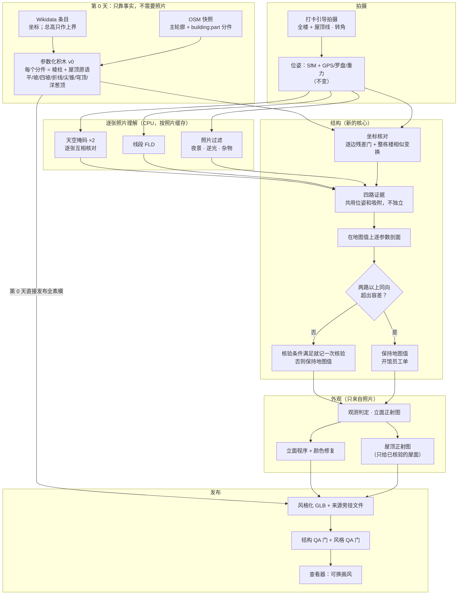
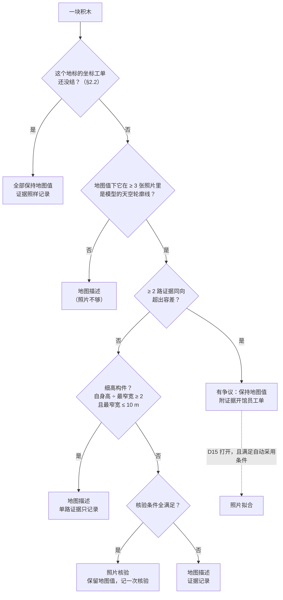
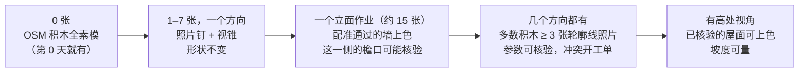
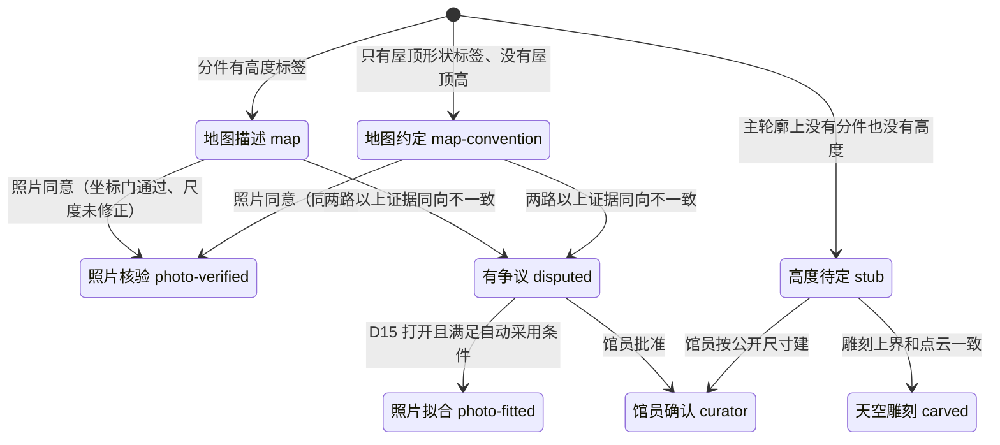
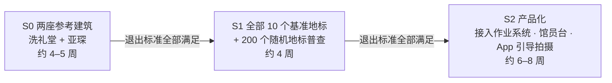

# Crowd3D 的"结构优先"：参照 Hover 重做算法流程

> 2026-10-22，修订版。作者：主设计（lead designer）。读者：产品负责人。
>
> 这份文档回答您的问题："这些模型都没有还原建筑本身的样貌，特别是屋顶；能否参考 hover.to 的技术栈，重新做我们的算法流程。"
> 本文给出改过的流程。四个探针（OSM 分件体块、天空轮廓线、Hover 逐张照片模型、颜色链）和复核实验的实测数字都在下面，每个数字后面标了出处。
>
> **这一版改了什么**：初稿把亚琛"天空轮廓线 22.9 → 17.0 px"当成主要收益，但这个 17.0 来自本文自己的规则会拒绝的参数值（撞边界、在地图值下没有天空背景照片）。按规则真正能发布的是 OSM 先验本身，它在两座参考建筑上都**比现原型更不贴照片**。本版做了这些修改：每个地标报三个数（原型、先验、真正能发布的）；判定规则全部改在地图值上做，每路证据只能投它看得见的方向，门槛都给出数字，参考表由代码生成；洗礼堂的问题改判为"整体坐标偏移 + 轮廓偏大"；补上了逐边残差门、成本、长尾、失效模式。
>
> **和现有文档的关系**：`docs/STYLIZED_MODEL.md`（下称"设计文档"）的大框架不变：素模表示"没人拍过"、外观只来自照片、画风可以换。本文只改两件事。一是**形状从哪里来、怎么用照片核对**，取代设计文档 §3.1 的实现部分和 §3.6 的屋顶部分；二是**颜色链的修复**（§2.5）。本文不直接改设计文档，需要它跟着改的地方列在第 7 节。
>
> **数字出处**：〔O…〕〔S…〕〔H…〕〔C…〕分别是 OSM 分件、天空轮廓线、Hover 模型、颜色四个探针的产物；〔L…〕是本版复核时主设计自己跑的检查；〔K〕是评审的核对脚本，本版重跑过其中的 `pc.py`、`elev.py`、`regcheck.py`、`apothem.py`、`widths.py`、`snap.py`、`hz.py`。附录 A 列了每个编号对应的绝对路径。〔D §x〕指设计文档的某一节。【本文】是作者把实测数字加总或换算出来的；【估算】是工程估计，没有实测；【待核实】是只有二手来源。所有实测都在本容器上跑：4 核 CPU，无 GPU，每个实验 `nice -n 19`、最多 2 线程，同时还有一个基准测试任务在抢 CPU。所以**耗时都偏保守，是上界**。
>
> 探针产物在会话的临时目录里，里面有 Wikimedia Commons 照片的像素，**不进仓库**。

---

## 0. 一页总结

### 0.1 为什么现在的模型不像，尤其是屋顶

您给的对照图〔E〕里，洗礼堂像一块米色"蛋糕"顶着一个普通的尖金字塔，白绿大理石的横条纹没了；亚琛像一堆灰色棱柱，看不出哥特式唱诗堂的屋顶、十六边形回廊和尖塔。原因有四个，按影响大小排：

1. **形状来源用错了（最主要）。** 设计文档 §3.1 已经定了：体块用 OpenStreetMap（OSM）里志愿者画好的建筑分件（`building:part`，带高度和屋顶形状）。但代码一直没实现。`crowd3d/stylize.py` 的 `build_massing()` 实际是用 OSM 主轮廓，加上照片点云的"高度场"一层层切块，屋顶只有"平顶"和"金字塔"两种。
   - 后果是：点云稀的地方切不出塔，细的采光亭和尖塔点太少会丢，哥特式陡坡顶、穹顶、十六边形都表达不了。
   - **但有一点必须说清楚。** "模型轮廓和照片里天空分界线差多少像素"（下称天空轮廓线距离）这个量，现原型天然占便宜：它的高度场就是从同一批照片的点云切出来的。所以这个量**不能衡量"像不像"**，只能查"和照片有没有矛盾"。实测（像素；前一个数用研究用掩码 Dm+R，后一个用可商用的经典掩码 A+R）：

| 地标 | 现原型 | OSM 积木先验 | 按本文规则真正能发布的 | 探针的无约束拟合（**不能发布**） |
|---|---|---|---|---|
| 亚琛 | 22.9 / 24.6 | 29.3 / 29.7 | 29.3 / 29.7（没有一个参数被改） | 17.0 / 19.1 |
| 洗礼堂 | 17.5 / 17.2 | 25.2 / 22.8 | 25.2 / 22.8（同上） | 22.5 / 20.8 |

   - 逐张照片看，OSM 先验只在亚琛 28%、洗礼堂 12–24% 的照片里比原型更贴照片〔S3〕〔K〕。初稿说的"拟合后 83% 的照片更准"，用的是撞到边界、本文规则不会接受的参数值。
   - 先验更差的原因是 OSM 自己的错：亚琛唱诗堂比照片里低 11–17 m（§2.4.3）；洗礼堂的八角形比照片里大 23%，整体还偏了约 3.6 m（§2.2）。
   - 结构优先赢在别处：屋顶类型、穹顶、尖塔、十六边形、采光亭这些**形状本身**是对的。这一点目前只有一个人的主观打分〔O2〕，要用盲测证明。盲测是 S0 的第一项，也是迁移版能不能上线的门（D23）。
2. **屋顶拍不到就被压平。** 地面照片很少看到屋顶顶面。现在的规则是：一个金字塔屋面被点云覆盖不到 40%，就改成平的素模盖〔D §3.6〕。所以洗礼堂有一半屋顶是平的〔O7〕〔S6〕。采光亭这类细构件点太少，在高度场里切不出来，也就没了〔O1〕。
3. **颜色链把识别度丢了。**
   - 洗礼堂的黑白横条纹在照片里明暗差 **30.9 L\***（L\* 是 0–100 的亮度），发布出去的贴图里只剩 **4.4 L\***。原因：工作图只有 8 px/m，61% 的暗条纹被画成了墙色〔C1〕。
   - 接近灰色的颜色只按亮度吸附到调色板，而中间档的灰偏暖，所以白大理石变成了米色 `stone`〔C1〕。
   - 亚琛的参考点云 568,557 个点颜色全是 0（黑），21 块屋顶全被涂成深石色，色差 ΔE00 40.2，却标着"照片实测"〔C1〕〔C4〕。
4. **没有"结构线"。** Hover 的模型像那栋房子，是因为它先做出一个带屋脊、斜脊、檐口的**参数化线框**（类似 CAD 模型），再往上贴东西。我们没有这一步：屋脊、斜脊、采光亭、檐口线都没有作为几何画出来。

### 0.2 Hover 的做法，我们抄哪一半

Hover 的流程（公开专利和资料）是：引导拍摄约 8 张照片 → 求位姿 → 每张照片做深度、分割和线段识别 → **把屋顶边线跨照片三角化成三维线框** → 拟合成平面屋面、坡度都确定的参数化模型 → 用标准门窗尺寸定尺度。

我们实测了它的"逐张照片神经网络"那一半，**在我们的建筑上基本没用**：

- 单目法线在屋面上偏 24–29°（洗礼堂）、39–42°（亚琛）〔H1〕；
- 三种通用分割模型把地标屋顶认成"屋顶"的比例只有 0–18%〔H1〕；
- 专门认屋顶部件的"Gestalt"模型和它的训练数据（HoHo/S23DR）：权重是否公开、数据是否只许非商用研究，H1 和 H7 里都没有原文【待核实】。

真正有用的是"**结构那一半**"：多张照片三角化出三维线段，再拟合成参数化模型。我们写了一个纯 numpy 的简化版。在洗礼堂 107 张照片上（0.75 m / 7° 内）：

- 原始线段找回了 8 条檐口里的 7 条、8 条斜脊里的 6 条，中位偏差 0.40 m；
- 本文实际要用的那一组（有 SfM 点支撑、≥ 6 张照片看到）是 **5/8 和 5/8**〔H2〕；
- 只用离地 ≤ 20 m 的 92 张照片的近似：原始 6/8、5/8，有支撑 5/8、5/8〔L6〕。

要说明两点：这些精度是拿一个**从同一批 SfM 点拟合出来的**参考八角形量的，不是独立真值（§2.4.2）；亚琛的结果差得多，0.75 m 内唱诗堂檐口 0/2、屋脊 0/1、十六边形斜脊 0/16、穹顶檐口 1/16、尖塔斜脊 1/8，放宽到 2 m 尖塔才找回 8/8〔L6〕。

更重要的是，名胜地标的"线框"**已经有人画好了**：13 个评测地标在 OSM 上全都有分件〔D §3.1〕。把它们搭成参数化积木，按探针作者一个人的打分〔O2〕：

- 7 个一眼认得出，其中 4 个磁盘上没有照片，是凭常识判断的；
- 洗礼堂也打了三星，但评语写着"没有颜色还认不出是哪一座"；
- 4 个认得出但有明显缺陷；
- 1 个（悉尼歌剧院，所有分件都没有高度）认不出。

### 0.3 新流程一句话

**先用地图事实搭出建筑的参数化"积木"（第 0 天就有，全身素模）→ 先核对整栋楼的坐标和轮廓 → 在地图值上用照片的几路证据逐个检查积木参数：一致就记一次"核验"，两路以上同向不一致就交馆员，v0 不自动改 → 最后才在核对过的形状上，按照片涂颜色、画门窗。** 这就是"结构优先"。



### 0.4 已经测到的东西（包括退步）

| 问题 | 现在 | 结构优先之后（实测） | 出处 |
|---|---|---|---|
| 亚琛的形状 | 一堆棱柱 | 西塔尖顶、八角堂穹顶、唱诗堂、小礼拜堂、十六边形都有；但唱诗堂按地图值低 11–17 m，开工单 | 〔O7〕〔L2〕 |
| 天空轮廓线距离（只查一致性） | 原型：亚琛 22.9 / 24.6 px，洗礼堂 17.5 / 17.2 px | 能发布的版本：亚琛 29.3 / 29.7，洗礼堂 25.2 / 22.8，**变差** | 〔S3〕〔L2〕 |
| 洗礼堂坐标工单经馆员批准之后 | — | 15.5 / 14.2 px（轮廓线最优的整体变换）；取墙面平面量出的变换是 18.1 / 16.0 px | 〔L3〕 |
| 洗礼堂的屋顶 | 陡金字塔、一半平顶、没有采光亭 | 地图上的 12 m 低金字塔、采光亭和西侧小礼拜堂（scarsella）都在；采光亭的位置要等坐标工单 | 〔O1〕〔O7〕〔L3〕 |
| 洗礼堂的横条纹 | 明暗差 4.4 L\* | 25.5 L\*（照片是 30.9） | 〔C1〕 |
| 亚琛的屋顶颜色 | 黑点被提亮成深石色，色差 ΔE00 40.2；只做重新取色是 31.8 | 10.3 | 〔C1〕 |
| 13 个地标第 0 天的素模 | 只有主轮廓拉伸 | 7 个一眼认得出（4 个是凭常识打分），洗礼堂要靠颜色，4 个有缺陷，1 个认不出（一人打分） | 〔O2〕 |

这张表的意思是：

- 第 0 天的 OSM 积木在形状类型上对了，但**和照片的一致性比现原型差**。
- 照片能做的是找出地图哪里错了、开工单。馆员处理以后，一致性才会追上来：洗礼堂一张坐标工单就能从 25.2 降到 15.5 px，低于原型的 17.5。
- 所有天空轮廓线数字都是用 A+R 和 Dm+R 两种掩码量的。计划的生产掩码 C+R 还没进过任何拟合；Dm+R 的训练数据不明，只能当研究对照（§2.3）。

### 0.5 不变的东西

- 您的四条规则不变：不编造没拍到的内容；没拍到的面是素模，形状只能来自事实；接受"玩具"定位；画风由您定。
- 配准门槛（吸附残差 ≤ 1.5 m、逐边核验）不放松〔D §3.2〕，**还加严一条**：逐边残差把墙内侧 3 m 以外的点也算进去（§2.2）。
- D12 的封闭小洞补底色、画风文件、风格 QA 门 Q1–Q16 都不变。

---

## 1. Hover 的每个环节，我们怎么对应

| Hover 环节 | 它在 Hover 里干什么 | Crowd3D 的选择 | 为什么（许可、CPU、数据），附数字 |
|---|---|---|---|
| 引导拍摄（约 8 张，App 实时检查每一张） | 保证每栋房子都拍到四角和屋顶线 | **借用**：打卡时最多 3 个提示："退后拍全楼和屋顶线"、"走到转角同时拍两面墙"、缺口任务；手机上只做轻量检查，永不拦截上传（§2.1） | 一块积木要在地图值下 ≥ 3 张照片里是模型轮廓线，照片才说得上话；洗礼堂西侧小礼拜堂只有 2 张〔L2〕。洗礼堂 107 张里 104 张在东北到东南〔K〕，西半边没有一个墙点〔L3〕 |
| SfM 位姿 + 手机 GPS/罗盘/重力 + 地平线和檐口线索 | 求每张照片的位置和朝向 | **不变**：COLMAP CPU + 现有地理配准；**新增**逐边残差门和整栋楼相似变换（§2.2） | 坐标和轮廓误差比任何高度参数都伤：洗礼堂北墙的点在 OSM 边内侧 4.4–4.5 m，南墙 2.0–2.2 m，东和东南在边上；照片里是一个 27.3 m 宽、中心偏 (+3.4, −1.2) m 的正八角形〔L3〕 |
| 用标准门窗尺寸定尺度（US9478031） | 没有地图时给出米制尺度 | **不用**：尺度来自 GPS 配准 + 吸附到 OSM 轮廓（尺度修正有上限 ±15%） | 地标的门窗不是标准件；我们有 OSM 轮廓。亚琛吸附修正了 ×1.10，而这个尺度同时乘在所有高度证据上（§2.4.2） |
| Metric3Dv2（单张照片测米制深度） | 补稀疏区域的深度 | **不用**。可选：Depth Anything V2-Small 对齐到 SfM 点后只做加密，默认关 | Metric3D 直接给的米制深度误差（AbsRel，洗礼堂 / 亚琛）0.43 / 0.32；尺度在 ±15% 以内的照片只有 4/20、8/20；权重没写许可证〔H1〕。DA-V2-S 对齐后误差 0.031 / 0.108，1.15 s/张，权重 Apache-2.0，训练数据里有非商用集（要标记）〔H1〕 |
| OneFormer（ADE20K 语义分割） | 天空、植被、建筑等类别 | **不用**。天空掩码两路互相核对（§2.3） | ADE20K 图片只许非商用研究，而且它没有"屋顶"这一类〔H1〕。拟合实际用的是 A+R（经典方法，可商用）和 Dm+R（U2-Net skyseg）；计划的主力 C+R 只在 30 张测试照片上跑过，没进拟合〔S1〕〔S3〕 |
| Gestalt（专认屋顶部件：屋脊、檐口、斜脊、天沟、顶点……） | Hover 的核心数据优势 | **没有可用替代**：拓扑（是什么屋顶）取自 OSM 的 `roof:shape`，位置由三维线段和天空轮廓线量。以后用我们自己核验过的线框反投影到照片里当标签，训练自己的小模型（DINOv2-S，Apache-2.0） | HoHo/S23DR 的许可、Gestalt 权重是否公开，H1/H7 里没有原文【待核实】。通用分割认出屋顶的比例只有 0–18%〔H1〕 |
| M-LSD（线段检测） | 找每张照片里的直线 | **OpenCV FLD**（核心 OpenCV 的 LSD 作备选） | FLD 0.027 s/张，檐口召回 0.844、斜脊 0.759；M-LSD tiny 0.188 s/张，0.619 / 0.667，训练数据许可不明〔H1〕 |
| NormalBAE（法线） | 屋面朝向、坡度 | **不用**，墙面法线也不靠单目 | 单目法线在屋面上偏 24–29°（洗礼堂）、39–42°（亚琛）；深度推出的墙面法线洗礼堂偏 10.2°，亚琛偏 54.3°〔H1〕。NormalBAE 的训练数据（ScanNet）和 DSINE 都是非商用〔H1〕 |
| 屋顶边线跨照片三角化成三维线框（US10460465） | 让模型"像那栋房子"的关键 | **借用**：三维线段（numpy 简化版 LIMAP），作为证据之一（§2.4.2） | 洗礼堂：有支撑的线段找回檐口 5/8、斜脊 5/8；顶点水平差 0.18 m、高度差 0.54 m，参考形状来自同一批 SfM 点〔H2〕〔H4〕。亚琛召回很低（§0.2）；唱诗堂半圆室有一个 46.4 m 的顶点，OSM 写 32 m〔H4〕 |
| 参数化 CAD 式模型（平面屋面、坡度） | 最终交付物 | **借用**：OSM 分件 → 参数化积木（先验），照片核验或开工单 | 13 个地标 828 块积木（822 个 OSM 分件 + 6 块空隙补体）全部水密；每个地标 21–938 ms 搭完〔O1〕〔O3〕。glTF 校验器**还没跑过**：初稿的"0 错误"只是对照图脚本里写死的一句话〔O1〕 |
| 地面照片 + 航拍正射（US9437033） | 屋顶俯视信息 | **没有航拍**。OSM 志愿者本来就是对着航拍图画的分件；政府开放的 LoD2 / 3D BAG 由您决定用不用（D19） | 我们没有航拍数据预算；13 个评测地标的 OSM 分件覆盖 13/13，但这 13 个是挑过的，长尾没测（§3） |
| 数据护城河（1000 万+ 栋房子、200 万+ 照片-结构配对） | 让它的模型越来越准 | 我们的护城河是"每个地标的众包照片 + 馆员确认过的体块登记表"；核验过的线框可以反过来当训练标签 | 开源模型本身是大路货；Hover 的优势在数据 |

**一句话**：Hover 的"逐张照片神经网络"那一半，我们只留线段检测和天空掩码；"结构"那一半全抄，并且把 OSM 当作现成的线框先验。

---

## 2. 新流程逐段说明

### 2.1 拍摄引导（借用 Hover 的引导拍摄）

Hover 能拿到好数据，是因为 App 一张张指导用户拍。游客不是测量员，我们只能"轻提示、不拦截"。

**打卡时的提示（最多 3 个，可跳过）**：

1. **"退后一点，把整栋楼和屋顶线都拍进来，头顶留一点天空。"** 照片要在地图值下把某块积木拍成轮廓线、而且上方是天空，才说得上话（§2.4.3）。
2. **"走到转角，同时拍到两面墙。"** 逐边核验要求通过的墙边方向至少相差 30°；整栋楼的轮廓尺度要求有点的墙面朝向覆盖 ≥ 180°、含两面相对的墙（§2.2）。转角照片同时给出两面墙，直接解决这两个问题。
3. **缺口任务**（沿用设计文档）：例如"站在西南侧 30–60 m 拍 4 张"。现在多两类：某块积木"在照片里从没成为轮廓线"时，提示"从 × 方向拍到它的屋顶线"；某个地标有坐标工单时，提示去拍还没人拍过的那半边（洗礼堂的西侧）。

**手机上的实时检查（只提示，不拦截）**：

- 机身倾斜（重力传感器）；
- 画面顶部有没有一条天空带。用手机上的经典方法：颜色加平滑度，不用模型；
- 是否模糊、过暗、逆光（太阳方位和视线夹角）；
- 离楼的距离（GPS 加 OSM 轮廓）。
- 可选的"取景框"：用第 0 天的积木模型，按手机的 GPS 和罗盘投影出一个半透明轮廓，提示"把楼放进框里"。GPS 的单张误差 p90 有 20–55 m〔D §3.2〕，所以这个框**只能帮着取景，不能用来对齐**【估算，未实测】。

**高处视角**（钟楼、穹顶上往下拍）对屋顶最有用，但不能鼓励攀爬。只做成"如果您恰好在上面"的可选奖励任务。

### 2.2 位姿与坐标对齐

**不变**：COLMAP CPU 增量/全局建图，地理配准（重力 + 2D 相似变换 + 罗盘），QA 门 1，吸附到主轮廓（偏航窗口、±25 m 平移、逐边核验）〔D §3.2〕。分件和主轮廓在同一个坐标系里〔O1〕。

**新增三步**：

1. **逐边残差门（加进配准门槛）。** 每条长 ≥ 5 m、带 ≥ 200 个墙带点的轮廓边，点到边的中位距离必须 ≤ 1.5 m。**墙内侧 3 m 以外、10 m 以内的点也算进去。**
   - 现在的 `registration_check` 不看内侧 3 m 以外的点，所以洗礼堂通过了：7 条投票边里 6 条通过，方向差 89°〔K〕。
   - 加上这一条以后：洗礼堂有 5 条边超限（1.56–4.57 m），不通过；亚琛 83 条有点的边里只有 3 条超过 1.5 m，都短于 5 m，通过〔L4〕。
   - 不通过时：开一张"坐标工单"；这个地标不做任何参数核验或拟合；超限的墙不贴图，保持素模。
2. **整栋楼的相似变换（取代初稿的"只报警"）。** 对整栋楼的全部分件求一个相似变换：平面尺度 k（绕 OSM 主体中心）、平移 t，可选偏航。用两种方法分别求：
   - 墙面平面：每个 OSM 面上墙带 SfM 点的中位位置，对"点位置 = k × 地图边心距 + 法向 · t"做最小二乘；
   - 天空轮廓线：在 (k, t) 上做多起点网格搜索。不能像初稿的 `frame_fit.py` 那样先搜尺度、再搜平移（§2.2 洗礼堂实测里说明为什么）。
   - 两者一致（k 差 ≤ 0.05、平移差 ≤ 1 m），并且有点的墙面朝向覆盖 ≥ 180°、含两面相对的墙，才算量到。单侧数据时尺度和平移分不开。
   - 结果**刚性地作用到所有分件**。永远不单独移动正多边形的某一条边，也不单独移动某个子分件。
   - k 偏离 1 超过 3%，或平移超过 1.5 m：这改的是地图事实（轮廓大小和位置）。按 D15（已拍板：至少两路照片证据一致就自动采用），两路独立量出的相似变换一致、而且檐口高度确认整体尺度时自动采用，否则开工单（D16）。原型实测：洗礼堂的 SfM 墙面平面（k 0.8164）和三维直线（k 0.8192）一致，檐口天际线 18.62 m、直线 18.79 m 对地图 18 m，自动采用 k 0.8178。
3. **逐墙平面对账只留给不规则轮廓。** 设计文档 §3.2 第 3 条"每面墙各自移到拟合平面（最多 5 m）"会把正多边形拆歪。以洗礼堂为例：北面要移 4.4 m，东面不动，西面没人拍也不动，八角形就歪了。轮廓有 P 重旋转对称（正八角形、正十六边形等）时，改用第 2 步。

**洗礼堂实测**〔L3〕〔K〕：

- 墙带 SfM 点（3–16 m 高，≥ 3 张照片看到）相对 OSM 各面的位置：北面两段在边内侧 4.38 / 4.53 m，东北 1.52 m，东面两段 +0.09 / +0.06 m，东南 +0.14 m，南面两段 1.96 / 2.20 m；西半边没有点。
- 墙面平面求出 k = 0.807、t = (+3.41, −1.18) m，也就是一个宽 27.25 m 的正八角形，8 个有点的面残差都 ≤ 0.16 m。只平移、不缩放，最好也要在南北各差 3.1–3.4 m。
- 尺度无关的核对：照片里檐口高 ÷ 宽 = 18.9 ÷ 27.25 = 0.69，地图上是 18 ÷ 33.4 = 0.54。两者比例本身就不一样，所以不是坐标尺度的问题（这个模型的吸附尺度是 1.00）。
- 天空轮廓线多起点网格：两种掩码的最优都是 k = 0.84、t = (+3.5, −1.5) m。
  - Dm+R：代价降 37%，平均距离 25.2 → 15.5 px（原型 17.5）；
  - A+R：代价降 30%，22.8 → 14.2 px（原型 17.2）；
  - 直接取墙面平面那组值：18.1 / 16.0 px。
  - 两种方法的 k 差 0.033、t 差 0.33 m，一致。
- 初稿的"尺度在 1.00 处有清楚的最小值"是搜索方式造成的：`frame_fit.py` 先在零平移下搜尺度，而零平移时轮廓线反而偏向"更大"（×1.05 最好，23.8 px），之后再搜平移就出不去了〔S4〕〔K〕。"×0.95 代价 +7%、×1.05 代价 +25%"这两个数在 S4 的产物里找不到，删掉。
- "采光亭偏东 3 m"是同一个坐标问题：把同一个相似变换作用到采光亭，它落到三维线段顶点 0.5–0.7 m 以内〔L3〕〔H4〕。所以工单是"整体变换"，不是"挪采光亭"。
- 官方尺寸（常见说法是 25.6 m）在 H6 里没有出处【待核实】；照片量出的 27.3 m 是外墙面的宽度。
- 结论：洗礼堂开一张坐标工单（k ≈ 0.81–0.84，平移约 3.6 m）。馆员批准前不核验、不拟合任何参数，南北墙不贴图。

**亚琛**：`frame_fit.py` 的尺度一直降到 ×0.86 还在降〔S4〕。

- 初稿说"不可信"，太武断。有两种解释：杂乱背景偏向更大的体块；或者吸附的 ×1.10 尺度修正本身偏大（1/1.10 = 0.91）。
- 现在分不开：西立面塔楼和尖塔的 SfM 高度在 ×1.10 下和 OSM 一致（47.6 / 74.2 m 对 49 / 74 m〔L5〕），支持 ×1.10；轮廓线的漂移不支持。
- 所以亚琛的全部证据标"尺度已修正 ×1.10"（§2.4.2），自动核验和自动改值都不做。

### 2.3 逐张照片理解（选定的模型）

每张照片只算一次，结果按照片缓存。以后的立面作业、完整作业直接复用。

| 用途 | 选用 | 耗时/张（2 线程，与基准任务争用） | 许可 | 状态 |
|---|---|---|---|---|
| 线段 | OpenCV FLD | 0.027 s〔H1〕 | OpenCV（Apache-2.0）；无权重 | **用** |
| 天空掩码（计划主力） | C+R：DINOv2-small 线性头给点提示 → SAM 2.1-tiny → 全分辨率 GrabCut 边带细化 | 3.4 s〔S1〕 | 权重 Apache-2.0；SAM 的训练集 SA-1B 只许研究用，DINOv2 训练集是网络图片，**要法务确认**；ONNX 要我们自己从官方权重导出〔S1〕。DINOv2 小头是用这两座参考建筑的 22 张照片（MegaDepth/Commons 图片）训练的，这些图片能不能用来训练商用模型【待核实】 | **只在 30 张测试照片上跑过，没进任何拟合**。S0 先过许可和独立评测，再跑全部照片、重跑剖面 |
| 天空掩码（核对，也是今天唯一可商用的） | A+R：经典方法（顶部种子 + Lab 颜色模型 + GrabCut）+ 同样的边带细化 | 310 张平均 1.06 s〔S2〕 | OpenCV | **用**。全部拟合都用了它 |
| 天空掩码（研究对照） | Dm+R：U2-Net skyseg + 同样的边带细化 | 310 张平均 0.91 s〔S2〕 | 上游代码 MIT（H7 里有原文，Hugging Face 模型卡也写 MIT）；**训练数据不明**【待核实】 | 只作对照。训练数据查清、可以商用的话，它能当第二路核对，比 C+R 快 3.7 倍 |
| 加密深度 | Depth Anything V2-Small，逐张对齐到 SfM 点 | 1.15 s〔H1〕 | 权重 Apache-2.0；训练数据含非商用集（要标记） | 可选，**默认关** |
| 人、车、树遮挡 | Mask2Former-COCO | 1.7 s〔H1〕 | 许可写的是"other"；COCO 图片走 Flickr 条款，要法务看 | 以后 |
| 屋面分面 | MoGe-2-S 法线 | 5.2 s〔H1〕 | MIT（训练集未审） | 以后 |
| — | Metric3Dv2、OneFormer/ADE20K、NormalBAE、DSINE、M-LSD、DeepLSD、HoHo/Gestalt | — | 不明或非商用〔H1〕。DeepLSD 依赖 pytlsd：H7 里它的许可证文件是 MIT，里面是否带 AGPL 的 LSD 原始代码【待核实】 | **不用** |

**两种天空掩码逐张互相核对**（初稿写了，但 `fit.py` 里没有实现）。规则：

- 每张照片在上部区域里，逐列取最上面的"天空 → 建筑"分界，比较两种掩码。
- 两种掩码都有分界的列里，分界位置中位差 > 8 px；或者只有一种掩码有分界的列占上部区域 > 50%；或者能比较的列不到 20 列：这张照片不参加拟合。
- 用 A+R 对 Dm+R 实测〔L7〕：
  - 中位差的分位数：洗礼堂 p75 8 px、p90 39 px；亚琛 p90 5 px、p95 37 px；
  - 这个门槛会去掉洗礼堂 107 张里的 46 张、亚琛 187 张里的 45 张；只看"中位差 > 8 px"一条，分别是 20 张和 14 张。
- 去掉这么多，说明两种掩码分歧本身就大。阈值要在 S0 用独立标注校准，并且用核对后的照片集重跑剖面。§2.4.3 的表还没有经过这一步。

**掩码评测不独立**。30 张"手工标注"的真值是这样来的：

- 先取 5 种被评方法（A、B0、B1、C、Dm）里 ≥ 3 票的多数；
- 只有 8 张做过多边形修正（评审说 9 张，`corrections.json` 里第 9 个键是说明文字）；
- 然后用和 C+R、A+R 同一个边带细化（R）吸边〔S1〕；
- DINOv2 小头的训练照片和测试照片来自同两座建筑。

所以"C+R 逐列误差 3.6 px、A+R 8.0 px"偏乐观，C+R 和 A+R 之间的比较也偏向带 R 的方法。S0 要做独立标注：不用任何方法投票、不吸边，照片取自别的地标（commons-ten-v1 的 10 个地标，每个 5 张）。

**照片级过滤**（失效模式，初稿漏了）：

- **夜景和逆光**：按 EXIF 时间和地理位置算太阳高度角，太阳在地平线下，或者太阳方位和视线夹角 < 30° 的照片，不进天空轮廓线。每张照片给一个掩码置信度（两种掩码的一致度），低于上面的门槛就不用。
- **塔吊、脚手架**：会被当成建筑。圣家堂就在 S1 里。需要一个"杂物"掩码（细长、高对比、颜色和墙不一致），S1 先人工标几张量影响。
- **植被**：三种分割模型各自把亚琛约 28%（27.9–28.6%）的墙点判成植被〔H1〕。礼拜堂前后的树，正是"把低矮礼拜堂往上拉"的来源之一（§2.4.3）。

### 2.4 结构（新的核心）

#### 2.4.1 先验：OSM 分件 → 参数化积木

做法沿用 OSM 分件探针的独立实现〔O8〕，移植进仓库（§7）：

1. **解析**：分件可以是单条路径（way），也可以是关系（relation）。关系要能拼接由几条路径组成的环，处理内环（洞）和一个关系里有几块外环的情况。
2. **过滤邻楼**：分件中心落在"主轮廓外扩 2 m"以内，**并且**分件面积至少 50% 在这个范围内。
   - 第二条是必要的：林肯纪念堂有一个 1,693 m² 的草坪台地分件，它的中心落在纪念堂里，但面积 0% 在轮廓内，只有面积条件能把它去掉〔O1〕。
   - 中心条件去掉了勃兰登堡门 59 个、圣家堂 44 个邻楼分件〔O1〕。
3. **高度**，每个都记来源：
   - `height` 或 `building:levels`；
   - `min_height` 或 `building:min_level`；
   - `roof:height`、`roof:levels` 或 `roof:angle`。
   - Wikidata 的总高**永远不用在任何一个分件上**，只当上界和核验。
4. **屋顶原语**：
   - 平顶、单坡、双坡（含横向和指定方向）、盐盒顶、复折顶、筒拱、四坡、半四坡、折线（mansard）：都按"凸多边形上一组平面的下包络"来建。对凸分件这就是精确的直骨架；不凸但矩形度 ≥ 0.85 的分件，用最小外接矩形代替。
   - 尖锥、圆锥：所有面汇到一个顶点。
   - 穹顶、洋葱顶：用轮廓的缩放副本做旋转面。
   - 做不出来就按一条明确的退化链往下退，原值和原因写进记录。13 个地标一共退化 70 次，其中 63 次在悉尼〔O1〕。
5. **主轮廓上没有分件的地方**（本版改了规则，文档和代码按这一条统一）：
   - 先用主轮廓自己的高度标签；
   - 没有，再看"支撑面"：压在它上面、并且和这块空隙重叠 ≥ 50% 的抬高分件的 `min_height`（来源 `osm-s3db-support`）；
   - 都没有就画 3 m 的"高度待定"矮台（D13），或者走 §2.4.4 的雕刻路径；
   - 小于 20 m² 且没有任何高度事实的空隙不画〔O1〕。
   - 改的原因：初稿写的是"最低 `min_height`"，探针代码（`resolve_remainder`）实际取的是"0.5 m 内碰到它的任何抬高分件的**最高** `min_height`"，只是碰到就算。德累斯顿圣母教堂因此得到 36.65 m，而主轮廓自己标的是 40.65 m〔O1〕。
6. **约定值**：有 `roof:shape` 但没有屋顶高时，按惯例取屋顶高，来源记 `s3db-shape-default`。完整清单和实际用到的次数〔O1〕：

| `roof:shape`（没有屋顶高） | 约定 | 13 个地标里实际画出来的 |
|---|---|---|
| hipped（四坡）、gabled（双坡）和其余坡顶 | 30° 坡，按半宽算 | 四坡 56、双坡 25 |
| dome / spherical（穹顶） | 内切半径 | 23，全在悉尼的 3 m 矮台上 |
| onion（洋葱顶） | 1.5 × 内切半径 | 4 |
| mansard / gambrel（折线顶） | 3 m（一层） | 2 |
| round（筒拱） | 半宽 | 1 |
| pyramidal / cone，分件宽 ≤ 12 m | 0.9 × 分件剩余高度（整件变成尖塔） | 0 |
| 所有约定 | 不超过墙高余量的 0.9 | — |

   - 合计 **111** 个画出来的约定屋顶（初稿写 112），匈牙利议会大厦占 78 个。另有 69 个算了约定高度，但最后退成了平顶。
   - 111 个里有 24 个在"高度待定"矮台上（悉尼 23、印度门 1）。
   - 本文建议：矮台上不加约定屋顶；删掉"≤ 12 m 的尖锥取 0.9 倍"这一条（它会把带帽的塔变成尖塔），尖锥也按 30° 坡。由您定（D17）。
   - 天空轮廓线探针为了快，自己搭了一套简化积木：没有屋顶高的屋顶画成平的，四坡和筒拱画成双坡〔S7〕。用 OSM 分件探针真正搭出的 GLB 打分，亚琛是 29.4 / 29.8 px，洗礼堂 25.3 / 22.8 px，和简化积木差 ≤ 0.1 px〔S3〕；这两座只有 1 个和 0 个约定屋顶，所以差得少。匈牙利议会大厦（78 个）要在 S1 用真正的积木打分。

**实测**〔O1〕〔O2〕〔O3〕〔O6〕：

- 13 个地标、828 块积木（822 个 OSM 分件 + 6 块空隙补体）全部水密；
- glTF 校验器还没跑过，G1 要求接上；
- 20 个合成测试分件的顶部高度都等于标签高度；
- 搭建耗时 21–938 ms/地标。

**数据本身的问题**（照片能指出一部分，改要馆员）〔O1〕〔L2〕〔L3〕：

| 地标 | 问题 | 后果 |
|---|---|---|
| 悉尼歌剧院 | 90 块积木都没有任何高度 | 认不出（只有 3 m 矮台） |
| 圣家堂 | 中殿 3,659 m² 没有分件，主轮廓也没有高度 | 尖塔都在，中殿是矮台 |
| 比萨斜塔 | 所有分件的中心都在同一点 0.06 m 以内 | 塔不倾斜 |
| 印度门 | 38–40 m 之间没有分件 | 顶上两层悬空 2 m（新的 G10 会拦下） |
| 亚琛唱诗堂 | 顶 32 m，其中 `roof:height` 只有 6 m | 去掉邻近更高分件后的 SfM 点比模型同区表面高 11–17 m；去掉吸附的 ×1.10 仍高约 7–13 m |
| 洗礼堂 | 地图上的八角形比照片里大 23%（宽 33.4–33.7 对 27.3 m），整体偏约 3.6 m | 见 §2.2；采光亭的"位置问题"也是它 |

#### 2.4.2 四路证据：共用同一套位姿的不同估计量

初稿把它们叫"三路互相独立的证据"，这不对：

- 四路都用同一套 SfM 位姿和同一个吸附（包括尺度）。吸附尺度乘在所有高度上（`apply_snap_points` 里 z 也乘 s）。亚琛的 ×1.10 让唱诗堂"三路都说约 46 m"，去掉它是约 41.8 m。
- 三维线段用 SfM 点当深度先验，只保留有点支撑的；它的精度也是拿 SfM 点拟合出的参考形状量的（`refmeas.py`）。

所以本文把它们叫"共用位姿的不同估计量"，并规定：

- 每条证据记录吸附尺度；
- 尺度修正 > 3% 的模型，证据标"尺度已修正"，不能单独决定冲突。这是设计文档 §3.2 第 4 条已有的规则，初稿漏了。
- "照片核验"和"照片拟合"之前要先过一道**尺度无关核对**：在同一个坐标系里取比值（这个参数 ÷ 一个参照量，参照量取墙面平面量出的轮廓宽度，或者另一个已核验分件的高度），和地图上的同一比值比，差 ≤ 5%。洗礼堂的例子见 §2.2。这一步还没有自动化，所以尺度修正 > 3% 的模型目前一律不核验、不拟合。

**每路证据只能投它看得见的方向**（容差 TOL = max(2 m, 地图值的 10%)）：

| 证据 | 怎么来 | 能说"地图偏高"吗 | 能说"地图偏低"吗 | 实测 | 局限 |
|---|---|---|---|---|---|
| **天空轮廓线** | 把积木投影到每张已注册照片里，算模型上边缘和照片天空分界线的距离（正反两个方向，≤ 40 px 截断；剖面用的就是这个代价） | 能：地图值下它在 ≥ 3 张照片里上方是天空，剖面又要它降低超过 TOL，或者撞到下边界 | 只能算弱信号"↑?"：树和后面的楼也会让它想升高。"↑?"必须另有一路"↑"才算一票 | 亚琛在地图值上剖面，49 个参数里 28 个撞到上边界〔L1〕 | 只量得到天空前面的部分 |
| **SfM 点** | 分件的暴露面积，去掉更高分件周围 1.5 m 后，点高度的 0.98 分位，和**模型自己在同一区域的表面** 0.98 分位比 | 不能：屋面上没点不代表没楼。洗礼堂屋顶上半没人拍，点的 q98 比模型同区表面还低 2.8 m | 能 | 见下 | 树、邻楼、遮挡物也会出现在模型上方；它**不是下界** |
| **天空雕刻** | 体素被 ≥ 3 张、并且 ≥ 20% 看到它的照片判成天空，就挖掉 | 能：上界的 p95 比模型 p95 低超过 TOL | 不能：它只是上界 | 洗礼堂采光亭上界 p95 30.5 m，模型 34.2 m〔S5〕 | 凹处和看不到的地方挖不掉；**永远不当展示几何** |
| **三维线段** | FLD 线段跨照片对极匹配，用 SfM 点给深度先验，再至少用 2 张别的照片验证，最后合并；只保留有 SfM 点支撑的 | 能（顶点、檐口线） | 能 | 洗礼堂见 §0.2；檐口和线脚高度 5.0、13.5、18.5–19 m 处有水平线峰值〔K〕 | 只用离分件中心 ≤ 2 m 的顶点。亚琛穹顶区那 3 个 37–39 m 的"顶点"彼此水平相距最远 6.5 m，不是穹顶的顶点，更像八角堂山花的尖〔H4〕〔K〕 |

**SfM 点这一路，初稿只举了两个一致的例子**（西立面塔楼、尖塔）。完整情况：

- 按 O5 原来的算法（点的 q98 直接和 OSM 顶高比），亚琛 15 个有点的分件里 11 个高出 max(2 m, 10%) 以上，例如穹顶 +10.1 m、唱诗堂三段和十六边形 +16 到 +18 m、马蒂亚斯礼拜堂 +15.3 m、尼古拉礼拜堂 +9.0 m〔O5〕。一个顶高 18 m 的小分件，点的 p95 有 65 m，落进去的是邻楼的点〔S5〕。
- 改成"去掉更高分件 1.5 m 范围、和模型同区表面比"以后，14 个有点的分件里还有 9 个高出 TOL〔L5〕：唱诗堂三段 +11 到 +17 m、穹顶 +9.1 m、尼古拉 +8.0 m、马蒂亚斯 +14.5 m、十六边形 +12.4 m、安娜 +4.3 m、西侧小塔 462 +7.0 m。一致的 4 个是尖塔、匈牙利礼拜堂穹顶、西立面塔楼、西侧小塔 459。
- 所以这一路**经常和地图不一致**，而且其中有真的地图错误（唱诗堂），也有没滤干净的邻居和树（马蒂亚斯礼拜堂紧挨唱诗堂）。它不能单独决定任何事。

#### 2.4.3 判定规则：照片什么时候能改地图上的值

**怎么算**：

- 每个积木参数单独在地图值附近做剖面，**其余所有分件都保持地图值**。初稿是逐件坐标下降两遍，后拟合的分件会继承前面分件没被接受的改动。八角堂穹顶就是这样"高了 4.6 m"：它下面的十六边形被抬到 +30% 边界，八角堂和穹顶跟着上去了〔S3〕。
- 网格：高度、屋顶高在原值的 0.70–1.30 倍之间，步长 0.05；穹顶半径 ±30%；轮廓缩放 ±10%，步长 0.02；打平时取原值；按照片重采样 200 次，估出参数的 90% 区间。
- 代价：沿用实测过的"正反两个方向"代价。初稿改成"只算正方向"，理由是反方向会让树和邻楼把礼拜堂往上拉，但这个改法没测过。在地图值上实测〔L1〕〔K〕：
  - 两种代价的最优值，在亚琛 49 个参数里有 47–48 个相差不到一格；
  - 撞上限的分别是 28 个和 29–30 个；
  - 安娜礼拜堂、马蒂亚斯礼拜堂、十六边形、唱诗堂在"只算正方向"下也一路降到 +30%。
  - 所以"只算正方向"拦不住往上拉。防这个靠下面的方向规则：**天空轮廓线单独永远不能把东西抬高。**
- 耗时：亚琛 19 块积木在地图值上全部剖面（两种代价都算）233 s，其中准备 68–70 s；洗礼堂 11 s〔L1〕。初稿的两遍坐标下降加剖面是 596–617 s 和 31–33 s〔S3〕。

**规则**（全部在地图值上判定，不依赖拟合结果）：



**门槛**（容差 TOL = max(2 m, 地图值的 10%)）：

| 条件 | 门槛 |
|---|---|
| 照片够不够 | 地图值下，它是模型天空轮廓线（≥ 10 列）的照片 ≥ 3 张。这个计数不看掩码 |
| "上方是天空" | 上面那些照片里，它上方 6 px 是天空的 ≥ 3 张（两种掩码取小的） |
| 方向证据 | 见 §2.4.2 的表；"轮廓线↑?"只在另有一路"↑"时算一票 |
| 细高构件 | 自身高（顶 − 底）÷ 最窄宽 ≥ 2，**并且**最窄宽 ≤ 10 m。按这一条：亚琛尖塔（2.8，宽 9.0 m）、洗礼堂采光亭（2.1，宽 3.9 m）、亚琛西侧两座小塔（4.6，宽 7.9 m）、安娜和马蒂亚斯礼拜堂（2.7 / 2.5，宽 7–8 m）都算；西立面塔楼高宽比 4.0 但宽 12.2 m，不算〔L2〕〔K〕 |
| 核验：区间 | 90% 重采样区间换成米 ≤ 1.5 m（高度）/ ≤ 0.75 m（半径和轮廓，按半宽算） |
| 核验：两种掩码 | 拟合值相差 ≤ 1.5 m（高度）/ ≤ 0.75 m（半径） |
| 核验：两种代价 | 正反代价和只算正方向代价的最优值相差 ≤ 1 格 |
| 核验：不撞边界 | 两种掩码都不撞 |
| 核验：离地图值 | ≤ TOL（高度）/ ≤ max(1 m, 10%)（半径） |
| 核验：尺度 | 吸附尺度修正 ≤ 3%；超过的话先过尺度无关核对（§2.4.2），目前没有自动化，所以不核验 |
| 自动采用（D15，**默认开**：产品负责人 2026-10-23 拍板，条件见 §6 D15） | 有争议的那几路里至少两路给出数值，彼此相差 ≤ max(1 m, 5%)；核验条件里除"离地图值"以外全部满足；不是细高构件；父件的状态已被接受 |

**两座参考建筑逐件过一遍**。下表由代码生成（`decide.py` → `table_zh.py`〔L2〕）。剖面一栏是"其余分件都在地图值"时的最优值，A+R / Dm+R 两种掩码，\* 表示撞边界；SfM 和雕刻一栏括号里是模型自己在同一区域的值；"↑?"是弱信号。

**洗礼堂**

| 分件 | 地图 底/檐/顶 m | 最窄宽 m · 高宽比 | 是轮廓线的照片 / 上方是天空 | 在地图值上的剖面 A+R / Dm+R（檐、顶、半径 m；* 撞边界） | SfM q98（模型同区） | 雕刻 p95（模型同区） | 线段顶点 | 方向证据 | 结果 |
|---|---|---|---|---|---|---|---|---|---|
| 主体八角（w252113556） | 0/18/30 | 33.4 · 0.9 | 88 / 73 | 檐 18.9/18.9；顶 31.2/32.4；半径 17.05/17.72 | 24.3（27.1） | 29.0（27.04） | — | — | 地图描述（坐标工单未结；否则檐口会是照片核验） |
| 西侧小礼拜堂（w252113557） | 0/11/13 | 3.7 · 3.5（细高） | 2 / 0 | 檐 12.65/11；顶 13/13；半径 1.7/1.7 | — | 29.5（12.91） | — | — | 地图描述（只在 2 张照片里是轮廓线） |
| 采光亭（w252113558） | 27/32/35 | 3.9 · 2.1（细高） | 67 / 56 | 檐 30.5*/30.5*；顶 34.1*/34.1* | — | 30.5（34.23） | — | 轮廓线↓（撞边界）、雕刻↓ −3.7 | 地图描述（坐标工单未结；否则是有争议·工单） |

**亚琛**

| 分件 | 地图 底/檐/顶 m | 最窄宽 m · 高宽比 | 是轮廓线的照片 / 上方是天空 | 在地图值上的剖面 A+R / Dm+R（檐、顶、半径 m；* 撞边界） | SfM q98（模型同区） | 雕刻 p95（模型同区） | 线段顶点 | 方向证据 | 结果 |
|---|---|---|---|---|---|---|---|---|---|
| 八角堂 Pfalzkapelle（w211100408） | 19/28/28 | 17.7 · 0.5 | 34 / 0 | 檐 30.7*/30.7*；半径 9.74*/9.74* | — | 49.5（28.0） | — | 轮廓线↑?（撞边界） | 地图描述（上方是天空的照片 < 3；只有一路方向证据） |
| 西塔尖顶（w306573602） | 49/49.1/74 | 9.0 · 2.8（细高） | 119 / 113 | 顶 66.53*/66.53*；半径 4.05*/4.05* | 74.2（70.4） | 64.5（68.13） | — | 轮廓线↓ −7.5 | 地图描述（细高构件，单路证据只记录） |
| 八角堂穹顶（w505513553） | 28/28/42 | 17.6 · 0.8 | 100 / 16 | 顶 46.2*/46.2*；半径 11.43*/11.43* | 51.0（41.9） | 55.5（41.61） | — | 轮廓线↑? +4.2、SfM↑ +9.1 | **有争议·工单** |
| 唱诗堂半圆室 a（w505513555） | 0/26/32 | 13.3 · 2.4 | 42 / 0 | 檐 33.8*/33.8*；顶 33.8*/33.8*；半径 7.07/7.34* | 48.5（31.2） | 49.5（30.55） | — | 轮廓线↑? +7.8、SfM↑ +17.3 | **有争议·工单** |
| 唱诗堂半圆室 b（w505513556） | 0/26/32 | 16.3 · 2.0 | 61 / 1 | 檐 33.8*/33.8*；顶 33.8*/33.8*；半径 7.34*/7.34* | 43.7（31.1） | 51.75（30.55） | 46.4 | 轮廓线↑? +7.8、SfM↑ +12.6、线段↑ +14.4 | **有争议·工单** |
| 唱诗堂 Chorhalle（w505513557） | 0/26/32 | 15.8 · 2.0 | 88 / 0 | 檐 33.8*/33.8*；顶 33.8*/33.8*；半径 8.68*/8.68* | 43.4（32.0） | 52.5（31.54） | — | 轮廓线↑? +7.8、SfM↑ +11.4 | **有争议·工单** |
| 匈牙利礼拜堂穹顶（w505524598） | 16/16/23 | 10.0 · 0.7 | 105 / 54 | 顶 20.9*/21.25；半径 4.49/4.49 | 22.9（22.9） | 26.25（22.84） | — | — | 地图描述（拟合不稳或撞边界） |
| 小分件 600（w505524600） | 0/13.5/18 | 6.7 · 2.7（细高） | 0 / 0 | 檐 17.55*/13.5；顶 18/18；半径 3.37/3.37 | — | 33.22（16.92） | — | — | 地图描述（只在 0 张照片里是轮廓线） |
| 尼古拉礼拜堂（w505524601） | 0/13/21 | 13.7 · 1.5 | 45 / 26 | 檐 16.9*/16.9*；顶 23.4*/23.4*；半径 6.17*/6.17* | 28.8（20.8） | 38.25（20.79） | — | 轮廓线↑? +3.9、SfM↑ +8 | **有争议·工单** |
| 匈牙利礼拜堂（w505550221） | 0/16/16 | 10.8 · 1.5 | 57 / 4 | 檐 15.2/15.2；半径 5.91*/5.91* | — | 33.37（16.0） | — | — | 地图描述（拟合不稳或撞边界） |
| 安娜礼拜堂（w505597426） | 0/16/20 | 7.4 · 2.7（细高） | 50 / 0 | 檐 20.8*/20.8*；顶 21.2*/21.2*；半径 4.09*/4.09* | 23.8（19.5） | 30.75（19.08） | — | 轮廓线↑? +4.8、SfM↑ +4.3 | **有争议·工单** |
| 马蒂亚斯礼拜堂（w505597429） | 0/16/20 | 7.9 · 2.5（细高） | 26 / 0 | 檐 20.8*/20.8*；顶 21.2*/21.2*；半径 4.19/4.35* | 34.4（19.9） | 38.36（19.86） | — | 轮廓线↑? +4.8、SfM↑ +14.5 | **有争议·工单** |
| 卡尔礼拜堂（w505597432） | 0/12/16 | 11.4 · 1.4 | 4 / 0 | 檐 11.4/11.4；顶 15.2/15.2；半径 5.13*/5.13* | — | 42.0（15.13） | — | 轮廓线↑?（上方无天空） | 地图描述（上方是天空的照片 < 3；只有一路方向证据） |
| 小分件 436（w505597436） | 0/13.5/18 | 5.5 · 3.3（细高） | 0 / 0 | 檐 17.55*/17.55*；顶 18/18；半径 2.73/2.73 | — | 34.5（17.58） | — | 轮廓线↑? +4.1 | 地图描述（只在 0 张照片里是轮廓线） |
| 小分件 454（w505623454） | 0/10/10 | 2.9 · 3.5（细高） | 2 / 1 | 檐 9.5/9.5 | 7.8（10.0） | 56.25（10.0） | — | — | 地图描述（只在 2 张照片里是轮廓线） |
| 西立面塔楼 Westwerk（w505623457） | 0/49/49 | 12.2 · 4.0 | 131 / 116 | 檐 41.65/44.1；半径 5.5*/5.5* | 47.6（49.0） | 55.5（49.0） | — | — | 地图描述（拟合不稳或撞边界） |
| 西侧小塔 459（w505623459） | 0/28/36 | 7.9 · 4.6（细高） | 66 / 27 | 檐 30.8/32.2；顶 38.4*/38.4*；半径 4.33*/4.09 | 35.3（33.8） | 39.0（34.45） | — | 轮廓线↑?（撞边界） | 地图描述（细高构件，单路证据只记录） |
| 西侧小塔 462（w505623462） | 0/28/36 | 7.9 · 4.6（细高） | 44 / 3 | 檐 32.2/32.2；顶 38.4*/38.4*；半径 4.33*/4.33* | 39.1（32.1） | 38.25（33.56） | — | 轮廓线↑? +4.2、SfM↑ +7 | **有争议·工单** |
| 十六边形回廊 Sechszehneck（w1077724896） | 0/13.5/24.5 | 32.8 · 0.8 | 4 / 0 | 檐 17.55*/17.55*；顶 27.8*/27.8*；半径 18.02*/18.02* | 29.9（17.5） | 49.5（18.26） | — | 轮廓线↑? +4.1、SfM↑ +12.4 | **有争议·工单** |

（三维线段顶点一栏只列离分件中心 ≤ 2 m 的。尖塔的另一个读数，用陡线段求的顶点 69.9 m〔H3〕，比地图低 4.1 m，在容差 7.4 m 以内。）

**结论**：

- **洗礼堂**：坐标工单未结，3 块积木全部保持地图值。工单处理以后要重新判定：届时主体檐口会是照片核验（18.9 对 18.0 m），采光亭会开工单（轮廓线撞下界、雕刻上界低 3.7 m），西侧小礼拜堂仍然照片不够。
- **亚琛**：9 张工单（唱诗堂三段、穹顶、尼古拉、安娜、马蒂亚斯、西侧小塔 462、十六边形），10 块保持地图值，**没有一块被核验**。
- **自动改值（D15 打开后的原型实测）**：洗礼堂 1 处（整栋轮廓，见 §2.2）；亚琛 0 处：多数分件只有 SfM 一路给出数值（天际线剖面撞边界、直线太少），唱诗堂半圆室 b 两路相差 3.26 m（允许 2.36 m），加上吸附尺度 ×1.10 需要的尺度无关核对找不到可量的参照，所以都只开工单。
- 所以两座参考建筑按规则真正能发布的都是 OSM 先验本身，也就是 §0.1 表里的第三列。

**初稿的几处判断收回**：

- 穹顶"照片核验"错了：它的 46.6 m 是被十六边形抬上去的。在地图值上，它的屋顶剖面一路降到 +30%，轮廓线代价 8683 → 8105，只算正方向 4045 → 3678〔K〕；SfM 也高 9.1 m。现在是工单。
- 唱诗堂按初稿规则会因为计数方式而翻转：照片数按拟合前算是 0 张、"照片不够"，按拟合后算是 6 张、"有争议"。现在的依据是"88 张照片里它是轮廓线，上方几乎从来不是天空"加上"SfM 高 11.4 m"，结果是工单。
- 西侧小塔 462 按初稿的规则会被自动抬高 4.2 m（不撞边界、42–43 张天空照片、拟合顶 39.0 m 和 SfM 40.8 m 一致），和"不自动改"矛盾。现在它算细高构件，两路同向，开工单。

**工单多**（亚琛 9 张）反映的是 OSM 数据本身的状况。工单只是请人看，不改模型。S1 统计每个地标的工单数；太多时按证据强度排序：有数值证据的路数，以及各路给出的差值大小（D22）。

**同一块积木没拍到的那几面、叠在上面的分件怎么办（D16）**：

- **允许**：整块积木的标量参数带动同一块积木没拍到的那几面，包括高度、屋顶高、顶点、穹顶半径。前提是这个参数已经被接受（照片拟合或馆员）。没拍到的面**仍然是素模**，几何来源记"在别的面上量的"。
- **整体轮廓缩放**只在 §2.2 的整栋楼相似变换里做，并且要求有点的墙面朝向覆盖 ≥ 180°、含两面相对的墙。单侧数据时尺度和平移分不开：洗礼堂只看零平移，轮廓线会说"大 5%"，联合求解却是"小 16%、平移 3.8 m"〔L3〕〔K〕。v0 走馆员。
- **父子传播**：子分件跟着父件动，只在父件的改动被接受以后；子分件自己的证据要在父件的新值上重新剖面；子分件的状态不能比父件"更确定"。初稿的两个例子：穹顶 +4.6 m 来自十六边形；尖塔降到 66.6 m，部分来自西立面塔楼被降低〔S3〕。
- **不允许**：逐条边的位置（没拍到的边只跟随整体变换）；逐面的细节，例如一面的老虎窗复制到另一面；任何外观。

这一点碰到了您的规则 2，所以列为 D16，请您确认。

#### 2.4.4 没有分件的地方：雕刻（只在这里用）

主轮廓上有一块没有任何分件、也没有高度标签（圣家堂中殿 3,659 m²、德累斯顿圣母教堂 594 m²、悉尼 6,641 m²〔O1〕），默认画 3 m 矮台。如果照片拍到了这一块，就走"雕刻"路径：

- **轮廓**：只用地图上的主轮廓（事实）；
- **高度**：雕刻上界在这一块的中位高度，要和"去掉邻近更高分件后"的 SfM 点 0.98 分位差 ≤ max(2 m, 10%)。上界和点云这两种估计都同意，才算量到。初稿把 SfM q98 叫"下界"，不对：邻居和树会让它偏高（§2.4.2）；
- **屋顶**：**一律平顶**，不发明屋顶形状；
- **来源**：`carved`；要求这一块在 ≥ 3 张照片里是轮廓线，并且上方是天空。
- 不满足就仍是 3 m 矮台加工单。

雕刻的体素**永远不直接显示**：它又碎又吵，也挖不掉凹处〔S5〕〔S6〕。这条路径在参考建筑上只试过亚琛积木之间的空隙（430 个格子没有积木，雕刻中位高度 33 m〔S5〕），**还没在圣家堂中殿这种真正的目标上验证**，是 S1 的实验。

#### 2.4.5 照片少的时候

众包照片的现实是：一个方向 8–15 张，几乎都在地面上。探针用的是很密的 MegaDepth 参考集（107 张和 203 张，还有钟楼、穹顶上的高处视角），三维线段的召回率是**最好情况**〔H2〕。只用地面照片的近似已经从 7/8 降到 6/8（原始线段的檐口）〔L6〕。所以规则设计成"**照片不够时什么都不改**"：



- 形状**下限就是地图积木**。在本文规则下，照片只能做三件事：记一次核验（不改值）、开工单、按 D15（默认开）的严格条件自动改值。
- G5（§2.8）保证照片改动后的版本和照片的一致性不比地图先验差。它保证不了"更像"，"更像"只能靠盲测。
- 洗礼堂在设计文档里只用 15 张真实照片时，模型退化成平顶八角"蛋糕"〔D §3.1〕。结构优先之后，第 0 天就有地图上的 12 m 金字塔和采光亭。
- **S0 必须实测**：每个参考地标只用 8 / 15 / 30 张地面照片，数一数各有多少参数能核验、开了多少工单，画出"照片数 → 确定率"的曲线（§5.3）。三维线段要用地面照片真正重跑，不是本文的近似。

#### 2.4.6 数据：体块登记表 v2

在设计文档 `massing.json` 的基础上，改成**每个参数一条来源**，每条证据带吸附尺度：

```json
{"landmark": "aachen-cathedral", "version": 7,
 "sources": {"osm": {"snapshot": "2026-10-22T03:10Z", "licence": "ODbL-1.0"}},
 "frame": {"snap_scale": 1.1008, "scale_corrected": true, "facet_gate": "pass", "frame_ticket": null},
 "parts": [{"id": "w505513556", "name": "choir apse", "outline_source": "osm-s3db",
   "shape": {"roof": "pyramidal", "source": "osm-s3db"},
   "params": {
     "min_height":  {"value": 0.0,  "state": "map", "source": "osm-s3db"},
     "height":      {"value": 32.0, "state": "disputed", "source": "osm-s3db",
                     "evidence": [{"kind": "skyline", "masks": ["A+R", "Dm+R"], "skyline_photos": 61, "sky_above_photos": 1, "vote": "up?", "snap_scale": 1.1008},
                                  {"kind": "sfm-points", "q98": 43.7, "model_q98": 31.1, "vote": "up", "snap_scale": 1.1008},
                                  {"kind": "lines3d", "apex": 46.4, "lines": 9, "vote": "up", "snap_scale": 1.1008},
                                  {"kind": "carve", "p95": 51.75, "model_p95": 30.55, "vote": null, "snap_scale": 1.1008}],
                     "ticket": "T-118"},
     "roof_height": {"value": 6.0,  "state": "map", "source": "osm-s3db"}},
   "fallback": null}],
 "curator_overrides": [], "conflicts_open": 9}
```

（证据数字取自〔L2〕〔L5〕〔H4〕〔S5〕；版本号和工单号是示意。）

`state` 只能取这几个值：`map`、`map-convention`、`photo-verified`、`photo-fitted`、`disputed`、`curator`、`carved`、`stub`。显示规则见 §2.7。

### 2.5 外观（只来自照片）

几何定了以后，外观链基本沿用设计文档：观测判定 → 正射图 → 立面程序 → 调色板 → QA。改动有两类。

**一、贴到新几何上**：

- 每块积木的每条边都是一面墙，墙和屋面沿用现有的 `Wall` 和屋顶面机制〔O1〕。
- 新增：
  - 双坡顶山墙的墙面带三角形顶边，贴图掩码按多边形算；
  - 穹顶、洋葱顶是一圈圈的小面，颜色按屋顶规则取；
  - 积木都是封闭实体，所以观测判定里的"被体块挡住"照样能用。
- 逐边残差门不通过的墙（§2.2）不贴图。
- **屋顶正射图**（新）：把照片投到屋面上做多视角中值，取代"用 SfM 点的颜色给屋顶上色"〔C1〕。但只在屋面位置可信时才做：
  - 只给几何状态是**照片核验、照片拟合或馆员确认**的屋面做。地图描述的屋面不投照片，有工单的更不投，例如亚琛唱诗堂（低 11–17 m）和坐标工单未结的洗礼堂；
  - 多视角一致性门：≥ 2 个一致视角、有点支撑、不是天空或植被，并且逐纹素一致率 ≥ 0.15（沿用设计文档 §3.3 第 4 条的墙级一致性）；
  - 其余屋面用过渡方案（SfM 点颜色，见下面第 5 条），并且只有落在屋面 1.5 m 以内的点才算"实测"；地面照片看不到的屋顶顶面仍然是素模。

**二、颜色链修复**（颜色探针的补丁〔C3〕，按这个顺序落地）：

1. **点颜色保护**：超过 50% 的点是黑色或没颜色时，从已注册照片重新取色（pycolmap 自带函数，亚琛 4.0 s）。永远不拿空颜色给屋顶标"照片实测"〔C1〕〔C4〕。
2. **去掉混合时的白平衡漂移**：每面墙一组增益，锚到原始视角的逐纹素中值。洗礼堂 3 号墙原来往暖色漂了约 +3.7 a\*、+3.5 b\*〔C1〕。
3. **近灰色按 ΔE00 在灰色族内吸附**：用实测的 a\*/b\*，不再只看亮度；加三种中性灰 `ash`、`smoke`、`iron`；彩色吸附加 ±30° 色相保护。
   - 结果：洗礼堂的墙从米色 `stone` 变成中性 `ash`〔C1〕。
   - **限制**：真正中性的浅灰过不了画风校验（素模色到实拍色 ΔE00 必须 ≥ 7.5，中性 L\* 84 的银灰只有 4.5）。所以浅色要保留 b\* 约 +4 到 +6 的暖意。这是画风问题（D21）〔C1〕。
4. **横条纹检测器**：在 16 px/m 的贴图分辨率上找，至少 4 条规则的横条才算，每条画成整齐的矩形。条纹是实测的连续观测纹素，所以是诚实的。
   - 洗礼堂明暗差 4.4 → 25.5 L\*，暗条纹被画成暗色的比例 0.39 → 0.76（对比图〔C2〕）；
   - 亚琛的误检从 8 面墙 22.3 m² 降到 1 面墙 1.2 m²〔C1〕。
5. **屋顶（过渡方案）**：去掉天空色的点（b\* < −9 且 L\* > 65），亮度取 0.60 分位而不是 0.85，`roof_lift` 从 0.5 降到 0.2。亚琛屋顶色差：黑点状态 40.2 → 只重新取色 31.8 → 全部修复 10.3〔C1〕。
6. **每面墙 2–4 种材料**，取代"整个地标一个计划色"。这样板岩、暖色毛石、浅石能区分开。现在亚琛拍到的板岩区域被涂成了石色，色差 27.4〔C1〕。
7. **曝光取向**（照片中值还是最亮四分之一的照片）是**取舍，不是对错**：
   - 用"亮"：洗礼堂更白，但亚琛变亮变暖，立面色差 23.4 → 28.0；
   - 用保守的中值：亚琛 16.4，但洗礼堂的屋顶偏灰〔C1〕。
   - 默认用保守版，见 D21。
8. **不涂绿色**：洗礼堂的蛇纹石在这批照片里跨视角色相标准差 59–84°，远超设计文档 §3.6 的 25° 规则。涂成绿色就违反规则 1〔C1〕。

### 2.6 风格化与渲染

- **画风文件不变**：`web/themes/*.json`，测到的东西和长什么样分开〔D §3.8〕。
- **把结构线画出来**：屋面之间的折痕（屋脊、斜脊、檐口）由查看器的折痕线自动描出，因为它们现在是真正的几何边。采光亭、尖塔是独立积木。三维线段量到的线脚高度只在**已拍到、已通过逐边残差门的墙**上画成微挤出的横带。
- **GLB 瘦身**（设计文档 §3.7 已经要求，现在必须做）：节点按材质合并，来源信息挪到旁挂文件。
  - 比萨斜塔：763 KB（gzip 90 KB）→ gzip 77 KB + 旁挂 3.7 KB；
  - 匈牙利议会大厦：706 KB（gzip 90 KB）→ 59 + 4.9 KB〔O1〕〔O4〕；
  - 不合并的话，glTF JSON 约占字节的 80%〔O1〕。
- **查看器的两处修改**〔O1〕：
  - 积木多的模型要限制虚线框和"待解锁"牌子的数量：匈牙利议会大厦有 374 面墙带框；
  - 采光亭和尖塔会在背光墙上投出一团暗影。原因是 three.js 用背面画阴影图，改 `shadowSide` 或用设计文档 §3.8 的跟随相机主光。
- **线型表达几何来源**：约定值的屋顶脊线（D17）和"高度待定"矮台的顶边画虚线，其余实线。画风可以改颜色和粗细，但校验器要保证虚线和实线分得开。

### 2.7 每块积木的来源，以及怎么显示

**几何来源**和**外观来源**是两条独立的轴。外观规则完全不变：**只有照片实测的面才有颜色，其余一律素模**，不管它的几何来源是什么。



| 几何状态 | 来源值 | 外观 | 怎么显示 | 计入"已解锁"吗 |
|---|---|---|---|---|
| 地图描述 | `osm-s3db`、`osm-height`、`gov-lod2`（D19） | 拍到的墙上色，其余素模；屋面不投照片（§2.5） | 实线描边；卡片写"形状：OpenStreetMap 志愿者测绘" | 只看外观 |
| 地图约定 | `s3db-shape-default`、`osm-s3db-support` | 同上 | 屋脊和斜脊画**虚线**（D17）；卡片写"屋顶坡度按惯例" | 只看外观 |
| 照片核验 | 地图值 + 核验记录 | 拍到的墙和屋面上色，其余素模 | 实线；卡片写"形状已由 n 张照片核验" | 只看外观 |
| 照片拟合 | `photo-fitted` | 同上；没拍到的那几面仍是素模（D16） | 实线；卡片写"高度：照片实测（地图原值 × m）" | 只看外观 |
| 有争议 | 地图值 + 工单 | 和"地图描述"一样 | 对玩家和"地图描述"一样；馆员台显示证据 | 只看外观 |
| 馆员确认 | `curator` | 和"照片核验"一样 | 实线；卡片写"形状：编辑核对" | 只看外观 |
| 天空雕刻 | `carved` | 拍到的墙上色，其余素模 | 平顶，实线；卡片写"高度由照片测得，屋顶形状未知" | 只看外观 |
| 高度待定 | `default-style` | **永远素模** | 3 m 矮台，顶边虚线（D13） | 否 |

### 2.8 QA 门与指标

**新增"结构 QA 门"G1–G12**（任何一项不过，这个版本不发布，线上保持上一版）：

| # | 检查 | 门槛 | 依据 |
|---|---|---|---|
| G1 | 每块积木水密；glTF 校验器 0 错误 | 全部 | 水密已做到 828/828〔O1〕；校验器还没跑过，S0 接上 |
| G2 | 每个参数都有来源，取值属于封闭枚举；禁用来源（Wikidata 总高、单目深度当米制、任何生成式模型）的计数 | = 0 | §4 |
| G3 | 积木过滤：中心在主轮廓外扩 2 m 内，而且 ≥ 50% 面积在内 | 全部 | 林肯纪念堂台地〔O1〕 |
| G4 | 每个"照片核验 / 拟合"参数满足 §2.4.3 的全部条件；细高构件没有自动拟合；坐标工单未结的地标没有任何核验或拟合；每条证据带吸附尺度 | 全部 | §2.4.3 |
| G5 | 天空轮廓线不退步（两种掩码都算，同一组照片）：① 同一体块来源的版本之间，新版本平均距离 ≤ 上一版 + 1 px；② 照片改动（拟合、馆员）之后的版本 ≤ 地图先验 + 0.5 px。**迁移版**（从高度场原型第一次换成 OSM 积木）不适用这一条，改由 G12 把关 | 不满足就保持旧几何 | 原型的高度场就是从这些照片切出来的，天然赢这个量（亚琛 22.9 对 29.3 px）〔S3〕 |
| G6 | 矮台只出现在没有任何高度事实、面积 ≥ 20 m² 的地方；`carved` 只出现在没有分件的地方，而且上界和点云一致；矮台上没有约定屋顶（D17） | 全部 | §2.4.1、§2.4.4 |
| G7 | 滞后：已发布参数变化 > max(2 m, 10%) 时必须有更强的证据（沿用 Q12） | — | 〔D §3.1〕 |
| G8 | 预算：合并节点后三角形 ≤ 20k，gzip ≤ 300 KB（沿用 Q13） | — | 〔O4〕13 个地标最大约 84 KB |
| G9 | 注入测试：伪造一个没拍到的积木的"照片拟合"值；伪造一个矮台；把 Wikidata 总高塞给一个分件；造一个继承了未接受父件改动的子分件；在坐标工单未结时伪造一次核验。都必须被拦下 | 全部 | 构造保证 |
| G10 | 支撑：每个 `min_height` > 0 的分件，底面 ≥ 50% 落在别的分件或地面上，竖向缝 ≤ 0.3 m；不满足就开工单，不发布那块积木的抬高 | 全部 | 印度门 38–40 m 之间悬空 2 m〔O1〕 |
| G11 | 逐边残差门（§2.2）：长 ≥ 5 m、≥ 200 个墙带点的轮廓边中位距离 ≤ 1.5 m，墙内侧 10 m 以内的点都算 | 不过就开坐标工单，超限的墙不贴图 | 洗礼堂 5 条边 1.56–4.57 m〔L4〕 |
| G12 | 迁移版盲测：OSM 积木版在 ≥ 3 位非项目成员的多数票里比原型更像，而且不低于二星 | 不满足就继续发布原型 | D23 |

风格 QA 门 Q1–Q16 不变〔D §3.9〕。

**指标**（进基准测试和排行榜；基准文件现在归另一个任务管，接入时要协调，见 §7）：

| 指标 | 定义 | 现在（参考） | 目标 |
|---|---|---|---|
| 认得出度（**主指标**） | 盲测：≥ 3 位非项目成员，看一张照片和 4 个同画风、同视角的模型（1 个对的 + 3 个同类地标），选出是哪个，并给"像不像"打 1–3 星；另做一组"原型 vs OSM 积木"二选一 | 只有探针作者一个人的打分〔O2〕 | S0 两座都三星（多数票），并且多数票认为 OSM 积木版更像；S1 10 个里 ≥ 7 个三星 |
| 天空轮廓线距离（**只查一致性，不代表像不像**） | 模型上边缘到照片天空分界线的平均像素距离（≤ 40 px 截断）；另报 ≤ 5 px 的比例、上部区域 IoU。每个地标报三个数：原型、先验、可发布版 | 亚琛 22.9 / 29.3 / 29.3，洗礼堂 17.5 / 25.2 / 25.2（Dm+R）〔S3〕〔L2〕 | 可发布版 ≤ 先验（G5）；和原型的比较只报不设门 |
| 参数确定率 | 每个地标的参数分到"核验 / 地图描述 / 有争议 / 照片不够"四类的比例 | 亚琛 19 块：9 块有争议，0 块核验，3 块照片不够〔L2〕 | 报出来，用于决定提示拍什么 |
| 三维线段吻合 | 预期的檐口、斜脊在 0.75 m / 7° 内找回的比例，报有 SfM 支撑的那组 | 洗礼堂 5/8、5/8；亚琛见 §0.2〔H2〕〔L6〕 | 报出来；地面照片子集另报 |
| 证据通道不一致率 | 每路证据和地图值的差超出容差的分件比例 | SfM 点：亚琛 14 块里 9 块〔L5〕 | 报出来，用来调过滤 |
| 诚实 | Q1–Q16 + G1–G12 的违规数 | 原型 Q 门都通过〔D §3.9〕 | 0 |
| 颜色识别度 | 区域级：横条纹明暗差、暗条纹画成暗色的比例、每种材料的色相族 | 4.4 L\* / 0.39〔C1〕 | ≥ 20 L\* / ≥ 0.7（洗礼堂） |
| 成本 | 每张照片、每个地标的 CPU 秒 | §5.1 | §5.1 |
| 馆员工单 | 每个地标开出的工单数，按证据强度排序 | 洗礼堂 1 张（坐标），亚琛 9 张〔L2〕 | 报出来 |

---

## 3. 从现有流程里删掉或降级的东西

| 现有环节 | 处理 | 原因 |
|---|---|---|
| `build_massing()` 的点云高度场切块，加上只有平顶和金字塔的屋顶 | **有 OSM 分件或高度标签的地标换掉；暂时不删**。没有 OSM 分件、也没有任何高度标签的长尾地标继续用它，来源照旧记"照片实测"。S1 随机抽约 200 个有 Wikidata 条目的建筑，统计分件和高度标签的覆盖率，再决定删不删 | 表达不了塔、穹顶、陡坡顶〔S3〕〔S6〕；但 13 个评测地标是挑过的，没有 OSM 分件和高度时，新路径只能出 3 m 矮台或平顶雕刻块 |
| 金字塔屋面覆盖 < 40% 就改成平的素模盖 | **在 OSM 积木路径上删除** | 形状改由地图积木给出，覆盖率只决定**颜色**，不决定形状 |
| 塔状轮廓用 Wikidata 高度拉伸（`wikidata-height`） | **删除** | Wikidata 是含尖顶的总高〔D §3.1〕 |
| 没有轮廓时从点云描轮廓再拉伸（`footprint_from_points`） | **删除**（设计文档已要求） | 等于编造背面〔D §3.1〕 |
| 正多边形轮廓的逐墙平面对账（每面墙各自移到拟合平面） | **改为整栋楼相似变换**（§2.2） | 会把正八角形拆歪（洗礼堂北面要移 4.4 m，东面不动）〔L3〕 |
| 逐件坐标下降拟合（两遍） | **改为在地图值上逐参数剖面** | 后拟合的分件会继承没被接受的改动（穹顶 +4.6 m）；剖面还更快：亚琛 233 s 对 596 s〔L1〕〔S3〕 |
| 初稿提议的"只算正方向"天空轮廓线代价 | **不采用** | 测过：和正反代价在亚琛 49 个参数里 47–48 个同一最优值，撞上限的反而更多〔L1〕；防树和邻楼靠方向规则 |
| 屋顶颜色只取 SfM 点颜色，`roof_lift` 0.5 | **降级**为过渡方案；lift 降到 0.2，过滤天空点；只有核验过的屋面才做屋顶正射图 | 亚琛黑点被提成深石色〔C1〕 |
| 灰色只按亮度吸附到调色板 | **删除**，改成按 ΔE00 在灰色族内吸附 | 白大理石变米色〔C1〕 |
| 整个地标一个计划色 | **删除**，改成每面墙几种材料 | 板岩被涂成石色〔C1〕 |
| 点云 q98 当高度（`sfm-points` 高度来源） | **降级**为只投"偏低"的证据；去掉邻近更高分件的点，和模型同区表面比 | 亚琛 14 块里 9 块和地图不一致，其中有邻居和树〔L5〕 |
| 天空雕刻 | **只当证据**，只投"偏高"，永不显示 | 碎、吵、只是上界〔S5〕 |
| 2 票雕刻 | **不用** | 会把采光亭和尖塔挖掉〔S5〕 |
| 单目深度当米制、单目法线量坡度 | **不用** | 尺度差 1.1–3 倍，屋面偏 24–42°〔H1〕 |

**保留**：采集、位姿、地理配准、吸附和逐边核验、观测判定、立面正射图、立面程序、D12 补洞、调色板和画风、风格 QA 和独立审计。

---

## 4. 诚实分析：哪些是事实、哪些是测量、哪些是简化

| 类别 | 内容 | 能用在哪里 |
|---|---|---|
| **事实**（人测绘、可追溯） | OSM 的轮廓、`height`、`min_height`、`roof:shape`、`roof:height`、`roof:levels`、`roof:angle`、`building:part`；馆员按公开尺寸录入的值；政府开放 LoD2（D19） | 所有几何，包括没拍到的面（规则 2） |
| **事实，但只当上界或核验** | Wikidata P2048 总高 | 永远不直接当任何积木的高度 |
| **事实，但默认不用** | OSM 的 `building:colour`、`roof:colour`、`*:material`（D2 重提） | v0 不用于上色 |
| **从事实推出的约定** | 没有屋顶高时的惯例屋顶高（111 个，清单见 §2.4.1）；支撑面推出的本体高；轻微凸化（面积变化 < 1.5%）；为避免共面闪烁内缩 1–3 cm；柱子简化到 ≤ 8 个顶点〔O1〕 | 要标来源，线型可区分（D17）；矮台上不用 |
| **测量**（来自照片） | SfM 点和墙面平面；天空轮廓线；三维线段；雕刻上界；照片颜色。这几路共用同一套位姿和吸附，**不是独立证据**，每条都带吸附尺度 | 拍到的部分的几何核验和全部外观；冲突开工单；没拍到的面只受已接受的整块积木标量参数影响（D16），而且仍是素模 |
| **简化**（允许，规则 1） | 屋顶原语集合；调色板吸附；立面程序的规整；多边形简化；圆角 | 都记录在来源里 |
| **猜测**（禁止） | 没有事实也没有测量的高度或形状；对称补全外观；生成式补全 | 用 3 m 矮台加工单代替（D13） |

**学习模型（神经网络）能用在哪里**：**只能产出"掩码"或"标签"，不能产出几何和像素。**

- 天空掩码：判断照片里哪里是天空，用来量轮廓。它不创造内容，而且两种掩码逐张互相核对。
- DINOv2 小头：给天空掩码出提示点。
- Depth Anything V2：对齐到 SfM 点以后只做加密，永远不能单独决定一个参数（默认关）。
- 以后自己训练的屋顶部件模型：只出"这里是屋脊"的标签，用来帮三维线段匹配。
- 扩散模型、图生 3D、修补、超分：**一律不用**（设计文档 §2.3 和 D3 不变）。

**四个灰区**（都交给您决定）：

1. 约定的屋顶坡度算不算"来自事实的形状"（D17）；
2. 在拍到的面上量出的积木参数，能不能带动同一积木没拍到的面；父件改了子件跟不跟（D16）；
3. 照片强证据能不能自动改掉 OSM 的值（D15）；
4. 第一版 OSM 积木和照片的一致性比原型差，能不能以盲测为准上线（D23）。

---

## 5. 成本、风险、分阶段计划

### 5.1 成本

下面是墙钟时间，最多 2 线程，和基准任务抢 CPU，所以是**上界**；CPU 秒 ≤ 2 × 墙钟秒。

| 环节 | 洗礼堂（107 张） | 亚琛（203 张） | 出处 |
|---|---|---|---|
| 每张照片：FLD + 天空 C+R + 天空 A+R | 约 4.5 s/张 → 约 480 s | 约 4.5 s/张 → 约 910 s | 〔H1〕〔S1〕〔S2〕，加总【本文】 |
| （可选）DA-V2-S 加密 | +1.15 s/张 | +1.12 s/张 | 〔H1〕 |
| OSM 积木搭建 | 0.024 s | 0.221 s | 〔O3〕 |
| 三维线段（共视 + 匹配 + 合并） | 392 s | 299 s | 〔H5〕 |
| 在地图值上逐参数剖面（两种掩码各一次，这里取一次） | 11 s | 233 s（准备 68–70 s） | 〔L1〕 |
| 雕刻（证据） | 2.1 s | 6.0 s | 〔S5〕 |
| 风格化（含颜色修复） | 13.7 s | 86 s | 〔C1〕 |
| **结构作业**（线段 + 剖面 + 雕刻） | **约 405 s**（初稿的两遍拟合是 425 s） | **约 538 s**（初稿是 901–922 s） | 【本文】 |

**结构作业什么时候跑**（初稿没写，成本因此算低了）：

- 每次**完整重建**之后跑一次。成熟地标一生约 8 次，每次 ≤ 300 张入选照片〔D §6.1〕；
- OSM 快照差异碰到这个地标时跑一次；
- **立面发布不跑**，复用上一次的结构结果，只更新外观；
- 逐张照片理解每张只算一次，按照片缓存。

**一个成熟地标一生**（450 张上传，8 次结构作业）【估算】：

- 逐张照片理解：450 × ≤ 9 CPU·s ≈ 1.1 vCPU·h；
- 结构作业：参考规模下每次 ≤ 810–1,076 CPU·s。三维线段按"照片数 × 邻居数 × 线段数²"涨，每张最多 600 条线段、邻居数固定，所以大致随照片数线性涨；剖面随相机数和分件数涨。300 张时每次约 1,500–3,000 s 墙钟【估算】。8 次合计约 2–13 vCPU·h；
- 合计**约 3–14 vCPU·h**，按需价约 $0.13–0.62〔D §6.1 的单价〕。初稿写的"多 2–6 vCPU·h"偏低。
- 加上每个分件的相机上限（≤ 60 台，按视角多样性挑）和三维线段的照片上限（≤ 200 张），结构作业封顶在参考规模，一生约 3–4 vCPU·h。
- 如果每次发布（约 40 次）都跑结构作业，光参考规模就是 9–12 vCPU·h，所以不这样做。

**回填**：1 万个地标（20% 成熟），每个地标跑一次结构作业，加全部照片的逐张理解。假设不成熟地标平均 ≤ 50 张：

- 照片 (2,000 × 450 + 8,000 × 50) × 9 CPU·s ≈ 3,250 vCPU·h；
- 结构作业 10,000 × 810–1,076 CPU·s ≈ 2,250–2,990 vCPU·h（小地标的作业更小，这是上界）；
- 合计**约 0.55–0.63 万 vCPU·h**【估算】。设计文档同一规模的回填是 3.1–14.8 万 vCPU·h〔D §6.2〕。

**对照**：

- SfM 在 100 张照片时合计 1,973 CPU·s，其中建图本身 1,186 CPU·s〔D §2.1〕；
- 现在每张照片入库要 20–92 CPU·s〔D §6.1〕，结构优先每张多 4.5–9 CPU·s。

**积木多的地标要先测**：

- 剖面每次试值都要在每台看得到它的相机里重新光栅化这块积木和它上面叠着的分件，每块每台相机 0.32–1.0 ms〔K〕。
- commons-ten-v1 里有比萨（284 块）、匈牙利议会大厦（132 块）、悉尼（90 块）。比萨按每块约 2.5 个参数、每个 13 个试值（约 9,200 次试值）、每次约 150 台相机、每次 0.2–1 s 算，在地图值上剖面每种掩码约 0.5–3 小时；初稿的两遍坐标下降加剖面约是它的 3 倍，到几十小时【估算，取决于叠放深度】。
- 对策：成组的分件共享一个参数（柱廊、小尖塔）；只剖面"地图值下 ≥ 3 张照片里是轮廓线、上方是天空"的分件；缓存父件的光栅；每块积木限 60 台相机。
- S0 实测比萨和匈牙利议会大厦的耗时。

### 5.2 风险

| 风险 | 影响 | 对策 |
|---|---|---|
| 第一版 OSM 积木和照片的一致性比原型差（亚琛 29.3 对 22.9 px） | 用户可能觉得"更不像" | 迁移版以盲测为准（G12、D23）；先处理参考建筑的工单 |
| 探针用的是很密的参考照片集（有高处视角），众包照片少且都在地面 | 核验、工单和三维线段的效果被高估 | 规则是"不够就不改"（§2.4.5）；S0 做 8 / 15 / 30 张地面子集实验，三维线段真正用地面照片重跑 |
| 坐标和轮廓误差比高度参数更伤（洗礼堂） | 剖面会把位置误差"吸"进高度里 | 逐边残差门 + 整栋楼相似变换（§2.2）；坐标工单未结时什么都不核验 |
| 几路证据共用位姿和吸附 | "几路都同意"可能只是同一个尺度错误 | 每条证据带吸附尺度；尺度修正 > 3% 不核验、不拟合；尺度无关核对（§2.4.2） |
| OSM 数据质量参差：悉尼没有高度、圣家堂中殿、比萨不倾斜、印度门缺口、亚琛唱诗堂矮 11–17 m、洗礼堂轮廓大 23% | 认得出度跟着数据走；工单多（亚琛 9 张） | 馆员覆盖（D22），工单按证据强度排序；快照冻结并做差异比对，防止被乱改；ODbL 义务（D5） |
| 长尾地标没有 OSM 分件或高度 | 新路径只出矮台 | 保留高度场回退；S1 抽约 200 个随机地标量覆盖率（§3） |
| 111 个约定屋顶可能被看作"猜" | 违反规则 2 的风险 | D17；虚线显示；矮台上不用；照片核验后变实线 |
| "线段 + 积木"的一致性检查还没写 | §2.4.3 里线段这一路目前只用了顶点 | S0 的核心任务；阈值只在 2 座建筑上定过，S1 要在 10 座上重新校准 |
| 掩码：生产掩码 C+R 没进过拟合；Dm+R 训练数据不明；30 张评测不独立；两种掩码逐张分歧大（按 8 px 门槛要扔 24–43% 的照片） | §2.4.3 的表可能在生产掩码下变化 | S0：许可、独立标注、跑全部照片、用核对后的照片集重跑剖面 |
| 许可：SAM 2.1（SA-1B）、DINOv2（LVD-142M）、DA-V2 的训练数据；ONNX 转换版没有许可标签；DINOv2 小头的训练图片 | C+R 可能过不了法务 | 退回 A+R 加一路训练数据清楚的掩码；拟合门槛收紧（≥ 5 张天空背景照片【估算】） |
| 杂乱背景（树、邻楼、塔吊、脚手架）让低矮积木看起来该升高 | 误开工单或误改 | 天空轮廓线单独永远不能抬高；SfM 点去掉邻近更高分件；植被和杂物掩码；按太阳角过滤照片 |
| 细高构件（尖塔、采光亭、小塔）在各路证据里都脆弱 | 误改 | 按高宽比定义，永不自动改（§2.4.3） |
| 抬高的分件悬空 | 出现印度门那种 2 m 空当 | G10 |
| 认得出度目前是一个人的主观判断，13 个里 4 个没有照片 | 结论可能偏乐观 | 盲测协议（§2.8） |
| 颜色阈值只在 2 座建筑上调过 | 别的建筑可能误检条纹 | S1 在 10 座上复核 |
| 和正在跑的基准任务改同一个 `stylize.py`（它接下来要改配准和吸附，逐边残差门正好在 `registration_check` 里） | 合并冲突 | 新代码放新模块，用开关接入；`registration_check` 的修改等基准任务让出后协调（§7） |
| 积木多的模型在查看器里很乱；剖面在积木多的地标上很慢 | 体验、测试速度、作业成本 | §2.6 的查看器修改；§5.1 的提速办法 |

### 5.3 分阶段计划



（时长都是【估算】，按 1 名工程师。S0 比初稿多 1 周：坐标对齐、独立标注和盲测是新加的。）

**S0：两座参考建筑打通**（输入是 MegaDepth-X 已注册的参考场景，再从中抽地面照片子集）

1. **盲测**（先做）：原型 vs OSM 积木先验，两座参考建筑，≥ 3 位非项目成员。这决定 D23。
2. 把 OSM 积木模块移植进仓库〔O8〕，用开关替换 `build_massing()`：积木 → 墙和屋顶面，山墙带顶边，带封闭性测试和 20 个原语自检；支撑面规则（§2.4.1 第 5 条）、约定清单（D17）、G10；接上 glTF 校验器。约 3–5 人日〔O1〕【估算】。
3. 坐标：逐边残差门（`registration_check` 在 `stylize.py` 里，要和基准任务协调）；整栋楼相似变换（墙面平面 + 轮廓线多起点）；洗礼堂坐标工单走一遍馆员流程。
4. 天空掩码：独立标注（别的地标、不投票、不吸边）；查清 skyseg 的训练数据和 DINOv2 小头训练图片的许可；生产掩码对跑全部 310 张；逐张交叉核对，并校准阈值。
5. 判定：把 `rev_fit.py` / `decide.py`〔L1〕〔L2〕移植进仓库（在地图值上逐参数剖面 + 方向规则 + 数字门槛），参考表由代码生成；用生产掩码对和核对后的照片集重跑。
6. 三维线段移植〔H8〕，加上"线段和积木参数是否一致"的检查（顶点、檐口、屋脊）；地面照片真正重跑。
7. SfM 点通道：去掉邻近更高分件、和模型同区表面比〔L5〕；加植被掩码后再看马蒂亚斯礼拜堂那类情况。
8. 雕刻只作证据；在亚琛积木之间的空隙上试 `carved` 路径。
9. 体块登记表 v2（逐参数来源、吸附尺度、尺度修正标记）和工单输出（按证据强度排序）。
10. 颜色修复第 1–6 条（§2.5），保守曝光；屋顶正射图只给核验过的屋面。
11. GLB 按材质合并加旁挂文件；查看器的框数限制、阴影修复、虚线线型。
12. 结构 QA 门 G1–G12 和注入测试。
13. 地面照片子集实验（8 / 15 / 30 张），画出"照片数 → 确定率"曲线。
14. 耗时实测：比萨（284 块）、匈牙利议会大厦（132 块）。

**S0 退出标准**（全部满足）：

- 盲测：两座都是三星（多数票），并且多数票认为 OSM 积木版比原型更像；
- 天空轮廓线（生产掩码对、核对后的照片集）：
  - 可发布版 ≤ 地图先验（G5）；
  - 洗礼堂坐标工单经馆员处理后 ≤ 原型（今天用研究掩码量是 15.5–18.1 px 对 17.5，要在生产掩码下复现）；
  - 和原型的比较报出来，但对迁移版不设门；
- 诚实：Q1–Q16 和 G1–G12 违规 0，注入测试全部拦下；
- 颜色：洗礼堂横条纹明暗差 ≥ 20 L\*，暗条纹画成暗色 ≥ 0.7；没有任何屋顶用空颜色标"实测"；
- 成本：每张照片 ≤ 5 s；亚琛的结构作业（线段 + 剖面）≤ 10 分钟墙钟（今天 299 + 233 s，已满足）；比萨的剖面 ≤ 30 分钟（加上相机上限和分组共享参数之后）。

**S1：全部 10 个基准地标**（`eval/testsets/commons-ten-v1`：真实 Commons 照片，带 EXIF GPS；位姿用基准任务的 COLMAP 结果）

- 10 个地标跑完整流程；
- 已知坏数据的馆员覆盖：悉尼、圣家堂中殿、印度门缺口、比萨倾斜（D20）、亚琛的 9 张工单、洗礼堂坐标工单；
- 按 D15–D23 的决定实现；
- 随机抽约 200 个有 Wikidata 条目的建筑，统计 OSM 分件、高度标签、屋顶形状的覆盖率，决定高度场回退删不删（§3）；
- 照片过滤：太阳角、杂物掩码（圣家堂的塔吊）、植被；
- D19 通过的话，在亚琛试北威州 LoD2；
- 引导拍摄提示的文案和手机端检查原型；
- 10 个地标的盲测。

**S1 退出标准**：

- ≥ 7/10 三星；没有"认不出"的，等馆员数据的除外；
- 每个地标的可发布版天空轮廓线 ≤ 先验（G5）；工单数和证据强度报出来；
- 诚实违规 0；
- 每个模型 gzip ≤ 150 KB（目标）；
- 工单清单经您过目。

**S2：产品化**

- 每次完整重建后排结构作业；登记表带滞后；馆员台（看证据、批准、按公开尺寸建）；
- App 里的引导拍摄和轻量检查；
- 公开 ODbL 派生数据；
- 监控上面这些指标。
- 以后再说：用自己核验过的线框做标签训练屋顶部件模型；如果 numpy 匹配成了瓶颈，换 LIMAP（BSD-3）。
- 退出标准沿用设计文档 S1 MVP-a〔D §9.1〕，加上本文 §2.8 的指标。

---

## 6. 需要您决定的事

编号接着设计文档的 D1–D14。

| # | 问题 | 本文建议的默认值 |
|---|---|---|
| **D15** | 照片的强证据能不能**自动**改掉 OSM 上的值？设计文档 §3.1 原来定的是"永不自动覆盖，一律交馆员"。现在有几路证据了，但它们共用同一套位姿和吸附，不是独立的 | **已拍板（产品负责人，2026-10-23）：至少两路照片证据一致就自动采用。** 本文原建议是"v0 不自动改，一律交馆员"。"一致"的含义（实现时照此写进代码和测试）：① 至少两路证据（天空轮廓线、SfM 点、三维直线；以后加雕刻）各自有 ≥ 3 张照片看到这块积木，并且各自给出数值；② 两路数值相差 ≤ max(1 m, 5%)，而且相对地图值同向；③ 不撞拟合边界；④ 吸附时尺度修正超过 3% 的，还要在一个和整体尺度无关的量上也一致（例如这块积木的高度与主体檐口高度之比、轮廓宽度与檐口高度之比），因为几路证据共用同一套位姿和尺度，整体尺度错了它们会一起错；⑤ 父件先判定，子件在父件新值上重新判定；⑥ 坐标门（轮廓位置和大小）本身也按同一条规则自动采用。自动采用的值来源记 `photo-fitted (auto)`，原地图值和全部证据一起存档，进"可撤销"清单；查看器显示"照片量出（自动采用）"。"高度待定"矮台也可以这样得到照片量出的高度。只有一路证据、或几路互相矛盾时，照旧开工单。从不改写 OpenStreetMap 本身 |
| **D16** | ① 在拍到的面上量出的**整块积木参数**（高度、屋顶高、顶点、穹顶半径），能不能带动这块积木没拍到的那几面？② 父件被改后，叠在上面的子件跟不跟？③ 整栋楼的轮廓缩放什么时候算量到？ | ① **可以**，只限已被接受的整块积木标量参数；逐边位置、逐面细节和外观都不行；来源写明"在别的面上量的"。② **跟**，但只在父件的改动被接受之后，子件要在新值上重新判定，状态不能比父件更确定。③ 只在整栋楼相似变换里做，要求墙面朝向覆盖 ≥ 180°、含两面相对的墙，两种方法一致；v0 交馆员 |
| **D17** | 只有 `roof:shape`、没有屋顶高时，按惯例取屋顶高，算不算"来自事实的形状"？13 个地标里画出来 111 个（四坡 56、双坡 25、穹顶 23、洋葱顶 4、折线 2、筒拱 1），匈牙利议会大厦占 78 个 | **算**，但来源记 `s3db-shape-default`，屋脊线画虚线，照片核验后变实线。另外两条：**矮台上不加约定屋顶**（悉尼那 23 个穹顶、印度门 1 个因此去掉）；**删掉"宽 ≤ 12 m 的尖锥取 0.9 倍剩余高度"**（会把带帽的塔变成尖塔；13 个地标里还没用到过）。不允许约定的话，这些都画成平顶，匈牙利议会明显变差 |
| **D2（重提）** | OSM 的颜色和材质标签能不能给没拍到的面上色？覆盖率：匈牙利议会 132/132、泰姬陵 107/107、比萨 284/284、勃兰登堡门 29/29、亚琛 15–19/21〔O1〕 | **v0 不用**，保持"有颜色 = 有人拍过"。标签也会错：洗礼堂采光亭标的是 `building:material=glass`〔D §9.2〕。S1 盲测后，可以试一个"地图淡彩"画风选项：只在画风里、和实拍色一眼分得开、来源 `osm-tag`、不计解锁 |
| **D18** | 引导拍摄的提示用哪几条、要不要做手机端检查和取景框？ | 默认 3 条提示（全楼加屋顶线、转角、缺口任务），可跳过；手机端只做倾斜、天空带、模糊和逆光、距离四项，**永不拦截上传**；取景框先做原型，测过 GPS 误差下的效果再上；高处视角只做可选奖励，不鼓励攀爬 |
| **D19** | 有政府开放的三维建筑数据（德国各州 LoD2、荷兰 3D BAG 等，屋顶形状来自航测）时，能不能当事实来源，优先于 OSM 分件？ | **可以**，逐个数据集过许可证：要能商用、署名能接受。S1 先试亚琛（北威州 LoD2），它正好能检验亚琛那 9 张工单。许可证细节【待核实】。来源记 `gov-lod2`。谷歌 3D Tiles 这类商业服务的条款限制提取和缓存，不用【待核实】 |
| **D20** | OSM 表达不了、但照片明显看得到的参数（比萨斜塔的倾斜），能不能作为新的参数？ | **可以**，走馆员（D15 的默认）；每个地标第一次出现时必须馆员确认 |
| **D21** | 颜色取向：①曝光按照片中值（保守，默认）还是按最亮的四分之一照片（洗礼堂更白，亚琛偏亮偏暖）；②真正中性的白色要换素模色才能过诚实校验，现在浅色会带一点暖意（b\* 约 +4 到 +6） | ① 默认保守；② v0 接受浅色略暖，不换素模色。这两项都是画风问题，您定 |
| **D22** | OSM 数据坏、或者照片指出地图错的地标（悉尼没有高度、圣家堂中殿、印度门缺口、亚琛 9 张工单、洗礼堂坐标工单），要不要由馆员按公开尺寸和证据录入积木（同一套参数格式，来源 `curator`）？ | **要**，先做 10 个基准地标里有问题的这几个；工单按证据强度排序；永不用图生 3D |
| **D23**（新） | 第一版 OSM 积木（迁移版）和照片的一致性比现原型差（天空轮廓线亚琛 29.3 对 22.9 px，洗礼堂 25.2 对 17.5 px），但形状类型对了。能不能以盲测为准上线？ | **能，以盲测为准**：G5 对迁移版不适用，改由 G12（多数票认为 OSM 积木版更像、不低于二星）把关；盲测不过就继续发布原型。之后每个版本都按 G5 不退步 |

---

## 7. 对现有文档和代码的影响

**设计文档 `docs/STYLIZED_MODEL.md`**（本文不改，列出要跟着改的地方）：

- §1.1 流程图：风格化 worker 前加"结构"子图（坐标核对、证据、剖面判定、工单）；
- §2.1 选型表"体块"一行：注明点云高度场只留给长尾回退；新增天空掩码、FLD、三维线段几行；
- §3.1 冲突策略：按 D15 的结果改；
- §3.1 屋顶表：补上盐盒顶、复折顶、退化链和约定清单（D17）的实测；
- §3.2：加逐边残差门（墙内侧 10 m 以内的点都算）；正多边形轮廓用整栋楼相似变换取代逐墙移动；第 4 条"尺度已修正"规则在本文 §2.4.2 里重申；
- §3.6 屋顶：形状不再由覆盖率决定，颜色改为只给核验过的屋面做屋顶正射图；
- §3.9 来源枚举：加 `photo-fitted`、`photo-verified`、`carved`、`s3db-shape-default`、`osm-s3db-support`、`gov-lod2`；
- §7 指标：加 §2.8 的几项，认得出度（盲测）为主指标；
- §9.2：加 D15–D23。

**代码**（落点建议；吸附和配准代码另一个任务马上要改，逐边残差门要等它让出后协调）：

- `crowd3d/parts.py`（新）：OSM 解析、过滤、高度、支撑面、屋顶原语、约定、退化链，输出现有的 `Massing`、`Wall` 和屋顶面。从〔O8〕移植；依赖 shapely（BSD-3）和 mapbox-earcut（ISC），设计文档已建议进生产。
- `crowd3d/frame.py`（新）：整栋楼相似变换（墙面平面最小二乘 + 轮廓线多起点网格）、逐边残差。从〔L3〕〔L4〕移植。
- `crowd3d/skyline.py`（新）：A+R 天空掩码（其他掩码走许可开关）、逐张交叉核对、照片过滤、投影轮廓、代价、在地图值上的逐参数剖面。从〔S7〕〔L1〕〔L7〕移植。
- `crowd3d/judge.py`（新）：方向证据、数字门槛、状态、工单、参考表生成。从〔L2〕移植。
- `crowd3d/lines3d.py`（新）：FLD、对极匹配、SfM 深度先验、验证、合并、支撑过滤，以及线段和积木的一致性检查。从〔H8〕移植。
- `crowd3d/carve.py`（新）：雕刻上界，只出证据。
- `crowd3d/stylize.py`：加 `StyleParams.massing_source = "osm-parts" | "height-field"`，`height-field` 留作长尾回退，S1 普查后再定；`registration_check` 加逐边残差（和基准任务协调）；颜色修复按〔C3〕的补丁重写后落地（补丁本身是未评审的临时代码）。
- `web/stylized.js`：框数限制、`shadowSide`、虚线线型、来源卡片文案。
- 基准测试的指标接入，要等另一个任务让出 `scripts/benchmark.py` 以后协调。

---

## 附录 A：产物索引（绝对路径）

以下都在会话临时目录里，含 Commons 照片像素的文件**不进仓库**。

表中路径里的"…"代表 `/tmp/claude-0/-home-user-temp/04ee4750-a5e3-5a4d-b130-9dfde89f5621/scratchpad/structure`。

| 编号 | 内容 | 绝对路径 |
|---|---|---|
| O1 | OSM 积木：逐地标的分件、过滤、标签、退化、空隙、三角形、体积 | `/tmp/claude-0/-home-user-temp/04ee4750-a5e3-5a4d-b130-9dfde89f5621/scratchpad/structure/osm-parts/work/report.json`（另有 `…/osm-parts/work/<slug>-parts.json`、`…/osm-parts/work/build.log`） |
| O2 | 认得出度主观评分 | `/tmp/claude-0/-home-user-temp/04ee4750-a5e3-5a4d-b130-9dfde89f5621/scratchpad/structure/osm-parts/work/judgement.json` |
| O3 | 搭建耗时 | `/tmp/claude-0/-home-user-temp/04ee4750-a5e3-5a4d-b130-9dfde89f5621/scratchpad/structure/osm-parts/work/timing.json` |
| O4 | 合并节点后的体积 | `/tmp/claude-0/-home-user-temp/04ee4750-a5e3-5a4d-b130-9dfde89f5621/scratchpad/structure/osm-parts/work/compact-sizes.json` |
| O5 | OSM 顶部和点云对比（未滤邻居） | `/tmp/claude-0/-home-user-temp/04ee4750-a5e3-5a4d-b130-9dfde89f5621/scratchpad/structure/osm-parts/work/sfm-check.json` |
| O6 | 原语自检 | `/tmp/claude-0/-home-user-temp/04ee4750-a5e3-5a4d-b130-9dfde89f5621/scratchpad/structure/osm-parts/work/test_primitives.log` |
| O7 | 对照图 | `/tmp/claude-0/-home-user-temp/04ee4750-a5e3-5a4d-b130-9dfde89f5621/scratchpad/structure/osm-parts/sheets/overview.png`、`…/osm-parts/sheets/florence-baptistery.png`、`…/osm-parts/sheets/aachen-cathedral.png`、`…/osm-parts/sheets/primitive-gallery.png` |
| O8 | 要移植的源码 | `/tmp/claude-0/-home-user-temp/04ee4750-a5e3-5a4d-b130-9dfde89f5621/scratchpad/structure/osm-parts/osm_parts.py`、`…/osm-parts/test_primitives.py` |
| S1 | 天空掩码评测（30 张，真值见 §2.3 的说明） | `/tmp/claude-0/-home-user-temp/04ee4750-a5e3-5a4d-b130-9dfde89f5621/scratchpad/structure/silhouette/work/sky_eval.json`、`…/silhouette/work/eval_sky_final.log`、`…/silhouette/labels/corrections.json` |
| S2 | 天空掩码全量耗时（310 张） | `/tmp/claude-0/-home-user-temp/04ee4750-a5e3-5a4d-b130-9dfde89f5621/scratchpad/structure/silhouette/work/sky_all_timing.json` |
| S3 | 天空轮廓线打分和逐件拟合（初稿的两遍坐标下降） | `/tmp/claude-0/-home-user-temp/04ee4750-a5e3-5a4d-b130-9dfde89f5621/scratchpad/structure/silhouette/work/results_fit.txt`、`…/silhouette/work/results_fit.json`、`…/silhouette/work/fit_bapt_Dm+R.json`、`…/silhouette/work/fit_aachen_Dm+R.json`、`…/silhouette/work/fit_bapt_A+R.json`、`…/silhouette/work/fit_aachen_A+R.json` |
| S4 | 坐标核对（初稿，坐标下降） | `/tmp/claude-0/-home-user-temp/04ee4750-a5e3-5a4d-b130-9dfde89f5621/scratchpad/structure/silhouette/work/frame_fit_bapt_Dm+R.json`、`…/silhouette/work/frame_fit_aachen_A+R.json` |
| S5 | 天空雕刻 | `/tmp/claude-0/-home-user-temp/04ee4750-a5e3-5a4d-b130-9dfde89f5621/scratchpad/structure/silhouette/work/carve_bapt_Dm+R.json`、`…/silhouette/work/carve_aachen_Dm+R.json`（不同参数：`…/silhouette/work/carve_*-v2f0.0e3.json`、`…/silhouette/work/carve_*-v5f0.3e3.json`） |
| S6 | 前后对比渲染 | `/tmp/claude-0/-home-user-temp/04ee4750-a5e3-5a4d-b130-9dfde89f5621/scratchpad/structure/silhouette/overlays/before_after_renders.jpg` |
| S7 | 要移植的源码 | `/tmp/claude-0/-home-user-temp/04ee4750-a5e3-5a4d-b130-9dfde89f5621/scratchpad/structure/silhouette/src/`（`skymethods.py`、`skyline.py`、`fit.py`、`frame_fit.py`、`carve.py`） |
| H1 | 逐张照片模型：线段、深度、法线、分割的精度和耗时 | `/tmp/claude-0/-home-user-temp/04ee4750-a5e3-5a4d-b130-9dfde89f5621/scratchpad/structure/hover-models/work/summary.json` |
| H2 | 洗礼堂三维线段评测（原始、S、S+V 三组） | `/tmp/claude-0/-home-user-temp/04ee4750-a5e3-5a4d-b130-9dfde89f5621/scratchpad/structure/hover-models/work/eval3d-florence-baptistery-fld.json`、`…/hover-models/work/eval3d-florence-baptistery-fld-filtered.json`、`…/hover-models/work/eval3d-florence-baptistery-lsd-filtered.json` |
| H3 | 亚琛三维线段读数 | `/tmp/claude-0/-home-user-temp/04ee4750-a5e3-5a4d-b130-9dfde89f5621/scratchpad/structure/hover-models/work/eval3d-aachen-cathedral-fld-filtered.json`、`…/hover-models/work/aachen-parts-readout.json` |
| H4 | 顶点搜索 | `/tmp/claude-0/-home-user-temp/04ee4750-a5e3-5a4d-b130-9dfde89f5621/scratchpad/structure/hover-models/work/apexes-florence-baptistery-fldSV.json`、`…/hover-models/work/apexes-aachen-cathedral-fldSV.json` |
| H5 | 三维线段耗时日志 | `/tmp/claude-0/-home-user-temp/04ee4750-a5e3-5a4d-b130-9dfde89f5621/scratchpad/structure/hover-models/logs/l3d-bapt-fld.log`、`…/hover-models/logs/l3d-aachen-fld.log` |
| H6 | 洗礼堂参考几何（SfM 点拟合的八角形、屋面；只有几何，没有官方尺寸） | `/tmp/claude-0/-home-user-temp/04ee4750-a5e3-5a4d-b130-9dfde89f5621/scratchpad/structure/hover-models/work/florence-baptistery-meas.pkl`（`…/hover-models/src/refmeas.py` 生成） |
| H7 | 许可证原文 | `/tmp/claude-0/-home-user-temp/04ee4750-a5e3-5a4d-b130-9dfde89f5621/scratchpad/structure/hover-models/licences/` |
| H8 | 要移植的源码 | `/tmp/claude-0/-home-user-temp/04ee4750-a5e3-5a4d-b130-9dfde89f5621/scratchpad/structure/hover-models/src/lines3d.py`、`…/hover-models/src/filt3d.py`、`…/hover-models/src/apexes.py` |
| C1 | 颜色链逐段测量（修复前、只重新取色、全部修复和各变体） | `/tmp/claude-0/-home-user-temp/04ee4750-a5e3-5a4d-b130-9dfde89f5621/scratchpad/structure/colour/out/before/measure-florence-baptistery.json`、`…/colour/out/before/measure-aachen-cathedral.json`、`…/colour/out/before-rc/measure-aachen-cathedral.json`、`…/colour/out/M/measure-florence-baptistery.json`、`…/colour/out/M/measure-aachen-cathedral.json`、`…/colour/out/Hw/measure-florence-baptistery.json`（文字版 `…/colour/out/*/measure-*.txt`） |
| C2 | 颜色前后对比图 | `/tmp/claude-0/-home-user-temp/04ee4750-a5e3-5a4d-b130-9dfde89f5621/scratchpad/structure/colour/colour-before-after.png` |
| C3 | 颜色修复补丁和变体开关 | `/tmp/claude-0/-home-user-temp/04ee4750-a5e3-5a4d-b130-9dfde89f5621/scratchpad/structure/colour/colour-probe.diff`、`…/colour/stylize_c.py`、`…/colour/variants.json` |
| C4 | 亚琛点云重新取色 | `/tmp/claude-0/-home-user-temp/04ee4750-a5e3-5a4d-b130-9dfde89f5621/scratchpad/structure/colour/aachen-recolor.npz` |
| L1 | 在地图值上逐参数剖面（两种掩码、两种代价、重采样区间、照片计数） | `/tmp/claude-0/-home-user-temp/04ee4750-a5e3-5a4d-b130-9dfde89f5621/scratchpad/structure/lead/rev/rev_fit.py`、`…/lead/rev/rev_profile_bapt_A+R.json`、`…/lead/rev/rev_profile_bapt_Dm+R.json`、`…/lead/rev/rev_profile_aachen_A+R.json`、`…/lead/rev/rev_profile_aachen_Dm+R.json`、`…/lead/rev/rev_fit.log` |
| L2 | 判定规则和逐件参考表（由代码生成） | `/tmp/claude-0/-home-user-temp/04ee4750-a5e3-5a4d-b130-9dfde89f5621/scratchpad/structure/lead/rev/decide.py`、`…/lead/rev/decide.json`、`…/lead/rev/decide.md`、`…/lead/rev/table_zh.py`、`…/lead/rev/table_zh.md` |
| L3 | 洗礼堂整栋楼相似变换（墙面平面 + 轮廓线多起点网格） | `/tmp/claude-0/-home-user-temp/04ee4750-a5e3-5a4d-b130-9dfde89f5621/scratchpad/structure/lead/rev/bapt_frame.py`、`…/lead/rev/bapt_frame_Dm+R.json`、`…/lead/rev/bapt_frame_A+R.json`、`…/lead/rev/frame.log` |
| L4 | 逐边残差（两座参考建筑） | `/tmp/claude-0/-home-user-temp/04ee4750-a5e3-5a4d-b130-9dfde89f5621/scratchpad/structure/lead/rev/regcheck_both.py`、`…/lead/rev/regcheck_both.json` |
| L5 | SfM 点通道：去掉邻近更高分件、和模型同区表面比 | `/tmp/claude-0/-home-user-temp/04ee4750-a5e3-5a4d-b130-9dfde89f5621/scratchpad/structure/lead/rev/sfm_exposed.py`、`…/lead/rev/sfm_exposed.json` |
| L6 | 三维线段：亚琛 0.75 m 容差、洗礼堂地面照片近似 | `/tmp/claude-0/-home-user-temp/04ee4750-a5e3-5a4d-b130-9dfde89f5621/scratchpad/structure/lead/rev/lines_check.py`、`…/lead/rev/lines_check.json` |
| L7 | 两种天空掩码逐张交叉核对 | `/tmp/claude-0/-home-user-temp/04ee4750-a5e3-5a4d-b130-9dfde89f5621/scratchpad/structure/lead/rev/mask_xcheck.py`、`…/lead/rev/mask_xcheck.json` |
| K | 评审的核对脚本和输出（逐张重计、联合缩放平移、边心距、配准检查、只算正方向的剖面、宽度、相机高度、水平线峰值、光栅耗时、吸附） | `/tmp/claude-0/-home-user-temp/04ee4750-a5e3-5a4d-b130-9dfde89f5621/scratchpad/structure/critic/` |
| E | 您的对照图（照片对模型） | `/tmp/claude-0/-home-user-temp/04ee4750-a5e3-5a4d-b130-9dfde89f5621/scratchpad/stylize/themes/theme-sheet-v3.png` |
| D | 设计文档 | `/home/user/temp/docs/STYLIZED_MODEL.md` |

## 附录 B：术语

| 术语 | 意思 |
|---|---|
| OSM / S3DB / `building:part` | OpenStreetMap；它的"简单三维建筑"约定；一个建筑分件（塔、穹顶、翼楼……），带高度和屋顶形状标签 |
| 积木 / 参数化积木 | 一个分件做成的几何：棱柱加屋顶原语，由少数几个参数（高度、屋顶高、半径……）决定 |
| 屋顶原语 | 平顶、双坡、四坡、折线、尖锥、穹顶、洋葱顶等几种标准屋顶形状 |
| SfM | 从多张照片同时求相机位置和稀疏三维点（我们用 COLMAP） |
| 吸附 / 吸附尺度 | 把 SfM 模型对齐到 OSM 主轮廓的旋转、平移和尺度；尺度同时乘在所有高度上 |
| 天空掩码 / 天空轮廓线 | 照片里哪些像素是天空 / 建筑和天空的分界线 |
| 天空轮廓线距离 | 模型上边缘到照片天空分界线的平均像素距离；只查一致性，不代表像不像 |
| 剖面 | 只改一个参数、其余都在地图值，看代价怎么变；最低点就是这一路证据的"最优值" |
| 三维线段 | 同一条直线（檐口、斜脊）在多张照片里被认出后，算出的空间位置 |
| 天空雕刻（上界） | 被多张照片判为"天空"的空间一定是空的；挖掉以后剩下的是建筑体积的上界 |
| 有界剖面 | 参数只许在原值附近一个固定范围内调（例如 ±30%），撞到边界说明"地图或模型表达不了" |
| 整栋楼相似变换 | 对一栋楼的全部分件一起做的缩放和平移，用来对齐地图轮廓和照片 |
| 坐标工单 | 逐边残差门不过时开的馆员工单；未结之前这栋楼不做任何参数核验 |
| 照片核验 / 照片拟合 | 照片同意地图值（不改值）/ 照片按严格条件改了地图值（v0 默认关） |
| 细高构件 | 自身高 ÷ 最窄宽 ≥ 2，并且最窄宽 ≤ 10 m 的分件 |
| 素模 | 没上色、浅灰紫、带淡斜纹的表面，表示"还没人拍过" |
| 馆员工单 | 交给人工编辑处理的冲突记录，附证据 |
| L\* / ΔE00 | 亮度（0–100）/ 两种颜色看起来差多少（CIEDE2000） |
