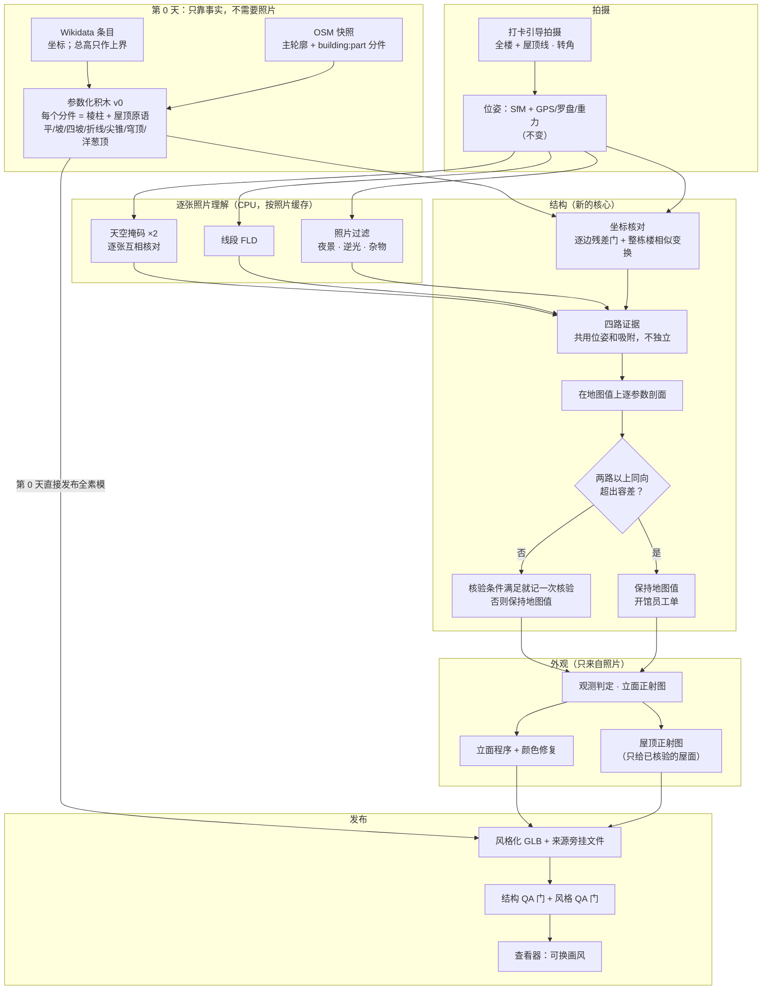
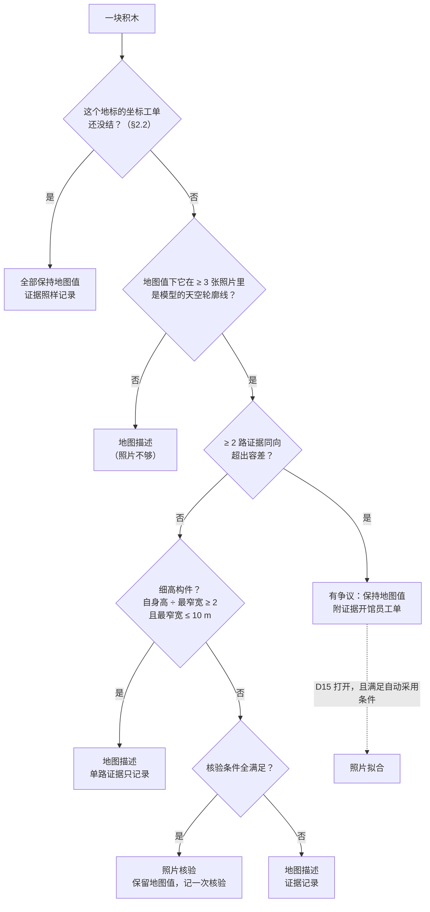
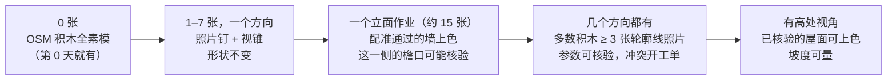
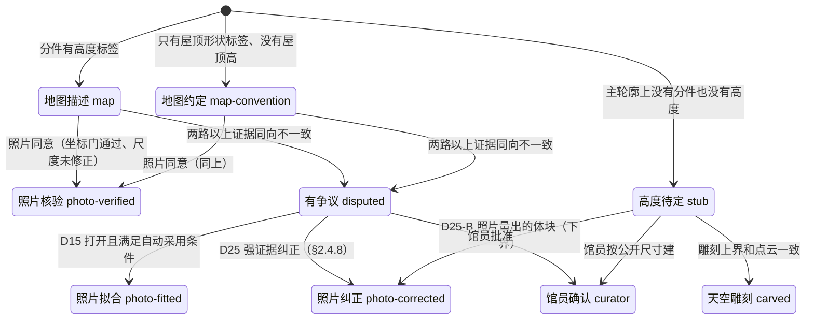
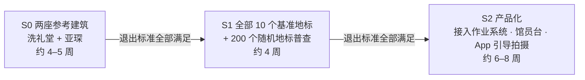

# Crowd3D 的"结构优先"：参照 Hover 重做算法流程

> 2026-10-22，修订版。作者：主设计（lead designer）。读者：产品负责人。
>
> 这份文档回答您的问题："这些模型都没有还原建筑本身的样貌，特别是屋顶；能否参考 hover.to 的技术栈，重新做我们的算法流程。"
> 本文给出改过的流程。四个探针（OSM 分件体块、天空轮廓线、Hover 逐张照片模型、颜色链）和复核实验的实测数字都在下面，每个数字后面标了出处。
>
> **这一版改了什么**：初稿把亚琛"天空轮廓线 22.9 → 17.0 px"当成主要收益，但这个 17.0 来自本文自己的规则会拒绝的参数值（撞边界、在地图值下没有天空背景照片）。按规则真正能发布的是 OSM 先验本身，它在两座参考建筑上都**比现原型更不贴照片**。本版做了这些修改：每个地标报三个数（原型、先验、真正能发布的）；判定规则全部改在地图值上做，每路证据只能投它看得见的方向，门槛都给出数字，参考表由代码生成；洗礼堂的问题改判为"整体坐标偏移 + 轮廓偏大"；补上了逐边残差门、成本、长尾、失效模式。
>
> **和现有文档的关系**：`docs/STYLIZED_MODEL.md`（下称"设计文档"）的大框架不变：素模表示"没人拍过"、外观只来自照片、画风可以换。本文只改两件事。一是**形状从哪里来、怎么用照片核对**，取代设计文档 §3.1 的实现部分和 §3.6 的屋顶部分；二是**颜色链的修复**（§2.5）。本文不直接改设计文档，需要它跟着改的地方列在第 7 节。
>
> **数字出处**：〔O…〕〔S…〕〔H…〕〔C…〕分别是 OSM 分件、天空轮廓线、Hover 模型、颜色四个探针的产物；〔L…〕是本版复核时主设计自己跑的检查；〔K〕是评审的核对脚本，本版重跑过其中的 `pc.py`、`elev.py`、`regcheck.py`、`apothem.py`、`widths.py`、`snap.py`、`hz.py`。附录 A 列了每个编号对应的绝对路径。〔D §x〕指设计文档的某一节。【本文】是作者把实测数字加总或换算出来的；【估算】是工程估计，没有实测；【待核实】是只有二手来源。所有实测都在本容器上跑：4 核 CPU，无 GPU，每个实验 `nice -n 19`、最多 2 线程，同时还有一个基准测试任务在抢 CPU。所以**耗时都偏保守，是上界**。
>
> 探针产物在会话的临时目录里，里面有 Wikimedia Commons 照片的像素，**不进仓库**。

---

## 0. 一页总结

### 0.1 为什么现在的模型不像，尤其是屋顶

您给的对照图〔E〕里，洗礼堂像一块米色"蛋糕"顶着一个普通的尖金字塔，白绿大理石的横条纹没了；亚琛像一堆灰色棱柱，看不出哥特式唱诗堂的屋顶、十六边形回廊和尖塔。原因有四个，按影响大小排：

1. **形状来源用错了（最主要）。** 设计文档 §3.1 已经定了：体块用 OpenStreetMap（OSM）里志愿者画好的建筑分件（`building:part`，带高度和屋顶形状）。但代码一直没实现。`crowd3d/stylize.py` 的 `build_massing()` 实际是用 OSM 主轮廓，加上照片点云的"高度场"一层层切块，屋顶只有"平顶"和"金字塔"两种。
   - 后果是：点云稀的地方切不出塔，细的采光亭和尖塔点太少会丢，哥特式陡坡顶、穹顶、十六边形都表达不了。
   - **但有一点必须说清楚。** "模型轮廓和照片里天空分界线差多少像素"（下称天空轮廓线距离）这个量，现原型天然占便宜：它的高度场就是从同一批照片的点云切出来的。所以这个量**不能衡量"像不像"**，只能查"和照片有没有矛盾"。实测（像素；前一个数用研究用掩码 Dm+R，后一个用可商用的经典掩码 A+R）：

| 地标 | 现原型 | OSM 积木先验 | 按本文规则真正能发布的 | 探针的无约束拟合（**不能发布**） |
|---|---|---|---|---|
| 亚琛 | 22.9 / 24.6 | 29.3 / 29.7 | 29.3 / 29.7（没有一个参数被改） | 17.0 / 19.1 |
| 洗礼堂 | 17.5 / 17.2 | 25.2 / 22.8 | 25.2 / 22.8（同上） | 22.5 / 20.8 |

   - 逐张照片看，OSM 先验只在亚琛 28%、洗礼堂 12–24% 的照片里比原型更贴照片〔S3〕〔K〕。初稿说的"拟合后 83% 的照片更准"，用的是撞到边界、本文规则不会接受的参数值。
   - 先验更差的原因是 OSM 自己的错：亚琛唱诗堂比照片里低 11–17 m（§2.4.3）；洗礼堂的八角形比照片里大 23%，整体还偏了约 3.6 m（§2.2）。
   - 结构优先赢在别处：屋顶类型、穹顶、尖塔、十六边形、采光亭这些**形状本身**是对的。这一点目前只有一个人的主观打分〔O2〕，要用盲测证明。盲测是 S0 的第一项，也是迁移版能不能上线的门（D23）。
2. **屋顶拍不到就被压平。** 地面照片很少看到屋顶顶面。现在的规则是：一个金字塔屋面被点云覆盖不到 40%，就改成平的素模盖〔D §3.6〕。所以洗礼堂有一半屋顶是平的〔O7〕〔S6〕。采光亭这类细构件点太少，在高度场里切不出来，也就没了〔O1〕。
3. **颜色链把识别度丢了。**
   - 洗礼堂的黑白横条纹在照片里明暗差 **30.9 L\***（L\* 是 0–100 的亮度），发布出去的贴图里只剩 **4.4 L\***。原因：工作图只有 8 px/m，61% 的暗条纹被画成了墙色〔C1〕。
   - 接近灰色的颜色只按亮度吸附到调色板，而中间档的灰偏暖，所以白大理石变成了米色 `stone`〔C1〕。
   - 亚琛的参考点云 568,557 个点颜色全是 0（黑），21 块屋顶全被涂成深石色，色差 ΔE00 40.2，却标着"照片实测"〔C1〕〔C4〕。
4. **没有"结构线"。** Hover 的模型像那栋房子，是因为它先做出一个带屋脊、斜脊、檐口的**参数化线框**（类似 CAD 模型），再往上贴东西。我们没有这一步：屋脊、斜脊、采光亭、檐口线都没有作为几何画出来。

### 0.2 Hover 的做法，我们抄哪一半

Hover 的流程（公开专利和资料）是：引导拍摄约 8 张照片 → 求位姿 → 每张照片做深度、分割和线段识别 → **把屋顶边线跨照片三角化成三维线框** → 拟合成平面屋面、坡度都确定的参数化模型 → 用标准门窗尺寸定尺度。

我们实测了它的"逐张照片神经网络"那一半，**在我们的建筑上基本没用**：

- 单目法线在屋面上偏 24–29°（洗礼堂）、39–42°（亚琛）〔H1〕；
- 三种通用分割模型把地标屋顶认成"屋顶"的比例只有 0–18%〔H1〕；
- 专门认屋顶部件的"Gestalt"模型和它的训练数据（HoHo/S23DR）：权重是否公开、数据是否只许非商用研究，H1 和 H7 里都没有原文【待核实】。

真正有用的是"**结构那一半**"：多张照片三角化出三维线段，再拟合成参数化模型。我们写了一个纯 numpy 的简化版。在洗礼堂 107 张照片上（0.75 m / 7° 内）：

- 原始线段找回了 8 条檐口里的 7 条、8 条斜脊里的 6 条，中位偏差 0.40 m；
- 本文实际要用的那一组（有 SfM 点支撑、≥ 6 张照片看到）是 **5/8 和 5/8**〔H2〕；
- 只用离地 ≤ 20 m 的 92 张照片的近似：原始 6/8、5/8，有支撑 5/8、5/8〔L6〕。

要说明两点：这些精度是拿一个**从同一批 SfM 点拟合出来的**参考八角形量的，不是独立真值（§2.4.2）；亚琛的结果差得多，0.75 m 内唱诗堂檐口 0/2、屋脊 0/1、十六边形斜脊 0/16、穹顶檐口 1/16、尖塔斜脊 1/8，放宽到 2 m 尖塔才找回 8/8〔L6〕。

更重要的是，名胜地标的"线框"**已经有人画好了**：13 个评测地标在 OSM 上全都有分件〔D §3.1〕。把它们搭成参数化积木，按探针作者一个人的打分〔O2〕：

- 7 个一眼认得出，其中 4 个磁盘上没有照片，是凭常识判断的；
- 洗礼堂也打了三星，但评语写着"没有颜色还认不出是哪一座"；
- 4 个认得出但有明显缺陷；
- 1 个（悉尼歌剧院，所有分件都没有高度）认不出。

### 0.3 新流程一句话

**先用地图事实搭出建筑的参数化"积木"（第 0 天就有，全身素模）→ 先核对整栋楼的坐标和轮廓 → 在地图值上用照片的几路证据逐个检查积木参数：一致就记一次"核验"，两路以上同向不一致就交馆员，v0 不自动改 → 最后才在核对过的形状上，按照片涂颜色、画门窗。** 这就是"结构优先"。



### 0.4 已经测到的东西（包括退步）

| 问题 | 现在 | 结构优先之后（实测） | 出处 |
|---|---|---|---|
| 亚琛的形状 | 一堆棱柱 | 西塔尖顶、八角堂穹顶、唱诗堂、小礼拜堂、十六边形都有；但唱诗堂按地图值低 11–17 m，开工单 | 〔O7〕〔L2〕 |
| 天空轮廓线距离（只查一致性） | 原型：亚琛 22.9 / 24.6 px，洗礼堂 17.5 / 17.2 px | 能发布的版本：亚琛 29.3 / 29.7，洗礼堂 25.2 / 22.8，**变差** | 〔S3〕〔L2〕 |
| 洗礼堂坐标工单经馆员批准之后 | — | 15.5 / 14.2 px（轮廓线最优的整体变换）；取墙面平面量出的变换是 18.1 / 16.0 px | 〔L3〕 |
| 洗礼堂的屋顶 | 陡金字塔、一半平顶、没有采光亭 | 地图上的 12 m 低金字塔、采光亭和西侧小礼拜堂（scarsella）都在；采光亭的位置要等坐标工单 | 〔O1〕〔O7〕〔L3〕 |
| 洗礼堂的横条纹 | 明暗差 4.4 L\* | 25.5 L\*（照片是 30.9） | 〔C1〕 |
| 亚琛的屋顶颜色 | 黑点被提亮成深石色，色差 ΔE00 40.2；只做重新取色是 31.8 | 10.3 | 〔C1〕 |
| 13 个地标第 0 天的素模 | 只有主轮廓拉伸 | 7 个一眼认得出（4 个是凭常识打分），洗礼堂要靠颜色，4 个有缺陷，1 个认不出（一人打分） | 〔O2〕 |

这张表的意思是：

- 第 0 天的 OSM 积木在形状类型上对了，但**和照片的一致性比现原型差**。
- 照片能做的是找出地图哪里错了、开工单。馆员处理以后，一致性才会追上来：洗礼堂一张坐标工单就能从 25.2 降到 15.5 px，低于原型的 17.5。
- 所有天空轮廓线数字都是用 A+R 和 Dm+R 两种掩码量的。计划的生产掩码 C+R 还没进过任何拟合；Dm+R 的训练数据不明，只能当研究对照（§2.3）。

### 0.5 不变的东西

- 您的四条规则不变：不编造没拍到的内容；没拍到的面是素模，形状只能来自事实；接受"玩具"定位；画风由您定。
- 配准门槛（吸附残差 ≤ 1.5 m、逐边核验）不放松〔D §3.2〕，**还加严一条**：逐边残差把墙内侧 3 m 以外的点也算进去（§2.2）。
- D12 的封闭小洞补底色、画风文件、风格 QA 门 Q1–Q16 都不变。

---

## 1. Hover 的每个环节，我们怎么对应

| Hover 环节 | 它在 Hover 里干什么 | Crowd3D 的选择 | 为什么（许可、CPU、数据），附数字 |
|---|---|---|---|
| 引导拍摄（约 8 张，App 实时检查每一张） | 保证每栋房子都拍到四角和屋顶线 | **借用**：打卡时最多 3 个提示："退后拍全楼和屋顶线"、"走到转角同时拍两面墙"、缺口任务；手机上只做轻量检查，永不拦截上传（§2.1） | 一块积木要在地图值下 ≥ 3 张照片里是模型轮廓线，照片才说得上话；洗礼堂西侧小礼拜堂只有 2 张〔L2〕。洗礼堂 107 张里 104 张在东北到东南〔K〕，西半边没有一个墙点〔L3〕 |
| SfM 位姿 + 手机 GPS/罗盘/重力 + 地平线和檐口线索 | 求每张照片的位置和朝向 | **不变**：COLMAP CPU + 现有地理配准；**新增**逐边残差门和整栋楼相似变换（§2.2） | 坐标和轮廓误差比任何高度参数都伤：洗礼堂北墙的点在 OSM 边内侧 4.4–4.5 m，南墙 2.0–2.2 m，东和东南在边上；照片里是一个 27.3 m 宽、中心偏 (+3.4, −1.2) m 的正八角形〔L3〕 |
| 用标准门窗尺寸定尺度（US9478031） | 没有地图时给出米制尺度 | **不用**：尺度来自 GPS 配准 + 吸附到 OSM 轮廓（尺度修正有上限 ±15%） | 地标的门窗不是标准件；我们有 OSM 轮廓。亚琛吸附修正了 ×1.10，而这个尺度同时乘在所有高度证据上（§2.4.2） |
| Metric3Dv2（单张照片测米制深度） | 补稀疏区域的深度 | **不用**。可选：Depth Anything V2-Small 对齐到 SfM 点后只做加密，默认关 | Metric3D 直接给的米制深度误差（AbsRel，洗礼堂 / 亚琛）0.43 / 0.32；尺度在 ±15% 以内的照片只有 4/20、8/20；权重没写许可证〔H1〕。DA-V2-S 对齐后误差 0.031 / 0.108，1.15 s/张，权重 Apache-2.0，训练数据里有非商用集（要标记）〔H1〕 |
| OneFormer（ADE20K 语义分割） | 天空、植被、建筑等类别 | **不用**。天空掩码两路互相核对（§2.3） | ADE20K 图片只许非商用研究，而且它没有"屋顶"这一类〔H1〕。拟合实际用的是 A+R（经典方法，可商用）和 Dm+R（U2-Net skyseg）；计划的主力 C+R 只在 30 张测试照片上跑过，没进拟合〔S1〕〔S3〕 |
| Gestalt（专认屋顶部件：屋脊、檐口、斜脊、天沟、顶点……） | Hover 的核心数据优势 | **没有可用替代**：拓扑（是什么屋顶）取自 OSM 的 `roof:shape`，位置由三维线段和天空轮廓线量。以后用我们自己核验过的线框反投影到照片里当标签，训练自己的小模型（DINOv2-S，Apache-2.0） | HoHo/S23DR 的许可、Gestalt 权重是否公开，H1/H7 里没有原文【待核实】。通用分割认出屋顶的比例只有 0–18%〔H1〕 |
| M-LSD（线段检测） | 找每张照片里的直线 | **OpenCV FLD**（核心 OpenCV 的 LSD 作备选） | FLD 0.027 s/张，檐口召回 0.844、斜脊 0.759；M-LSD tiny 0.188 s/张，0.619 / 0.667，训练数据许可不明〔H1〕 |
| NormalBAE（法线） | 屋面朝向、坡度 | **不用**，墙面法线也不靠单目 | 单目法线在屋面上偏 24–29°（洗礼堂）、39–42°（亚琛）；深度推出的墙面法线洗礼堂偏 10.2°，亚琛偏 54.3°〔H1〕。NormalBAE 的训练数据（ScanNet）和 DSINE 都是非商用〔H1〕 |
| 屋顶边线跨照片三角化成三维线框（US10460465） | 让模型"像那栋房子"的关键 | **借用**：三维线段（numpy 简化版 LIMAP），作为证据之一（§2.4.2） | 洗礼堂：有支撑的线段找回檐口 5/8、斜脊 5/8；顶点水平差 0.18 m、高度差 0.54 m，参考形状来自同一批 SfM 点〔H2〕〔H4〕。亚琛召回很低（§0.2）；唱诗堂半圆室有一个 46.4 m 的顶点，OSM 写 32 m〔H4〕 |
| 参数化 CAD 式模型（平面屋面、坡度） | 最终交付物 | **借用**：OSM 分件 → 参数化积木（先验），照片核验或开工单 | 13 个地标 828 块积木（822 个 OSM 分件 + 6 块空隙补体）全部水密；每个地标 21–938 ms 搭完〔O1〕〔O3〕。glTF 校验器**还没跑过**：初稿的"0 错误"只是对照图脚本里写死的一句话〔O1〕 |
| 地面照片 + 航拍正射（US9437033） | 屋顶俯视信息 | **没有航拍**。OSM 志愿者本来就是对着航拍图画的分件；政府开放的 LoD2 / 3D BAG 由您决定用不用（D19） | 我们没有航拍数据预算；13 个评测地标的 OSM 分件覆盖 13/13，但这 13 个是挑过的，长尾没测（§3） |
| 数据护城河（1000 万+ 栋房子、200 万+ 照片-结构配对） | 让它的模型越来越准 | 我们的护城河是"每个地标的众包照片 + 馆员确认过的体块登记表"；核验过的线框可以反过来当训练标签 | 开源模型本身是大路货；Hover 的优势在数据 |

**一句话**：Hover 的"逐张照片神经网络"那一半，我们只留线段检测和天空掩码；"结构"那一半全抄，并且把 OSM 当作现成的线框先验。

---

## 2. 新流程逐段说明

### 2.1 拍摄引导（借用 Hover 的引导拍摄）

Hover 能拿到好数据，是因为 App 一张张指导用户拍。游客不是测量员，我们只能"轻提示、不拦截"。

**打卡时的提示（最多 3 个，可跳过）**：

1. **"退后一点，把整栋楼和屋顶线都拍进来，头顶留一点天空。"** 照片要在地图值下把某块积木拍成轮廓线、而且上方是天空，才说得上话（§2.4.3）。
2. **"走到转角，同时拍到两面墙。"** 逐边核验要求通过的墙边方向至少相差 30°；整栋楼的轮廓尺度要求有点的墙面朝向覆盖 ≥ 180°、含两面相对的墙（§2.2）。转角照片同时给出两面墙，直接解决这两个问题。
3. **缺口任务**（沿用设计文档）：例如"站在西南侧 30–60 m 拍 4 张"。现在多两类：某块积木"在照片里从没成为轮廓线"时，提示"从 × 方向拍到它的屋顶线"；某个地标有坐标工单时，提示去拍还没人拍过的那半边（洗礼堂的西侧）。

**手机上的实时检查（只提示，不拦截）**：

- 机身倾斜（重力传感器）；
- 画面顶部有没有一条天空带。用手机上的经典方法：颜色加平滑度，不用模型；
- 是否模糊、过暗、逆光（太阳方位和视线夹角）；
- 离楼的距离（GPS 加 OSM 轮廓）。
- 可选的"取景框"：用第 0 天的积木模型，按手机的 GPS 和罗盘投影出一个半透明轮廓，提示"把楼放进框里"。GPS 的单张误差 p90 有 20–55 m〔D §3.2〕，所以这个框**只能帮着取景，不能用来对齐**【估算，未实测】。

**高处视角**（钟楼、穹顶上往下拍）对屋顶最有用，但不能鼓励攀爬。只做成"如果您恰好在上面"的可选奖励任务。

### 2.2 位姿与坐标对齐

**不变**：COLMAP CPU 增量/全局建图，地理配准（重力 + 2D 相似变换 + 罗盘），QA 门 1，吸附到主轮廓（偏航窗口、±25 m 平移、逐边核验）〔D §3.2〕。分件和主轮廓在同一个坐标系里〔O1〕。

**新增三步**：

1. **逐边残差门（加进配准门槛）。** 每条长 ≥ 5 m、带 ≥ 200 个墙带点的轮廓边，点到边的中位距离必须 ≤ 1.5 m。**墙内侧 3 m 以外、10 m 以内的点也算进去。**
   - 现在的 `registration_check` 不看内侧 3 m 以外的点，所以洗礼堂通过了：7 条投票边里 6 条通过，方向差 89°〔K〕。
   - 加上这一条以后：洗礼堂有 5 条边超限（1.56–4.57 m），不通过；亚琛 83 条有点的边里只有 3 条超过 1.5 m，都短于 5 m，通过〔L4〕。
   - 不通过时：开一张"坐标工单"；这个地标不做任何参数核验或拟合；超限的墙不贴图，保持素模。
2. **整栋楼的相似变换（取代初稿的"只报警"）。** 对整栋楼的全部分件求一个相似变换：平面尺度 k（绕 OSM 主体中心）、平移 t，可选偏航。用两种方法分别求：
   - 墙面平面：每个 OSM 面上墙带 SfM 点的中位位置，对"点位置 = k × 地图边心距 + 法向 · t"做最小二乘；
   - 天空轮廓线：在 (k, t) 上做多起点网格搜索。不能像初稿的 `frame_fit.py` 那样先搜尺度、再搜平移（§2.2 洗礼堂实测里说明为什么）。
   - 两者一致（k 差 ≤ 0.05、平移差 ≤ 1 m），并且有点的墙面朝向覆盖 ≥ 180°、含两面相对的墙，才算量到。单侧数据时尺度和平移分不开。
   - 结果**刚性地作用到所有分件**。永远不单独移动正多边形的某一条边，也不单独移动某个子分件。
   - k 偏离 1 超过 3%，或平移超过 1.5 m：这改的是地图事实（轮廓大小和位置）。按 D15（已拍板：至少两路照片证据一致就自动采用），两路量出的相似变换（SfM 墙面平面和三维直线：两者共用同一套位姿和吸附，三维直线又只保留有 SfM 点支持的，所以**不是独立的**两路，只是两种估计）一致、而且檐口高度确认整体尺度时自动采用，否则开工单（D16）。原型实测：洗礼堂的 SfM 墙面平面（k 0.8164）和三维直线（k 0.8192）一致，檐口天际线 18.62 m、直线 18.79 m 对地图 18 m，自动采用 k 0.8178。
3. **逐墙平面对账只留给不规则轮廓。** 设计文档 §3.2 第 3 条"每面墙各自移到拟合平面（最多 5 m）"会把正多边形拆歪。以洗礼堂为例：北面要移 4.4 m，东面不动，西面没人拍也不动，八角形就歪了。轮廓有 P 重旋转对称（正八角形、正十六边形等）时，改用第 2 步。

**洗礼堂实测**〔L3〕〔K〕：

- 墙带 SfM 点（3–16 m 高，≥ 3 张照片看到）相对 OSM 各面的位置：北面两段在边内侧 4.38 / 4.53 m，东北 1.52 m，东面两段 +0.09 / +0.06 m，东南 +0.14 m，南面两段 1.96 / 2.20 m；西半边没有点。
- 墙面平面求出 k = 0.807、t = (+3.41, −1.18) m，也就是一个宽 27.25 m 的正八角形，8 个有点的面残差都 ≤ 0.16 m。只平移、不缩放，最好也要在南北各差 3.1–3.4 m。
- 尺度无关的核对：照片里檐口高 ÷ 宽 = 18.9 ÷ 27.25 = 0.69，地图上是 18 ÷ 33.4 = 0.54。两者比例本身就不一样，所以不是坐标尺度的问题（这个模型的吸附尺度是 1.00）。
- 天空轮廓线多起点网格：两种掩码的最优都是 k = 0.84、t = (+3.5, −1.5) m。
  - Dm+R：代价降 37%，平均距离 25.2 → 15.5 px（原型 17.5）；
  - A+R：代价降 30%，22.8 → 14.2 px（原型 17.2）；
  - 直接取墙面平面那组值：18.1 / 16.0 px。
  - 两种方法的 k 差 0.033、t 差 0.33 m，一致。
- 初稿的"尺度在 1.00 处有清楚的最小值"是搜索方式造成的：`frame_fit.py` 先在零平移下搜尺度，而零平移时轮廓线反而偏向"更大"（×1.05 最好，23.8 px），之后再搜平移就出不去了〔S4〕〔K〕。"×0.95 代价 +7%、×1.05 代价 +25%"这两个数在 S4 的产物里找不到，删掉。
- "采光亭偏东 3 m"是同一个坐标问题：把同一个相似变换作用到采光亭，它落到三维线段顶点 0.5–0.7 m 以内〔L3〕〔H4〕。所以工单是"整体变换"，不是"挪采光亭"。
- 官方尺寸（常见说法是 25.6 m）在 H6 里没有出处【待核实】；照片量出的 27.3 m 是外墙面的宽度。
- 结论：洗礼堂开一张坐标工单（k ≈ 0.81–0.84，平移约 3.6 m）。馆员批准前不核验、不拟合任何参数，南北墙不贴图。

**亚琛**：`frame_fit.py` 的尺度一直降到 ×0.86 还在降〔S4〕。

- 初稿说"不可信"，太武断。有两种解释：杂乱背景偏向更大的体块；或者吸附的 ×1.10 尺度修正本身偏大（1/1.10 = 0.91）。
- 现在分不开：西立面塔楼和尖塔的 SfM 高度在 ×1.10 下和 OSM 一致（47.6 / 74.2 m 对 49 / 74 m〔L5〕），支持 ×1.10；轮廓线的漂移不支持。
- 所以亚琛的全部证据标"尺度已修正 ×1.10"（§2.4.2），自动核验和自动改值都不做。

### 2.3 逐张照片理解（选定的模型）

每张照片只算一次，结果按照片缓存。以后的立面作业、完整作业直接复用。

| 用途 | 选用 | 耗时/张（2 线程，与基准任务争用） | 许可 | 状态 |
|---|---|---|---|---|
| 线段 | OpenCV FLD | 0.027 s〔H1〕 | OpenCV（Apache-2.0）；无权重 | **用** |
| 天空掩码（计划主力） | C+R：DINOv2-small 线性头给点提示 → SAM 2.1-tiny → 全分辨率 GrabCut 边带细化 | 3.4 s〔S1〕 | 权重 Apache-2.0；SAM 的训练集 SA-1B 只许研究用，DINOv2 训练集是网络图片，**要法务确认**；ONNX 要我们自己从官方权重导出〔S1〕。DINOv2 小头是用这两座参考建筑的 22 张照片（MegaDepth/Commons 图片）训练的，这些图片能不能用来训练商用模型【待核实】 | **只在 30 张测试照片上跑过，没进任何拟合**。S0 先过许可和独立评测，再跑全部照片、重跑剖面 |
| 天空掩码（核对，也是今天唯一可商用的） | A+R：经典方法（顶部种子 + Lab 颜色模型 + GrabCut）+ 同样的边带细化 | 310 张平均 1.06 s〔S2〕 | OpenCV | **用**。全部拟合都用了它 |
| 天空掩码（研究对照） | Dm+R：U2-Net skyseg + 同样的边带细化 | 310 张平均 0.91 s〔S2〕 | 上游代码 MIT（H7 里有原文，Hugging Face 模型卡也写 MIT）；**训练数据不明**【待核实】 | 只作对照。训练数据查清、可以商用的话，它能当第二路核对，比 C+R 快 3.7 倍 |
| 加密深度 | Depth Anything V2-Small，逐张对齐到 SfM 点 | 1.15 s〔H1〕 | 权重 Apache-2.0；训练数据含非商用集（要标记） | 可选，**默认关** |
| 人、车、树遮挡 | Mask2Former-COCO | 1.7 s〔H1〕 | 许可写的是"other"；COCO 图片走 Flickr 条款，要法务看 | 以后 |
| 屋面分面 | MoGe-2-S 法线 | 5.2 s〔H1〕 | MIT（训练集未审） | 以后 |
| — | Metric3Dv2、OneFormer/ADE20K、NormalBAE、DSINE、M-LSD、DeepLSD、HoHo/Gestalt | — | 不明或非商用〔H1〕。DeepLSD 依赖 pytlsd：H7 里它的许可证文件是 MIT，里面是否带 AGPL 的 LSD 原始代码【待核实】 | **不用** |

**两种天空掩码逐张互相核对**（初稿写了，但 `fit.py` 里没有实现）。规则：

- 每张照片在上部区域里，逐列取最上面的"天空 → 建筑"分界，比较两种掩码。
- 两种掩码都有分界的列里，分界位置中位差 > 8 px；或者只有一种掩码有分界的列占上部区域 > 50%；或者能比较的列不到 20 列：这张照片不参加拟合。
- 用 A+R 对 Dm+R 实测〔L7〕：
  - 中位差的分位数：洗礼堂 p75 8 px、p90 39 px；亚琛 p90 5 px、p95 37 px；
  - 这个门槛会去掉洗礼堂 107 张里的 46 张、亚琛 187 张里的 45 张；只看"中位差 > 8 px"一条，分别是 20 张和 14 张。
- 去掉这么多，说明两种掩码分歧本身就大。阈值要在 S0 用独立标注校准，并且用核对后的照片集重跑剖面。§2.4.3 的表还没有经过这一步。

**掩码评测不独立**。30 张"手工标注"的真值是这样来的：

- 先取 5 种被评方法（A、B0、B1、C、Dm）里 ≥ 3 票的多数；
- 只有 8 张做过多边形修正（评审说 9 张，`corrections.json` 里第 9 个键是说明文字）；
- 然后用和 C+R、A+R 同一个边带细化（R）吸边〔S1〕；
- DINOv2 小头的训练照片和测试照片来自同两座建筑。

所以"C+R 逐列误差 3.6 px、A+R 8.0 px"偏乐观，C+R 和 A+R 之间的比较也偏向带 R 的方法。S0 要做独立标注：不用任何方法投票、不吸边，照片取自别的地标（commons-ten-v1 的 10 个地标，每个 5 张）。

**照片级过滤**（失效模式，初稿漏了）：

- **夜景和逆光**：按 EXIF 时间和地理位置算太阳高度角，太阳在地平线下，或者太阳方位和视线夹角 < 30° 的照片，不进天空轮廓线。每张照片给一个掩码置信度（两种掩码的一致度），低于上面的门槛就不用。
- **塔吊、脚手架**：会被当成建筑。圣家堂就在 S1 里。需要一个"杂物"掩码（细长、高对比、颜色和墙不一致），S1 先人工标几张量影响。
- **植被**：三种分割模型各自把亚琛约 28%（27.9–28.6%）的墙点判成植被〔H1〕。礼拜堂前后的树，正是"把低矮礼拜堂往上拉"的来源之一（§2.4.3）。

### 2.4 结构（新的核心）

#### 2.4.1 先验：OSM 分件 → 参数化积木

做法沿用 OSM 分件探针的独立实现〔O8〕，移植进仓库（§7）：

1. **解析**：分件可以是单条路径（way），也可以是关系（relation）。关系要能拼接由几条路径组成的环，处理内环（洞）和一个关系里有几块外环的情况。
2. **过滤邻楼**：分件中心落在"主轮廓外扩 2 m"以内，**并且**分件面积至少 50% 在这个范围内。
   - 第二条是必要的：林肯纪念堂有一个 1,693 m² 的草坪台地分件，它的中心落在纪念堂里，但面积 0% 在轮廓内，只有面积条件能把它去掉〔O1〕。
   - 中心条件去掉了勃兰登堡门 59 个、圣家堂 44 个邻楼分件〔O1〕。
3. **高度**，每个都记来源：
   - `height` 或 `building:levels`；
   - `min_height` 或 `building:min_level`；
   - `roof:height`、`roof:levels` 或 `roof:angle`。
   - Wikidata 的总高**永远不用在任何一个分件上**，只当上界和核验。
4. **屋顶原语**：
   - 平顶、单坡、双坡（含横向和指定方向）、盐盒顶、复折顶、筒拱、四坡、半四坡、折线（mansard）：都按"凸多边形上一组平面的下包络"来建。对凸分件这就是精确的直骨架；不凸但矩形度 ≥ 0.85 的分件，用最小外接矩形代替。
   - 尖锥、圆锥：所有面汇到一个顶点。
   - 穹顶、洋葱顶：用轮廓的缩放副本做旋转面。
   - 做不出来就按一条明确的退化链往下退，原值和原因写进记录。13 个地标一共退化 70 次，其中 63 次在悉尼〔O1〕。
5. **主轮廓上没有分件的地方**（本版改了规则，文档和代码按这一条统一）：
   - 先用主轮廓自己的高度标签；
   - 没有，再看"支撑面"：压在它上面、并且和这块空隙重叠 ≥ 50% 的抬高分件的 `min_height`（来源 `osm-s3db-support`）；
   - 都没有就画 3 m 的"高度待定"矮台（D13），或者走 §2.4.4 的雕刻路径；
   - 小于 20 m² 且没有任何高度事实的空隙不画〔O1〕。
   - 改的原因：初稿写的是"最低 `min_height`"，探针代码（`resolve_remainder`）实际取的是"0.5 m 内碰到它的任何抬高分件的**最高** `min_height`"，只是碰到就算。德累斯顿圣母教堂因此得到 36.65 m，而主轮廓自己标的是 40.65 m〔O1〕。
6. **约定值**：有 `roof:shape` 但没有屋顶高时，按惯例取屋顶高，来源记 `s3db-shape-default`。完整清单和实际用到的次数〔O1〕：

| `roof:shape`（没有屋顶高） | 约定 | 13 个地标里实际画出来的 |
|---|---|---|
| hipped（四坡）、gabled（双坡）和其余坡顶 | 30° 坡，按半宽算 | 四坡 56、双坡 25 |
| dome / spherical（穹顶） | 内切半径 | 23，全在悉尼的 3 m 矮台上 |
| onion（洋葱顶） | 1.5 × 内切半径 | 4 |
| mansard / gambrel（折线顶） | 3 m（一层） | 2 |
| round（筒拱） | 半宽 | 1 |
| pyramidal / cone，分件宽 ≤ 12 m | 0.9 × 分件剩余高度（整件变成尖塔） | 0 |
| 所有约定 | 不超过墙高余量的 0.9 | — |

   - 合计 **111** 个画出来的约定屋顶（初稿写 112），匈牙利议会大厦占 78 个。另有 69 个算了约定高度，但最后退成了平顶。
   - 111 个里有 24 个在"高度待定"矮台上（悉尼 23、印度门 1）。
   - 本文建议：矮台上不加约定屋顶；删掉"≤ 12 m 的尖锥取 0.9 倍"这一条（它会把带帽的塔变成尖塔），尖锥也按 30° 坡。由您定（D17）。
   - 天空轮廓线探针为了快，自己搭了一套简化积木：没有屋顶高的屋顶画成平的，四坡和筒拱画成双坡〔S7〕。用 OSM 分件探针真正搭出的 GLB 打分，亚琛是 29.4 / 29.8 px，洗礼堂 25.3 / 22.8 px，和简化积木差 ≤ 0.1 px〔S3〕；这两座只有 1 个和 0 个约定屋顶，所以差得少。匈牙利议会大厦（78 个）要在 S1 用真正的积木打分。

**实测**〔O1〕〔O2〕〔O3〕〔O6〕：

- 13 个地标、828 块积木（822 个 OSM 分件 + 6 块空隙补体）全部水密；
- glTF 校验器还没跑过，G1 要求接上；
- 20 个合成测试分件的顶部高度都等于标签高度；
- 搭建耗时 21–938 ms/地标。

**数据本身的问题**（照片能指出一部分，改要馆员）〔O1〕〔L2〕〔L3〕：

| 地标 | 问题 | 后果 |
|---|---|---|
| 悉尼歌剧院 | 90 块积木都没有任何高度 | 认不出（只有 3 m 矮台） |
| 圣家堂 | 中殿 3,659 m² 没有分件，主轮廓也没有高度 | 尖塔都在，中殿是矮台 |
| 比萨斜塔 | 所有分件的中心都在同一点 0.06 m 以内 | 塔不倾斜 |
| 印度门 | 38–40 m 之间没有分件 | 顶上两层悬空 2 m（新的 G10 会拦下） |
| 亚琛唱诗堂 | 顶 32 m，其中 `roof:height` 只有 6 m | 去掉邻近更高分件后的 SfM 点比模型同区表面高 11–17 m；去掉吸附的 ×1.10 仍高约 7–13 m |
| 洗礼堂 | 地图上的八角形比照片里大 23%（宽 33.4–33.7 对 27.3 m），整体偏约 3.6 m | 见 §2.2；采光亭的"位置问题"也是它 |

#### 2.4.2 四路证据：共用同一套位姿的不同估计量

初稿把它们叫"三路互相独立的证据"，这不对：

- 四路都用同一套 SfM 位姿和同一个吸附（包括尺度）。吸附尺度乘在所有高度上（`apply_snap_points` 里 z 也乘 s）。亚琛的 ×1.10 让唱诗堂"三路都说约 46 m"，去掉它是约 41.8 m。
- 三维线段用 SfM 点当深度先验，只保留有点支撑的；它的精度也是拿 SfM 点拟合出的参考形状量的（`refmeas.py`）。

所以本文把它们叫"共用位姿的不同估计量"，并规定：

- 每条证据记录吸附尺度；
- 尺度修正 > 3% 的模型，证据标"尺度已修正"，不能单独决定冲突。这是设计文档 §3.2 第 4 条已有的规则，初稿漏了。
- "照片核验"和"照片拟合"之前要先过一道**尺度无关核对**：在同一个坐标系里取比值（这个参数 ÷ 一个参照量，参照量取墙面平面量出的轮廓宽度，或者另一个已核验分件的高度），和地图上的同一比值比，差 ≤ 5%。洗礼堂的例子见 §2.2。这一步还没有自动化，所以尺度修正 > 3% 的模型目前一律不核验、不拟合。

**每路证据只能投它看得见的方向**（容差 TOL = max(2 m, 地图值的 10%)）：

| 证据 | 怎么来 | 能说"地图偏高"吗 | 能说"地图偏低"吗 | 实测 | 局限 |
|---|---|---|---|---|---|
| **天空轮廓线** | 把积木投影到每张已注册照片里，算模型上边缘和照片天空分界线的距离（正反两个方向，≤ 40 px 截断；剖面用的就是这个代价） | 能：地图值下它在 ≥ 3 张照片里上方是天空，剖面又要它降低超过 TOL，或者撞到下边界 | 只能算弱信号"↑?"：树和后面的楼也会让它想升高。"↑?"必须另有一路"↑"才算一票 | 亚琛在地图值上剖面，49 个参数里 28 个撞到上边界〔L1〕 | 只量得到天空前面的部分 |
| **SfM 点** | 分件的暴露面积，去掉更高分件周围 1.5 m 后，点高度的 0.98 分位，和**模型自己在同一区域的表面** 0.98 分位比 | 不能：屋面上没点不代表没楼。洗礼堂屋顶上半没人拍，点的 q98 比模型同区表面还低 2.8 m | 能 | 见下 | 树、邻楼、遮挡物也会出现在模型上方；它**不是下界** |
| **天空雕刻** | 体素被 ≥ 3 张、并且 ≥ 20% 看到它的照片判成天空，就挖掉 | 能：上界的 p95 比模型 p95 低超过 TOL | 不能：它只是上界 | 洗礼堂采光亭上界 p95 30.5 m，模型 34.2 m〔S5〕 | 凹处和看不到的地方挖不掉；**永远不当展示几何** |
| **三维线段** | FLD 线段跨照片对极匹配，用 SfM 点给深度先验，再至少用 2 张别的照片验证，最后合并；只保留有 SfM 点支撑的 | 能（顶点、檐口线） | 能 | 洗礼堂见 §0.2；檐口和线脚高度 5.0、13.5、18.5–19 m 处有水平线峰值〔K〕 | 只用离分件中心 ≤ 2 m 的顶点。亚琛穹顶区那 3 个 37–39 m 的"顶点"彼此水平相距最远 6.5 m，不是穹顶的顶点，更像八角堂山花的尖〔H4〕〔K〕 |

**SfM 点这一路，初稿只举了两个一致的例子**（西立面塔楼、尖塔）。完整情况：

- 按 O5 原来的算法（点的 q98 直接和 OSM 顶高比），亚琛 15 个有点的分件里 11 个高出 max(2 m, 10%) 以上，例如穹顶 +10.1 m、唱诗堂三段和十六边形 +16 到 +18 m、马蒂亚斯礼拜堂 +15.3 m、尼古拉礼拜堂 +9.0 m〔O5〕。一个顶高 18 m 的小分件，点的 p95 有 65 m，落进去的是邻楼的点〔S5〕。
- 改成"去掉更高分件 1.5 m 范围、和模型同区表面比"以后，14 个有点的分件里还有 9 个高出 TOL〔L5〕：唱诗堂三段 +11 到 +17 m、穹顶 +9.1 m、尼古拉 +8.0 m、马蒂亚斯 +14.5 m、十六边形 +12.4 m、安娜 +4.3 m、西侧小塔 462 +7.0 m。一致的 4 个是尖塔、匈牙利礼拜堂穹顶、西立面塔楼、西侧小塔 459。
- 所以这一路**经常和地图不一致**，而且其中有真的地图错误（唱诗堂），也有没滤干净的邻居和树（马蒂亚斯礼拜堂紧挨唱诗堂）。它不能单独决定任何事。

#### 2.4.3 判定规则：照片什么时候能改地图上的值

**怎么算**：

- 每个积木参数单独在地图值附近做剖面，**其余所有分件都保持地图值**。初稿是逐件坐标下降两遍，后拟合的分件会继承前面分件没被接受的改动。八角堂穹顶就是这样"高了 4.6 m"：它下面的十六边形被抬到 +30% 边界，八角堂和穹顶跟着上去了〔S3〕。
- 网格：高度、屋顶高在原值的 0.70–1.30 倍之间，步长 0.05；穹顶半径 ±30%；轮廓缩放 ±10%，步长 0.02；打平时取原值；按照片重采样 200 次，估出参数的 90% 区间。
- 代价：沿用实测过的"正反两个方向"代价。初稿改成"只算正方向"，理由是反方向会让树和邻楼把礼拜堂往上拉，但这个改法没测过。在地图值上实测〔L1〕〔K〕：
  - 两种代价的最优值，在亚琛 49 个参数里有 47–48 个相差不到一格；
  - 撞上限的分别是 28 个和 29–30 个；
  - 安娜礼拜堂、马蒂亚斯礼拜堂、十六边形、唱诗堂在"只算正方向"下也一路降到 +30%。
  - 所以"只算正方向"拦不住往上拉。防这个靠下面的方向规则：**天空轮廓线单独永远不能把东西抬高。**
- 耗时：亚琛 19 块积木在地图值上全部剖面（两种代价都算）233 s，其中准备 68–70 s；洗礼堂 11 s〔L1〕。初稿的两遍坐标下降加剖面是 596–617 s 和 31–33 s〔S3〕。

**规则**（全部在地图值上判定，不依赖拟合结果）：



**门槛**（容差 TOL = max(2 m, 地图值的 10%)）：

| 条件 | 门槛 |
|---|---|
| 照片够不够 | 地图值下，它是模型天空轮廓线（≥ 10 列）的照片 ≥ 3 张。这个计数不看掩码 |
| "上方是天空" | 上面那些照片里，它上方 6 px 是天空的 ≥ 3 张（两种掩码取小的） |
| 方向证据 | 见 §2.4.2 的表；"轮廓线↑?"只在另有一路"↑"时算一票 |
| 细高构件 | 自身高（顶 − 底）÷ 最窄宽 ≥ 2，**并且**最窄宽 ≤ 10 m。按这一条：亚琛尖塔（2.8，宽 9.0 m）、洗礼堂采光亭（2.1，宽 3.9 m）、亚琛西侧两座小塔（4.6，宽 7.9 m）、安娜和马蒂亚斯礼拜堂（2.7 / 2.5，宽 7–8 m）都算；西立面塔楼高宽比 4.0 但宽 12.2 m，不算〔L2〕〔K〕 |
| 核验：区间 | 90% 重采样区间换成米 ≤ 1.5 m（高度）/ ≤ 0.75 m（半径和轮廓，按半宽算） |
| 核验：两种掩码 | 拟合值相差 ≤ 1.5 m（高度）/ ≤ 0.75 m（半径） |
| 核验：两种代价 | 正反代价和只算正方向代价的最优值相差 ≤ 1 格 |
| 核验：不撞边界 | 两种掩码都不撞 |
| 核验：离地图值 | ≤ TOL（高度）/ ≤ max(1 m, 10%)（半径） |
| 核验：尺度 | 吸附尺度修正 ≤ 3%；超过的话先过尺度无关核对（§2.4.2），目前没有自动化，所以不核验 |
| 自动采用（D15，**默认开**：产品负责人 2026-10-23 拍板，条件见 §6 D15） | 有争议的那几路里至少两路给出数值，彼此相差 ≤ max(1 m, 5%)；核验条件里除"离地图值"以外全部满足；不是细高构件；父件的状态已被接受 |
| 强证据纠正（D25，产品负责人 2026-10-25 拍板） | D15 没采用的有争议参数和"高度待定"矮台，按 §2.4.8 再判：天空轮廓线放宽搜索，最大的一组 ≥ 2 路一致而且没有反对（第二轮修复：往上改的一组里要有楼自己的几何——三维直线或屋顶面拟合，SfM 全周顶只能反对），对边墙可以确立尺度，配准盒子里的下界仍比地图值多出 TOL；下界在中点以上才采用照片值，否则只采用下界。还有倾斜（D25-T）和照片量出的体块（D25-B） |

**两座参考建筑逐件过一遍**。下表由代码生成（`decide.py` → `table_zh.py`〔L2〕）。剖面一栏是"其余分件都在地图值"时的最优值，A+R / Dm+R 两种掩码，\* 表示撞边界；SfM 和雕刻一栏括号里是模型自己在同一区域的值；"↑?"是弱信号。

**洗礼堂**

| 分件 | 地图 底/檐/顶 m | 最窄宽 m · 高宽比 | 是轮廓线的照片 / 上方是天空 | 在地图值上的剖面 A+R / Dm+R（檐、顶、半径 m；* 撞边界） | SfM q98（模型同区） | 雕刻 p95（模型同区） | 线段顶点 | 方向证据 | 结果 |
|---|---|---|---|---|---|---|---|---|---|
| 主体八角（w252113556） | 0/18/30 | 33.4 · 0.9 | 88 / 73 | 檐 18.9/18.9；顶 31.2/32.4；半径 17.05/17.72 | 24.3（27.1） | 29.0（27.04） | — | — | 地图描述（坐标工单未结；否则檐口会是照片核验） |
| 西侧小礼拜堂（w252113557） | 0/11/13 | 3.7 · 3.5（细高） | 2 / 0 | 檐 12.65/11；顶 13/13；半径 1.7/1.7 | — | 29.5（12.91） | — | — | 地图描述（只在 2 张照片里是轮廓线） |
| 采光亭（w252113558） | 27/32/35 | 3.9 · 2.1（细高） | 67 / 56 | 檐 30.5*/30.5*；顶 34.1*/34.1* | — | 30.5（34.23） | — | 轮廓线↓（撞边界）、雕刻↓ −3.7 | 地图描述（坐标工单未结；否则是有争议·工单） |

**亚琛**

| 分件 | 地图 底/檐/顶 m | 最窄宽 m · 高宽比 | 是轮廓线的照片 / 上方是天空 | 在地图值上的剖面 A+R / Dm+R（檐、顶、半径 m；* 撞边界） | SfM q98（模型同区） | 雕刻 p95（模型同区） | 线段顶点 | 方向证据 | 结果 |
|---|---|---|---|---|---|---|---|---|---|
| 八角堂 Pfalzkapelle（w211100408） | 19/28/28 | 17.7 · 0.5 | 34 / 0 | 檐 30.7*/30.7*；半径 9.74*/9.74* | — | 49.5（28.0） | — | 轮廓线↑?（撞边界） | 地图描述（上方是天空的照片 < 3；只有一路方向证据） |
| 西塔尖顶（w306573602） | 49/49.1/74 | 9.0 · 2.8（细高） | 119 / 113 | 顶 66.53*/66.53*；半径 4.05*/4.05* | 74.2（70.4） | 64.5（68.13） | — | 轮廓线↓ −7.5 | 地图描述（细高构件，单路证据只记录） |
| 八角堂穹顶（w505513553） | 28/28/42 | 17.6 · 0.8 | 100 / 16 | 顶 46.2*/46.2*；半径 11.43*/11.43* | 51.0（41.9） | 55.5（41.61） | — | 轮廓线↑? +4.2、SfM↑ +9.1 | **有争议·工单** |
| 唱诗堂半圆室 a（w505513555） | 0/26/32 | 13.3 · 2.4 | 42 / 0 | 檐 33.8*/33.8*；顶 33.8*/33.8*；半径 7.07/7.34* | 48.5（31.2） | 49.5（30.55） | — | 轮廓线↑? +7.8、SfM↑ +17.3 | **有争议·工单** |
| 唱诗堂半圆室 b（w505513556） | 0/26/32 | 16.3 · 2.0 | 61 / 1 | 檐 33.8*/33.8*；顶 33.8*/33.8*；半径 7.34*/7.34* | 43.7（31.1） | 51.75（30.55） | 46.4 | 轮廓线↑? +7.8、SfM↑ +12.6、线段↑ +14.4 | **有争议·工单** |
| 唱诗堂 Chorhalle（w505513557） | 0/26/32 | 15.8 · 2.0 | 88 / 0 | 檐 33.8*/33.8*；顶 33.8*/33.8*；半径 8.68*/8.68* | 43.4（32.0） | 52.5（31.54） | — | 轮廓线↑? +7.8、SfM↑ +11.4 | **有争议·工单** |
| 匈牙利礼拜堂穹顶（w505524598） | 16/16/23 | 10.0 · 0.7 | 105 / 54 | 顶 20.9*/21.25；半径 4.49/4.49 | 22.9（22.9） | 26.25（22.84） | — | — | 地图描述（拟合不稳或撞边界） |
| 小分件 600（w505524600） | 0/13.5/18 | 6.7 · 2.7（细高） | 0 / 0 | 檐 17.55*/13.5；顶 18/18；半径 3.37/3.37 | — | 33.22（16.92） | — | — | 地图描述（只在 0 张照片里是轮廓线） |
| 尼古拉礼拜堂（w505524601） | 0/13/21 | 13.7 · 1.5 | 45 / 26 | 檐 16.9*/16.9*；顶 23.4*/23.4*；半径 6.17*/6.17* | 28.8（20.8） | 38.25（20.79） | — | 轮廓线↑? +3.9、SfM↑ +8 | **有争议·工单** |
| 匈牙利礼拜堂（w505550221） | 0/16/16 | 10.8 · 1.5 | 57 / 4 | 檐 15.2/15.2；半径 5.91*/5.91* | — | 33.37（16.0） | — | — | 地图描述（拟合不稳或撞边界） |
| 安娜礼拜堂（w505597426） | 0/16/20 | 7.4 · 2.7（细高） | 50 / 0 | 檐 20.8*/20.8*；顶 21.2*/21.2*；半径 4.09*/4.09* | 23.8（19.5） | 30.75（19.08） | — | 轮廓线↑? +4.8、SfM↑ +4.3 | **有争议·工单** |
| 马蒂亚斯礼拜堂（w505597429） | 0/16/20 | 7.9 · 2.5（细高） | 26 / 0 | 檐 20.8*/20.8*；顶 21.2*/21.2*；半径 4.19/4.35* | 34.4（19.9） | 38.36（19.86） | — | 轮廓线↑? +4.8、SfM↑ +14.5 | **有争议·工单** |
| 卡尔礼拜堂（w505597432） | 0/12/16 | 11.4 · 1.4 | 4 / 0 | 檐 11.4/11.4；顶 15.2/15.2；半径 5.13*/5.13* | — | 42.0（15.13） | — | 轮廓线↑?（上方无天空） | 地图描述（上方是天空的照片 < 3；只有一路方向证据） |
| 小分件 436（w505597436） | 0/13.5/18 | 5.5 · 3.3（细高） | 0 / 0 | 檐 17.55*/17.55*；顶 18/18；半径 2.73/2.73 | — | 34.5（17.58） | — | 轮廓线↑? +4.1 | 地图描述（只在 0 张照片里是轮廓线） |
| 小分件 454（w505623454） | 0/10/10 | 2.9 · 3.5（细高） | 2 / 1 | 檐 9.5/9.5 | 7.8（10.0） | 56.25（10.0） | — | — | 地图描述（只在 2 张照片里是轮廓线） |
| 西立面塔楼 Westwerk（w505623457） | 0/49/49 | 12.2 · 4.0 | 131 / 116 | 檐 41.65/44.1；半径 5.5*/5.5* | 47.6（49.0） | 55.5（49.0） | — | — | 地图描述（拟合不稳或撞边界） |
| 西侧小塔 459（w505623459） | 0/28/36 | 7.9 · 4.6（细高） | 66 / 27 | 檐 30.8/32.2；顶 38.4*/38.4*；半径 4.33*/4.09 | 35.3（33.8） | 39.0（34.45） | — | 轮廓线↑?（撞边界） | 地图描述（细高构件，单路证据只记录） |
| 西侧小塔 462（w505623462） | 0/28/36 | 7.9 · 4.6（细高） | 44 / 3 | 檐 32.2/32.2；顶 38.4*/38.4*；半径 4.33*/4.33* | 39.1（32.1） | 38.25（33.56） | — | 轮廓线↑? +4.2、SfM↑ +7 | **有争议·工单** |
| 十六边形回廊 Sechszehneck（w1077724896） | 0/13.5/24.5 | 32.8 · 0.8 | 4 / 0 | 檐 17.55*/17.55*；顶 27.8*/27.8*；半径 18.02*/18.02* | 29.9（17.5） | 49.5（18.26） | — | 轮廓线↑? +4.1、SfM↑ +12.4 | **有争议·工单** |

（三维线段顶点一栏只列离分件中心 ≤ 2 m 的。尖塔的另一个读数，用陡线段求的顶点 69.9 m〔H3〕，比地图低 4.1 m，在容差 7.4 m 以内。）

**结论**：

- **洗礼堂**：坐标工单未结，3 块积木全部保持地图值。工单处理以后要重新判定：届时主体檐口会是照片核验（18.9 对 18.0 m），采光亭会开工单（轮廓线撞下界、雕刻上界低 3.7 m），西侧小礼拜堂仍然照片不够。
- **亚琛**：9 张工单（唱诗堂三段、穹顶、尼古拉、安娜、马蒂亚斯、西侧小塔 462、十六边形），10 块保持地图值，**没有一块被核验**。
- **自动改值（D15 打开后的原型实测）**：洗礼堂 1 处（整栋轮廓，见 §2.2）；亚琛 0 处：多数分件只有 SfM 一路给出数值（天际线剖面撞边界、直线太少），唱诗堂半圆室 b 两路相差 3.26 m（允许 2.36 m），加上吸附尺度 ×1.10 需要的尺度无关核对找不到可量的参照，所以都只开工单。
- 所以两座参考建筑按规则真正能发布的都是 OSM 先验本身，也就是 §0.1 表里的第三列。

**初稿的几处判断收回**：

- 穹顶"照片核验"错了：它的 46.6 m 是被十六边形抬上去的。在地图值上，它的屋顶剖面一路降到 +30%，轮廓线代价 8683 → 8105，只算正方向 4045 → 3678〔K〕；SfM 也高 9.1 m。现在是工单。
- 唱诗堂按初稿规则会因为计数方式而翻转：照片数按拟合前算是 0 张、"照片不够"，按拟合后算是 6 张、"有争议"。现在的依据是"88 张照片里它是轮廓线，上方几乎从来不是天空"加上"SfM 高 11.4 m"，结果是工单。
- 西侧小塔 462 按初稿的规则会被自动抬高 4.2 m（不撞边界、42–43 张天空照片、拟合顶 39.0 m 和 SfM 40.8 m 一致），和"不自动改"矛盾。现在它算细高构件，两路同向，开工单。

**工单多**（亚琛 9 张）反映的是 OSM 数据本身的状况。工单只是请人看，不改模型。S1 统计每个地标的工单数；太多时按证据强度排序：有数值证据的路数，以及各路给出的差值大小（D22）。

**同一块积木没拍到的那几面、叠在上面的分件怎么办（D16）**：

- **允许**：整块积木的标量参数带动同一块积木没拍到的那几面，包括高度、屋顶高、顶点、穹顶半径。前提是这个参数已经被接受（照片拟合或馆员）。没拍到的面**仍然是素模**，几何来源记"在别的面上量的"。
- **整体轮廓缩放**只在 §2.2 的整栋楼相似变换里做，并且要求有点的墙面朝向覆盖 ≥ 180°、含两面相对的墙。单侧数据时尺度和平移分不开：洗礼堂只看零平移，轮廓线会说"大 5%"，联合求解却是"小 16%、平移 3.8 m"〔L3〕〔K〕。v0 走馆员。
- **父子传播**：子分件跟着父件动，只在父件的改动被接受以后；子分件自己的证据要在父件的新值上重新剖面；子分件的状态不能比父件"更确定"。初稿的两个例子：穹顶 +4.6 m 来自十六边形；尖塔降到 66.6 m，部分来自西立面塔楼被降低〔S3〕。
- **不允许**：逐条边的位置（没拍到的边只跟随整体变换）；逐面的细节，例如一面的老虎窗复制到另一面；任何外观。

这一点碰到了您的规则 2，所以列为 D16，请您确认。

#### 2.4.4 没有分件的地方：雕刻（只在这里用）

主轮廓上有一块没有任何分件、也没有高度标签（圣家堂中殿 3,659 m²、德累斯顿圣母教堂 594 m²、悉尼 6,641 m²〔O1〕），默认画 3 m 矮台。如果照片拍到了这一块，就走"雕刻"路径：

- **轮廓**：只用地图上的主轮廓（事实）；
- **高度**：雕刻上界在这一块的中位高度，要和"去掉邻近更高分件后"的 SfM 点 0.98 分位差 ≤ max(2 m, 10%)。上界和点云这两种估计都同意，才算量到。初稿把 SfM q98 叫"下界"，不对：邻居和树会让它偏高（§2.4.2）；
- **屋顶**：**一律平顶**，不发明屋顶形状；
- **来源**：`carved`；要求这一块在 ≥ 3 张照片里是轮廓线，并且上方是天空。
- 不满足就仍是 3 m 矮台加工单。

雕刻的体素**永远不直接显示**：它又碎又吵，也挖不掉凹处〔S5〕〔S6〕。这条路径在参考建筑上只试过亚琛积木之间的空隙（430 个格子没有积木，雕刻中位高度 33 m〔S5〕），**还没在圣家堂中殿这种真正的目标上验证**，是 S1 的实验。

#### 2.4.5 照片少的时候

众包照片的现实是：一个方向 8–15 张，几乎都在地面上。探针用的是很密的 MegaDepth 参考集（107 张和 203 张，还有钟楼、穹顶上的高处视角），三维线段的召回率是**最好情况**〔H2〕。只用地面照片的近似已经从 7/8 降到 6/8（原始线段的檐口）〔L6〕。所以规则设计成"**照片不够时什么都不改**"：



- 形状**下限就是地图积木**。在本文规则下，照片只能做四件事：记一次核验（不改值）、开工单、按 D15（默认开）的严格条件自动改值、按 D25（§2.4.8）在强证据下纠正地图。
- G5（§2.8）保证照片改动后的版本和照片的一致性不比地图先验差。它保证不了"更像"，"更像"只能靠盲测。
- 洗礼堂在设计文档里只用 15 张真实照片时，模型退化成平顶八角"蛋糕"〔D §3.1〕。结构优先之后，第 0 天就有地图上的 12 m 金字塔和采光亭。
- **S0 必须实测**：每个参考地标只用 8 / 15 / 30 张地面照片，数一数各有多少参数能核验、开了多少工单，画出"照片数 → 确定率"的曲线（§5.3）。三维线段要用地面照片真正重跑，不是本文的近似。

#### 2.4.6 数据：体块登记表 v2

在设计文档 `massing.json` 的基础上，改成**每个参数一条来源**，每条证据带吸附尺度：

```json
{"landmark": "aachen-cathedral", "version": 7,
 "sources": {"osm": {"snapshot": "2026-10-22T03:10Z", "licence": "ODbL-1.0"}},
 "frame": {"snap_scale": 1.1008, "scale_corrected": true, "facet_gate": "pass", "frame_ticket": null},
 "parts": [{"id": "w505513556", "name": "choir apse", "outline_source": "osm-s3db",
   "shape": {"roof": "pyramidal", "source": "osm-s3db"},
   "params": {
     "min_height":  {"value": 0.0,  "state": "map", "source": "osm-s3db"},
     "height":      {"value": 32.0, "state": "disputed", "source": "osm-s3db",
                     "evidence": [{"kind": "skyline", "masks": ["A+R", "Dm+R"], "skyline_photos": 61, "sky_above_photos": 1, "vote": "up?", "snap_scale": 1.1008},
                                  {"kind": "sfm-points", "q98": 43.7, "model_q98": 31.1, "vote": "up", "snap_scale": 1.1008},
                                  {"kind": "lines3d", "apex": 46.4, "lines": 9, "vote": "up", "snap_scale": 1.1008},
                                  {"kind": "carve", "p95": 51.75, "model_p95": 30.55, "vote": null, "snap_scale": 1.1008}],
                     "ticket": "T-118"},
     "roof_height": {"value": 6.0,  "state": "map", "source": "osm-s3db"}},
   "fallback": null}],
 "curator_overrides": [], "conflicts_open": 9}
```

（证据数字取自〔L2〕〔L5〕〔H4〕〔S5〕；版本号和工单号是示意。）

`state` 只能取这几个值：`map`、`map-convention`、`photo-verified`、`photo-fitted`、`photo-corrected`（D25，§2.4.8）、`disputed`、`curator`、`carved`、`stub`。显示规则见 §2.7。

#### 2.4.7 照片实测的结构细节（已实现：`crowd3d/relief.py`、`crowd3d/structmetrics.py`；第三轮核查后收紧；第四轮补上"合并开间"；第五轮 D24 已打开；第七轮补上起拱线贴着窗台的合并开间、D24 加上留出照片这一路）

产品负责人 2026-10-23："主要目标是构建出一栋建筑的框架，结构的细节越多越好。"框架仍是 OSM 分件；照片在**拍到的墙上**加上**量出来的**结构，每一处都带来源记录。

**立面起伏（facade relief）**：每面已上色（拍到）的墙，在墙自己的坐标里做 0.2 m 的起伏图（SfM 点，track ≥ 3，相对拍到的前表面，含偏航），按这面墙自己的起伏层（直方图峰）吸附，再分解成：腰线/勒脚/退台（横带）、壁柱/扶壁/角柱（竖条）、开口（拱券开间、拱、门、窗，圆拱顶，开口里还可以套一层更深的门窗）。边缘用原始点细化到格子以下。

**墙前的独立物体不是结构**（第二轮核查：注入的杆子曾把真拱券切成 3 个假开间、被建成"扶壁"）：从原始点找宽 ≤ 2.5 m、高 ≥ 1 m、两侧都站出 ≥ 0.45 m 的东西，如果它背后**看得见墙**（墙面点密度 ≥ 旁边的 0.3 倍）、而且墙和它之间有 ≥ 0.25 m 的**空深度**，就是杆子、树干、路灯：删掉它的点，按照片在它背后看到的墙重新量。起伏图里的竖条再过一道同样的网。扶壁、墩柱背后看不见墙，侧面把深度填满，所以保留（亚琛唱诗堂的深扶壁因此不再被误判）。

**证据和闸门**（全部通过才建几何）：

| 闸门 | 条件 |
|---|---|
| G-R1 墙 | ≥ 2000 点、≥ 15 点/m²、≥ 20% 的格子有数据、拍到的前表面离框架墙 ≤ 0.6 m；**前表面是一整块**：框架层（和更凸出）的格子连成一片，横跨拍到宽度的 ≥ 75%（第三轮：墙前 0.15–0.25 m 的一块板或脚手架网会被当成框架，所有深度都从它量；有两个前表面的墙也没有唯一的框架，都拒绝）；每半照片 ≥ 6 张看到这面墙 |
| G-R2 两种分法 | 只用一半照片的观测**重新三角化**点（`PointTracks`），两种分法都要：按方位角**交替**分，和按**视点**分（看到这面墙的照片按方位角中位数分成左右两半，邻近视点在同一半）。每种分法的两半都找到它（框 IoU ≥ 0.3、同类型同方向），深度差 ≤ max(0.1 m, 50%)，**量到的边**两半相差 ≤ 0.3 m，**并且每一半找到的是同一个元素**（第七轮，`split_box_m`）：它的侧边（横带是上下边）离元素本身 ≤ 0.6 m——合并了两个开间的框按 IoU 能对上其中一个，侧边对不上。审计对**每一条记录**从照片观测重跑两种分法（第七轮；第六轮只重跑 D24 记录），切开半边的竖条由审计自己从点推（`halves_cutters`），不用记录写的。**D24 元素（第六轮）要求更多**：分法是它唯一的第二路证据，所以**每一条边**（贴地的底边、寄存器边界上的底/顶这些"界限边"也算）在两种分法的两半里都要再找到：两半之间 ≤ 0.3 m、每一半和元素本身 ≤ 0.6 m（`relief.d24_halves_check`）；元素的底或顶正好是它所在寄存器的边界时，那不是量到的边，造出这条边界的横带本身必须被接受（`relief.register_bounds`，第一轮核查的人群：被拒的"人群横带"的顶成了上面开间的窗台） |
| G-R3 三维直线 | 至少一条边落在三维直线簇上（≤ 0.2 m），**而且不是碰巧**：每条边算"在元素两侧 2 m 内、**避开它自己两条边 ±0.4 m** 随便放一个位置，附近也有直线簇"的比例（chance；第二轮的窗口把元素自己的边簇也算成偶然，1.5 m 以下的干净壁柱永远过不了），确认这么多条边的偶然概率必须 ≤ 0.1；每条记录写出各边的 chance 和这个概率。**D24（2026-10-24 起）**：只差这一条、而且至少一条边落在直线簇上（直线处于偶然水平，不是没有直线）的元素，在比例条件满足的模型上只凭点建，见下"第五轮" |
| G-R4 尺寸深度 | 检测器的尺寸范围内，深度/凸出 ≤ 1.5 m |
| G-R5 实拍 | 框 ≥ 50% 落在实拍纹素上；并且 ≥ 50% 的表面被看到这面墙的大多数照片**无遮挡**地看到（它前面 ≥ 0.3 m 的密集点都算遮挡，不论多远，不再有 1.5 m 的豁免） |
| G-R6 原始点重量 | （第七轮：下面的"框内"都按**建出来的轮廓**量——拱是到起拱线的矩形加上面的半圆，四周缩 0.15 m；量不了的内部不算通过；条宽按 0.1 m 的名义格数比）框内原始点的中位偏移和记录相差 ≤ max(0.05 m, 30% 起伏)，且离"没有它时的面"超过 max(3 倍标准误, 0.04 m)：平墙上 0.10–0.15 m 的假凹进过不了；**旁边一圈**（开口、竖条左右两侧外 0.1–0.4 m）的原始点也要显出它的台阶：每一侧"框内减旁边"朝声明的方向至少是声明起伏的一半（第三轮）；**凹进的框内不能有结构**（D24 前补的漏洞，第六轮补全，见下）：沿元素（竖条）和横穿元素（横条）按 0.1 m 重推原始点的深度剖面。竖条：宽 ≥ 0.3 m、在元素 ≥ 2/3 的高度上比声明的背面凸出声明起伏的一半以上（起伏按记录的"底"和框架面里**较近的**那个算）——两个开间之间的壁柱、竖棂。横条（第六轮重写：第四轮的逐行规则在真实数据上看不到檐部，见第六轮）：每一行**合并上下 0.15 m 内的点**（一行噪声不再打断一条横带），一行算结构，要么 ≥ 2/3 的格子在框架面（同上），要么它是**横穿凹进的构件**：合并后的中位深度比它上下 0.5–1.5 m 两侧的凹进背面（两侧中位数的平均，不低于声明的背面）凸出 ≥ 0.2 倍起伏，并且 ≥ 2/3 的格子至少凸出这个量的一半（横贯整个宽度，不是一尊雕像）；这样的行连续 ≥ 0.25 m 就是一条横条——两层之间的檐部、横档。流程自己的 G-R6 用更严的 60% / 0.2 m / 0.2 m / 0.175 倍 |
| G-R7 离开独立物体 | 量到的竖边离独立物体 ≥ 0.3 m |
| 嵌套 | 门窗只在已接受的父开口里 |

开口只在点确认的竖条处（G-R2、G-R6、G-R7 都过）切成开间：没被点确认的竖条（墙前的东西、一半照片看不到的条）不能把一个凹进切成编出来的开间。检测器在一个开口**里面**找到框架面上的竖条（两边都是凹进，不是开口自己的边）时，把它当成一个竖条元素，同样过 G-R2/G-R6/G-R7，并在那里切开；只用已接受的竖条切时，跨过没被确认的竖条的开口在 G-R6 被拒：**从不建一个跨过墩柱的凹进**。

- **几何**：凹进去的做成墙面上的洞 + 侧面 + 背面（拱用 8 段半圆），凸出的做成盒子，都在记录写的偏移上；只在这面墙拍到的那一段上；每个顶点保留墙上的 (u, z)，贴图照旧。
- **来源**：每个元素在墙节点 extras 的 `relief` 里有一条记录：`photo-measured`、两种分法的 IoU / 深度差 / 边差、确认边的三维直线、各边 chance 和偶然概率、原始点重量的数值、无遮挡比例、各闸门结果、是否建了几何。
- **诚实检查**（第二轮加的几何对记录检查）：`audit_glb` 和 `audit_model` 现在要求**没有起伏记录的墙节点必须是平面**（1 mm 内）；有记录的节点，墙面外的每个顶点都要落在一条"已建"记录的框里、并且在这条记录（或它的父开口）的偏移上；每条已建记录都要在它的偏移上有一个面；两面不同的墙上坐标到毫米都相同的记录算抄的；记录编号要对应它的墙；`audit_model` 用原始点重量**每一条**记录（建没建都算）；`structure_metrics` 的 unbacked 必须是 0，QA 才通过。第一轮核查伪造的 GLB（删记录留几何、几何搬到素模墙、记录和几何抄到另一面墙并改编号、有记录没几何、凹进加深 2.5 倍、几何平移 1.5 m、浅凹假记录）和"被拒的元素也建几何"的变异体，现在全部被 `audit_glb` 和 `audit_model` 拦下。
- **第三轮：审计不再相信记录自己写的参照**（核查用自洽的假记录骗过了全部四项检查：墙 5 上一个 3 × 9.9 m 的假凹进，那面墙的点本来就在模型墙后 0.305 m，记录把框架写成模型墙面；墙 2 的平壁柱上一个假凹进，记录的框架往外挪 0.3 m）。现在 `audit_model` 对每面有记录的墙**只用原始点重推** G-R1 和框架（`relief.independent_frame`），按相机重数每半照片张数；墙过不了 G-R1、或记录的框架离重推的框架 > 0.1 m，记录就不通过；每条记录的偏移对着**重推的框架**和**旁边一圈的点**重量；G-R3 由三维直线**重新算**（`relief.line_evidence`，不看记录自己写的直线数字；没有三维直线可对的起伏记录也不通过）。两个假凹进现在都被拦下。
- **第三轮：GLB 的框架和屋顶结构线也要对得上记录**：`audit_glb` 要求每条屋顶结构线落在它分件屋顶网格上同类的边上（屋脊、斜脊、天沟在 ≥ 20° 的折边上，檐口、山墙斜边在边界上；屋脊和檐口水平，斜脊和山墙斜边倾斜）：飘在顶点上方 3 m 的线、往外挪 30% 的檐口、编出来的 30 m 屋脊都被拦下。GLB 的结构 extras 现在带每个分件建成的底、檐、顶高度和轮廓环，`audit_glb` 核对每个节点：墙从底到不超过顶、墙脚在轮廓上，屋顶在檐和顶之间，来源值在枚举里并且和它画出来的参数一致（把顶点抬高 4 m、墙节点改成 `photo-measured` 都会被拦下）。被标"照片核验"的屋顶线由 `audit_model` 用三维直线再核验一次。
- **第四轮（D24 打开前补漏洞，按您 2026-10-24 的要求"同意 D24，但先补上'合并开间'这个漏洞再打开"）**：
  - **合并开间**（核查 N10：一条记录声称一个凹进，跨过两个真实开间和它们之间的壁柱，记录和几何自洽、偏移、框架、旁边一圈都对得上，原来只有处于偶然水平的直线能拦）：`audit_points` 现在对每个凹进**从原始点重推框内的深度剖面**（`relief.interior_structure`，不看记录写的任何内部信息），框内有框架面上的竖条或横条就不通过（**第七轮更正**：拱的"框内"只量到起拱线，起拱线贴着窗台时只剩 0.15 m，检查返回"通过"；"一条记录声称跨过真实结构的一个凹进，现在只凭原始点就过不了 `audit_model`"这句话第六轮之前都不成立，第七轮按建出来的轮廓量、量不了不算通过）；`audit_model` 用的是重推的框架。检测器自己也在这种竖条处切开（见上）。**更正（第六轮）**：这里原来写"诚实的输出不会碰到这条检查"、上表写这条检查能拦"两层之间的檐部"——在真实数据上**不对**：第一轮 D24 核查发现，第五轮建成的 11 个元素里有 8 个（墙 2 的 o7–o9、墙 3 的 o6/o7、墙 4 的 o5–o7）从地面一直到上层拱顶，**跨过了两层之间的檐部**（z 约 4.6–5.4 m），把两层的立面做成了一层高的大开间；檐部在原始点里只比开间背面凸出起伏的 0.3–0.7，逐行的格子比例在 0.33–0.86 之间跳，连续 ≥ 2/3 的行凑不够 0.4 m，所以这条检查没看到。第六轮重写了横条规则并让检测器在横条处切开，见下。`audit_glb` 只拿到 GLB 字节：GLB 里只有建成的几何（就是声明本身）和照片纹理，**没有元素内部的深度**，所以它只能要求每条凹进记录带着自己的内部重量结果（`record_violations`），真正独立的检查是 `audit_model`（它拿原始点）。
  - **屋顶补丁不是屋顶的边**（核查 S5：沿屋顶补丁轮廓编一条檐口或山墙斜边能通过，补丁是贴在屋面上方几厘米的颜色贴片，轮廓在坡中间）：`audit_glb` 核对结构线用的屋顶网格只含屋面（`roof`、`roof-cut`），不含补丁。
  - **墙在它的屋顶开始的地方结束**（核查 P4：主体一面墙抬高 3 m，超过檐口但没超过顶，能通过）：`audit_glb` 要求每个墙节点高出墙脚的每个顶点（有起伏的节点：它上面两个框架角）落在本分件屋顶网格的某条边上（檐口，或山墙的斜边）。之前五座地标（亚琛、勃兰登堡门、洗礼堂、德累斯顿圣母教堂、比萨斜塔）和两个合成场景的 43 个旧 GLB、两座参考建筑的新 GLB 都没有这类发现。
  - **天沟是凹折边，斜脊是凸折边**（核查 S6：把斜脊改标成天沟能通过）：折边按两个面的凸凹分开，判据和 `structmetrics` 一样。
  - **占比口径一致**：没打 `min_height` / `roof:height` 标签时用的 S3DB 默认值（`osm-default-ground`）以前算 OSM 的数，而默认的平屋顶形状算"约定"；现在两者都算"约定"（标 `osm-default`）。
  - **变异测试**：第三轮核查留下的 7 个存活变异（旁边一圈只看一侧、台阶比例 0.5→0.1、屋顶线容差 0.05→1.0 m、屋顶线不分种类、重数照片不看可见比例、独立框架不删独立物体、墙顶不查）现在都有测试杀死；本轮新代码的 12 个变异（内部检查关掉、宽度 0.3→1.0 m、比例改成永不、只按记录的底算、检测器不找竖条、流程不用严格限值、记录不要求内部结果、补丁算进屋顶网格、墙顶检查关掉、天沟不分凸凹、默认值又算 OSM、竖条不切）也全部被杀死：合计 28 个变异全部被杀死（核查的 16 个 + 新代码的 12 个；其中"只按记录的底算"和"流程不用严格限值"两个第一次跑存活，补了测试——记录把底抬高藏不住墩柱、记录写出流程用的限值——之后被杀死）。
  - **D24 的比例条件**（第三轮核查：整体比例错约 6% 时，洗礼堂墙 3 仍然给出候选）：`relief.d24_scale_condition` 用**这个模型自己的点和三维直线**在结构轮廓上重推整栋楼相似变换（`judge.frame_similarity`、`frame_similarity_lines`）；只有 `judge.scale_status` 认定比例已确立（吸附没有改比例 > 3%，有一路绕墙一圈测到的相似变换 k 在 1 的 3% 内），或者框架是按 D15 **带檐口核对**采用的（有效的框架采用记录，`check_frame_record` 通过、`scale_check` 通过），并且这里重推的相似变换没有一路反对（测到了却偏 > 3% 或平移 > 1.5 m），D24 元素才可以建；否则这个模型的 D24 关闭，原因写进摘要（`relief.stats.d24`，每个 D24 候选清单都带）。D24 开关当时仍关（`D24_ENABLED`；第五轮已打开，见下）。实测：洗礼堂**允许**（SfM 墙面的整栋楼相似变换 k 0.997，在 1 的 3% 内）；同一个洗礼堂把点和三维直线一起整体缩放 ×1.03 / ×1.06 / ×0.94：**关闭**（×1.03 时三维直线 k 1.035；×1.06 时 SfM 1.059、直线 1.065；×0.94 时 0.936 / 0.940）；亚琛：**关闭**（吸附比例 ×1.101 > 3%，也没有带檐口核对的框架采用）。
- **第五轮：D24 打开**（产品负责人 2026-10-24 拍板："同意 D24，但先补上'合并开间'这个漏洞再打开"；漏洞第四轮已补，打开前复跑了合并开间的 12 个单元测试——N10、拱顶 N10b、抬高底面、N10c、N10d、两开间场景的伪造——全部被拦下）：
  - **规则**（`relief.D24_ENABLED = True`，`relief.apply_d24`）：一个元素其余**所有基于点的闸门**都通过（G-R1、两种分法的 G-R2、G-R4、G-R5、含旁边一圈和框内检查的 G-R6、G-R7、父开口已接受），只差 G-R3，而且 G-R3 不过只是因为直线处于偶然水平——**至少一条边落在三维直线簇上**，但偶然概率 > 0.1——就建。一条边都不在直线簇上的不算（那不是直线在偶然水平，而是这里没有直线）。只在这个模型的**比例条件**满足时建（`relief.d24_allowed`：开关开，并且 `d24_scale_condition` 满足，见第四轮）；不满足就不建，留在 `possible_decisions` 里，写明"D24 已开，但这个模型的比例条件不满足"和原因。门窗按父开口现在的状态判定：父开口被 D24 接受后，子开口按自己的闸门或 D24 判定；父开口没被接受的，子开口从不建。
  - **来源记录**：来源写 `photo-measured (points, D24)`；记录多一块 `d24`：这个决定（产品负责人 2026-10-24，前提是先补合并开间）、依据（只凭 SfM 点：两种分法的四个半边都找到、原始点重量偏移、旁边一圈、凹进框内没有框架面上的结构；这面墙的三维直线处于偶然水平）、**G-R3 的统计**（边数、落在直线簇上的边数、各边偶然率、偶然概率、没过的阈值 0.1）、**两种分法每一半各自量到的框和深度**（加 IoU、深度差、边差、每半照片数）、**旁边一圈的台阶**（`ring_m`、要求的最小台阶）和框内检查结果、**这个模型的比例条件**（满足、由哪一路、原因）。记录里 G-R3 照实写 `false`。
  - **检查**：`record_violations`（`check_honesty`、`audit_glb` 都用它）要求 D24 记录带齐这块证据：开关开、比例条件满足、直线至少一条边在簇上且统计都在、两种分法四个半边的框都和记录的框重叠（IoU ≥ 0.3）、开口和竖条旁边一圈朝声明方向的台阶至少是声明起伏的一半、除 G-R3 外闸门全过；不说 D24 的记录带 `d24` 块也不行。`audit_model` **不看记录自己写的比例条件**：用这个模型的点、三维直线、结构框架、吸附尺度和点的质量**重推**比例条件，不满足就拒绝每条 D24 记录；直线证据从三维直线重算，D24 记录允许偶然水平，但重算时至少一条边要在直线簇上；其余的点检查（重推的框架、偏移、旁边一圈、框内结构）对 D24 记录照旧，合并开间就靠框内结构拦。`audit_glb` 还要求场景 extras 写着这个模型的 D24 状态（`relief.d24`：开、允许）和建成的 D24 记录数（`built_d24`），并且和节点上的记录数一致。`structure_metrics` 把 D24 元素算进照片实测（`photo-measured` 类），另外单独计数（`facade_elements_built_d24`、`photo_elements_d24`、`photo_dof_measured_d24`，平面指标 `struct_facade_elements_d24`）。
  - **查看器**（`web/stylized.js`）：点到墙时，D24 元素单独一行："立面起伏：照片点云量出（D24）N 处（拱券开间 3），两种照片分法都量到，原始点重量对得上；这面墙的三维直线到处都是（处于偶然水平），没有直线核对"；有直线核对的元素仍是"照片实测……并有三维直线核对"。没带 `d24` 证据的 D24 记录不显示也不计数。
  - **测试**（`tests/test_d24.py` 29 个，`web/tests` 1 个）：合成立面上画满 0.5 m 的网格直线（G-R3 在偶然水平），其余三面墙也有点（整栋楼相似变换测得到，k 1.000，比例条件满足）时凹板按 D24 建成，记录、三项检查和指标都对；只拍到一面、其余墙的点偏 6%（k 1.048，框架有疑问）、没有结构框架三种情况比例条件不满足，什么都不建并写明原因；开关关掉时什么都不建，已有的 D24 记录被三项检查全部拒绝；D24 记录的 10 种伪造（删证据、比例条件改成关、没有直线簇的边、少一个半边的测量、测量换到 4.5 m 外、旁边没有台阶、点闸门失败、普通记录带 D24 块、记录和几何一致地加深、平墙上编一个 D24 凹进）都被拦下；`audit_model` 自己重推比例条件（不给结构框架、其他墙偏 6% 都拒绝，干净直线照常通过）和直线（把直线挪走 40 m 就拒绝）；`audit_glb` 要场景的 D24 状态和计数；以及**D24 下的合并开间**：两开间一窗的立面上 3 个元素按 D24 建成，伪造者把两个开间和中间的墩子合成一条 D24 记录（证据照抄、自称框内检查通过、场景计数也改对），记录检查和 `audit_glb` 都过，只有 `audit_model` 的框内剖面拦下。
  - **变异测试**（`d24/enabler/scripts/mutate_d24.py`）：D24 代码的 22 个变异（候选不要求直线簇、不看比例条件、不看父开口、父开口不重判、记录检查不查比例条件 / 半边重叠 / 旁边台阶 / 偶然水平的直线 / 开关、普通记录可带 D24 块、记录总写普通来源、`audit_model` 不重推比例条件 / 不查直线簇 / 不查开关 / 不用结构框架、`audit_glb` 不查场景状态 / 计数、流程不调用 `apply_d24`、指标不要求比例条件 / 两种分法的测量、查看器计入没证据的 D24 记录）**全部被杀死**；第一次跑"指标不要求两种分法的测量"存活，补了两个指标测试（少一种分法、证据里没有直线簇）后被杀死。
- **第六轮：补上真实数据上的"合并开间"（第一轮 D24 核查的发现；您的条件"先补上'合并开间'这个漏洞再打开"在第五轮并没有真正满足）**（**第七轮更正**：这一轮也没有完全补上——一条拱的起拱线只比窗台高 0.3 m 时，框内检查只量到 0.15 m 一条，"量不了"算通过，合并两个拱和中间壁柱的记录四项全过，见第七轮）：
  - **发现**：第五轮在洗礼堂上建成的 11 个 D24 元素里，8 个拱券开间 / 开间（墙 2 的 o7–o9、墙 3 的 o6/o7、墙 4 的 o5–o7）从地面直通上层拱顶，跨过两层之间连续的檐部（z 约 4.6–5.4 m），把两层的立面做成一层：这正是合并开间（N10c），只不过出现在流程自己的诚实输出里。原始点里檐部只比开间背面凸出起伏的 0.3–0.7（合并 0.3 m 后的行剖面），中间弱、两边强；第四轮的逐行规则要连续 ≥ 2/3 的格子站到框架面附近，行比例在 0.33–0.86 之间跳，所以没看到。两种照片分法也对不上底边：w2-o8、w2-o9、w3-o6 有一半照片只量到上面的拱（底边 4.9–5.6 m），G-R2 不比贴地的底边，IoU ≥ 0.3 就放过了。
  - **框内检查的横条规则重写**（`relief.interior_structure`）：横条的每一行合并上下 0.15 m 内的点（`INTERIOR_POOL_M`），并多一种结构——**横穿凹进的构件**：合并后的中位深度比上下两侧 0.5–1.5 m 的凹进背面（两侧中位数的平均，不低于声明的背面）凸出 ≥ 0.2 倍起伏（`interior_member`）、并且对**每一侧单独**也凸出这个量的一半（是凸起，不是台阶：凹进下部较浅、或一排雕像的顶，都不算构件），而且 ≥ 2/3 的格子至少凸出这个量的一半；连续 ≥ 0.25 m 就是一条横条。审计用 2/3 / 0.25 m / 0.2，流程自己的 G-R6 和检测器用更严的 0.6 / 0.2 m / 0.175。阈值来自真实数据：洗礼堂合并开间里檐部的行剖面（`d24/fixer2/logs/band_prof0.log`、`hvariants*.log`），以及把每个高开间在 4.55 / 5.45 m 处切开后的下层、上层（诚实的声明）——下层、上层里没有一行到严格限值，最弱的合并开间（w3-o6）在 0.2 倍处有 0.3 m（`interior_grid3.log`）。合成的两层立面（檐部只凸出 0.4 倍起伏，噪声 0.1 m，每平米 150 点）上，旧规则在 6 个随机种子上全部放过合并声明，新规则全部拦下，诚实的上下两层都过严格限值。
  - **检测器在横条处切开**（`_measure_wall_once` 的 `members` / `hsplit`）：和在框内竖条处切开一样，一个开口里（不在它自己的底边或顶边上）找到横条，就把它切成上下两个开口，各自过全部闸门；切口记在寄存器上（`member_cuts`）；只用已接受的竖条切时横条照样切。两种分法的每一半用自己的点做同样的切法，所以一半照片没看到檐部时，那一半量到的还是合并的大开间，和整体量到的上下两层对不上，G-R2 / 四边规则就不让它建（fail-safe）。
  - **D24 要每一条边在两种分法里都找到**（见 G-R2 一行，`d24_halves_check`；记录里留下各分法的边差和这两半是在哪些竖条处切的 `halves_cut_at`）；`d24_violations` 和 `structure_metrics` 都重查。
  - **`audit_model` 重跑 D24 记录的照片分法**（核查 M2：G-R2 的证据原来只在记录里，伪造者把被 G-R2 拒掉的元素写成 D24 记录、两半的测量写成它自己的框，四项检查都过）：`audit_model` 现在拿到场景的点观测（`tracks`，`stylize_landmark` 传 `scene.point_tracks`），对每条 D24 记录从照片观测重新三角化这面墙的点、重量两种分法的四个半边（按记录写的竖条切），要求每个半边都找到它、四条边都在限内；没有观测就不通过。记录的底/顶是寄存器边界时，审计也从原始点重推造出这条边界的横带，要求它是这个节点上的一条记录（已接受）。
  - **寄存器边界不是量到的边**（核查 M3，人群：墙前 0.3–2.0 m 的 60 个人被量成一条凸出的横带，被拒，但它的顶成了上面寄存器的边界，D24 把墙 3 的侧拱从 1.7 m 建起，下面是一段不存在的 1.6 m 平台）：`relief.register_bounds` 找出开口 / 竖条的底或顶是不是寄存器边界、是哪条横带造的；`apply_d24` 只在那条横带本身被接受时才建（记录写 `bounded_by`）。合成场景（两开间一窗的 D24 立面前站一群人）里没有这条规则时 D24 把两个开间从 1.5 m 建起（真实是 0.6 m），有了以后只建窗。
  - **审计和流程量的是同一个东西**（重跑核查的对抗场景时自己发现的两处不一致，都会让诚实的模型通不过自己的审计）：交替分法原来用**所有被量的墙**的点一起重新三角化，别的墙的点重新三角化后落进这面墙的窗口，改变了一半照片量到的深度（路灯场景墙 3 o6：0.33 → 0.53 m），审计用这面墙自己的点重跑就对不上——现在交替分法和视点分法一样**按墙**重新三角化；流程挑三维直线时以点的参考面为准、审计以框架面为准，人群把框架面推到参考面后 0.24 m 时，同一条退台边一个算在直线上、一个不算——`independent_frame` 现在也给出参考面，`line_evidence` 以它为准。
  - **其余**：D24 块里的直线数字必须和记录的 `lines3d` 一样、高于零假设、并且偶然概率能由各边偶然率算出来（核查 V5c / V5d：只改一处或两处都改、把 1 条确认边改成 2 条，原来都能过）；横带的界限边在流程的 G-R3 和审计的 `line_evidence` 里用同一个定义（地面、测量窗口的顶；核查 V5a：数据的顶在流程里算界限、在审计里算真边，同一条记录两种结论）——于是洗礼堂墙 3 的退台 2 条边都在直线上（p 0.069）按正常两路证据接受，墙 4 的退台成为 D24 退台；D24 比例条件走"D15 带檐口核对的框架采用"这条路时，必须有一路在这个模型自己的数据上**绕墙一圈测到**、在 3% 内的相似变换（哪怕在拟合边界上）支持它（核查：只有一个视点的照片集什么都测不到，原来照样"允许"）；`interior_structure` 的竖条在格子只有一半有数据时仍算（补了 K4 的测试：墩子上三分之一高度没有点）。宽 0.15 m 的开间伸进壁柱（V2b）低于 0.3 m 的边差，是精度限度，不是结构伪造；本轮的 D24 四边规则和重跑分法在真实模型上把它也拦下了。
- **第七轮：起拱线贴着窗台的合并开间（第二轮 D24 核查 N10x；第六轮写的"合并开间补上了"被推翻）**：
  - **发现**：伪造者写一条"有直线核对"（不是 D24）的拱券开口记录，横跨两个真实拱和它们之间的壁柱，**起拱线只比窗台高 0.31–0.34 m**，真实的两条拱记录删掉，几何用 `relief_mesh` 重建，直线数字照抄审计自己重算的结果。核查在洗礼堂三面墙上找到 7 条这样的记录，四项检查（`audit_glb`、`structure_metrics`、`check_honesty`、`audit_model`）全过，流程自己的严格 G-R6 也说通过。原因：`interior_box` 把重量的框截在起拱线（只剩 0.15 m 一条），`interior_structure` 在框太小时返回"通过"；旁边一圈和偏移窗口用的是同一条窄带，拱顶里面从来没被看过；非 D24 记录的照片分法证据只在记录里，审计不重跑。
  - **框内重量按建出来的轮廓**（`relief.outline_arch` / `in_interior` / `interior_box`）：`audit_points` 和 `interior_structure` 现在量的是 `relief_plan` 实际建出的轮廓——到起拱线的矩形加上面的半圆（顶边处截平），四周缩 0.15 m；起拱线不比窗台高 0.1 m 以上的拱按矩形建，也按矩形量。旁边一圈覆盖元素的整个高度。
  - **量不了不算通过**：框内少于 12 个点、一半以上的列（或行）没有数据、或轮廓沿某个方向 ≥ 1 m 却在那个方向上量不了（`INTERIOR_MIN_CLAIM_M`），`interior_structure` 返回 `ok None`（量不了），`audit_points` 随之量不了——流程的 G-R6 不接受，`audit_model` 记为违规。前面已经确定的失败（偏移、旁边一圈）照旧是失败。
  - **条宽按名义格数算**：竖条的宽、横条的高按 0.1 m 的名义格数比（0.5 m 的壁柱在 6.98 m 宽的框里是 3 格 0.0997 m，按 0.3 m 算，不再是 0.299 m < 0.3 m；核查：审计的框内检查因此漏看 w3-v2）。
  - **G-R2 要"同一个元素"**（`split_match`，新参数 `split_box_m` 0.6 m）：每一半找到的那个元素，侧边（横带是上下边）离元素本身 ≤ 0.6 m——IoU ≥ 0.3 能对上合并框里的一个开间，侧边对不上。流程和审计用同一条规则。
  - **审计对每一条记录重跑照片分法**（不只 D24）：`audit_model` 从照片观测重新三角化这面墙的点、重量两种分法的四个半边，每条记录都要在四个半边里作为同一个元素找到；没有观测就不通过。**切开半边的竖条由审计自己推**（`relief.halves_cutters`，流程和审计共用：第一遍用每一半自己找到的所有竖条，两种分法都找到、原始点重量过、旁边没有独立物体的竖条才算确认，不全确认时按确认的重切），不再用记录写的 `halves_cut_at`；D24 记录写的和审计推的不一样就不通过（核查：把它改成 `[]` 会去掉所有切口，审计重跑的半边把开间合并——第六轮"改它只会切得更碎"的说法是错的）。
  - **D24 的图像一路：留出照片不能否定它的侧边**（核查的留出照片：建成的 D24 元素轮廓在没给它三维直线的照片里不明显高于平移副本，窗台、顶边在偶然水平，两个元素的侧边低于副本）：`relief.heldout_check`（流程和审计共用）挑出看到这面墙、面向它 60° 以内、**没给这个元素自己边上的任何直线簇贡献过照片**的留出照片（从三维直线重算，不看记录），在从点重推的框架面上投影轮廓，比较跨轮廓的图像梯度命中率和副本（侧边沿墙平移 ±0.4 / ±0.7 m，窗台和顶边上下平移 ±0.3 / ±0.6 m）。≥ 3 张留出照片给侧边打了分、而侧边的平均命中率不高于副本或在不到一半的照片里高于副本时，D24 **不建**它（列在 `possible_decisions` 里写明原因）；少于 3 张时记为"没查"。窗台、顶边只记录不要求（条纹立面上上下平移的副本常常落在下一条线脚上；核查：有直线核对的元素窗台、顶边也在偶然水平），每条 D24 记录写明哪些部分高于偶然（`heldout.above_chance`），摘要里按部分计数。`audit_model` 对每条 D24 记录重挑留出照片、重新打分。
  - **比例**：GLB 场景 extras 带上比例条件所依据的数字（`relief.d24.scale`：各路整栋楼相似变换的 k、是否在拟合边界、吸附尺度、D15 采用的檐口核对），`audit_glb` 检查这些数字按比例条件自己的规则确实允许 D24（`relief.d24_scale_inconsistency`）——"允许"写在不允许的数字上就是被改过。**只拿 GLB 无法重推比例本身**（那要点和三维直线，只有 `audit_model` 能做）：一个把数字也一起改掉的伪造者，只有 `audit_model` 拦得住。每条记录带上模型的比例条件（`scale_condition`）：对有直线核对的元素这是一条**说明**——不满足时，它的位置和深度带着重建里没验证的整体比例（核查 ×1.06 时墙 3 退台 −0.571 m 对干净的 −0.512 m）；有直线核对的元素不受比例条件约束（这一轮没改，见"仍未解决"）。
  - **诚实输出的变化（代价）**：拱顶进入框内重量后，流程自己的严格 G-R6 在墙 2 的上层拱 o7 的起拱线处（z 10.5–10.7 m）看到一条 2 行的横构件（比两侧凸出约 0.08 m，起伏的 0.3 倍左右，像拱脚线脚或窗龛顶），检测器在那里把它切成一块面板和一个拱顶小块，两块都过不了 G-R2，墙 2 这一轮什么都不建；墙 3 的右拱 o7 在 8.3–8.6 m（窗龛底座）处被切开，下半块面板按正常两路证据接受（直线 3 条边、p 0.094），上半拱过不了 G-R2；按名义格数，这条 2 行的构件不再因为行高 0.0997 m 还是 0.1003 m 而时有时无。留出照片拒掉两个 D24 元素：墙 3 左侧下层开间（侧边命中率 0.228 对副本 0.261，32 张照片里 37.5% 比副本高）和墙 3 中拱里的拱窗（0.267 对 0.242，31.9%）——正是核查说低于偶然的两个。墙 3 中拱下雕像之间的一块面板（u 4.10–4.87 m）这一轮两种分法都找到，按 D24 接受（侧边 0.437 对 0.378）。
  - **墙前离壁柱 0.3 m 的细杆**（核查 polepier3）：`standing_objects` 没把它认成独立物体——杆子后面的墙只看到旁边密度的 15%（要 ≥ 30%），杆子的深度一直填到离壁柱 0.05 m 以内（要空出 ≥ 0.25 m）；和贴墙的墩子靠的正是这两个数分开，降到能认出这根杆子就只剩 0.05 m 的余量，所以没改。结果是 fail-safe 的：合成两开间立面上同样的杆子，杆子上什么都不建、没有凹进跨过壁柱（新测试）；核查的真实场景里也没有跨过壁柱的元素、没有编出的结构。
  - **仍未解决（第七轮，留给下一轮核查 / 您决定）**：
    - 有直线核对的元素仍不受比例条件约束，只在记录里写明比例条件没满足（×1.06 时墙 3 退台深 −0.571 m，干净时 −0.512 m）；要不要把比例条件也做成它们的闸门，是一个取舍（更严，但比例没测到的模型上就一个元素都不建）。
    - 窗台和顶边没有独立于点的确认：留出照片里近副本（上下 0.3 / 0.6 m）和它们一样像边缘（窗台 1.08 倍、顶边 1.09 倍），只记录、不要求；侧边是闸门。
    - 严格的横构件规则在拱脚线脚、窗龛底座这类只凸出起伏 0.2–0.3 倍的线脚上会切开诚实的拱（墙 2 o7、墙 3 o7），它和最弱的真实檐部（0.2 倍）用这一个数分不开；现在的取舍是宁可切开、少建。
    - 墙前离壁柱 0.3 m 的细杆仍不当成独立物体（见上）；结果是 fail-safe 的，但它旁边的元素可能和干净时不同（polepier3：墙 3 右拱整个建成，干净时只建下半块）。
    - 核查脚本里针对墙 2 和第六轮编号的伪造（墙 2 这一轮没有起伏节点；墙 3 右拱、拱窗、左侧下层开间已不建）在第七轮模型上做不了，按语句逐句跑时记为"不适用"。
- **不复制**：一面墙上量到的节奏（例如等宽拱券开间）**不会**复制到没拍到的墙上；只在摘要的 `possible_decisions` 里列出来，等您决定（D16）。

**实测**（第七轮规则：框内按建出来的轮廓量、量不了不算通过、G-R2 要同一个元素、审计对每条记录重跑分法并自己推切口、D24 要留出照片不否定侧边；参考场景，合并后的判定和吸附；`d24/fixer3/logs/ref_final.log`、`ref_aachen.log`）：

| 地标 | 量了几面墙 | 检测 | 接受 | 建成几何 | 原因 |
|---|---|---|---|---|---|
| 洗礼堂（107 张） | 4 | 55 | 12（8 个 D24） | 10（6 个 D24） | 建成：墙 3 上层的左拱 o6、中拱 o5（7.54 m 起）、右拱下半块面板 o8（5.60–8.30 m，按正常两路证据）、中拱下雕像之间的两块面板 o10、o11、退台 b1（正常两路证据）；墙 4 上层两个拱 o6（正常两路证据）、o7，下层中间开间 o9（正常两路证据）、退台 b0。另 2 个壁柱 w4-v2、v3 接受、不单独建模。D24 留出照片：7 个有侧边的 D24 记录侧边全部高于副本，窗台 8 个里 4 个、顶边 8 个里 3 个高于偶然（其余记为未经图像确认）；拒掉 2 个（墙 3 左侧下层开间、拱窗）。三项检查全过：`audit_model` 用原始点重量 12 条记录（含按轮廓的框内检查）、对 12 条都重跑了两种分法、对 7 条 D24 记录重新打了留出照片的分，重推的比例条件满足；`audit_glb` 没有发现（场景里的比例数字允许 D24）；`structure_metrics` 的 unbacked 0。没有一个建成元素跨过檐部或壁柱 |
| 亚琛（203 张） | 4 | 18 | 0 | 0 | 同第六轮：18 个全过不了 G-R2；D24 比例条件不满足（吸附比例 ×1.101） |

**第七轮重跑**（最终代码；`d24/fixer3/logs/`，脚本在 `d24/fixer3/scripts/`；审计拿到 `stylize_landmark` 给的全部输入）：
- **N10x（起拱线贴窗台的合并拱）**：`scan_f3.py` 在第七轮模型的墙 2–4 上把每一对相邻的一层开口合成一个拱（跨过它们之间的结构），窗台按 0.05 m 扫遍整面墙高，起拱线比窗台高 0.31 / 0.34 / 0.5 / 1.0 m 或真实高度：9152 个声明里 451 个能过审计自己重算的直线证据；用第六轮的 `audit_points` 有 127 个也能过点检查（`scan_f3_oldaudit.log`），第七轮 **0 个**（`scan_f3_final.log`）。`forge_f3.py` 把核查的 7 种 N10x 按位置重做在第七轮模型上（墙 2 这一轮没有起伏节点，那 1 种做不了），每种做成有直线核对的、D24 带 `halves_cut_at []` 的和 D24 带原切口的三份，另加真实起拱线的两种：两个对照四项全过，**24 个伪造全部被 `audit_model` 拦下，而且每一个都同时被两路各自拦下**——重跑的照片分法（"侧边离记录 3.0–3.5 m"）和原始点（框内竖条 u 7.04–7.54 / 3.57–4.07 / 2.54–3.04 m，或偏移 −0.021 m 对声明的 −0.307 m）。
- **核查自己的脚本**（按编号映射到第七轮模型：`remap.py` 把第七轮元素按框重叠改用核查的编号，模型内容不变，`remap/out/`）：`forge_vr2b`（N9a–f，有直线核对的合并拱 8 个）8 个全部拦下；`forge_vr2d`（精度探针 P1–P3）3 个全部拦下，P1（墙 4 右拱伸进角墩 0.45 m）现在还被留出照片拦下；`forge_vr2c`（N10x 墙 4 的 4 种）4 个全部只被 `audit_model` 拦下（记录自己都对得上）。其余几个脚本直接跑会在墙 2 的伪造处中断（墙 2 这一轮没有起伏节点），改用 `run_tolerant.py` 按顶层语句逐句跑（做不了的语句记为"不适用"，其余照跑）：`forge_vr2`（N1–N8）**15 个全部拦下**、对照通过，其中 13 个只被 `audit_model` 拦下——第二轮核查说"只有每条边的重跑在拦"的 N2、N2c（起拱线 0.3 / 0.45 m）、N3（退台延到 13.80 m）现在都被拦下（N4 用的拱窗这一轮不建，不适用；对照 0b 要改墙 2，不适用）；`forge_f2_mine`（第六轮的 24 个）**24 个全部拦下**、2 个对照通过；`forge_d24_mine`（gap 轮的 F1–F8 和 N10）在墙 2 上的 5 个改动做不了（逐句跑时那几条检查跑在没改过的模型上，不算数），把它们改到墙 4 上重跑（`forge_d24_mine_w4.py`）**15 个全部拦下**、2 个对照通过；`forge_vr2c` 的墙 2、墙 3 组（`CASES2`）用的是这一轮不再是记录的编号，不适用（这几种已在 `forge_f3.py` 里按位置重做）。`gaps.py`（干净直线下的合并开间）：4 种全部被 `audit_points` 拒绝。
- **旧伪造**（`run_old_f3.py`，审计拿到观测）：forge5v 32 个全部拦下、2 个对照通过；forge2 13 个全部拦下、2 个对照通过；forge3 5 个全部拦下。
- **伪造的比例状态**（`forge_scale.py`：整体 ×1.06 / ×1.03 的模型上把 D24 候选照建、记录和场景都写"允许"）：×1.06 伪造 4 个 D24、×1.03 伪造 5 个，现在 **`audit_glb` 也拦下**——场景里的比例数字（sfm-points k 1.0589 / 三维直线 k 1.0345 带"框架有疑问"）不允许 D24；`audit_model` 照旧拦下。
- **对抗场景**（核查的 `adv_vr2.py` 13 个，跑完整流程）：QA 除整体 ×1.10（结构判定不过，fail-safe）外全部通过；**没有一个建成元素跨过壁柱**；12 个场景里没有新的或变了的元素在注入的物体旁，唯一的例外是 polepier3：墙 3 右拱 o7 整个按 D24 建成（干净时只建它的下半块），它的左边就是壁柱的真实边（7.52 m），不是杆子；×0.97 时墙 4 左侧下层开间、×1.06 时墙 3 退台（−0.571 m 对干净的 −0.512 m）按正常两路证据建成，记录写着比例条件不满足（`scale_condition met: false`）。只有一个视点的照片集（3 面墙 × 每面 4 种，`adv_onevp.py`）和只从一侧拍的照片集（3 面墙 × 每面 3 种，`adv_sector.py`）共 21 组全部 0 个、D24 都不允许。
- **变异测试**（`mutate_f3.py`，本轮新加或改动的 13 处 + 核查的 M5，各自单独改进沙盒，跑 relief / D24 / structure-stylize / structmetrics 的测试）：**14 个全部被杀**——框内只量到起拱线（N10x 回退）、量不了算通过、框内大半没数据不算量不了、条宽回到米制（0.299 < 0.3）、G-R2 不比侧边、审计只重跑 D24 记录、D24 记录写别的切口也放过、留出照片不拒、审计不重打留出照片的分、`audit_glb` 不查比例数字、记录自己的留出分数否定侧边也放过、侧边只比均值不比照片数、流程不按确认的竖条重切，以及核查的 M5（审计重跑分法时不查每一条边，上一轮唯一活下来的变异）。
- **测试**：`pytest -m "not slow"` 740 个通过（13 个 slow 未选；本轮之前 726 个，新加 14 个：N10x 的单元和两开间端到端、按轮廓的框内、量不了、0.299 m 壁柱、伪造分法数字的有直线核对合并记录、壁柱前的细杆、一半照片量到别的窗台的 D24 记录（杀 M5）、伪造的切口、留出照片的建 / 拒、审计重打留出分、阈值、GLB 的比例数字）；`node --test web/tests` 86 个通过、1 个跳过。
- **留出照片**（核查的 `heldout_vr2.py` / `heldout_vr2_far.py` 原样跑在第七轮模型上）：近副本（侧边沿墙 ±0.4 / 0.7 m，窗台、顶边上下 ±0.3 / 0.6 m）侧边 1.32 倍（D24 1.28 倍，64% 的照片自己高），窗台 1.08 倍、顶边 1.09 倍（在偶然水平，记录里记为未经图像确认），整体 1.15 倍（第二轮核查在第六轮模型上：侧边 1.28、窗台 1.10、顶边 0.98、整体 1.10）；远副本侧边 1.43、窗台 1.97、顶边 1.32 倍。**每个建成元素的侧边都高于近副本**（1.21–1.58 倍）。

第六轮的数字（起拱线贴窗台的合并拱这一轮还拦不住；`d24/fixer2/logs/ref7-bapt.log`）：

| 地标 | 量了几面墙 | 检测 | 接受 | 建成几何 | 原因 |
|---|---|---|---|---|---|
| 洗礼堂（107 张） | 4 | 52 | 14（11 个 D24） | 12（9 个 D24） | 检测器在横穿开间的檐部（和墙 3 中拱下部 z 7.1–7.5 m 的横构件）处切开，原来 8 个从地面通到拱顶的开间变成**下层的开间和上层的拱两个元素**，各自过闸门。建成：墙 2 上层拱 o7；墙 3 上层的三个拱（o5、o6、o7，o5 从横构件上方 7.54 m 起）、中拱下的一块小面板 o10、左侧开间的下层 o11（0.10–5.10 m）、拱窗 o14、退台 b1；墙 4 上层的两个拱（o6、o7）、下层中间的开间 o9、退台 b0。其中墙 3 退台、墙 4 拱 o6 和开间 o9 的边落在三维直线上**且高于偶然**（p 0.069 / 0.083 / 0.051），按正常两路证据接受；其余 9 个按 D24（另 2 个 D24 接受的是墙 4 的两根壁柱，墙面本身）。**没建的**：墙 2、4 其余的下层开间和上层拱（一种分法的两半量到的底边差 1.1–1.6 m——一半照片里地面附近被人群挡住——或一半照片没切出檐部，四边规则不让 D24 建；或 G-R2 本身不过）、墙 3 右侧开间的下层和门（G-R2、G-R6）。来源 `photo-measured (points, D24)` 或 `photo-measured`；三项检查全过，`audit_model` 重跑了 11 条 D24 记录的照片分法、全部再找到。**没有一个建成的元素跨过檐部。** |
| 亚琛（203 张） | 4 | 18 | 0 | 0 | 同第五轮（检测器在横构件处多切出 3 个元素），18 个全过不了 G-R2；D24 比例条件不满足（吸附比例 ×1.101） |

第五轮的数字（规则在真实数据上没拦住合并开间，已作废）：

| 地标 | 量了几面墙 | 检测 | 接受 | 建成几何 | 原因 |
|---|---|---|---|---|---|
| 洗礼堂（107 张，第五轮） | 4 | 38 | 18（全部 D24） | 11（全部 D24） | **其中 8 个是跨过檐部的合并开间（第六轮）**。绿白大理石条纹让三维直线到处都是：墙 2、3、4 上 18 个元素其余闸门全过、只差 G-R3（偶然概率 0.13–0.97，每个有 1–3 条边落在直线簇上）。这个模型的比例条件满足（SfM 墙面的整栋楼相似变换 k 0.997，三维直线 k 1.005，都在 1 的 3% 内），所以 D24 把 18 个全部接受，建成 11 个几何：7 个拱券开间、1 个拱、1 个拱窗、1 个凹开间、1 个退台；另 7 个壁柱/角柱是墙面本身（接受、不单独建模）。来源都是 `photo-measured (points, D24)`。三项检查全过：`audit_model` 用原始点重量了 18 条记录（含框内检查）、重推的比例条件满足，`audit_glb` 没有发现，`structure_metrics` 的 unbacked 0。另有 5 个只差 G-R3 的元素**没**建（墙 2、3、4 的 3 个角柱，墙 4 的退台和一个壁柱）：它们一条边都不在直线簇上（偶然概率 1.0），不是 D24 候选 |
| 亚琛（203 张，第五轮） | 4 | 15 | 0 | 0 | 17 面拍到的墙里，4 面拍到的表面离框架墙 0.77–1.92 m，5 面点或数据不够，2 面是山墙，2 面（20、58）的框架层不是一整块前表面；量了的 4 面墙上 15 个元素全部过不了 G-R2，所以也不是 D24 候选。这个模型的 D24 比例条件本身也不满足（吸附比例 ×1.101 > 3%，也没有带檐口核对的框架采用），有候选也不会建 |

第二轮的数字（亚琛 6 面墙 / 19 个元素）因新的"前表面是一整块"规则变成 4 / 15；洗礼堂的检测数和 18 个候选和第二轮完全相同（墙 3 的拱旁边一圈的台阶 0.18 / 0.23 m，刚过声明 0.31 m 的一半）。

第四轮（框内结构检查、检测器在框内竖条处切开）：两座的检测数、候选和接受数都不变（洗礼堂 38 个、18 个只差 G-R3 的候选、0 接受；亚琛 15 个、0 接受）。18 个候选在严格（流程）和审计两种限值下框内都**没有**竖条或横条（`interior_real.log`）；墙 3 的拱里下部有三处站到框架面附近甚至更外的东西（各宽约 0.4 m、高约 2 m，占拱在起拱线以下高度的约 43%；看位置像门上方的雕像），够不上 2/3，不算结构。会被拒的只有本来就过不了的元素：洗礼堂墙 3 的门（它右边 0.5 m 在 −0.2 m，本来就因深度对不上被 G-R6 拒）、亚琛墙 1 的面板（右边 0.2 m 在框架面上，本来就过不了 G-R2）。

**第六轮重跑（最终代码；`d24/fixer2/logs/`；审计拿到的输入和 `stylize_landmark` 给的一样：点、相机、观测记录、点的质量、三维直线、结构框架、吸附尺度，以及本轮新加的点观测 `tracks`——旧核查脚本 `forge2.py` 不给三维直线、所有旧脚本都不给观测，重跑时由包装脚本 `run_old.py` 补上；第一轮核查指出 `forge2/forge3` 的对照在有起伏记录的模型上不给三维直线就过不了，那是脚本输入不全，不是检查的问题）**：
- **新伪造**（`forge_f2.py`，在第六轮的洗礼堂上；每个伪造者都把记录、几何、D24 证据和场景计数做成自洽，凹进的框内检查自称通过）：两个对照四项全过；**24 个伪造全部被拦下**：7 个合并开间（墙 4 下层开间 o9 + 上层拱 o6 合成一个；墙 4 的 o5、o7，墙 3 的 o6、o7，墙 2 的 o7 各自向下延到地面跨过檐部；墙 3 的 o5 向下延过 7.1–7.5 m 的横构件）——**每一个都同时被框内检查（原始点里的横条，z 4.5–5.6 m / 7.15–7.44 m）和重跑的照片分法拦下**；6 个被检测器拒掉的元素（G-R2 或四边规则）连同伪造的两半测量升成 D24、墙 2 退台截短后升成 D24（核查 V1 / V1b）——都由重跑分法拦下；开间伸进壁柱 0.15 / 0.25 / 0.4 m（V2b）、墙 4 檐下的假退台、墙 3 的拱窗放进墙 4 的拱、D24 记录连同两半测量一起往下挪 1.3 m、墙 3 的拱抄到墙 1——重跑分法拦下（0.4 m 的伸进还被旁边一圈拦下）；D24 块和 `lines3d` 的直线数字改一处、两处都改成"多一条确认边"、两处都改成 p 0.05——记录检查（`check_honesty`、`audit_glb`，多数还有 `structure_metrics`）拦下。
- **旧伪造**（第二轮核查的 `forge2.py` / `forge3.py`、第三轮的 `forge5v.py`，经 `run_old.py` 原样跑在第六轮模型上）：forge5v 32 个伪造全部拦下、2 个对照通过；forge2 13 个全部拦下、2 个对照通过；forge3 5 个全部拦下。第五轮造的 `forge_d24on.py` 用的是第五轮模型的元素编号（那些元素现在已被切开或不再建），没有重跑，它的各类伪造都在 `forge_f2.py` 里按新编号重做了。
- **对抗场景**（第一轮核查的 `adv_mine.py` 的 11 个，跑完整流程）：QA 除整体 ×1.10 外全部通过（×1.10 时 QA 因结构判定不过——和第一轮核查一样，是 fail-safe），**没有一个新建或改变的元素在注入的物体旁**：0.4 m 的杆子、亭子与干净时完全相同（12 个）；1.0 m 的杆子、路灯、树、0.3 m 的脚手架网、人群、邻楼只让元素不建（10 / 11 / 9 / 8 / 2 / 8 个，其余与干净时相同）——人群这次只剩两个与干净时相同的元素，第一轮核查里那两个以人群顶为窗台的侧拱不再出现；整体 ×1.03 / ×1.06 / ×1.10 时 D24 比例条件都不满足（三维直线 k 1.035；SfM 1.059、直线 1.065；1.100 / 1.106），D24 建 0 个；×1.06 时墙 3 的退台按正常两路证据（两条边都在直线上，不是 D24）照样建，深度 −0.571 m（干净时 −0.512 m）：比例条件只管 D24，有直线核对的元素带着整体比例误差照建——见"仍未解决"。
- **留出照片**（第一轮核查的方法：面向墙 ≤ 60°、轮廓整个在画面里、不在元素直线证据里的照片；Canny 边缘，按轮廓部分区分方向，1.5 px）：12 个建成元素里 10 个有合格的留出照片（两个退台只在按高度平移的比较里有），共 262 对（照片, 元素）。整条轮廓（任意方向，2 px）：自己 0.527，沿墙平移 0.5–0.8 m 的副本 0.482，164 / 262 对自己高；按部分（1.5 px，区分方向）：**侧边** 0.282 对 0.215（1.31 倍，146 / 262）；**窗台**拿上下平移 0.5–0.8 m 的副本比（沿墙平移的副本仍在同一条水平线上，第一轮核查用它比窗台和拱顶不公平）0.258 对 0.217（1.19 倍，122 / 297），沿墙比 0.90；**拱顶 / 顶边** 上下比 0.376 对 0.341（1.10 倍，125 / 298），沿墙比 1.08。逐个元素：上层拱的拱顶高于副本（墙 3 o5、o6 0.60 对 0.39，墙 4 o6、o7 0.65–0.71 对 0.50–0.59），但上层拱的窗台（檐部上沿，5.4–5.6 m）低于上下平移的副本：照片在它下面 0.1–0.2 m 处有一条强边（`heldout_dz6.log`：墙 3 o6 / o7 在 −0.2 m 处 0.57 / 0.66），也就是点量出的窗台比照片里的檐部上沿高 0.1–0.2 m——在 0.2 m 格子和 0.3 m 的分法容差之内，但在 1.5 px 下对不上；**墙 3 中拱下的面板 o10（0.98 倍）和左侧下层开间 o11（0.85 倍）没有得到留出照片的支持**（o10 的顶边 6.9 m 处照片里没有边，它的左边是雕像的边）。叠图：`d24/fixer2/out/heldout-w2-000525.jpg`、`heldout-w3-000121.jpg`、`heldout-w4-000011.jpg`——墙 4 两个上层拱的轮廓落在檐部之上、下层中间的开间停在檐部之下；墙 3 中拱从雕像头顶上方开始。
- **变异测试**（`mutate_f2.py`，本轮新加或改动的 23 处：横构件规则、合并取点、两侧要求、背面下限、检测器在横构件处切、四边规则三处、D24 块的三项直线核对、审计重跑分法和横带核对、寄存器边界规则、横带界限边、D15 路线要测到的相似变换、指标的两处镜像、K4、审计在没有观测时放过、检测器在开口自己的底/顶边切）：第一遍 18 个被杀死、5 个存活；为存活的补了 3 个测试（横构件只在每三行里有一行点时仍被看到——不合并取点就看不到，也是真实数据上墙 3 o6 向下延伸的伪造只有合并取点时审计才看到的原因；审计要求界定 D24 记录的横带是已接受的记录——不带寄存器边界规则建出人群场景的开间，只有这一条拦下；凹进自己顶端那条较浅的带不是构件）之后，**23 个里 21 个被杀死**；剩下 2 个说明如下：去掉构件背面"不低于声明的背面"这一下限只会让检查更严（构件更容易被看到），而且"高过每一侧"的规则已经包含它；让检测器在开口自己的底/顶边上的横条处也切（修边而不是留给 G-R6 拒）是另一种 fail-safe 做法，而且只在开口的标签自己带着框架面上的行时才会发生，检测器的凹进标签不会产生这种行。
- **测试**：`pytest -m "not slow"` 726 个通过（13 个 slow 未选；本轮之前 708 个）；`node --test web/tests` 86 个通过、1 个跳过。
- **仍未解决（留给下一轮核查 / 您决定）**：
  - 四边规则、重跑分法和"寄存器边界不是量到的边"只管 D24 元素；有直线核对的元素仍按原来的 G-R2（只比量到的边），也不受比例条件约束（×1.06 的模型照建墙 3 退台，深度带着比例误差）。
  - 窗台和顶边没有留出照片之外的第二路证据：上层拱的窗台比照片里的檐部上沿高 0.1–0.2 m；墙 3 中拱下的面板 o10（一边是雕像的边、顶边在 6.9 m 处照片里没有边）和左侧下层开间 o11 在留出照片里低于副本。流程里没有图像边缘这一路，要不要把"留出照片确认窗台 / 顶边"做成 D24 的闸门，是一个可选决定。
  - 墙 3 中拱从 7.54 m（雕像头顶上方、窗龛底座处的横构件）起建；它下面雕像背后的那一段凹进没有建（fail-safe，但拱的底边是那条横构件，不是拱自己的底）。
  - 墙 2 的下层开间、墙 4 两侧的下层开间这一轮不建：一半照片在地面附近被人群挡住，两半量到的底边差 1.1–1.6 m，四边规则不让 D24 建（细节少了，没有编）。
  - ~~审计重跑分法时用记录写的 `halves_cut_at`：改它只会让半边被切得更碎、更难对上~~（**第七轮更正**：错。把它改成 `[]` 就去掉了所有切口，审计重跑的半边把开间合并成一个；第七轮起审计自己推切口，记录写的不一样就不通过。）
  - 测试时间从 184 s 涨到约 260–280 s（D24 测试模型的审计都重跑分法）。

**第五轮重跑（D24 打开，真实开关，不放宽任何检查；`d24/enabler/logs/`）**：
- **伪造**（`forge_d24on.py`：在发布的 D24 洗礼堂上，审计全用正式代码，`audit_model` 拿到结构框架、吸附尺度和点的质量来重推比例条件；伪造者每次也把场景 extras 的 D24 计数改对）：两个对照（模型本身、它的 GLB 字节）四项全过；**20 个伪造全部被拦下**：第一轮的 F1–F8（10 个）、合并开间 6 个（墙 2 的两对、墙 4，矩形和拱顶，记录自称框内检查通过；墙 3 的拱往下延到地面跨过框架带）——5 个由框内检查拦下（竖条 u 3.42–3.92 / 3.54–4.04 / 6.91–7.31 m），N10c 由深度中位数拦下（−0.133 对声明的 −0.307 m）——以及 4 个 D24 专门的：D24 记录改标成"有直线核对"（`audit_model` 重算的偶然概率 0.857，记录写 0.05）、记录自己的比例条件写成"不满足"、在壁柱 w2-v3 上编一个 D24 凹进（证据照抄并挪过去）、D24 凹进连同几何加深 0.3 m。
- **对抗场景**（第一、三轮核查的 19 个，在真实 D24 下重跑；第一轮那几个直接调用 `measure_relief` 的脚本改成和流程一样先算比例条件再 `apply_d24`）：QA 全部通过，**没有一个元素建在注入的物体上**，结果和第四轮的 D24 预览一致——干净场景 11 个；墙 2 前的四种板和人群让墙 2 的拱券开间不建（8 个）；树让墙 3 的拱窗不建（10 个）；邻楼让墙 3 被拒（6 个）；一张、两张照片的假凹进不建（11 个，和干净时一样）；杆子、路灯、细杆、墙 3 前的杆子都被认成独立物体删掉（墙 2 三个、墙 3 五个，和干净时一样）；亭子让墙 2 只剩一个拱券开间；注入的干净直线让墙 3 的凸角柱和墙 4 的退台各有一条边落到直线簇上（仍在偶然水平），按 D24 也被建（13 个；它们本来就过了所有点的闸门），墙 3 的拱窗和墙 4 的两个壁柱在干净直线下超过偶然、改由正常的两路证据接受。**比例场景和预览不同**：整体 ×1.06 时预览在墙 3 建 4 个，真实开关下比例条件不满足（SfM k 1.058、直线 k 1.064），**建 0 个**；第一轮的比例场景 ×0.97 / ×1.03 / ×1.06 同样全部不满足（SfM k 0.967；直线 k 1.034；1.058 / 1.064），接受 0 个，而不缩放的基线接受 18 个、建 11 个。
- **留出照片的核对**（`heldout_d24on.py`，核查第三轮的方法；**第六轮更正**：第一轮 D24 核查按轮廓部分重测，侧边高于偶然、窗台和拱顶在偶然水平，而且留出照片上这些开间从地面直通拱顶、跨过檐部——见第六轮）：11 个建成的 D24 元素，在没给它们贡献三维直线的照片里，元素边上的图像边缘命中率 0.265，同一条边平移 ±0.25 / ±1.0 m 的副本 0.141；11 个里 10 个高于副本。每面墙一张留出照片上画出建成元素的轮廓（`d24/sheets/heldout-florence-baptistery.png`）：墙 2、4 的三个拱券开间、墙 3 的两个侧开间、门上的拱和退台都落在照片里的结构上；墙 3 的拱里下部是门上方的雕像（部分高度的物体，按设计不算结构，凹进照样建在它们后面）。
- **对照图**（`d24/sheets/reference-<地标>-<页>.png`，只在 scratch 里，含 Commons 照片像素）：每行"真实照片 | 只有 OSM 框架 | 框架 + 立面起伏（D24 打开，发布的模型）"，每座 2 个整体角度，再加每一面拍到的墙的近景（洗礼堂 7 面，亚琛 17 面；近景只留这面墙和它的转角、去掉屋顶）。洗礼堂墙 2、3、4 的拱券开间、门上的拱、拱窗和退台在第三列可见，其余拍到的墙两列相同；亚琛两列完全相同（D24 在这里关，也没有候选）。

**第四轮对抗重跑**（第一到三轮核查的对抗场景全部在第四轮代码上重跑，D24 关和 D24 预览两种模式；`logs/adv-*.log`、`logs/r1-*.log`、`d24mode/logs/`）：
- **D24 关**（第四轮时的状态）：第三轮 `adv3v.py` 的 11 个场景（墙 2 前 1.0 / 0.6 / 0.25 / 0.15 m 的板、墙 3 的树、墙 2 前的人群、只有两张照片的假凹进、只有一张照片的假凹进、墙 3 前的邻楼、干净直线、整体 ×1.06）和第一轮的 8 个（墙 2 前 1.0 / 0.4 m 的杆子、路灯、1.5 m 外的细杆、墙 3 前的杆子、亭子、比例 ×0.97 / 1.03 / 1.06、1 / 2 / 6 张照片）：QA 全部通过，建成 0 个（干净直线让 2 个壁柱被接受，壁柱是墙面本身，不建几何），和第三轮一样都是 fail-safe。
- **D24 预览**（直线放宽到偶然水平，其余全部照旧；只是模拟，不发布）：干净的洗礼堂建 11 个；四种板和人群让墙 2 的 3 个拱券开间不建（8 个）；邻楼让墙 3 被拒（6 个）；树让墙 3 的拱窗不建（10 个）；一张、两张照片的假凹进不建（11 个，和干净时完全一样）；杆子、路灯、细杆、墙 3 前的杆子都被认成独立物体删掉，建的和干净时完全一样（墙 2 三个拱券开间，墙 3 五个，退台仍是 −0.512 m）；亭子让墙 2 只剩一个拱券开间；干净直线让两个本来就过了所有点的闸门、只是没有确认边的真实元素（墙 3 的角柱、墙 4 的退台）也被建（13 个）；QA 全部通过，没有一个建在注入的物体上。整体 ×1.06：预览（它不看比例条件）在墙 3 建 4 个，但这个模型记录的比例条件是**关**（SfM 相似变换 k 1.06，框架有疑问），按比例条件打开的 D24 在这里建 0 个；第一轮的比例场景（只测量，不跑完整流程）×0.97 时预览会接受墙 3、4 的 7 个，比例条件在 ×0.97 时同样是关（SfM k 0.967），×0.98 / ×1.02 时开（在 3% 内）。

**墙前遮挡物的第三轮对抗测试**（核查脚本 `adv2.py` 的场景，按真实投影注入点、观测和三维直线，跑完整流程）：墙 2 前 0.15 m 和 0.25 m 的 6 × 9 m 板（第二轮它被当成框架，退台深度 −0.554 / −0.653 m 代替干净的 −0.468 m）现在让墙 2 在 G-R1 被拒（框架最大连通块只横跨 51%）；1.0 m / 0.6 m 的板照旧被"离框架墙 > 0.6 m"拒绝；其余墙的候选和干净时完全一样。整体比例错 ×1.06 时墙 1、2、4 被拒，墙 3（离比例中心近，框架偏 0.40 m）仍被量、给出 6 个候选：只在 D24 被同意时才有影响，见 D24。

**第四轮伪造测试**（第一到三轮核查的伪造全部重跑，代码在第四轮；审计拿到三维直线）：
- 第三轮核查的 `forge5v.py`（含第二轮 `forge2.py` / `forge3.py` 的全部伪造和第三轮新加的）：**32 个伪造全部被拦下**，2 个对照（原样的 GLB、原样重写的部件）照常通过。第三轮漏掉的 4 个现在都拦下：沿屋顶补丁轮廓的假檐口（偏屋顶边界 0.29 m）和假山墙斜边（4.49 m），斜脊改标天沟（不在凹折边上），主体一面墙抬高 3 m（墙顶离本分件屋顶 2.34 m）。合并开间 N10 / N10b（墙 2、墙 4，矩形和拱顶）现在除了 G-R3，**原始点的框内检查也拦下**（墙 2 竖条 u 3.43–3.92 m，墙 4 u 3.54–4.04 m）。
- 第二轮核查的 `forge2.py` / `forge3.py` 原样重跑（审计不给三维直线）：13 + 5 个伪造全部拦下，2 个对照通过。第一轮的 `forge.py`（F1–F8）要一个建了起伏的发布模型，D24 关时没有，改在 D24 预览模型上重跑（下面；第五轮又在真实打开的 D24 模型上重跑）。
- 第三轮核查的 `gaps.py`：只给"干净"的结构直线（G-R3 的偶然概率 0.024–0.033，能过）时，合并开间以前四项全过；现在 `audit_points` 拒绝它（框内竖条）。真实开间在同样的干净直线下照常通过。
- **D24 模式下的伪造**（`forge_d24.py`，新写：在 D24 预览——直线处于偶然水平的元素也接受、其余全部照旧——建成的 11 个元素的洗礼堂上，审计也按 D24 放宽直线检查，这正是 D24 打开后要发布的情形，直线一路帮不上忙）：两个对照（预览模型本身、它的 GLB 字节）四项全过；第一轮核查的 F1–F8（删记录留几何、几何搬到素模墙、连记录一起搬、记录和几何抄到另一面拍到的墙并改编号、有记录没几何、凹进加深 2.5 倍、几何平移 1.5 m、节点改成没拍到、浅凹假记录）和 6 个合并开间（墙 2 的两对、墙 4，矩形和拱顶，记录还自称内部检查通过；墙 3 的拱向下延到地面跨过框架带）**16 个全部被拦下**；合并开间每一个都由原始点的框内检查（或深度中位数）拦下。

**第三轮伪造测试**（核查的 `forge2.py` / `forge3.py`，在第三轮发布的洗礼堂上重跑，审计拿到三维直线）：20 个里 18 个是伪造，**全部被拦下**：墙 2 平壁柱上的假凹进（框架挪 0、+0.15、+0.30、+0.50 m），墙 5 上的假凹进（那面墙重推 G-R1 不过；旁边一圈的台阶 +0.18 / +0.03 m，也对不上声明的 −0.30 m），墙 3 的假檐口（框架挪 −0.30 m），拱加深 1 m，真实 D24 拱券开间配伪造的直线证据（重算的偶然概率 0.86），四条伪造的屋顶线（飘起 3 m、外移 30%、编出来的屋脊、伪造核验证据），墙节点外移 1 m，屋顶顶点抬高 4 m，墙节点高度来源改成 `photo-measured`。

**墙前物体的对抗测试**（第二轮；把杆子、路灯、亭子按真实投影注入洗礼堂的点、观测和三维直线，跑完整流程）：杆子 0.5 m 宽、离墙 1.0 m 和 0.4 m；路灯 0.3 m、离墙 0.5 m；0.24 m 的细杆离墙 1.5 m；墙 3 前 0.4 m 的杆子离墙 0.8 m——每一种都被认成独立物体删掉，墙上什么都不建，`possible_decisions` 里的候选和没有杆子时**完全一样**（墙 3 的退台仍是 −0.512 m）；3 m 宽、离墙 0.3 m 的亭子什么都没触发。QA 全部通过。

众包模型（第五轮，D24 打开；核心五座的 v1-after-fixes 重录——两次重复 r1、r2——每座每次取点最多的 2 个已地理配准的模型；`d24/enabler/logs/crowd-*.log`）：16 个模型**全部没通过配准**（吸附被拒：有另一个 1.7–12.9 m 外的摆法也合适、相机会比照片里离墙近 10–47%、最佳拟合把墙移出平移界限），所以没有墙上色、没有量起伏，建成 0 个；QA 全部通过。德累斯顿两次的作业库里都没有模型表。上一轮唯一通过配准的洗礼堂模型 32efae08 所在的那次运行已被另一个流程重录（模型编号都换了），新的洗礼堂模型 4 个都被拒。

**屋顶结构线**：每个分件屋顶的屋脊、斜脊、天沟和檐口、山墙斜边写进 GLB 场景 extras（`structure_lines`），约定屋顶高（D17）画虚线。**照片核验要求**：三维直线在 0.3 m、7° 内沿着它，覆盖 ≥ max(1 m, 25%)，≥ 3 张照片，**并且比它的 14 个位移副本覆盖得好 0.1 以上**：上下、内外各 1.5 m，水平转 ±15°，以及第三轮加的**近副本**上下、内外各 0.4 m 和 0.8 m（核查发现洗礼堂唯一一条"核验"过的檐口在留出的照片里对不上：照片里的檐口在地图值上方约 0.8 m，1.5 m 的副本测不出这种偏移）。近副本比线本身覆盖得好 0.1 以上时，记录写 `line_check` 状态 `offset`（照片看到的位置），不算核验、值仍是地图的。结果：洗礼堂 39 条里 0 条核验（那条檐口现在是"偶然水平"，另一条斜脊报 `offset`：上移 0.8 m 的副本覆盖 0.44）。

**OSM 与照片的占比**（`structmetrics`，写进摘要和 GLB；第三轮核查后**以原始数字个数为首要口径**；第四轮起没打标签时的 S3DB 默认值和默认屋顶形状一样算"约定"；第七轮的数字来自第七轮发布的模型的摘要（`d24/fixer3/out/florence-baptistery-{frame,relief}.json` 的 `structure_metrics`）；第六轮是 94 个数字、12 个立面元素（其中墙 2 的拱、墙 3 右拱、左侧下层开间和拱窗这一轮不建或只建下半块，见第七轮）；第五轮的 89 个数字里有 8 个合并开间的数字，已作废）：

- **首要口径：定义模型的原始数字**：每个画出的分件的轮廓坐标（每个顶点 2 个，按建成的轮廓环）、它的高度参数，加上照片定出的数字（D15 相似变换的 k、tx、ty，拟合的参数，实测立面元素的数字：每面墙上不同的 u 位置、z 高度和深度，和墙自己的边界重合的、5 cm 内重复的只算一次或不算）。被采用的轮廓仍是地图的坐标（那 3 个数单独算照片的），照片核验过的值仍是地图的数（单列"其中照片核验"）。
- 其次是**元素个数**（分件、墙面、屋面、结构线、建成的立面元素），最后才是**面积**：面积是次要、有条件的口径，一个三角形一半算轮廓、一半算界定它的高度，所以 3 个数的整体相似变换一移动 OSM 轮廓，每个面的平面那一半就都算"来自照片"。

| | 洗礼堂：只有 OSM 框架 | 洗礼堂：框架 + 立面起伏（D24 打开，第七轮） | 亚琛（框架 + 起伏；D24 比例条件不满足） |
|---|---|---|---|
| **原始数字** | **52 个：照片 3 个（5.8%：k 0.8178、平移 (3.351, −1.175) m）**；OSM 47 个（40 个轮廓坐标 + 7 个高度，其中 2 个经照片核验）；约定 2 个（没打标签的 `min_height`：S3DB 默认的地面 0） | **85 个：照片 36 个（42.4%）= 相似变换 3 个 + 立面元素量出的 33 个（14 个 u 位置、15 个 z 高度、4 个深度；其中 21 个来自 D24 元素）**；OSM 47 个（其中 2 个经照片核验）；约定 2 个 | **474 个：照片 0 个**；OSM 452、约定 20（19 个没打标签的地面默认值 + 1 个约定屋顶高）、待定 2（和只有框架时完全一样：起伏一个都没建） |
| **照片加出来的立面元素** | 0 个 | **10 个**：6 个 D24（`photo-measured (points, D24)`：墙 3 左拱、中拱、雕像之间的两块面板，墙 4 右拱、退台），4 个有直线核对（墙 3 退台、墙 3 右拱下半块面板、墙 4 拱 o6、开间 o9）；另接受 2 个壁柱（墙面本身，不单独建模）；**没有一个跨过檐部或壁柱** | 0 个（18 个检测到的元素都过不了 G-R2） |
| **结构元素个数**（分件 + 墙面 + 屋面 + 结构线 + 立面元素） | 100 个：全部来自 OSM 的分件（存在轴：OSM 100%） | 110 个：OSM 的 100 个 + 照片加出来的 10 个（**只因照片才存在的元素 9.1%**）；照片定出的元素尺寸 53.9%（照片核验的 OSM 值 15.0%） | 663 个：OSM 89.9%、待定 10.1%；照片 0% |
| 立面元素的轮廓线总长 / 体积 | 0 | 152.7 m / 84.0 m³；有立面元素的墙占拍到面积的 30.9% | 0 |
| 分件 / 屋顶形状 | 3 / 3，全部 OSM | 同左 | 22 / 20 个 OSM、2 个"高度待定"占位块（无 roof:shape，按 S3DB 默认平顶） |
| 框架参数（每个分件：轮廓、底高、高度、屋顶高） | 12 个：OSM 5、约定 2（S3DB 的地面默认值）、照片核验 2（值仍是 OSM 的）、照片拟合 3（3 个轮廓被同一个相似变换移动） | 同左（立面元素不改框架参数） | 88 个：OSM 66（10 个有争议）、约定 20（19 个地面默认值 + 1）、待定 2；照片 0 |
| 屋顶结构线 | 39 条，照片核验 0 条 | 同左 | 224 条，0 条 |
| 面积（次要：每个三角形一半算轮廓、一半算高度；起伏的三角形全算照片实测） | 2901 m²："来自照片" 50.0%（就是每个面的平面那一半：形状是 OSM 的，大小和位置是那 3 个数）、照片核验的 OSM 值 28.5%、约定 16.9%、其余 OSM 4.6% | 2961 m²（多出来的是凹进的侧面和背面）："来自照片" 54.0% = 立面起伏 7.9% + 相似变换移动的平面那一半 46.0%；照片核验的 OSM 值 26.4%、约定 15.1%、其余 OSM 4.5% | 19431 m²：OSM 81.3%、约定 18.0%、待定 0.7%、照片 0% |

**没做的**（按探针建议，要么太贵，要么碰到您的规则，留给后续/您决定）：D15 的边界放宽和尺度无关核对（亚琛唱诗堂顶 46–47 m 三路一致，但檐口不一致、吸附尺度 ×1.10）；空隙块（remainder13）的照片高度；比萨斜塔的倾斜（D20 建议第一次由馆员确认）。**这三件现在由 D25 处理（产品负责人 2026-10-25 拍板，见 §2.4.8）。**

#### 2.4.8 强证据纠正 OSM（D25，方向 A；产品负责人 2026-10-25 拍板）

**您的决定**（2026-10-25）：对照图里"只有 OSM 框架"和"框架 + 照片数据"两列几乎一样，照片对框架帮助很小。您选了方向 A："放宽'照片纠正 OSM'的规则——证据很强时直接改模型：亚琛唱诗堂抬到约 46 m、比萨斜塔加上倾斜、OSM 缺失的部分用照片补出体块"，并且要能撤销。

**不变的规则**：不编造，每一处纠正都是用多视角几何**量出来**的，不猜，也不用生成式模型；没拍到的部分保持 OSM 的事实；每一处纠正都记下地图原值、全部证据和来源，可以撤销（沿用 D15 的采用 / 撤销机制）；OpenStreetMap 本身永远不改，只另外输出一份"建议 OSM 修正"的报告文件。

本节是 D25 的完整规则。数字来自三个探针（亚琛、比萨、证据级配准；产物见附录 A 的 A25），以及本节作者用这些探针的产物算出的两张预估表（`dir-a/rules/scripts/box_preview.py`、`tilt_preview.py`，没有做新的测量）。构建者已经实现（2026-10-25，实现和实测见第十四部分）；下面的"预计结果"是实现以前的预估，实测以第十四部分为准；实测比预估保守时，以实测为准，**不为了让哪一座建筑触发而调低门槛**。

##### 一、给您的白话说明：D25 比 D15 放宽了什么，为什么仍然放不过错值

D15（两路照片证据一致就自动改）在两座参考建筑上只改了一处，就是洗礼堂的整栋轮廓；亚琛一处都没改。亚琛唱诗堂卡在三个地方：

1. **天空轮廓线只在地图值 ±30% 的范围里找。** 唱诗堂地图上是 32 m，32 × 1.3 = 41.6 m，真实的 46–47 m 在搜索范围外，拟合永远"撞边界"，按规则不算数。
2. **要求所有给出数值的通道两两一致。** SfM 点在陡坡屋顶上天然偏低：半圆室上 D15 的 SfM 估计是 43.87 m，三维直线是 47.13 m，相差 3.26 m（允许 2.36 m），偏低的这一路把整件事否决了。
3. **尺度核不了。** 吸附把重建放大了 ×1.10，D15 要求拿"主体檐口"做尺度无关核对，可是亚琛主体（十六边形）的檐口从来不在天空轮廓线上，量不到。

D25 放宽这三处，再加一道 D15 没有的锁：

| | D15 | D25 | 放宽以后靠什么拦住错值 |
|---|---|---|---|
| 天空轮廓线的搜索范围 | 地图值 ×0.70–1.30 | 撞边界就分级放宽，最高到 ×2.5、最低到 ×0.1；坡屋顶改用"檐口 × 屋顶"二维搜索 | 放宽以后撞边界照样不算；两种天空掩码要一致；在量出的值下要有 ≥ 5 张照片里它上方是天空，说明量到的是天空前面的真轮廓，不是后面的树和楼 |
| "两路一致" | 所有给出数值的通道两两一致 | 最大的一组（≥ 2 路）两两一致；组外的通道不能反对。只有一个例外：往上改时，SfM 点低于这个值不算反对，因为没人拍到的屋顶本来就没有点 | 任何一路落在地图值的容差以内，或者在地图值的另一侧，照样一票否决 |
| 每路的区间 | 90% 区间 ≤ 1.5 m | ≤ max(3 m, 改动量的 25%) | 区间的一半算进下面的误差余量 |
| 尺度 | 只能用主体檐口的比值 | 还可以用**对边墙**：同一栋楼两面相对的墙，照片量出的间距除以地图上的间距，就是重建的尺度；整体平移对两面墙一样，不影响这个比值 | 注入 ×1.03、×1/1.10 的尺度错误时，对边墙检查不通过，什么都不改 |
| **新：误差余量** | 没有 | 把照片模型的摆放（配准）在它的误差范围里挪动、转动，每路重算一遍；**最坏情况下的值（下界）也要比地图值多出一个容差**；只有下界还在地图值和照片值的**中点以上**时才采用照片值，否则只采用下界 | 亚琛八角堂穹顶照片说高 8.45 m，但在 2.5 m 的配准误差下，保证的改动只剩 0.45 m，不改 |

**三道锁，加上撤销**：

- **两种不同的量法要一致**：天空轮廓线、SfM 点、三维直线里至少两路，而且没有一路反对。
- **改动量要大过所有已知误差的总和**：配准误差、照片抽样的区间、尺度误差加起来以后，还要剩下一个容差 TOL = max(2 m, 地图值的 10%)。
- **尺度要用这栋楼自己的墙核过。**
- 每一处纠正都能撤销；全部撤销以后，模型和新载入的 OSM 完全一样。

**"中点规则"保证改了以后不会比地图更差。** 真值至少在下界以上。照片值如果高估了，高估的量最多是"照片值 − 下界"；地图值至少错了"下界 − 地图值"。只要前者不超过后者，也就是下界在中点以上，改了就一定更接近真值。达不到时只采用下界：方向一定对，一定不会冲过头，剩下的部分继续留在工单里。

**在探针的测试里，D25 没有放过错值**（数字全部来自探针实测）：

- **地图看起来对的分件一个都没被改。** 亚琛西立面塔楼：天空轮廓线和留出照片都说约 42 m，但 SfM 49.27 m 在地图值的容差以内，算反对。尖塔：细高构件；即使不算细高，SfM 73.66 m 和三维直线 67.08 m 也都在地图值的容差以内。匈牙利礼拜堂和它的穹顶、卡尔礼拜堂也没被改。洗礼堂 3 块都不改，因为对边墙量出 k 0.80–0.81，尺度没有确立。
- **尺度错。** 注入 ×1.03 和 ×1/1.10 时，对边墙量出 1.033 和 0.917，不在 1 的 3% 以内，全部不改。注入 ×0.97 时，对边墙量出 0.978 / 0.980，检查通过；除以这个 k 以后，误差只剩"注入值和 k 之差"。
- **配准错。** 穹顶在 ±2.5 m 平移下保证的改动只剩 0.45 m（容差 4.2 m），不改。平移 +2.5 m（y 方向）时两对对边墙互相不一致（0.89 对 1.008），平移 +2.5 m（x 方向）时一对都量不到，尺度都算没确立。
- **邻居干扰。** 唱诗堂改完以后重新量：马蒂亚斯礼拜堂的天空轮廓线从 32.8 m 降到 26.6 m，w1169861473 从 37.5–39 m 降到 31.0 m。先改高的邻居、再重新量，邻居的高度就不会被算到它头上。
- **倾斜。** 形状门拦下不是圆形或不够高的建筑（洗礼堂的八角形量出 1.29° 的假倾斜，德累斯顿圣母教堂量出 3.4–40°）；只有一路重力参照的模型不采用。
- **撤销。** 亚琛的纠正全部撤销以后，每个参数的值和来源都和新载入的 OSM 一样；比萨撤销倾斜以后，三角形逐个相同。

**对您意味着什么**（预计，以实现后的实测为准）：

- **亚琛唱诗堂**：预计会往上改。在探针跑过的单轴配准盒子上，半圆室和 Chorhalle 都按完整值采用（46.9 m、46.6 m）。完整盒子加上重力项以后，可能先只抬到下界（约 37–38 m）；量到唱诗堂旁边的地面（第七部分的"局部地面"）以后，预计是完整的 46–47 m。
- **比萨斜塔**：参考模型在它的配准偏航 σ ≤ 5.3° 时倾斜 4.46°（朝 175°）；众包模型里 r2 西南面倾斜 4.11°（朝 183°），另外 3 个差在偏航项上。
- **亚琛 remainder13**：补一块至少 16.2 m 的平顶块（真实是约 20 m 的坡顶，下界如实偏低）。
- **众包模型**：今天一处都不改（第七部分）。

**还没有测过的**（构建者实现时要补，见本节第十三部分）：

- 亚琛没有真值，"OSM 是对的"只是从几路一致推出来的。
- 放宽搜索的格子、PREC、0.4 的内点比例、檐口容差、细高构件的门槛都是选定的，没有在数据上调过。
- 完整的配准盒子（含角点、地面和重力）还没跑过。
- 雕像和塔吊会不会被两路通道一起当成屋顶，还没测：勃兰登堡门的四马战车、证据级配准探针合成的 60 m 塔吊。

##### 二、纠正的种类

| 种类 | 改什么 | 例子 |
|---|---|---|
| **D25-H** 分件高度、屋顶高 | 一块积木的顶高；檐口也有两路一致时，连屋顶高一起改 | 亚琛唱诗堂 |
| **D25-T** 倾斜 | 一整摞圆形高塔的姿态。这是新参数，地图上一律是直立的（S3DB 的约定） | 比萨斜塔 |
| **D25-B** 照片量出的体块 | "高度待定"的 3 m 矮台，以及主轮廓上没有分件的空隙：做一块平顶块，高度只给下界 | 亚琛 remainder13 |
| **D25-F** 整栋轮廓 | 和 D15 ⑥ 完全一样，不放宽 | 洗礼堂 k 0.8178（D15 已采用） |

D25 **不管**这些：逐条边的位置、屋顶形状（`roof:shape` 永远来自 OSM）、立面细节（由 D24 管）、颜色。

##### 三、共同前提（四种都要满足）

1. **配准门通过**：吸附被接受，逐边残差门 G11 通过，坐标工单已结。配准被拒时，`withdraw_photo_judgements` 把全部 D25 纠正撤回，和 D15 一样。【第三轮修复：吸附门在报告的偏航 σ 大或没有时会接受 44–180° 的对称别名（REAL_WORLD_EVAL.md §7 第 1 条，任务 #73，未修）。吸附等级的 D25 依赖这一点，所以吸附等级的盒子把主轮廓的对称别名当作配准候选一起采样（第七部分），倾斜不能用吸附等级（第五部分），见第十六部分第 6 条。】
2. **在地图值上量**：先父件、后子件；先改比它高的相邻有争议分件，改完在新模型上重新量这一块。和 D15 一样按轮次进行，直到没有新的纠正。
3. **细高构件永远不自动改**（不变）：自身高 ÷ 最窄宽 ≥ 2，并且最窄宽 ≤ 10 m。
4. **证据级配准**：每一处纠正都在配准盒子里重算过（第七部分）。
5. **不退步**：改完以后的版本要过 G5，天空轮廓线距离不能比地图先验差 0.5 px 以上。（构建者没有实现这一条，第二轮修复补上：`correct_landmark` 在最后一轮以后，用两种掩码、同一批照片量地图先验和改完的版本，不过就把这次的纠正全部撤销；每条 D25-H / D25-B 记录带这组数，发布门重算这个不等式。D25-T 不在这里量，见第十五部分的偏差。）【第三轮修复改成**按分件量**：只在这一块在任一版本里是模型天空轮廓线的照片上、只用它自己的列，比较改完的模型和**这次 D25 纠正以前的模型**（D15 的采用保留在基线里，免得 D15 的改善盖住 D25 的退步）；一块不过只撤这一块的记录。**G5 看不见遮挡物**：脚手架网、树冠就在天空掩码里时，错的纠正反而让天空轮廓线更贴（核查员的网 4.22 → 2.83 px、树冠 17.6 → 0.81 px 都过了 G5）；拦它们的是第四部分的触发条件 6、7。见第十六部分第 5 条。】【第四轮修复：记录自己的天空轮廓线一路说这一块是模型天空轮廓线（D25-H 的一致组里有天空轮廓线、量出的值下 ≥ 10 张照片，或者 D25-B 有有效的天空轮廓线读数）时，分件 G5 不能"空过"，每种掩码都要有照片；核查员把唱诗堂记录的 G5 伪造成"0 张照片"，四道检查都放过了。见第十七部分第 5 条。】

D15 的采用照旧：D15 已经采用的参数，D25 不再重判。D25 只处理 D15 留下的"有争议"和"高度待定"。

##### 四、D25-H：分件高度和屋顶高

**三路通道**（每路只算一次；雕刻只当上界核对，不算一路）：

| 通道 | 怎么量 | 算一路的条件 |
|---|---|---|
| 天空轮廓线（放宽） | 先在地图值 ×0.70–1.30 里找；撞边界就往上分级放宽到 ×1.6 / 2.0 / 2.5，往下放宽到 ×0.4 / 0.1。坡屋顶（屋顶高 > 0.5 m，而且不是平顶、穹顶、洋葱顶）用"檐口 × 屋顶"二维搜索，探针的格子约 1.3 m × 1.5 m | 两种掩码（A+R、Dm+R，用逐张交叉核对后留下的照片）都**不撞放宽后的边界**，顶高相差 ≤ max(1.5 m, 5%)。地图值下它是模型天空轮廓线的照片 ≥ 3 张，量出的值下 ≥ 10 张。往上改时，量出的值下它上方 6 px 是天空的照片 ≥ 5 张；往下改时，地图值下 ≥ 5 张。90% 区间（两种掩码区间的并）≤ PREC |
| SfM 点 | **每种屋顶都用它自己的屋顶面拟合**（第二轮修复）：每 1 m 格取第二高的点；坡屋顶在"檐口 × 屋顶高"网格上拟合，平顶拟合顶高，穹顶拟合穹顶高。另量"屋面下的格子"：离轮廓 ≥ 2 m 的内部格（每格至少 1 个点，取最高点）里，比拟合出的屋面低 TOL 以上的格子占多少。全周顶（第 3 高象限的 0.98 分位）**只能反对，不能算一路** | 屋顶面拟合：内点比例 ≥ 0.4，≥ 30 格，≥ 3 个象限各 ≥ 3 格，不撞网格边界，区间 ≤ PREC，**屋面下的格子 ≤ 25%**。全周顶：≥ 3 个象限各有 ≥ 20 个 track ≥ 3 的点；落在地图值的 TOL 以内，或高出一致组 AGREE 以上时算反对。**只能说"往上"** |
| 三维直线 | 顶点或屋脊；没有的话，用檐口加地图上的屋顶高 | ≥ 3 张照片、≥ 2 条线，不在搜索窗的边上，区间 ≤ PREC，投票没有被扣留 |

其中 PREC = max(3 m, 0.25 × |这一路的值 − 地图值|)。

**为什么全周顶不能算一路**（第二轮修复，核查员 verify-r1 的合成场景）：一栋地图写对了的 10 m 平顶厅，南北两面墙外有 7–16 m 的树冠伸到屋顶上。天空轮廓线读到树冠顶（16.85 m），SfM 全周顶也读到树冠顶（15.96 m），两路"一致"，D25 把厅改成了 16.4 m（错 6.4 m）。文中原有的几道防线（上方是天空的照片数、天花板、反对规则）只防得住楼**后面**的树和楼，防不住盖在楼**上面、前面**的树。所以往上改的一致组里必须有一路是这栋楼自己的几何：三维直线（屋脊、檐口这类多视角直线），或者 SfM 的屋顶面拟合——它要找的是一个覆盖大部分格子的屋面；树冠下面看得见的真屋顶（地图值处）会让"屋面下的格子"超过 25%，拟合就不算数。【第三轮核查发现这句话不对：三维直线的**檐口**不是楼自己的几何。墙外挂一张不透光的脚手架网，网就是墙带里最密的面，三维直线把网顶当成檐口，和天空轮廓线一起"一致"，D25 采用了错的下界（核查员 verify-r2）。树冠盖满屋顶时，屋顶面拟合拟合的是树冠，"屋面下的格子"也不超过 25%。第三轮加了触发条件 6、7（下面），见第十六部分第 1、2 条。】D15 的"两种代价相差 ≤ 1 格"在 D25 里不要求：放宽后的搜索只用正反两向的代价；§2.4.3 的实测里，只算正方向的代价和它在亚琛 49 个参数里有 47–48 个最优值相差不到一格。

**触发条件**（全部满足才改）：

1. ≥ 2 路偏离地图值超过 TOL = max(2 m, 地图顶高的 10%)，而且在同一侧。其中最大的一组两两相差 ≤ AGREE = max(1 m, 5%)；一样大时取相差最小的一组。
2. 没有一路有效通道落在地图值的 TOL 以内，也没有一路在地图值的另一侧。组外的通道和这一组的平均值相差超过 AGREE，就算反对。唯一的例外：往上改时，SfM 点低于平均值不算反对。
3. 往上改时，SfM 点没有"天花板"（全周的点都停在地图顶高处，说明看到墙在那里结束）。往下改时，SfM 全周顶不高于采用值 + AGREE。
4. 尺度已经确立（第六部分），并且采用值 ÷ k 仍然偏离地图值超过 TOL。
5. 在配准盒子里（第七部分）：往上改要求 LB − 地图值 ≥ TOL；往下改要求 地图值 − UB ≥ TOL。
6. **往上改要读到这一块自己的屋顶**（第三轮修复，U1）：一致组里必须有屋顶面拟合（SfM，在这一块内部的格子上拟合的屋面），或者三维直线的顶点 / 屋脊（"top" 记录）。只有三维直线的檐口加天空轮廓线不够：它们读到的是轮廓边上站着的任何东西的顶（脚手架网、围挡、邻楼的墙），网后面那块看不见的屋顶，任何地面照片都量不到。往下改不受影响。【第五轮核查发现"往下改不受影响"不对：屋顶藏在女儿墙后面时，三维直线檐口和天空轮廓线一起读到女儿墙顶，在地图写对了的 31 m 厅上发布了完整值 21.99 m（真值 31 m）。第五轮修复（D1）：往下改也要读到这一块自己内部的顶——一致组里要有屋面拟合（内部格里比它高 TOL 以上的 ≤ 10%）或三维直线的顶点 / 屋脊，只有檐口加天空轮廓线只开工单；屋面拟合在地图值的 TOL 以内时反对往下改。另外"屋顶面拟合（在这一块内部的格子上拟合的屋面）"原来也不对：拟合用的是可见面积上的全部格子，屋顶看不见时它站在边上的格子上（轮廓里面的网、女儿墙）；现在要求 ≥ 10 个内部格落在拟合面上、并且 ≥ 有点的内部格的 40%。见第十八部分第 1、10 条。】
7. **往上改要看到这一块自己的墙升到改完以后的檐口**（第三轮修复，U2）：每条檐口边找墙带里点最密的面，数它的点按 0.5 m 一层、每层落在这条边 ≥ max(2, 20%) 个 1 m 格里、空档 ≤ 2 m 地往上连到多高（从地图檐口以下开始），取最高的一条边作墙顶（`correct_measure.wall_reading`）。采用 V 要求配准原位的墙顶 ≥ V 的檐口 − AGREE；不满足时退到下界，要求盒子里墙顶的最小值 − 地面项 3σ_z ≥ 下界的檐口 − AGREE；再不满足就不改；任何一个样本量不到墙顶也不改。檐口规则同样要求墙顶 ≥ 采用的檐口 − AGREE。树冠盖住屋顶时，它下面的墙只看得到树冠以下那一段。【第四轮修复：地图檐口以上的一层还要**在墙面上**才算墙——离散（1.4826 × 中位绝对偏差）≤ min(0.25 m, max(0.15 m, 1.25 × 檐口以下各层离散的中位数))，中位位置和上一层被接受的那一层相差 ≤ 0.2 m，覆盖的 1 m 格 ≥ 檐口以下各层的一半；伸出墙外的树冠、粗糙的顶棚的点填满墙带，就这样分开了。格中点往外 0.5 / 1.5 / 2.5 m 落在更高分件里的 1 m 格不算这一块的墙，剩下不到 2 m 的边不量。见第十七部分第 2、4 条。】【第五轮修复：离散上限改成 min(0.18 m, …)（粗糙墙面把上限抬到 0.25 m 时，贴着墙面的树冠被当成墙）；一层在边上覆盖够格却不在墙面上，墙到这里就结束，不再跨过它接上面的层；檐口以上只算檐口以下也看得到这面墙的 1 m 格上的点——上面"更高分件的格子"只管模型里的分件，不在模型里的邻楼贴在墙上、高出屋顶的防火墙原来被当成这一块的墙。见第十八部分第 4、5 条。】

**采用什么值**：

- **照片值** V = 这一组通道的平均值。
- **下界** LB = 盒子里每个样本上、这一组每一路的"值 − 这一路 90% 区间的一半"中最小的那个，再减去尺度项 k_err × V 和地面项 3σ_z（第六、七部分）。上界 UB 与之对称。
- **下界在中点以上**，即 LB ≥ (V + 地图值) / 2：采用 V，来源记 `photo-corrected (auto)`。
- **否则采用 LB**：来源记 `photo-corrected (auto, lower bound)`。整块积木抬高，屋顶高保持地图值；工单不关，写明"至少 LB，照片值 V"。
- 往下改时对称：UB ≤ (V + 地图值) / 2 时采用 V，否则采用 UB。

**檐口和屋顶高**：顶高按完整值 V 采用时，如果另有 ≥ 2 个檐口读数（天空轮廓线二维搜索的檐口、SfM 包络拟合的檐口、三维直线的檐口）两两相差 ≤ max(1.5 m, 7.5%)，并且檐口本身也满足上面的触发条件 1–5 和中点规则（地图檐口 = 地图顶高 − 地图屋顶高），就同时采用檐口，屋顶高 = V − 檐口；否则屋顶高保持地图值。屋顶形状永远是 OSM 的 `roof:shape`。

**预计结果**（亚琛参考场景：203 张照片，两种掩码逐张交叉核对后留下 156 张；尺度由对边墙确立，k 1.0064，k_err 0.0171；配准盒子只用了探针跑过的单轴扰动——平移 ±2.5 m、转动 ±1.5°，各路重算；天空轮廓线的变化取自一维剖面，用在二维搜索的值上。**完整盒子要求的角点、地面和重力项都还没算进去**）：

| 分件 | 地图顶 m | 一致的两路 | V | LB | 中点 | 预计 |
|---|---|---|---|---|---|---|
| 唱诗堂半圆室 w505513556 | 32 | 天空轮廓线 46.70 [45.2, 48.2]（地图值下 58 张照片里是轮廓线，量出的值下 72 张，上方是天空 56 张）+ 三维直线顶点 47.13 [46.91, 47.32]（9 条线、12 张照片）；SfM 全周顶 40.93 低于 V，不算反对 | 46.92 | 42.17 | 39.46 | 采用 46.92 m。檐口只有天空轮廓线一路（37.7 m），屋顶高保持 6 m |
| 唱诗堂 Chorhalle w505513557 | 32 | 天空轮廓线 46.70 [45.39, 46.9]（76 → 85 张，上方是天空 78 / 82 张）+ SfM 屋顶包络 46.44 [46.36, 47.72] | 46.57 | 43.29 | 39.29 | 采用 46.57 m。檐口 37.57 m 有两路一致（天空轮廓线 37.70、SfM 37.44），探针据此把屋顶高从 6 m 改成 9.0 m；D25 还要求檐口本身过盒子，这一步没算 |
| 八角堂穹顶 w505513553 | 42 | 天空轮廓线 50.08 + SfM 全周顶 50.82 | 50.45 | 42.45 | — | 不改：保证的改动 0.45 m < TOL 4.2 m；父件八角堂鼓座本身也有争议（只有天空轮廓线一路，32.9 m） |

- 其余分件都不改。尼古拉礼拜堂：天空轮廓线 25.20 m、SfM 包络 27.18 m，两路不一致。西立面塔楼：SfM 49.27 m 在地图值容差以内。尖塔、安娜礼拜堂、马蒂亚斯礼拜堂：细高构件。唱诗堂西段 w505513555：没有一路有效（天空轮廓线区间 4.50 m，超过 PREC 3.85 m；SfM 包络的内点比例只有 0.21）。匈牙利礼拜堂：没有一路偏离地图值超过 TOL。卡尔礼拜堂：量出的值下只在 3 张照片里是轮廓线。
- 第二轮（唱诗堂按改后的值放进模型重量）没有新的纠正。
- 现在的 D15 在这些分件上一处都不改。
- 照片叠图（`dir-a/aachen/out/sheet-final.png`，方位 199° 和 143°）上，改后的唱诗堂边线落在真实的屋顶线上，OSM 的边线在窗户半腰。
- 用一半照片量的结果和另一半相差 0–1.1 m；改后的唱诗堂在 60–70% 的留出照片上代价更低，0–3% 更高。
- 改后的尺度无关值是 46.62 m 和 46.27 m（V ÷ k）。
- **完整盒子会更保守**【估算，用的是证据级配准探针量的灵敏度，不是新测量】：
  - 地面项 3 × 0.5 m = 1.5 m 让两块的下界各低 1.5 m：半圆室 40.67 m、Chorhalle 41.79 m，都还在中点以上。
  - 重力是关键。按表采样 ±3°（σ_g 下限 1°）时，SfM 一路在唱诗堂上的灵敏度是 1.1–1.3 m/°，下界会再低 3–4 m，两块都落到中点以下（约 37–38 m）。那时只采用下界，仍然高出地图值一个 TOL 以上。
  - 如果唱诗堂旁边量到了"局部地面"（第七部分），重力就不必采样，两块预计仍按完整值采用。
  - 平移从 ±2.5 m 扩到 ±3 m、再加上角点，下界还会再低一些。以实测为准。

##### 五、D25-T：倾斜

| 条件 | 门槛 |
|---|---|
| 形状门 | OSM 主轮廓的圆度 4πA/P² ≥ 0.97，并且这一摞高 ≥ 1.5 × 直径。核心五座里只有比萨通过（0.994，高宽比 3.38）；洗礼堂 0.877，德累斯顿圣母教堂 0.638，勃兰登堡门 0.627，亚琛 0.221 |
| 通道（每个重建各自量，≥ 2 路通过） | **点云轴**（按高度分带，用径向剖面的锐度拟合）：≥ 20 带，分块自举 σ ≤ 0.3°（第二轮修复：自举从扰动过的起点重拟合，σ = 自举 σ ÷ 方位覆盖率；覆盖率是点在轴周围占到的 10° 扇区比例，只拍到一面的重建只有一段弧）。**轮廓**（在看得到整摞的照片上用最小二乘求倾斜向量）：≥ 15 张照片，边缘对比 ≥ 0.2，内点 ≥ 80%，σ ≤ 0.5°。**三维直线**（塔身上的竖线）：≥ 100 条线、来自 ≥ 20 张照片，σ ≤ 0.3° |
| 重力（两路独立参照，都要通过） | **相机**：estimate_up，先去掉 roll 超过 5° 的相机（这些照片的像素旋转没有写进位姿）。**场景竖线**：目标外面（用宽掩码去掉目标）的竖直边的消失方向，用已知的相机姿态求；≥ 500 条内点线段、来自 ≥ 15 张照片，σ ≤ 0.3°。estimate_up 的自举 σ 永远不当作重力误差（实测低估了 3–10 倍） |
| 合成 | 每路通道和每路重力配对，各得一个倾斜向量（东、北分量）；T = 各分量的中位数，倾斜量 t = T 的长度；spread = 任一组合到 T 的最大距离 |
| 精度（探针规则，30%） | t ≥ max(2°, 3 × spread)，并且 spread ≤ max(0.5°, 0.3 × t) |
| 偏航（D25 加的） | 倾斜方位的误差就是配准的偏航误差。U = spread + t × sin(3σ_yaw)，σ_yaw 见第七部分；要求 t ≥ 2U，这样倾斜后的模型在最坏情况下也不比直立的差。【第三轮修复：圆形的塔每个转角都是吸附的别名，吸附的 0.5° 不是偏航 σ；倾斜只用众包等级（偏航来自 GPS / 罗盘），吸附等级的倾斜记录发布门不通过】 |
| 几个重建 | 同一座建筑有几个重建都通过时，它们的 T 两两相差 ≤ max(0.5°, 0.3 × t)；否则不采用，开工单（第二轮修复：记录带上每个重建的 D25-T 结果，发布门重算这一条；偏航 σ 按记录里的配准等级和报告的 σ 重算；转动中心必须是主轮廓在塔基处的形心） |

**为什么取 30% 而不是 20%**：按 20%，没有一个重建能通过（参考模型的 spread 1.02° 大于容差 0.89°），因为两路重力参照本身就差 1.0–2.0°。30% 的意思是：通道和重力之间的分歧最多是倾斜量的 30%（塔顶约 4 m 的位移里约 1.2 m）。再加上偏航项，总误差 U 也不超过倾斜量的一半（t ≥ 2U）。直立的模型误差是 100%。

**为什么用两路重力的实测分歧，而不用证据级配准探针的 σ_g 盒子**：

- 只用一路重力（各模型自己的 estimate_up）时，众包模型的倾斜向量和公开值相比差 0.25–2.04°，中位约 1.15°。
- 两路合成以后，各个采用值彼此只差约 0.7°，spread（0.82–1.29°）把这个差包住了。
- 公开的约 3.97° 只拿来做核对，从不当输入；它落在每一个采用值的 spread 以内。
- 按证据级配准探针的 σ_g 盒子（k = 3）：用流水线现在的重力（σ_g 约 1°）时倾斜被拒；只有场景竖线给出 σ ≤ 0.6° 的重力时，下界才有 1.7–2.9°。D25-T 要求场景竖线 σ ≤ 0.3°，并且两路重力都用。

**预计结果**（比萨探针的 `combine.json` 加上偏航项；报告的偏航 σ 取自各次运行的模型表）：

| 重建 | T | spread | 两路重力相差 | σ_yaw | 2U | D25-T |
|---|---|---|---|---|---|---|
| 参考 MegaDepth-X（1002 张，GT 位姿） | 4.46° 朝 174.9° | 1.02° | 1.04° | 取它配准记录里的值 | — | 偏航 σ ≤ 5.3° 时采用 |
| r2 西南面 57533d（44 张） | 4.11° 朝 183.0° | 0.82° | 1.39° | 4.79°（报告 3.19° × 1.5） | 3.69° | 采用 |
| r1 全量 9f2e0b（74 张） | 3.79° 朝 177.6° | 0.99° | 1.89° | 4.65° | 3.80° | 不采用（差 0.01°） |
| r1 西南面 ca2746（44 张） | 3.96° 朝 177.5° | 1.16° | 1.67° | 4.79° | 4.28° | 不采用 |
| r2 全量 c4cd30（79 张） | 4.32° 朝 178.5° | 1.29° | 2.00° | 4.65° | 4.66° | 不采用 |
| 西立面 b5a7e4 / 76c78d | — | — | — | — | — | 不采用：只有一路重力（场景竖线 σ 0.65°） |
| a0c7b8、323bb8 | — | — | — | — | — | 不采用：通过的通道不到 2 路 |

- 不加偏航项的探针规则会采用参考模型和 4 个众包模型（3.79–4.46°，朝 175–183°，两两相差最多约 0.7°）。参考模型和 r2 西南面相差 0.70°，在 0.3 × t 以内。
- 在 39 张 GT 位姿照片上比边缘吻合分数：直立的 OSM 模型 86.6；采用 4.46° 朝 175° 的 123.0（39 张里 37 张更好）；3.79° 朝 178° 的 130.1（36 张更好）。

**怎么改模型**：

- 整摞（比萨是全部 284 个分件）绕主轮廓在塔基处的形心做一次刚性旋转；永远不单独转某一个分件。一摞只能倾斜一次，第二次被拒。
- 倾斜依赖当前生效的轮廓采用（`depends_on`）。
- 证据都在"转回直立"的坐标里量；`audit_glb`、结构检查、天空轮廓线、立面起伏都按记录的姿态检查。
- 撤销以后三角形逐个相同。
- 真实的塔身是弯的（参考模型下半段 4.41°、上半段 3.32°），一次刚性旋转是近似，塔顶位置的误差约 0.5 m。

**和 D20 的关系**：D20 原来规定"新参数（比萨的倾斜）走馆员，每个地标第一次出现时必须馆员确认"。D25（您点名要比萨的倾斜）对**通过 D25-T 全部门槛的倾斜**取消这一条；其他新参数仍然按 D20。OSM 没有标准的倾斜标签，"建议 OSM 修正"报告里只写成一条备注。

##### 六、尺度无关参照（D25-H、D25-B 用）

满足下面任意一条，尺度就算确立：

1. **D15 ④ 的整栋楼相似变换**：`scale_status` 认定已确立，也就是吸附没有改尺度超过 3%，并且有一路绕墙一圈测到 k 在 1 的 3% 以内。k_err = |k − 1| + 0.5 m ÷ 轮廓宽度。
2. **D15 ④ 的檐口比值**：≥ 2 路同时量到主体檐口，各自的比值相差 ≤ 5%。k_err = 两路比值之差 ÷ 平均比值。
3. **对边墙（D25 新加）**：在 OSM 轮廓上找两条法向相差 180° ± 25° 的边，相距 ≥ 20 m，每条边的中间 80% 上各有 ≥ 200 个墙带 SfM 点（3–16 m 高、track ≥ 3）。k = 照片量出的两墙间距 ÷ 地图上的间距。所有合格的对边墙两两相差 ≤ 3%，并且 k 在 1 的 3% 以内；取相距最远的那一对，k_err = |k − 1| + 0.5 m ÷ 间距。

第 3 条的 k_err 是亚琛探针用的公式；第 1、2 条的 k_err 是照它类推的，还没有在数据上用过。

**"一个和 OSM 一致的参照分件"不算尺度参照。** 亚琛匈牙利礼拜堂 SfM 16.61 m、三维直线 16.67 m，对 OSM 16 m（k 1.04），但它自己的容差是 ±TOL（12.5%），太松，框不住尺度；用它做同一通道的比值时，半圆室的两个比值也对不上（SfM 2.464、三维直线 2.827）。

**两座参考建筑**：

- 亚琛：第 3 条成立。两对墙 k 1.0064（边 67 / 199，相距 46.8 m）和 1.0065（边 1 / 67，相距 38.9 m），每条墙 435–4721 个点。第 1 条不成立：吸附改了尺度 ×1.10。第 2 条也不成立：主体檐口不在天空轮廓线上；三维直线量的十六边形檐口 15.42 m 对 OSM 13.5 m，会给出 k 1.14。
- 洗礼堂：对边墙 k 0.80–0.81（OSM 的八角形太大），尺度没有确立，什么都不改。

**这意味着**：D25 的高度是"按 OSM 轮廓的尺度"量的。楼按 OSM 写的那么宽，唱诗堂按照片和这个宽度的比例那么高。如果 OSM 轮廓本身的大小错了，要先由 D25-F（即 D15 ⑥）改轮廓；D25-H 的纠正依赖轮廓采用，轮廓一变就重判。

证据级配准探针看到 OSM 轮廓和参考模型的大小差 +9%（比萨）、+8%（圣母教堂）、−13%（勃兰登堡门）。但参考模型自己的尺度来自 GPS，哪一边错了没有定论。所以 D25 不加一个固定的"OSM 绘制偏差"项（大约 7%，在唱诗堂上是 3.3 m，却说不出是哪边错），而是把这条依赖写明。

##### 七、证据级配准（k = 3）

**为什么要这一步**：配准（照片模型在地图里的摆放）是所有通道共用的误差来源。颜色门要求相机定位到约 1.5 m，会拒掉全部众包模型；结构纠正不需要这么严，因为容差随改动量放大：改动越大，能容忍的配准误差越大。

但"2–3 m 的摆放误差对 +14 m 的高度差几乎没影响"这个前提，只对孤立的测量成立，例如倾斜或一座孤立的塔。对挨着更高分件的分件高度不成立：

- 平移 2.5 m，唱诗堂的天空轮廓线值最多变 4.7 m（只从一侧拍时，深度和高度分不开）；
- 摆放偏了，更高的邻居的点会落进这块的面积里。证据级配准探针量到，这样得到的错值反而很稳定。

**为什么不用"改动量 > k × σ"**：σ 如果是在模型自己的摆放附近做蒙特卡罗得到的，那么每个分量最多偏 2.3σ 的摆放误差，就造出了这条规则在 k 高达 13.7 时也会接受的错值（Chorhalle 17.7 ± 1.3 m，真值 11.5 m）。所以没有一个 k 是安全的。

**盒子**：每个分量取 ±3σ（k = 3），σ 见下表。在盒子里取这些样本：每个采样轴的两端、≥ 12 个随机角点、≥ 6 个内部点，以及含糊范围内的每一个吸附候选；每个样本上把这一组的每一路重算一遍。尺度和地面不采样，作为加法项（k_err × V、3σ_z）。【第三轮修复：吸附等级的盒子另外采样**主轮廓的对称别名**：主轮廓绕形心转 10–350°、和自己的重叠比（IoU）是 ≥ 0.85 的局部最大的角度，彼此相隔 ≥ 10°，每个是一个只有偏航的样本（亚琛 0 个，洗礼堂 23 个，矩形 180°）。发布门用主轮廓重算别名，盒子少采一个就不通过。见第十六部分第 6 条。】

某个样本上这一组里有一路量不出来时，这一路在这个样本上不算：三维直线的顶点只认离分件中心 ≤ 2 m 的，平移 2.5 m 会让中心离开顶点，丢的是关联，不是"量到了别的高度"。某个样本上这一组的每一路都量不出来，就拒绝。这一条比证据级配准探针的建议（"任何一个样本丢了测量就拒绝"）松，下面第十三部分的对抗测试要专门覆盖它。

| 分量 | 吸附被接受（不含糊，G11 通过） | 其他（众包模型通常是这种） | 依据 |
|---|---|---|---|
| 水平平移（x、y） | 1.0 m | max(3 m, 0.5 × GPS 残差中位数) | 众包模型的 GPS 残差中位数 4–20 m |
| 偏航 | max(0.5°, 吸附自己的 σ) | max(3°, 1.5 × 报告的偏航 σ) | 真实偏航误差 ÷ 报告 σ 最多 3.6。比萨 20 台以上相机的众包模型：相机层面的真实偏航误差 0–4.2°，结构层面（点云对齐到参考模型）4.4–9.1°，报告的 σ 3.1–3.5° |
| 尺度 | 尺度参照的 k_err（第六部分），作加法项 | 同左；没有尺度参照时 σ = 0.10（≥ 20 台注册相机）或 0.35（更少），实际上什么都过不了 | 报告的 GPS 尺度 σ 低估到 9.5 倍；建筑的尺度和相机的尺度能差 21% |
| 地面 | 量到地面时 0.5 m，否则 1.5 m；作加法项 3σ_z。"量到地面"：建筑外 SfM 点的 1% 分位离 z = 0 ≤ 0.5 m，并且相机高度的中位数在 1–2.5 m | 1.5 m | 亚琛：西 / 西南侧地面 0.04 m，相机高度中位数 1.74 m；+1 m 的地面偏差让每个高度都多约 1 m |
| 重力（两轴） | max(1.0°, 4 × estimate_up 的自举 σ)；两路重力参照（门槛同 D25-T）都通过时，取 max(0.5°, 两路之差)；量到"局部地面"时不采样（见下） | 同左 | 比萨：众包模型的 estimate_up 偏 1.2–1.5°；参考模型的两路重力差 1.04° |

**局部地面（可以代替重力采样，只用于高度）**：重力偏了 θ，坐标系就斜了 θ。离转动中心 d 远的分件，它的顶和它脚下的地面会一起偏 d × sin θ，高度差几乎不变。证据级配准探针量到，唱诗堂的 SfM 读数每倾斜 1° 变 1.1–1.3 m，这正是这种整体偏移。所以只要在分件脚下量到地面在 z = 0 附近，重力对这块的高度就影响不大。

- **门槛**：分件轮廓外 2–15 m、不在任何建筑轮廓里的 SfM 点（track ≥ 3），在 ≥ 2 个相隔 ≥ 90° 的方向上各有 ≥ 30 个，每个方向的 5% 分位都在 z = 0 ± 0.5 m 以内。
- **满足时**：这块的重力不采样，地面项取 3 × 0.5 m。
- **不满足时**：重力按上表采样，地面项按上表。
- **这条路要先过测试才能用**：第十三部分第 2 条的倾斜注入测试要证明，凡是 ±1° / ±3° 的整体倾斜让采用值跑出记录的 [LB, UB]，局部地面检查都不通过。没过以前，一律按表采样重力。

吸附被接受时的 1.0 m、0.5° 下限，地面的 0.5 m 和"量到地面"的门槛，两路重力时的 0.5° 下限，以及局部地面的 2–15 m、30 个点、±0.5 m，都是选定的，没有在数据上调过。众包一栏的系数来自证据级配准探针在 10 次真实众包运行上的校准。

**众包模型现在**：一处纠正都没有。

- 亚琛两个众包模型在唱诗堂上没有一个点（点都在中心以北 19–67 m）。
- 圣母教堂穹顶在 9 个模型上说 −12.9 到 +24.3 m，彼此矛盾。
- 勃兰登堡门顶部说的 +4.5 到 +6.9 m 是四马战车（雕塑），不是更高的女儿墙。
- 洗礼堂说"往下"，只是因为屋顶没人拍到。

按众包的 σ，盒子太宽，全部被拒。**D25-H 和 D25-B 在众包等级的配准上默认关**，直到第十三部分第 3 条的角点盒子对抗测试跑完、没有一个错值通过；D25-T 在众包模型上可以用（偏航项已算进去）。

##### 八、D25-B：照片量出的体块（只用于"高度待定"矮台和没有分件的空隙）

- **三个下界读数**：
  - 三维直线：足迹里最高的一簇水平线（≥ 3 条、来自 ≥ 3 张照片）的最低一端；【第五轮修复：端点或中点落在更高分件里、或离它的轮廓不到 1 m 的线去掉（和下面 SfM 去掉点的规则一样）：空隙的轮廓伸进旁边各翼下面 0.25 m，各翼的内立面线曾经在空的回廊庭院上建出"至少 7.166 m"的块。见第十八部分第 2 条。】
  - SfM：足迹上第 3 高象限的 0.98 分位，要求 ≥ 3 个象限各有 ≥ 20 个 track ≥ 3 的点，离更高的相邻分件 1 m 以内的点去掉；
  - 天空轮廓线：按米搜 3–45 m，取 90% 区间的下端；要求量出的值下它是模型天空轮廓线的照片 ≥ 10 张，上方是天空的 ≥ 5 张。
- **每个读数取它在配准盒子里的最小值**（第七部分）。
- **高度 H = 第二高的读数**，也就是至少两路都说"至少这么高"。**第二轮修复**：三维直线必须是其中一路，H = min(第二高的读数, 三维直线的读数)；三维直线要在盒子的每个样本上都量得到，并且每个样本上至少还有另一路，否则拒绝（一路在某个配准下丢了，就界定不了那个配准下的高度）。SfM 顶和天空轮廓线同样会读到盖在矮台上的树冠（合成场景：真高 8 m 的矮台被建成 ≥ 12.3 m）。读数是否有效按它自己的原始计数重算（线数、照片数、象限点数、两种掩码的照片数），不看 valid 标记。
- 雕刻上界的 25% 分位要 ≥ H；不然两种量法矛盾，开工单。
- H − 3 m ≥ TOL；不是细高构件；先改相邻的高分件，再量这一块。
- **几何**：轮廓用 OSM 的（事实），平顶放在 H，不加屋顶形状，哪怕天空轮廓线看得出它是坡顶。来源记 `photo-corrected (auto, lower bound)`；查看器写"照片量出：至少 H m（屋顶形状未知）"。
- §2.4.4 的 `carved` 路径先判，不满足才走 D25-B。
- **要读到它自己的屋顶**（第四轮修复，U1 用到体块上）：在这一块的可见面积上，取格心离轮廓 ≥ 2 m 的 1 m 内部格，每格取最高点；一格的点一直落到它高度的最低四分之一里，是竖着的东西（网、墙），不算屋顶格。要求屋顶格 ≥ max(10, 内部格总数的 25%)，它们最高点的中位数 ≥ H − AGREE，内部格里最高点比 H 低 TOL 以上的 ≤ 25%。脚手架网站在轮廓里时，三维直线（横杆）、天空轮廓线、SfM 象限顶都读到网，网后面的屋顶任何地面照片都量不到；没有屋顶读数就不建（核查员的网：真高 6 m 的附楼被建成"至少 10.54 m"）。这一条要求屋顶看得见：只从地面拍、看不见平屋顶的矮台不再建块。不对体块用 U2（墙升到 H）：矮台的 3 m 是占位值，"地图檐口以下的墙"只剩街面那一段，定不出墙面；网本身就是升到网顶的"墙"。见第十七部分第 1 条。【第五轮修复：内部格里第二低的点比 H 低 TOL 以上（块的体积里看见了东西：树冠下面的真屋顶、底被挡住的网），这一格算"比 H 低"、不算屋顶格；记录带每格的 [最高、最低、第二低] 点，发布门自己重判。核查员建议的"薄面"屋顶格（点都在最高点 1 m 以内）没有采用：真实屋顶的点在 1 m 格里本来就散开 1–4 m（remainder13 只有 16% 的格子 ≤ 1 m）。网围在轮廓上、树冠盖满整个内部、真屋顶一点都看不见的情形仍然分不开。见第十八部分第 3 条。】

| 块 | 面积 | 三维直线 | SfM | 天空轮廓线 | 雕刻 p25 | H | 预计 |
|---|---|---|---|---|---|---|---|
| remainder13（主轮廓上、Domhof 北面的楼） | 144.8 m² | 16.24（16 条线，最多 27 张照片） | 15.58 | 17.5 | 22.0 | 16.24 | 建一块 ≥ 16.2 m 的平顶块。真实是带老虎窗的坡顶，屋脊按天空轮廓线约 20 m，下界如实偏低 |
| w1169861473（马蒂亚斯礼拜堂和唱诗堂之间） | 14 m²，宽 3.2 m | 33.15 | 30.75 | 30.5（唱诗堂改后重量） | 35.0 | 30.75 | 不建：30.75 m 时高宽比 9.7，是细高构件。它的点可能是唱诗堂的扶壁（OSM 唱诗堂的轮廓比真实墙线往里约 0.5–1.5 m）。开工单 |

- 要求两路读数相等（相差 ≤ AGREE）的严格版本，两块都过不了（remainder13：三维直线 16.75 m 对 SfM 18.59 m），所以 D25-B 只给下界。
- 探针没有把配准盒子用在这两块上。remainder13 暴露面积上的 SfM 0.98 分位在 ±2.5 m 平移下是 13.76–29.13 m，所以按盒子取最小值以后 H 可能更低，要实测。

##### 九、仍然是工单的

- 只有一路证据，或几路互相矛盾（亚琛尼古拉礼拜堂）。
- 细高构件（尖塔、安娜和马蒂亚斯礼拜堂、w1169861473）。
- 盒子里保证的改动不到 TOL（八角堂穹顶）。
- 尺度没有确立（洗礼堂的高度参数）。
- 父件或更高的相邻分件还有争议（八角堂穹顶等它的鼓座）。
- 坐标工单没结，或配准被拒（这时连证据都不用来改值）。
- 只采用了下界的纠正：剩下的部分留在工单里。
- 倾斜只有一路重力参照，或不满足偏航项。
- 众包等级配准上的 D25-H / D25-B（直到第十三部分第 3 条通过）。

工单照旧按证据强度排序（D22），馆员可以一键录入照片值（来源 `curator`）。

##### 十、来源、记录和撤销

- **状态** `photo-corrected`（新）；D15 的 `photo-fitted` 不变。
- **来源**：`photo-corrected (auto)` 用于完整的照片值（D25-H 的 V、D25-T 的 T）；`photo-corrected (auto, lower bound)` 用于只采用下界的 D25-H 和全部 D25-B 体块；`photo-corrected (auto, upper bound)` 用于往下改、只采用上界的 D25-H（第二轮修复以前也记成"下界"）。
- **查看器卡片**：
  - "照片纠正地图（自动）：地图 32 m → 照片 46.9 m（范围 42.2–53.7 m）"
  - "照片纠正地图（自动，下界）：至少 … m（地图 … m）"；往下改时"照片纠正地图（自动，上界）：至多 … m（地图 … m）"
  - "倾斜：照片量出 4.1°，朝 183°（地图上是直的）"（倾斜永远显示一位小数：4.0117° 写成 4.0°）
  - "照片量出：至少 16.2 m（屋顶形状未知）"
- **占比指标**（`structmetrics`）：`photo-corrected` 的数字算"照片"。

**每条纠正的记录**进 D15 的可撤销清单（`StructureModel.adoptions`，摘要和 GLB extras 里各一份），内容有：

- 编号、种类（`d25-height`、`d25-roof`、`d25-tilt`、`d25-block`）、分件编号（倾斜是整摞）、参数；
- 地图原值和它的来源；
- V、LB、UB，采用的是哪一个（`measured` 或 `lower bound`），方向，TOL；
- 每一路的值、区间、照片数（天空轮廓线：每种掩码的轮廓线照片数和天空照片数；SfM：每个象限的点数、内点比例；三维直线：线数、照片数）、有效与否和原因，以及一致的那一组；
- 配准盒子：等级、σ 向量、k、每个样本上每一路的值、丢了测量的样本；
- 尺度参照：哪一条、k、k_err、用到的墙对；地面项和重力项；
- 第几轮、重量前已采用了哪些纠正、`depends_on`（轮廓采用、父件、重量过的邻居）；
- 规则版本 "D25 (2026-10-25)"、来源、`active`、`reversible: true`、`osm_edited: false`，以及对应的 OSM 修正建议。

```json
{"id": "D25-aachen-cathedral-1", "kind": "d25-height", "part": "w505513557", "param": "height",
 "map_value": {"value": 32.0, "source": "osm-s3db"}, "value": 46.57, "lb": 43.29, "ub": 53.76,
 "adopted": "measured", "direction": "up", "tol": 3.2,
 "agreeing": ["skyline", "sfm-points"],
 "channels": {"skyline": {"value": 46.70, "interval": [45.39, 46.90], "masks": {"A+R": 46.70, "Dm+R": 46.70},
                           "skyline_photos_map": 76, "skyline_photos_at": 85, "sky_above_at": 78},
              "sfm-points": {"value": 46.44, "interval": [46.36, 47.72], "how": "roof-fit", "inlier_share": 0.518},
              "lines3d": {"valid": false, "why": "no 3-D line measurement"}},
 "registration_box": {"grade": "snap-accepted", "k": 3, "sigma": {"xy_m": 1.0, "yaw_deg": 0.5, "z_m": 0.5, "gravity_deg": 1.0},
                      "samples": "…"},
 "scale": {"route": "opposite-walls", "k": 1.0064, "k_err": 0.0171, "pairs": [[67, 199], [1, 67]]},
 "rule": "D25 (2026-10-25)", "provenance": "photo-corrected (auto)", "depends_on": [],
 "active": true, "reversible": true, "osm_edited": false}
```

（数值取自亚琛探针和 `box_preview.py`；配准盒子一栏是示意，完整盒子还没跑。）

**撤销**：

- `revert_adoption` 撤销一条纠正，同时撤销依赖它的纠正（子件、按它重量过的邻居、在它之后量的体块）；记录留在清单里，标为已撤销。
- 全部撤销以后，模型和新载入的 OSM 逐值、逐来源、逐三角形相同：亚琛探针（值和来源）、比萨探针（三角形）都实测过。
- 配准被拒时，`withdraw_photo_judgements` 撤回全部 D25 纠正。

**发布门要跟着改**：`check_adoption_record`、`_fitted_problem`、`check_decisions`（G4 / G9）要能用 D25 记录自己的数字把规则重算一遍：一致的那一组、反对规则、PREC、盒子的 LB / UB、中点规则、尺度参照、细高、形状门、偏航项、来源和状态是否相符。亚琛探针按今天的发布门试过，D25 记录被拒（QA 不通过），因为它只认 D15 的记录格式和尺度核对。`audit_glb` 要按记录的姿态检查倾斜。

##### 十一、建议的 OSM 修正（只是报告文件，不改 OSM）

- 每个地标在摘要旁边输出一份 `osm_fix_suggestions.json`（第二轮修复：摘要里有 `osm_fix_suggestions`，`scripts/stylize_model.py` 和 `scripts/eval_real_landmark.py` 把它写成 `<slug>-osm_fix_suggestions.json`；高度待定的矮台和空隙的现值写"没有 height 标签"，不写 3 m 占位值；每条带各路的值、区间、照片 / 点 / 线数、配准盒子和尺度参照）。每条写：OSM 元素（way / relation 编号；空隙写"主轮廓上某处，没有 building:part"）、标签、现值、建议值（下界写"≥"）、证据摘要（各路的值、区间、照片数、尺度参照、配准等级）和对应的 D25 纠正编号。
- 倾斜没有标准标签，只写成备注。
- 亚琛探针的示例：
  - way/505513556 `height` 32 → 约 47；
  - way/505513557 `height` / `roof:height` 32 / 6 → 约 46.6 / 约 9；
  - way/1169861473 → ≥ 30.75（下界）；
  - remainder13 → 新的 `building:part`，≥ 16.2（下界）。
- **从不自动上传**。这份报告给人工核对的 OSM 志愿者看，由他们自己核实以后决定。用 Commons 照片量出的数字能不能录进 OSM，是许可问题（ODbL 兼容性），由录入的人判断【待核实】。报告里不放照片。

##### 十二、永远不能发生的事

1. 没有多视角几何测量的值：猜的，生成式模型给的，单目深度当米制用，Wikidata 总高，"看起来应该"。
2. 没拍到的部分改形状（D16 允许的"整块积木的标量参数带动同一块没拍到的面"除外），或者没拍到的面上色。
3. 一路证据单独改值；天空轮廓线单独抬高任何东西。
4. 细高构件被自动改；倾斜作用在没过形状门的建筑上；倾斜只转一个分件。
5. 发明屋顶形状（体块一律平顶；高度改了，屋顶形状仍是 OSM 的 `roof:shape`）。
6. 改 OpenStreetMap 本身，或者自动提交修正建议。
7. 没有记录、不能撤销的改动；撤销以后和新载入的 OSM 不完全一样。
8. 配准被拒的模型留着照片的纠正。
9. 采用的值比地图值离真值更远（中点规则就是为了这一条），或者记录写的 [LB, UB] 不含真值。【第三轮核查：脚手架网（下界 12.27 m，真值 10 m）和盖满屋顶的树冠（完整值 16.03 m，真值 10 m）都违反过这一条，第十六部分修好；网加临时顶棚的整体围护几何上和楼分不开，仍是未决问题。】【第四轮核查：围住高度待定矮台的脚手架网（体块下界 10.54 m，真值 6 m，比 3 m 占位值离真值更远）、伸出墙外的树冠（下界 13.965 m，真值 10 m）和贴墙的粗糙顶棚（完整值 16.045 m / 15.845 m，真值 10 m）也违反过这一条，第十七部分修好；几何上仍然分不开的只有平整的整体围护（贴着墙面的网或围挡加临时顶棚），见第十七部分未决问题 2。】【第五轮核查：上一句不对。藏在女儿墙后面的屋顶（往下改：完整值 21.99 m，真值 31 m）、空的回廊庭院（体块"至少 7.166 m"，真值没有楼）、树冠下面看得见真屋顶的网中矮台（10.489 m，真值 6 m）、底被挡住的网（9.225 m）、粗糙墙面上贴面的树冠（下界 13.821 m，真值 10 m）、不在模型里的邻楼的防火墙（13.471 m），还有本轮自己发现的轮廓里面的网（下界 12.173 m，真值 10 m）都违反过这一条，第十八部分修好；几何上仍然分不开的是平整的整体围护，以及网围在矮台轮廓上、树冠盖满整个内部、真屋顶一点都看不见的情形（体块"至少 10.53 m"，真高 6 m），见第十八部分未决问题 2。】
10. 为了让哪一座建筑触发而调低门槛。亚琛唱诗堂和比萨斜塔都不是理由。

##### 十三、实现前必须通过的测试（构建者）

1. **参考场景**：亚琛、洗礼堂按 D25 全流程跑（完整盒子）。负对照全部不改：西立面塔楼、尖塔、匈牙利礼拜堂和它的穹顶、卡尔礼拜堂、尼古拉礼拜堂、洗礼堂 3 块。唱诗堂和 remainder13 的结果和记录如实写进摘要，是采用 V、采用下界还是被拒，都照实写。
2. **注入**：
   - 整体尺度 ×1.03、×1/1.10 → 0 处纠正；
   - ×0.97 → 采用值的偏差 ≤ (k 和注入值之差) × V；
   - 配准平移 ±3 m、偏航 ±1.5°、重力 ±1° / ±3° 注入以后：每一条采用的纠正，记录的 [LB, UB] 都要包含不注入时量出的参考值，采用的值也不能比地图值离参考值更远；
   - 局部地面：整体倾斜 ±1° / ±3° 注入以后，凡是 [LB, UB] 不再包含参考值的分件，局部地面检查都不通过（做不到就不能用这条路）；
   - 删掉一路通道 → 不纠正。
3. **证据级配准探针的对抗集，在角点盒子上跑**：18 个扰动实例（按 1 / 2 / 3σ 截断）、洗礼堂 44° 别名、塔吊和雕像遮挡、扇区子集（只用东南扇区时，西立面塔楼的 SfM 读数是 +14.3 m，真值 +0.3 m）。要求每一条采用的纠正，下界都不超过参考值（往下改时上界不低于参考值），采用的值不比地图值离参考值更远；勃兰登堡门的四马战车和合成的 60 m 塔吊不触发；也要覆盖第七部分里"丢一路不拒绝"的放宽。**这一条通过以前，众包等级配准上的 D25-H / D25-B 不打开。**
4. **伪造**：D25 记录的这些改动都要被发布门拦下——改 V、LB 或样本值、改照片数、改尺度参照、下界在中点以下却写"measured"、细高构件、非圆建筑上的倾斜、带屋顶形状的体块、细高的体块、来源和状态不符。
5. **撤销**：全部撤销以后和新载入的 OSM 逐值、逐来源、逐三角形相同；撤销一条时，依赖它的一起撤销。
6. **倾斜**：形状门的负对照（洗礼堂、圣母教堂）不倾斜；只有一路重力参照时不倾斜；第二次倾斜被拒；审计按记录的姿态检查。
7. **变异测试**：中点规则、盒子、尺度参照、反对规则、细高门、形状门、偏航项各自改坏以后，都要有测试把它杀死。

##### 十四、实现（构建者，2026-10-25）

**代码**（全部在仓库里，测试见下）：

| 模块 | 做什么 |
|---|---|
| `crowd3d/correct.py` | D25 的规则本身，只吃数字：三路通道各自的判定（`skyline_verdict` / `sfm_verdict` / `lines_verdict`）、`rule_h_pre`（触发条件 1–3：同侧、最大一致组、反对规则、天花板、细高、父件和更高邻居先）、尺度参照三条路（`scale_from_walls` / `scale_from_similarity` / `scale_from_eave_ratios`）、配准盒子（`box_sigma` 按表、`box_poses` 取样、`box_structure_problem` 检查盒子是否完整、`box_bounds` 算 LB / UB）、`rule_h_box`（触发条件 4–5 和中点规则）、`rule_eave`、`rule_b`、`rule_t`（形状门、两路重力、偏航项）和 `tilt_consensus`；`apply_height` / `apply_block` / `apply_tilt` 写入纠正（来源、地图原值、全部数字、盒子、尺度参照，进可撤销清单）；`check_record` / `check_model` 是发布门：用每条记录自己的数字把规则重算一遍；`records_to_keep`、`publish_grade`（配准被拒时按证据级等级保留纠正）；`osm_fix_suggestions`（只是报告） |
| `crowd3d/correct_measure.py` | 量出这些数字：放宽的天空轮廓线（分级放宽、坡顶二维、矮台按米；两种掩码共用同一批试验实体）、SfM 包络拟合和全周顶、三维直线、对边墙、量到地面、局部地面和它的倾斜注入测试、雕刻上界、D25-B 的三个下界读数；配准盒子：配准误差 T 把照片、点、线一起移动，天空轮廓线改成把模型按 T⁻¹ 移动（相对运动相同，掩码不用重算）；`correct_landmark` 按轮次跑 |
| `crowd3d/tilt.py` | D25-T 的通道（点云轴的锐度拟合、轮廓、塔身竖线）和两路重力（去掉 roll > 5° 的相机后的 estimate_up；塔外竖直线段的消失方向） |
| `crowd3d/structure.py` | 新状态 `photo-corrected`、两个新来源、`StructureModel.pose`（倾斜只在导出时作用） |
| `crowd3d/judge.py` | `revert_adoption` 认 D25 的四种记录（倾斜撤销 = 姿态回到直立）；`withdraw_photo_judgements(keep=…)`；`check_decisions` 调 `correct.check_model` |
| `crowd3d/stylize.py` | 节点 extras 的 `corrected` / `tilt`；配准被拒时按证据级等级保留纠正；有倾斜时把照片证据转回直立再观测；GLB 每个节点带同一个姿态矩阵；`audit_glb` 的 D25 部分（重算每条记录、参数和记录一致、块不许有屋顶形状、姿态 = 记录、圆度门、没有别的节点变换）；`audit_model` 调 `check_model` |
| `crowd3d/structmetrics.py` | 新类 `photo-corrected` 算"照片"（带值的照片类），D25 记录按自己的一致组算有证据；倾斜算 2 个照片数字 |
| `web/stylized.js` | 查看器卡片："照片纠正地图（自动）：顶高 地图 32 m → 照片 46.9 m（范围 …）"、"至少 …"、"照片量出：至少 … m（屋顶形状未知）"、"倾斜：照片量出 …°，朝 …°" |

**和本节文字不同的地方**（实现时的解释，都偏严或只是把没写死的地方写死）：

1. **尺度参照第二条路（屋檐比）**：除了"比值相差 ≤ 5%"，还要求 k 离 1 不超过 3%（和另外两条路一样：采用的是 V，不是 V / k），k_err 里也加上 |k − 1|。
2. **D25-B 的尺度和地面**：每个读数在盒子里的最小值再减地面项 3σ_z 和尺度项 k_err × 读数（和 D25-H 的 LB 一样），所以 D25-B 也要求尺度参照成立。
3. **SfM 判定**：坡顶先用包络拟合，拟合不能用（内点、格子数、象限、碰边界、区间）时退回全周顶（0.98 分位）；平顶和穹顶直接用全周顶。全周顶只能说"往上"。【第二轮修复取消了这一条：全周顶不再能算一路，每种屋顶都用自己的屋顶面拟合，见第四部分和第十五部分。】
4. **盒子样本上"量不出来"**：一路在某个样本上没有数值才算丢；有数值但比基准宽的照样算（不另设门槛）。
5. **天空轮廓线的放宽搜索**：基准值用整段的分级放宽搜索；每个盒子样本为了省时间从基准值开始，在 ±6 格（一维）/ ±4 格（二维）的窗口里找，最小值落在窗口边上时窗口往那边继续扩大，直到分级放宽的最外界。所以样本上的值可能停在离基准值较近的局部最小值上（这会让盒子偏窄，是这条解释的风险，写在未决问题里）。
6. **倾斜通道的 σ**：点云轴取东、北两个分量自举标准差里较大的一个；轮廓、竖线同样。
7. **§2.4.4 的 `carved` 路径**：由先跑的 D15 判定处理；D25-B 只看 D15 以后来源仍是"高度待定"的分件。
8. **框架工单**：未结的框架工单（G11 不过、相似变换存疑）对 D25-T 也是前提，不只对 D25-H / D25-B。
9. **配准等级**：`publish_grade`：吸附被接受且不含糊 = 吸附等级；吸附被拒或含糊、但有 GPS 地理配准 = 众包等级；只有先验 = 没有等级（不纠正）。颜色门拒绝配准时，按等级保留：吸附等级的纠正只在吸附等级下保留，众包等级的纠正在两种等级下都保留（`records_to_keep`）。

**测试**（`tests/test_d25.py` 47 个、`tests/test_d25_publish.py` 13 个、`tests/test_d25_measure.py` 12 个）：

- 规则：每一道门单独改一个数就拒绝（天空轮廓线碰边界 / 两种掩码不一致 / 区间超 PREC / 照片数不够，SfM 拟合和全周顶，三维直线照片数，最大一致组内外的反对、两侧都有、只有一路、天花板、往下时的 SfM 否决、细高、父件和更高邻居先）；"地图对 ⇒ 不纠正"；尺度参照三条路各自的门；盒子要完整（轴端、角点、内部点、下限、超出盒子的样本、没有基准）、局部地面要先过注入测试；一个样本上一路丢了不拒绝、全丢了拒绝；众包等级的开关；屋檐；中点规则（上、下对称）；LB / UB 减尺度项和地面项（变异测试后加的）。
- D25-B：取第二高的下界、平顶；每一道门单独拒绝；盒子最小值减地面项和尺度项（变异测试后加的）；伪造的块被发布门拦下。
- D25-T：形状门（圆、八边形、矮的、方的）；两路通道、两路重力、偏航项、30% 的 spread（变异测试后加的：别的两项都过、只有 spread 超）；一次刚性旋转、撤销逐三角形相同、第二次倾斜被拒；非圆建筑上的倾斜和改过的姿态被发布门拦下；几个重建要一致。
- 记录和发布：纠正带来源、地图原值和全部数字，过发布门；每一种伪造（改 V、LB、样本值、照片数、尺度参照、来源，下界写成"measured"，没有记录的纠正值）都被 `check_decisions` / `audit_model` / `audit_glb` 拦下【第二轮核查发现这句话不对：伪造的随动（M1：西立面塔楼 +12 m 一路发布成功）、只改 judged_against（M6）、照片数不够却标 valid 的体块读数（M3）、GLB 里没有记录的照片纠正值（F1b）、伪造的屋顶高记录（M2）、比自己输入还小的盒子 σ（M4）、比萨的转动中心和偏航 σ（T1、T2）都过了；第十五部分修好并逐条加了测试】；全部撤销后和新载入的 OSM 逐值、逐来源、逐三角形相同；依赖它的一起撤销；配准被拒时按等级保留；GLB 里每个节点同一个姿态矩阵，方块建筑上的倾斜不过审计。
- 测量：合成场景端到端（地图 20 m、真值 30 m 的塔改到 30.08 m；地图对时不改；整体尺度 ×1.03 不改；删掉一路不改；没有证据级配准或框架工单未结时不改）；配准变换同时移动点、模型和三维直线；对边墙量尺度；局部地面；D25-B 的读数；点云轴量出倾斜；塔身竖线和相机重力。
- 变异测试（`dir-a/builder/scripts/mutate_d25.py`，在临时副本上逐个改坏）：44 个变异体全部被杀死（第一轮 40 个里 3 个活下来：盒子的地面项、尺度项和倾斜的 spread，补了上面三个测试，又加了 4 个 D25-B / 一致性的变异体）。

**实测结果**（构建者 2026-10-25 的运行；脚本和输出在临时目录 `dir-a/builder/`，照片、GLB、点云都不提交）：

*亚琛*（203 台相机、22 个分件，吸附 ×1.1008 被接受、不含糊 → 吸附等级；尺度参照：对边墙，边 67 / 199 相距 46.8 m，k 1.0064，k_err 0.0171；地面量到：建筑外点 1% 分位 0.18 m、相机高度中位数 1.76 m；estimate_up 自举 σ 0.21° → 重力 σ 取下限 1.0°；局部地面检查没过，所以重力照表采样；D25 用时 1923 s，2 轮）：

| 分件 | 地图 | 各路 | 盒子 [LB, UB] | 结果 |
|---|---|---|---|---|
| 唱诗堂 Chorhalle（w505513557） | 32 m | 天空轮廓线 46.7、SfM 46.44（坡顶拟合），V 46.57 | [36.26, 57.94]，中点 39.28 | **采用下界 ≥ 36.26 m**（来源 `photo-corrected (auto, lower bound)`）。最低的样本是角点（x −3 m、y +3 m、偏航 +1.5°、重力 (3°, 3°)），天空轮廓线在那里是 39.5 m；+1.5 m 地面项、+0.80 m 尺度项 |
| remainder13（主轮廓上没有分件的空隙） | 高度待定 3 m | 三维直线 16.24、SfM 15.58、天空轮廓线 17.5；盒子最小值 8.72 / 8.71 / 11.28 | — | **建平顶块 ≥ 8.72 m**（三维直线 + 天空轮廓线；雕刻 p25 22.0 m 不矛盾）。比预估的 16.24 m 低很多：在 ±3 m 的平移样本上，足迹里最高的一簇水平线换成了更低的线 |
| 唱诗堂东端多边形部分（w505513556） | 32 m | 第 1 轮 SfM 40.93 对三维直线 47.13 不一致；第 2 轮（唱诗堂改了以后）SfM 47.44 + 三维直线 47.13 一致，V 47.29 | LB 33.79，UB 58.99 | 不改：保证的改动 LB − 地图 = 1.79 m < TOL 3.2 m |
| 宫廷礼拜堂穹顶（w505513553） | 42 m | SfM 50.82 + 天空轮廓线 50.08，V 50.45 | — | 不改：父件鼓座（w211100408）还有争议（鼓座只有天空轮廓线一路 32.91 m） |
| w1169861473 | 高度待定 3 m | 盒子最小值 30.85 / 17.83 / 25.04 | — | 不建：25.04 m 时高宽比 7.9，细高，开工单 |
| 负对照：安娜礼拜堂、马蒂亚斯礼拜堂、36 m 塔（细高）；尼古拉和米迦勒礼拜堂（天空轮廓线 25.2 对 SfM 27.18 不一致）；w505513555、连廊（0 路有效） | | | | 全部不改 |

- 发布门（`check_decisions`、`audit_model`、`audit_glb` 的 D25 部分）全部通过；全部撤销以后和 D15 以后的模型逐值、逐来源、逐三角形相同。
- 份额（原始数字口径，struct_numbers）：只 OSM 框架 0% 照片 → D15 以后 0% → D25 以后 0.42%；带照片值的参数 0% → 0% → 2.27%；OSM 参数 75.0% → 75.0% → 73.86%；照片体积 0% → 0% → 2.92%。
- 建议的 OSM 修正报告：Chorhalle `height` 32 → ≥ 36.255（下界）；remainder13 需要新建一个 building:part，`height` ≥ 8.722。只是报告文件，没有上传。

*洗礼堂*（107 台相机，吸附被接受 → 吸附等级）：D15 已经采用外轮廓相似变换（×0.8178，SfM 点和三维直线两路一致；D25-F = D15 ⑥，没改），以后三块都没有争议、也没有高度待定的块，所以 **D25 一处都没改**，什么也没量（2.4 s）。负对照通过。份额：只 OSM 框架 0% 照片 → D15 以后 5.77% → D25 以后 5.77%（带照片值的参数 0% → 25% → 25%，OSM 参数 83.3% → 41.7% → 41.7%）。

*注入*（第十三部分第 2 条，在亚琛的唱诗堂、东端多边形部分和 remainder13 上；D15 的结果不变，点、三维直线、相机一起移动，所以照片之间仍然一致）：

| 注入 | 尺度参照 | 唱诗堂（参考：≥ 36.26，V 46.57） | 东端多边形部分（参考：不改） | remainder13（参考：读数第二高 16.24 m，采用的块 ≥ 8.72 m） |
|---|---|---|---|---|
| 尺度 ×1.03 | 不成立：对边墙 k 1.0325 | 不改：尺度参照不成立 | 不改：尺度参照不成立 | 不改：尺度参照不成立 |
| 尺度 ×1/1.10 | 不成立：对边墙 k 0.9179 | 不改：尺度参照不成立 | 不改：两路不一致 SfM 36.51, 直线 40.05 | 不改：尺度参照不成立 |
| 尺度 ×0.97 | k 0.9796，k_err 0.03108 | 不改：LB 减地图 -0.71 m < TOL；盒子 [31.285, 67.715] | 不改：有样本上一致的各路全丢 | 块 ≥ 6.64 m |
| 平移 北 +3 m | 不成立：对边墙之间不一致 | 不改：两路不一致 天空 43.20, SfM 40.37 | 不改：两路不一致 天空 45.70, SfM 37.56 | 不改：尺度参照不成立 |
| 重力 东 +3° | k 1.0048，k_err 0.01548 | 不改：LB 减地图 0.85 m < TOL；盒子 [32.846, 66.704] | 不改：有样本上一致的各路全丢 | 块 ≥ 7.46 m |
| 偏航 +1.5° | k 1.0101，k_err 0.02078 | 不改：LB 减地图 3.19 m < TOL；盒子 [35.187, 59.243] | 不改：两路不一致 SfM 38.47, 直线 47.13 | 块 ≥ 9.94 m |
| 平移 北 −3 m | 不成立：没有点数够的对边墙 | 不改：两路不一致 天空 46.85, SfM 50.16 | 不改：离地图超过 TOL 的只有 1 路 | 不改：尺度参照不成立 |
| 平移 东 +3 m | 不成立：没有点数够的对边墙 | 不改：尺度参照不成立 | 不改：两路不一致 天空 48.00, SfM 43.44 | 不改：尺度参照不成立 |
| 重力 北 −1° | k 1.0052，k_err 0.01588 | ≥ 36.95 m，盒子 [36.947, 63.133] | 不改：LB 减地图 3.05 m < TOL；盒子 [35.051, 60.159] | 块 ≥ 9.00 m |

- 整体尺度 ×1.03、×1/1.10：对边墙量出 k 1.0325 / 0.9179，离 1 超过 3%，尺度参照不成立，**0 处纠正**（符合要求）。
- ×0.97：k 0.9796，尺度参照成立。唱诗堂的盒子 [31.29, 67.72] 包含参考 V 46.57，但保证的改动不够，不改；remainder13 采用更弱的下界 6.64 m，见下面未决问题第 3 条。
- 平移 ±3 m（北 +3、北 −3、东 +3）：对边墙的尺度参照先不成立（两对墙给出的 k 相差 > 3%，或者没有点数够的对边墙），**0 处纠正**。
- 偏航 +1.5°、重力 东 +3°、重力 北 −1°：尺度参照成立（k 1.0101 / 1.0048 / 1.0052）。唱诗堂的盒子 [35.19, 59.24]、[32.85, 66.70]、[36.95, 63.13] 都包含参考 V 46.57；偏航和重力 +3° 时保证的改动不到 TOL（偏航时 3.19 m 对 3.20 m），不改；重力 −1° 时采用下界 36.95 m（离参考比地图 32 m 近）。东端多边形部分每次都不改。remainder13 的块 ≥ 9.94 / 7.46 / 9.00 m，都在没注入时的读数（第二高 16.24 m）以下。
- 结论：每一条采用的纠正都满足第十三部分第 2 条的配准注入要求（记录的区间包含参考值，采用值比地图离参考近）；尺度 ×0.97 时 D25-B 下界的偏差条款按字面不满足（未决问题第 3 条）。跑了 9 个注入，每个带盒子的约 25 分钟；偏航 −1.5°、重力 东 +1°、北 −3°、平移 东 −3 m 没有跑。"局部地面"的倾斜注入也没有跑：亚琛的局部地面检查本身不过，这条路没有用上。删掉一路通道的注入在合成场景的测试里（`test_losing_a_channel_leaves_one_and_corrects_nothing`）。

*比萨（D25-T）*（形状门：圆度 0.9935，高宽比 3.40，通过）：

| 重建 | 通道（东、北分量，°） | 两路重力 | σ_yaw | 结果 |
|---|---|---|---|---|
| 参考 MegaDepth-X（GT 位姿；z = 它的 up0，偏航取 r1 9f2e0b 的 GPS 配准） | 点云轴 (−1.60, −5.60) σ 0.06；塔身竖线 (−0.75, −4.93) σ 0.17；轮廓 σ 0.69 被拒 | 相机 (−1.71, −1.05)；场景竖线 (−1.12, −0.30)，750 条 / 28 张，σ 0.14；相差 0.95° | 4.65° | **4.59° 朝 177.0°**，spread 1.01°，2U 4.24° |
| r2 西南面 57533d（44 张，**已发布的模型**） | 点云轴 (0.56, −3.61) σ 0.06；轮廓 (0.66, −3.38) σ 0.34 | 相机 (0, 0)（众包模型的竖直本来就按 estimate_up 定）；场景竖线 (0.89, 1.03)，816 条 / 26 张，σ 0.23；相差 1.36° | 4.79° | **4.01° 朝 177.7°**，spread 0.80°，2U 3.59° |
| r1 西南面 92e43c（41 张，没发布） | 点云轴 (0.82, −3.03) σ 0.07；轮廓 (1.05, −3.04) σ 0.29 | 场景竖线 (0.81, 1.14)，792 条 / 22 张；相差 1.40° | 4.80° | 3.65° 朝 171.7°，spread 0.77°，2U 3.36° |
| r1 西南面 ca2746（已发布） | | 相差 1.64° | 4.79° | 不采用：偏航项 3.86° < 3.90° |
| r2 全量 c4cd30 | | 相差 1.22° | 4.65° | 不采用：偏航项 5.08° < 5.19° |
| 其余 11 个（全量 9f2e0b、323bb8、a0c7b8、481212；西面 b5a7e4 / 76c78d、2081c4；已发布的东北、东面 4 个小模型，7–11 张） | | | | 不采用：通过的通道不到 2 路（众包模型上点云轴大多量不出来：有圆环的高度带不到 4 个；竖线不到 100 条） |

- 三个通过的重建两两相差 ≤ max(0.5°, 0.3t)（参考和 92e43c 相差约 1.02°，容差 1.09°），一致。公开的约 3.97° 只做核对：三个采用值 3.65–4.59°。
- 已发布的 r2 西南面模型带上倾斜发布：颜色门拒绝了它的配准（众包模型都这样），倾斜的配准等级是众包，按等级保留；QA、结构检查、`audit_glb` 的 D25 部分都通过，每个节点同一个姿态矩阵。份额（原始数字口径）：照片 0.00% → 0.05%（倾斜算 2 个照片数字，塔有 284 个分件）。
- 和预估的差别：参考模型 4.59°，探针是 4.46°。构建者的轮廓通道在参考模型上没通过（σ 0.69° > 0.5°），所以 T 只由点云轴和竖线两路合成（探针用了三路）。

*核心五座的众包模型*（证据级配准：吸附被接受的一个都没有，全部是众包等级，洗礼堂 2 个连众包等级都不是）：

| 建筑 | 发布的模型 | G11 通过 | D25-H 候选 | 纠正 | 倾斜形状门 |
|---|---|---|---|---|---|
| 比萨斜塔 | 8 | 8 | 0 | 1 处倾斜（r2 西南面） | 通过（0.994，3.40） |
| 勃兰登堡门 | 10 | 10 | 0 | 0 | 不过（0.627） |
| 德累斯顿圣母教堂 | 10 | 8 | 0 | 0 | 不过（0.638） |
| 亚琛主教座堂 | 2 | 2 | 0 | 0 | 不过（0.221） |
| 佛罗伦萨洗礼堂 | 10 | 0 | 0 | 0（框架工单未结） | 不过（0.877） |

- 众包模型上一个 D25-H 候选都没有，而且就算有，众包等级上的 D25-H / D25-B 也是关的：众包模型没有天空掩码、三维直线，只有 SfM 一路；SfM 一路还要求每块 ≥ 3 个象限各 ≥ 20 个点，众包模型几乎都不够；尺度参照也立不起来（没有相距 ≥ 20 m、各 ≥ 200 个墙点的对边墙）。
- 圣母教堂的 10 个众包发布 QA 都不过，原因是 `audit_glb` 的屋顶线检查（"a hip that is level"）。在 D25 之前的提交 07ca13d 上同一个模型同样不过，和 D25 无关。

**未决问题**（实测暴露的，不在这次改）：

1. **众包等级上的 D25-H / D25-B 仍然关**：第十三部分第 3 条的角点盒子对抗集（18 个扰动实例、44° 别名、遮挡、扇区子集）这次没有跑。就算打开，众包模型也只有 SfM 一路、尺度参照立不起来，量不出候选。
2. **唱诗堂只到下界 36.26 m（V 46.57 m）**：亚琛的 estimate_up 自举 σ 0.21°，重力 σ 取下限 1.0°，盒子里 ±3° 的倾斜加 ±3 m 的平移把天空轮廓线压到 39.5 m。局部地面这条路本来能免掉重力采样，但在亚琛过不了：分件外 2–15 m 的环里有不在模型里的邻楼，5% 分位离地面 3.6–16.6 m。要么把邻楼轮廓也排除掉，要么给重力一路更准的参照（场景竖线），都要改规则，交给规则作者。
3. **D25-B 的下界对配准样本很敏感**：remainder13 的三维直线读数 16.24 m，在盒子里的最小值只有 8.72 m（±3 m 平移让足迹里"最高的一簇水平线"换成更低的线）；注入以后下界在 6.64–9.94 m 之间变。下界一直在真值下面，方向是安全的，但第十三部分第 2 条"×0.97 时采用值的偏差 ≤ (k − 注入值) × V"按字面对这个下界不成立（差 2.08 m，允许约 0.16 m）。
4. **平移注入没有真正考到盒子**：三次 ±3 m 的平移都让对边墙的尺度参照先不成立，所以什么都不改。安全，但盒子在大平移下的覆盖要另外验证（第十三部分第 3 条）。
5. **盒子样本上的天空轮廓线搜索是局部窗口**（上面"不同的地方"第 5 条）：可能停在离基准值较近的局部最小值，盒子偏窄。
6. **比萨参考模型的轮廓通道没过**（σ 0.69°，探针 0.40°），众包模型上点云轴几乎都量不出来（有圆环的高度带不到 4 个）。
7. **宫廷礼拜堂穹顶**两路一致（V 50.45 m），但父件鼓座只有一路，永远解不开"父件先"的顺序；需要馆员或鼓座的第二路证据。
8. **圣母教堂众包发布的 QA 不过**（屋顶线审计 "a hip that is level"），D25 以前就这样，和 D25 无关。
9. 建议 OSM 修正报告里，Commons 照片量出的数能不能写进 OSM（ODbL 兼容）要由制图者判断（报告里标了"待核实"）。

##### 十五、第二轮修复（核查员 verify-r1 的发现，fixer2，2026-10-25）

独立核查员在构建者的实现上找到 8 个问题（2 个高、3 个中、3 个低）。本部分逐条写：核查员看到了什么、是不是真的、怎么改的、加了哪些测试、重跑以后的数字。所有数字来自本轮自己的运行（脚本和输出在临时目录 `dir-a/fixer2/`，照片、GLB、点云都不提交）。

**1. 盖在一栋地图正确的楼上的树，让 D25-H 发布了错的高度（高，属实）。**

- 复现（`dir-a/fixer2/scripts/synth_d15.py`，用仓库的引擎和规则，先跑 D15 再跑 D25）：地图写对了的 10 m 平顶厅，南北墙外 7–16 m 的树冠伸到屋顶上（trees-ns）：D25 采用 16.405 m（`photo-corrected (auto)`，错 6.4 m）；树冠一圈伸进 1.5 m（trees-ring2）采用 16.275 m；伸进 4 m、冠顶 15 m（trees-ring3）采用下界 12.486 m。发布门都过。
- 原因：往上改时，天空轮廓线和 SfM 全周顶读到的都是树冠顶；本节原有的防线只防楼后面的树。
- 改法（第四部分已改写）：全周顶只能反对、不能算一路；每种屋顶都用它自己的屋顶面拟合（平顶拟合顶高、穹顶拟合穹顶高、坡顶照旧），而且离轮廓 ≥ 2 m 的内部格里比拟合屋面低 TOL 以上的格子不能超过 25%（树冠下面看得到的真屋顶会超过）。这样往上改的一致组里一定有一路是楼自己的几何（三维直线或屋顶面拟合）。
- D25-B 有同样的问题（`synth_block_trees.py`：真高 8 m 的矮台，树冠伸到上面，建成了"至少 12.34 m"的块，下界不含真值），一起改（第八部分已改写）：三维直线必须是其中一路，在盒子每个样本上都量得到，H = min(第二高的读数, 三维直线的读数)。
- 阈值 25% 是选定的：亚琛参考场景里能用的屋顶面拟合，屋面下的格子比例是 Chorhalle 0.069、东端多边形部分 0.047、尼古拉礼拜堂 0.163、马蒂亚斯礼拜堂 0.0（`probe_fit2.py`）；合成的树冠场景是 0.555–0.817（`synth_show.py`）。
- 剩下的风险：树冠盖住屋顶内部 75% 以上、又没有三维直线时，屋面下的格子可能不到 25%，两路仍可能一起读到树冠。写在未决问题里。

**2. 发布门和 `audit_glb` 放过了没有依据或伪造的照片纠正（高，属实）。**

- 复现：核查员的脚本在新代码上重跑（`dir-a/fixer2/scripts/vr/`）。M1：西立面塔楼（OSM 49 m，从没判过）加一条"随动"证据，指向 Chorhalle 的记录，+12 m，以前整套发布（`stylize_landmark`）都过；F1b：只要有一条 D25 记录生效，GLB 里任何标成照片纠正、没有记录的参数都被当成"随动"放过；M6：只把 judged_against 从 32 改成 25，Chorhalle 的下界记录就变成了完整值 46.57 m。
- 改法：随动只在这些条件都满足时承认——指向一条生效的 D25-H 记录，这个分件确实立在那条记录的分件上（模型里查父件链；GLB 的分件现在带 `parent`），出现在那条记录的 `carried` 清单里、dz 相同，而且 dz 就是那条记录自己的改动量；记录的 `carried` 清单里不许有不立在它上面的分件。GLB 审计不再豁免任何照片纠正的参数。judged_against 必须等于记录自己的修改前快照，快照的值 = 地图值 + 它当时的随动量，记录的地图值必须等于参数的地图值。

**3. `check_record` 没有用几种记录自己的数字重算（中，属实）。**

- 屋顶高记录（M2、F4b）：现在在它的高度记录上重跑檐口规则（高度记录必须生效、是同一分件、按完整值采用），得出的檐口和屋顶高必须等于记录里的；檐口另外补上触发条件 4（E ÷ k 仍要离地图檐口超过 TOL）。
- D25-B 读数（M3、F5）：有效与否按原始计数重算（`block_reading_problem`），不看 valid 标记。
- 盒子的 σ（M4、F6、F7）：按盒子记下的输入重算（地面"量到"的数字、estimate_up 自举 σ、两路重力的场景竖线、局部地面的扇区和注入行），每个分量不得小于重算值；盒子没记输入就不通过。
- 倾斜（T1、T2、consensus 为空）：偏航 σ 按记录里的配准等级和报告的 σ 重算；转动中心必须是主轮廓在塔基处的形心（模型和 GLB 都查，GLB 带 `main_ring`）；记录带每个重建的 D25-T 结果，发布门重跑一致性。

**4. 中央的 TOL 锁和檐口规则没有能杀死变异体的测试（中，属实）。** 补了守卫级测试：下界在 (地图, 地图 + TOL) 之间时上下两个方向都拒绝、檐口的每个触发条件单独拒绝、一致性刚好超出 max(0.5°, 0.3t) 时拒绝、伪造的随动和随动值不一致都被 `check_model` 拦下。变异测试结果见下。

**5. 文档和代码不一致：G5 没实现，伪造的说法言过其实（中，属实）。** G5 已实现（第三部分第 5 条），第十四部分里"每一种伪造都被拦下"那句已标出错在哪里。

**6. 点云轴的倾斜 σ 在只拍到一段弧时过于自信（低，属实）。** 自举改成从扰动过的起点重拟合，σ 再除以方位覆盖率（第五部分已改写）。

**7. 标签和 OSM 报告不准（低，属实）。** 往下改、只采用上界时来源记 `photo-corrected (auto, upper bound)`，查看器写"（自动，上界）……至多"；洗礼堂对照图的标题改成"D25 没改任何高度（右列外轮廓缩小 ×0.8178 来自 D15）"；报告里高度待定的矮台和空隙写"没有 height 标签"，每条带各路的值、区间和照片数；报告接进了摘要和两个入口脚本；倾斜显示一位小数。

**8. D25-B 跳过盒子样本上丢掉的读数；吸附候选没用上（低，部分属实）。** 丢读数：属实，改成"三维直线在每个样本上都要量得到，并且每个样本至少还有另一路"。吸附候选：`registration_inputs` 原来按一个吸附元数据里根本没有的 `within_margin` 字段过滤，永远是空的；但吸附等级要求吸附不含糊，含糊范围内的候选按定义不存在（有就是含糊、众包等级，D25-H / D25-B 在众包等级上是关的），所以不影响结论。现在把这一点明写在记录里，候选如果带 `pose`（x、y、偏航）就照样采样。

**和本节文字不同的地方（第二轮新增，接第十四部分的 9 条）**：

10. **SfM 一路**：全周顶只能反对、不能算一路；屋顶面拟合用在每种屋顶上，另要求屋面下的格子 ≤ 25%（这是新加的门槛，选定的）。
11. **D25-B**：三维直线必须是其中一路，并且在每个盒子样本上量得到、每个样本至少还有另一路；H = min(第二高的读数, 三维直线的读数)。比原文严。
12. **G5 在 D25-T 上不量**：众包模型没有天空掩码；倾斜是一次刚性旋转，它和照片的吻合由比萨探针的边缘分数核对过（第五部分）。D25-H / D25-B 没有两种掩码时不能证明不退步，纠正全部撤销。
13. **点云轴的 σ** = 扰动起点的自举 σ ÷ 方位覆盖率（取代第十四部分第 6 条里点云轴的那一半）。
14. **倾斜记录必须带一致性的输入**（每个重建的结果，只有一个重建时就是它自己），否则发布门不通过。

**重跑以后的实测**（第二轮修复后的代码，`dir-a/fixer2/out/`）：

*亚琛*（同一批相机、掩码、三维直线和 D15 结果；D25 用时 2248 s，2 轮）：

| 分件 | 第一轮（构建者） | 第二轮修复后 | 为什么变了 |
|---|---|---|---|
| 唱诗堂 Chorhalle（w505513557） | 采用下界 ≥ 36.26 m（V 46.57 m，盒子 [36.26, 57.94]） | **不变：采用下界 ≥ 36.26 m**（天空轮廓线 46.7 + SfM 坡顶拟合 46.44，屋面下的格子 0.069；盒子 [36.255, 57.935]，中点 39.28） | — |
| remainder13（空隙） | 建平顶块 ≥ 8.72 m | **不建** | 盒子的第 14、19 号样本（角点）上三维直线和 SfM 都量不到，只剩天空轮廓线：那两个配准下界定不了下界（第八部分的新规则） |
| w1169861473 | 不建（细高） | 不建 | 29 个样本里 25 个丢了三维直线 |
| 东端多边形部分（w505513556） | 不改（LB − 地图 1.79 m < TOL） | 不改（第 2 轮三维直线 47.13 + SfM 坡顶拟合 47.44 一致，V 47.285，LB − 地图 1.79 m < TOL 3.2 m） | — |
| 宫廷礼拜堂穹顶（w505513553） | 不改（父件鼓座有争议） | 不改（只有天空轮廓线 50.08 m 一路；SfM 全周顶 50.82 m 只能反对，穹顶自己的屋面拟合内点比例 0.05） | 全周顶不再算一路 |

- G5：地图先验 → 改后，A+R 29.496 → 29.211 px，Dm+R 29.301 → 29.236 px（同一批 140 张照片），过。
- 发布门（`check_decisions`、`audit_model`、`audit_glb` 的 D25 部分）全部通过；全部撤销以后和 D15 以后的模型逐值、逐来源、逐三角形相同；OSM 框架和纠正后的发布 QA 都通过。
- 份额（原始数字口径，只 OSM → D15 以后 → D25 以后）：照片数字 0% → 0% → 0.21%（第一轮 0.42%）；带照片值的参数 0% → 0% → 1.14%（第一轮 2.27%）；OSM 参数 75.0% → 75.0% → 73.86%；照片体积 0% → 0% → 2.46%（第一轮 2.92%）。少掉的是 remainder13 的块。
- 建议的 OSM 修正：只剩 way/505513557 `height` 32 → ≥ 36.255（下界），带各路的值、区间、照片数、配准盒子和尺度参照。

*洗礼堂*：和第一轮一样，D25 一处都没改（三块在 D15 以后都没有争议），份额 0% → 5.77% → 5.77%。对照图的标题改了。

*比萨（D25-T）*（`pisa_tilt.py`，参考模型和 11 个众包重建重量）：

| 重建 | 点云轴（扰动起点的自举 σ / 方位覆盖率 / σ） | 第一轮 | 第二轮修复后 |
|---|---|---|---|
| 参考 MegaDepth-X（整圈） | 0.103 / 1.0 / 0.103 | 4.59° 朝 177.0° | **不变：4.59° 朝 177.0°**（spread 1.01°，U 2.12°） |
| r2 西南面 57533d（已发布） | 0.385 / 0.528 / 0.730 | 4.01° 朝 177.7°，带着发布 | **不采用**：点云轴不算一路，只剩轮廓一路 |
| r1 西南面 92e43c | 0.354 / 0.556 / 0.636 | 3.65° 朝 171.7° | 不采用（同上） |
| r1 西南面 ca2746、r2 全量 c4cd30、r1 全量 9f2e0b | 0.33–0.47 / 0.56–0.67 / 0.59–0.70 | 不采用（偏航项 / 通道不够） | 不采用 |
| 其余 6 个 | 点云轴量不出来 | 不采用 | 不采用 |

- 扰动起点的自举 σ 本身（不除覆盖率）在 5 个有点云轴的众包重建上也都是 0.33–0.47°，超过 0.3°；所以众包模型的倾斜被拒不是"除以覆盖率"造成的。
- 结果：核心五座的发布里**现在没有一个带倾斜**（第一轮的 r2 西南面倾斜撤下了）。参考模型照样过，但它不是发布的众包模型。要让比萨在发布里带上倾斜，需要一个绕塔一圈（或至少点云轴自举 σ ≤ 0.3°）的众包重建，见未决问题。
- 核查员的扇区测试重跑（`pisa_arc.py`）：第一轮 19 个扇区里 18 个过了点云轴的门槛（最大偏差 1.78°）；只用扰动起点时 6 个过（最大偏差 0.62°）；再除以覆盖率时只有 1 个过（180° 南面弧，偏 0.33°）。

*核心五座的众包模型*（`crowd_five.py` 重跑）：50 个发布，D25-H 候选 0 个，纠正 0 处；圣母教堂的 10 个发布 QA 仍不过（屋顶线审计 "a hip that is level"，D25 以前就这样）。

*注入*（第十三部分第 2 条，在亚琛重跑两个，点、三维直线、相机一起动）：尺度 ×1.03：对边墙量出 k 1.0325，尺度参照不成立，0 处纠正（和第一轮一样）；重力 北 −1°：对边墙 k 1.0052 成立，唱诗堂采用下界 ≥ 36.95 m（盒子 [36.947, 63.133] 包含没注入时的 V 46.57 m，采用值比地图 32 m 离它近），东端多边形部分不改（LB − 地图 3.05 m < TOL 3.2 m），remainder13 不建（同样是第 14、19 号样本丢了读数），G5 过（A+R 29.255 → 28.946 px，Dm+R 29.069 → 28.987 px）。其余 7 个注入没有重跑：第二轮修复只改了 remainder13（不再建块）和"全周顶不算一路"，它们在第一轮的结论（尺度不成立就不改、唱诗堂的盒子包含 V）不受影响。

*伪造*（核查员的脚本在新输出上重跑，`dir-a/fixer2/scripts/vr/`）：M1（西立面塔楼 +12 m 的伪造随动）：`check_decisions` 拦下（"不立在 w505513557 上"），整套发布（`stylize_landmark`）QA 不通过、`audit_model` / `audit_glb` 都报出；M2（伪造屋顶高，连高度记录的 G5 数一起抄过去）：拦下（"檐口只能跟着完整值的顶高采用"）；M4（盒子 σ 比自己的输入小）：拦下；M6（只改 judged_against）：拦下；GLB 上的 F1、F1b、F2、F3、F4、F4b、F6、F7：全部拦下。M3 / F5（体块读数）在新的亚琛结果上不适用（没有建块），由单元测试覆盖。第一轮的两个 GLB（亚琛、比萨）在新的发布门下都不通过（缺 G5 的数、缺点云轴的覆盖率、缺一致性的输入、缺主轮廓），由重跑的发布取代。

*对抗场景*（`synth_trees.py`、`synth_trees_pitched.py`、`synth_d15.py`、`synth_block_trees.py`）：trees-ns、trees-ring、trees-ring2、trees-ring3、塔吊、脚手架、坡顶厅的 4 种树冠，以及矮台上的树冠：**全部不改**。【第三轮核查：这些场景都没有给三维直线（`lines=None`），"脚手架全部不改"没有被证明；带真三维直线的脚手架网让 D25 采用了错的下界。第十六部分用真三维直线重跑了这一组，并加了网和盖满的树冠。】

*变异测试*（`dir-a/fixer2/scripts/mutate_f2.py`，在仓库的临时副本上逐个改坏，只跑三个 D25 测试文件）：核查员的 37 个变异体（重新定位到修好的代码上）加 36 个新的守卫，共 73 个。第一遍杀死 67 个；6 个活下来的里，5 个补了测试以后被杀死（SfM 豁免放宽、一致组"全部"改"任一"、檐口读数在 TOL 以内、随动值一致性、快照 = 地图值 + 随动量）；剩下 1 个（盒子重力 σ 的下限检查改成 0）是**等价变异体**：新加的盒子 σ 重算要求重力 σ ≥ max(1°, 4 × 自举 σ)，永远不低于这个下限，所以原来的下限检查已经被它包含。合计 72 / 73 被杀死，1 个等价。

*测试*：`pytest -m "not slow"` 876 个通过（第一轮 HEAD 2adcf84 上同一条命令是 847 个；多出的 29 个是本轮的新测试），`node --test` 87 个通过、1 个跳过。新加和改写的 D25 测试在 `tests/test_d25.py`、`tests/test_d25_publish.py`、`tests/test_d25_measure.py`、`web/tests/stylized.test.mjs`。

**未决问题（第二轮）**：

1. **树冠盖住屋顶内部 75% 以上、又没有三维直线时**，屋顶面拟合的"屋面下的格子"可能不到 25%，天空轮廓线和拟合仍可能一起读到树冠。现在只有一个选定的 25% 门槛挡着；要更稳，需要植被掩码（第四部分允许作为掩码使用），这次没做。【第三轮核查实测到了：完整值 16.03 m 发布，真值 10 m；第十六部分第 2 条用"墙要升到檐口"（触发条件 7）挡住。】
2. **比萨在发布里没有倾斜了**：众包重建都只拍到塔的一面，点云轴的自举 σ 0.33–0.47° > 0.3°。参考模型（整圈）过。需要绕塔一圈的众包照片，或者给轮廓 / 竖线以外再加一路不依赖整圈的通道。
3. **remainder13 不再建块**：两个角点样本上三维直线丢了。按第七部分"丢的是关联"的说法，这可能偏严；但 D25-B 是凭空加一块体积，第二轮选了严的一边。
4. **G5 只在 D25-H / D25-B 上量**；D25-T 的不退步靠比萨探针的边缘吻合分数（众包模型没有天空掩码）。
5. 第十四部分的未决问题 1、5、6、7、8、9 仍然有效。

##### 十六、第三轮修复（核查员 verify-r2 的发现，fixer3，2026-10-25）

独立核查员在第二轮修复后的代码上找到 6 个问题（1 个高、1 个中、4 个低），6 个都属实。本部分逐条写：核查员看到了什么、是不是真的、为什么、怎么改的、加了哪些测试、重跑以后的数字。所有数字来自本轮自己的运行（脚本和输出在临时目录 `dir-a/fixer3/`，照片、GLB、点云都不提交）。

**1. 脚手架网让三维直线把网顶当成檐口，D25-H 发布了错的下界（高，属实）。**

- 复现（核查员的 `attack_net.py`，本轮在第二轮代码上重跑，`dir-a/fixer3/logs/verify-net-15.log`）：一栋地图写对了的 10 m 平顶附楼，三面外墙外 1–1.3 m 挂着不透光的印花网，网顶 15 m，墙被网挡住，屋顶从地面看不见（没有点）。三维直线（真的 `Lines3D`，经 `measure_part`）读到网顶 15.01 m，天空轮廓线读到 15.45 m，两路一致，SfM 一路没有数，所以没有反对；局部地面通过、注入测试通过，盒子 [12.27, 18.05]，采用下界 12.273 m（`photo-corrected (auto, lower bound)`），G5 和 `check_decisions` 都过。真值 10 m 在盒子外，违反第十二部分第 9 条。
- 原因：三维直线检查"这一串线是不是这面墙的顶"时，把墙带里点最密的面当成墙自己的面；网挡住了墙，它自己就是最密的面，而且它的点一直到网顶。第二轮的说法"往上改的一致组里一定有一路是楼自己的几何（三维直线或屋顶面拟合）"不成立：三维直线的**檐口**和天空轮廓线一样，读到的是轮廓边上站着的任何东西的顶（脚手架网、围挡、邻楼的墙）。
- 另外发现（D15 本身，合并以前就有）：同一个场景网顶 12 m（×1.2，在 D15 的 ±30% 以内）时，**D15 直接采用了 12.21 m**（`photo-fitted (auto)`，天空轮廓线 + 三维直线，`logs/verify-net-12.log`）；网再加一个临时顶棚（整体围护）时 D15 采用 15.0 m。见未决问题 1。
- 改法（第四部分已改写，触发条件加第 6、7 条）：
  - **U1：往上改要读到这一块自己的屋顶。** 一致组里必须有屋顶面拟合（SfM，在这一块内部的格子上拟合的屋面），或者三维直线的顶点 / 屋脊（"top" 记录：从两个方向汇向地图顶点的斜线、沿地图屋脊的水平线）。只有三维直线的檐口加天空轮廓线不够。往下改不受影响。【第五轮更正：往下改也受影响（女儿墙后面的屋顶），第五轮加了 D1，见第十八部分第 1 条。】
  - **三维直线自己的检查加两条**（`crowd3d/lines3d.py`，D15 和 D25 共用）：墙带里最密的面在轮廓边**外面**超过 1 m 时，这条边不量（"站在墙前面的东西"）；这一串线所在的平面离它所核对的那个面超过 0.6 m 时，也不量。核查员的网（1–1.3 m）这样就被三维直线自己拒掉了。但是离墙 1 m 以内的网，几何上和墙分不开（亚琛半圆室的扶壁面就在轮廓外 2.2–2.4 m，真墙也可能"站在外面"）；所以 D25 靠的是 U1，不是这条。【第四轮核查：U1 只加在了 D25-H 上，D25-B 没有；同样的网站在高度待定矮台的轮廓里，D25-B 建出了错的块，见第十七部分第 1 条。】
- 为什么不按核查员的第一个建议（"最密的面必须在 OSM 边 0.6–1 m 以内，并且它的点在 ≥ 2 条边上升到线的高度"）只改三维直线：本轮把网放到墙外 0.4 m（`attack_net2.py net 15 off=0.4`），三维直线读到 15.0 m，这条检查过；真墙的最密面离 OSM 边 −0.75 到 −0.07 m（亚琛、洗礼堂的全部檐口记录，`probe_walls.py`），半圆室的扶壁面在 +2.2 到 +2.4 m。离墙的距离分不开网和墙。U1 不靠这个距离：网后面那块看不见的屋顶，任何地面照片都量不到，所以永远不会有"屋顶读数"。

**2. 整块树冠盖住平顶，D25 发布了完整的错值（中，属实）。**

- 复现（核查员的 `attack_canopy.py`，本轮重跑）：地图写对了的 10 m 平顶厅，整个被树冠盖住（伸出 1 m，天空掩码里 7–16 m），树冠的点粗糙（15 + 1.5 sin sin + N(0, 0.5)），墙只看得到 3–7 m，没有三维直线。天空轮廓线 16.46 m 和平顶的屋面拟合 15.6 m 一致；树冠盖满了，屋面下的格子比例很低；局部地面这条路上盒子 [13.30, 18.85]，下界过中点，采用**完整值 16.03 m**（`photo-corrected (auto)`）。G5 过（17.6 → 0.81 px），发布门过。真值 10 m。
- 原因：第二轮的"屋面下的格子 ≤ 25%"只在树冠下面还看得见真屋顶时管用；树冠盖满时，屋面拟合拟合的就是树冠。光滑的树冠（第二轮的合成模型）伸出 1 m 时只差 0.06 m 就"一致"了。
- 改法（第四部分已改写，触发条件第 7 条）：【第四轮更正：下面的"不在更高的分件后面"原来只看边的中点，部分贴着更高分件的边会爬上那一块的墙；墙带 ±0.5 m 里檐口以上的点不论是不是还在墙面上都算墙，伸出墙外的树冠就这样把墙"接"了上去。见第十七部分第 2、4 条。】**U2：往上改要看到这一块自己的墙一直升到改完以后的檐口。** 每条檐口边（墙顶就是檐口的轮廓边，≥ 2 m，不在更高的分件后面）：在边的窗口里（往里 min(6 m, 最窄宽的 1/4)，往外 3 m）、在分件底 + 1 m 到地图檐口之间（墙一定在这里）找点最密的面；这个面 ±0.5 m 以内的点，按 0.5 m 一层往上数，一层算"看到"要求它的点落在这条边 ≥ max(2, 20%) 个 1 m 格里（一棵贴墙的树、一根杆子、一根落水管盖不到 20%，搭不了桥），从最低的一层往上走，空档 ≤ 2 m 就继续；走到的最高点是这条边的"墙顶"，而且这串要从地图檐口以下开始。读数取最高的一条边（一面墙升到那么高，就说明这一块的墙至少那么高）。
  - 采用 V 要求：配准原位上的墙顶 ≥ V 的檐口（地图屋顶高不变）− AGREE。两者在同一个坐标系里量，地面误差让它们一起动，所以不扣地面项。
  - 不满足时退到下界：盒子所有样本上墙顶的最小值 − 地面项 3σ_z ≥ 下界的檐口 − AGREE。这是对真值的保证，所以扣地面项。
  - 还不满足就不改。任何一个样本上量不到墙顶，也不改。
  - 墙面在配准原位选一次，盒子样本上只是这批点随样本一起动（倾斜会改变高度）；如果每个样本都重新找面，平移 3 m 以后找到的是 3 m 外站着的别的东西（合成塔楼的测试里就这样量到了旁边厅的墙）。
  - 檐口规则（第四部分"屋顶高"）同样要求墙顶 ≥ 采用的檐口 − AGREE，否则保留地图的屋顶高。
  - AGREE 而不是 TOL：地图写对时，真墙顶就在地图檐口；往上改至少抬 TOL，所以改完的檐口至少高出真墙顶 TOL；TOL − AGREE ≥ max(1 m, 5%)，真墙永远够不着。
- 参数（20%、2 m、0.5 m 一层、1 m 一格）是选定的，用真实墙面核过（`probe_walls.py`、`probe_cov.py`）：唱诗堂 Chorhalle 只有北边（edge 0）看得到，墙面在 6–32 m 每层有 18 格里的 7–13 格，33–35 m 有空档，36–44 m 是尖顶饰；按 20% 和 2 m，墙顶 33.0 m。洗礼堂六条边 19.5–20.0 m（地图檐口 18 m，上面的阁楼层）。

**3. `audit_glb` 不核对 D25 记录的配准等级和 GLB 自己的吸附状态（低，属实）。**

- 复现（核查员的 `forge_grade.py`）：把第二轮亚琛 GLB 场景附加信息里的 `snap.accepted` 和 `registration.accepted` 改成 false，吸附等级（σ 1 m / 0.5°）的 D25-H 记录留着：`audit_glb` 的 D25 部分为空，通过。发布路径里 `records_to_keep` 本来会撤掉它，可是 GLB 上没有任何检查看得出来。倾斜记录也一样：众包模型上的倾斜可以自称吸附等级（σ 偏航 0.5°），`check_record` 只按记录自己写的等级重算。
- 改法：`audit_glb` 对每条生效的 D25 记录取它的等级（屋顶高记录取它的高度记录的）：吸附等级要求 GLB 的吸附被接受、而且不含糊；众包等级要求模型标明已地理配准（场景附加信息新带 `prior`：配准自己报告的 `georegistered`、偏航 σ 等）；别的等级不通过。另外（第 6 条）：倾斜记录不能是吸附等级。

**4. 一致地伪造地图值，能把下界升级成完整值（低，属实）。**

- 复现（核查员的 `forge_map.py`）：在第二轮亚琛模型上把 Chorhalle 参数的 map_value、记录的地图值、judged_against、修改前快照、rule_part 的地图顶高和纠正证据一律改成 25 m（OSM 写的是 32 m），规则重跑得中点 35.79 < 下界 36.255，于是"测得"46.57 m `photo-corrected (auto)`；`check_model` 空、`check_decisions` 通过，OSM 修正报告甚至写"现值 25"。第二轮的检查只看记录内部是否自洽，从不回头读地图值本身。
- 改法：地图值是能重新核对的 OSM 事实。`crowd3d.structure.map_value_of` 只从 OSM 事实重新推出一个参数的地图值和来源（OSM 分件：它自己的标签走一遍 `resolve_heights`；主轮廓上的空隙：主轮廓的 height 标签，没有就是它的支撑或 3 m 矮台，这种不重推）。`check_model` 对每条 D25-H / 屋顶高 / D25-B 记录，用分件的 `PartSpec.tags` 重推，值和来源都必须等于记录的地图值；随轮廓变化的值（roof:angle、形状约定的屋顶高）只核来源；体块的地图值必须是 3 m 矮台。GLB 的分件现在带 `kind` 和决定高度的 OSM 标签（`osm`），场景附加信息带主轮廓的 height 标签，`audit_glb` 同样重推。
- 剩下的：GLB 里连标签一起改掉，单看 GLB 发现不了；发布路径的 `check_model` 用的是 OSM 快照的标签。

**5. G5 太弱，拦不住它本该拦的错值；基线里含 D15（低，属实）。**

- 复现：上面两个错值 G5 都过了（网 4.22 → 2.83 px，树冠 17.6 → 0.81 px）：遮挡物就在天空掩码里，错的纠正反而让天空轮廓线更贴。G5 是整个模型、所有照片的平均（亚琛 140 张，29.496 → 29.211），一块的变化被摊薄；`map_prior()` 撤掉全部采用，包括 D15 的整栋轮廓，所以 D15 的改善（洗礼堂 ×0.8178）会盖住 D25 的退步。
- 改法（第三部分第 5 条已改写）：G5 按**每个纠正的分件**量：只在这一块在任一版本里是模型天空轮廓线的照片上，只用它自己的那些列，比较改完的模型和**这次 D25 纠正以前的模型**（D15 的采用保留），两种掩码都不能差 0.5 px 以上；一块不过，只撤这一块的记录（连同依赖它的），剩下的重量，直到不再撤。每条记录带它自己这一块的数（`scope: part`），发布门核对它确实是这一块的。一块在两个版本里都不是任何照片的天空轮廓线时，它改不坏天空轮廓线，G5 照空过（每种掩码 0 张照片、没有距离）。整个模型的数仍然记下来，只作参考。
- **G5 看不见遮挡物**：遮挡物在天空掩码里时，错的纠正反而更贴。这一条已写进第三部分；拦网和树冠的是 U1、U2，不是 G5。

**6. 吸附等级的 D25 依赖一个已知会接受对称别名的吸附门（低，属实）。**

- 事实：REAL_WORLD_EVAL.md §7 第 1 条（未修，高；任务 #73 仍未做）：报告的偏航 σ 大或没有时，吸附门会接受 44–180° 的对称别名。D25 的盒子不采样吸附候选（吸附元数据里从来没有候选的位姿），第十三部分第 3 条的别名测试没跑过。核查员在洗礼堂 45° 上的运行：D15 在别名证据上采用了一个整栋相似（这是 D15 原有的行为），D25 没有争议的分件，0 处纠正。所以还没有演示出 D25 的错值，但这个依赖没有任何保护。
- 改法（第七部分已改写）：吸附等级的盒子把**主轮廓的对称别名**当作配准候选来采样：主轮廓绕自己的形心（也是盒子的转动中心）转 10–350°，以 1° 为步，和自己的重叠比（0.25 m 栅格上的 IoU）是局部最大、≥ 0.85 的角度，彼此相隔 ≥ 10°。每个别名是一个只有偏航的样本，和其他样本一样参与下界：别名下这一组读得更低，下界就跟着降；这一组都量不到，就拒绝。`check_model` 和 `audit_glb` 用主轮廓重算别名，盒子少采一个就不通过。众包等级（偏航来自 GPS / 罗盘）不用。
  - 亚琛主轮廓：没有别名（转 1° 以外的重叠比都在 0.875 以下）。洗礼堂主轮廓接近圆形，每个角度的重叠比都在 0.85–0.89，于是有 23 个别名（22°、36°、……、342°）：它的轮廓定不住偏航，D25 在它上面的每一处纠正都要在这 23 个转角下都成立。矩形有 180°，正方形有 90° / 180° / 270°。
  - 倾斜：圆形的塔每个转角都是别名，吸附的 0.5° 不是偏航 σ。倾斜记录现在必须是众包等级（偏航来自 GPS / 罗盘），吸附等级的倾斜记录发布门不通过。比萨的参考模型和众包模型本来就都是众包等级。
- 别名修好（任务 #73）以前，这只是把"别名下也成立"变成了采用的条件，不是修好吸附门。

**和本节文字不同的地方（第三轮新增，接第十五部分的 14 条）**：

15. **往上改要读到这一块自己的屋顶**（触发条件 6）：一致组里要有屋顶面拟合或三维直线的顶点 / 屋脊。比原文严：只有三维直线檐口 + 天空轮廓线的往上改不再采用。
16. **往上改要看到自己的墙升到改完的檐口**（触发条件 7）：V 要原位的墙顶够到 V 的檐口 − AGREE，否则退到下界（盒子最小墙顶 − 地面项够到下界的檐口 − AGREE），否则不改；檐口规则同样要求。参数 20% / 2 m / 0.5 m / 1 m 是选定的。
17. **三维直线的檐口**（D15 和 D25 共用）：墙带最密的面在边外 > 1 m，或者线串离那个面 > 0.6 m，这条边不量。
18. **G5 按分件量**，基线是这次 D25 以前的模型（D15 保留）；一块不过只撤这一块；两个版本里都不是天空轮廓线的一块空过。
19. **吸附等级的盒子采样主轮廓的对称别名**（第七部分）；发布门重算别名。
20. **倾斜只用众包等级**（偏航来自 GPS / 罗盘）。
21. **地图值是能重新核对的事实**：`check_model` 和 `audit_glb` 从分件的 OSM 标签重推；GLB 的分件带 `kind` 和高度标签，场景附加信息带 `prior`（地理配准的自述）和主轮廓的 height 标签。
22. **GLB 里的记录等级要和 GLB 自己的配准一致**：吸附等级要吸附被接受、不含糊；众包等级要标明已地理配准。

**重跑以后的实测**（第三轮修复后的代码，提交 b01a799，`dir-a/fixer3/out/`；三维直线改了，所以 D15 也用新代码重跑）：

*亚琛*（同一批相机、掩码和三维直线；D15 重跑后的争议分件和第二轮完全一样，0 处采用；D25 用时 2347 s，2 轮）：

| 分件 | 第二轮修复后 | 第三轮修复后 | 说明 |
|---|---|---|---|
| 唱诗堂 Chorhalle（w505513557） | 采用下界 ≥ 36.26 m（V 46.57 m，盒子 [36.255, 57.935]） | **不变：采用下界 ≥ 36.255 m** | 一致组是 SfM 坡顶拟合 46.44 + 天空轮廓线 46.7，有屋顶面拟合（U1 过）；它自己的墙只有北墙看得到，原位升到 32.85 m，盒子 29 个样本上最低 30.92 m，减地面项 1.5 m 是 29.42 m，下界的檐口 30.255 m − AGREE 1.51 m = 28.74 m，过（U2）。照片值 V 的檐口是 40.57 m（地图屋顶高 6 m 不变），墙够不到；所以就算以后盒子变窄、下界过了中点，也只会采用下界，除非檐口规则同时采用一个墙够得到的檐口 |
| 东端多边形部分（w505513556） | 不改（LB − 地图 1.79 m < TOL） | 不改（同样 1.79 m） | 第 2 轮：三维直线顶点 47.13 + SfM 坡顶拟合 47.44，U1 过；先被 TOL 锁拒绝 |
| remainder13、w1169861473 | 不建 | 不建 | 同第二轮（第 14、19 号样本 / 25 个样本丢读数） |
| 宫廷礼拜堂穹顶及其余 | 不改 | 不改 | 原因同第二轮 |

- 吸附等级的盒子：主轮廓没有对称别名（转 1° 以外的重叠比都 < 0.875），不加样本；重力按 1.0° 采样（局部地面没过）。
- G5（按分件，基线是 D25 以前的模型）：唱诗堂自己的天空轮廓线列，84 张照片：A+R 39.78 → 38.37 px，Dm+R 39.95 → 39.72 px，过。整个模型（只作参考）：A+R 29.496 → 29.211 px，Dm+R 29.301 → 29.236 px（140 张）。
- 发布：OSM 框架和纠正后的发布 QA 都过，`audit_model` / `audit_glb` 的 D25 部分没有违例（新加的等级、地图值、别名检查都过），全部撤销后和 D15 以后的模型逐值、逐来源、逐三角形相同。份额和第二轮一样（照片数字 0% → 0% → 0.21%，带照片值的参数 0% → 0% → 1.14%，OSM 参数 75.0% → 75.0% → 73.86%，照片体积 0% → 0% → 2.46%）。第二轮的亚琛 GLB 在新发布门下不通过（缺按分件的 G5、分件不带 OSM 标签），由这次的发布取代。
- 建议的 OSM 修正：仍然只有 way/505513557 `height` 32 → ≥ 36.255（下界）。

*洗礼堂*（D15 重跑：整栋相似 k 0.8178 照样采用，w252113556 照片核验）：D25 一处都没改，份额 0% → 5.77% → 5.77%，发布 QA 过。主轮廓接近圆，有 23 个对称别名；这里没有候选，所以没有用上。

*比萨*：D25-T 的规则和数据都没变（参考模型和众包模型本来就是众包等级）；新加的"倾斜不能是吸附等级"不影响它们。没有重跑。

*注入*（第十三部分第 2 条，只重跑唱诗堂）：尺度 ×1.03：对边墙量出 k 1.0325，尺度参照不成立，不改（和前两轮一样）；重力 北 −1°：对边墙 k 1.0052 成立，唱诗堂采用下界 ≥ 36.947 m（盒子 [36.947, 63.133] 包含没注入时的 V 46.57 m，采用值比地图 32 m 离它近；墙顶和 G5 都过，按分件的 G5：85 张照片，A+R 39.715 → 38.222 px，Dm+R 39.931 → 39.615 px）；重力 东 +3°：对边墙 k 1.0048 成立，盒子 [32.846, 66.704] 仍包含 V，但保证的改动只剩 0.85 m < TOL 3.2 m，不改（往安全的一边）。

*对抗场景，带真三维直线*（核查员指出第二轮的对抗场景都没给三维直线）：【第四轮核查：这份清单里没有 D25-B（高度待定矮台）的网，也没有伸出墙外的树冠；两者在第三轮代码上都发布了错值，见第十七部分第 1、2 条。】
- 脚手架网（`attack_net2.py`，D25 直接从争议状态开始）：网离墙 1.0 m（外表面 1.3 m）：三维直线拒绝（面在边外 > 1 m），只剩天空轮廓线一路，不改；网离墙 0.4 m：三维直线读到 15.0 m，和天空轮廓线一致，U1 拒绝，不改；只有网顶一条线（无横杆）、网离墙 0.4 m：U1 拒绝，不改；网离墙 0.7 m（外表面 1.0 m）：三维直线拒绝，不改；网离墙 0.4 m 但附楼自己的 10 m 屋顶看得到：SfM 落在地图值的 TOL 以内，反对，不改。对照：附楼真的是 15 m（屋顶、墙、檐口线都在它自己身上）：照常纠正。网加一个临时顶棚（整体围护，网离墙 0.4 m）：三维直线 + 屋顶面拟合 + 天空轮廓线一致于 14.89 m，墙顶 15.0 m，U1、U2 都过，**采用下界 12.44 m（附楼真高 10 m）**——几何上它就是一栋 15 m 的"楼"，见未决问题 2。
- 整块树冠（`attack_canopy2.py`，伸出 0 / 1 / 2 m，冠顶 16 / 16.5 m，光滑 / 粗糙，12 种）：全部不改。两路一致的 6 种（伸出 0 m 的 4 种、伸出 1 m 的 2 种粗糙树冠）被 U2 拒绝（墙只升到 7 m，盒子最小值减地面项 5.5 m，够不到下界的檐口 ≈ 13.3 m − 1 m）；另外 6 种天空轮廓线冲过了头，本来就不一致。
- 第二轮的树冠 / 塔吊 / 脚手架场景加上三维直线重跑（`adv_lines.py`：厅自己的 10 m 檐口线、脚手架每 2 m 的横杆和 14 m 的顶边、塔吊每 3 m 的横撑）：trees-ring、trees-ns、trees-ring2、trees-ring3、塔吊、脚手架**全部不改**。树冠场景里厅自己的檐口线被三维直线拒绝（墙面的点升到树冠里）；脚手架的顶边被拒绝（墙自己的点停在 9.7 m）；塔吊场景里檐口线 10.01 m 在地图值的 TOL 以内。
- D15（合并以前就有的行为，见未决问题 1）：网离墙 1.0 m 和 0.7 m、网顶 12 m：三维直线拒绝以后 D15 不再采用；网离墙 0.4 m：D15 仍然采用 12.09 m。

*伪造*（核查员的脚本在这次的输出上重跑，`dir-a/fixer3/scripts/vr/`）：等级伪造（吸附标成被拒、记录留着）：`audit_glb` 报出；地图值一致伪造（32 → 25 m）：`check_model` 报出（"OSM 标签给的是 32 m"），在 GLB 里伪造：`audit_glb` 报出（`forge_map_glb.py`）；第一、二轮的 M1、M2、M4、M6、F1、F1b、F2、F3、F4、F4b、F6、F7 全部拦下。

*变异测试*（`dir-a/fixer3/scripts/mutate_f3.py`，在仓库的临时副本上逐个改坏，跑 5 个 D25 / 三维直线测试文件）：核查员的 16 个（重新定位）加 32 个新的守卫，共 48 个。第一遍杀死 46 个；N14（墙顶那一串可以从地图檐口以上开始）补了测试以后被杀死；N3（屋顶读数检查里的 `agrees` 条件）是**等价变异体**：SfM 一路只有 `agrees` 为真时才进得了一致组，而且"屋顶面拟合"本身就意味着 `agrees`。合计 47 / 48 被杀死，1 个等价。

*测试*：`pytest -m "not slow"` 893 个通过（第二轮 HEAD 5845cc3 上是 876 个；多出的是本轮的新测试，另有 7 个慢测试），`node --test` 87 个通过、1 个跳过。新加的测试在 `tests/test_d25_occluders.py`（网、树冠、墙顶读数，全部用真的 `Lines3D` 和测量引擎）、`tests/test_d25.py`、`tests/test_d25_publish.py`、`tests/test_d25_measure.py`、`tests/test_lines3d.py`。

**未决问题（第三轮）**：

1. **D15 本身会采用脚手架网的顶**（合并以前就有）：网离墙 1 m 以内、网顶在地图值的 ×1.3 以内、屋顶看不见时，天空轮廓线和三维直线檐口"一致"，D15 采用（网 0.4 m、网顶 12 m 的 10 m 附楼：12.09 m）。D25 的 U1 可以照搬到 D15（往上采用要有一路读到屋顶），代价是 D15 再也不能抬高屋顶看不见的平顶分件；两座参考建筑上 D15 没有任何高度采用，所以不影响今天的结果。D15 是您拍板的规则，要不要这样改请您决定。
2. **整体围护和贴墙的密树冠，几何上和楼分不开**：网加临时顶棚时，屋顶面拟合读到顶棚，三维直线读到网顶，网就是一路升到顶的"墙"，合成场景里 D25 采用了下界 12.44 m（附楼真高 10 m，违反第十二部分第 9 条）；树冠贴着墙面（伸出 ≤ 0.5 m）、侧面也有点时同理。只有语义掩码（脚手架、植被；第四部分允许作为掩码）分得开；可商用的语义模型还没有（OneFormer 的 ADE20K 只许非商用）。【第四轮更正：对伸出墙外的树冠和粗糙的顶棚，"只有语义掩码分得开"不对——它们的点填满墙带（离散 0.20–0.47 m），墙面是薄的（唱诗堂北墙 0.10–0.16 m），第十七部分第 2 条用这个分开了；几何上真分不开的只剩平整的整体围护，见第十七部分未决问题 2。】
3. **U2 的参数**（20%、2 m、0.5 m、1 m）是选定的，只在两座参考建筑的墙面上核过；唱诗堂下界那一边只有 0.68 m 的余量（29.42 对 28.74）。【第四轮：加了"檐口以上要在墙面上"以后，余量只剩 0.20 m（28.94 对 28.745），见第十七部分。】墙面看不到的分件（玻璃幕墙、四面都被挡住）往上永远改不了。
4. **吸附门的别名还没修**（任务 #73）：现在只是要求纠正在别名下也成立；近圆形的轮廓（洗礼堂 23 个别名）上 D25-H 实际上很难通过。
5. 第十五部分的未决问题 2、3、4 和第十四部分的 1、5、6、7、8、9 仍然有效（第十五部分第 1 条已由本部分第 2 条挡住）。

##### 十七、第四轮修复（核查员 verify-r3 的发现，fixer4，2026-10-25）

独立核查员在第三轮修复后的代码上找到 5 个问题（1 个高、2 个中、2 个低），5 个都属实。第 3 个是 D15 本身的行为：D15 是您拍板的规则，本轮没有改，只把实测的情形、可选的改法和代价写进未决问题 1。其余 4 个已修好。本部分逐条写：核查员看到了什么、是不是真的、为什么、怎么改的、加了哪些测试、重跑以后的数字。所有数字来自本轮自己的运行（脚本和输出在临时目录 `dir-a/fixer4/`，照片、GLB、点云都不提交）；"修复前"的数字是把第三轮的代码（提交 cf6bfae 的 `crowd3d/`）原样取出来、在上面重跑核查员的脚本得到的。

**1. 脚手架网围住"高度待定"矮台，D25-B 建出错的体块；U1 / U2 从来没用到 D25-B 上（高，属实）。**

- 复现（核查员的 `attack_block_net.py`，第三轮代码，`dir-a/fixer4/logs/repro-block-*.log`）：一栋 OSM 没有高度的附楼（3 m 占位，真高 6 m），三面外墙前挂着网，网在 OSM 轮廓**以内** 0.2 m（OSM 轮廓一般比真墙往外 0.07–0.75 m，网离真墙 0.4 m 就站在轮廓里了），网顶 15 m，横杆每 2 m 一道，每边 6 段（真的 `Lines3D`），主厅的对边墙给出尺度 k 0.9963。D25-B 建了"至少 10.54 m"的块（`photo-corrected (auto, lower bound)`，三维直线 + 天空轮廓线，盒子最小值 10.54 / 10.838 m）。每边 4 / 5 段：10.605 / 10.507 m；网在轮廓内 0.35 m：10.521 m；网顶 12 m：7.877 m；同样的网围住主轮廓上的空隙（remainder）：10.54 m；附楼真正的 6 m 屋顶在网里面看得见时**仍然**建了 10.503 m。网贴着轮廓线（0 m）、每边只有 3 段时被拒。每一个发布的下界都高于真值，而且比 3 m 占位值离真值更远，违反第十二部分第 9 条。
- 原因：D25-B 的三个读数都是"至少这么高"的读数：三维直线取足迹里最高的一簇水平线（网的横杆整根落在轮廓里），天空轮廓线读到网顶，SfM 象限 0.98 分位读到网面上的点。没有一路读的是这一块自己的屋顶。第三轮的 U1 / U2 只加在 D25-H 上（`rule_h_pre` / `rule_h_box`），`rule_b` 和 `block_readings` 没动过；第十六部分"全部不改"的对抗清单里也没有 D25-B 的网。
- 改法（第八部分已加一条）：**U1 用到体块上：体块要读到它自己的屋顶。** `correct_measure.block_roof`：在这一块的可见面积上（和屋面拟合一样，去掉它上面的分件和更高分件周围 1.5 m），取格心离轮廓 ≥ 2 m 的 1 m 内部格（"屋面下的格子"用的也是这个内部），每格取最高点；一格的点一直落到它高度的最低四分之一里（离分件底不到"最高点 − 底"的 1/4），说明那是一面竖着的东西（网、墙），不算屋顶格。`correct.block_roof_problem` 按记录里的数重算三条，任何一条不满足就不建：
  - 屋顶格 ≥ max(10, 内部格总数的 25%)；
  - 屋顶格最高点的中位数 ≥ H − AGREE（H 是下界，坡顶读得更高没有关系）；
  - 内部格里最高点比 H 低 TOL 以上的格子 ≤ 25%（看得见更低的屋顶或地面，说明那里没有高到 H 的实体）。
  记录带 `roof`（每个内部格的最高点、屋顶格的最高点、内部格总数、内部距离 2 m），发布门用它重算；内部距离不是 2 m、屋顶格不在内部格里、格数比内部格总数还多，都不通过。
- 为什么分得开：网离轮廓 0.2–0.35 m，内部格一个点都没有（核查员的探针 `probe_block_interior.py` 也是 0 个点），所以没有屋顶读数；附楼的真屋顶看得见时，内部格的最高点都在 6.0 m 左右，100% 比 H 低 TOL 以上。网站在轮廓里 2.5 m 时（本轮加的变体），网自己的格子进了内部，但每一格的点都从地面连到网顶，是竖着的，0 个屋顶格。
- 为什么不把 U2（墙升到 H）也用到体块上：矮台的 3 m 是占位值，不是地图事实，"地图檐口以下的墙"只剩街面那 1–3 m（店面、汽车、行人），定不出墙面；而且网本身就是一路升到网顶的"墙"，U2 拦不住它。拦网的是内部的屋顶读数。
- 真实数据（`scripts/probe_real_blocks.py`、`probe_interior_cells.py`）：亚琛 remainder13 内部格 41 个，25 个有点，其中 24 个是屋顶格，最高点中位数 16.83 m（三维直线 16.24 m），这一条它过得了；它照旧因为两个盒子样本上三维直线丢了而不建（和第三轮一样）。w1169861473 宽 3.2 m，没有内部格（本来就是细高构件，开工单）。洗礼堂没有矮台和空隙。
- 重跑（`logs/fix1-block-*.log`）：上面每一种网都不建：七种"没读到自己的屋顶"（0 个屋顶格），看得见真屋顶的那一种"100% 的内部格比 H 低 TOL 以上"，网在轮廓里 2.5 m 也是 0 个屋顶格。对照（`scripts/block_scene.py`：网换成离轮廓 0.3 m 的真墙，墙上同样的立面线，屋顶看得见）：真高 15 m 的附楼建"至少 10.49 m"，真高 10 m 建"至少 6.568 m"，空隙上真高 15 m 建"至少 10.49 m"，记录都过发布门。
- 测试：`tests/test_d25_occluders.py`（网 0.2 m、看得见真屋顶、真高 15 m 的对照三条快测试；每边 4 / 5 段、0.35 m、网顶 12 m、空隙、网在轮廓里 2.5 m、空隙上的真块七条慢测试；全部用真的 `Lines3D` 和测量引擎）；`tests/test_d25.py`（三条门各自单独拒绝、伪造的屋顶读数被发布门拦下）；`tests/test_d25_measure.py`（`block_roof` 的内部、竖着的格子、地面）。原有的 D25-B 单元测试都补上了一个屋顶读数。

**2. 伸出墙外的树冠和贴墙的顶棚骗过 U2：一栋地图写对了的平顶厅被发布了错的下界，贴墙的顶棚甚至发布了完整值（中，属实）。**

- 复现（核查员的 `attack_crowns.py`，第三轮代码，`logs/old-crowns-*.log`）：地图写对了的 10 m 平顶厅（30 × 20 m），墙在 1–10 m 看得到，屋顶看不见；屋顶上六个球形树冠（半径 6 m、中心 12 m），伸出墙外约 1 m。D15 有争议（只开工单）。D25：屋面拟合 16.0 + 天空轮廓线 16.91 一致，U1 过；U2 的墙顶原位 15.36 m、盒子最小减地面项 13.86 m（树冠的点落在墙面 ±0.5 m 的墙带里，把墙"接"到了檐口以上），**采用下界 13.965 m**（真值 10 m）。加上厅自己真正的 10 m 檐口线也一样（三维直线自己的墙面检查拒掉了那条檐口）：13.965 m。贴墙的盒形顶棚：伸出 0.3 m、从 9.8 m 起：**完整值 16.045 m**（墙顶 15.98 m）；伸出 0、从 10 m 起：**完整值 15.845 m**（墙顶 16.28 m）。
- 原因：`wall_reading` 在地图檐口以下选出墙面，然后墙面 ±0.5 m 里的点不论高低都算"墙"；树冠的点穿过这个薄片，被当成墙往上接。核查员量了：檐口以下墙带里的点离墙面的离散是 0.04–0.07 m，檐口以上的树冠点是 0.28–0.29 m。第十六部分未决问题 2 说"只有语义掩码分得开"，对伸出的树冠和粗糙的顶棚是错的。
- 本轮在真实墙面上量了（`scripts/probe_wall_slabs.py`，`out/probe-wall-slabs-*.json`；离散取 1.4826 × 中位绝对偏差，每 0.5 m 一层）：唱诗堂北墙在地图檐口（26 m）以上每层离散 0.10–0.16 m，但它的中位位置从 +0.10 m 慢慢移到 +0.40 m（6 m 里移 0.3 m，每层不到 0.1 m：墙在往里收，或者重力差了不到 1°）；洗礼堂六条边 0.07–0.25 m；合成的树冠 0.20–0.47 m，粗糙顶棚 0.13–0.37 m（只有几个点、覆盖本来就不够的边缘层偶尔更低）。核查员建议的"离散 ≤ 0.15 m、中位位置离墙面 ±0.2 m 以内"会把唱诗堂北墙截在 28.5 m（`scripts/sim_planar.py` 在这些逐层数字上模拟），盒子里的下界就保不住了；所以位置改成和上一层比，离散的门槛跟着这面墙自己在檐口以下的离散走。
- 改法（第四部分触发条件 7 已补）：地图檐口以上，墙带里的每一层（0.5 m）只有**还在墙面上**才算墙（`correct_measure.wall_planar`）：
  - 离散 ≤ min(0.25 m, max(0.15 m, 1.25 × 这面墙在檐口以下各层离散的中位数))；【第五轮：上限改成 0.18 m，见第十八部分第 4 条。】
  - 中位位置和上一层被接受的那一层相差 ≤ 0.2 m（起点是檐口以下最后 2 m 的墙；墙可以慢慢斜、慢慢收，伸出去的顶棚边是一步跨出去的）；
  - 覆盖的 1 m 格 ≥ max(原来的 20% 门槛, 檐口以下各层覆盖格数中位数的一半)。
  不算墙的层，它的点去掉，再照原样数连续的墙顶（空档 ≤ 2 m）。檐口以下一层都没看到时不去点（那时墙顶从檐口以上开始，本来就被拒）。墙面和这些点在配准原位选一次，盒子样本上只是高度跟着动（和第三轮一样）。
- 重跑（`logs/fix2-crowns-*.log`）：伸出的树冠：墙顶原位 10.0 m，盒子最小减地面项 8.5 m，够不到下界的檐口 13.96 m，不改；加上檐口线：同样不改；伸出 0.3 m 的顶棚：墙顶 11.97 m（W 10.47 m），不改；贴墙 0 m 的粗糙顶棚：墙顶 10.0 m，不改；跨墙的树冠、种在墙外的树冠：照旧不改（偏离地图超过 TOL 的通道不到两路）。
- 真实墙面（`scripts/probe_walls_new.py`，`out/probe-walls-new.json`）：唱诗堂北墙 32.85 → 32.5 m（32.5 m 那一层离散 0.20 m、只覆盖 5 格，这面墙的门槛是 0.17 m、5.5 格）；东端多边形部分 39.28 → 38.29 m；洗礼堂 19.98 → 19.5 m。亚琛重跑的结果见下表：唱诗堂的下界保住了，余量从 0.68 m 降到 0.20 m。
- 剩下的：**平整地贴着墙面的围挡或顶棚边**（离墙面 ≤ 0.2 m、离散和墙一样小、覆盖和墙一样满），几何上就是墙往上接，分不开（`test_above_the_eave_only_bins_on_the_wall_extend_it` 把这个行为钉住了，改了会被看见）；它再加上临时顶棚，就是第十六部分的整体围护。见未决问题 2。【第五轮核查：粗糙墙面（离散 0.2 m）把上限抬到 0.25 m 时，贴着墙面的树冠（离散 0.16–0.25 m）也过了，采用下界 13.821 m；不在模型里的邻楼的防火墙也被当成墙（13.471 m）。第十八部分第 4、5 条修好。】
- 测试：`tests/test_d25_occluders.py`：伸出的树冠、伸出 0.3 m 的顶棚两条快测试（真的测量引擎），带檐口线的树冠、贴墙的顶棚、大树冠三条慢测试；`wall_planar` 每个条件单独的测试（一步跨出 0.35 m 的薄面、30 m 墙上 6 m 宽的一条、填满墙带的点、粗糙墙面上的 0.25 m 上限），以及一面真的升到 16 m 的墙（直的、每米斜 0.07 m 的）照样读到 16 m。

**3. D15（合并以前就有）在地图写对了的附楼上采用了脚手架网的顶（中，属实；您的规则，本轮不改）。**

- 本轮在当前代码上重跑核查员的 `attack_net_v3.py`（网离墙 0.4 m、网顶 12 m、附楼真高 10 m，`logs/attack-net-12-off0.4.log`）：D15 照样采用 12.09 m（`photo-fitted (auto)`，天空轮廓线 + 三维直线檐口）。D15 的行为本轮没有改；D25 不重判 D15 已经采用的参数，所以 D25 的修复挡不住它。见本部分未决问题 1。

**4. U2 的"自己的墙"可以是旁边更高分件的墙：遮挡只看边的中点；跳过被挡的边这一条没有测试（低，属实）。**

- 复现（核查员的 `probe_partial_abut.py`，第三轮代码）：10 m 附楼的北边（14 m）有 6 m 贴着一座 30 m 的塔，边的中点没被挡，这条边照样量，墙顶读数 29.99 m，爬的是塔的南墙。核查员的变异测试里，去掉 `hidden` 的变异体活了下来（137 个测试都过）。
- 改法（第四部分触发条件 7 已补）：每条檐口边按 1 m 一格，格中点往外 0.5、1.5、2.5 m（墙带往外 3 m 的窗口）落在更高分件（顶高于这一块檐口 − 0.5 m、底在檐口以下）里的格子，它们的点不算这一块的墙，选墙面和数墙顶时都去掉，覆盖门槛按剩下的格数算；剩下不到 2 m 的边整条不量（整条被挡的边也是这样）。
- 重跑：同一个场景读数 9.99 m（北边去掉 6 格，墙顶 9.98 m）。真实数据上被去掉格子的边：亚琛 w505524601 的一条边去掉 17 格，另有几处 1–5 格（`out/probe-walls-new.json`）；这些分件都不是 D25 的纠正，结果不受影响。
- 测试：`test_the_cells_a_taller_part_abuts_are_not_the_parts_wall`：部分贴着的塔、隔着 2 m 小巷的塔、四条边全被挡（"没有在视野里的檐口边"）。

**5. 伪造一个"空的"分件 G5，所有门都放过，而记录自己的天空轮廓线说这一块在 85 张照片里是天空轮廓线（低，属实）。**

- 复现（核查员的 `forge_v3.py`，第三轮代码）：把第三轮亚琛唱诗堂记录的 G5 两种掩码都改成 0 张照片、没有距离（"这一块不是任何照片的天空轮廓线"），而它的一致组里有天空轮廓线、量出的值下它是模型天空轮廓线的照片 85 张：`check_record`、`check_model`、`check_decisions`、`audit_glb` 全过。
- 改法（第三部分第 5 条已补）：`correct.skyline_seen`：D25-H 的一致组里有天空轮廓线，并且某种掩码下量出的值下是模型天空轮廓线的照片 ≥ 10 张；D25-B 有一个有效的天空轮廓线读数（两种掩码都 ≥ 10 张）；屋顶高记录看它的高度记录。这样的记录，分件 G5 不能空过，每种掩码都要有照片。引擎的 G5 关（`g5_gate` → `g5_measure`）也按同样的条件判，免得引擎留下一条发布门会拒的记录。
- 重跑：同一个伪造在 `check_record`、`check_model`、`check_decisions`、`audit_glb` 都被拦下（"G5 vacuous ... while the record's skyline channel shows it as the model skyline in >= 10 photos"），在第三轮的输出和本轮的输出上都是。
- 测试：`tests/test_d25.py::test_a_vacuous_g5_needs_a_record_without_skyline_evidence`；`tests/test_d25_measure.py` 里引擎把天空轮廓线一致的分件交给 G5、`g5_measure` 拒绝空过的测试。

**和本节文字不同的地方（第四轮新增，接第十六部分的 22 条）**：

23. **D25-B 要读到体块自己的屋顶**（第八部分）：内部格（离轮廓 ≥ 2 m）里不是竖着的格子 ≥ max(10, 25%)，它们最高点的中位数 ≥ H − AGREE，比 H 低 TOL 以上的内部格 ≤ 25%。D25-B 不用 U2。比原文严：屋顶看不见的矮台不再建块。
24. **U2 的墙在地图檐口以上要还在墙面上**（第四部分触发条件 7）：离散、和上一层的位置差、覆盖格数三条。参数 0.15 / 0.25 m、1.25 倍、0.2 m、一半是选定的，在唱诗堂北墙、洗礼堂六条边和合成树冠上核过。
25. **U2 的墙不含更高分件的格子**：格中点往外 0.5 / 1.5 / 2.5 m 落在更高分件里的 1 m 格去掉；剩下不到 2 m 的边不量。
26. **分件 G5 只有在记录没有天空轮廓线证据时才能空过**（第三部分第 5 条）。

**重跑以后的实测**（第四轮修复后的代码，提交 1124c50，`dir-a/fixer4/out/`；D15 也用同一份代码重跑）：

*亚琛*（同一批相机、掩码和三维直线；D15 重跑 441.5 s，有争议的分件和第三轮完全一样，10 个有争议、2 个高度待定，0 处采用；D25 用时 2259 s，2 轮）：

| 分件 | 第三轮修复后 | 第四轮修复后 | 说明 |
|---|---|---|---|
| 唱诗堂 Chorhalle（w505513557） | 采用下界 ≥ 36.255 m（盒子 [36.255, 57.935]） | **不变：采用下界 ≥ 36.255 m** | 一致组照旧是 SfM 坡顶拟合 46.44 + 天空轮廓线 46.7（U1 过）。它的北墙按新规则原位升到 32.5 m（第三轮 32.85 m），盒子 29 个样本上最低 30.44 m（第三轮 30.92 m），减地面项 1.5 m 是 28.94 m，下界的檐口 30.255 m − AGREE 1.51 m = 28.745 m，过（U2），余量 0.20 m（第三轮 0.68 m） |
| 东端多边形部分（w505513556） | 不改（LB − 地图 1.79 m < TOL） | 不改（同样 1.79 m） | 第 2 轮：三维直线顶点 47.13 + SfM 坡顶拟合 47.44，U1 过；先被 TOL 锁拒绝 |
| remainder13 | 不建（2 个盒子样本丢读数） | 不建（同样的 2 个样本：第 14、19 号） | 新加的屋顶读数它过得了：内部 41 格里 24 个屋顶格 |
| w1169861473 | 不建（25 个样本丢读数） | 不建（同样） | 宽 3.2 m，没有内部格 |
| 宫廷礼拜堂穹顶及其余 | 不改 | 不改 | 原因同第三轮（只有一路、两路不一致、细高构件） |

- G5（按分件，基线是 D25 以前的模型）：唱诗堂自己的天空轮廓线列，84 张照片：A+R 39.78 → 38.369 px，Dm+R 39.95 → 39.717 px，过；它的一致组里有天空轮廓线（85 张照片），这次的 G5 不是空过的。整个模型（只作参考）：A+R 29.496 → 29.211 px，Dm+R 29.301 → 29.236 px（140 张）。
- 发布：OSM 框架和纠正后的发布 QA 都过，`audit_model` / `audit_glb` 的 D25 部分没有违例，全部撤销后和 D15 以后的模型逐值、逐来源、逐三角形相同。份额和第三轮一样（照片数字 0% → 0% → 0.21%，带照片值的参数 0% → 0% → 1.14%，OSM 参数 75.0% → 75.0% → 73.86%，照片体积 0% → 0% → 2.46%）。建议的 OSM 修正仍然只有 way/505513557 `height` 32 → ≥ 36.255（下界）。

*洗礼堂*（D15 重跑：整栋相似 k 0.8178 照样采用，w252113556 照片核验）：D25 一处都没改（没有有争议或高度待定的分件；主轮廓 23 个对称别名），份额 0% → 5.77% → 5.77%，发布 QA 过，全部撤销后相同。

*比萨*：D25-T 的代码和数据都没变，没有重跑（第四轮的改动都在 D25-H / D25-B 的墙、体块和 G5 上）。

*注入*（第十三部分第 2 条，只重跑唱诗堂，`logs/aachen-inject.log`）：尺度 ×1.03：对边墙量出 k 1.0325，尺度参照不成立，不改（和前三轮一样）；重力 北 −1°：对边墙 k 1.0052 成立，盒子 [36.947, 63.133] 和第三轮一样，但**不改**——注入以后的原位上，北墙选到的面是轮廓外 2.42 m 的扶壁面（墙面斜了 1°，墙的点在偏移上摊开，扶壁面那一格变成了最密的一格；没注入时是轮廓内 0.45 m 的墙面），扶壁面在檐口以上没有一层算墙，墙顶只到 26.0 m，盒子最小 24.42 m 减地面项是 22.92 m，够不到下界的檐口 30.95 m − AGREE（`scripts/probe_inject_walls.py`）。第三轮在这里采用了 ≥ 36.947 m（盒子包含没注入时的 V，不算错值）；这一轮往安全的一边退了一步。没有重跑重力 东 +3°（第三轮就因为保证的改动不到 TOL 而不改）。

*伪造*（第三轮的伪造脚本和核查员的 `forge_v3.py` 在本轮输出上重跑，`dir-a/fixer4/scripts/vr/`）：M1（伪造随动）、M2（下界顶上伪造屋顶高）、M4（盒子 σ 小于它自己的输入）、M6（judged_against 和快照不符）、地图值一致伪造（模型里、GLB 里）、等级伪造、F1–F4、F6、F7、F1b、F4b、空的 G5（模型里、GLB 里）、G5 标成别的分件、G5 退步 0.6 px、去掉墙顶读数、一个样本的墙顶改成 20 m：全部拦下。M3（伪造体块）不适用：这次没有建块，由 `tests/test_d25.py` 覆盖。

*变异测试*（`scripts/mutate_f4.py`，在仓库的临时副本上逐个改坏，跑 5 个 D25 / 三维直线测试文件）：本轮新守卫的 26 个变异体——体块屋顶读数 12 个（关掉整条、不要格数、不要 25%、不要"低于 H"、不要中位数、竖着的格子也算、内部距离改成 0、不核内部距离、屋顶格可以不在内部格里、格数可以多于内部格、引擎不传屋顶读数、发布门不看记录里的屋顶读数）、墙在墙面上 6 个（关掉整条、不要离散、不要位置差、不要和檐口以下比覆盖、位置差不跟着上一层走、离散上限 0.25 → 1.0 m）、更高分件的格子 3 个（不去掉、只探 0.5 m、被挡的边照样量）、G5 空过 5 个——全部被杀死（26 / 26）。本轮新加的测试在第三轮代码上跑：21 个失败，2 个通过——都是对照（空隙上真高 15 m 的块照样建、R 7 m 的大树冠照样不改，两份代码都应该通过）。

*测试*：`pytest -m "not slow"` 905 个通过（第三轮 893 个），D25 慢测试 17 个通过（第三轮 7 个），`node --test` 88 个里 87 个通过、1 个跳过。

**未决问题（第四轮）**：

1. **D15 本身会采用脚手架网的顶**（合并以前就有，您的规则，本轮没有改）。实测（当前代码，`attack_net_v3.py net 12 off=0.4`）：地图写对了的 10 m 附楼，网离墙 0.4 m、网顶 12 m（×1.2，在 D15 的 ±30% 以内），屋顶看不见：天空轮廓线和三维直线檐口一致于 12.09 m，D15 采用 12.09 m（`photo-fitted (auto)`），真值 10 m。网离墙 ≥ 0.7 m 时三维直线自己拒掉（第十六部分）。**可选的改法**：把 D25 的 U1 照搬到 D15——往上采用时一致组里必须有一路读到这一块自己的屋顶（屋面拟合，或三维直线的顶点 / 屋脊），只有三维直线檐口加天空轮廓线不够。**代价**：D15 再也不能抬高屋顶从地面看不见的平顶分件（这类分件只有檐口和天空轮廓线两路）；两座参考建筑上 D15 都没有高度采用（亚琛 0 处；洗礼堂的采用是整栋相似 k 0.8178 和 w252113556 的照片核验，不是高度），所以今天的结果不变，受影响的是以后屋顶看不见的平顶楼。要不要这样改，请您决定。
2. **几何上真分不开的只剩平整的整体围护**：网（或平整的围挡）贴着墙面、再加一个临时顶棚，屋面拟合读到顶棚、墙面平整地升到顶棚，D25-H 采用下界（第十六部分的合成场景：12.44 m，真高 10 m）；同样的围护在高度待定的矮台上，内部格读到顶棚，D25-B 也会建块。贴着墙面（≤ 0.2 m）、平整、覆盖满的围挡边也一样。只有语义掩码（脚手架、围挡）分得开；可商用的语义模型还没有。伸出墙外的树冠、粗糙的顶棚、一步跨出 > 0.2 m 的围挡，本轮已经分开（第 2 条）。【第五轮更正："只剩平整的整体围护"不对：庭院里的树、网中矮台上的树冠、粗糙墙面上贴面的树冠、不在模型里的邻楼、女儿墙后面的屋顶都发布过错值，第十八部分修好；网围在矮台轮廓上、树冠盖满整个内部、真屋顶看不见的情形仍然分不开。见第十八部分未决问题 2。】
3. **U2 又多了五个选定的参数**（离散 0.15 / 0.25 m、1.25 倍、0.2 m、一半的覆盖），只在两座参考建筑和合成场景上核过；唱诗堂下界那一边的余量只剩 0.20 m（28.94 对 28.745），换一批照片或者配准稍差一点，它就会变成"不改"（往安全的一边）：重力注入 1° 时它已经不改了——U2 选墙面只看偏移直方图里最密的一格，墙面一斜，就选到了轮廓外 2.42 m 的扶壁面。墙面看不到的分件往上永远改不了。D25-B 现在要求屋顶看得见，只从地面拍、看不见平屋顶的矮台永远建不了块。【第五轮：U2 又加了上限 0.18 m 和"离面层结束墙"，往下改现在也要屋顶看得见，见第十八部分未决问题 3。】
4. 第十六部分的未决问题 4（吸附门的别名，任务 #73）和它引用的第十五、十四部分的未决问题仍然有效；第十六部分的未决问题 1 就是本部分第 1 条，未决问题 2 由本部分第 2 条取代，未决问题 3 由本部分第 3 条取代。

##### 十八、第五轮修复（核查员 verify-r4 的发现，fixer5，2026-10-28）

独立核查员在第四轮修复后的代码上找到 9 个问题（2 个高、3 个中、4 个低）。本轮逐条在第四轮的代码（提交 1124c50）上重跑核查员的脚本：第 1、2、4、5、6、7、8 条属实，已修好；第 3 条一半属实、已修好（树冠下面看得见的真屋顶、底被挡住的网），另一半（网围在轮廓上、树冠盖满整个内部、真屋顶一点都看不见）几何上和楼分不开，写进未决问题 2；核查员给第 2、3 条建议的"屋顶格要是薄面"在真实屋顶上不能用（第 2 条有实测），本轮用另一条规则代替。第 9 条不要求改代码，只写进文档。另外，本轮测试第 1 条的修复时自己发现了同一类的一个漏洞（网在轮廓里面时，屋面拟合只站在轮廓边上的格子上，D25-H 照样发布了错的下界），也修了（第 10 条）。D15 是您拍板的规则，本轮没有改（第 9 条、未决问题 1）。本部分逐条写：核查员看到了什么、是不是真的、为什么、怎么改的、加了哪些测试、重跑以后的数字。所有数字来自本轮自己的运行（脚本和输出在临时目录 `dir-a/fixer5/`，照片、GLB、点云都不提交）；"修复前"的数字是在提交 1124c50 的代码上重跑核查员的脚本得到的（`logs/repro-*.log`）。

**1. 屋顶藏在女儿墙后面，D25-H 往下改，在地图写对了的分件上发布了错的完整值（高，属实）。**

- 复现（核查员的 `attack_parapet.py`，`logs/repro-par-*.log`）：一座 50 × 50 m 的厅，墙和女儿墙到 22 m，女儿墙后面是一个升到 31 m 的四坡顶（约 20°），离立面约 35 m 的 20 张街景照片里全被女儿墙挡住；OSM 写 height=31（真顶高），没有 roof:shape，所以模型是一个 31 m 的平顶盒子。D15 有争议（只开工单）。D25：三维直线檐口 21.99 m 和天空轮廓线 21.99 m 一致，SfM 全周顶 21.59 m（屋顶上没有点，只有墙上的），盒子 [17.98, 25.31]，下界过中点，**发布完整值 21.99 m**（`photo-corrected (auto)`，比真值低 9 m）；分件 G5、`check_record`、`check_model`、`check_decisions` 都过，OSM 修正报告建议"height 31 → 约 21.99"。变体：30 × 30 m 的厅、屋顶到 36 m：发布上界 31.141 m；屋顶 40 m、檐口 24 m：上界 33.29 m；只在 90° 扇区里拍：上界 26.771 m；50 × 50 m、屋顶到 36 m：完整值 21.965 m；再加三张只看到一个坡面的远处照片：完整值 22.025 m。远处照片绕一圈、屋顶的点落到 3 个以上象限时，SfM 全周顶 29.94 m 反对，不改。对照：建筑真的就是一个 22 m 的平顶盒子（地图错）时，各路读数一模一样，也是 21.99 m——这批照片分不开这两种情况。
- 原因：第四部分触发条件 6（U1）只管往上改，原文写"往下改不受影响"；往下改的一致组只能是三维直线 + 天空轮廓线（SfM 不能说"往下"），而它们读的是轮廓边上站着的东西的顶：往上是脚手架网，往下就是挡住屋顶的女儿墙。
- 改法（第四部分触发条件 6 已改写；`correct.rule_h_pre`）：**D1：往下改也要读到这一块自己内部的顶。** 一致组里必须有屋顶面拟合，或者三维直线的顶点 / 屋脊（"top" 记录）；只有三维直线檐口加天空轮廓线，只开工单。屋顶面拟合现在可以说"往下"，条件是：内部格里最高点比拟合面高 TOL 以上的 ≤ 10%（一块凸起的部分、远处看到的屋脊，都说明这一块比拟合面高；`correct_measure.below_share` 新量 `above_share`），并且拟合要站在内部格上（第 10 条）。屋面拟合落在地图值的 TOL 以内时反对往下改（以前往下改时 SfM 一律不算反对，只看全周顶）。
- 代价（请您知道）：**只从近处街上拍、屋顶上没有一个点的平顶分件，从此不能往下改。** 上面的对照就是这样：真的是 22 m 的平顶，也只开工单。屋顶从远处或高处拍到时照常往下改（下面的对照测试：地图 30 m、真高 22 m、屋顶看得到：屋面拟合 + 三维直线 + 天空轮廓线一致，往下改）。核查员建议的第三种证据——照片的视线从地图顶以下穿过内部、看到天空——本轮没有做：女儿墙后面的低坡面，靠边的格子视线能从地图顶以下穿过，内部中间（屋脊附近）穿不到，必须按格子算整片内部，写进未决问题 3。
- 重跑（`logs/final-par-*.log`）：上面每一种都只开工单（"none of them reads the part's own top over its interior"），远处全周看到坡屋顶的那一种也是（现在 D1 先拒）；OSM 标了屋顶形状的对照照旧不变。
- 测试：`tests/test_d25.py::test_a_downward_change_needs_a_reading_of_the_parts_own_top`（女儿墙的数字：一对檐口 + 天空轮廓线拒绝；屋面拟合在 22 m 时采用；三维直线屋脊时采用；`above_share` 0.11 或缺失时屋面拟合不能说"往下"；屋面拟合在地图值时反对）；原来的 `test_an_upward_change_needs_a_reading_of_the_parts_own_roof` 最后一段断言"往下改不受影响"（正是这个漏洞），改成断言只开工单；`tests/test_d25_round5.py`：女儿墙场景（快）、四个变体（慢）、看得到屋顶的真平顶对照和它没有屋顶点时只开工单、远处全周看到坡屋顶。

**2. 空的回廊庭院上建出了体块：一棵树，加上旁边更高分件的立面线（高，属实）。**

- 复现（核查员的 `attack_garth.py`）：四翼（OSM 分件，10 m，地图写对了）围着一个庭院；主轮廓没有内环，庭院是主轮廓上的空隙（3 m 的高度待定矮台）；院里一棵树（树冠半径 7 m、中心 11 m）。D25-B：三维直线 9.97 m（各翼的内立面线：空隙的轮廓伸进各翼下面 0.25 m，这些线整根落在空隙的轮廓里）+ SfM 16.47 m（树冠的 0.98 分位），175 个内部格算成屋顶格（树冠的格子落不到最低四分之一），**建了"至少 7.166 m"的块**；分件 G5 过，发布门过。相机放进回廊：7.166 m；只有两翼的内角：6.983 m；沿着一翼的院子（天空轮廓线有效）：7.14 m（树冠半径 7 m 和 6 m 都是）。真值 0 m（没有楼），3 m 的占位值反而更近。
- 原因：`block_lines` 把轮廓里每一条水平线都算上，没有像 `block_sfm` 那样去掉更高分件旁边的；`block_roof` 把树冠的格子当成屋顶格。
- 改法（第八部分已补）：**体块的三维直线不要更高分件的立面。** `correct_measure.block_lines` 去掉端点或中点落在更高分件（顶高于这一块 + 1 m，和 `block_sfm` 的规则一样）里、或者离它的轮廓不到 1 m 的线。核查员建议的另一条——屋顶格要是"薄面"（格子里的点都在最高点 1 m 以内）——本轮在真实屋顶上量了（`scripts/probe_cells.py`，`out/probe-cells-aachen-cathedral-judged.json`）：亚琛 remainder13 的 25 个内部格，点的 90% 分位减 10% 分位的中位数是 1.69 m，≤ 1 m 的只有 16%；唱诗堂 53%，w505524601 49%。真实屋顶的 SfM 点在 1 m 格子里本来就散开 1–4 m（坡度、老虎窗、噪声）；合成场景的树冠格子反而更"薄"（44% ≤ 1 m）。薄面规则会让每一块真实屋顶都读不到，又分不开树冠，所以没有采用；树冠格子由第 3 条的"体内的点"处理。庭院里树冠的点都在 H 之上（H 7.17 m，树冠最低 9.3 m），挡住庭院的是上面这一条三维直线规则。
- 重跑（`logs/b1-*.log`、`logs/final-garth-*.log`）：五种庭院都不建（"no 3-D lines reading"）。对照（第四轮的 `block_scene.py`，真块）：真高 15 m 的附楼建"至少 10.503 m"（第四轮 10.49 m）、真高 10 m 建 6.574 m（6.568 m）、空隙上真高 15 m 建 10.503 m（10.49 m）——附楼贴着 12 m 主厅的那几根线被去掉，最高一簇的最低一根变了约 1 cm。亚琛 remainder13 照样不建（盒子样本 [14, 18, 19, 20, 26] 上三维直线丢了；第四轮是 [14, 19]：靠近 w505524601 的线去掉以后多丢了三个样本）。
- 测试：`tests/test_d25_round5.py`：庭院（快）、四个变体（慢）、`block_lines` 的单元测试（各翼的线都去掉；离更高分件 0.5 m 的线去掉、1.35 m 的一根自己的线保留；不给模型时和以前一样）。

**3. `block_roof` 把树冠、底被挡住的网当成体块自己的屋顶（中，一半属实已修，一半归入未决问题）。**

- 复现（核查员的 `attack_block_net2.py`）：网在矮台轮廓里 0.2 m，加两个树冠（半径 4 m）在附楼上方：建"至少 10.53 m"（真高 6 m）；空隙变体 10.53 m；看得见真屋顶、再加树冠（半径 4.5 m）：10.489 m；网在轮廓里 2.5 m、点从 4 m 往上才有（底被车辆、人群挡住）：9.225 m；点从 3 m 往上：不建；网在轮廓里 2.2 m、网顶 12 m、点从 3.5 m 往上：5.81 m（在真值以下，不算错）。核查员的变异体 N23（"竖着"的门槛从 25% 改成 5%）在快测试和慢测试上都活了下来。
- 原因：`block_roof` 只用"最低点落进高度的最低四分之一"判断竖着的东西；真屋顶在树冠下面看得见时，格子的最高点是树冠，它照样算屋顶格；网的底被挡住时，最低点 4 m 高于 15 m 的四分之一。
- 改法（第八部分已补）：**体块的体积里看见了东西，就不是屋顶。** 一个实心的块挡住它屋顶下面的一切，所以内部格里**第二低的点**比 H 低 TOL 以上，说明块的体积里看见了别的东西（树冠下面的真屋顶、网的中段），这一格算进"比 H 低"的格子（≤ 25% 的那一条），也不算屋顶格。记录现在带每个内部格的 [最高点, 最低点, 第二低的点] 和基底高度；发布门自己重新判断哪些格子是竖着的、哪些格子体内有点，屋顶格取记录里的屋顶格和它自己判断的交集（只改测量那边的门槛，例如 N23，瞒不过发布门；但 N23 改的是两边共用的常数，所以另加了守卫测试）。
- 重跑：看得见真屋顶加树冠：不建（54 个内部格 100% 体内有点）；网在 2.5 m、点从 4 m：不建；从 3 m：照旧不建；2.2 m、网顶 12 m、从 3.5 m：现在也不建（往安全的一边）。
- **分不开的那一半**：网围在轮廓上（像墙），两个树冠盖满整个内部（11–15.2 m），真屋顶一点都看不见：仍然建"至少 10.53 m"（空隙变体同样 10.53 m）。点里没有任何东西和"一栋 15 m 的楼、屋顶是两个穹顶"矛盾：树冠格子的点就在顶上 1–2 m 以内，和真实屋顶一样"厚"（第 2 条），树冠下面、块的体积里一个点都没有。它和第十七部分未决问题 2 的整体围护是同一类，只有语义掩码（植被、脚手架）分得开。（物理上，这两个树冠的中心在附楼轮廓的正中，树干只能从附楼屋顶上长出来，即屋顶花园。）写进未决问题 2。
- 测试：`tests/test_d25_round5.py`：看得见真屋顶加树冠、网底被挡住（快），另外三个变体（慢）；`block_roof_problem` 每一条守卫单独的测试（体内的点：9 / 30 格拒绝、7 / 30 格过但不算屋顶格；发布门自己重判竖着的格子 = 杀 N23；"比 H 低"的比例对全部内部格算、不只对屋顶格 = 杀 N25；没有每格的点数、不是它的格子、顺序不对；基底不对）；测量这边 `block_roof` 的竖着格子划分。

**4. 粗糙墙面把墙面离散的上限抬到 0.25 m，贴着墙面的树冠就被当成墙（中，属实）。**

- 复现（核查员的 `attack_crowns2.py`，墙面起伏 σ 0.2 m，`logs/repro-crowns2-*.log`）：地图写对了的 10 m 平顶厅，树冠半径 4 m、中心 12.5 m、外缘贴着墙面（伸出 0–0.2 m）、点噪声 0.12 m：墙顶原位 14.5 m，**采用下界 13.821 m**；种子 12 / 13、树冠噪声 0.15、伸出 0.2 m 都是 13.82–13.84 m；半径 3.5 m、两排：13.339 m。
- 原因：上限是 min(0.25, max(0.15, 1.25 × 墙在檐口以下的离散))，墙本身粗糙时上限就到了 0.25 m，贴面树冠的点离散 0.16–0.25 m（`scripts/probe_wall_bins.py`）。
- 改法（第四部分触发条件 7 已补；`correct_measure.wall_planar`）：
  - 上限从 0.25 m 降到 **0.18 m**。唱诗堂北墙的上限是 0.17 m（檐口以下的离散 0.136 m × 1.25），它在地图檐口以上的各层是 0.096–0.158 m，不受影响。
  - **一层在这条边上覆盖够格（≥ 数墙顶时的覆盖门槛）却不在墙面上，墙到这里就结束**，往上不再接。原来这一层的点去掉以后，2 m 的空档规则会把它上面又贴回墙面的层接起来：半径 3.5 m、两排的变体，上限 0.18 m 时各层是"在、不在、在"交替的，单靠上限仍然采用 13.339 m。点太少、盖不住边的层（墙面暗、没拍到）不结束墙，照旧可以跨过去。
- 重跑（`logs/h2-*.log`）：上面每一种都不改（墙顶最低读到 8.5–11.0 m，够不到下界的檐口）；墙面 σ 0.25、0.15 也不改；核查员记为"低"的光滑墙面贴面椭球树冠（噪声 0.05 m，第四轮代码 13.677 m）和贴墙 0.1 m 的盒形树篱（完整值 14.86 m）现在也不改。唱诗堂北墙原位仍升到 32.5 m（在 32.5 m 那一层结束）。
- 代价：墙在地图檐口以上有一道凸出墙面 0.2 m 以上、覆盖整条边的线脚时，墙顶读数停在线脚下面（往安全的一边）；墙面本身离散超过 0.18 m 的分件往上改更难。
- 测试：`tests/test_d25_round5.py`：粗糙墙面贴面树冠（快）、六个变体（慢）；`wall_planar` 的单元测试（上限、结束、连续性、V5b，见第 5、8 条）。

**5. 不在模型里的邻楼，它的防火墙被当成这一块的墙（中，属实）。**

- 复现（核查员的 `attack_crowns_nb.py`）：树冠在屋顶上方（U1 过：屋面拟合 16.0 + 天空轮廓线 16.96），一栋 OSM 没给的 15 m 邻楼贴着北墙的一半，它的防火墙在厅的 10 m 檐口以上正好落在墙面上，共用的墙在檐口以下没有点：墙顶原位 15.0 m（防火墙），**采用下界 13.471 m**。核查员的探针 `probe_abut_nonmodel.py`：一栋不在模型里的 30 m 邻楼平贴着 14 m 边里的 6 / 8 / 10 m，墙顶读到 29.99 / 30 / 30 m。
- 原因：第十七部分第 4 条去掉的只是**模型里**更高分件的格子；OSM 只给这座地标的分件，旁边的楼不在模型里。第四部分的说明没写这个限制。
- 改法（第四部分触发条件 7 已补）：**墙要连续：檐口以上只算檐口以下也看得到这面墙的 1 m 格上的点**，这一层的离散、位置、覆盖都只用这些点算。防火墙下面是共用的墙，没有点，它的格子和墙在檐口以下看得到的那一半不重合。
- 重跑：同一个场景不改（单靠连续性墙顶 11.47 m，加上第 4 条的结束规则 8.5 m）；邻楼 14.5 m：不改；探针：9.99 / 9.98 / 10.0 m，离墙面 0.15 m 时 9.99 m。唱诗堂北墙 18 格里 17 格在檐口以下看得到，檐口以上去掉 64 个点，墙顶不变。
- 测试：`tests/test_d25_round5.py`：带不在模型里的邻楼的场景；`wall_planar` 的连续性单元测试（防火墙的格子去掉、同样的面落在墙自己的格子上照样往上接）。

**6. 文档说得比做到的多（低，属实）。**

第十七部分未决问题 2 和第十二部分第 9 条的第四轮注释说，几何上分不开的只剩"平整的整体围护"，伸出的树冠、粗糙的顶棚已经分开；第四部分触发条件 6 说"往下改不受影响"；第四部分关于被挡格子的注释没说只管模型里的分件。上面第 1–5 条的实测反例说明这些说法不对。本轮已经在这些地方加了更正（第四部分触发条件 6、7，第八部分，第十二部分第 9 条，第十七部分第 2 条和未决问题 2、3），并把这一轮修好的和仍然分不开的分别写清楚（未决问题 2）。

**7. 发布门相信体块屋顶读数里的内部格总数和摘要（低，属实）。**

- 复现（核查员的 `forge_block.py`）：B5 把内部格总数从 299 改成 12，于是 12 个屋顶格就过了 25% 那一条；B6 改摘要 `roof_check`（中位数 99、屋顶格 999）。`check_record`、`check_model`、`check_decisions`、`audit_glb` 都放过，B6 的数字还显示在证据摘要里。
- 改法：`correct.block_footprint_bounds` 从轮廓重推内部格总数的上下界——上界不扣任何东西，下界扣掉所有别的分件再往外扩 1.5 m 加一格（量的时候哪些分件算"更高"、发布时环的取整，都不会让真值跑出这个范围）；`check_model` 用模型里的轮廓、`audit_glb` 用 GLB 里发布的环（有被扣下的分件时只核上界）核对。`check_record` 要求摘要 `roof_check` 等于它自己按读数重算的结果，证据摘要也改成重算的数字。
- 重跑（`scripts/forge_block_f5.py`，在本轮代码建出的真块上——`block_scene.py` 空隙上真高 15 m 的块，`save_block.py`、`publish_block.py` 发布了 GLB）：B1–B4、B5（不一致地改）、B6、B7，以及本轮加的几种——每格点数删掉、一格的第二低点改高、基底改掉、B5 连每格点数一起一致地改（B5c）、B5c 再把摘要也照着重算（B5d：只剩内部格上下界能看出来）——全部被拦下。B5d：`check_record` 过（它没有轮廓），`check_model` 和 `audit_glb` 拦下（"12 cells outside 54-60"）。
- 测试：`tests/test_d25_round5.py::test_the_gate_rederives_a_blocks_footprint_count_and_roof_summary`、`::test_the_glb_audit_rederives_a_blocks_footprint_count`。

**8. 新守卫里活下来的变异体（低，属实）。**

- 核查员的 V5b（`wall_planar` 覆盖门槛改成 1）、N16（被挡格子只看比顶高 1 m 以上的分件）、N23（竖着的门槛 5%）、N25（"比 H 低"的比例只对屋顶格算）在快测试和慢测试上都活了下来。
- 加的守卫测试：V5b——墙每隔 2 m 看到一段、一根落水管在一格里一路到顶：管子的 1 格层不能定参照，否则 6 格宽的一条在檐口以上会被当成墙；N16——一座只比 10 m 附楼高 0.8 m 的邻居贴着北边 6 m，这 6 格要去掉；N23、N25 见第 3 条。
- 变异测试（`scripts/mutate_f5.py`，在仓库的临时副本上逐个改坏，跑 6 个 D25 / 三维直线测试文件）：33 个变异体（核查员活下来的 4 个按本轮代码改写，加本轮每一条新守卫各一到几个：D1 六个、屋面拟合内部支撑四个、体块十三个、墙四个、檐口两个），杀死 30 个（`out/mutants-f5.json`）；核查员的 V5b、N16、N23、N25 都杀死了。活下来的 3 个：B2（体块直线离更高分件的距离 1 m 改成 0.1 m）、B9（`check_model` 不核内部格总数）、W4（"结束墙"的那一层要的覆盖从这条边自己的覆盖改成墙面参照的覆盖）。B2、B9 是因为那次运行用的副本早于两处测试的收紧（`block_lines` 的单元测试加了离更高分件 0.5 m 的线；伪造测试改成一致地伪造、先让 `check_record` 过，再看 `check_model` 和 `audit_glb` 拦不拦）；W4 是真的少一个测试，加了一条：6 / 20 格宽的一带树冠（够这条边的覆盖 4 格，不够墙面参照的 10 格）要结束墙。三个在当前的测试上重跑（`scripts/mutate_f5_recheck.py`，`out/mutants-f5-recheck.json`）：全部杀死。

**9. 唱诗堂纠正的稳健性、对照图上半圆室的台阶、D15 采用藏起来的屋顶（低；D15 是您的规则）。**

- 核查员在第四轮代码上做了一组注入（全部 12 个分件；尺度、平移、偏航、重力、只用一部分照片），报告没有一条错值，偏航 ±1.25° 时唱诗堂一次不改、一次采用比实测顶低的下界。本轮在新代码上重跑了偏航 ±1.25°（只跑唱诗堂和半圆室，`scripts/inject_f5.py`，`out/aachen-cathedral-inject-r4.json`）。偏航 −1.25°：没有记录。唱诗堂被 U2 拒绝（自己的墙最低只看到 28.95 m，比檐口 31.60 m 低 AGREE 以上；盒子 [37.598, 59.362]）；半圆室只有三维直线 47.13 m 离地图超过 TOL，天空轮廓线的 90% 区间 9.00 m 大于 PREC 4.19 m，不改。偏航 +1.25°：唱诗堂采用下界 36.099 m（盒子 [36.099, 64.965]，屋面拟合 + 天空轮廓线一致在 46.61 m；不注入时是 36.255 m），半圆室这次也采用下界 36.188 m（盒子 [36.188, 59.067]，三个读数一致在 46.90 m；不注入时保证的改动只有 1.79 m，不改）；G5 两个都过（各自天空轮廓线的列上，A+R：唱诗堂 82 张 39.779 → 37.439 px，半圆室 60 张 38.418 → 36.644 px；Dm+R：39.996 → 39.757、38.809 → 37.868 px）。两个下界都比实测的顶（46.61、46.90 m）低 10 m 以上，没有一个越过实测顶。其余几种本轮没有重跑。U2 下界那一边的余量仍是 0.195 m（28.94 对 28.745）。这些不要求改代码：配准稍差一点，唱诗堂就变成"不改"（往安全的一边）；配准往另一边偏一点，半圆室也会抬到下界，对照图上的台阶跟着消失，这也是规则的结果。
- 对照图上半圆室的台阶：第四轮的对照图里唱诗堂抬高了，半圆室（东端多边形部分）留在 32 m，图上多了一道照片里没有的台阶。这是规则的诚实结果：半圆室第 2 轮的一致组（三维直线顶点 47.13 + 屋面拟合 47.44）有，盒子里保证的改动只有 1.79 m，不到 TOL 3.2 m，所以不改。
- D15 采用藏起来的屋顶（D15 的行为，不是 D25）：同一个女儿墙场景、屋顶到 30 m（×0.73，在 D15 往下放宽的范围里）时，**D15 自己采用了 22.11 m**（`photo-fitted (auto)`，天空轮廓线 + 三维直线，`logs/d15-parapet-top30.log`；D25 在 D15 没碰过的模型上照样只开工单）。D15 的网的情形仍然采用 12.09 m（`logs/d15-net12-off0.4.log`），没有变。两者都写进未决问题 1，请您决定。

**10. 本轮自己发现的：网在轮廓里面时，屋面拟合只站在边上的格子上，D25-H 照样发布了错的下界（高，属实，已修）。**

- 发现经过：给第 1 条做对照测试时，没有屋顶点的真平顶盒子居然成了往下改的候选——屋面拟合读到的是边上格子里墙顶的点。于是把第三轮的 D25-H 脚手架网场景（`test_d25_occluders._net_scene`）的网挪进地图写对了的 10 m 附楼的轮廓里 0.3–0.5 m（OSM 轮廓一般比真墙往外 0.07–0.75 m，网离真墙 0.4 m 就站在轮廓里了），在第四轮代码上跑（`scripts/probe_net_inside.py`）：屋面拟合 14.4 m（`surface-fit`，只靠边上的格子），和三维直线 14.99 m、天空轮廓线 14.94 m 一致；U1 过（有屋面拟合），U2 过（网就是一路升到网顶的"墙"），**采用下界 12.173 m**（网再往里 0.2 m：12.079 m）。真值 10 m。
- 原因：屋面拟合用的是这一块可见面积上的全部格子，包括离轮廓不到 2 m 的边上格子；屋顶看不见时，拟合就落在边上站着的东西的顶上。第三轮写 U1 时说"屋顶面拟合（在这一块内部的格子上拟合的屋面）"，实际上只有"屋面下的格子"那一条看内部。
- 改法（第四部分已补）：**屋面拟合要站在内部格上**：离轮廓 ≥ 2 m、有 ≥ 3 个点的内部格里，落在拟合面 0.75 m 以内的 ≥ 10 格，并且 ≥ 有点的内部格的 40%；不满足时屋面拟合不能进一致组（往上往下都是）。按内部格总数的 25% 算会把唱诗堂卡掉（内部 168 格，有点的 60 格，落在拟合面上的 39 格），所以比例按有点的内部格算（`scripts/probe_fit_interior.py`：唱诗堂 39 / 60，w505524601 22 / 30，w505597429 10 / 14）。
- 连带修的：屋面拟合不能用以后，D25-H 的端到端塔楼测试（`test_d25_measure`）在一座**平顶**塔上用天空轮廓线的檐口和那个不能用的拟合的檐口写出了 0.52 m 的屋顶高记录，发布门照规则拒绝（"平顶上的屋顶高"），整次运行的门不过。`rule_eave` 现在不在非坡屋顶上采用檐口，SfM 的檐口只取能当屋顶读数的拟合。
- 重跑：网在轮廓里 0.3–0.5 m（off −0.6 / −0.8 / −0.45）都不改；唱诗堂的一致组照旧有屋面拟合。
- 测试：`tests/test_d25_round5.py::test_the_roof_surface_fit_must_hold_over_the_interior`（网在轮廓里，快；另两个位置，慢；守卫：9 格、15 / 40 格、缺失时不能用，16 / 40 格可以）、`::test_the_eave_rule_needs_a_pitched_roof_and_a_usable_fit`。

**和本节文字不同的地方（第五轮新增，接第十七部分的 26 条）**：

27. **往下改也要读到这一块自己内部的顶**（第四部分触发条件 6）：一致组里要有屋面拟合（内部格里比它高 TOL 以上的 ≤ 10%）或三维直线的顶点 / 屋脊。比原文严：屋顶看不见的分件不能往下改。屋面拟合在地图值的 TOL 以内时反对往下改。
28. **屋面拟合要站在内部格上**（第四部分）：≥ 10 个内部格落在拟合面上，并且 ≥ 有点的内部格的 40%。参数是选定的，在亚琛的分件上核过。
29. **体块的三维直线不要更高分件的立面**（第八部分）：端点或中点在更高分件里、或离它的轮廓 < 1 m 的线去掉。
30. **体块的体积里看见了东西就不是屋顶**（第八部分）：第二低的点比 H 低 TOL 以上的内部格算"比 H 低"、不算屋顶格；发布门用每格的 [最高、最低、第二低] 自己重判。
31. **U2 的墙面离散上限 0.18 m；覆盖够格却不在墙面上的一层结束墙**（第四部分触发条件 7）。
32. **U2 的墙要连续**：檐口以上只算檐口以下也看得到墙的格子。
33. **体块的内部格总数由发布门按轮廓核上下界；摘要 `roof_check` 必须是它自己按读数重算的结果。**
34. **檐口规则只用在坡屋顶上；SfM 的檐口只取能当屋顶读数的拟合。**

**重跑以后的实测**（第五轮修复后的代码，`dir-a/fixer5/out/`；D15 也用同一份代码重跑）：

*亚琛*（同一批相机、掩码和三维直线；在提交的代码上整次重跑，`logs/aachen-ref-final.log`：D15 重跑 308.0 s，有争议的分件和第四轮完全一样，10 个有争议、2 个高度待定，0 处采用；D25 用时 1438.1 s，2 轮；整次 2203.6 s）：

| 分件 | 第四轮修复后 | 第五轮修复后 | 说明 |
|---|---|---|---|
| 唱诗堂 Chorhalle（w505513557） | 采用下界 ≥ 36.255 m（盒子 [36.255, 57.935]） | **不变：采用下界 ≥ 36.255 m** | 一致组照旧是 SfM 坡顶拟合 46.44 + 天空轮廓线 46.7（U1 过）；屋面拟合站在内部格上（有点的 60 个内部格里 39 个落在拟合面上，65%）。北墙原位仍升到 32.5 m（在 32.5 m 那一层结束；18 格里有 1 格在檐口以下没看到，檐口以上去掉它的 64 个点），盒子 29 个样本上最低 30.44 m，减地面项 1.5 m 是 28.94 m，下界的檐口 30.255 m − AGREE 1.51 m = 28.745 m，过（U2），余量 0.195 m（和第四轮一样） |
| 东端多边形部分（w505513556） | 不改（LB − 地图 1.79 m < TOL） | 不改（同样 1.79 m） | 第 2 轮：三维直线顶点 47.13 + SfM 坡顶拟合 47.44；先被 TOL 锁拒绝 |
| remainder13 | 不建（第 14、19 号样本丢读数） | 不建（第 14、18、19、20、26 号样本丢读数） | 离更高分件 1 m 以内的线去掉以后，又有三个盒子样本上三维直线量不到 |
| w1169861473 | 不建（25 个样本丢读数） | 不建（没有三维直线读数） | 靠着唱诗堂的线都去掉了；宽 3.2 m，本来就没有内部格 |
| 宫廷礼拜堂穹顶及其余 | 不改 | 不改 | 原因同第四轮（只有一路、两路不一致、细高构件） |

- G5（按分件，基线是 D25 以前的模型）：唱诗堂自己的天空轮廓线列，84 张照片：A+R 39.78 → 38.369 px，Dm+R 39.95 → 39.717 px，过。整个模型（只作参考）：A+R 29.496 → 29.211 px，Dm+R 29.301 → 29.236 px（140 张）。
- 发布：OSM 框架和纠正后的发布 QA 都过，`audit_model` / `audit_glb` 的 D25 部分没有违例（新加的内部格总数核对用不上：没有体块），全部撤销后和 D15 以后的模型逐值、逐来源、逐三角形相同。份额和第四轮一样（照片数字 0% → 0% → 0.21%，带照片值的参数 0% → 0% → 1.14%，OSM 参数 75.0% → 75.0% → 73.86%，照片体积 0% → 0% → 2.46%）。建议的 OSM 修正仍然只有 way/505513557 `height` 32 → ≥ 36.255（下界）。
- 本轮先在檐口规则的修复（第 10 条）以前跑过一次（`logs/aachen-ref-pre-final.log`，D15 295.0 s、D25 1350.6 s），提交以后又整次重跑了一次（上面的数字）：D25 的输出、OSM 修正建议、两个框架的发布摘要除用时以外逐项相同。

*洗礼堂*（D15 重跑 30.1 s：整栋相似 k 0.8178 照样采用，w252113556 照片核验；`logs/bapt-ref.log`）：D25 一处都没改（没有有争议或高度待定的分件），份额 0% → 5.77% → 5.77%，发布 QA 过，全部撤销后相同。

*比萨*：D25-T 的代码和数据都没变，没有重跑（本轮的改动都在 D25-H / D25-B 的屋面拟合、墙、体块和发布门上）。

*对抗场景*（核查员的脚本在本轮最后的代码上重跑，`scripts/repro.sh final`，`logs/final-*.log`；墙的更多变体见 `logs/h2-*.log`）：女儿墙 9 种：7 种攻击（包括远处全周看到屋顶的那种，现在是 D1 先拒）只开工单，真平顶的对照也只开工单（第 1 条的代价），OSM 标了屋顶形状的对照不变；庭院 6 种（含院里看得见草地的对照）：都不建；网加树冠 5 种：看得见真屋顶的、网底被挡的 3 种不建，网围着、树冠盖满内部的 2 种仍建 10.53 m（未决问题 2）；粗糙墙面贴面树冠：`final` 里 3 种、`h2` 里 8 种，光滑墙面贴面椭球 2 种、贴墙的盒形树篱：都不改；不在模型里的邻楼 3 种：都不改。

*伪造*：第 7 条的十几种全部拦下。

*测试*：`pytest -m "not slow"` 922 个通过（第四轮 905 个；多出的 17 个是本轮的快测试），49 个不在快测试里跑（13 个 COLMAP 慢测试、36 个 D25 慢测试）；D25 慢测试 `-m slow -k d25` 36 个通过（第四轮 17 个）；`node --test` 88 个里 87 个通过、1 个跳过。本轮新加的测试在第四轮的代码上跑（`oldrun/` = 提交 163e2aa 的代码加本轮的测试文件，`logs/newtests-on-oldcode.log`）：`test_d25_round5.py` 的 35 个里 32 个失败，`test_d25.py` 里改写和新加的 2 个失败；没失败的 3 个是两个对照（远处全周看到坡屋顶、网底从 3 m 就看得见）和 N16 的守卫测试（它守的是第四轮已经对的行为）。

**未决问题（第五轮）**：

1. **D15 本身的两种采用**（合并以前就有，您的规则，本轮没有改）：(a) 脚手架网：网离墙 0.4 m、网顶 12 m 的 10 m 附楼，D15 采用 12.09 m（真值 10 m）；(b) 藏起来的屋顶：女儿墙 22 m、后面的屋顶到 30 m，D15 采用 22.11 m（真值 30 m）。**可选的改法**：把 D25 的 U1 和本轮的 D1 都照搬到 D15——往上、往下采用时一致组里都要有一路读到这一块自己内部的顶（屋面拟合站在内部格上，或三维直线的顶点 / 屋脊）。**代价**：D15 再也不能抬高或降低屋顶从地面看不见的平顶分件；两座参考建筑上 D15 没有高度采用，今天的结果不变。注意：网加盖住屋顶的树冠时（核查员的 `attack_net_crowns.py`，本轮重跑，`logs/d15-netcrowns-*.log`：树冠中心 11.5 / 12 m）D15 采用 15.07 / 15.32 m（SfM + 三维直线），那里 D15 的 SfM 读的是树冠，U1 照搬也挡不住；本轮的"站在内部格上"同样挡不住盖满内部的树冠。要不要这样改，请您决定。
2. **几何上分不开的**：(a) 平整的整体围护（贴着墙面的网或围挡加临时顶棚，第十六、十七部分）；(b) 网围在高度待定矮台的轮廓上、树冠盖满整个内部、真屋顶一点都看不见（第 3 条：建"至少 10.53 m"，真高 6 m）。两者点里都没有和"一栋楼"矛盾的东西，只有语义掩码（脚手架、围挡、植被）分得开；可商用的语义模型还没有。本轮已经分开的：庭院里的树（第 2 条）、树冠下面看得见的真屋顶和底被挡住的网（第 3 条）、粗糙墙面上贴面的树冠和光滑墙面上的贴面椭球（第 4 条）、不在模型里的邻楼的防火墙（第 5 条）、女儿墙后面的屋顶（第 1 条）、轮廓里面的网（第 10 条）。
3. **代价和选定的参数**：往下改现在要屋顶看得见（第 1 条），只从近处街上拍的平顶不能往下改；"视线从地图顶以下穿过内部看到天空"这第三种证据没有做。U2 又多了两条（上限 0.18 m、覆盖够格的离面层结束墙），墙面离散超过 0.18 m 或有凸出线脚的分件往上改更难；唱诗堂下界那一边的余量 仍是 0.195 m（28.94 对 28.745）。屋面拟合的内部支撑（10 格、40%）、往下的 10%、体内点的第二低点都是选定的，只在两座参考建筑和合成场景上核过。D25-B 的体内点规则让一些读数在真值以下的块也不建了（第 3 条的 5.81 m）。
4. 第十七部分的未决问题 1 由本部分第 1 条取代（加上了藏起来的屋顶），未决问题 2 由本部分第 2 条取代，未决问题 3 由本部分第 3 条补充；第十六部分的未决问题 4（吸附门的别名，任务 #73）和它引用的第十五、十四部分的未决问题仍然有效。

### 2.5 外观（只来自照片）

几何定了以后，外观链基本沿用设计文档：观测判定 → 正射图 → 立面程序 → 调色板 → QA。改动有两类。

**一、贴到新几何上**：

- 每块积木的每条边都是一面墙，墙和屋面沿用现有的 `Wall` 和屋顶面机制〔O1〕。
- 新增：
  - 双坡顶山墙的墙面带三角形顶边，贴图掩码按多边形算；
  - 穹顶、洋葱顶是一圈圈的小面，颜色按屋顶规则取；
  - 积木都是封闭实体，所以观测判定里的"被体块挡住"照样能用。
- 逐边残差门不通过的墙（§2.2）不贴图。
- **屋顶正射图**（新）：把照片投到屋面上做多视角中值，取代"用 SfM 点的颜色给屋顶上色"〔C1〕。但只在屋面位置可信时才做：
  - 只给几何状态是**照片核验、照片拟合或馆员确认**的屋面做。地图描述的屋面不投照片，有工单的更不投，例如亚琛唱诗堂（低 11–17 m）和坐标工单未结的洗礼堂；
  - 多视角一致性门：≥ 2 个一致视角、有点支撑、不是天空或植被，并且逐纹素一致率 ≥ 0.15（沿用设计文档 §3.3 第 4 条的墙级一致性）；
  - 其余屋面用过渡方案（SfM 点颜色，见下面第 5 条），并且只有落在屋面 1.5 m 以内的点才算"实测"；地面照片看不到的屋顶顶面仍然是素模。

**二、颜色链修复**（颜色探针的补丁〔C3〕，按这个顺序落地）：

1. **点颜色保护**：超过 50% 的点是黑色或没颜色时，从已注册照片重新取色（pycolmap 自带函数，亚琛 4.0 s）。永远不拿空颜色给屋顶标"照片实测"〔C1〕〔C4〕。
2. **去掉混合时的白平衡漂移**：每面墙一组增益，锚到原始视角的逐纹素中值。洗礼堂 3 号墙原来往暖色漂了约 +3.7 a\*、+3.5 b\*〔C1〕。
3. **近灰色按 ΔE00 在灰色族内吸附**：用实测的 a\*/b\*，不再只看亮度；加三种中性灰 `ash`、`smoke`、`iron`；彩色吸附加 ±30° 色相保护。
   - 结果：洗礼堂的墙从米色 `stone` 变成中性 `ash`〔C1〕。
   - **限制**：真正中性的浅灰过不了画风校验（素模色到实拍色 ΔE00 必须 ≥ 7.5，中性 L\* 84 的银灰只有 4.5）。所以浅色要保留 b\* 约 +4 到 +6 的暖意。这是画风问题（D21）〔C1〕。
4. **横条纹检测器**：在 16 px/m 的贴图分辨率上找，至少 4 条规则的横条才算，每条画成整齐的矩形。条纹是实测的连续观测纹素，所以是诚实的。
   - 洗礼堂明暗差 4.4 → 25.5 L\*，暗条纹被画成暗色的比例 0.39 → 0.76（对比图〔C2〕）；
   - 亚琛的误检从 8 面墙 22.3 m² 降到 1 面墙 1.2 m²〔C1〕。
5. **屋顶（过渡方案）**：去掉天空色的点（b\* < −9 且 L\* > 65），亮度取 0.60 分位而不是 0.85，`roof_lift` 从 0.5 降到 0.2。亚琛屋顶色差：黑点状态 40.2 → 只重新取色 31.8 → 全部修复 10.3〔C1〕。
6. **每面墙 2–4 种材料**，取代"整个地标一个计划色"。这样板岩、暖色毛石、浅石能区分开。现在亚琛拍到的板岩区域被涂成了石色，色差 27.4〔C1〕。
7. **曝光取向**（照片中值还是最亮四分之一的照片）是**取舍，不是对错**：
   - 用"亮"：洗礼堂更白，但亚琛变亮变暖，立面色差 23.4 → 28.0；
   - 用保守的中值：亚琛 16.4，但洗礼堂的屋顶偏灰〔C1〕。
   - 默认用保守版，见 D21。
8. **不涂绿色**：洗礼堂的蛇纹石在这批照片里跨视角色相标准差 59–84°，远超设计文档 §3.6 的 25° 规则。涂成绿色就违反规则 1〔C1〕。

### 2.6 风格化与渲染

- **画风文件不变**：`web/themes/*.json`，测到的东西和长什么样分开〔D §3.8〕。
- **把结构线画出来**：屋面之间的折痕（屋脊、斜脊、檐口）由查看器的折痕线自动描出，因为它们现在是真正的几何边。采光亭、尖塔是独立积木。三维线段量到的线脚高度只在**已拍到、已通过逐边残差门的墙**上画成微挤出的横带。
- **GLB 瘦身**（设计文档 §3.7 已经要求，现在必须做）：节点按材质合并，来源信息挪到旁挂文件。
  - 比萨斜塔：763 KB（gzip 90 KB）→ gzip 77 KB + 旁挂 3.7 KB；
  - 匈牙利议会大厦：706 KB（gzip 90 KB）→ 59 + 4.9 KB〔O1〕〔O4〕；
  - 不合并的话，glTF JSON 约占字节的 80%〔O1〕。
- **查看器的两处修改**〔O1〕：
  - 积木多的模型要限制虚线框和"待解锁"牌子的数量：匈牙利议会大厦有 374 面墙带框；
  - 采光亭和尖塔会在背光墙上投出一团暗影。原因是 three.js 用背面画阴影图，改 `shadowSide` 或用设计文档 §3.8 的跟随相机主光。
- **线型表达几何来源**：约定值的屋顶脊线（D17）和"高度待定"矮台的顶边画虚线，其余实线。画风可以改颜色和粗细，但校验器要保证虚线和实线分得开。

### 2.7 每块积木的来源，以及怎么显示

**几何来源**和**外观来源**是两条独立的轴。外观规则完全不变：**只有照片实测的面才有颜色，其余一律素模**，不管它的几何来源是什么。



| 几何状态 | 来源值 | 外观 | 怎么显示 | 计入"已解锁"吗 |
|---|---|---|---|---|
| 地图描述 | `osm-s3db`、`osm-height`、`gov-lod2`（D19） | 拍到的墙上色，其余素模；屋面不投照片（§2.5） | 实线描边；卡片写"形状：OpenStreetMap 志愿者测绘" | 只看外观 |
| 地图约定 | `s3db-shape-default`、`osm-s3db-support` | 同上 | 屋脊和斜脊画**虚线**（D17）；卡片写"屋顶坡度按惯例" | 只看外观 |
| 照片核验 | 地图值 + 核验记录 | 拍到的墙和屋面上色，其余素模 | 实线；卡片写"形状已由 n 张照片核验" | 只看外观 |
| 照片拟合 | `photo-fitted` | 同上；没拍到的那几面仍是素模（D16） | 实线；卡片写"高度：照片实测（地图原值 × m）" | 只看外观 |
| 照片纠正（D25） | `photo-corrected (auto)`；只采用下界的 D25-H 和全部 D25-B 体块记 `photo-corrected (auto, lower bound)` | 同上；体块拍到的墙上色，其余素模 | 实线；卡片写"照片纠正地图（自动）：地图 × m → 照片 × m（范围 …）"，下界写"至少 × m"，体块写"屋顶形状未知"，倾斜写"照片量出 × °，朝 × °（地图上是直的）" | 只看外观 |
| 有争议 | 地图值 + 工单 | 和"地图描述"一样 | 对玩家和"地图描述"一样；馆员台显示证据 | 只看外观 |
| 馆员确认 | `curator` | 和"照片核验"一样 | 实线；卡片写"形状：编辑核对" | 只看外观 |
| 天空雕刻 | `carved` | 拍到的墙上色，其余素模 | 平顶，实线；卡片写"高度由照片测得，屋顶形状未知" | 只看外观 |
| 高度待定 | `default-style` | **永远素模** | 3 m 矮台，顶边虚线（D13） | 否 |

### 2.8 QA 门与指标

**新增"结构 QA 门"G1–G12**（任何一项不过，这个版本不发布，线上保持上一版）：

| # | 检查 | 门槛 | 依据 |
|---|---|---|---|
| G1 | 每块积木水密；glTF 校验器 0 错误 | 全部 | 水密已做到 828/828〔O1〕；校验器还没跑过，S0 接上 |
| G2 | 每个参数都有来源，取值属于封闭枚举；禁用来源（Wikidata 总高、单目深度当米制、任何生成式模型）的计数 | = 0 | §4 |
| G3 | 积木过滤：中心在主轮廓外扩 2 m 内，而且 ≥ 50% 面积在内 | 全部 | 林肯纪念堂台地〔O1〕 |
| G4 | 每个"照片核验 / 拟合"参数满足 §2.4.3 的全部条件；每个"照片纠正"（D25）参数满足 §2.4.8 的全部条件，并且能用它自己记录里的数字重算出同样的结论（一致的那一组、配准盒子的下界、中点规则、尺度参照、形状门、偏航项）；细高构件没有自动拟合或纠正；坐标工单未结的地标没有任何核验、拟合或纠正；每条证据带吸附尺度 | 全部 | §2.4.3、§2.4.8 |
| G5 | 天空轮廓线不退步（两种掩码都算，同一组照片）：① 同一体块来源的版本之间，新版本平均距离 ≤ 上一版 + 1 px；② 照片改动（拟合、馆员）之后的版本 ≤ 地图先验 + 0.5 px。**迁移版**（从高度场原型第一次换成 OSM 积木）不适用这一条，改由 G12 把关 | 不满足就保持旧几何 | 原型的高度场就是从这些照片切出来的，天然赢这个量（亚琛 22.9 对 29.3 px）〔S3〕 |
| G6 | 矮台只出现在没有任何高度事实、面积 ≥ 20 m² 的地方；`carved` 只出现在没有分件的地方，而且上界和点云一致；矮台上没有约定屋顶（D17） | 全部 | §2.4.1、§2.4.4 |
| G7 | 滞后：已发布参数变化 > max(2 m, 10%) 时必须有更强的证据（沿用 Q12） | — | 〔D §3.1〕 |
| G8 | 预算：合并节点后三角形 ≤ 20k，gzip ≤ 300 KB（沿用 Q13） | — | 〔O4〕13 个地标最大约 84 KB |
| G9 | 注入测试：伪造一个没拍到的积木的"照片拟合"值；伪造一个矮台；把 Wikidata 总高塞给一个分件；造一个继承了未接受父件改动的子分件；在坐标工单未结时伪造一次核验；D25 的伪造（§2.4.8 第十三部分第 4 条：改 V、下界或样本值，下界在中点以下却写完整值，细高构件，非圆建筑上的倾斜，带屋顶形状的体块，来源和状态不符）。都必须被拦下 | 全部 | 构造保证 |
| G10 | 支撑：每个 `min_height` > 0 的分件，底面 ≥ 50% 落在别的分件或地面上，竖向缝 ≤ 0.3 m；不满足就开工单，不发布那块积木的抬高 | 全部 | 印度门 38–40 m 之间悬空 2 m〔O1〕 |
| G11 | 逐边残差门（§2.2）：长 ≥ 5 m、≥ 200 个墙带点的轮廓边中位距离 ≤ 1.5 m，墙内侧 10 m 以内的点都算 | 不过就开坐标工单，超限的墙不贴图 | 洗礼堂 5 条边 1.56–4.57 m〔L4〕 |
| G12 | 迁移版盲测：OSM 积木版在 ≥ 3 位非项目成员的多数票里比原型更像，而且不低于二星 | 不满足就继续发布原型 | D23 |

**配准没通过时，照片对结构下的结论一律撤回**（合并后的核查 verify-r1 发现，合并修复第二轮补上，2026-10-24）：判定器（D15）和发布时的风格化用的是同一批照片。风格化的配准门拒绝这批照片时（只有先验的模型、吸附被拒、没有相机看得到墙点、倾斜等），`stylize_landmark` 在发布前把判定器写进结构里的结论全部撤回（`judge.withdraw_photo_judgements`）：每个还生效的 D15 采纳都撤销（轮廓、高度和来源回到地图值，坐标工单重新打开，采纳记录留在可撤销列表里、标为已撤销），剩下的照片核验退回到其来源对应的状态。馆员的值保留；有争议的参数本来就用地图值，它的工单留给馆员。撤回的内容记在登记表的 `frame.withdrawn` 里。撤回在一份拷贝上做，调用方传入的结构不变。以前 G11 在没有配准点时直接跳过，D15 的外轮廓采纳就留在了发布的模型里：洗礼堂参考场景按只有先验来跑，外轮廓仍是 photo-fitted (auto)，还有 2 个参数是照片核验。现在同样的跑法得到 0 个照片数，外轮廓和高度都回到 OSM，QA 通过。仓库里的入口（`scripts/stylize_model.py`、基准）都还没有传 `SceneInput.structure`，所以这个漏洞在今天只有直接调用时才会出现。

风格 QA 门 Q1–Q16 不变〔D §3.9〕。

**指标**（进基准测试和排行榜；基准文件现在归另一个任务管，接入时要协调，见 §7）：

| 指标 | 定义 | 现在（参考） | 目标 |
|---|---|---|---|
| 认得出度（**主指标**） | 盲测：≥ 3 位非项目成员，看一张照片和 4 个同画风、同视角的模型（1 个对的 + 3 个同类地标），选出是哪个，并给"像不像"打 1–3 星；另做一组"原型 vs OSM 积木"二选一 | 只有探针作者一个人的打分〔O2〕 | S0 两座都三星（多数票），并且多数票认为 OSM 积木版更像；S1 10 个里 ≥ 7 个三星 |
| 天空轮廓线距离（**只查一致性，不代表像不像**） | 模型上边缘到照片天空分界线的平均像素距离（≤ 40 px 截断）；另报 ≤ 5 px 的比例、上部区域 IoU。每个地标报三个数：原型、先验、可发布版 | 亚琛 22.9 / 29.3 / 29.3，洗礼堂 17.5 / 25.2 / 25.2（Dm+R）〔S3〕〔L2〕 | 可发布版 ≤ 先验（G5）；和原型的比较只报不设门 |
| 参数确定率 | 每个地标的参数分到"核验 / 地图描述 / 有争议 / 照片不够"四类的比例 | 亚琛 19 块：9 块有争议，0 块核验，3 块照片不够〔L2〕 | 报出来，用于决定提示拍什么 |
| 三维线段吻合 | 预期的檐口、斜脊在 0.75 m / 7° 内找回的比例，报有 SfM 支撑的那组 | 洗礼堂 5/8、5/8；亚琛见 §0.2〔H2〕〔L6〕 | 报出来；地面照片子集另报 |
| 证据通道不一致率 | 每路证据和地图值的差超出容差的分件比例 | SfM 点：亚琛 14 块里 9 块〔L5〕 | 报出来，用来调过滤 |
| 诚实 | Q1–Q16 + G1–G12 的违规数 | 原型 Q 门都通过〔D §3.9〕 | 0 |
| 颜色识别度 | 区域级：横条纹明暗差、暗条纹画成暗色的比例、每种材料的色相族 | 4.4 L\* / 0.39〔C1〕 | ≥ 20 L\* / ≥ 0.7（洗礼堂） |
| 成本 | 每张照片、每个地标的 CPU 秒 | §5.1 | §5.1 |
| 馆员工单 | 每个地标开出的工单数，按证据强度排序 | 洗礼堂 1 张（坐标），亚琛 9 张〔L2〕 | 报出来 |

---

## 3. 从现有流程里删掉或降级的东西

| 现有环节 | 处理 | 原因 |
|---|---|---|
| `build_massing()` 的点云高度场切块，加上只有平顶和金字塔的屋顶 | **有 OSM 分件或高度标签的地标换掉；暂时不删**。没有 OSM 分件、也没有任何高度标签的长尾地标继续用它，来源照旧记"照片实测"。S1 随机抽约 200 个有 Wikidata 条目的建筑，统计分件和高度标签的覆盖率，再决定删不删 | 表达不了塔、穹顶、陡坡顶〔S3〕〔S6〕；但 13 个评测地标是挑过的，没有 OSM 分件和高度时，新路径只能出 3 m 矮台或平顶雕刻块 |
| 金字塔屋面覆盖 < 40% 就改成平的素模盖 | **在 OSM 积木路径上删除** | 形状改由地图积木给出，覆盖率只决定**颜色**，不决定形状 |
| 塔状轮廓用 Wikidata 高度拉伸（`wikidata-height`） | **删除** | Wikidata 是含尖顶的总高〔D §3.1〕 |
| 没有轮廓时从点云描轮廓再拉伸（`footprint_from_points`） | **删除**（设计文档已要求） | 等于编造背面〔D §3.1〕 |
| 正多边形轮廓的逐墙平面对账（每面墙各自移到拟合平面） | **改为整栋楼相似变换**（§2.2） | 会把正八角形拆歪（洗礼堂北面要移 4.4 m，东面不动）〔L3〕 |
| 逐件坐标下降拟合（两遍） | **改为在地图值上逐参数剖面** | 后拟合的分件会继承没被接受的改动（穹顶 +4.6 m）；剖面还更快：亚琛 233 s 对 596 s〔L1〕〔S3〕 |
| 初稿提议的"只算正方向"天空轮廓线代价 | **不采用** | 测过：和正反代价在亚琛 49 个参数里 47–48 个同一最优值，撞上限的反而更多〔L1〕；防树和邻楼靠方向规则 |
| 屋顶颜色只取 SfM 点颜色，`roof_lift` 0.5 | **降级**为过渡方案；lift 降到 0.2，过滤天空点；只有核验过的屋面才做屋顶正射图 | 亚琛黑点被提成深石色〔C1〕 |
| 灰色只按亮度吸附到调色板 | **删除**，改成按 ΔE00 在灰色族内吸附 | 白大理石变米色〔C1〕 |
| 整个地标一个计划色 | **删除**，改成每面墙几种材料 | 板岩被涂成石色〔C1〕 |
| 点云 q98 当高度（`sfm-points` 高度来源） | **降级**为只投"偏低"的证据；去掉邻近更高分件的点，和模型同区表面比 | 亚琛 14 块里 9 块和地图不一致，其中有邻居和树〔L5〕 |
| 天空雕刻 | **只当证据**，只投"偏高"，永不显示 | 碎、吵、只是上界〔S5〕 |
| 2 票雕刻 | **不用** | 会把采光亭和尖塔挖掉〔S5〕 |
| 单目深度当米制、单目法线量坡度 | **不用** | 尺度差 1.1–3 倍，屋面偏 24–42°〔H1〕 |

**保留**：采集、位姿、地理配准、吸附和逐边核验、观测判定、立面正射图、立面程序、D12 补洞、调色板和画风、风格 QA 和独立审计。

---

## 4. 诚实分析：哪些是事实、哪些是测量、哪些是简化

| 类别 | 内容 | 能用在哪里 |
|---|---|---|
| **事实**（人测绘、可追溯） | OSM 的轮廓、`height`、`min_height`、`roof:shape`、`roof:height`、`roof:levels`、`roof:angle`、`building:part`；馆员按公开尺寸录入的值；政府开放 LoD2（D19） | 所有几何，包括没拍到的面（规则 2） |
| **事实，但只当上界或核验** | Wikidata P2048 总高 | 永远不直接当任何积木的高度 |
| **事实，但默认不用** | OSM 的 `building:colour`、`roof:colour`、`*:material`（D2 重提） | v0 不用于上色 |
| **从事实推出的约定** | 没有屋顶高时的惯例屋顶高（111 个，清单见 §2.4.1）；支撑面推出的本体高；轻微凸化（面积变化 < 1.5%）；为避免共面闪烁内缩 1–3 cm；柱子简化到 ≤ 8 个顶点〔O1〕 | 要标来源，线型可区分（D17）；矮台上不用 |
| **测量**（来自照片） | SfM 点和墙面平面；天空轮廓线；三维线段；雕刻上界；照片颜色。这几路共用同一套位姿和吸附，**不是独立证据**，每条都带吸附尺度 | 拍到的部分的几何核验和全部外观；冲突开工单；没拍到的面只受已接受的整块积木标量参数影响（D16），而且仍是素模 |
| **简化**（允许，规则 1） | 屋顶原语集合；调色板吸附；立面程序的规整；多边形简化；圆角 | 都记录在来源里 |
| **猜测**（禁止） | 没有事实也没有测量的高度或形状；对称补全外观；生成式补全 | 用 3 m 矮台加工单代替（D13） |

**学习模型（神经网络）能用在哪里**：**只能产出"掩码"或"标签"，不能产出几何和像素。**

- 天空掩码：判断照片里哪里是天空，用来量轮廓。它不创造内容，而且两种掩码逐张互相核对。
- DINOv2 小头：给天空掩码出提示点。
- Depth Anything V2：对齐到 SfM 点以后只做加密，永远不能单独决定一个参数（默认关）。
- 以后自己训练的屋顶部件模型：只出"这里是屋脊"的标签，用来帮三维线段匹配。
- 扩散模型、图生 3D、修补、超分：**一律不用**（设计文档 §2.3 和 D3 不变）。

**四个灰区**（都交给您决定）：

1. 约定的屋顶坡度算不算"来自事实的形状"（D17）；
2. 在拍到的面上量出的积木参数，能不能带动同一积木没拍到的面；父件改了子件跟不跟（D16）；
3. 照片强证据能不能自动改掉 OSM 的值（D15）；
4. 第一版 OSM 积木和照片的一致性比原型差，能不能以盲测为准上线（D23）。

---

## 5. 成本、风险、分阶段计划

### 5.1 成本

下面是墙钟时间，最多 2 线程，和基准任务抢 CPU，所以是**上界**；CPU 秒 ≤ 2 × 墙钟秒。

| 环节 | 洗礼堂（107 张） | 亚琛（203 张） | 出处 |
|---|---|---|---|
| 每张照片：FLD + 天空 C+R + 天空 A+R | 约 4.5 s/张 → 约 480 s | 约 4.5 s/张 → 约 910 s | 〔H1〕〔S1〕〔S2〕，加总【本文】 |
| （可选）DA-V2-S 加密 | +1.15 s/张 | +1.12 s/张 | 〔H1〕 |
| OSM 积木搭建 | 0.024 s | 0.221 s | 〔O3〕 |
| 三维线段（共视 + 匹配 + 合并） | 392 s | 299 s | 〔H5〕 |
| 在地图值上逐参数剖面（两种掩码各一次，这里取一次） | 11 s | 233 s（准备 68–70 s） | 〔L1〕 |
| 雕刻（证据） | 2.1 s | 6.0 s | 〔S5〕 |
| 风格化（含颜色修复） | 13.7 s | 86 s | 〔C1〕 |
| **结构作业**（线段 + 剖面 + 雕刻） | **约 405 s**（初稿的两遍拟合是 425 s） | **约 538 s**（初稿是 901–922 s） | 【本文】 |

**结构作业什么时候跑**（初稿没写，成本因此算低了）：

- 每次**完整重建**之后跑一次。成熟地标一生约 8 次，每次 ≤ 300 张入选照片〔D §6.1〕；
- OSM 快照差异碰到这个地标时跑一次；
- **立面发布不跑**，复用上一次的结构结果，只更新外观；
- 逐张照片理解每张只算一次，按照片缓存。

**一个成熟地标一生**（450 张上传，8 次结构作业）【估算】：

- 逐张照片理解：450 × ≤ 9 CPU·s ≈ 1.1 vCPU·h；
- 结构作业：参考规模下每次 ≤ 810–1,076 CPU·s。三维线段按"照片数 × 邻居数 × 线段数²"涨，每张最多 600 条线段、邻居数固定，所以大致随照片数线性涨；剖面随相机数和分件数涨。300 张时每次约 1,500–3,000 s 墙钟【估算】。8 次合计约 2–13 vCPU·h；
- 合计**约 3–14 vCPU·h**，按需价约 $0.13–0.62〔D §6.1 的单价〕。初稿写的"多 2–6 vCPU·h"偏低。
- 加上每个分件的相机上限（≤ 60 台，按视角多样性挑）和三维线段的照片上限（≤ 200 张），结构作业封顶在参考规模，一生约 3–4 vCPU·h。
- 如果每次发布（约 40 次）都跑结构作业，光参考规模就是 9–12 vCPU·h，所以不这样做。

**回填**：1 万个地标（20% 成熟），每个地标跑一次结构作业，加全部照片的逐张理解。假设不成熟地标平均 ≤ 50 张：

- 照片 (2,000 × 450 + 8,000 × 50) × 9 CPU·s ≈ 3,250 vCPU·h；
- 结构作业 10,000 × 810–1,076 CPU·s ≈ 2,250–2,990 vCPU·h（小地标的作业更小，这是上界）；
- 合计**约 0.55–0.63 万 vCPU·h**【估算】。设计文档同一规模的回填是 3.1–14.8 万 vCPU·h〔D §6.2〕。

**对照**：

- SfM 在 100 张照片时合计 1,973 CPU·s，其中建图本身 1,186 CPU·s〔D §2.1〕；
- 现在每张照片入库要 20–92 CPU·s〔D §6.1〕，结构优先每张多 4.5–9 CPU·s。

**积木多的地标要先测**：

- 剖面每次试值都要在每台看得到它的相机里重新光栅化这块积木和它上面叠着的分件，每块每台相机 0.32–1.0 ms〔K〕。
- commons-ten-v1 里有比萨（284 块）、匈牙利议会大厦（132 块）、悉尼（90 块）。比萨按每块约 2.5 个参数、每个 13 个试值（约 9,200 次试值）、每次约 150 台相机、每次 0.2–1 s 算，在地图值上剖面每种掩码约 0.5–3 小时；初稿的两遍坐标下降加剖面约是它的 3 倍，到几十小时【估算，取决于叠放深度】。
- 对策：成组的分件共享一个参数（柱廊、小尖塔）；只剖面"地图值下 ≥ 3 张照片里是轮廓线、上方是天空"的分件；缓存父件的光栅；每块积木限 60 台相机。
- S0 实测比萨和匈牙利议会大厦的耗时。

### 5.2 风险

| 风险 | 影响 | 对策 |
|---|---|---|
| 第一版 OSM 积木和照片的一致性比原型差（亚琛 29.3 对 22.9 px） | 用户可能觉得"更不像" | 迁移版以盲测为准（G12、D23）；先处理参考建筑的工单 |
| 探针用的是很密的参考照片集（有高处视角），众包照片少且都在地面 | 核验、工单和三维线段的效果被高估 | 规则是"不够就不改"（§2.4.5）；S0 做 8 / 15 / 30 张地面子集实验，三维线段真正用地面照片重跑 |
| 坐标和轮廓误差比高度参数更伤（洗礼堂） | 剖面会把位置误差"吸"进高度里 | 逐边残差门 + 整栋楼相似变换（§2.2）；坐标工单未结时什么都不核验 |
| 几路证据共用位姿和吸附 | "几路都同意"可能只是同一个尺度错误 | 每条证据带吸附尺度；尺度修正 > 3% 不核验、不拟合；尺度无关核对（§2.4.2） |
| OSM 数据质量参差：悉尼没有高度、圣家堂中殿、比萨不倾斜、印度门缺口、亚琛唱诗堂矮 11–17 m、洗礼堂轮廓大 23% | 认得出度跟着数据走；工单多（亚琛 9 张） | 馆员覆盖（D22），工单按证据强度排序；快照冻结并做差异比对，防止被乱改；ODbL 义务（D5） |
| 长尾地标没有 OSM 分件或高度 | 新路径只出矮台 | 保留高度场回退；S1 抽约 200 个随机地标量覆盖率（§3） |
| 111 个约定屋顶可能被看作"猜" | 违反规则 2 的风险 | D17；虚线显示；矮台上不用；照片核验后变实线 |
| "线段 + 积木"的一致性检查还没写 | §2.4.3 里线段这一路目前只用了顶点 | S0 的核心任务；阈值只在 2 座建筑上定过，S1 要在 10 座上重新校准 |
| 掩码：生产掩码 C+R 没进过拟合；Dm+R 训练数据不明；30 张评测不独立；两种掩码逐张分歧大（按 8 px 门槛要扔 24–43% 的照片） | §2.4.3 的表可能在生产掩码下变化 | S0：许可、独立标注、跑全部照片、用核对后的照片集重跑剖面 |
| 许可：SAM 2.1（SA-1B）、DINOv2（LVD-142M）、DA-V2 的训练数据；ONNX 转换版没有许可标签；DINOv2 小头的训练图片 | C+R 可能过不了法务 | 退回 A+R 加一路训练数据清楚的掩码；拟合门槛收紧（≥ 5 张天空背景照片【估算】） |
| 杂乱背景（树、邻楼、塔吊、脚手架）让低矮积木看起来该升高 | 误开工单或误改 | 天空轮廓线单独永远不能抬高；SfM 点去掉邻近更高分件；植被和杂物掩码；按太阳角过滤照片 |
| 细高构件（尖塔、采光亭、小塔）在各路证据里都脆弱 | 误改 | 按高宽比定义，永不自动改（§2.4.3） |
| 抬高的分件悬空 | 出现印度门那种 2 m 空当 | G10 |
| 认得出度目前是一个人的主观判断，13 个里 4 个没有照片 | 结论可能偏乐观 | 盲测协议（§2.8） |
| 颜色阈值只在 2 座建筑上调过 | 别的建筑可能误检条纹 | S1 在 10 座上复核 |
| 和正在跑的基准任务改同一个 `stylize.py`（它接下来要改配准和吸附，逐边残差门正好在 `registration_check` 里） | 合并冲突 | 新代码放新模块，用开关接入；`registration_check` 的修改等基准任务让出后协调（§7） |
| 积木多的模型在查看器里很乱；剖面在积木多的地标上很慢 | 体验、测试速度、作业成本 | §2.6 的查看器修改；§5.1 的提速办法 |

### 5.3 分阶段计划



（时长都是【估算】，按 1 名工程师。S0 比初稿多 1 周：坐标对齐、独立标注和盲测是新加的。）

**S0：两座参考建筑打通**（输入是 MegaDepth-X 已注册的参考场景，再从中抽地面照片子集）

1. **盲测**（先做）：原型 vs OSM 积木先验，两座参考建筑，≥ 3 位非项目成员。这决定 D23。
2. 把 OSM 积木模块移植进仓库〔O8〕，用开关替换 `build_massing()`：积木 → 墙和屋顶面，山墙带顶边，带封闭性测试和 20 个原语自检；支撑面规则（§2.4.1 第 5 条）、约定清单（D17）、G10；接上 glTF 校验器。约 3–5 人日〔O1〕【估算】。
3. 坐标：逐边残差门（`registration_check` 在 `stylize.py` 里，要和基准任务协调）；整栋楼相似变换（墙面平面 + 轮廓线多起点）；洗礼堂坐标工单走一遍馆员流程。
4. 天空掩码：独立标注（别的地标、不投票、不吸边）；查清 skyseg 的训练数据和 DINOv2 小头训练图片的许可；生产掩码对跑全部 310 张；逐张交叉核对，并校准阈值。
5. 判定：把 `rev_fit.py` / `decide.py`〔L1〕〔L2〕移植进仓库（在地图值上逐参数剖面 + 方向规则 + 数字门槛），参考表由代码生成；用生产掩码对和核对后的照片集重跑。
6. 三维线段移植〔H8〕，加上"线段和积木参数是否一致"的检查（顶点、檐口、屋脊）；地面照片真正重跑。
7. SfM 点通道：去掉邻近更高分件、和模型同区表面比〔L5〕；加植被掩码后再看马蒂亚斯礼拜堂那类情况。
8. 雕刻只作证据；在亚琛积木之间的空隙上试 `carved` 路径。
9. 体块登记表 v2（逐参数来源、吸附尺度、尺度修正标记）和工单输出（按证据强度排序）。
10. 颜色修复第 1–6 条（§2.5），保守曝光；屋顶正射图只给核验过的屋面。
11. GLB 按材质合并加旁挂文件；查看器的框数限制、阴影修复、虚线线型。
12. 结构 QA 门 G1–G12 和注入测试。
13. 地面照片子集实验（8 / 15 / 30 张），画出"照片数 → 确定率"曲线。
14. 耗时实测：比萨（284 块）、匈牙利议会大厦（132 块）。

**S0 退出标准**（全部满足）：

- 盲测：两座都是三星（多数票），并且多数票认为 OSM 积木版比原型更像；
- 天空轮廓线（生产掩码对、核对后的照片集）：
  - 可发布版 ≤ 地图先验（G5）；
  - 洗礼堂坐标工单经馆员处理后 ≤ 原型（今天用研究掩码量是 15.5–18.1 px 对 17.5，要在生产掩码下复现）；
  - 和原型的比较报出来，但对迁移版不设门；
- 诚实：Q1–Q16 和 G1–G12 违规 0，注入测试全部拦下；
- 颜色：洗礼堂横条纹明暗差 ≥ 20 L\*，暗条纹画成暗色 ≥ 0.7；没有任何屋顶用空颜色标"实测"；
- 成本：每张照片 ≤ 5 s；亚琛的结构作业（线段 + 剖面）≤ 10 分钟墙钟（今天 299 + 233 s，已满足）；比萨的剖面 ≤ 30 分钟（加上相机上限和分组共享参数之后）。

**S1：全部 10 个基准地标**（`eval/testsets/commons-ten-v1`：真实 Commons 照片，带 EXIF GPS；位姿用基准任务的 COLMAP 结果）

- 10 个地标跑完整流程；
- 已知坏数据的馆员覆盖：悉尼、圣家堂中殿、印度门缺口、比萨倾斜（D20）、亚琛的 9 张工单、洗礼堂坐标工单；
- 按 D15–D23 的决定实现；
- 随机抽约 200 个有 Wikidata 条目的建筑，统计 OSM 分件、高度标签、屋顶形状的覆盖率，决定高度场回退删不删（§3）；
- 照片过滤：太阳角、杂物掩码（圣家堂的塔吊）、植被；
- D19 通过的话，在亚琛试北威州 LoD2；
- 引导拍摄提示的文案和手机端检查原型；
- 10 个地标的盲测。

**S1 退出标准**：

- ≥ 7/10 三星；没有"认不出"的，等馆员数据的除外；
- 每个地标的可发布版天空轮廓线 ≤ 先验（G5）；工单数和证据强度报出来；
- 诚实违规 0；
- 每个模型 gzip ≤ 150 KB（目标）；
- 工单清单经您过目。

**S2：产品化**

- 每次完整重建后排结构作业；登记表带滞后；馆员台（看证据、批准、按公开尺寸建）；
- App 里的引导拍摄和轻量检查；
- 公开 ODbL 派生数据；
- 监控上面这些指标。
- 以后再说：用自己核验过的线框做标签训练屋顶部件模型；如果 numpy 匹配成了瓶颈，换 LIMAP（BSD-3）。
- 退出标准沿用设计文档 S1 MVP-a〔D §9.1〕，加上本文 §2.8 的指标。

---

## 6. 需要您决定的事

编号接着设计文档的 D1–D14。

| # | 问题 | 本文建议的默认值 |
|---|---|---|
| **D15** | 照片的强证据能不能**自动**改掉 OSM 上的值？设计文档 §3.1 原来定的是"永不自动覆盖，一律交馆员"。现在有几路证据了，但它们共用同一套位姿和吸附，不是独立的 | **已拍板（产品负责人，2026-10-23）：至少两路照片证据一致就自动采用。** 本文原建议是"v0 不自动改，一律交馆员"。"一致"的含义（实现时照此写进代码和测试）：① 至少两路证据（天空轮廓线、SfM 点、三维直线；以后加雕刻）各自有 ≥ 3 张照片看到这块积木，并且各自给出数值；② 两路数值相差 ≤ max(1 m, 5%)，而且相对地图值同向；③ 不撞拟合边界；④ 吸附时尺度修正超过 3% 的，还要在一个和整体尺度无关的量上也一致（例如这块积木的高度与主体檐口高度之比、轮廓宽度与檐口高度之比），因为几路证据共用同一套位姿和尺度，整体尺度错了它们会一起错；⑤ 父件先判定，子件在父件新值上重新判定；⑥ 坐标门（轮廓位置和大小）本身也按同一条规则自动采用。自动采用的值来源记 `photo-fitted (auto)`，原地图值和全部证据一起存档，进"可撤销"清单；查看器显示"照片量出（自动采用）"。"高度待定"矮台也可以这样得到照片量出的高度。只有一路证据、或几路互相矛盾时，照旧开工单。从不改写 OpenStreetMap 本身 |
| **D16** | ① 在拍到的面上量出的**整块积木参数**（高度、屋顶高、顶点、穹顶半径），能不能带动这块积木没拍到的那几面？② 父件被改后，叠在上面的子件跟不跟？③ 整栋楼的轮廓缩放什么时候算量到？ | ① **可以**，只限已被接受的整块积木标量参数；逐边位置、逐面细节和外观都不行；来源写明"在别的面上量的"。② **跟**，但只在父件的改动被接受之后，子件要在新值上重新判定，状态不能比父件更确定。③ 只在整栋楼相似变换里做，要求墙面朝向覆盖 ≥ 180°、含两面相对的墙，两种方法一致；v0 交馆员 |
| **D17** | 只有 `roof:shape`、没有屋顶高时，按惯例取屋顶高，算不算"来自事实的形状"？13 个地标里画出来 111 个（四坡 56、双坡 25、穹顶 23、洋葱顶 4、折线 2、筒拱 1），匈牙利议会大厦占 78 个 | **算**，但来源记 `s3db-shape-default`，屋脊线画虚线，照片核验后变实线。另外两条：**矮台上不加约定屋顶**（悉尼那 23 个穹顶、印度门 1 个因此去掉）；**删掉"宽 ≤ 12 m 的尖锥取 0.9 倍剩余高度"**（会把带帽的塔变成尖塔；13 个地标里还没用到过）。不允许约定的话，这些都画成平顶，匈牙利议会明显变差 |
| **D2（重提）** | OSM 的颜色和材质标签能不能给没拍到的面上色？覆盖率：匈牙利议会 132/132、泰姬陵 107/107、比萨 284/284、勃兰登堡门 29/29、亚琛 15–19/21〔O1〕 | **v0 不用**，保持"有颜色 = 有人拍过"。标签也会错：洗礼堂采光亭标的是 `building:material=glass`〔D §9.2〕。S1 盲测后，可以试一个"地图淡彩"画风选项：只在画风里、和实拍色一眼分得开、来源 `osm-tag`、不计解锁 |
| **D18** | 引导拍摄的提示用哪几条、要不要做手机端检查和取景框？ | 默认 3 条提示（全楼加屋顶线、转角、缺口任务），可跳过；手机端只做倾斜、天空带、模糊和逆光、距离四项，**永不拦截上传**；取景框先做原型，测过 GPS 误差下的效果再上；高处视角只做可选奖励，不鼓励攀爬 |
| **D19** | 有政府开放的三维建筑数据（德国各州 LoD2、荷兰 3D BAG 等，屋顶形状来自航测）时，能不能当事实来源，优先于 OSM 分件？ | **可以**，逐个数据集过许可证：要能商用、署名能接受。S1 先试亚琛（北威州 LoD2），它正好能检验亚琛那 9 张工单。许可证细节【待核实】。来源记 `gov-lod2`。谷歌 3D Tiles 这类商业服务的条款限制提取和缓存，不用【待核实】 |
| **D20** | OSM 表达不了、但照片明显看得到的参数（比萨斜塔的倾斜），能不能作为新的参数？ | **可以**，走馆员（D15 的默认）；每个地标第一次出现时必须馆员确认。**D25 修改（2026-10-25）**：倾斜通过 D25-T 全部门槛时自动采用，不再需要馆员第一次确认（§2.4.8 第五部分）；其他新参数仍按这一条 |
| **D21** | 颜色取向：①曝光按照片中值（保守，默认）还是按最亮的四分之一照片（洗礼堂更白，亚琛偏亮偏暖）；②真正中性的白色要换素模色才能过诚实校验，现在浅色会带一点暖意（b\* 约 +4 到 +6） | ① 默认保守；② v0 接受浅色略暖，不换素模色。这两项都是画风问题，您定 |
| **D22** | OSM 数据坏、或者照片指出地图错的地标（悉尼没有高度、圣家堂中殿、印度门缺口、亚琛 9 张工单、洗礼堂坐标工单），要不要由馆员按公开尺寸和证据录入积木（同一套参数格式，来源 `curator`）？ | **要**，先做 10 个基准地标里有问题的这几个；工单按证据强度排序；永不用图生 3D |
| **D23**（新） | 第一版 OSM 积木（迁移版）和照片的一致性比现原型差（天空轮廓线亚琛 29.3 对 22.9 px，洗礼堂 25.2 对 17.5 px），但形状类型对了。能不能以盲测为准上线？ | **能，以盲测为准**：G5 对迁移版不适用，改由 G12（多数票认为 OSM 积木版更像、不低于二星）把关；盲测不过就继续发布原型。之后每个版本都按 G5 不退步 |
| **D24**（新） | 墙上的三维直线到处都是（洗礼堂的大理石条纹）时，立面元素的"边被直线确认"和随便放一条边差不多（偶然概率 0.30–0.95），G-R3 拦下了全部元素。这些元素两种照片分法（交替、按视点）都找得到，边差 ≤ 0.3 m，原始点重量也对得上。能不能在直线处于偶然水平的墙上，**只凭点**（两种分法 + 原始点重量）建它们？ | **已拍板（产品负责人，2026-10-24）："同意 D24，但先补上'合并开间'这个漏洞再打开。"** 第四轮（§2.4.7）补上漏洞：每个凹进的框内由原始点重推深度剖面，框内有框架面上的结构（两个开间之间的壁柱、檐部）记录就不通过，检测器也在框内的竖条处切开；比例条件也已实现。**第五轮已打开**（`relief.D24_ENABLED = True`）：其余所有基于点的闸门都过、只差 G-R3 而且至少一条边落在直线簇上（直线在偶然水平）的元素，在比例条件满足的模型上只凭点建；来源记 `photo-measured (points, D24)`，记录带 G-R3 统计、两种分法每一半的测量、旁边一圈和比例条件，查看器写"照片点云量出（D24）"；`audit_model` 自己重推比例条件。结果：洗礼堂接受 18 个、建成 11 个（7 个拱券开间、1 个拱、1 个拱窗、1 个凹开间、1 个退台），三项检查全过；亚琛 0 个（没有候选，比例条件也不满足）；众包模型 16 个都没过配准，0 个。真实开关下 20 个伪造（含 6 个合并开间）全部被拦下，19 个对抗场景没有一个建在注入的物体上，整体比例错 3–6% 时建 0 个。**第六轮更正**：第一轮 D24 核查发现第五轮建成的 11 个里有 8 个是**跨过两层之间檐部的合并开间**——您要求先补的漏洞在真实数据上并没有补上。第六轮补上（§2.4.7 第六轮）：框内检查能看到只凸出一部分的横构件，检测器在那里把开间切成下层开间和上层拱，D24 元素的每一条边都要在两种分法的四个半边里再找到，`audit_model` 自己从照片观测重跑分法，被拒横带造出的寄存器边界不再当成量到的边。洗礼堂现在建成 12 个（9 个 D24：上层的拱、墙 3 左侧下层开间、拱窗、一块面板、退台；3 个按正常两路证据），没有一个跨过檐部；24 个新伪造（含 7 个合并开间，框内检查和重跑分法各自都拦下）全部被拦下。**第七轮更正**：第二轮 D24 核查又找到一种合并开间——拱的起拱线只比窗台高 0.3 m 时框内检查只量到 0.15 m 一条、"量不了"算通过，跨过两个拱和中间壁柱的"有直线核对"记录在 7 个位置上四项全过；第六轮"漏洞已补上"不成立。第七轮补上（§2.4.7 第七轮）：框内按建出来的轮廓量（拱顶也量）、量不了不算通过、G-R2 要每一半找到的是同一个元素（侧边 ≤ 0.6 m）、`audit_model` 对**每一条**记录重跑两种分法并自己推切口；D24 另加一路**留出照片**：没给它三维直线的照片里，它的侧边要比平移的副本更像图像边缘，否则不建。洗礼堂现在建成 10 个（6 个 D24，4 个按正常两路证据），没有一个跨过檐部或壁柱；按位置扫遍的 451 个能过直线的合并拱 0 个过点检查（第六轮的检查放过 127 个），按核查的 7 种重做的 24 个伪造每个都被重跑分法和原始点两路各自拦下。代价：墙 2 的拱和墙 3 右拱的上半、墙 3 左侧下层开间和拱窗这一轮不建（细节少了，没有编）。 |
| **D25**（新） | 对照图里"只有 OSM 框架"和"框架 + 照片数据"几乎一样：D15 在亚琛一处都没改（天空轮廓线只在 ±30% 里找，唱诗堂的 46–47 m 在范围外；偏低的 SfM 一路否决了整件事；吸附尺度 ×1.10 找不到尺度参照）。照片证据很强时，能不能直接改模型？ | **已拍板（产品负责人，2026-10-25）：方向 A，"放宽'照片纠正 OSM'的规则——证据很强时直接改模型：亚琛唱诗堂抬到约 46 m、比萨斜塔加上倾斜、OSM 缺失的部分用照片补出体块"，可撤销。** 规则见 §2.4.8，摘要如下。① **种类**：D25-H 分件高度和屋顶高；D25-T 倾斜（只给通过形状门的圆形高塔）；D25-B 照片量出的体块（只给"高度待定"矮台和空隙，平顶，只给下界）；D25-F 整栋轮廓（等于 D15 ⑥）。② **D25-H 放宽 D15 的三处**：天空轮廓线分级放宽到 ×2.5 / ×0.1，坡顶用二维搜索，放宽后撞边界仍不算；最大的一组 ≥ 2 路两两 ≤ max(1 m, 5%)，组外不能反对（往上改时 SfM 偏低不算反对）；区间 ≤ max(3 m, 改动量的 25%)；尺度可以用对边墙确立（相距 ≥ 20 m、每墙 ≥ 200 点、两两 ≤ 3%、k 在 1 的 3% 内）。③ **加一道锁（证据级配准，k = 3）**：配准盒子（每个分量 ±3σ，σ 按表；含角点和吸附候选；尺度、地面作加法项；重力按表采样，或者先过倾斜注入测试再用局部地面）里的下界要比地图值多出 TOL = max(2 m, 10%)；下界在地图值和照片值的中点以上才采用照片值（`photo-corrected (auto)`），否则只采用下界（`photo-corrected (auto, lower bound)`），保证改了不比地图差。④ **D25-T**：形状门（圆度 ≥ 0.97、高 ≥ 1.5 × 直径），≥ 2 路通道，两路独立重力参照都过，t ≥ max(2°, 3 × spread)，spread ≤ max(0.5°, 0.3t)，加偏航项 t ≥ 2(spread + t·sin 3σ_yaw)；对通过的倾斜取消 D20 的"第一次馆员确认"。⑤ **D25-B**：三路下界（三维直线、SfM、天空轮廓线，各取盒子里的最小值）里取第二高的，雕刻 p25 不低于它，不是细高构件。⑥ **不变**：细高构件不动；屋顶形状只来自 OSM；没拍到的面是素模；每处纠正都记地图原值、全部证据，可撤销，全部撤销后和新载入的 OSM 完全一样；配准被拒时全部撤回；OSM 本身不改，只输出 `osm_fix_suggestions.json` 给人工核对。⑦ **预计**（探针的单轴盒子，完整盒子未跑）：亚琛唱诗堂半圆室 32 → 46.92 m、Chorhalle 32 → 46.57 m（加上重力项后可能先只到下界，约 37–38 m）；八角堂穹顶不改（保证的改动 0.45 m）；remainder13 一块 ≥ 16.24 m 的平顶块；w1169861473 不建（细高）；洗礼堂高度不改（对边墙 k 0.80–0.81）；比萨参考模型 4.46°（朝 175°，配准偏航 σ ≤ 5.3° 时）、众包 r2 西南面 4.11°（朝 183°）。在探针测试里没有放过错值：负对照全部不改，注入 ×1.03、×1/1.10 的尺度错时不改，2.5 m 配准误差下穹顶不改，形状门拦下洗礼堂（1.29°）和圣母教堂（3.4–40°）的假倾斜。⑧ **实现前必须通过**（§2.4.8 第十三部分）：完整盒子、注入、伪造、撤销、倾斜和变异测试；众包等级配准上的 D25-H / D25-B 要等角点盒子对抗测试通过才打开 |

---

## 7. 对现有文档和代码的影响

**设计文档 `docs/STYLIZED_MODEL.md`**（本文不改，列出要跟着改的地方）：

- §1.1 流程图：风格化 worker 前加"结构"子图（坐标核对、证据、剖面判定、工单）；
- §2.1 选型表"体块"一行：注明点云高度场只留给长尾回退；新增天空掩码、FLD、三维线段几行；
- §3.1 冲突策略：按 D15 的结果改；
- §3.1 屋顶表：补上盐盒顶、复折顶、退化链和约定清单（D17）的实测；
- §3.2：加逐边残差门（墙内侧 10 m 以内的点都算）；正多边形轮廓用整栋楼相似变换取代逐墙移动；第 4 条"尺度已修正"规则在本文 §2.4.2 里重申；
- §3.6 屋顶：形状不再由覆盖率决定，颜色改为只给核验过的屋面做屋顶正射图；
- §3.9 来源枚举：加 `photo-fitted`、`photo-verified`、`carved`、`s3db-shape-default`、`osm-s3db-support`、`gov-lod2`，以及 D25 的 `photo-corrected (auto)`、`photo-corrected (auto, lower bound)`；
- §7 指标：加 §2.8 的几项，认得出度（盲测）为主指标；
- §9.2：加 D15–D25。

**代码**（落点建议；吸附和配准代码另一个任务马上要改，逐边残差门要等它让出后协调）：

- `crowd3d/parts.py`（新）：OSM 解析、过滤、高度、支撑面、屋顶原语、约定、退化链，输出现有的 `Massing`、`Wall` 和屋顶面。从〔O8〕移植；依赖 shapely（BSD-3）和 mapbox-earcut（ISC），设计文档已建议进生产。
- `crowd3d/frame.py`（新）：整栋楼相似变换（墙面平面最小二乘 + 轮廓线多起点网格）、逐边残差。从〔L3〕〔L4〕移植。
- `crowd3d/skyline.py`（新）：A+R 天空掩码（其他掩码走许可开关）、逐张交叉核对、照片过滤、投影轮廓、代价、在地图值上的逐参数剖面。从〔S7〕〔L1〕〔L7〕移植。
- `crowd3d/judge.py`（新）：方向证据、数字门槛、状态、工单、参考表生成。从〔L2〕移植。
- `crowd3d/lines3d.py`（新）：FLD、对极匹配、SfM 深度先验、验证、合并、支撑过滤，以及线段和积木的一致性检查。从〔H8〕移植。
- `crowd3d/carve.py`（新）：雕刻上界，只出证据。
- `crowd3d/stylize.py`：加 `StyleParams.massing_source = "osm-parts" | "height-field"`，`height-field` 留作长尾回退，S1 普查后再定；`registration_check` 加逐边残差（和基准任务协调）；颜色修复按〔C3〕的补丁重写后落地（补丁本身是未评审的临时代码）。
- `web/stylized.js`：框数限制、`shadowSide`、虚线线型、来源卡片文案。
- 基准测试的指标接入，要等另一个任务让出 `scripts/benchmark.py` 以后协调。

---

## 附录 A：产物索引（绝对路径）

以下都在会话临时目录里，含 Commons 照片像素的文件**不进仓库**。

表中路径里的"…"代表 `/tmp/claude-0/-home-user-temp/04ee4750-a5e3-5a4d-b130-9dfde89f5621/scratchpad/structure`。

| 编号 | 内容 | 绝对路径 |
|---|---|---|
| O1 | OSM 积木：逐地标的分件、过滤、标签、退化、空隙、三角形、体积 | `/tmp/claude-0/-home-user-temp/04ee4750-a5e3-5a4d-b130-9dfde89f5621/scratchpad/structure/osm-parts/work/report.json`（另有 `…/osm-parts/work/<slug>-parts.json`、`…/osm-parts/work/build.log`） |
| O2 | 认得出度主观评分 | `/tmp/claude-0/-home-user-temp/04ee4750-a5e3-5a4d-b130-9dfde89f5621/scratchpad/structure/osm-parts/work/judgement.json` |
| O3 | 搭建耗时 | `/tmp/claude-0/-home-user-temp/04ee4750-a5e3-5a4d-b130-9dfde89f5621/scratchpad/structure/osm-parts/work/timing.json` |
| O4 | 合并节点后的体积 | `/tmp/claude-0/-home-user-temp/04ee4750-a5e3-5a4d-b130-9dfde89f5621/scratchpad/structure/osm-parts/work/compact-sizes.json` |
| O5 | OSM 顶部和点云对比（未滤邻居） | `/tmp/claude-0/-home-user-temp/04ee4750-a5e3-5a4d-b130-9dfde89f5621/scratchpad/structure/osm-parts/work/sfm-check.json` |
| O6 | 原语自检 | `/tmp/claude-0/-home-user-temp/04ee4750-a5e3-5a4d-b130-9dfde89f5621/scratchpad/structure/osm-parts/work/test_primitives.log` |
| O7 | 对照图 | `/tmp/claude-0/-home-user-temp/04ee4750-a5e3-5a4d-b130-9dfde89f5621/scratchpad/structure/osm-parts/sheets/overview.png`、`…/osm-parts/sheets/florence-baptistery.png`、`…/osm-parts/sheets/aachen-cathedral.png`、`…/osm-parts/sheets/primitive-gallery.png` |
| O8 | 要移植的源码 | `/tmp/claude-0/-home-user-temp/04ee4750-a5e3-5a4d-b130-9dfde89f5621/scratchpad/structure/osm-parts/osm_parts.py`、`…/osm-parts/test_primitives.py` |
| S1 | 天空掩码评测（30 张，真值见 §2.3 的说明） | `/tmp/claude-0/-home-user-temp/04ee4750-a5e3-5a4d-b130-9dfde89f5621/scratchpad/structure/silhouette/work/sky_eval.json`、`…/silhouette/work/eval_sky_final.log`、`…/silhouette/labels/corrections.json` |
| S2 | 天空掩码全量耗时（310 张） | `/tmp/claude-0/-home-user-temp/04ee4750-a5e3-5a4d-b130-9dfde89f5621/scratchpad/structure/silhouette/work/sky_all_timing.json` |
| S3 | 天空轮廓线打分和逐件拟合（初稿的两遍坐标下降） | `/tmp/claude-0/-home-user-temp/04ee4750-a5e3-5a4d-b130-9dfde89f5621/scratchpad/structure/silhouette/work/results_fit.txt`、`…/silhouette/work/results_fit.json`、`…/silhouette/work/fit_bapt_Dm+R.json`、`…/silhouette/work/fit_aachen_Dm+R.json`、`…/silhouette/work/fit_bapt_A+R.json`、`…/silhouette/work/fit_aachen_A+R.json` |
| S4 | 坐标核对（初稿，坐标下降） | `/tmp/claude-0/-home-user-temp/04ee4750-a5e3-5a4d-b130-9dfde89f5621/scratchpad/structure/silhouette/work/frame_fit_bapt_Dm+R.json`、`…/silhouette/work/frame_fit_aachen_A+R.json` |
| S5 | 天空雕刻 | `/tmp/claude-0/-home-user-temp/04ee4750-a5e3-5a4d-b130-9dfde89f5621/scratchpad/structure/silhouette/work/carve_bapt_Dm+R.json`、`…/silhouette/work/carve_aachen_Dm+R.json`（不同参数：`…/silhouette/work/carve_*-v2f0.0e3.json`、`…/silhouette/work/carve_*-v5f0.3e3.json`） |
| S6 | 前后对比渲染 | `/tmp/claude-0/-home-user-temp/04ee4750-a5e3-5a4d-b130-9dfde89f5621/scratchpad/structure/silhouette/overlays/before_after_renders.jpg` |
| S7 | 要移植的源码 | `/tmp/claude-0/-home-user-temp/04ee4750-a5e3-5a4d-b130-9dfde89f5621/scratchpad/structure/silhouette/src/`（`skymethods.py`、`skyline.py`、`fit.py`、`frame_fit.py`、`carve.py`） |
| H1 | 逐张照片模型：线段、深度、法线、分割的精度和耗时 | `/tmp/claude-0/-home-user-temp/04ee4750-a5e3-5a4d-b130-9dfde89f5621/scratchpad/structure/hover-models/work/summary.json` |
| H2 | 洗礼堂三维线段评测（原始、S、S+V 三组） | `/tmp/claude-0/-home-user-temp/04ee4750-a5e3-5a4d-b130-9dfde89f5621/scratchpad/structure/hover-models/work/eval3d-florence-baptistery-fld.json`、`…/hover-models/work/eval3d-florence-baptistery-fld-filtered.json`、`…/hover-models/work/eval3d-florence-baptistery-lsd-filtered.json` |
| H3 | 亚琛三维线段读数 | `/tmp/claude-0/-home-user-temp/04ee4750-a5e3-5a4d-b130-9dfde89f5621/scratchpad/structure/hover-models/work/eval3d-aachen-cathedral-fld-filtered.json`、`…/hover-models/work/aachen-parts-readout.json` |
| H4 | 顶点搜索 | `/tmp/claude-0/-home-user-temp/04ee4750-a5e3-5a4d-b130-9dfde89f5621/scratchpad/structure/hover-models/work/apexes-florence-baptistery-fldSV.json`、`…/hover-models/work/apexes-aachen-cathedral-fldSV.json` |
| H5 | 三维线段耗时日志 | `/tmp/claude-0/-home-user-temp/04ee4750-a5e3-5a4d-b130-9dfde89f5621/scratchpad/structure/hover-models/logs/l3d-bapt-fld.log`、`…/hover-models/logs/l3d-aachen-fld.log` |
| H6 | 洗礼堂参考几何（SfM 点拟合的八角形、屋面；只有几何，没有官方尺寸） | `/tmp/claude-0/-home-user-temp/04ee4750-a5e3-5a4d-b130-9dfde89f5621/scratchpad/structure/hover-models/work/florence-baptistery-meas.pkl`（`…/hover-models/src/refmeas.py` 生成） |
| H7 | 许可证原文 | `/tmp/claude-0/-home-user-temp/04ee4750-a5e3-5a4d-b130-9dfde89f5621/scratchpad/structure/hover-models/licences/` |
| H8 | 要移植的源码 | `/tmp/claude-0/-home-user-temp/04ee4750-a5e3-5a4d-b130-9dfde89f5621/scratchpad/structure/hover-models/src/lines3d.py`、`…/hover-models/src/filt3d.py`、`…/hover-models/src/apexes.py` |
| C1 | 颜色链逐段测量（修复前、只重新取色、全部修复和各变体） | `/tmp/claude-0/-home-user-temp/04ee4750-a5e3-5a4d-b130-9dfde89f5621/scratchpad/structure/colour/out/before/measure-florence-baptistery.json`、`…/colour/out/before/measure-aachen-cathedral.json`、`…/colour/out/before-rc/measure-aachen-cathedral.json`、`…/colour/out/M/measure-florence-baptistery.json`、`…/colour/out/M/measure-aachen-cathedral.json`、`…/colour/out/Hw/measure-florence-baptistery.json`（文字版 `…/colour/out/*/measure-*.txt`） |
| C2 | 颜色前后对比图 | `/tmp/claude-0/-home-user-temp/04ee4750-a5e3-5a4d-b130-9dfde89f5621/scratchpad/structure/colour/colour-before-after.png` |
| C3 | 颜色修复补丁和变体开关 | `/tmp/claude-0/-home-user-temp/04ee4750-a5e3-5a4d-b130-9dfde89f5621/scratchpad/structure/colour/colour-probe.diff`、`…/colour/stylize_c.py`、`…/colour/variants.json` |
| C4 | 亚琛点云重新取色 | `/tmp/claude-0/-home-user-temp/04ee4750-a5e3-5a4d-b130-9dfde89f5621/scratchpad/structure/colour/aachen-recolor.npz` |
| L1 | 在地图值上逐参数剖面（两种掩码、两种代价、重采样区间、照片计数） | `/tmp/claude-0/-home-user-temp/04ee4750-a5e3-5a4d-b130-9dfde89f5621/scratchpad/structure/lead/rev/rev_fit.py`、`…/lead/rev/rev_profile_bapt_A+R.json`、`…/lead/rev/rev_profile_bapt_Dm+R.json`、`…/lead/rev/rev_profile_aachen_A+R.json`、`…/lead/rev/rev_profile_aachen_Dm+R.json`、`…/lead/rev/rev_fit.log` |
| L2 | 判定规则和逐件参考表（由代码生成） | `/tmp/claude-0/-home-user-temp/04ee4750-a5e3-5a4d-b130-9dfde89f5621/scratchpad/structure/lead/rev/decide.py`、`…/lead/rev/decide.json`、`…/lead/rev/decide.md`、`…/lead/rev/table_zh.py`、`…/lead/rev/table_zh.md` |
| L3 | 洗礼堂整栋楼相似变换（墙面平面 + 轮廓线多起点网格） | `/tmp/claude-0/-home-user-temp/04ee4750-a5e3-5a4d-b130-9dfde89f5621/scratchpad/structure/lead/rev/bapt_frame.py`、`…/lead/rev/bapt_frame_Dm+R.json`、`…/lead/rev/bapt_frame_A+R.json`、`…/lead/rev/frame.log` |
| L4 | 逐边残差（两座参考建筑） | `/tmp/claude-0/-home-user-temp/04ee4750-a5e3-5a4d-b130-9dfde89f5621/scratchpad/structure/lead/rev/regcheck_both.py`、`…/lead/rev/regcheck_both.json` |
| L5 | SfM 点通道：去掉邻近更高分件、和模型同区表面比 | `/tmp/claude-0/-home-user-temp/04ee4750-a5e3-5a4d-b130-9dfde89f5621/scratchpad/structure/lead/rev/sfm_exposed.py`、`…/lead/rev/sfm_exposed.json` |
| L6 | 三维线段：亚琛 0.75 m 容差、洗礼堂地面照片近似 | `/tmp/claude-0/-home-user-temp/04ee4750-a5e3-5a4d-b130-9dfde89f5621/scratchpad/structure/lead/rev/lines_check.py`、`…/lead/rev/lines_check.json` |
| L7 | 两种天空掩码逐张交叉核对 | `/tmp/claude-0/-home-user-temp/04ee4750-a5e3-5a4d-b130-9dfde89f5621/scratchpad/structure/lead/rev/mask_xcheck.py`、`…/lead/rev/mask_xcheck.json` |
| K | 评审的核对脚本和输出（逐张重计、联合缩放平移、边心距、配准检查、只算正方向的剖面、宽度、相机高度、水平线峰值、光栅耗时、吸附） | `/tmp/claude-0/-home-user-temp/04ee4750-a5e3-5a4d-b130-9dfde89f5621/scratchpad/structure/critic/` |
| G | D24 前补漏洞（第四轮）：参考场景重跑、核查脚本（第一到三轮的伪造和对抗）的重跑、D24 模式（直线在偶然水平时放宽）下的对抗重跑、变异测试、内部结构检查在真实元素上的数字、D24 比例条件 | `/tmp/claude-0/-home-user-temp/04ee4750-a5e3-5a4d-b130-9dfde89f5621/scratchpad/d24/gap/NOTES.md`、`/tmp/claude-0/-home-user-temp/04ee4750-a5e3-5a4d-b130-9dfde89f5621/scratchpad/d24/gap/logs/`（`chain.log`、`forge5.log`、`forge_d24.log`、`gaps.log`、`interior_real.log`、`d24scale.log`、`adv-*.log`、`r1-*.log`、`mutants.log`）、`/tmp/claude-0/-home-user-temp/04ee4750-a5e3-5a4d-b130-9dfde89f5621/scratchpad/d24/gap/d24mode/logs/`、`/tmp/claude-0/-home-user-temp/04ee4750-a5e3-5a4d-b130-9dfde89f5621/scratchpad/d24/gap/out/`（`mutants.json`、`forge5.json`、`forge_d24.json`、参考 GLB / 摘要）、脚本 `/tmp/claude-0/-home-user-temp/04ee4750-a5e3-5a4d-b130-9dfde89f5621/scratchpad/d24/gap/scripts/` |
| G7 | 起拱线贴窗台的合并开间（第七轮，修复第二轮 D24 核查）：按轮廓的框内检查、审计对每条记录重跑分法和自推切口、D24 的留出照片、GLB 的比例数字；参考场景重跑、全部伪造（含核查脚本按编号映射后逐句重跑）、对抗场景、留出照片、变异测试、对照图 | `/tmp/claude-0/-home-user-temp/04ee4750-a5e3-5a4d-b130-9dfde89f5621/scratchpad/d24/fixer3/NOTES.md`、`/tmp/claude-0/-home-user-temp/04ee4750-a5e3-5a4d-b130-9dfde89f5621/scratchpad/d24/fixer3/logs/`（`ref_final.log`、`ref_aachen.log`、`forge_f3_final.log`、`scan_f3_*.log`、`rm-*.log`、`tol-*.log`、`forge_scale*.log`、`adv-*.log`、`heldout_*.log`、`mutate_run.log`、`pytest*.log`、`node.log`、`chain*_f3.log`）、`/tmp/claude-0/-home-user-temp/04ee4750-a5e3-5a4d-b130-9dfde89f5621/scratchpad/d24/fixer3/out/`（参考 GLB / 摘要 / pkl、`forge_f3.json`、`mutants.json`）、`/tmp/claude-0/-home-user-temp/04ee4750-a5e3-5a4d-b130-9dfde89f5621/scratchpad/d24/fixer3/remap/out/`（按核查编号重命名的同一模型）、对照图 `/tmp/claude-0/-home-user-temp/04ee4750-a5e3-5a4d-b130-9dfde89f5621/scratchpad/d24/fixer3/sheets/`、渲染 `/tmp/claude-0/-home-user-temp/04ee4750-a5e3-5a4d-b130-9dfde89f5621/scratchpad/d24/fixer3/renders/`、`/tmp/claude-0/-home-user-temp/04ee4750-a5e3-5a4d-b130-9dfde89f5621/scratchpad/d24/fixer3/renders_obl/`、脚本 `/tmp/claude-0/-home-user-temp/04ee4750-a5e3-5a4d-b130-9dfde89f5621/scratchpad/d24/fixer3/scripts/` |
| G6 | 真实数据上补合并开间（第六轮，修复第一轮 D24 核查）：檐部的诊断（行剖面、规则候选、网格）、参考场景重跑、新伪造与旧伪造的重跑、对抗场景、留出照片按轮廓部分的核对、变异测试、对照图 | `/tmp/claude-0/-home-user-temp/04ee4750-a5e3-5a4d-b130-9dfde89f5621/scratchpad/d24/fixer2/NOTES.md`、`/tmp/claude-0/-home-user-temp/04ee4750-a5e3-5a4d-b130-9dfde89f5621/scratchpad/d24/fixer2/logs/`（`band_prof0.log`、`hvariants*.log`、`interior_grid*.log`、`ref6-bapt.log`、`ref-aachen.log`、`forge_f2b.log`、`old-forge*.log`、`adv-*.log`、`heldout*.log`、`heldout_parts-*.log`、`heldout_dz.log`、`mutants.log`、`pytest*.log`）、`/tmp/claude-0/-home-user-temp/04ee4750-a5e3-5a4d-b130-9dfde89f5621/scratchpad/d24/fixer2/out/`（参考 GLB / 摘要 / pkl、`forge_f2.json`、`mutants.json`、`share.json`、留出照片叠图）、对照图 `/tmp/claude-0/-home-user-temp/04ee4750-a5e3-5a4d-b130-9dfde89f5621/scratchpad/d24/fixer2/sheets/`、脚本 `/tmp/claude-0/-home-user-temp/04ee4750-a5e3-5a4d-b130-9dfde89f5621/scratchpad/d24/fixer2/scripts/` |
| G5 | D24 打开（第五轮）：参考场景（只有框架 / 框架 + D24）、真实开关下的伪造、对抗场景、留出照片核对、众包模型（r1、r2）、占比表、对照图 | `/tmp/claude-0/-home-user-temp/04ee4750-a5e3-5a4d-b130-9dfde89f5621/scratchpad/d24/enabler/NOTES.md`、`/tmp/claude-0/-home-user-temp/04ee4750-a5e3-5a4d-b130-9dfde89f5621/scratchpad/d24/enabler/logs/`（`chain.log`、`ref-*.log`、`forge_d24on.log`、`adv-*.log`、`r1-*.log`、`adv_summary.txt`、`heldout-bapt.log`、`crowd-*.log`、`share.md`）、`/tmp/claude-0/-home-user-temp/04ee4750-a5e3-5a4d-b130-9dfde89f5621/scratchpad/d24/enabler/out/`（参考 GLB / 摘要 / pkl、`forge_d24on.json`、`share.json`、`florence-baptistery-d24-heldout.json`、`crowd/`）、对照图和留出照片叠图 `/tmp/claude-0/-home-user-temp/04ee4750-a5e3-5a4d-b130-9dfde89f5621/scratchpad/d24/sheets/`、脚本 `/tmp/claude-0/-home-user-temp/04ee4750-a5e3-5a4d-b130-9dfde89f5621/scratchpad/d24/enabler/scripts/` |
| A25 | D25（方向 A，强证据纠正 OSM）的三个探针和规则预估：亚琛（放宽的天空轮廓线、二维搜索、SfM 包络、对边墙尺度、配准扰动、留出照片、第二轮重量、空隙块、撤销、OSM 修正建议、对照图）、比萨（点云轴、轮廓、三维直线、两路重力、合成规则、负对照、草稿版倾斜代码、叠图）、证据级配准（众包模型的真实摆放误差、结构尺度、重力自举、对抗集、盒子下界）；本节作者用探针产物算的配准盒子和倾斜预估 | 亚琛：`/tmp/claude-0/-home-user-temp/04ee4750-a5e3-5a4d-b130-9dfde89f5621/scratchpad/dir-a/aachen/NOTES.md`、`/tmp/claude-0/-home-user-temp/04ee4750-a5e3-5a4d-b130-9dfde89f5621/scratchpad/dir-a/aachen/out/`（`decide_a.json`、`regsens.json`、`scalecheck.json`、`scalecheck_pert.json`、`ratio.json`、`heldout.json`、`round2.json`、`gapblocks.json`、`gap_rule.json`、`bapt.json`、`osm_fix_suggestions.json`、`sheet-final.png`）、脚本 `/tmp/claude-0/-home-user-temp/04ee4750-a5e3-5a4d-b130-9dfde89f5621/scratchpad/dir-a/aachen/scripts/`（`rule_a.py`、`decide_a.py`）；比萨：`/tmp/claude-0/-home-user-temp/04ee4750-a5e3-5a4d-b130-9dfde89f5621/scratchpad/dir-a/pisa/NOTES.md`、`/tmp/claude-0/-home-user-temp/04ee4750-a5e3-5a4d-b130-9dfde89f5621/scratchpad/dir-a/pisa/out/`（`combine.json`、`variant_scores.json`、`gravity_decomp.json`、`overlays/overlay_sheet.jpg`）、草稿代码 `/tmp/claude-0/-home-user-temp/04ee4750-a5e3-5a4d-b130-9dfde89f5621/scratchpad/dir-a/pisa/scratch/structure_tilt.diff`；证据级配准：`/tmp/claude-0/-home-user-temp/04ee4750-a5e3-5a4d-b130-9dfde89f5621/scratchpad/dir-a/evidence-reg/NOTES.md`、`/tmp/claude-0/-home-user-temp/04ee4750-a5e3-5a4d-b130-9dfde89f5621/scratchpad/dir-a/evidence-reg/out/`（`placement_table.json`、`struct_icp.json`、`gravity_boot.json`、`refadv.json`、`adv_mc_good.json`、`own_scan.json`）；规则预估：`/tmp/claude-0/-home-user-temp/04ee4750-a5e3-5a4d-b130-9dfde89f5621/scratchpad/dir-a/rules/scripts/box_preview.py`、`/tmp/claude-0/-home-user-temp/04ee4750-a5e3-5a4d-b130-9dfde89f5621/scratchpad/dir-a/rules/scripts/tilt_preview.py`、`/tmp/claude-0/-home-user-temp/04ee4750-a5e3-5a4d-b130-9dfde89f5621/scratchpad/dir-a/rules/out/box_preview.json`、`/tmp/claude-0/-home-user-temp/04ee4750-a5e3-5a4d-b130-9dfde89f5621/scratchpad/dir-a/rules/out/tilt_preview.json` |
| A25b | D25 第二轮修复（核查员 verify-r1 的 8 个问题）：树冠 / 塔吊合成场景、屋面下格子的探针、伪造（核查员脚本在新输出上重跑）、变异测试、比萨扇区测试、亚琛 / 洗礼堂 / 比萨 / 核心五座重跑、注入、对照图 | `/tmp/claude-0/-home-user-temp/04ee4750-a5e3-5a4d-b130-9dfde89f5621/scratchpad/dir-a/fixer2/NOTES.md`、`/tmp/claude-0/-home-user-temp/04ee4750-a5e3-5a4d-b130-9dfde89f5621/scratchpad/dir-a/fixer2/out/`（`aachen-cathedral-d25.json`、`aachen-cathedral-osm_fix_suggestions.json`、`aachen-cathedral-inject.json`、`florence-baptistery-d25.json`、`pisa-tilt.json`、`pisa-tilt-table.txt`、`pisa-arc.json`、`pisa-arc-table.txt`、`crowd-five.json`、`mutants-f2-run1.json`、`mutants-f2.json`、`probe-fit2-aachen-cathedral.json`、`synth-*.json`、`vr-*.json`）、日志 `/tmp/claude-0/-home-user-temp/04ee4750-a5e3-5a4d-b130-9dfde89f5621/scratchpad/dir-a/fixer2/logs/`、脚本 `/tmp/claude-0/-home-user-temp/04ee4750-a5e3-5a4d-b130-9dfde89f5621/scratchpad/dir-a/fixer2/scripts/`、对照图 `/tmp/claude-0/-home-user-temp/04ee4750-a5e3-5a4d-b130-9dfde89f5621/scratchpad/dir-a/sheets/fixer2/` |
| A25c | D25 第三轮修复（核查员 verify-r2 的 6 个问题）：脚手架网、整块树冠、墙顶读数的探针、带真三维直线的对抗场景、伪造（核查员脚本在新输出上重跑）、变异测试、亚琛 / 洗礼堂重跑（D15 也重跑）、注入、对照图 | `/tmp/claude-0/-home-user-temp/04ee4750-a5e3-5a4d-b130-9dfde89f5621/scratchpad/dir-a/fixer3/NOTES.md`、`/tmp/claude-0/-home-user-temp/04ee4750-a5e3-5a4d-b130-9dfde89f5621/scratchpad/dir-a/fixer3/out/`（`aachen-cathedral-d25.json`、`aachen-cathedral-judged.pkl`、`aachen-cathedral-inject.json`、`aachen-cathedral-osm_fix_suggestions.json`、`florence-baptistery-d25.json`、`attack-*.json`、`adv-lines.json`、`probe-walls.json`、`mutants-f3.json`、`mutants-f3-N14.json`、`vr3-*.json`）、日志 `/tmp/claude-0/-home-user-temp/04ee4750-a5e3-5a4d-b130-9dfde89f5621/scratchpad/dir-a/fixer3/logs/`、脚本 `/tmp/claude-0/-home-user-temp/04ee4750-a5e3-5a4d-b130-9dfde89f5621/scratchpad/dir-a/fixer3/scripts/`（`attack_net2.py`、`attack_canopy2.py`、`adv_lines.py`、`probe_walls.py`、`probe_cov.py`、`probe_alias.py`、`run_ref.py`、`inject_ref.py`、`mutate_f3.py`、`vr/`）、对照图 `/tmp/claude-0/-home-user-temp/04ee4750-a5e3-5a4d-b130-9dfde89f5621/scratchpad/dir-a/sheets/fixer3/` |
| A25d | D25 第四轮修复（核查员 verify-r3 的 5 个问题）：围住矮台的脚手架网、伸出墙外的树冠和贴墙的顶棚、部分贴着更高分件的边、空过的分件 G5；真实墙面每层离散的探针、内部屋顶格的探针、修复前（第三轮代码）和修复后的重跑、变异测试、亚琛 / 洗礼堂重跑（D15 也重跑）、对照图 | `/tmp/claude-0/-home-user-temp/04ee4750-a5e3-5a4d-b130-9dfde89f5621/scratchpad/dir-a/fixer4/NOTES.md`、`/tmp/claude-0/-home-user-temp/04ee4750-a5e3-5a4d-b130-9dfde89f5621/scratchpad/dir-a/fixer4/out/`（`aachen-cathedral-d25.json`、`aachen-cathedral-judged.pkl`、`aachen-cathedral-osm_fix_suggestions.json`、`florence-baptistery-d25.json`、`probe-real-blocks.json`、`probe-wall-slabs-*.json`、`probe-walls-new.json`、`attack-*.json`、`old-*.json`、`mutants-f4.json`）、日志 `/tmp/claude-0/-home-user-temp/04ee4750-a5e3-5a4d-b130-9dfde89f5621/scratchpad/dir-a/fixer4/logs/`（`repro-block-*.log`、`fix1-block-*.log`、`old-crowns-*.log`、`fix2-crowns-*.log`、`aachen-ref.log`、`bapt-ref.log`、`mutate-f4.log`）、脚本 `/tmp/claude-0/-home-user-temp/04ee4750-a5e3-5a4d-b130-9dfde89f5621/scratchpad/dir-a/fixer4/scripts/`（`vr3/`、`vr3old/`、`block_scene.py`、`probe_real_blocks.py`、`probe_interior_cells.py`、`probe_wall_slabs.py`、`sim_planar.py`、`probe_walls_new.py`、`run_ref.py`、`mutate_f4.py`）、对照图 `/tmp/claude-0/-home-user-temp/04ee4750-a5e3-5a4d-b130-9dfde89f5621/scratchpad/dir-a/sheets/fixer4/` |
| A25e | D25 第五轮修复（核查员 verify-r4 的 9 个问题，加本轮自己发现的轮廓里面的网）：女儿墙后面的屋顶（往下改）、回廊庭院、网中矮台的树冠和底被挡住的网、粗糙墙面贴面的树冠、不在模型里的邻楼、体块读数的伪造；真实屋顶格厚度、墙面每层统计、屋面拟合内部支撑的探针；修复前（第四轮代码）和修复后的重跑、新测试在旧代码上的结果、变异测试、注入、亚琛 / 洗礼堂重跑（D15 也重跑） | `/tmp/claude-0/-home-user-temp/04ee4750-a5e3-5a4d-b130-9dfde89f5621/scratchpad/dir-a/fixer5/NOTES.md`、`/tmp/claude-0/-home-user-temp/04ee4750-a5e3-5a4d-b130-9dfde89f5621/scratchpad/dir-a/fixer5/out/`（`aachen-cathedral-d25.json`、`aachen-cathedral-judged.pkl`、`aachen-cathedral-osm_fix_suggestions.json`、`aachen-cathedral-inject-r4.json`、`florence-baptistery-d25.json`、`probe-cells-aachen-cathedral-judged.json`、`probe-fit-interior-aachen-cathedral.json`、`forge-block-f5.json`、`mutants-f5.json`、`mutants-f5-recheck.json`、`attack-*.json`、`ref-pre-final/`）、日志 `/tmp/claude-0/-home-user-temp/04ee4750-a5e3-5a4d-b130-9dfde89f5621/scratchpad/dir-a/fixer5/logs/`（`repro-*.log`、`d1-par-*.log`、`b1-*.log`、`h1-*.log`、`h2-*.log`、`final-*.log`、`newtests-on-oldcode.log`、`d15-*.log`、`forge-block-f5.log`、`aachen-ref.log`、`aachen-ref-final.log`、`bapt-ref.log`、`mutate-f5.log`、`mutate-f5-recheck.log`、`inject-r4.log`）、脚本 `/tmp/claude-0/-home-user-temp/04ee4750-a5e3-5a4d-b130-9dfde89f5621/scratchpad/dir-a/fixer5/scripts/`（`vr4/`、`vr3/`、`repro.sh`、`repro_b.sh`、`repro_h.sh`、`summ.py`、`probe_cells.py`、`probe_r13.py`、`probe_block_cells.py`、`probe_wall_bins.py`、`probe_fit_interior.py`、`probe_net_inside.py`、`block_scene.py`、`save_block.py`、`publish_block.py`、`forge_block_f5.py`、`run_ref.py`、`inject_f5.py`、`mutate_f5.py`、`mutate_f5_recheck.py`、`doc_edit5.py`）、对照图 `/tmp/claude-0/-home-user-temp/04ee4750-a5e3-5a4d-b130-9dfde89f5621/scratchpad/dir-a/sheets/fixer5/` |
| E | 您的对照图（照片对模型） | `/tmp/claude-0/-home-user-temp/04ee4750-a5e3-5a4d-b130-9dfde89f5621/scratchpad/stylize/themes/theme-sheet-v3.png` |
| D | 设计文档 | `/home/user/temp/docs/STYLIZED_MODEL.md` |

## 附录 B：术语

| 术语 | 意思 |
|---|---|
| OSM / S3DB / `building:part` | OpenStreetMap；它的"简单三维建筑"约定；一个建筑分件（塔、穹顶、翼楼……），带高度和屋顶形状标签 |
| 积木 / 参数化积木 | 一个分件做成的几何：棱柱加屋顶原语，由少数几个参数（高度、屋顶高、半径……）决定 |
| 屋顶原语 | 平顶、双坡、四坡、折线、尖锥、穹顶、洋葱顶等几种标准屋顶形状 |
| SfM | 从多张照片同时求相机位置和稀疏三维点（我们用 COLMAP） |
| 吸附 / 吸附尺度 | 把 SfM 模型对齐到 OSM 主轮廓的旋转、平移和尺度；尺度同时乘在所有高度上 |
| 天空掩码 / 天空轮廓线 | 照片里哪些像素是天空 / 建筑和天空的分界线 |
| 天空轮廓线距离 | 模型上边缘到照片天空分界线的平均像素距离；只查一致性，不代表像不像 |
| 剖面 | 只改一个参数、其余都在地图值，看代价怎么变；最低点就是这一路证据的"最优值" |
| 三维线段 | 同一条直线（檐口、斜脊）在多张照片里被认出后，算出的空间位置 |
| 天空雕刻（上界） | 被多张照片判为"天空"的空间一定是空的；挖掉以后剩下的是建筑体积的上界 |
| 有界剖面 | 参数只许在原值附近一个固定范围内调（例如 ±30%），撞到边界说明"地图或模型表达不了" |
| 整栋楼相似变换 | 对一栋楼的全部分件一起做的缩放和平移，用来对齐地图轮廓和照片 |
| 坐标工单 | 逐边残差门不过时开的馆员工单；未结之前这栋楼不做任何参数核验 |
| 照片核验 / 照片拟合 | 照片同意地图值（不改值）/ 照片按严格条件改了地图值（v0 默认关） |
| 细高构件 | 自身高 ÷ 最窄宽 ≥ 2，并且最窄宽 ≤ 10 m 的分件 |
| 素模 | 没上色、浅灰紫、带淡斜纹的表面，表示"还没人拍过" |
| 馆员工单 | 交给人工编辑处理的冲突记录，附证据 |
| L\* / ΔE00 | 亮度（0–100）/ 两种颜色看起来差多少（CIEDE2000） |
