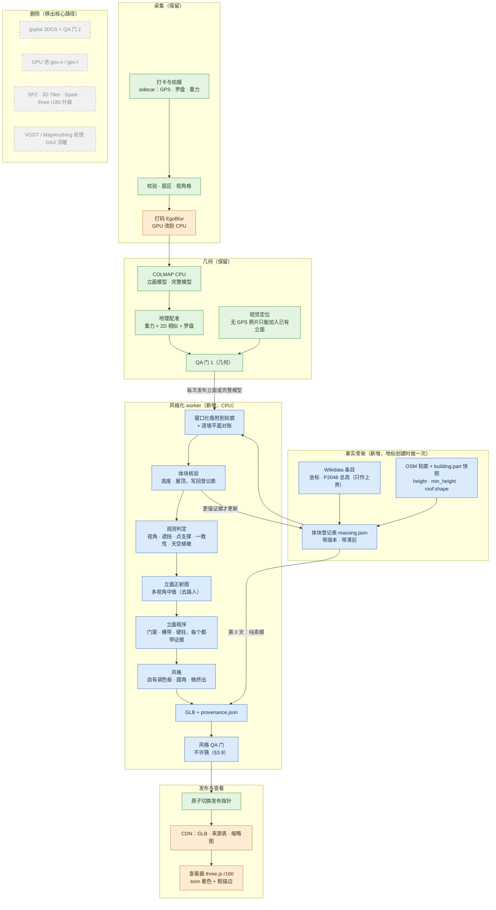

# Crowd3D 风格化模型：设计文档

> 版本：2026-10-22（修订 2）。本文是"从照片级转向风格化"这次转向的定稿设计，合并了三份角色草案（几何与风格化、生成式模型政策、产品／美术／成本）和原型报告（`crowd3d/stylize.py`）。三份草案有分歧的地方在正文里就地裁决，标"**裁决**"。修订 2 按一轮文档评审逐条核对后修改（核对不成立的意见没有采纳），第 5 节换成原型修复轮之后的数字和截图；需要您拍板的事项都在 §9.2。术语见附录 D。
>
> **修订 3**（同日）：产品负责人拍板了 D7（画风由他定：测到的东西和长什么样分开，画风做成可替换的文件，格式见 `docs/ART_DIRECTION.md`）、D8（接受"玩具"定位，配准门不放松）和 D12（封闭的小洞用该墙实测的底色补齐）。受影响的段落已改，标"**已拍板**"；这几项的新数字标【原型 修订3】。
>
> **复审 1**（同日）：对 D12 和 D7 的一轮对抗式复审确认了 11 条问题，已按负责人的决定修完：补洞加了形状规则（装得下一个完整可画元素的洞不是"小洞"，不补，§3.3）；画风校验改成按查看器真实的光照算，屋顶斜纹也算，三个参考画风的素模色因此微调（`docs/ART_DIRECTION.md` 第 4、5 节）；补了相应的测试。新数字标【原型 复审1】。
>
> **复审 2**（同日）：复审 1 的形状规则用的是元素**画出来**的最小尺寸（0.35 m × 0.375 m），但门窗和点缀块是在 8 px/m 的工作图上认出来的，只被盖住一部分的工作像素也算数，所以照片里的证据比画出来的小：一扇只占 4 × 6 纹素（0.25 m × 0.375 m）的暗窗会被画成 0.38 m × 0.5 m 的窗；一个装不下 0.35 m × 0.375 m、却正好盖住这些纹素的洞，补上底色以后这扇窗就没了。现在按元素**在照片里最少占的纹素**算（§3.3）。两座参考建筑重跑，补洞结果逐纹素不变，新数字标【原型 复审2】。
>
> **复审 3**（同日）：发布字节审计在 GLB 没写贴图尺寸时用的下限其实不是下限（`work_grid()` 把工作像素数四舍五入，每个像素可以少于 1/f 个纹素），改成按所有可能的贴图尺寸取最小块（§3.3）；补了行列写反、默认画风也要换素模色、画风在"如设定"和斜屋顶光照下的检查等测试。流水线输出逐字节不变，两座参考建筑的数字不变。
>
> **结构优先（2026-10-22 起）**：`docs/STRUCTURE_FIRST.md`（"参照 Hover 重做算法流程"）取代了本文 §3.1 的实现部分（形状来源和照片核对）和 §3.6 的屋顶部分，并修了颜色链（它的 §2.5）。本文不改原文，只在受影响的各节开头加一行"→ 结构优先"指过去；那份文档 §7 列了本文要跟着改的全部地方。原型代码：`crowd3d/structure.py`（OSM 分件 → 参数化积木、G10 支撑、地图值的合理性工单）、`crowd3d/skyline.py`（天空掩码、天空轮廓线剖面）、`crowd3d/judge.py`（坐标门、判定规则、工单）、`crowd3d/lines3d.py`（三维线段证据：FLD/LSD 线段、对极匹配加 SfM 深度先验、在另外 ≥ 2 张照片里验证、合并、SfM 点支撑，再按分件的地图边量檐口、顶点/屋脊和斜脊坡度）、`crowd3d/stylize.py` 的 `build_massing_from_structure()` / `structure_gates()` / `finish_structure_gates()`（结构 QA 门 G1–G12 并入发布 QA）。
>
> **数字的来源标注**（每个数字都来自下面某一种；没有标注的数字是对同一节里已标注数字的复述）：
>
> | 标注 | 含义 |
> |---|---|
> | 【原型】 | 原型修复轮之后的最终运行，本容器（4 核 CPU、无 GPU），2026-10-22 08:12–08:14 UTC |
> | 【原型 v1】 | 修复轮之前的第一版原型，2026-10-22 05:13–05:19 UTC（只在对比时引用） |
> | 【原型 修订3】 | 加上 D12 补洞和 D7 颜色语义之后的重跑，同一容器，2026-10-22 13:09–13:11 UTC（输入和【原型】相同） |
> | 【原型 复审1】 | 复审 1 之后（补洞形状规则）的重跑，同一容器，2026-10-22 14:55–14:57 UTC（输入和【原型】相同） |
> | 【原型 复审2】 | 复审 2 之后（形状规则按照片里的最少证据算）的重跑，同一容器，2026-10-22 15:58–16:00 UTC（输入和【原型】相同） |
> | 【几何】【ML】【产品】 | 对应草案作者在本容器上的实测，脚本和数据见附录 B |
> | 【本文】 | 本文作者为写这份文档做的复核或计算（附录 B） |
> | 【估算】 | 工程估计，没有实测 |
> | 【待核实】 | 只有二手来源，或来源互相冲突 |
>
> 法规和许可部分是工程整理，**不构成法律意见**。本文**不直接修改** `docs/ARCHITECTURE.md`（另一个工作流正在编辑它），要改的地方列在第 8 节。视觉定位的设计见 `docs/VISUAL_LOCALIZATION.md`（另一个工作流在写），基准测试的说明见 `eval/results/README.md`。

---

## 0. 一句话与产品体验

**一句话**：我们没有 GPU 预算做照片级渲染，而且游客照片又少又偏，照片级模型本来就很难看稳。所以改做**卡通"玩具"模型**：楼的**形状**来自公开的事实数据（OpenStreetMap 的建筑分件和高度，由照片重建出的点云来核对），**颜色和门窗**只来自真实照片。没人拍过的面就是**素模**（没有贴图、浅灰紫色、带淡斜纹的体块，颜色见 §4.2），等玩家去拍来"解锁"。

**打个比方**：先给每座地标做一个没上色的纸模型，也就是素模（形状照着地图档案做，不靠猜）。有人在东边拍了照，东墙就按照片"上色"：照片里有几扇拱窗就画几扇，是什么颜色就用调色板里最接近的那种颜色。西边没人拍，西墙就一直是素模，上面挂一个"待解锁"的小牌子。东墙只拍到一半，就只给拍到的那一半上色，另一半仍是素模。

### 0.1 用户看到什么

| 时刻 | 用户看到的 | 背后发生的事 |
|---|---|---|
| 地标第一天上线 | 一座能认出轮廓的素模：塔、穹顶、尖顶都在，全身素模色，带淡斜纹 | 从 OSM 建筑分件（`building:part`）拉伸出的"事实骨架"（§3.1），不需要任何照片 |
| 拍了几张，还不够建模 | 被拍的那一面出现琥珀色虚线框和"照片钉" | 扇区暂定点亮（沿用 ARCHITECTURE §2.1） |
| 立面模型发布后几分钟 | 那面墙像被滚刷刷过一样上色：真实的拱窗、横带、门洞，扁平颜色、粗描边 | 立面作业 → 风格化作业 → 风格 QA → 发布（§1） |
| 只拍到一部分 | 拍到的部分上色，没拍到的部分仍是素模纹理，中间一条圆角虚线；墙中间被树或行人挡住的小块（封闭、≤ 0.5 m²、装不下一个完整的可画元素）用这面墙自己的底色补齐，其余的洞仍是素模 | "部分解锁"，按观测掩码算，补洞不算（§3.3，D12 已拍板）；掩码和合法补洞以外只许出现素模纹素（§3.9 Q1） |
| 点任意一面 | 来源卡片："轮廓：OSM · 高度：照片实测 · 外观：12 位玩家的照片" | 每个面带来源标注（provenance，§3.9） |
| 点"待解锁"牌子 | 拍摄任务："站在西南侧 30–60 m 拍 4 张" | 牌子直接对应缺口任务（ARCHITECTURE §3.9） |

**这个转向的三个好处**（数字见第 6 节）：

1. **便宜**：核心路径不用 GPU。1 万个地标的回填算力从约 $2.7 万 GPU 降到约 $1.4k–6.6k CPU（按需价；上界主要来自还没实测的 CPU 打码，§6）；每次浏览的下载从约 15 MB 降到约 0.2–0.3 MB。
2. **对稀疏照片更友好**：照片级 3DGS 要几十张照片才不过拟合（ARCHITECTURE §3.4.1 定的门槛是 ≥ 40 张）。风格化的要求是：一面墙进了一个通过质检、配准到位的立面模型（`georeg_level = full`，吸附后残差 ≤ 1.5 m 且逐边核验通过），并且有 ≥ 2 个视角和点云支撑（全部条件见 §3.2、§3.3）。实测：洗礼堂东立面 15 张真实照片注册 10 张，2 面墙上色；同一次运行里另外 3 个 6–7 张照片的立面作业都没能上色（§5.2）。所以"拍几张就能点亮"现在还不成立；按今天唯一成功的样本，一个立面大约要 15 张照片。
3. **诚实看得见**：素模 = 事实骨架，彩色 = 有人拍过。"不捏造"变成了玩法本身。

**代价**（直说）：模型不再是"真实记录"。颜色和实物差得不少（原型 v1 的区域色差中位数 ΔE00 约 27，大部分来自整体提亮；修复轮去掉了明度拉伸和灰世界白平衡，色差还没重测，§5.2），铜门浮雕会变成几块深色或棕色色块，曲面壳体（悉尼歌剧院）用拉伸体块表示不了。

---

## 1. 新流程（端到端）

### 1.1 流程图

→ 结构优先：风格化作业前多一个"结构"子图（坐标核对、几路证据、在地图值上剖面判定、工单），见 `docs/STRUCTURE_FIRST.md` §0.3 的流程图。

图例：绿色 = 保留，蓝色 = 新增，橙色 = 保留但改了，灰色虚线 = 删除（不在核心路径上）。



### 1.2 和旧架构比：保留、删除、新增

| 旧环节（ARCHITECTURE） | 处理 | 说明 |
|---|---|---|
| 采集、sidecar、校验、扇区、视角格、`plan_jobs`、作业调度 | **保留** | 风格化只改展示层，几何主干不变 |
| COLMAP 增量 / global、地理配准、QA 门 1、在线注册 | **保留** | 风格化的输入就是它们的输出 |
| 视觉定位（无 GPS 的照片） | **保留** | 定位成功的照片在风格化里就是一台普通的已注册相机，能给已有的墙加视角、提细节；它带不来新的点云，所以解锁不了没有点云支撑的墙（§3.3） |
| 打码 EgoBlur、语义掩码 | **改到 CPU** | 发布物里已经没有照片像素，但原图存储和人工审核仍要打码。EgoBlur 是人脸、车牌两个 Faster R-CNN 检测器（按其论文），官方 README 说在只能用 CPU 的 Mac 上推理"very slow"，推荐用 CUDA GPU；本文按 1600 px 时 10–70 CPU·s/张估算（原文的约 1 s/张偏乐观），S0 要在 4 核容器上实测，并对比更轻的人脸/车牌检测器【估算】。语义掩码 v0 不用模型（§2.3 ③） |
| ALIKED + LightGlue（GPU 特征） | **推迟** | 继续用 CPU SIFT。代价：原指望它改善的转角和夜景匹配问题继续存在（CPU SIFT 下亚琛 augmented 全景只注册了 38%，见 REAL_WORLD_EVAL §4.4） |
| MegaLoc 检索（GPU） | **改** | CPU 推理或 COLMAP 词汇树 |
| gsplat 3DGS、QA 门 2（PSNR/LPIPS）、`hd_eligible`/`hd` 扇区状态 | **删除** | 失去照片级真实感和"写实版制作中"的玩法 |
| VGGT / MapAnything 前馈、1 分钟即时预览 | **删除** | 预览由"第 0 天的事实骨架"代替；**稀疏、对称场景的兜底没有替代**（亚琛 real 模式仍然 0 个立面） |
| DA3 单目深度的 L1 浮雕 | **删除** | 1–3 张照片时改为"照片钉 + 视锥" |
| SPZ、3D Tiles、Spark、three r180 升级 | **删除** | 单个 GLB 几十 KB，不需要 LOD；three@0.160 已有 `MeshToonMaterial` |
| 外观嵌入的"夜景版、雪景版"变体 | **改** | 变成"实测调色板变体"：只有真有夜间照片时，才出夜景配色 |
| PLY 点云查看器 | **降级** | 只当调试视图 |
| — | **新增** | OSM 分件导入与体块登记表、风格化 worker、立面程序、风格 QA 门、样式令牌（Python 和 JS 共用一份 JSON）、来源旁挂文件、客户端分享卡 |

### 1.3 风格化作业什么时候跑

- **地标创建时**：导入 OSM 快照，生成体块登记表 v0，直接发布一个全素模的 GLB（冷启动，§3.1）。
- **每次有立面模型或完整模型通过 QA 门 1 并发布后**：排一个 `stylize` 作业，按地标做，不按模型做。
  - 输入：该地标所有已发布模型里 `georeg_level = full` 的那些，各自先吸附到轮廓并通过逐边核验（§3.2）。
  - **按墙合并，不是"有完整模型就只用完整模型"**：每面墙取对它支撑最好的那个模型（掩码面积 × 视角数最大），完整模型没覆盖到的墙继续用立面模型；新输入里没有任何模型观测到的墙，保留上一版的结果（照片被撤回时除外）。原因：完整模型可能很弱（亚琛 augmented 的全景模型只注册了 38%，只覆盖一个方向，REAL_WORLD_EVAL §4.4），只用它会让已经上色的墙消失，违反"已解锁墙数不减"的不退化门（§8），玩家看到的就是解锁被收回。
  - 输出：一个新的风格化版本，走风格 QA 门，通过才原子切换发布指针。
  - 优先级排在"首个立面"之后、"立面重建"之前；耗时几秒到两分钟（§5），不需要单独的去抖。
- **照片被撤回时**：用到这张照片的风格化版本也标 `contains_deleted`，按 ARCHITECTURE §3.8 的 30 天规则重算。重算只要 CPU 几十秒，没有理由拖。

---

## 2. 技术选型

### 2.1 选型总表

→ 结构优先：下表"体块"一行的点云高度场只留给没有 OSM 分件和高度标签的长尾地标（`StyleParams.massing_source`）；新增的天空掩码（A+R，经典方法，可商用）、FLD 线段、三维线段几行见 `docs/STRUCTURE_FIRST.md` §1、§2.3。FLD 在 OpenCV 的 contrib 包（`cv2.ximgproc`）里；仓库现在的依赖 `opencv-python-headless` 没有它，`crowd3d/lines3d.py` 就用核心 OpenCV 的 LSD（设计里写的备选），记录里写明用的是哪一个。

耗时都是 4 核 CPU 上的实测，除非另标。

| 阶段 | 选用 | 不选及原因 | 许可证 | CPU/GPU | 每栋或每面的耗时／成本 |
|---|---|---|---|---|---|
| 特征与匹配 | COLMAP SIFT（沿用原型） | ALIKED + LightGlue：要 GPU，推迟 | BSD | CPU | 特征 1.55 CPU·s/张（约 1000 px）；匹配 0.128 CPU·s/图对【产品】 |
| 位姿 | COLMAP 增量式（n < 300），global mapper（n ≥ 300） | 前馈模型：要 GPU，可商用权重有附加条件（ARCHITECTURE §4.2） | BSD | CPU | n = 25 / 50 / 100 张：合计 96 / 313 / 1973 CPU·s，其中建图 14.9 / 74.3 / 1186 CPU·s【产品】 |
| 吸附到轮廓 | 在配准偏航窗口内搜索的 2D 吸附（窗口由配准给出的偏航 σ 推出），再逐边核验、逐墙 RANSAC 拟合平面（§3.2） | 不加约束的全局 ICP：八角形上收敛到 −90.58° 的对称别名解【几何】；真实立面作业上也收敛到 79–93° 的别名（§3.2） | 自研 | CPU | 1.2 s / 2.5 s（洗礼堂 / 亚琛）【原型】 |
| 体块 | OSM Simple 3D Buildings 分件 + 体块登记表；没有分件时用轮廓 + 高度 | 点云凹包闭合：和 OSM 的 IoU 只有 0.22–0.57，等于捏造背面【几何】；点云高度场递归切块：亚琛出现乱块【原型】【几何】 | OSM：ODbL（署名，派生库要公开）；Wikidata：CC0 | CPU | 原型（点云切块版）1.5 s / 6.1 s【原型】；分件素模 GLB 5.4 KB / 31.5 KB、105 / 1,199 个三角形【几何】【本文】 |
| 多边形运算 | shapely（并、差、缓冲）、mapbox-earcut（带洞多边形三角化） | trimesh：不需要。它的 `export_glb` 默认不写法线（`include_normals` 默认只在法线已缓存时才写，要显式传 `True`），几何草案没传，toon 材质下整楼全黑【几何】；不用它的理由是体积和 extras 要自己控制，不是它做不到 | BSD-3 / ISC | CPU | 毫秒级 |
| 观测判定 | 规则：视角 + 体块遮挡 + SfM 点遮挡 + 点支撑 + 多视颜色一致 + 天空植被（§3.3） | 只看几何覆盖：洗礼堂南墙几何覆盖 95.7%，点支撑只有 3.4%，贴上去的是远处糊掉的背景【几何】 | 自研 | CPU | 1.2 s（10 面墙、107 台相机）/ 50.4 s（79 面墙、203 台相机）【原型】 |
| 立面正射图 | 多视角加权中值 + 每张图的曝光增益 | CPU 稠密 MVS + 网格 + 纹理：慢，细节也不是目标；OpenMVS 是 AGPL-3.0【几何，版本未核对】 | 自研（OpenCV Apache-2.0） | CPU | 16 px/m 时约 1.0–1.3 s/墙（含逐相机遮挡）【原型】；5 cm 纹素加逐纹素遮挡测试时 16–32 s/墙（72 张照片）【几何】 |
| 立面简化 | **立面程序**：结构检测（行列剖面、暗块、周期条带）+ 有上限的规整 + 证据约束（§3.5） | 逐像素 k-means 加调色板：杂乱；粗色块：像迷彩【几何】【产品】 | 自研 | CPU | 语法拟合 0.06 s/墙【几何】；整栋风格化 0.2 s / 0.6 s【原型】 |
| 可选：区域标签 | DINOv2-small（ONNX）+ 在 CMP 立面库上训练的线性头，**只给已有区域贴标签** | SegFormer 权重：仅限非商用；ADE20K 训练的 Mask2Former/OneFormer 权重：ADE20K 图像仅限非商用研究【ML】 | 权重 Apache-2.0；CMP 为 CC BY-SA（训练出的权重算不算改编作品【待核实】） | CPU | 0.16–0.23 s/立面【ML】 |
| 可选：分割 | SAM 2.1-tiny（ONNX），框提示，只在观测掩码内 | SlimSAM-77：不比它快【ML】 | Apache-2.0 | CPU | 编码 3.5–3.8 s（1024²），解码 0.16–0.19 s/框【ML】 |
| 可选的额外算力（公司付费，不是用户付费功能） | SAM 3 概念分割（租 GPU，按需） | — | SAM License（2025-11-19 版）：没有非商用限制；禁止 ITAR 管辖的活动以及军事/战争、核、间谍、枪支等最终用途；使用方要赔偿 Meta 因使用引起的第三方索赔；须遵守制裁和出口管制。Hugging Face 上的下载门槛是点击同意协议，不是人工审批【本文核对许可证原文；法务确认】 | 租 GPU | < $0.001/立面【估算，ML】 |
| 纹理风格化 | **调色板填色**（扁平色本身就是风格） | 扩散 img2img（SD-Turbo、SDXL + ControlNet、FLUX、托管图像编辑器）：实测会做语义替换，自动检查拦不住（§2.3） | — | — | SD-Turbo 每 512² 立面 16–37 s（被否决）【ML】 |
| 网格与 GLB | 原型自带的 GLB 写出器（零依赖）+ 微挤出几何 + 低分辨率调色板贴图 | Draco / meshopt：几何量太小，不需要；3D Tiles：不需要 LOD | 自研 | CPU | 3.1 s / 18.1 s【原型】；GLB gzip 后 16 KB / 54 KB【本文】 |
| 查看器 | three@0.160 `MeshToonMaterial`（3 阶）+ `EdgesGeometry` 粗折痕线 + 只在曲面件上用反壳剪影（§3.8） | Spark/SPZ：为 splat 设计；处处用反壳描边：平面多面体上屋顶变暗【几何】 | MIT | 用户设备 | SwiftShader 软件渲染 640×480：5.6–18.2 ms/帧【几何】；390×844 @2x：51–79 ms/帧【产品】 |
| 可选：文案 | VLM（如 Claude Haiku 5.5）生成构件名称和导览文字，只进 UI，只描述已观测的面 | 用 VLM 输出驱动几何或纹理 | API | 云端 | Haiku 5.5 约 $0.0004–0.0007/立面（effort 设 `low`、`max_tokens` 1024；它默认开着自适应思考，思考输出也计费）【估算；判别效果未测】 |

**每栋的端到端风格化耗时**：洗礼堂（107 台相机）21.9 s，亚琛（203 台相机）115 s，峰值内存 567 MB / 816 MB【原型】。修复轮之前是 10.3 s / 67.1 s【原型 v1】，多出来的主要是加载时算点的质量（约 9–15 s）和亚琛的观测判定（约 50 s）。真实链路里 15 张照片的立面 2.8 s【本文，用最终原型代码重跑】。这些都远小于 SfM 本身（洗礼堂 20 张真实照片的整条链路 57 s【产品】）。

### 2.2 新依赖

| 依赖 | 许可证 | 用途 | 状态 |
|---|---|---|---|
| shapely | BSD-3 | 分件的并、差、缓冲，轮廓包含关系过滤 | **建议进生产** |
| mapbox-earcut | ISC | 带洞多边形三角化（原型的耳切法不支持洞） | **建议进生产** |
| onnxruntime | MIT | 可选的 DINOv2 标签、SAM 2.1 分割 | 可选，默认关 |
| ~~tokenizers~~ | Apache-2.0 | **不需要**：它只服务于开放词汇检测器（ML 草案试过 Grounding DINO、OWLv2），而本文没有选用任何开放词汇检测器（§2.1、§2.3 都没有）。以后要用时，检测器本身的许可证和权限类别要先补进 §2.1 和 §2.3 | 删除 |

本文作者没有安装任何依赖，也没有改 `requirements.txt`。草案作者的实验依赖都装在各自的临时目录里（附录 B）。

### 2.3 生成式模型：允许、有条件、禁止

**用户的规则**：生成式模型不得给没拍到的地方编造内容（不得编造看不见的立面和背面，不做图生 3D 补全，不修补未观测区域），但可以用来做简化和风格化。

**本文的执行方式**：规则管的是**结果**，不管用的是什么方法。所以下面这些规则对非生成式方法同样适用（例如把八角形一面的立面复制到对面，不用任何模型也是捏造）。

**定义**：

- **观测掩码 M**：立面纹理上，满足 §3.3 全部条件的像素。
- **原语**：画到立面上的一个形状（矩形或拱形洞口、横带、壁柱、条纹、嵌板），或一块填色区域。
- **证据**：原语对应的正射图源区域 id，加上它的观测比例、规整前后的 IoU、移动距离、亮度差。

| 类别 | 内容 | 护栏 |
|---|---|---|
| **默认（不用任何生成式图像模型）** | 正射中值图 → 经典结构检测 → 有上限的规整 → 调色板 → GLB | §3.9 的 QA |
| **有条件允许** | ① 在**已观测的正射图**上做分割（SAM 2.1、SAM 3），提示点只放在 M 内；② 判别模型给已有区域贴标签（DINOv2 + CMP 线性头）；③ 人、车、树、天空的分割，结果**只能用来从 M 里剔除像素**。v0 不用分割模型：人和车靠多视角中值和 SfM 点遮挡（§3.3）去掉，天空和植被靠 CPU 颜色、纹理规则（原型已实现）。要加模型时，候选必须先过许可证（SegFormer、ADE20K 训练的权重、Ultralytics 的 AGPL 模型都不行）；本文还没有核实过一个许可证干净、能在 CPU 上跑的人/车/植被分割模型，这是 S0 的待办，费用按 0.5–3 CPU·s/张预留（§6）【待核实】；④ 用点云拟合屋顶类型、简化形状（本身不是生成）；⑤ VLM 生成名称和导览文字，只进 UI，标"AI 生成说明"，不回流几何和纹理；**只能描述已观测的面**：调用时只给它已观测的正射图和已解锁墙的列表，输出里提到素模面上的构件就丢弃 | 模型输出只是"提议"：必须再过规整上限和证据约束（§3.5），否则丢弃；每次调用记录模型 id、版本、权重许可（谱系） |
| **灰区，默认不用** | 单目深度（Depth Anything V2-Small，Apache-2.0）给已通过证据检查的原语提供 ≤ 0.3 m 的凹凸提示 | SfM 点已经给出墙面平面，收益很小 |
| **禁止（与许可证无关）** | 未观测区域的 inpainting / outpainting（包括 LaMa、SD-inpaint 这类"只是修一下小洞"的用法；用邻近颜色、别的墙的颜色或任何推测内容填洞这种非生成式做法同样算。唯一的例外是 D12 **已拍板**的封闭小洞：≤ 0.5 m²、装不下一个完整的可画元素、四周全是同一面墙的已观测纹素，只填这面墙实测的底色，不算观测，§3.3）；扩散超分；img2img 或图像编辑模型**直接产出发布纹理**；图生 3D、文生 3D、新视角合成（TRELLIS、Hunyuan3D、SAM 3D 等）；对称或重复补全超出已观测的实例；生成式矢量化（StarVector）；用生成式模型"清理"正射图；训练或使用品牌风格 LoRA | CI 里维护模型白名单；QA 检查 `lineage` 必填 |
| **许可证不允许** | SegFormer 权重；ADE20K 训练的 Mask2Former / OneFormer 权重；FLUX.1-dev、FLUX.1-Kontext-dev；Depth Anything V2 Base/Large | 同上 |

**裁决（扩散风格化）**：用户的规则本来允许用生成式模型"风格化已观测的纹理"。但实测表明，扩散模型在已观测区域里也会改内容，所以**本文建议默认路径和可选的额外算力（§2.1）都不用扩散风格化**，需要用户确认（§9 决定 D3）。证据【ML】：

- SD-Turbo img2img（512²，CPU 每立面 16–37 s，速度可以接受）：
  - strength 0.25：基本只是把原图模糊一遍，没有风格化；
  - strength 0.5：洗礼堂的雕像变成阳台加铁栏杆，青铜门变成木门，未观测区域长出一座塔和一棵树；
  - strength 0.75：变成一栋普通欧式公寓，阳台上还站着人。
- **关键证据**：strength 0.5 那张明显有幻觉的图，**两项自动检查都通过了**（2 m 窗口结构相关性中"不相关窗口"只占 0.01–0.15，元素级检查报 0 个无支撑元素）。
- 事后图像比对本身就不可靠：在纹理很密的洗礼堂立面上，元素级检查只抓到 36/100 个人为加的假窗，同时误报 13/128 个正常元素；放宽到能抓全假窗时，误报升到 106/128。

所以"不许猜"只能**靠构造保证**：每个原语必须带着证据链接才能画出来（§3.5、§3.9）。扩散输出的像素没有证据链接，只能事后检查，而事后检查恰恰拦不住它最典型的错误。就算把扩散结果再量化到调色板、裁回已通过的原语里，它也只能在既有形状里换颜色，比调色板填色多不了什么。

**语义标签也要有像素证据**【ML】：CMP 训练的解析器会把洗礼堂浅色大理石的盲拱和嵌板标成"窗"。用一条规则"画成深色玻璃的窗，源区域必须比周围环带暗 ≥ 4 L*"，20 个窗/门判断里有 14 个被降级为浅色嵌板，人工核对全部正确。

**合规**（工程整理，需律师确认）：

- 核心路径不用生成式图像模型。但中国《互联网信息服务深度合成管理规定》第二十三条把"三维重建"和"图像修复"也列为深度合成技术，第十九条要求具有舆论属性的服务做算法备案，**这可能与用不用扩散无关**【ML，待法务确认】。
- 中国《人工智能生成合成内容标识办法》（2025-09-01 施行）和配套的强制性国家标准 GB 45438-2025《网络安全技术 人工智能生成合成内容标识方法》规定了显式标识和隐式标识的格式，办法里明确列了"虚拟场景"（在起始画面或适当位置加显著提示）。如果我们的模型被认定为生成合成内容，GLB 和旁挂文件的元数据要按标准写隐式标识，至少包括：生成合成标签、内容生成服务提供者名称或编码、内容制作编号，传播时还有传播服务提供者名称或编码和内容传播编号【本文整理，字段名以标准正文为准，待法务确认】。
- 欧盟 AI Act 第 50 条已于 2026-08-02 适用，50(2) 对"不实质改变输入数据或其语义"的标准编辑辅助有豁免；风格化能不能适用，说不准【ML、产品，待核实】。
- 建议无论哪条路径都按"需要标识"设计：UI 显示"依据玩家照片风格化"，查看器起始画面放显式标识；GLB 的 scene extras 写隐式标识，字段按 GB 45438-2025 的元数据格式（上面几项），另加 `ai_assisted` 和谱系。

---

## 3. 风格化算法

### 3.1 体块：形状来自事实

→ 结构优先：本节的实现部分（分件解析和过滤、屋顶原语和退化链、约定值 D17、空隙补体、冲突策略 D15）由 `docs/STRUCTURE_FIRST.md` §2.4 取代；参数化积木在 `crowd3d/structure.py`，判定规则在 `crowd3d/judge.py`。v0 照片永远不自动改地图值（D15 的自动采用默认关），"高度待定"矮台（D13）永远是素模、状态永远是 `stub`，照片证据只开工单；底面一半以上悬空的抬高分件（G10）开工单，碰得到支撑的留在地图位置，什么都碰不到的不画（`resolve_support()`）。地图值越过合理范围（分件顶 > 1000 m、> Wikidata 总高 × 1.1、> 其余分件最高顶 × 2.5）、数字标签解析不了、约定屋顶（没有 `roof:height`）占分件高度 70% 以上，都只开工单、不改值（`open_value_tickets()`）。D15 开关打开时，采用的值会重画成实体（不会出现"已拟合"却画在地图值上的分件）。三维线段是第三路证据（`crowd3d/lines3d.py`，只当证据，永不变成几何、永不上色）：它直接量高度，所以能投"偏高"也能投"偏低"；每条记录带区间、照片数和吸附尺度，吸附尺度修正 > 3% 时它不能单独决定（只在另一路强证据同向时才算一票）；少于 3 张照片不出数，没被线段覆盖的边列为"没拍到"、不出数；墙面自己的 SfM 点高过最高一簇水平线时那条边不出数（那是线脚，不是墙顶）。"照片核验"现在要两路证据一致：天空轮廓线（两种掩码）和三维线段量同一个量（檐口对檐口、顶点/屋脊对屋顶），彼此相差 ≤ max(1 m, 5%)，线段离地图值 ≤ 容差；发布门 `check_decisions()` 从记录里重算一遍。工单里带各路量到的值和哪几路一致（v0 仍然只开工单、不改值）。

**裁决（体块来源）**：初始方向是"OSM 轮廓拉伸 + 用点云定高度"。三份草案和原型报告一致建议改为**优先用 OSM Simple 3D Buildings（S3DB）的分件**，点云只做核验。理由：

- **可用率很高**【本文复核产品草案的 OSM 快照】：评测目录 13 个地标全部有 `building:part`。按"分件中心落在主轮廓内（外扩 2 m）"过滤掉相邻建筑的分件后，每个地标有 4–132 个分件；12/13 的分件带 `height`（唯一例外是悉尼歌剧院，13 个分件都没有高度）；12/13 至少有一个分件带 `roof:shape`（例外是比萨斜塔：塔本身 29 个分件都没有；不过滤时唯一带 `roof:shape` 的 w265815356 离塔中心 42 m，是邻楼）。主轮廓本身带 `height` 的只有 4/13【几何】。
- **形状对**：分件带 `min_height`、`roof:shape`、`roof:height`，能直接搭出塔、穹顶、尖顶和门洞。亚琛的分件素模（西塔加尖顶、八角堂加穹顶、唱诗堂、小礼拜堂）一眼能认出来；原型从点云高度场切出来的体块是一团乱块，八角堂和哥特唱诗堂并成了一个 573 m² 的平顶块【原型 v1】【几何】，修复轮之后仍是一堆棱柱（§5.3）。
- **照片少时也稳**：洗礼堂只用 15 张真实照片时，屋顶没被拍到，模型退化成平顶八角"蛋糕"；OSM 写着金字塔顶（`roof:height=12`）加采光亭【产品】。
- 这些是人工测绘的事实数据，不是生成。用户的规则管的是"编造"，不是"引用事实"。

**来源优先级**：

| 优先级 | 来源 | 给出什么 | 来源标注 |
|---|---|---|---|
| 1 | OSM `building:part`（S3DB） | 分件轮廓、`height`、`min_height`、`roof:shape`、`roof:height` | `osm-s3db` |
| 2 | OSM 主轮廓 `height` / `building:levels`（× 3 m） | 单一高度 | `osm-height` |
| 3 | 点云：每条边墙带点 z 的 0.97 分位，再取各边中位数 | 檐口高度、屋顶形状核验 | `sfm-points` |
| 4 | Wikidata P2048 | **只作上界和核验，永远不直接当拉伸高度** | — |
| 5 | 风格默认值，同时开馆员工单 | 兜底；只用于有 OSM 轮廓、但没有任何高度事实也没有点云的体块（例如悉尼歌剧院的 13 个分件）。原文是 15 m 平顶，这也是编出来的尺寸，本文建议改成 3 m 高、顶边画虚线的"高度待定"矮台，由 §9 决定 D13 定。没有轮廓时不用（见下文"OSM 缺失时"） | `default-style` |

为什么 Wikidata 只作上界【几何】：P2048 是总高，含尖顶和穹顶。德累斯顿圣母教堂 P2048 = 91.24 m，而 OSM 主轮廓 40.65 m。拿总高拉伸整个轮廓，等于凭空造出一个 91 m 高的盒子。**导入时要按 rank 读**：圣家堂有 3 个值，但 172.5 m 是 preferred，138 m 和 162.91 m 是 deprecated（不同建造阶段的历史值）【本文核对条目】，导入器只取 preferred（没有 preferred 时取 normal 里最新的），并统一单位（双子塔的值是 1483 英尺）。

**做法**：

1. **取数**：建地标时按轮廓外扩 20 m 的范围取 OSM 快照（生产用 Overpass 或 Geofabrik 区域快照；本容器里 Overpass 连不上，草案用的是 OSM API v0.6 `/map`）。**要按包含关系过滤**：查询框会混进相邻建筑的分件。产品草案的查询框是轮廓外接尺寸的一半加 20 m，不过滤时各地标查出 4–134 个分件，按"分件中心在主轮廓内（外扩 2 m）"过滤后是 4–132 个；混进来最多的是勃兰登堡门（88 → 29）和圣家堂（70 → 26）【本文复核】。快照的 OSM 版本号和时间戳冻结进登记表。
2. **分件棱柱**：每个分件是一个从 `min_height` 到 `height − roof:height` 的棱柱，再加屋顶（S3DB 规定 `height` 量到屋顶顶部）。有分件时**不再渲染外轮廓体**（S3DB 惯例）。
3. **屋顶**（`roof:shape`）：按下表建，做不出来就按表里的顺序退，**不退成金字塔**（四坡顶、折线顶的屋脊退成尖顶，事实骨架就错了：匈牙利议会大厦有 56 个 hipped、10 个 mansard 分件）。每次退化都把原值写进来源记录（`roof.fallback_from`）。13 个地标过滤后的取值统计：flat 86、hipped 57、pyramidal 51、gabled 45、dome 10、mansard 10、round 5、onion 4、circular 3、spherical 3【本文复核】。

   | `roof:shape` | 做法 | 做不出来时 |
   |---|---|---|
   | flat | 平顶 | — |
   | pyramidal | 扇形三角面汇到质心 | flat |
   | gabled | 沿最小外接矩形长轴做屋脊 | 矩形度 ≤ 0.85：flat + 馆员工单 |
   | hipped、half-hipped、side_hipped | 四坡顶（直骨架，矩形可用最小外接矩形近似） | gabled，再不行 flat |
   | mansard、gambrel | 两段折线剖面 | hipped / gabled，再不行 flat |
   | skillion | 单坡，坡向按 `roof:direction`，没有就按长边 | flat |
   | dome、onion | 旋转体（6 环缩放） | flat |
   | cone | 圆锥 | pyramidal |
   | **round** | **沿长轴拉伸的半圆剖面（筒形拱顶）**，不是穹顶：OSM wiki 的定义是"横截面像半个圆，也叫 barrel roof"。原文按穹顶建是错的（圣母教堂有 1 个、悉尼歌剧院有 4 个 round 分件） | gabled，再不行 flat |
   | saltbox、crosspitched、sawtooth、butterfly、hipped-and-gabled、bellcast_gable、gabled_height_moved | v0 不实现 | gabled，再不行 flat |
   | many、circular、spherical、其他非标准值、缺失 | flat + 馆员工单；`roof:height` 只作核验 | — |
4. **简化**：轮廓用 Douglas-Peucker，容差逐步放大到 ≤ 32 个顶点且 Hausdorff ≤ 直径的 3%；接近正交的边吸附到主轴；正八边形这类真多边形保留（原型已实现：洗礼堂 13 → 10 个顶点，偏差 0.02 m；亚琛 200 → 30，偏差 1.92 m【原型】）。
5. **圆角**：转角倒圆，半径 = clamp(1.5% × 直径, 0.3 m, 1.2 m)，3 段（原型参数）。
6. **重叠分件**：分件交叠处会有共面闪烁的细线，要在体块阶段做布尔并，或给共面面做微小偏移【几何】。

**体块登记表**（`massing.json`，每个地标一份，带版本）：

```json
{"landmark": "florence-baptistery", "version": 3, "osm": {"snapshot": "2026-10-22T03:10Z", "elements": ["w166821303", "..."]},
 "parts": [{"id": "p0", "outline": [[x, y], "..."], "outline_source": "osm-s3db",
            "z0": {"value": 0.0, "source": "osm-s3db"},
            "eave": {"value": 18.0, "source": "osm-s3db", "sigma": 1.0,
                     "evidence": [{"model": "m42", "value": 18.17, "p10_p90": [18.09, 18.27], "verdict": "agrees"}]},
            "roof": {"shape": "pyramidal", "height": 12.0, "source": "osm-roof-shape"}}],
 "curator_overrides": [], "disputes": []}
```

**冲突策略**【几何，阈值为估算】：

- 只有 `georeg_level = full` 的模型能产生高度证据。原因：洗礼堂 NE 立面模型只有 6 张 GPS 照片（`prior_only`），它测出的檐口是 26.98 m，比实际高约 45%；其余模型在 17.9–19.0 m，OSM 是 18.0 m【几何】。
- 证据和 OSM 相差 ≤ max(2 m, 10%)：只记"已核验"，**不改值**。
- 冲突较大时，**不自动覆盖 OSM**：保留 OSM 的值，标"有争议"，开馆员工单。满足"完整模型、该件暴露区 ≥ 500 个点、bootstrap 区间（重采样估出的置信区间）宽 < 1 m、连续两个版本一致"的证据会排到工单前面，但改值要馆员批准，批准后来源记 `curator`（证据附在记录里）。理由：点云估计器本身可能有偏差，亚琛 14 个分件里 9 个比 OSM 高 7–16 m，谁对谁错还判不了（§9.3 第 2 条），这些分件大多能满足上面的点数和区间条件，自动覆盖会用一个有偏的估计替换可能正确的事实。
- **永不自动回馈 OSM**。馆员确认后的修正也只有在来源许可证允许向 ODbL 贡献时才回馈（§9 决定 D5）。
- **滞后**：已发布的体块，高度只有变化 > 2 m 且证据更强时才更新，避免版本之间模型来回跳（原型在 E 立面模型上算出 15.48 m 平顶、在完整模型上算出 18.71 m 金字塔顶，两版体块来回跳【几何】）。
- 细高结构信 OSM：亚琛西塔尖顶点云 q98 = 69.6 m，OSM 74 m，细尖顶点太少【几何】。

**OSM 缺失时不用点云闭合体块**。洗礼堂完整模型实测，点云凹包和 OSM 的 IoU 只有 0.22–0.57、Hausdorff 22.7 m：西侧没人拍，凹包就把背面"猜"成了别的形状【几何】。做法：

1. 名胜地标的 OSM 覆盖率很高（13/13）；建地标时把 OSM 轮廓列为必填，缺了由馆员手绘（约 2 分钟【估算】），来源记 `curator`。
2. 馆员画好之前，自动兜底**只显示已观测墙段**（来自平面拟合）加地面上一圈扁平的点云足迹线，**不画闭合体块**。半透明的"推断闭合体"和 15 m 的默认高度一样，都是给没人拍过、OSM 也没描述的部分编出来的几何，和点云凹包是同一类问题，只是轻一些，所以默认不做；要不要做由您决定（§9 决定 D13）。
   - 原型目前的做法（修复轮新增）是：没有可用轮廓时从点云描出轮廓、按普通体块拉伸，来源记 `sfm-points`。这比本条宽松，进生产前要按本条改。

### 3.2 吸附与坐标

→ 结构优先：加逐边残差门 G11（墙内侧 10 m 以内的点都算；不过就开坐标工单，那条边上的墙不贴图，发布时在 `structure_gates()` 里跑；只量配准通过的点，配准不过时整栋都是素模，门不跑）；正多边形轮廓用整栋楼相似变换取代逐墙移动（`judge.frame_similarity()`，改轮廓要馆员批准；坐标工单里附"尺度假设"：照片点云高度 / 地图高度的中位数放在缩放 k 旁边，有 Wikidata 总高时也放上，因为 k 本身分不清是 OSM 轮廓画错还是重建尺度偏了）；第 4 条"尺度已修正"规则见 `docs/STRUCTURE_FIRST.md` §2.2、§2.4.2。

**坐标**：沿用地标 ENU（x 东、y 北、z 上，米）。GLB 用 glTF 的 y 朝上：ENU (x, y, z) → glTF (x, z, −y)，和 `web/viewer.js` 一致。地面取 z = 0（相机高度约定 1.6 m）；点云墙脚的低分位被人群和围栏挡住，不能用来定地面【几何】。

**吸附**：

1. **旋转只在配准偏航窗口内搜索**。窗口 = ±min(3σ_θ, P/2 − 5°)：σ_θ 是这个模型配准时报出的偏航不确定度（`reconstruct` 已经在日志里报，例如真实立面作业的"yaw ±4–6 deg"），P 是轮廓的旋转对称周期（正八边形 45°，矩形 180°，不对称取 360°）。窗口内多起点；最优解离窗口边 < 1° 就不吸附、打标记。
   - 为什么不用 ARCHITECTURE §3.5.7 的固定 ±10°：洗礼堂参考模型成功的吸附要转 −9.42°，已经用掉窗口的 94%【原型】；ARCHITECTURE §3.5.3 算出单个立面只靠 GPS 时 σ_θ ≈ 13°。固定 ±10° 会把很多正常的真实立面当成"落在窗口边上"拒掉。
   - 为什么一定要窗口【几何】：原型的全局 ICP 在洗礼堂完整模型上收敛到 −90.58° 的对称别名解，墙面中位距离 0.402 m，**比正确解附近的 0.44–0.48 m 还小**。护栏拒掉了这个解，模型因此偏 3.9 m 没吸附，南墙贴上了乔托钟楼的图像。真实链路上也一样：3 个 6–7 张照片的立面作业，不加约束的 ICP 分别收敛到 92.5°、78.9°、88.7°【本文】。窗口不超过 P/2 时，对称轮廓天然不会混进别名。
   - **近似旋转对称的轮廓**（圆形的比萨斜塔、16 边形等，P/2 − 5° 小于 3σ_θ 时）：偏航从轮廓上看不出来，只搜平移，偏航沿用配准结果。
2. **平移搜索 ±25 m，接受靠逐边核验，不靠"修正量小"**。单张照片的真实 GPS 误差 p90 在洗礼堂是 20.3 m、亚琛 55.0 m（REAL_WORLD_EVAL，对轮廓校正后的参考），模型配准把多张照片平均后小一些：真实立面模型相对轮廓校正参考的水平误差中位数 4.7–10.4 m【产品】，12 台相机的那个作业偏 17.8 m，所以 ARCHITECTURE §3.5.7 的 8 m 上限太紧（§8 已列）。接受条件（原型 `registration_check`）：吸附后，点数达到中位边 25% 的轮廓边每条一票，≥ 60% 的边中位距离 < 3 m，而且通过的边方向至少相差 30°（全平行时沿墙方向的平移看不出来）。
   - 只拍到一面墙的立面模型（例如矩形建筑的一面），沿墙方向的平移看不出来，核验过不了，就只出素模。宁可不上色，也不把立面贴歪 10 m。
   - 原型现在还是"不加约束的 ICP + 拒绝超过 20° / 20 m 的修正"，没有实现窗口搜索；S0 要改成本条（离线试验脚本见附录 B 的 `lead2/winsnap.py`）。
3. **逐墙平面对账**（原型修复轮已实现）：吸附之后，对每面墙附近 4 m 内的点做 RANSAC，拟合一个竖直平面（每面墙一个偏移和一个偏航，**不截断**）。
   - 拟合平面在面内侧 > 1 m 或转了 > 5°：把这条边移到拟合平面上（最多 5 m），来源记 `sfm-plane`（原型记 `sfm-points`），开馆员工单。往外移只允许在原始 OSM 轮廓之内（找回简化时丢掉的细节）。
   - 拟合平面在轮廓外 > 1.5 m：那是墙前面的别的东西（邻楼、小礼拜堂），这面墙不贴图，保持素模。
   - 附近的点只有 < 25% 落在同一个面上（没有明确的立面），这面墙不贴图。
   - 移动之后，贴图平面和体块面的差必须 ≤ 1.5 m、≤ 8°，否则不贴图。原型最终运行里已贴图墙的最大差是 1.17 m / 4.3°（洗礼堂）、0.93 m / 3.7°（亚琛）【原型】。
   - 原文的"偏移 ≤ 1.5 m 时保留 OSM 边、平面偏移截断到 ±1 m"已废弃：原型 v1 正是这样做的，结果洗礼堂 4 面已观测墙里 2 面、亚琛 38 面里 9 面撞到 ±1 m 的截断，照片投到错的平面上，洗礼堂 wall 2 的正射图明显重影，而且没有任何标记【原型 v1】。
   - 未观测的边只跟随整体变换。
4. **带尺度的吸附**：原型修复轮对所有模型都开了有界的尺度修正（±15%），亚琛参考模型修正了 1.10（模型比 OSM 轮廓小约 10%，这也是 v1 大部分平面偏移的原因）【原型】。尺度修正会连带改变高度证据，所以尺度修正超过 ±3% 的模型，高度证据标"尺度已修正"，冲突策略里不能单独靠它（§3.1）。NE 立面模型（`prior_only`）带尺度的 ICP 只修到 0.923，檐口仍有 24.5 m，原因没查清【几何】；**查清之前，`prior_only` 的模型不贡献高度，也不贡献立面。**
5. 每次吸附都把旋转、平移、尺度和吸附前后的中位距离写进来源记录（原型已写进 GLB 的 scene extras 和摘要；`--snap-from` 可以复用上一版的吸附，保证重发布不漂移）。

**上色的前提**：吸附后墙点到体块的中位距离 ≤ 1.5 m（原型参数 `snap_max_residual_m`），**并且**通过第 2 条的逐边核验。不满足就整栋只出素模，原因写进来源记录。D8 拍板接受"玩具"定位以后，这道门（1.5 m 吸附残差、逐边核验、逐墙 1.5 m / 8°）**不放松**：它管的是把照片贴到对的墙上，不是测绘精度。

> **真实链路的现状**【本文，用最终原型代码重跑】：目前手上有 5 个真实链路的立面作业，全是洗礼堂，**1 个能上色**。15 张照片的 E 立面（注册 10 张，10/10 个 GPS 定位参与配准）吸附从 2.61 m 修到 0.16 m，逐边核验 4/4 通过，2 面墙上色（掩码 94% / 97%）。另外 4 个都只出素模：12 台相机的作业偏 17.8 m，吸附后仍 4.4 m；6–7 张照片的 E、SE、NE 三个作业，ICP 都跑到了 79–93° 的别名解，超过修正上限被拒（NE 本来就是 `prior_only`，按规则也不参与）。按第 1、2 条的窗口规则离线重试（σ_θ 取配准日志里的 4–6°，平移 ±25 m）：E15 照样通过；SE7 转 −11.5°、移 6.2 m 后中位距离 0.41 m，**通过**核验（2 条投票边，方向差 45°）；E7 吸附到 0.15 m，但通过的 2 条边互相平行，按规则拒绝；NE6 也能通过（5/6 条边），但它是 `prior_only`，不参与【本文】。SE7 这个解对不对还没和参考模型逐相机核对：参考模型要转约 −6.9° 才贴上轮廓，SE7 相对参考模型的朝向误差中位数约 3°，所以正确的修正大约在 −4° 到 −10° 之间，−11.5° 略在这个范围外【本文，按产品草案的真实运行摘要】。所以原文"真实链路上只能出素模"不对；现行原型的通过率是 1/4，按本文规则可能到 2/4，但只有一个地标、样本很小，**提高并验证真实链路的通过率是 S0 的硬任务**（§9）。逐墙对账在初始误差 ±3 m 以内能恢复到 0.44–0.57 m，超出 3 m 的墙就找不到点了【几何】，所以需要"先粗后细"：先按第 1、2 条做窗口化的粗吸附，再逐墙对账。

### 3.3 观测判定：哪些地方算"拍到了"

**一面墙的一个纹素，同时满足下面四条，才算已观测**（掩码 M）：

| # | 条件 | 参数（初值） | 为什么 |
|---|---|---|---|
| 1 | **≥ 2 个一致视角**：相机在墙前方、视线和墙法向夹角 ≤ 72°、投影落在图像内、不被体块挡住、不被 SfM 点挡住（见下面"遮挡细节"），并且这些视角的颜色和混合结果一致（0.4 m 窗口平均后 RGB 距离 ≤ 60，≥ 50% 的视角一致） | `min_views = 2`；`max_view_angle_deg = 72`；`consistency_rgb = 60`；`min_agreement = 0.5`（原型） | 单张照片分不清墙上的东西和路过的东西 |
| 2 | **点云支撑**：墙面 0.75 m 带内有 SfM 点，膨胀 1.5 m；整面墙 ≥ 20 个点且 ≥ 1 点/m² | 原型参数 | 洗礼堂南墙：几何覆盖 95.7%，点支撑 3.4%。没有这一条，它就会被斜视的远景照片"解锁"【几何】。原型加上这条后，去掉了两面其实是邻楼屋顶的假墙【原型】 |
| 3 | **不是天空、不是植被** | 颜色偏蓝、纹理低、在墙顶以上 → 天空；绿色高纹理 → 植被（CPU 规则） | 原型早期版本在亚琛 43 面已观测墙里，有 23 面出现天空色，占纹素的 8.2%【几何】 |
| 4 | **墙级一致性**：一致纹素（≥ 3 个视角，且 ≥ 60% 的视角和中值差 ≤ 40 RGB）占比 ≥ 0.15 | 【估算阈值】 | 平面放对时一致率只有 0.31–0.45（众包照片光照差异大），外移 2 m 降到 0.06–0.07，外移 4 m 降到 0–0.04【几何】。所以它**不能单独当掩码**，只用来抓"平面放错、贴的是背景"的整面墙 |

**遮挡细节**：

- **SfM 点遮挡测试**（原型修复轮的做法）：比拟合的墙面平面靠前 > 1.5 m 的 SfM 点算遮挡物（树、棚子、路人、车）。每台相机建一张深度格（长边 128 格），一格里有 ≥ 3 个这样的点才算挡住；只用三角化质量好的点（≥ 3 张照片看到、三角化角 ≥ 5°）。用 MVS 深度图对照校准：在洗礼堂干净的东墙上，用全部点会误挡 50% 的墙，1 m 余量精确率 0.54，最终设置精确率 0.68、召回率 0.93；亚琛"多数相机里靠前 ≥ 1.5 m"的掩码面积从 23.3% 降到 5.4%【原型】。**局限**：完全没有 SfM 点的遮挡物挡不住，合成测试里一个没有点的红棚子仍有约 20% 漏进贴图【原型】。
- **室内照片**：相机中心在轮廓内、低于屋顶时，不参与外立面。
- **常年被挡的区域**（东墙"天堂之门"下方约 0.5 m 总站着人）：中值也去不掉人头。规则禁止修补，所以这条底带判为未观测，保持素模【几何】。
- **墙内的洞**（被一棵树、一个行人挡住的一块，或者样本不够）：**已拍板（D12，产品负责人）：小洞用这面墙实测的底色补齐，大洞保持素模纹理。** 规则如下，原型已实现（`StyleParams.fill_max_hole_m2 = 0.5`，设为 0 就不补）：
  - **只补封闭的洞**：洞里每个纹素的 8 个邻居，要么也在洞里，要么是同一面墙的已观测纹素。碰到贴图边的未观测区（墙两端的素模条、墙脚那条底带、墙顶以上）都不算洞；伸进转角圆角下面那一段的也不算，因为那一段不发布，洞会被切开（§3.7）。
  - **只补"小洞"：面积 ≤ 0.5 m²，而且装不下一个完整的可画元素。** 后半条是复审 1 加的。产品负责人要补的是"墙上的小洞"；一个洞大到能藏下一整个可画元素，就不是小洞，补上底色等于声称那里是一面平墙，而那里可能有一扇窗。负责人决定把它写成代码规则（更严 = 更安全）：
    - 原来写的理由"0.5 m² 比最小可画元素（0.6 m 见方）还小"不成立：0.6 m 见方是 0.36 m²，本身就比 0.5 m² 小；而且原型实际画的门窗从 0.35 m × 0.5 m（0.175 m²）起，自有颜色的点缀块面积从 0.25 m² 起，宽和高至少 3 个工作像素（0.375 m）。只看面积的话，一个 ≤ 0.5 m² 的洞能盖住一整扇窗：复审实测，0.47 m² 的洞盖住一扇 0.5 m × 0.625 m 的窗，补完那里是一片平墙色，窗少了一扇，QA 照样通过。
    - 形状规则（`fill_shape_kernels()`）：洞里放得下最小可画元素**在照片里最少占的那块纹素**（按墙自己的横竖方向；16 px/m 时 **0.25 m × 0.25 m**，见下一条），或者一条 **1.5 m 长的横线或竖线**（最短的线脚，线脚按纹素认；横带、壁柱更长），就不补，保持素模，摘要里单独计数（`holes_could_hide`、`could_hide_m2`）。不规则的暗块（自由形状）要 ≥ 0.6 m² 才画，本来就超过面积上限。
    - 这块有多大（复审 2 改正）：门窗和点缀块是在 8 px/m 的工作图上认出来的（贴图按面积平均缩小），最小的门窗外接 3 × 4 个工作像素（0.35 m × 0.5 m 向上取整），点缀块至少占一个 3 × 3 的工作像素方块。两头的工作像素只被盖住一部分也可能算数，理论下限约 6%（暗块要比周围暗 6 个 L*，L* 最多差 100；点缀色要比墙的彩度高 8，sRGB 颜色的彩度最多约 134）。所以照片里的证据是"中间的整像素，加两头各一小块"。规则横竖都按 3 个工作像素算（偏严：门窗竖向要 4 个，画出来的点缀块面积还要 ≥ 0.25 m²，即至少 16 个工作像素，例如 4 × 10 或 6 × 6 纹素）：16 px/m、贴图能整除成工作像素时（每个工作像素正好 2 × 2 纹素），两头各至少 1 个纹素，最小是 **4 × 4 纹素（0.25 m × 0.25 m）**；某个方向的纹素数是奇数时，那个方向的像素边界落在纹素中间，一个纹素能只碰到一个像素的一小条，3 个纹素就够（0.19 m）；被 512 像素上限压到 16 px/m 以下的长墙更小（12.8 px/m 时 2 个纹素，0.16 m）。代码按每面墙的贴图尺寸，沿每个方向逐个位置算出最少要几个纹素（`_span_texels()`；测试拿 OpenCV 自己的面积缩小逐个位置核对过）。复审 1 用的是画出来的尺寸 0.35 m × 0.375 m（16 px/m 时 5 × 6 纹素），比证据大：复审实测，一扇 4 × 6 纹素（0.25 m × 0.375 m）的暗窗被画成 0.38 m × 0.5 m 的窗，正好盖住这 24 个纹素的洞（0.094 m²）当时会被补上，窗少一扇，QA 照样通过；半径 0.225–0.237 m 的圆形遮挡（一个人头、一小团树冠，0.16–0.17 m²）盖住一扇 4 × 7 纹素的小窗、正好盖住一块 4 × 10 纹素红色铭牌的洞也一样。现在这些洞都保持素模。
    - 规则按矩形和直线判断。门窗是按暗块的外接矩形 ≥ 0.35 m × 0.5 m 认出来的（暗块只需占外接矩形的一半），所以照片里一个形状很不规则的暗块，理论上能藏进一个装不下上面那块的洞；这种洞补上的也只是该墙底色。
    - 块的大小取决于工作像素落在哪，所以 GLB 节点 extras 的 `fill` 里写了该墙贴图的尺寸（`texture_px`），发布字节审计用它自己算。没有这个尺寸、或者尺寸和节点对不上（行数不同，或者列数比节点显示的还少）时，审计把所有可能的贴图尺寸都算一遍取最小的块（`_least_block()`）：每边从节点显示的纹素数到 512（流水线不做更大的贴图），只算洞放得下的块（封闭的洞最多比那一边少 2 个纹素），所以不会比流水线松。节点 156 × 310 纹素、16 px/m 时是 3 × 3；完全不给尺寸（`fill_shape_kernels(ppm)`）就从 2 纹素算起，16 px/m 时是 2 × 2（5 纹素的一边分成 4 个工作像素，每个 1.25 纹素，2 个纹素就碰得到 3 个）。复审 3 改正：原来的下限假定每个工作像素正好 1/f 个纹素（f 是工作图的缩小比例），说"只会更严"，并不成立。`work_grid()` 把工作像素数四舍五入，实际每个像素可以少于 1/f 个纹素：14.3 px/m（约 35.8 m 长的墙被 512 上限压下来）、96 纹素高的贴图，每个像素 1.778 纹素（1/f 是 1.7875），块是 2 × 3，原下限却是 3 × 3，所以去掉 `texture_px` 后，伪造的 2 × 3 补洞反而能通过审计。只有没写尺寸的 GLB 会走到这一步，流水线自己总会写。
    - 洞只盖住一个元素的一部分时仍可能被补：窗缺一块，轮廓不补全。剩下的部分太小、认不出是窗时，这扇窗整个不画——这一点和补不补洞无关：不补时洞里是素模，剩下的部分同样画成墙色。
    - 更大或装得下元素的封闭洞保持素模，在摘要里计数（`holes_over_cap`、`holes_could_hide`）。
  - **只用这面墙自己的实测底色**，也就是墙那一层、吸附到调色板以后的颜色。贴花、点缀色、线条都不长进洞里；不借邻墙的颜色；不做 inpainting，也不做任何生成式填充。
  - **来源按纹素记**为 `observed-fill`，和 `photo-observed` 分开：GLB 里有一张和贴图同布局的来源图集（§3.7）。逐墙的补洞面积和个数写进摘要（`walls[].fill`、`observed_fill`）和 GLB 节点的 extras（`fill`）；场景 extras 的 `observed_fill` 还写了形状规则的两个尺寸（`element_min_m`：各面墙用的块里最大的那个，两座参考建筑都是 0.25 m × 0.25 m；`line_min_m`），逐墙的块在 `walls[].fill.element_min_m`。
  - **补的纹素不算观测**：不计入掩码占比、解锁状态（下表）、`style_observed_area`，也不计入任何"已观测"指标。
  - **QA**：Q1 改成"观测掩码 ∪ 合法补洞以外不许有非素模纹素"，并逐块检查补洞是否封闭、≤ 上限、装不下可画元素、只有底色。独立审计用自己的办法重算哪些洞可以补（从贴图边缘泛洪找洞，用积分图找放得下的矩形和直线，不用流水线的腐蚀），再直接核对发布出去的 GLB 字节（§3.9 Q1、Q16）。三层用同一套尺寸，测试里每一层都有伪造的补洞（超上限、不封闭、只在一个角上碰到素模、装得下窗或线、不是底色、压在已观测纹素上）被拦下。
  - 原文的"≤ 4 m² 的洞填实测底色（`neutral-fill`）"仍然作废：4 m² 装得下一扇门或一块铭牌，填上底色就等于声称那里是一面平墙。形状规则把同一个理由用到了 0.5 m² 以内。
  - 修订 3 重跑【原型 修订3】：洗礼堂 2 面墙补了 2 个洞，共 0.71 m²，最大 0.42 m²，没有超过上限的封闭洞；亚琛 9 面墙补了 12 个洞，共 3.2 m²，最大 0.43 m²，另有 6 个封闭洞超过上限（合计 6.05 m²，最大 1.30 m²），保持素模。修订 2 时原型的 `tidy_mask` 是把小洞并进观测掩码（0.7 m² / 4.0 m²）：既算进了覆盖率，洞里还可能画上贴花。这两点都已改掉。
  - 加形状规则后重跑【原型 复审1】：**洗礼堂一个洞也不补了**：原来补的两个洞（0.42 m²、0.29 m²，外接 0.69 m × 0.81 m 和 0.69 m × 0.56 m）都放得下一扇最小的窗，现在保持素模。**亚琛 2 面墙补 2 个洞，共 0.16 m²**（一个 0.31 m × 1.06 m 的细缝 0.15 m²，一个 0.01 m² 的小缺口）；原来补的另外 10 个洞（共 3.05 m²）装得下可画元素，其中 8 个放得下一扇最小的窗，2 个（0.26 m²、0.22 m²）只放得下最小的点缀块；6 个超上限的洞不变（6.05 m²）。也就是说，树冠、行人留下的 0.2–0.5 m² 的洞通常和窗一样宽，现在都保持素模；补上的主要是细长的缝和很小的缺口。两座建筑的 QA、独立审计和发布字节审计都通过。
  - 形状规则按照片里的最少证据算以后重跑【原型 复审2】：两座建筑的补洞逐纹素不变（亚琛那条细缝在一面纹素数为偶数的墙上，块是 4 × 4，细缝最宽 4 个纹素的地方只有 3 行，放不下；0.01 m² 的缺口只有 2 × 1 个纹素）。立面贴图、掩码和 GLB 的二进制部分逐字节相同，只多了 extras 里的尺寸。原来就保持素模的 10 + 6 个洞仍是素模（块变小了，原来放得下的现在也放得下）。QA、独立审计和发布字节审计都通过。

**一面墙的状态**（阈值是初值，进基准校准；区间首尾相接，没有空档）：

| 状态 | 掩码占比 | 视角数 | 贡献用户数（D1） |
|---|---|---|---|
| 锁定（素模） | < 10%，或不满足墙级条件（≥ 2 台相机各看到 ≥ 15% 的墙；≥ 20 个点且 ≥ 1 点/m²；平面对账通过，§3.2） | — | — |
| 部分解锁 | 10–60% | ≥ 2 | ≥ 1 |
| 部分解锁 | ≥ 60% | < 3，或用户数不够 | < 2（D1 通过时） |
| 已解锁 | ≥ 60% | ≥ 3 | ≥ 2（D1 通过时） |

- **视角数**：各自看到这面墙 ≥ 15% 面积的已注册相机数（和墙级条件同一口径；逐纹素"≥ 2 个一致视角"已经包含在掩码里）。
- **掩码占比不含补洞**（D12）：`observed-fill` 纹素不算观测，所以补洞不会把一面墙从"锁定"推到"部分解锁"，也不会把"部分解锁"推到"已解锁"。
- 原文的"部分解锁从掩码 20% 开始"和"锁定是掩码 < 10%"之间有一段 10–20% 的空档，原型 v1 的亚琛有 4 面墙落在里面（w46 0.116、w47 0.105、w51 0.146、w57 0.164），所以原来报的 `style_walls_unlocked = 4 / 38` 不是按这个指标自己的定义算的，只是原型的二值"已观测"。
- 按上表重算原型最终运行（贡献用户数未知，参考模型没有用户 id，暂不计 D1）：洗礼堂已解锁 4、部分解锁 1、锁定 5；亚琛已解锁 10、部分解锁 8、锁定 61【本文】。原型的查看器目前把所有贴了图的墙都叫"已解锁"，没有区分部分解锁，要按上表改。

**部分观测的墙怎么建**（原型修复轮已实现）：

1. 沿墙的方向切：掩码在墙两端留下的、宽度 ≥ 1 m 的未观测竖条，切成单独的素模墙段（独立的节点，`appearance = default-style`，没有贴图参数）；中间的"已拍条"是一块带贴图的墙段。
2. 已拍条里面，掩码外的每个纹素都写成素模纹理（素模底色加斜纹两种颜色），只有合法的封闭小洞例外（D12，只填该墙底色）。贴图里因此只可能出现两类颜色：调色板色（只在掩码内和补洞里）和素模纹理色。掩码边界的圆角虚线（§4.4）原型还没画，现在只有锁定墙段有虚线框。
3. Q1 直接按纹素查：掩码和合法补洞以外出现任何非素模纹素，版本就不发布（§3.9）。屋顶面同样按这个办法查（§3.6）。
4. 原型 v1 不是这样做的：它把掩码外的纹素全部涂成观测到的墙底色。洗礼堂 wall 5 有 15.8% 的纹素没人看到，在贴图里全是 stone-light（浅石色）（评审对 v1 输出的实测）；按墙面积算，v1 在亚琛有 1,315 m²、洗礼堂有 101 m² 的未观测墙面涂了照片色，而 v1 的 Q1 只数"细节"像素，所以照样通过。修复轮之后两者都是 0 m²【原型】。测试 `test_a_partly_seen_wall_is_split_and_unseen_pixels_are_clay`（半边被拍到的合成墙）覆盖这一条。

**视觉定位的照片**：定位成功后就是一台已注册相机，能增加视角数、把"部分"推到"已解锁"、提高细节；但它带不来新的三角化点，第 2 条（点云支撑）保证它不能单独解锁一面没有点云的墙。

### 3.4 立面正射图

1. 把墙面按纹素铺成网格，用已知相机位姿把每个纹素投到每张照片上取色（OpenCV `remap`）。
2. **曝光归一化**：每张照片一组 RGB 增益，向混合结果迭代 2 次，增益限制在 0.5–2.0（原型）。
3. **混合**：逐纹素按亮度取加权中值（权重 = 可见比例 × cos 视角 × 分辨率），路人基本被消掉。实测 5 cm 纹素下三面已观测墙每纹素中位视角数 29–62【几何】。
4. **分辨率**：工作分辨率 4–5 cm（原型为了速度用 16 px/m，长边 ≤ 512 px）；**发布的贴图降到 10 cm**。
5. **正射图永不发布**。它是照片的衍生物，只存在私有的 `derived/` 里，用来生成立面程序和调色。

### 3.5 简化：立面程序

**裁决（区域驱动还是结构驱动）**：初始方向是"颜色量化 + 保边简化 → 矢量区域 → 规整"。实测四条路线都不到 Duolingo 的水平【几何】【产品】：

| 路线 | 观感（如实评价） |
|---|---|
| 逐像素 k-means 加调色板 | 杂乱；灰色大理石被吸成 wood（木色）、pine（松绿）等假色 |
| 粗色块加圆角 | **像迷彩**，看不出建筑结构；每面墙的角色色还不一样 |
| 原型的三层分解（墙、局部更暗的点缀、彩色点缀）+ 门窗规整 | 洗礼堂能看出拱窗节奏，但很多是半截拱和断开的横带；亚琛是满墙深色碎斑。贴花里只有 68–71% 形状规整，每 100 m² 有 11.4 块【产品】 |
| 纯语法（楼层线 + 门窗） | 最干净、最"卡通"，但千篇一律，丢了洗礼堂绿白大理石条纹和三连拱的识别度；还**把门画到了右下角**（实际在底部正中），这是观测区内的错误细节 |

所以改为**结构驱动**：每面墙产出一份"**立面程序**"（结构化的矢量 JSON），它是规范产物，贴图和几何都由它生成。

```json
{"wall": "p0-e4", "observed_region": [[u, z], "..."],
 "palette_roles": {"wall": "lime-white", "trim": "grey-stone", "opening": "grey-stone.dark"},
 "base_colour": {"lab": [75.0, 0.1, 0.4], "source": "photo-observed"},
 "bands":     [{"kind": "course", "z": 8.35, "h": 0.25, "u0": 0.6, "u1": 13.6, "src": "w4/seg3", "support": 0.82}],
 "pilasters": [{"u": 0.0, "w": 0.6, "pattern": "stripes", "src": "w4/seg9", "support": 0.7}],
 "openings":  [{"kind": "arch", "cx": 4.4, "bottom": 9.3, "w": 1.1, "h": 2.4, "src": "w4/seg17",
                "observed_frac": 1.0, "evidence_iou": 0.71, "moved_m": 0.12, "darker_L": 11.4, "glass": true,
                "label": {"model": "dinov2-s+cmp-linear@v0", "p": 0.62}}],
 "poster_fallback": null,
 "provenance": {"views": 36, "users": 9, "texel_m": 0.05}}
```

**步骤**：

1. **结构检测**（经典方法，CPU）：
   - 行剖面的水平梯度峰 → 楼层线、横带；
   - 局部更暗的紧凑连通块 → 洞口候选（窗、门、拱、壁龛）；
   - 行、列剖面上周期性的明暗交替 → 条纹壁柱（洗礼堂的绿白大理石识别度靠它）；
   - 长而细的区域 → 横带、壁柱。
2. **可选的模型提议**（默认关）：SAM 2.1-tiny 用框提示细化候选的边界；DINOv2 + CMP 线性头给候选投票贴标签（窗、门、檐口、壁柱、装饰）。模型**只给已有区域贴标签或细化边界，不创造区域**。
3. **规整，有上限**：
   - 移动 ≤ max(0.15 m, 尺寸的 10%)，且永不超过 0.3 m；缩放 ≤ 15%；
   - 规整前后和源区域的 IoU ≥ 0.5；
   - 同一行的洞口顶、底对齐到 ±0.2 m 以内，宽度差 10% 以内的统一尺寸；
   - **等距化只在观测区内做**：一行里已观测的中心本来就接近等距（偏差 ≤ 步长的 12%）时才等距化；
   - **不得增加实例**：输出数 ≤ 源区域数。"这一排有 5 个窗，第 6 个被树挡住了"，就画 5 个。
   - 永不跨未观测区镜像或外推。
4. **语义要有像素证据**：标成窗或门、要画成深色玻璃的原语，源区域必须比周围环带暗 ≥ 4 L*；否则画成观测颜色的浅色嵌板。
5. **位置约束**：原语连同外框（0.12 m）必须**完全**落在 `observed_region` 内；不满足就丢弃，**不裁成半截**（"半截拱"正是原型看起来脏的原因之一）。
6. **最小尺寸**：≥ 0.6 m，且在默认取景下 ≥ 6 CSS px（40 m 宽的建筑占 350 px 时，0.7 m 约 6 px【估算】）。更小的不画。（这是目标；原型还没按这条收紧，门窗现在从 0.35 m × 0.5 m 起画，点缀块从 0.375 m 见方起，而照片里只要约 0.25 m 见方的证据就够。D12 补洞的形状规则按照片里这块最少的证据算，§3.3。）
7. **解释不了的部分**：已观测但不属于任何原语的区域，填该墙实测的底色。**宁缺毋滥**：规整不了的斑块一律不画。
8. **兜底：海报化贴图**。立面程序能解释的面积太少时（例如圣家堂这类有机立面，证据 IoU 普遍低），退到 ≤ 6 色、10 cm 的低色数海报化贴图，UI 上如实显示为"简化贴图"。实测这条兜底不会好看（就是上表第一、三条路线的样子）。

**识别度元素**（条纹壁柱、重复拱廊母题）是"像不像这座楼"的关键，**目前还没实测**，是 S0 最重要的实验（§9）。

### 3.6 风格：调色板、圆角、微挤出

→ 结构优先：屋顶形状不再由覆盖率决定（形状来自地图积木，覆盖率只决定颜色）；屋顶颜色暂用 SfM 点颜色，只认屋面 1.5 m 以内的点，并且要有相机正对这一面（在它的平面前方、中心在画面里）才算拍到，发布审计 `audit_model()` 再用这一面自己的三角形独立复算一遍；重新取色时落在天空掩码上的取样丢掉、要 ≥ 2 张照片一致。见 `docs/STRUCTURE_FIRST.md` §2.5。

**调色**：

1. **全楼一套颜色角色**：所有已观测墙一起聚类，最亮 → 墙，中间 → 饰带，最暗 → 洞口或点缀。原型和几何草案都发现，每面墙各自选色会让同一栋楼五颜六色。
2. **保色相族地吸附**：实测色度 < 4 的颜色保持中性（走中性色族）；色度 ≥ 4、跨 ≥ 3 张照片色相一致（圆周标准差 ≤ 25°）的区域，色度放大 × 1.3 后找最近色，色相偏移 ≤ 30°。
3. **提亮上限 +12 L\***。原型 v1 实测整体提亮了 +23 到 +26 L\*，画面发白【产品】。修复轮去掉了灰世界白平衡和明度拉伸，但吸附前仍把墙色往白色拉 20%、屋顶拉 50%（`wall_lift`、`roof_lift`），新的整体提亮量还没重测【原型】。
4. **洞口用该色族专门的"洞口档"**（§4.2 第四列），不再统一用冷色（slate 石板灰蓝、night 夜蓝），也不用暗档。原型 v1 把暖色小细节大量映射成冷色：按区域个数算，色相误差中位数 142–150°【产品】。原文写"用暗档"，和 §4.2"墙与洞口明度差 ΔL ≥ 25"冲突：按 §4.2 的色值换算到 CIELAB，各族基色到暗档的 ΔL 只有 14.5（石灰白）到 21.9（铜绿、玻璃），没有一族达到 25【本文】。所以每族加一档洞口色，ΔL 定在基色减 27。修复轮的原型用"比墙色暗 ≥ 30 L\*"（`min_dark_delta`）选暗色，方向一致。
5. **屋顶**：颜色只取已观测屋顶点的中值；屋顶的明度下限高于描边墨色（原型 v1 把亚琛的板岩屋顶吸成 night（夜蓝），过黑）。没观测到的屋顶用素模屋顶色（是否改用 OSM `roof:colour`、`building:material` 这类标签，见 §9 决定 D2）。
   - **屋顶面怎么算"拍到了"**（原型修复轮的规则，原文只给墙定义了观测）：屋顶按 1 m 网格统计，格子里有落在这个屋顶面上的 SfM 点（点本身至少被 2 张照片三角化）就算覆盖。一个屋顶面覆盖 ≥ 80%：整面上色；40–80%：只给覆盖到的成片区域（≥ 4 m²）上色，其余是素模；< 40% 的金字塔面不按点云造坡，改成中性的平顶盖，保持素模。
   - 地面照片很少拍到屋顶顶面，所以这条规则主要靠高处的点。最终运行：按面积算洗礼堂屋顶 49%、亚琛 30% 已观测（v1 曾把亚琛 3,126 m² 屋顶里的 3,066 m² 标成照片观测，修复后 869 / 2,881 m²）；亚琛被标为照片观测的屋顶块里，点覆盖最低的是 50%（一块 37.6 m² 的成片区域）【原型】。
   - Q1 对屋顶同样适用：屋顶贴图在覆盖区外只许有素模纹素。查看器的标签改为"屋顶已拍 49%"这种面积比（v1 显示"屋顶 1/2"，和"5/10 个面"对不上）。
6. **诚实的代价**：洗礼堂的绿色大理石在这批照片里几乎是中性灰（暗色簇色度约 2），所以它显示为灰，**不能凭常识涂成绿色**。

**形状**：

- 转角圆角（§3.1），洞口圆角半径 = 0.25 × min(宽, 高)，拱用半圆顶。
- **混合表示**：门窗、横带、檐口做成 5–15 cm 的**微挤出几何**（粗描边会自动勾出它们，任意缩放都清晰）；大面积色块用 10 cm/px、≤ 16 色的调色板 PNG（实测每面墙 2.6–3.0 KB【几何】）。矢量化后只多约 1.4k / 4.5k 个三角形（洗礼堂 / 亚琛，8 cm 容差【产品估算】）。

### 3.7 网格与 GLB

1. 体块 + 圆角 + 微挤出 + 调色板贴图，写成一个 GLB。原型自带零依赖的 GLB 写出器，**写出时必须带 NORMAL**（几何草案用 trimesh 导出时没打开 `include_normals`，GLB 里没有法线，toon 材质下整楼全黑【几何】）。最终 GLB 在 Khronos glTF-Validator 下 0 错误 0 警告，trimesh 检查 0 个退化三角形、0 个绕序不一致【原型】。
2. **按材质合并节点**。glTF JSON（主要是每个节点的来源 extras）在原型 GLB 里占大头：v1 洗礼堂 13,920 / 27,432 B（51%）、亚琛 81,900 / 147,908 B（55%）；修复轮给每面墙加了贡献照片列表后，升到 25,260 / 42,648 B（59%）和 138,512 / 214,512 B（65%）【本文解析 GLB】（原文的 56% / 62% 来自产品草案自己生成的 GLB）。改成：
   - GLB 里每个面只留紧凑的 extras：`face_id`、`kind`、`state`（locked / partial / unlocked）；
   - 完整来源放进旁挂的 `<模型>.provenance.json`，用 `face_id` 关联。按亚琛最终 GLB 的 extras 估算，旁挂文件去掉照片列表后约 39 KB，gzip 后约 3.3 KB【本文】。
3. **体积和三角形预算（全文只用这一套，成本和 QA 都按它算）**：
   - 每个模型（GLB + `provenance.json`）gzip 后目标 ≤ 150 KB，硬上限 300 KB（Q13）；三角形 ≤ 20k（不含查看器生成的描边），这个量级不做 LOD，也不用 Draco、meshopt。
   - 实测：洗礼堂 124 个三角形、GLB gzip 16 KB；亚琛 1,178 个三角形、gzip 54 KB【原型】。
   - 最大的 S3DB 地标是匈牙利议会大厦（132 个分件、约 800 个轮廓顶点）。按几何草案亚琛分件素模的密度（21 个分件 1,199 个三角形、gzip 9.6 KB）外推，素模约 7.5k 个三角形、gzip 约 60 KB；加上立面微挤出（亚琛估计 +4.5k）和每面已观测墙约 3 KB 的贴图，全拍到时约 12–15k 个三角形、gzip 150–250 KB，超过目标、在硬上限内，需要合并贴图图集、降纹素【估算】。
   - 每次浏览的下载预算：模型 ≤ 150 KB + 缩略图约 40 KB + UI JSON 约 20 KB + three.js 运行时（r160 压缩后约 170 KB，按 50% 缓存命中折算约 85 KB）≈ 0.3 MB；按实测模型大小约 0.2 MB。§6 用 0.2–0.3 MB。
4. scene extras 写：原点经纬度（按地区降精度）、OSM 快照版本、样式令牌版本、谱系（用到的模型 id 和版本、权重许可）、`ai_assisted` 标记和 GB 45438-2025 的隐式标识字段（§2.3）、署名清单。`asset.copyright` 写 OSM 署名。
   - **颜色语义和纹素来源**（D7、D12 拍板后原型已实现）：`style` 写颜色表，每种颜色带名字、RGB、角色（调色板色、描边暗色、墨色、素模色）和色族；平涂材质在 extras 里写颜色名；贴图集是无损 PNG，没用到的图集空间填素模色；`texel_provenance` 指向一张和贴图同布局的灰度图集（0 素模、1 实拍、2 底色补洞），`observed_fill` 写补洞上限、个数和面积。查看器靠这些不重跑风格化就能换画风（§3.8），审计也能直接查发布出去的字节（§3.9 Q16）。
   - 无损要专门保证：原型原来用 PIL 的 `quantize()` 压索引色 PNG，并不精确，随机贴图集里约四分之一会把墨色 (45, 42, 50) 和一种暗色 (32, 37, 50) 合并。现在色板按实际颜色逐一构造，有测试覆盖。
   - 代价：GLB gzip 后洗礼堂 17.2 → 19.4 KB，亚琛 63.8 → 63.8 KB（颜色表约 5 KB 未压缩，来源图集 2–8 KB）【原型 修订3】。
5. **隐私**：GLB 和旁挂文件里不放照片 id、用户 id 和相机位姿，只放计数（视角数、贡献人数）。
   - 原型修复轮为了调试，在每面墙的 extras 里写了贡献照片的文件名和许可证字段（许可证现在是空的，没有读许可证表）。Commons 照片可以这样做，用户照片不行，进生产前要移到下面的鉴权接口。
   - 贡献者小旗、"我的贡献"星标、"首亮"贴纸（§4.6）都需要按墙查到用户，这些放在一个**需要登录的按墙贡献者接口**里（`GET /v1/models/{id}/faces/{face_id}/contributors`），不进 GLB 和公开的旁挂文件。规则：用户默认不公开（在设置里主动打开才显示头像）；只对本人显示"我的贡献"；头像只在一面墙有 ≥ 3 位公开贡献者时显示，且不显示拍摄时间。原因：墙脚的头像等于告诉别人"这个人在这一侧站过"。是否做这个功能见 §9 决定 D14。

### 3.8 查看器

在 `web/stylized.js`（原型已有）基础上：

- **材质**：文件里保留 PBR 材质（便于移植），加载时换成 `MeshToonMaterial`，3 阶 gradientMap，Nearest 采样，色阶 [0.55, 0.8, 1.0]。
- **描边**：
  - 折痕线：`EdgesGeometry`（折角 30–35°）+ `LineSegments2`，3 CSS px，墨色。我们的几何几乎全是平面，轮廓边基本都是折边，这条足够【几何】。
  - 剪影：原型对整栋楼用反壳（`BackSide`）描边；在平面多面体上它会让屋顶变暗【几何】。改为**只给曲面件（穹顶、洋葱顶、圆柱）加反壳剪影**，或者用屏幕空间的法线/深度边缘。
  - 所有描边宽度在任何 DPR 下都 ≥ 1 物理像素。
- **光照**：半球光加一盏主光；主光**跟着相机走**（相机方位 −35°、仰角 50°），保证任何视角下相邻面至少差一档明暗。**手机上不开实时阴影贴图**（软件渲染下占帧时间 22–33%【产品】），改为按轮廓烘焙一张地面软阴影。
- **兜底**：没有法线时调用 `computeVertexNormals`，同时上报 QA 错误。
- **交互**：点面 → 来源卡片；点锁形牌子 → 该扇区的拍摄任务；OSM 署名常驻角落，不能藏在菜单里（OSMF 署名指南）。
- **取景**：默认朝向观测最多的一侧（原型逻辑）；竖屏按水平视场贴合，留 12% 边距（原型 v1 的模型在竖屏上只占屏幕高度约四分之一【产品】，修复轮之后约三分之一，下半屏仍空着【原型】）。
- **状态标签**：区分"已解锁"和"部分解锁"（§3.3）；屋顶显示面积比"屋顶已拍 49%"。原型修复轮已改成面积比，但仍把所有贴图的墙都算"已解锁"。
- **画风（D7，已拍板，原型已实现）**：画风由产品负责人定，所以做成可替换的文件 `web/themes/<id>.json`，格式和规则见 `docs/ART_DIRECTION.md`。地址参数 `theme=<id>` 选画风，面板里有画风下拉框；不带参数就是原来的外观，只有素模色往蓝调了一点（复审 1：按真实光照，原来的素模条在投影里离 snow 只有 ΔE00 5.2；见 `docs/ART_DIRECTION.md` 第 3 节）。画风能换的是调色板映射（按颜色名或色族，可以用明度、饱和度、色相、混色、渐变映射规则）、素模和斜纹色、墨色、描边颜色和粗细（或不要描边）、卡通明暗档、光、背景、地面。查看器按 GLB 里的颜色表把贴图集逐纹素查表换色。校验器保证素模色（包括查看器画在整面素模墙和屋顶上的斜纹色）到画风下每个实拍色的 ΔE00 ≥ 7.5，按设定的颜色算，也按查看器真实的光照算（半球光的天空和地面、主光乘每一档明暗、投影里、渐变，按绝对亮度），斜纹在这些光照下也都看得见；没通过的画风会被拒绝，退回默认画风。参考画风 4 个：明快扁平（默认）、绘本粉彩、黄昏渐变、蓝图线稿。
- 来源卡片：墙段有补洞时多一行"底色补洞：N 处，共 X m²（……不算实拍覆盖）"；面板说明里加了一句补洞规则。

### 3.9 "不许猜"怎么强制执行

→ 结构优先：来源枚举加 `photo-fitted`、`photo-verified`、`carved`、`s3db-shape-default`、`osm-s3db-support`、`gov-lod2`；结构 QA 门 G1–G12 和风格 QA 门一起决定能不能发布（`qa.passed` 里的 `structure`）；"高度待定"矮台的每个面在 `check_honesty()`、`audit_model()` 和发布字节的 `audit_glb()` 里都必须是素模。见 `docs/STRUCTURE_FIRST.md` §2.7、§2.8。

**在代码里（构造保证）**：

1. **每个面、每个原语都必须带来源**。来源分四个维度，取值是封闭枚举：

   | 维度 | 取值 |
   |---|---|
   | `outline` | `osm-footprint`、`osm-s3db`、`sfm-plane`、`curator`；`inferred-closure` 只在 D13 通过后才启用 |
   | `height` | `osm-s3db`、`osm-height`、`sfm-points`、`inferred`（这面墙没测到，沿用同一体块已测部分的高度）、`curator`、`default-style` |
   | `roof` | `osm-roof-shape`（退化时另记 `fallback_from`，§3.1）、`sfm-points`、`curator`、`default-style` |
   | `appearance` | `photo-observed`、`default-style`（素模）、`commons-blueprint`（开放影像预览，只画线稿）；纹素级另有 `observed-fill`（D12 **已拍板**：封闭的、≤ 0.5 m² 且装不下一个完整可画元素的小洞用该墙实测底色补齐；只出现在 `photo-observed` 墙段的贴图里，不能作为整个面的来源，不算观测）；草稿里的 `sub-lod-fill` 改名为它；原文的 `neutral-fill` 已删除（§3.3） |

   原型已有 `photo-observed`、`osm-footprint`、`sfm-points`、`osm-height`、`wikidata-height`、`inferred`、`default-style`，纹素级的 `observed-fill`（修订 3）。`wikidata-height` 按 §3.1 不再作为高度值使用，改为只出现在核验记录里（原型修复轮只在塔状轮廓上用它拉伸，仍要改）。

2. **画原语的函数不接受没有证据的输入**：`src` 区域 id、`observed_frac`、`evidence_iou`、`moved_m` 是必填参数，任何一项不满足 §3.5 的上限，函数直接丢弃，不提供"强制画"的开关。
3. **锁定面的构造路径里没有贴图参数**：素模面只能拿到素模颜色和斜纹。
4. **生成式模型调用走白名单包装**：只能拿到正射图的掩码内部分，输出类型只能是"掩码"或"标签"，不能是"像素"；每次调用写谱系。
5. **对称传播在代码里没有入口**：不存在"把墙 A 的程序复制到墙 B"的函数。

**在风格 QA 门里（任何一项不过，这面墙退回素模，整栋照常发布；标"拒绝"的项不过则整个版本不发布）**：

| # | 检查 | 门槛 | 不过时 | 依据 |
|---|---|---|---|---|
| Q1 | `unobserved_nonclay_texels`：墙和屋顶贴图里，观测掩码（屋顶是覆盖区）和合法补洞以外**任何**不是素模纹理的纹素，以及任何落在掩码外却带照片外观的面积。合法补洞（D12）逐块检查：封闭（8 邻居全是同一面墙、发布墙段内的已观测纹素）、≤ `fill_max_hole_m2`、装不下最小可画元素在照片里最少占的那块（16 px/m 时 0.25 m × 0.25 m，纹素数为奇数的方向 0.19 m）或 1.5 m 的直线（§3.3）、不和掩码重叠、只有该墙底色 | = 0；合法补洞不算违规，面积和块数单独报出 | 拒绝 | 原型修复轮已按这个定义查墙（掩码外只许素模两色）；对"镜像补全"注入 2/2 抓到【ML】。原文的"掩码外有**细节**的像素"太松：v1 把未观测墙面涂成底色也能过（§3.3） |
| Q2 | `primitives_outside_region`：原语（含外框）越出观测区 | = 0 | 拒绝 | §3.5 |
| Q3 | `primitives_without_source`、`added_instances` | = 0 | 拒绝 | §3.5 |
| Q4 | `glass_without_darker_source` | = 0 | 拒绝 | §2.3 |
| Q5 | `textured_locked_faces`、`locked_faces_claiming_photos` | = 0 | 拒绝 | 原型已有 |
| Q6 | `faces_without_provenance`、`lineage` 缺失 | = 0 | 拒绝 | 原型已有 |
| Q7 | `off_palette_colors`；样式令牌校验：素模底色和素模屋顶色到每个色族亮档、基色的 ΔE76 ≥ 10，每族洞口档比基色暗 ΔL ≥ 25 | = 0 / 通过 | 拒绝 | 原型已有调色板检查；令牌校验见 §4.2。查看器的画风另有自己的校验（D7）：素模色和整面素模上的斜纹色到画风下每个实拍色 ΔE00 ≥ 7.5（设定颜色和查看器真实的光照下都算）、斜纹在每种光照下都看得见，不通过的画风不用（`docs/ART_DIRECTION.md`） |
| Q8 | 墙级一致纹素占比 | ≥ 0.15【估算】 | 该墙退回素模 | §3.3 |
| Q9 | 天空色或植被色纹素占已观测面积 | ≤ 1%【估算】 | 该墙退回素模 | 原型早期 8.2% |
| Q10 | 平面支撑：内点 ≥ 25 且占附近点 ≥ 25%，平面 RMS ≤ 0.3 m；拟合平面不在轮廓外；（移动后的）面和贴图平面差 ≤ 1.5 m、≤ 8°；逐墙记 `plane_residual_m`（§7.2） | — | 该墙退回素模；边被移动时开工单 | §3.2；原型修复轮的审计会按点云重算平面，对不上就拒绝发布 |
| Q11 | 立面纹理的竖直范围和体块墙高之差 | ≤ 10% | 该墙退回素模 | NE 立面 27 m 问题 |
| Q12 | 体块稳定：高度变化 > 2 m 要有更强证据 | — | 保持旧体块 | §3.1 |
| Q13 | GLB 有法线；模型（GLB + 来源表）gzip ≤ 300 KB；三角形 ≤ 20k | — | 拒绝 | §3.7 |
| Q14 | 结构相关性兜底：2 m 窗口里输出与源不相关（NCC，归一化互相关 < 0.2）的比例 | ≤ 0.5 | 转人工 | 能拦"整片重画"，拦不住局部替换【ML】 |
| Q15 | 版本抖动：相邻两版贴花 IoU 的补数 | ≤ 0.2【估算】 | 转人工 | 加 3 张照片不该把整面墙重画【产品】 |
| Q16 | 独立审计（原型修复轮已有 `audit_model`）：从点云和相机重算屋顶覆盖、贴图平面位置、实测高度、遮挡和逐边核验，和流水线自己的结论对比。修订 3 加了两项：① D12 的补洞用审计自己的办法重算（从贴图边缘和转角圆角下的列泛洪，够不到的未观测区才算封闭；用积分图查洞里放不放得下可画元素，块的大小按该墙贴图尺寸自己算），而且画出来的掩码不许超出几何观测（补洞不能算观测）；② 发布字节审计 `audit_glb`：贴图集只含颜色表里的颜色（无损）；按来源图集，素模纹素只有素模色、补洞纹素只有该墙底色、每块补洞在发布的墙段里封闭、≤ 上限且装不下可画元素（贴图尺寸取节点 extras 的 `texture_px`，缺了或对不上，就在不小于节点的所有贴图尺寸里取最小的块）、块数和节点 extras 一致 | 无不一致 | 拒绝 | 防止流水线的 bug 自己给自己放行；第 ② 项在亚琛上抓到过两个真问题（图集空白处是黑色；转角圆角切开了 3 个补洞），都已修 |

Q14 只是兜底：正文已经说明，事后图像比对拦不住扩散的语义替换，真正的保证是 Q2–Q4 的构造式检查。

**"转人工"的含义**：新版本**先不发布**，进审核队列；线上继续显示上一版（第一版就继续显示素模），审核 SLA 48 小时，超时按"拒绝"处理并开工单。原型还没有实现 Q14、Q15，所以没法从原型运行估出触发率；§6 先按 2–10% 的风格化版本、每次 3–5 分钟估算，1 万个地标时每月约 2.5–41 小时【估算】，S0 接入基准后实测。

**测试**：原型现在有 `tests/test_stylize.py` 34 个（修复轮前 19 个）、`web/tests/stylized.test.mjs` 9 个（其中 glTF-Validator 那个只在指定了验证器路径时运行）【原型】。修订 3 加了 D12 和 D7 的测试，现在是 `tests/test_stylize.py` 42 个、`web/tests/stylized.test.mjs` 10 个（原来 8 个，上面的"9 个"多数了一个）、`web/tests/themes.test.mjs` 9 个；全量快速测试 399 通过、1 跳过，node 测试 75 个里 74 通过、1 跳过（glTF-Validator 那个；指定验证器后两座参考建筑的新 GLB 都是 0 错误 0 警告，提示只有未被材质引用的来源图集和非 2 的幂尺寸）。覆盖：封闭小洞只补底色、窗上的洞不长贴花、开口洞和超上限的洞保持素模、补洞不计入覆盖、转角圆角下的洞不补、伪造的补洞（超上限、不封闭、非底色）被 QA 和发布字节审计拦下、贴图 PNG 无损、颜色表随 GLB 发布；每个画风都通过校验并列入下拉框、默认画风是恒等映射、不诚实的画风（素模色贴近实拍色、调色板被拉向素模色、斜纹看不见）被拒、精确查表和近似兜底、画风加载失败退回默认。（复审 1 发现，当时独立审计 `audit_model` 的补洞检查只测了它的找洞函数，审计本身可以整个关掉而不让任何测试失败；画风测试也只用了极端的输入。）修复轮已经补上：半边被拍到的墙（掩码外全是素模纹素）、墙前的遮挡物、审计能抓到掩码漏掉的遮挡物、部分被拍到的平顶、吸附被拒时只出素模、逐边核验（不能只靠最好的那面）、平面拟合不截断、尺度修正、复用旧吸附、轮廓缺失或损坏、内院不封顶。

复审 1 后是 `tests/test_stylize.py` 50 个、`web/tests/themes.test.mjs` 11 个；全量快速测试 407 通过、1 跳过，node 测试 77 个里 76 通过、1 跳过。新加的覆盖：形状规则（装得下窗或线的洞不补，整扇窗被挡时保持素模、只挡一角时窗缺一块），三层检查各自拦下装得下元素的伪造补洞；`audit_model` 直接拿伪造的立面去审（超上限、装得下元素、在转角圆角下、画出的掩码超出几何观测），端到端的伪造补洞让发布 QA 失败；`audit_glb` 的每一项检查都有单独的伪造用例（碰到贴图边、被素模围住、只在一个角上碰到素模、非底色、块数和 extras 不符、装得下窗或线、超上限、图集里有表外颜色、没有来源图集），每个用例只触发它针对的那一项；面积正好 0.5 m² 的洞要补、多一个纹素不补；补洞压在已观测纹素上被拦下；端到端：转角圆角下的洞不补、补洞不会把一面墙推过解锁门槛。画风：门槛数值本身、两侧的主题（6.7 和 5.1 被拒，8.0–8.1 的参考画风通过）、每一种素模色（底色、斜纹、整面素模、它的斜纹、屋顶、屋顶斜纹）各有一个正好撞上实拍色的反例、描边暗色和墨色也算、半球光地面色、过亮和过暗、投影、渐变、每种光照下斜纹都看得见（包括屋顶）、默认画风只换素模色。每个新测试都在故意改坏的实现上失败过：Python 23 个变异、JavaScript 24 个变异，全部被测试抓到（脚本见附录 B）。

复审 2 后是 `tests/test_stylize.py` 59 个；全量快速测试 416 通过、1 跳过，node 测试不变（77 个里 76 通过、1 跳过）。新加的覆盖：复审 2 的三类复现（4 × 6 纹素的小窗、半径 0.225 和 0.237 m 的圆形遮挡、4 × 10 和 10 × 4 纹素的铭牌），外加边缘落在纹素中间的窗和铭牌、纹素数为奇数的贴图上一扇 4 × 5 纹素的黑窗：看得到时都画得出来，洞正好盖住它碰到的每个纹素时保持素模，QA 和独立审计都拦下伪造的补洞，而复审 1 的 5 × 6 块都放过了它们；`_span_texels()` 和 OpenCV 的面积缩小逐个位置核对（少一个纹素到不了那么多工作像素，正好那么多能到）；发布字节审计在没有贴图尺寸、或尺寸和节点对不上时改用一个下限。这些测试在复审 1 的规则上都失败；另外 5 个变异（把每张贴图都当成能整除、审计不看贴图尺寸、审计相信任何尺寸、两头要盖住一半才算、流水线拿错贴图尺寸）也都被抓到。（当时还写了"不给贴图尺寸时的块不大于任何尺寸下的块"，测试只随机抽了 200 组，没抽到 14.3–15.05 px/m 的反例，复审 3 证实这句不成立，见下一段。）

复审 3 后是 `tests/test_stylize.py` 60 个；全量快速测试 417 通过、1 跳过，node 测试不变（77 个里 76 通过、1 跳过）。随机抽查换成了确定的扫描：3–16 px/m 每 0.25 一档，14.2–15.1 px/m 每 0.025 一档，每边 2–512 纹素的每个尺寸，不给尺寸时的块都不大于洞放得下的块；按节点大小算的下限也一样；另外单独跑过一遍更密的扫描（3–16 px/m 每 0.005 一档，约 266 万种尺寸，0 个反例）。发布字节审计新加了三个用例：14.3 px/m、96 行的贴图，伪造的 2 × 3 补洞去掉 `texture_px` 照样被拦；`texture_px` 的列数比节点显示的少时不信它；不给尺寸时 2 × 2 的补洞照样能过，下限不比需要的更严。以前所有测试贴图两边奇偶相同，所以四个调用处（流水线、QA、独立审计、发布字节审计）把贴图的行和列写反都不会有测试失败。现在加了一张宽高奇偶不同的贴图（193 × 96 纹素，块是 4 行 × 3 列，写反就成了 3 × 4）和一扇 2.5 × 10 纹素的黑窗：看得到时画得出来；洞（10 行 × 3 列）保持素模；QA、独立审计（`audit_model`）和带 `texture_px` 的发布字节审计都拦下伪造的补洞；墙的报告写 `element_min_m` = [0.188, 0.25]（先宽后高）。复审 2 里活下来的 7 个变异（四个调用处行列写反、审计不查 `texture_px` 的列数、报告和 `smallest_element_m` 宽高写反）和 8 个针对新下限的变异，现在都被测试抓到。场景级 `element_min_m` 取各墙最大值还是最小值，仍然没有测试能区分，因为参考场景的墙块大小都一样（这个值只用于报告）。复审 3 的独立核验又找到 4 个活下来的变异，已补测试：发布字节审计回退下限的行列写反（60 × 512 纹素、14.3 px/m，块 2 × 3）；查看器的画风选择挪进纯函数 `pickLook()`，测试默认画风也要按颜色表换素模色、没通过校验的画风退回默认并留说明；画风校验"如设定"那一轮和斜屋顶光照的采样各有测试钉住。node 测试现在 80 个里 79 通过、1 跳过。

还要加：

- 合成"只拍两面"的建筑（`synthetic-two-sides`）：没拍的墙必须全是素模，Q1–Q7 全为 0；
- 注入测试：把已观测立面镜像到未观测墙、在纯墙位置放假窗、复制已观测开口到别处，三种都必须被构造检查拦下（不靠 Q14）；
- 没有任何 SfM 点的遮挡物（现在约 20% 漏进贴图，§3.3）：先写成"已知失败"的测试；
- GLB 往返：每个节点有法线、有 `face_id`，旁挂来源表能对上；GLB 里没有照片 id 和用户 id（§3.7 第 5 条，现在会失败）。

---

## 4. 美术风格指南

> **D7 已拍板**：画风由产品负责人定。本节是默认画风（`web/themes/default.json`）背后的风格指南；别的画风写成一个 JSON 文件就能换，格式、诚实约束和 4 个参考画风见 `docs/ART_DIRECTION.md`。换画风只换颜色和光影，形状语言（本节 4.1、4.3）仍由风格化作业决定。

### 4.1 五条原则

1. **剪影优先**：认不认得出先看体块和屋顶，立面细节排第二。
2. **少即是多**：每面墙最多 6 种图案；屏幕上小于 6 CSS px 的元素不画。
3. **全部圆润**：基本形只有圆角矩形、圆、圆角三角形。哥特尖顶和尖拱保留轮廓，但尖端圆角 ≥ 0.2 m。这和 Duolingo 公开描述的形状语言是同一种精神（用最少的形状，圆润友好），但**我们不用 Duolingo 的色值、角色、字体和素材，宣传里也不写"Duolingo 风格"**（画风本身一般不受保护，但商业外观和商标受保护）。
4. **颜色来自观测**：只做吸附、限量提亮和饱和，不换色相族。
5. **看得出哪里是事实、哪里是照片**：素模 = 事实骨架，彩色 = 有人拍过。

### 4.2 调色板（自有，v0 草案）

每族四档：亮面、基色、暗部（也是该族的描边色）、洞口（门窗洞、深色玻璃）。样式令牌放在一份 JSON 里，Python 和 JS 共用；原型现有的 30 色调色板迁移到这套结构。（修订 3：原型的颜色表已经随每个 GLB 发布，`web/themes/palette.json` 是它的副本，有测试保证两者一致；迁移到四档结构时一起改。）

| 族 | 亮 | 基 | 暗 | 洞口（新增） | 用途 |
|---|---|---|---|---|---|
| 石灰白 | #FBF7EE | #EDE4D3 | #C9BBA2 | #A19A8D | 浅色石材、大理石 |
| 砂岩 | #F6DDB0 | #E7BE7E | #B88A4E | #957849 | 砂岩 |
| 陶土砖 | #FFB59A | #E8735A | #A9483A | #8B3727 | 砖、赤陶 |
| 灰石 | #E3E0DA | #B9B3AA | #857E75 | #716D66 | 花岗岩、混凝土 |
| 蛇纹绿 | #BFE6CF | #4FA37A | #2C6B53 | #195B3E | **只有实测为绿色时才用** |
| 铜绿 | #B8EBDD | #5FC2AC | #2F8576 | #2A7767 | 铜屋顶 |
| 石板蓝 | #AFC4DA | #6E87A6 | #45597A | #31455B | 石板瓦屋顶 |
| 金 | #FFE9A3 | #FFC93C | #D69A1A | #A98214 | 镀金、穹顶尖 |
| 木 | #E9C29A | #B97F4C | #7F5432 | #68401B | 门、木构 |
| 玻璃 | #CDEBFF | #7CC3F2 | #3E86C2 | #437A9C | 实测偏蓝或反光的玻璃 |

洞口档是在 CIELAB 里把基色的 L\* 降 27、色度乘 0.8 得到的，比基色暗 ΔL = 27，比描边墨色（L\* 17.7）亮 ≥ 10，所以窗框描边仍然看得见【本文】。

固定色：描边墨色 #2D2A32（不用纯黑）；**素模墙 #D8D5E4（浅灰紫），素模屋顶 #D2CFE0，斜纹 #C8C4D6，虚线框 #8C879F**；状态色暂定：点亮 #FFB547，已解锁 #43C46B，完成 #F2B705。

- **为什么换素模色**：原文的素模墙 #E9E2D6 和石灰白基色 #EDE4D3 只差 ΔE76 ≈ 2.8，和灰石亮档 #E3E0DA 差 ≈ 3.5【本文】。浅色石材的地标（洗礼堂、泰姬陵、林肯纪念堂）是常见情况，这时"素模 = 事实骨架，彩色 = 有人拍过"只靠很淡的斜纹区分，手机上斜纹基本看不见（原型 v1 的手机截图就是这样：浅石色 (222,216,206) 和素模 (233,226,214) 几乎一样）。新的素模色到所有色族亮档和基色的 ΔE76 ≥ 11.5（最近的是灰石亮档）；素模屋顶到所有亮档、基色 ≥ 10.2（最近的是石板蓝亮档）。另外素模面在查看器里只用 2 档明暗（彩色面 3 档），作为不靠颜色的第二个区分。
- 原型修复轮已经把素模改成冷灰 (228,232,238)，理由一样（诚实的石材颜色旁边配米色素模，看起来像脏了）。但它离灰石亮档只有 ΔE76 7.2、离石灰白亮档 9.8，过不了下面的校验，S0 定稿时换成上面的色值。（GLB 里仍写这个值；复审 1 后查看器的默认画风把它显示成 #dbe6f3，因为按查看器真实的光照算，原值在投影里离 snow 只有 ΔE00 5.2，见 `docs/ART_DIRECTION.md` 第 3、4 节。）

**样式令牌校验**（写进令牌 JSON 的校验器，也是 Q7 的一部分）：素模底色、素模屋顶色到每个色族亮档和基色的 ΔE76 ≥ 10；每族洞口档比基色暗 ΔL ≥ 25，比描边墨色亮 ΔL ≥ 8。

每座地标最多：墙 3 色 + 点缀 2 色；墙与洞口的明度差 ΔL ≥ 25（由洞口档保证）。

### 4.3 形状语言

| 元素 | 规则 |
|---|---|
| 体块转角 | 圆角 r = clamp(1.5% × 体块直径, 0.3 m, 1.2 m) |
| 洞口 | 圆角 0.25 × min(宽, 高)；拱用半圆顶；圆窗用圆 |
| 对齐 | 同一行洞口顶、底对齐到 ±0.2 m；宽度差 10% 以内统一尺寸；观测区内 ≥ 3 个相似洞口时等距排列 |
| 浮雕 | 外凸 0.05–0.15 m；横带、壁柱用直条，不画曲线噪声 |
| 最小元素 | ≥ 0.6 m，且默认取景下 ≥ 6 CSS px |

### 4.4 描边

| 描边 | 宽度 | 颜色与条件 |
|---|---|---|
| 剪影 | 3 CSS px | 墨色；只在曲面件上用反壳（§3.8） |
| 折痕线（二面角 > 30°） | 3 CSS px（原型默认 2.5 px，在 390 px 宽的竖屏上偏细） | 墨色 |
| 贴花边 | 1.5 px | 该色族暗档，不用黑色 |
| 观测区边界 | 1.5 px 圆角虚线 | #8C879F |

### 4.5 光照

- 环境：半球光，天空 #FDFBFF，地面 #D5E6C4；
- 主光：单盏，跟相机走（方位 −35°、仰角 50°）；
- 色阶：3 档 [0.55, 0.8, 1.0]；
- 阴影：不用阴影贴图，地面放一张按轮廓烘焙的软阴影；
- 黄昏、夜晚主题只是样式；"夜景版"立面颜色必须来自实测的夜间照片（例如亮着的窗）。

### 4.6 各种状态长什么样

| 状态 | 条件 | 外观 | 文案示例 |
|---|---|---|---|
| 事实骨架 | 地标创建即有 | 素模体块，屋顶按 OSM 形状 | "模型骨架来自 OpenStreetMap" |
| 有照片、还没建模 | 扇区有 ≥ 1 张照片 | 该面琥珀色虚线框 + 照片钉（视锥，只对本人显示） | "已收到 3 张，还差约 2 张" |
| 待解锁 | 没有观测 | 素模 + 淡斜纹；锁形牌子只挂在面积最大的几面锁定墙上 | "待解锁 · 站在西南侧 30–60 m 拍 4 张" |
| 部分解锁 | §3.3 | 已观测区域上色；未观测区（包括墙中间较大的洞）是素模纹理，墙中间 ≤ 0.5 m²、装不下可画元素的封闭小洞用该墙底色补齐、不算点亮（D12）；边界圆角虚线，不做渐隐 | "已点亮 45%" |
| 已解锁 | §3.3 | 全色 + 微挤出门窗 | "由 12 位玩家点亮" |
| 开放影像预览 | 只有 Commons 照片 | **蓝图态**：素模上画蓝色线稿，不上色，不计入玩法（D6；线稿怎么做见 §7.1） | "开放影像预览，等你来点亮颜色" |
| 屋顶 | 不是玩法单元 | 形状来自事实；按 §3.6 的覆盖规则上色，没覆盖的部分用素模屋顶色；**不挂"待解锁"**（地面玩家几乎拍不到屋顶，拿来当任务只会让人挫败） | "屋顶已拍 49%" |

**进度怎么显示在模型上**：底座一圈 8 段环，颜色对应扇区状态（灰 → 琥珀 → 绿 → 金），和地图上的迷你罗盘一致；解锁时一条"滚刷"扫过墙面（约 0.8 s）；时间轴滑块看墙怎么一点点亮起来（每个旧版本 GLB 只有几十 KB）；分享卡在客户端渲染（服务端软件渲染首帧要 7–44 s【产品】）。下面三项要按墙查到用户，走 §3.7 第 5 条的鉴权接口，用户默认不公开，是否做见 §9 决定 D14：每面已解锁墙的墙脚插一面小旗，显示前 3 位**公开**贡献者的头像（≥ 3 位才显示）；触发解锁那张照片的作者得"首亮"贴纸（只有本人和他主动分享时可见）；"我的贡献"模式给有你照片的墙打星标（只对本人）。

---

## 5. 原型实测

本节是原型修复轮之后的最终结果【原型】。修复轮之前的第一版标【原型 v1】，只在对比时出现。

### 5.1 测了什么

- **代码**：`crowd3d/stylize.py`、`scripts/stylize_model.py`、`web/stylized.html`、`web/stylized.js` 和两组测试（提交 8a60865）。
- **输入**：
  - MegaDepth-X 参考模型（全部照片，按真实 EXIF GPS 配准，再吸附到 OSM 轮廓）：洗礼堂 107 台相机、366,897 个点；亚琛 203 台相机、568,557 个点。这是"照片充足"的最好情况。**这些数字是算法上限，不是产品政策**：照片来自 Wikimedia Commons，按 D6 的建议，产品里 Commons 照片只出蓝图线稿，不会显示这样的彩色立面。
  - 真实链路：产品草案那次真实运行留下的 4 个洗礼堂立面作业（6、7、7、15 张照片），本文用最终代码重跑；另有原型 v1 跑过的一个 12 台相机的真实作业，它的图片已经不在磁盘上，没法重跑。
- **机器**：4 核 CPU、`nice -n 19`，同时有别的工作流在跑。
- **修复轮做了什么**：评审对原型 v1 提了 11 个问题，修复轮修了 9 个，每个都先在旧代码上复现再修。没做的两项是：屋顶仍只有平顶和金字塔（没有人字顶、四坡顶、穹顶）；体块仍是点云高度场切块，OSM `building:part` 分件还没接进原型。

### 5.2 数字

**修复前后**【原型】：

| 问题 | 原型 v1 | 修复后 |
|---|---|---|
| 测试墙前放一个红棚子（有 SfM 点） | 贴图里 30.4% 是红色，墙色被吸成"薄荷绿"，QA 照样通过 | 红色 1.5%（墙自己的红色横带约 5%），墙色不变，QA 通过 |
| 砖红色的墙 | 吸成"桃色"，L\* 94 | 砖红 |
| 把洗礼堂的轮廓平移 25 m / 旋转 / 放大 1.25 倍 | 分别仍有 6/17、5/21、5/17 面墙贴图，QA 通过 | 0 面贴图，只出素模，原因写进记录 |
| 轮廓缺失、为空或自相交 | 报 TypeError / ValueError | 从点云描出轮廓，来源标 `sfm-points`（§3.1 要求进一步收紧） |
| 墙面在多数相机里比 MVS 深度图靠前 ≥ 1.5 m 的掩码面积（亚琛） | 23.3%（≥ 4 m：8.3%） | 5.4%（1.8%）；洗礼堂前后都是 0% |
| 掩码外被涂成照片墙色的面积 | 亚琛 1,315 m²，洗礼堂 101 m² | 0 m² |
| 亚琛被标成照片观测的屋顶 | 3,126 m² 里 3,066 m² | 2,881 m² 里 869 m²；点覆盖最低的一块 50% |
| 已贴图墙的贴图平面与体块面 | 撞到 ±1 m 截断（洗礼堂 4 面里 2 面，亚琛 38 面里 9 面） | 不截断；最大 1.17 m / 4.3°（洗礼堂），0.93 m / 3.7°（亚琛） |

**最终数字**：

| 指标 | 洗礼堂 | 亚琛 |
|---|---|---|
| 输入相机 / 点 | 107 / 366,897 | 203 / 568,557 |
| 轮廓顶点 OSM → 模型 | 13 → 10（偏差 0.02 m），3 条边按平面拟合移动 | 200 → 30（偏差 1.92 m），各层体块合计 31 条边移动（主轮廓 9 条） |
| 吸附：旋转 / 尺度；墙面中位距离 前 → 后 | −9.42°、刚体；5.79 → 0.24 m | −1.05°、尺度 1.10（模型小了约 10%）；3.32 → 0.30 m |
| 逐边核验 | 7 条投票边里 6 条通过 | 88/88 |
| 体块 | 1 个棱柱，墙高 18.9 m（OSM 檐口 18.0 m），金字塔顶 31.1 m，西侧没点云的坡面是中性平盖 | 8 个棱柱，基座 20.6 m，最高到 66.0 m |
| 贴图的墙（§3.3 新状态：已解锁 + 部分解锁） | 5/10（4 + 1） | 18/79（10 + 8）；v1 是 38/69 |
| 墙面积占比：已拍条 / 实际观测像素 | 62% / 53% | 27% / 18% |
| 墙高标"推断"的面积 | 751 m² | 3,047 m² |
| 屋顶按面积已观测 | 49% | 30% |
| 封闭小洞用底色补齐（≤ 0.5 m²，D12） | 0.7 m²；修订 3 重跑 0.71 m²（2 面墙 2 个洞）【原型 修订3】；加形状规则后 0（两个洞都放得下一扇窗）【原型 复审1】；按最少证据算后不变【原型 复审2】 | 4.0 m²；修订 3 重跑 3.2 m²（9 面墙 12 个洞，另 6 个超上限保持素模）【原型 修订3】；加形状规则后 0.16 m²（2 面墙 2 个洞；10 个 3.05 m² 装得下可画元素、6 个超上限，都保持素模）【原型 复审1】；按最少证据算后不变【原型 复审2】 |
| 识别出的门窗 / 线条和横带 | 54 / 364 | 166 / 235 |
| 三角形 / 节点 / 图集 | 124 / 18 / 1 | 1,178 / 115 / 1 |
| GLB 未压缩 / gzip | 42,648 B / 16,259 B | 214,512 B / 55,003 B |
| 用时（加载 / 吸附 / 体块 / 观测 / 正射图 / 风格化 / GLB） | 21.9 s（9.4 / 1.2 / 1.5 / 1.2 / 5.2 / 0.2 / 3.1） | 115 s（14.8 / 2.5 / 6.1 / 50.4 / 22.9 / 0.6 / 18.1） |
| 峰值内存 | 567 MB | 816 MB |
| 诚实 QA（掩码外非素模纹素、锁定面贴图、缺来源、调色板外颜色）+ 独立审计 | 全 0，审计通过 | 全 0，审计通过 |

来源：GLB gzip 和 GLB 解析为【本文】，状态拆分按 §3.3 新表【本文】，其余【原型】。

- 亚琛贴图的墙从 38 面降到 18 面。最终运行里 61 面锁定墙的原因：26 面相机不够、5 面点不够、16 面没有明确的立面平面、5 面拟合平面在轮廓外（墙前另有东西）、5 面平面偏离这个面、4 面掩码太小【原型】。v1 没有平面这几条检查，这类墙在 v1 里贴的多半是投到错的平面上的照片。
- 慢了一倍：加载时算点的三角化质量约 9–15 s，亚琛逐相机的遮挡测试约 50 s。

**真实链路**【本文，用最终代码重跑】：

| 作业 | 注册 / 点 | 配准 | 吸附 | 结果 |
|---|---|---|---|---|
| E 立面，15 张 | 10 张 / 2,790 | 10/10 个 GPS 定位，`full` | 2.61 → 0.16 m，逐边 4/4 | **2 面墙上色**（掩码 94% / 97%），屋顶 2%，2.8 s，GLB 25 KB |
| E 立面，7 张 | 6 张 / 682 | `full` | ICP 跑到 92.5° 别名，被拒 | 只出素模 |
| SE 立面，7 张 | 7 张 / 800 | `full` | ICP 跑到 78.9° 别名，被拒 | 只出素模 |
| NE 立面，6 张 | 6 张 / 1,458 | `prior_only` | 别名，被拒（按规则本来也不参与） | 只出素模 |
| 12 台相机的作业（原型 v1 跑的） | 12 / 3,206 | — | 17.8 → 4.4 m，被拒 | 只出素模 |

合计 5 个里 1 个能上色，都是同一个地标，样本太小，只能说明"能通"，说明不了通过率。按 §3.2 的窗口规则离线重试，SE7 也能通过核验（解是否正确未核实），E7 因为通过的边全平行仍被拒（§3.2）。

**颜色与贴花质量**【产品，测的是原型 v1】：区域色差 ΔE00（面积加权中位数）原始 27.3 / 26.8、扣掉整体提亮后 8.7 / 10.3；整体提亮 +25.9 / +23.2 L\*；彩色区域色相误差 ≤ 30° 的面积占比 0.69 / 0.61；贴花规整占比 0.68 / 0.71；体块轮廓与 OSM 的 IoU 0.999 / 0.933。修复轮改了白平衡、提亮和取色，这些都要重测，S0 接入基准时一起做。

**查看器**（无头 Chromium + SwiftShader 软件渲染，只能当 CI 回归代理，**不代表手机**）【产品，原型 v1】：390×844 @2x 下稳态帧时间开阴影 76 / 79 ms、关阴影 51 / 62 ms，首帧 6.8–7.3 s / 34–44 s。**真机帧率还没测**。

**测试**【原型】：`tests/test_stylize.py` 34 个通过（v1 是 19 个）；全量快速测试 391 通过、1 跳过、12 未选；node 测试 63/64 通过，没跑的那个是 glTF-Validator 测试（要用环境变量指到验证器和模型，指定后 8/8 通过）。最终 GLB 在 glTF-Validator 下 0 错误 0 警告。

### 5.3 截图说明

截图由照片衍生，按 REAL_WORLD_EVAL §2.1 的理由不进仓库，路径见附录 B（`shots/final/`）。

- **洗礼堂，3 个角度**（`florence-baptistery-view{1,2,3}-*.png`）：东侧 5 面墙是灰褐色的"石材"底，上面是石墨色的拱窗、横线和竖线（大理石嵌线），东侧屋顶坡面是奶油色。西半边是浅冷灰的素模加斜纹和"待解锁"牌子，屋顶西半边是没坡度的平盖，所以从西边看是"半个金字塔"加几道竖直的素模切口。wall 6 只拍到一半，拍到的部分上色、其余是素模斜纹，边界参差。比 v1 好看：v1 的立面是浅色底上的灰蓝碎斑，现在拱窗和横带的节奏更清楚。但白色大理石出来是灰褐色的"石材"，不是白色（§5.4）。
- **洗礼堂，桌面和手机 UI**（`florence-baptistery-ui-*.png`）：顶部三个标签"已解锁立面 5/10""素模 = 待解锁""屋顶已拍 49%"，一句说明"彩色部分只来自真实照片；没人拍过的地方（整面墙、墙的一部分、屋顶）都是素模……"；点 wall 4 的卡片写"轮廓：OSM 轮廓 · 高度：重建点云实测 · 外观：照片实拍 · 实拍覆盖 100%（其余为素模）· 来自 24 张照片"。手机竖屏上模型约占屏幕高度的三分之一，下半屏仍空着。
- **洗礼堂，正射图前后对比**（`orthophotos/florence-baptistery-facades.jpg`）：上排是多视角中值正射图（洋红 = 未观测），下排是风格化结果。wall 3、wall 5 的三连拱和窗格最清楚；wall 4 的雕像组变成几块深色块，"天堂之门"变成几块棕色的点缀色；wall 2 和 wall 6 各有一块大的未观测区（洋红），风格化后这些地方是素模斜纹。v1 时 wall 2 的问题不是没拍到（掩码 82%），而是平面偏移被 ±1 m 截断后重影；修复后 wall 2 的拱窗不再重影，掩码 71%。
- **亚琛，3 个角度**（`aachen-cathedral-view{1,2,3}-*.png`）：仍是一堆棱柱，大部分是浅冷灰的素模；贴了图的墙是灰褐色底上的深色窗块，边缘参差，像补丁；屋顶上有几块深棕色的已观测块。八角堂不是穹顶，唱诗堂和八角堂还连在一个平顶大块里。比 v1 诚实（v1 把整圈墙都涂成了照片色），但更不像亚琛。
- **亚琛，桌面和手机 UI**：标签"已解锁立面 18/79""屋顶已拍 30%"；左上角是 OSM 署名和"立面颜色来自 Wikimedia Commons 照片（逐张许可）"；点 wall 24 的卡片写"轮廓：重建点云实测 · 高度：重建点云实测 · 外观：照片实拍 · 实拍覆盖 93%（其余为素模）· 来自 24 张照片"。
- **修复前后对比**（`before-after.png`）和**总览**（`contact-sheet.png`、`ui-sheet.png`）。
- 下面几张是草案阶段的截图，仍有参考价值（路径见附录 B）：亚琛的 OSM 分件素模【几何】（西塔加尖顶、八角堂加穹顶、长条唱诗堂，一眼能认出是亚琛，穹顶有点像鸡蛋）；洗礼堂 15 张真实照片的版本【产品】（屋顶没拍到，平顶八角"蛋糕"，两面墙有细节，**这才是用户早期真正会看到的样子**）；几何细节版 GLB 没写法线时整栋全黑【几何】；SD-Turbo strength 0.5 把洗礼堂 wall 4 变成带铁栏杆阳台和木门的公寓立面【ML】。

### 5.4 诚实的局限

1. **真实链路的通过率很低**：5 个真实立面作业只有 1 个能上色（15 张照片的 E 立面，0.16 m），而且都来自同一个地标；按本文的窗口规则可能多过 1 个，但还没核实（§3.2、§5.2）。
2. **亚琛不像亚琛**：一堆棱柱，大部分是素模，贴了图的地方像补丁；八角堂不是穹顶，屋顶只有平顶和金字塔。体块要换成 OSM 分件（几何草案的分件素模一眼能认出来），但分件版还没接上立面。
3. **洗礼堂**：西侧是半个金字塔加竖直的素模切口；白色大理石出来是灰褐色的"石材"（修复轮去掉了灰世界白平衡，照片本身偏暖偏暗）；没有采光亭和阁楼带（OSM 灯笼顶 35 m，模型金字塔顶 31.1 m）。
4. **没有 SfM 点的遮挡物挡不住**：合成的红棚子测试里，棚子没有点时仍有约 20% 红色漏进贴图（§3.3）。
5. **封闭小洞涂墙色**（D12 已拍板允许：≤ 0.5 m²，而且装不下最小可画元素在照片里最少占的那块——16 px/m 时 0.25 m × 0.25 m——或 1.5 m 的直线）：洗礼堂 0、亚琛 0.16 m²【原型 复审1】，按最少证据算后不变【原型 复审2】（加形状规则前是 0.71 m² 和 3.2 m²【原型 修订3】，那时一个洞能盖住一整扇窗），按纹素记为 `observed-fill`，不算观测。洞只盖住窗的一部分时窗会缺一块（轮廓不补全）；剩下的部分太小认不出是窗时，这扇窗整个不画，和补不补洞无关（§3.3）。
6. **照片 id 写进了 GLB**：调试用的贡献照片列表在每面墙的 extras 里，许可证字段是空的（没读许可证表）；进生产前要移走（§3.7 第 5 条）。
7. **和本文设计还不一致的地方**：吸附没有偏航窗口（§3.2）；没有轮廓时从点云描轮廓拉伸体块（§3.1 要求只显示已观测墙段）；Wikidata 高度仍会拉伸塔状轮廓；素模色过不了 §4.2 的校验；查看器不区分部分解锁和已解锁；部分观测墙的边界没有虚线。
8. **样本很小**：两座建筑，阈值（遮挡余量、平面容差、核验比例）都在它们上面调的，属于样本内结果。
9. **还没做**：立面程序、识别度元素、OSM 分件 + 立面的合体版本、Q14/Q15、颜色指标重测、真机帧率、认得出度盲测。

---

## 6. 成本重算

修订 2 重写了成本模型：原文给每个地标每月 30 张上传、而且长尾地标每月重建一次（30 /(0.5 × 60) = 1），和它自己"长尾地标一生只有 90 张"以及引用的 ARCHITECTURE §9.4（每月约 5% 的地标重建）都对不上，结果 1 万个地标时一半的稳态 CPU（8,000 × 0.357 ≈ 2,856 / 5,714 vCPU·h）花在长尾上。每张照片的 CPU 也漏了打码、检索、掩码、NSFW 这些本文自己挪到 CPU 的环节。

### 6.1 假设

| 项目 | 取值 | 来源 |
|---|---|---|
| CPU 单价 | 按需 $0.0446 / vCPU·h，spot $0.0262（c7i.2xlarge，8 vCPU，$0.357/h、$0.2094/h） | Holori，2026-10-21【产品】 |
| GPU 单价（旧方案） | 混合 $1.5 / GPU·h，spot $0.9 | ARCHITECTURE §9.1 |
| CDN | $0.085/GB（CloudFront 前 10 TB 档），每月前 1 TB 免费 | CloudFront 定价【产品】 |
| 对象存储 | S3 标准 $0.023/GB·月 | ARCHITECTURE §9.1 |
| 每张照片的 CPU（1600 px） | **20–92 CPU·s**，逐项：校验 0.1；EgoBlur 人脸 + 车牌 10–70【估算，未实测，最大的不确定项】；SIFT 4.0（实测 1.55 s/张 @约 1000 px，按像素数折到 1600 px）；检索 0.5–3（词汇树到 CPU 上的 MegaLoc）【估算】；人/车/植被掩码 0.5–3（模型未选定）【估算】；NSFW 0.2–1【估算】；在线注册 30 个图对 3.8–9.6（实测 0.128 s/对，按 1600 px 特征放大 1–2.5 倍）；PnP/局部 BA 1【估算】。原文是 9.9 CPU·s | 【本文】按【产品】实测单价计算；S0 要在 4 核容器上实测 EgoBlur、检索和掩码 |
| 建图 | n ≤ 100：在实测点 25 / 50 / 100 张（14.9 / 74.3 / 1186 CPU·s，约 1000 px）之间按对数插值；n > 100：1186 × (n/100)^k，k = 2–3；再乘 1–2.5 折到 1600 px 特征。n ≥ 300 时 global mapper 应该更快，所以 k = 3 是上界 | 【产品】实测，外推为【估算】 |
| 重建用的照片数 | 每次重建最多用 300 张入选照片（上传超过 300 张的部分存着，但不进重建）。原文的稳态按 n = 450 重建，和这个上限矛盾，已改 | ARCHITECTURE §3.3.3 |
| 特征缓存 | MVP（S0–S2）**没有**地标级特征缓存：每次重建都重新提特征、重新匹配。成熟地标一生因此多 2.1–3.5 vCPU·h；本文建议把缓存提前到 S1（§9.1） | 【本文】 |
| 成熟地标一生 | 450 张上传、300 张入选；约 8 次完整模型重建（n = 24 → 300，几何增长）；约 32 次立面重建；每次风格化：完整模型 115–160 CPU·s、立面 3–15 CPU·s；每个发布版本一张缩略图 2–45 CPU·s | ARCHITECTURE §3.3.3、§9.1；风格化取亚琛最终 115 s【原型】、真实 15 张立面 2.8 s【本文】；缩略图见下 |
| 长尾地标一生 | 90 张上传、60 张入选；约 30% 跑出一次小规模完整模型（n ≈ 40）；12 次立面重建 | ARCHITECTURE §9.1 |
| 上传量（**一个模型通用**） | 1 万个地标时每月约 30 万张（ARCHITECTURE §9.4），按热度分：90% 给 20% 的成熟地标（每个每月 135 张），10% 给长尾（每个每月 3.75 张，约 24 个月攒满 90 张后基本不再增长）。100 个和 1,000 个地标按同样的每地标速率 | ARCHITECTURE §9.4；分配比例【假设】 |
| 重建频率 | 照片数长到 1.5 倍时重建（ARCHITECTURE §3.3.3）。成熟地标每月 135 张时，成熟后第 1 年每月 0.31 次、第 2 年 0.12 次完整重建；长尾每月 0.03 次完整重建、0.25–0.5 次立面重建。1 万个地标时每月约 5–9% 的地标有一次完整重建，和 ARCHITECTURE §9.4 的约 5% 同一量级 | 【本文】 |
| 缩略图 | 每个发布版本在服务端生成一张（约 40 KB）。首选在风格化 worker 里用一个小的 CPU 光栅化器直接画 GLB（平涂加描边），估 2–5 CPU·s；退路是无头浏览器，首帧 7–44 s【产品】。成本按 2–45 CPU·s 计 | 【估算】，S0 实测 |
| 人工审核（新增部分） | Q14/Q15 触发"转人工"的版本 2–10%，每次 3–5 分钟 | 【估算】，原型还没实现 Q14/Q15 |
| 每次浏览下载 | 新：0.2–0.3 MB（§3.7 第 3 条的预算：模型 ≤ 150 KB + 缩略图约 40 KB + UI JSON 约 20 KB + three.js 按 50% 缓存命中约 85 KB）；旧：约 15 MB | 新【估算】；旧 ARCHITECTURE §9.4 |
| 浏览量 | 100 个地标 2 万次/月；1,000 个 20 万次/月【假设】；1 万个 200 万次/月 | ARCHITECTURE §9.4 |
| 模型存储 | 新：每个成熟地标约 80 MB（稀疏模型 n = 100 实测 22.5 MB，外推到 300 张约 70 MB【估算】，加正射图约 5 MB，加 GLB 各版本）；旧：0.63 GB | 【产品】、ARCHITECTURE §9.1 |

计算脚本见附录 B（`lead2/cost3.py`），下表数字都是它的输出【本文】。每个范围的低端用各项的低估计和 k = 2，高端用高估计和 k = 3。

**单个地标一生的 CPU**（没有特征缓存）：成熟地标 12.6–63.0 vCPU·h（按需 $0.56–2.81），有缓存时 10.4–59.6 vCPU·h；长尾地标 0.74–2.81 vCPU·h。高端主要来自 EgoBlur 的估计（450 张 × 70 s ≈ 8.8 vCPU·h）和 n = 300 时 k = 3 的建图外推。旧方案每个成熟地标约 $7.5 GPU（ARCHITECTURE §9.3），**另外还有同样的 CPU 建图成本**，只是旧文没有计价。

### 6.2 三个规模

| 项目 | 100 个地标（全成熟） | 1,000 个（20% 成熟） | 10,000 个（20% 成熟） |
|---|---|---|---|
| 上传 / 月 | 1.35 万张 | 3 万张 | 30 万张 |
| **新：回填 CPU**（MVP，无特征缓存） | 1,263–6,295 vCPU·h，**$56–281**（spot $33–165） | 3,120–14,840 vCPU·h，**$139–662**（spot $82–388） | 31.2k–148.4k vCPU·h，**$1,392–6,623**（spot $817–3,884）；30 天回填要 6–26 台 8 vCPU 机器 |
| 新：回填 CPU（有特征缓存） | 1,037–5,962 vCPU·h，$46–266 | 2,586–14,148 vCPU·h，$115–631 | 25.9k–141.5k vCPU·h，$1,154–6,314 |
| 旧：回填 GPU | 约 500 GPU·h，$750 | 约 1,800 GPU·h，$2,700 | 约 1.8 万 GPU·h，$27,000 |
| **新：稳态 CPU / 月** | 118–1,074 vCPU·h，$5–48 | 261–2,248 vCPU·h，$12–100 | 2.6k–22.5k vCPU·h，**$116–1,003**（spot $68–588）；其中照片入库占 34–64%，长尾地标只占 4–9% |
| 旧：稳态 GPU / 月 | 很小 | — | 约 $450（3DGS）+ $80（逐张预处理）（ARCHITECTURE §9.4） |
| 新：风格化版本 / 月 | 12–31 | 248–487 | 2.5k–4.9k |
| **新：Q14/Q15 人工审核 / 月** | < 0.5 h | 0.2–4 h | 2.5–41 h（另加原有的照片审核约 50 h） |
| **新：CDN / 月** | 4–6 GB，$0（不计免费额度 ≤ $1） | 40–60 GB，$0（不计免费额度 $3–5） | 400–600 GB，**$0**（不计免费额度 $34–51） |
| 旧：CDN / 月 | 300 GB，约 $25（不计免费额度） | 3 TB，约 $170–255 | 30 TB，约 $1.5k–2.6k（ARCHITECTURE §9.4） |
| **新：存储** | 80 GB，$1.8/月 | 295 GB，$6.8/月 | 2.95 TB，$68/月 |
| 旧：存储 | 135 GB，$3.1/月 | 566 GB，$13/月 | 5.7 TB，$130/月 |
| 不变的成本 | — | — | 照片人工审核约 50 h/月；托管 Postgres $200–600/月（ARCHITECTURE §9.4） |

说明：

- 范围比原文宽很多（1 万个地标回填 $1.4k–6.6k，原文 $0.95k–1.96k），主要因为 EgoBlur 在 CPU 上还没实测：它一项就占每张照片 20–92 s 里的 10–70 s。S0 实测之后这个范围会大幅收窄；如果 EgoBlur 太慢，换更轻的人脸/车牌检测器（要先过许可证）。
- 稳态 CPU 的上界假设 n = 300 时仍用增量建图（k = 3）、特征放大 2.5 倍，实际会走 global mapper，所以偏高。
- 照片仍然占存储的大头：新方案里每个成熟地标约 0.72 GB 照片对约 0.08 GB 模型。
- **即使取高端，1 万个地标时算力每月也在 $1k 左右，流量接近 0；人工审核和数据库才是大头。**

**单位经济指标改为**："每个已发布立面的审核分钟数 + CPU 分钟数"，取代 ARCHITECTURE §10.1 的"每个已发布立面的 GPU 成本"。

**可选的额外算力（公司付费，都不含图像生成）**：SAM 3 概念分割 < $0.001/立面【估算，ML】。VLM 文案：Claude Haiku 5.5（$0.10 / $0.50 每百万 token）默认开着自适应思考、effort 默认 medium，思考输出也按输出计费，所以调用时 effort 设 `low`、`max_tokens` 设 1024；按每次约 2k 输入 token（一张正射图加提示）算，每立面约 $0.0004–0.0007；用 Claude Sonnet 5.5（$2 / $10）约 $0.006–0.014。1 万个地标 × 平均 10 面墙 × 每月重算一次 = 每月 10 万次，约 **$40–70（Haiku）到 $600–1,400（Sonnet）**【估算】。

---

## 7. 基准测试新增的指标

→ 结构优先：加认得出度（盲测，主指标）、参数确定率、三维线段吻合、证据通道不一致率、馆员工单数，见 `docs/STRUCTURE_FIRST.md` §2.8。

### 7.1 怎么接到现有的 `eval/` 基准

现有基准（`scripts/benchmark.py`，指标定义在 `scripts/eval_real_landmark.METRICS`，`metric_schema_version = 1`）每栋建筑跑一遍产品链路，记录发布、配准和 GT 误差。风格化的接法：

1. `benchmark.py run` 加一个开关（例如 `--stylize`）：每栋建筑跑完产品链路后，对最终发布的模型跑一次风格化（等同 `scripts/stylize_model.py --job-dir`），产物写到仓库外的 `--work-root`。
2. 对有参考模型的测试集（`mdx-two-v1`），再跑一次"参考模型上限"模式（等同 `--scene`），分开记录：一个衡量"真实链路今天能做到什么"，一个衡量"风格化算法本身的上限"。**上限模式是算法上限，不是产品政策**：参考模型的照片来自 Commons，按 D6 的建议，产品里 Commons 照片只出蓝图线稿，排行榜上要把这一列标清楚。
   - 蓝图线稿怎么做（D6 通过后）：Commons 照片照样走 SfM 注册和地理配准（没有注册上的照片不用），然后走同一套观测判定和立面程序，只是输出限制成线：门窗洞口、横带、壁柱画成蓝色描线，不填色，`appearance = commons-blueprint`，不计入解锁。没有注册的照片不能直接贴线稿，因为不知道它对应哪面墙、哪个位置。
3. 新指标加进 `METRICS`，组名 `style`，`metric_schema_version` 升到 2。`compare` 本来就会拒绝跨版本比较，旧结果要重跑一次基线。
4. `LEADERBOARD.md` 增加风格化列；截图仍不进仓库。
5. `synthetic.py` 要**导出立面真值**（每面墙的窗、门矩形，它们本来就是程序生成的），这样合成集上能直接算"编造率"。
6. 新的 10 地标 Commons 集（`commons-ten-v1`）同样适用。`docs/BENCHMARK.md` 由另一个工作流在写，接入时要和它对齐。

### 7.2 指标

方向：↑ 越大越好，↓ 越小越好，"-" 只记录。

| 指标 | 单位 | 方向 | 汇总 | 定义 | 当前实测（洗礼堂 / 亚琛，参考模型） | 建议门槛 |
|---|---|---|---|---|---|---|
| `style_published` | 0/1 | ↑ | sum | 风格化版本通过风格 QA 并发布 | 1 / 1【原型】 | — |
| `style_provenance_violations` | count | ↓ | sum | Q1–Q7 违规总数（Q1 按 §3.9 的新定义：掩码外任何非素模纹素），含对称传播 | 0 / 0【原型】 | **必须为 0** |
| `style_audit_mismatches` | count | ↓ | sum | Q16 独立审计和流水线结论的不一致数 | 0 / 0【原型】 | **必须为 0** |
| `style_hallucinated_primitives` | count | ↓ | sum | 合成集：没有对应真值窗门的原语数 | 未测 | **必须为 0** |
| `style_opening_recall` | fraction | ↑ | mean | 合成集：已观测区内真值窗门被画出的比例 | 未测 | 只记录，再定 |
| `style_registration_pass_rate` | fraction | ↑ | mean | 真实链路：`georeg_level = full` 的立面作业里，通过吸附和逐边核验（§3.2）的比例 | 1/4（洗礼堂；另有 1 个 `prior_only` 作业不计；12 台相机那个作业的配准等级没记录，按 full 计）【本文】 | S0 退出：≥ 0.5，覆盖 ≥ 3 个地标 |
| `style_snap_residual_m` | m | ↓ | median | 吸附后墙点到体块的中位距离 | 0.24 / 0.30【原型】 | ≤ 1.5（上色前提） |
| `style_plane_residual_m` | m | ↓ | max | 已贴图墙的贴图平面和体块面的最大距离（逐墙记录，Q10） | 1.17 / 0.93【原型】 | ≤ 1.5 |
| `style_massing_footprint_iou` | fraction | ↑ | mean | 体块底面对 OSM 轮廓的 IoU | 0.999 / 0.933【产品，v1】 | ≥ 0.9 |
| `style_height_error_vs_osm_m` | m | ↓（绝对值） | median | 檐口、顶点高度对 OSM 分件 | 洗礼堂墙高 +0.9（18.87 对 18.0 m）【本文】 | ≤ max(2 m, 10%) |
| `style_walls_unlocked` | walls | ↑ | sum | 按 §3.3 新状态表：已解锁 + 部分解锁的墙数（同时分别记录两者） | 5（4 + 1）/ 18（10 + 8）【本文】 | — |
| `style_observed_area` | fraction | ↑ | mean | 像素掩码下已观测墙面积 / 总墙面积（不含 `observed-fill`） | 0.53 / 0.18【原型】 | 只记录 |
| `style_roof_observed_area` | fraction | - | mean | 按 §3.6 规则已观测的屋顶面积 / 屋顶总面积 | 0.49 / 0.30【原型】 | 只记录 |
| `style_fill_m2` | m² | - | sum | 底色补洞（D12，`observed-fill`）的面积；同时记块数，以及超上限、装得下可画元素而保持素模的封闭洞数 | 0 / 0.16【原型 复审1】（形状规则前 0.71 / 3.2【原型 修订3】） | 只记录；违规的补洞（不封闭、超上限、装得下可画元素、不是底色）由 Q1、Q16 拦下，必须为 0 |
| `style_sky_veg_fraction` | fraction | ↓ | max | 已观测纹素里天空、植被色占比 | 未单独输出 | ≤ 0.01 |
| `style_colour_de00_after_lift` | ΔE00 | ↓ | mean | 区域实测色对风格色，扣掉整体提亮 | 8.7 / 10.3【产品，v1】 | ≤ 12 |
| `style_lightness_lift` | ΔL\* | - | mean | 整体提亮 | +25.9 / +23.2【产品，v1】 | ≤ +12 |
| `style_hue_preserved_area` | fraction | ↑ | mean | 彩色区域中色相误差 ≤ 30° 的面积占比 | 0.69 / 0.61【产品，v1】 | ≥ 0.85 |
| `style_decal_clean_fraction` | fraction | ↑ | mean | 规整贴花占比 | 0.68 / 0.71【产品，v1】 | ≥ 0.95（立面程序上线后） |
| `style_decal_density_per_100m2` | count | - | mean | 防"满墙斑点" | 11.4 / 11.4【产品，v1】 | 只记录 |
| `style_version_churn` | fraction | ↓ | mean | 相邻两版贴花 IoU 的补数 | 未测 | ≤ 0.2 |
| `style_glb_bytes_gz` | KB | ↓ | max | 模型（GLB + 来源表）gzip 后大小 | 16 / 54【本文】 | 目标 ≤ 150，硬上限 300（§3.7） |
| `style_triangles` | count | ↓ | max | GLB 三角形数，不含查看器生成的描边 | 124 / 1,178【原型】 | ≤ 20k（§3.7） |
| `style_cpu_s` | s | ↓ | sum | 风格化耗时（墙钟秒；要改成用户 CPU 秒再比较） | 21.9 / 115【原型】；v1 用户 CPU 13.6 / 89.5【产品】 | 只记录 |
| `style_frame_ms_swiftshader` | ms | ↓ | max | CI 代理，390×844 @2x | 76 / 79【产品，v1】 | 回归不超过 +20% |
| `style_recognisability_top1` | fraction | ↑ | mean | 盲测四选一（约 20 人），**离线，不进自动基准** | 未测 | ≥ 0.7【目标】 |

`compare` 的"最小变化量"按指标定义给：比例类 0.02，米类 0.1 m，字节类 2 KB【估算，用 5 次重复的极差再校准，沿用 `eval/results/README.md` 的做法】。

---

## 8. 对 docs/ARCHITECTURE.md 的修改清单

本文不直接改 ARCHITECTURE.md。下面逐节列出要改什么，由它的负责人合入。

| 章节 | 要改什么 |
|---|---|
| 文首版本说明 | 加一句：2026-10-22 起展示层从照片级改为风格化，详见 `docs/STYLIZED_MODEL.md`；3DGS 相关内容保留为"已移出核心路径"的历史记录 |
| §0 一句话、§0.1 | "点亮"之后加"解锁的面按照片上色，没拍到的面是素模"；体验表加一行"第 0 天：事实骨架素模" |
| §0.3 关键决定 | 第 2 条（浮雕 → 立面卡片 → splat）改为"事实骨架素模 → 立面上色 → 完整模型"；第 4 条删去前馈的"即时预览"职责；第 7 条（gsplat 写实层）改为"风格化层：OSM 分件体块 + 立面程序 + toon 着色，纯 CPU"；新增一条"生成式模型政策"（本文 §2.3） |
| §1 总体架构图 | 查看器"Spark 渲染 SPZ"改为"three.js r160 toon 渲染 GLB"；删除 GPU 池，CPU 池加"风格化 worker"和"打码（CPU）"；CDN 产物"SPZ · 3D Tiles"改为"GLB · 来源表 · 缩略图"；数据层加"体块登记表"；各层职责里删去"两个池分开扩缩" |
| §2 时序图 | QA 门 1 之后加"风格化 → 风格 QA → 发布"；"推送 立面已解锁"保留 |
| §2.2 作业步骤与缓存 | 流程改为 `… → georegister → QA 门 1 → stylize → 风格 QA → export(GLB、provenance.json、缩略图) → 权利与合规门 → publish`；"特征(GPU)""匹配(GPU)"改为 CPU；缓存表删去 3DGS 行，加"风格化"行，缓存键 = (模型版本集合, 体块登记表版本, 样式令牌版本, 风格参数版本) |
| §3.1 扇区状态 | 删除 `hd_eligible`、`hd`；状态图相应删两步；可加"细节星级"（按视角数和 px/m）作为展示属性 |
| §3.3.3 重建节奏 | 优先级表中"⑤ 3DGS"改为"风格化"，排在首个立面之后；删去"3DGS 单独排队"行 |
| §3.3.4 位姿后端路由 | 删去 n ≤ 12 时并行跑前馈、注册率 < 60% 时用前馈位姿重跑、"即时预览"三处；前馈模型降为研究对照 |
| §3.4.1 渐进式表示 | 整表重写：底座 = OSM 分件素模（第 0 天）；L0 照片卡片 + 视锥；L1 浮雕删除；L2 立面点云降为调试视图；L2.5 立面卡片改为"风格化立面"；L3 立面 3DGS 删除；L4 完整模型改为"风格化完整模型"；删掉 3DGS 门槛的裁决段 |
| §3.4.2 相邻立面怎么拼 | 风格化按地标合并已发布模型，每个模型先吸附到轮廓；"拼合预览"的接缝问题在体块上不存在（形状来自 OSM），只影响相邻两面墙的配色是否一致 |
| §3.4.3 不做生成式补全 | 保留，并指向本文 §2.3 的允许／禁止清单；补一句"规则管结果不管方法：对称传播和修补同样禁止" |
| §3.5.7 OSM 轮廓吸附 | 改为"偏航窗口 ±min(3σ_θ, 对称周期/2 − 5°) 内多起点搜索 + 平移搜索 ±25 m + 逐边核验 + 逐墙平面对账"；接受条件第 3 条的"θ 修正 ≤ 10°、t 修正 ≤ 8 m"删除，改为逐边核验（≥ 60% 的支撑边中位距离 < 3 m，且方向相差 ≥ 30°）和吸附后中位距离 ≤ 1.5 m；近似旋转对称的轮廓只搜平移；加对称别名实例（−90.58°，以及真实立面作业的 79–93°）；轮廓来源从 Nominatim 主轮廓扩展到 S3DB 分件（本文 §3.2） |
| §3.5.9 回退与配准等级 | 加："`prior_only` 的模型不贡献体块高度和立面" |
| §3.7 外观差异 | 第 2 层（gsplat 外观嵌入）改为"正射图的逐图曝光增益 + 加权中值"；第 3 层的语义掩码改为 CPU 可选；第 4 层"外观变体"改为"实测调色板变体" |
| §3.8 质量指标 | QA 门 2（PSNR/LPIPS、漂浮物）改为"风格 QA 门"（本文 §3.9 的 Q1–Q16）；不退化门里的"PSNR 下降 ≤ 0.5 dB"改为"版本抖动 ≤ 0.2、已解锁墙数不减"（风格化按墙合并多个模型、没被新输入观测到的墙保留上一版，才能满足这一条，本文 §1.3）；删除触发的重建规则同样适用于风格化版本；评测集段落里参评后端删去前馈模型 |
| §3.9 拍摄任务 | v1 的"基于表面覆盖的 next-best-view"可以提前到 MVP：体块已经给出每面墙，未观测的墙就是任务目标；锁形牌子直接链到任务 |
| §4.1 选型表 | 删除或标"已移出核心路径"：前馈 3D 基础模型、米制尺度与单目深度（DA3）、写实重建（gsplat）、网格（2DGS/TSDF、MVS）、分发格式（SPZ、3D Tiles）、Web 渲染（Spark、r180）；"隐私打码""语义与瞬态掩码""局部特征与匹配""全局描述子"改为 CPU 方案；新增"体块（OSM S3DB）""立面观测与正射图""立面程序""样式令牌与调色板""多边形库（shapely、mapbox-earcut）""可选分割与标签（SAM 2.1-tiny、DINOv2 + CMP）" |
| §4.2 许可证表 | 新增：OSM S3DB（ODbL）、shapely（BSD-3）、mapbox-earcut（ISC）、SAM 3（SAM License，需申请，出口管制条款）、CMP Facade（CC BY-SA）、SD-Turbo（Stability Community License，已否决）、FLUX.1-dev / Kontext-dev（非商用，已否决）、StarVector（否决）、Potrace（GPL，不链接）；3DGS、SPZ、Spark、VGGT 等行标"不再使用" |
| §4.3 许可政策 | 加生成式模型政策和模型白名单（本文 §2.3），加"谱系必填" |
| §5.2 部署形态 | 计算一行："1 台 GPU 服务器加 2 个 CPU worker"改为"2–3 个 CPU worker"；删除"GPU 选型"一行（或改为"不需要"）；打码一行注明 CPU |
| §5.3 组件职责 | "3DGS Worker"改为"风格化 Worker"；"QA 门"加风格 QA；"地标目录"加 OSM 快照导入和体块登记表；"模型注册表"加来源表和样式令牌版本 |
| §5.4 API | `/v1/models/{id}/manifest` 的资源改为 GLB、`provenance.json`、缩略图；`level` 取值改为 `points \| stylized`；新增 `GET /v1/landmarks/{id}/massing`（公开派生体块，配合 ODbL）；新增需要登录的 `GET /v1/models/{id}/faces/{face_id}/contributors`（按墙的贡献者，只返回主动公开的用户，本文 §3.7 第 5 条） |
| §5.5 数据模型 | `jobs.kind` 加 `stylize`，`jobs.level` 去掉 `relief`、`splat`、`card`，加 `stylized`；`gpu_seconds` 改为 `cpu_seconds`；`model_versions.asset_keys` 改为 `ply \| glb \| provenance \| thumb`；新增表 `landmark_massing(landmark_id, version, osm_snapshot, parts jsonb, disputes jsonb, created_at)` 和 `stylized_faces(model_version_id, face_id, state, provenance jsonb, views, users)` |
| §5.6 存储分层 | `public/` 改为 GLB、来源表、缩略图；`derived/` 加立面正射图和立面程序（私有，永不公开） |
| §5.7 Worker 规格 | 删除 gpu-s、gpu-l；cpu-ingest 改为约 20–92 CPU·s/张（1600 px，含 EgoBlur 人脸 + 车牌、SIFT、检索、掩码、NSFW；EgoBlur 未实测，S0 实测后更新，本文 §6.1）；新增 cpu-stylize（单栋 1–120 s 墙钟，峰值内存 < 1 GB，另含缩略图） |
| §5.8 可观测性 | `job_gpu_seconds_total` 改为 `job_cpu_seconds_total`；`model_qa` 去掉 `psnr`，加 `style_provenance_violations`、`style_walls_unlocked`；SLO 删去"即时预览 p95 < 5 min"，加"立面发布后风格化版本 p95 < 5 min" |
| §5.9 故障处理 | 删除"GPU 显存不足""spot 抢占（gsplat checkpoint）"两行；加"风格化 QA 不过：保留上一版风格化，该墙退回素模" |
| §6 反作弊与激励 | 加"首亮"贴纸和解锁所需的用户数（本文 §9 决定 D1）；只有 `verified` 的照片能计入解锁；贡献者头像和小旗默认不公开、主动开启才显示（本文 §9 决定 D14） |
| §7.4 许可谱系 | 风格化立面的颜色和图元由照片衍生：只要用到 BY-SA 照片，该立面按 BY-SA 发布并附署名清单；NC 照片不进可商用构建 |
| §7.5 删除 | 风格化版本同样适用 `contains_deleted` 和 30 天重算 |
| §7.8、§7.9 AI 标识 | 更新：核心路径不用生成式图像模型；但《深度合成管理规定》第二十三条把"三维重建"列为深度合成技术，是否需要备案转法务；第 50 条已于 2026-08-02 适用，更新原【待核实】的生效时间；加《人工智能生成合成内容标识办法》（2025-09-01 施行）和 GB 45438-2025 的显式、隐式标识要求（含虚拟场景），隐式标识字段写进 GLB 元数据（本文 §2.3） |
| §7.11 权利引擎 | 加一句：风格化模型仍是对建筑作品的三维复制，不能绕开权利引擎，`collect_only` 的地标照样不公开模型 |
| §8 冷启动 | 第 1 条"OSM 轮廓只在内部使用，不公开派生数据库"**要改**：我们会公开由 S3DB 分件和点云修正产生的模型，按 ODbL 4.6 要公开派生数据库或修改方法（本文 §9 决定 D5）；第 3 条 Commons 照片改为"蓝图态"展示（本文 §7.1）；第 5 条"约 400 GPU 小时"删除；加"第 0 天发布素模骨架" |
| §9 成本 | 整节替换为本文第 6 节；§9.6 成本杠杆改为"重建调度、审核分钟数、数据库" |
| §10 路线图 | MVP-a 的"1 台 GPU 服务器""L1 浮雕和立面卡片"改为"CPU worker""风格化立面"；v1 删去前馈路由、DA3 尺度、gsplat、SPZ + Spark、3D Tiles，加 OSM 分件、立面程序 v1、可选 SAM；"不做"加"扩散风格化、图生 3D、对称传播"；§10.1 质量指标"3DGS PSNR ≥ 18 dB"改为"风格 QA 违规 = 0、认得出度 ≥ 0.7"，成本指标见本文 §6 |
| §11.1 模块对应 | 新增 `crowd3d/stylize.py`、`scripts/stylize_model.py`、`web/stylized.html`、`web/stylized.js` 四行；`web/viewer.js` 一行的"升级 three ≥ r180 并接入 Spark"改为"PLY 降为调试视图，主查看器为 stylized.js" |
| §11.2、§11.4 | §11.2 "只输出点云"改为"点云 + 风格化 GLB（原型）"；§11.4 第 7 条"新增 Trainer（3DGS）和 Exporter（SPZ、3D Tiles）"改为"新增 Stylizer 和 GLB Exporter" |
| §12.1 失败模式 | 删除 3DGS 漂浮物；新增：对称建筑吸附别名、天空和邻楼贴上立面、树木、脚手架、玻璃幕墙、`prior_only` 高度偏大、有机立面、曲面壳体、OSM 分件高度与点云估计不一致（见本文 §9.3）、没有 SfM 点的遮挡物漏进贴图、只拍到一面墙时沿墙方向的平移看不出来 |
| §12.3 开放问题 | 第 6 条（ODbL）改写为本文决定 D5；第 11 条（`KHR_gaussian_splatting`）删除；加本文 §9.2 的新问题 |
| 附录 A | 加一行：照片级 → 风格化的转向，裁决与理由 |

另外，`docs/PHOTOREAL_LOCAL.md`（本地训练 3DGS 的指南）可以保留为"本地实验"，在文首注明它不在产品核心路径上。

---

## 9. 路线图与开放问题

### 9.1 路线图（时间都是【估算】）

| 阶段 | 时长 | 交付 | 退出标准 |
|---|---|---|---|
| **S0 打通与定风格** | 1–2 周 | ① **配准阻塞项**：在真实链路上实现 §3.2 的偏航窗口（由配准的 σ_θ 推出）+ ±25 m 平移搜索 + 逐边核验 + 逐墙对账，在 ≥ 3 个地标的真实立面作业上测通过率（今天是洗礼堂 1/4）；② 13 个地标导入 OSM 分件（按 §3.1 的屋顶表），接上原型的立面；③ 立面程序 v0 + 识别度元素（条纹壁柱、拱廊母题）实验；④ 样式令牌 JSON 定稿（新素模色、洞口档、令牌校验）；⑤ §7 的指标接入 `benchmark.py`；⑥ 真机帧率基线（至少 2 台 Android 中端机 + 1 台较旧 iPhone）；⑦ 认得出度盲测，三档：OSM 素模 / 分件素模 / 加立面；⑧ 在 4 核容器上实测 EgoBlur（人脸 + 车牌，1600 px）、检索和掩码的 CPU 时间，更新 §6；⑨ 原型和本文对齐（§5.4 第 7 条） | 真实链路上，≥ 3 个地标的 `georeg_level = full` 立面作业里 ≥ 50% 通过吸附和逐边核验（`style_registration_pass_rate ≥ 0.5`）【估算门槛】；原文的"≥ 1 个地标有 ≥ 1 面墙上色"今天已经满足（15 张的 E 立面，0.16 m），太松；指标进排行榜；有真机 p95 帧时间；有认得出度基线 |
| **S1 MVP-a** | 4–6 周 | 纯 CPU 风格化 worker；立面发布后自动排风格化作业；体块登记表和冲突策略；立面程序 v1（窗、门、拱、横带、条纹壁柱；规整不了的不画）；风格 QA Q1–Q16；§4.6 全部状态；底座环、贡献者小旗和首亮（D14 通过时，走鉴权接口）；客户端分享卡；OSM 署名和派生体块公开页；许可谱系；**地标级特征缓存**（从 v1 提前：MVP 没有它时，每个成熟地标一生多 2.1–3.5 vCPU·h，§6.1） | ≥ 6 个地标各有 ≥ 2 面已解锁；风格 QA 违规 = 0；`style_decal_clean_fraction ≥ 0.95`；`style_hue_preserved_area ≥ 0.85`；参考机 p95 ≤ 33 ms；认得出度 ≥ 0.7 |
| **S2 MVP-b** | 4–6 周 | 100 个地标；Commons 冷启动的蓝图态；实测夜景调色板；版本抖动门槛；审核台；成本看板（审核分钟数 + CPU 分钟数） | ≥ 30 个地标有 ≥ 50% 的可达立面解锁；每个已发布立面的审核 + 算力成本有基线 |
| **v1** | 3–4 个月 | 1 万个地标；n ≥ 300 用 global mapper；可选 SAM 2.1（CPU）或 SAM 3（租 GPU）；AR"桌面模型" | SLO 达标；CPU 回填 30 天内完成（按 §6.2 要 6–26 台 8 vCPU 机器，S0 实测 EgoBlur 后收窄） |
| **不做** | — | 3DGS、前馈预览、扩散风格化、图生 3D、对称传播、修补（D12 的封闭小洞底色补齐除外）、美术手工建模的"明星地标"进模型层（可以做营销插画卡，不进模型） | — |

### 9.2 需要用户决定的事项

→ 结构优先新增的 D15–D23 见 `docs/STRUCTURE_FIRST.md` 第 6 节。

| # | 问题 | 本文建议 |
|---|---|---|
| **D1** | 一面墙"已解锁"是否要求照片来自 ≥ 2 位不同用户（防单人刷解锁）？ | 要。单人拍的最多到"部分解锁" |
| **D2** | 屋顶算不算玩法单元？没拍到的面能否按 OSM 的颜色和材质标签（`roof:colour`、`building:colour`、`building:material=glass` 等，都是事实标签）上色或换材质？ | 屋顶不挂"待解锁"；v0 颜色和材质标签**都不用**，保持"有颜色 = 有人拍过"这条视觉语言纯粹，盲测后再议。OSM 标签也会错：洗礼堂的采光亭（w252113558）标的是 `building:material=glass`。以后启用时，这类面用单独的来源（`osm-tag`）和一眼能看出的样子（例如只描边不填色） |
| **D3** | 扩散模型风格化：您的规则允许"风格化已观测纹理"，但实测它会把青铜门变木门、雕像变阳台，自动检查拦不住。是否同意默认路径和可选的额外算力都**不用**扩散风格化（比您的规则更严）？ | 同意不用 |
| **D4** | 可选的额外算力（公司付费，租 GPU 跑 SAM 3、VLM 文案）做不做？ | MVP 不做；S1 结束后看立面程序的召回率再定。做 VLM 文案时只用 Haiku 5.5、effort `low`，1 万个地标每月约 $40–70（§6.2） |
| **D5** | ODbL：我们会公开由 OSM 分件和点云修正得到的模型。按 ODbL 4.6 要公开派生数据库（或修改方法），最好直接回馈 OSM。这推翻了 ARCHITECTURE §8 "只在内部使用"的立场。同意吗？ | 同意，并请律师确认 3D 模型算 Produced Work（ODbL 里"由数据库产出的作品"）。**回馈 OSM 只在两个条件下做**：馆员人工确认过（永不自动推送，§3.1）；修正所依据的照片，其许可证允许向 ODbL 贡献（用户照片按服务条款、Commons 的 CC BY-SA 照片都不一定兼容 OSM 的贡献者条款，要法务逐类确认） |
| **D6** | Commons 开放照片：只显示"蓝图态"线稿（不上色、不计入玩法）还是完全不用？用到 BY-SA 照片的立面要按 BY-SA 发布。注意：§5 的彩色截图和排行榜的"参考模型上限"都是用 Commons 照片上色的，它们是算法上限，不是产品会显示的样子 | 蓝图态；线稿也要先 SfM 注册，走同一套立面程序、只输出线（§7.1） |
| **D7** | 美术定稿：调色板、吉祥物、字体由谁定（内部还是外包插画师）？对外怎么描述画风（不能说"Duolingo 风格"） | **已拍板（产品负责人）**：画风由产品负责人定。所以把测到的东西和长什么样分开：GLB 带颜色表和纹素来源，查看器按 `web/themes/<id>.json` 换画风，不用重跑风格化；画风只能换颜色和光影，校验器保证素模不会像实拍（§3.8、`docs/ART_DIRECTION.md`）。已交 4 个参考画风供选：明快扁平（现状）、绘本粉彩、黄昏渐变、蓝图线稿，都是自有配色，按类型描述，不用任何品牌的色值和素材。吉祥物和字体仍待定 |
| **D8** | 接受"模型是玩具，不是真实记录"：颜色会失真（洗礼堂绿大理石显示为灰），浮雕会变矩形 | **已拍板（产品负责人）：接受**，UI 上明说"依据照片风格化"。配准门**不放松**（吸附残差 ≤ 1.5 m、逐边核验、逐墙 ≤ 1.5 m / 8°，§3.2）：它管的是把照片贴到对的墙上，不是测绘精度 |
| **D9** | 配准不达标时：MVP 初期是否接受大多数地标只显示素模、少数墙上色？还是把配准改进作为上线前的硬门槛？今天真实立面作业的通过率是 1/4（一个地标） | 作为 S0 硬门槛先攻（退出标准：≥ 3 个地标、≥ 50%）；攻不下就以"素模 + 少量墙上色"内测 |
| **D10** | 首发市场：中国大陆能否使用 OSM 数据做体块，涉及测绘法规【待核实】 | 若首发中国大陆，体块要换持证数据或馆员手绘，S0 前请法务确认 |
| **D11** | 是否按"需要 AI 标识"来设计，以及《深度合成管理规定》下是否要算法备案 | 按需要标识设计（显式标识 + 按 GB 45438-2025 写隐式标识，§2.3）；备案问题转法务 |
| **D12** | 墙上 ≤ 0.5 m² 的未观测小洞能不能用该墙实测的底色闭合？（当时这里写的"比最小可画元素还小"不对：最小的窗 0.35 m × 0.5 m 只有 0.175 m²，复审 1 改正，见右栏）您的规则是"不修补未观测区域"，这是最严格读法下的一个例外。更大的洞一律保持素模，已经定了（§3.3） | **已拍板（产品负责人）：允许，小洞用该墙实测的底色补齐。** 本文原来倾向不允许。实现（§3.3）：只补四周全是同一面墙已观测纹素的封闭洞（不碰素模条、墙脚底带和转角圆角下的一段），≤ `fill_max_hole_m2` = 0.5 m²；只用该墙吸附后的底色，贴花和邻墙颜色都不进洞；来源按纹素记 `observed-fill`；逐墙面积和块数写进摘要和 GLB extras；不计入解锁和任何"已观测"指标；Q1、Q16 和发布字节审计逐块检查。修订 3 重跑：洗礼堂 0.71 m²（2 个洞），亚琛 3.2 m²（12 个洞，另 6 个超上限保持素模）。**复审 1（负责人决定，更严）**：您要补的是"小洞"，能藏下一整个可画元素的洞不算：现在洞里放得下最小可画元素在照片里最少占的那块（16 px/m 时 **0.25 m × 0.25 m**，贴图纹素数为奇数的方向 0.19 m）或 1.5 m 的直线（最短的线脚）就不补。**复审 2 更正**：这里原来写的 0.35 m × 0.375 m 是元素画出来的尺寸；元素在 8 px/m 的工作图上认，部分盖住的像素也算，照片里 0.25 m × 0.375 m 的暗块就会被画成 0.38 m × 0.5 m 的窗，所以按照片里的证据算才对。重跑后洗礼堂 0、亚琛 0.16 m²（2 个洞，复审 2 的更正没有改变这两个数），树冠、行人留下的洞大多保持素模（§3.3）；如果您想补得多一些，需要另行决定接受"补洞可能盖住一扇窗" |
| **D13** | 没人拍、OSM 也没描述的几何怎么兜底？两种情况：（a）没有 OSM 轮廓、馆员还没画时，要不要画一个半透明的"推断闭合体"（来源 `inferred-closure`）；（b）有轮廓但没有任何高度事实和点云时（悉尼歌剧院的分件都没高度），要不要按 15 m 默认高度拉伸。两者都是编出来的尺寸 | （a）不画，只显示已观测墙段加地面足迹线，等馆员画轮廓（约 2 分钟）；（b）不按 15 m 拉伸，改成 3 m 高、顶边虚线的"高度待定"矮台，开馆员工单。如果您要保留闭合体或 15 m：必须一眼看出不是事实（只有虚线、不填面），不计入任何进度 |
| **D14** | 墙脚贡献者小旗、头像、"首亮"贴纸做不做？它们会暴露"某人在某一侧站过" | 做，但用户默认不公开，主动打开才显示；头像只在一面墙有 ≥ 3 位公开贡献者时显示，不显示时间；走需要登录的按墙接口，不进 GLB（§3.7 第 5 条） |

### 9.3 开放的技术问题

1. **`prior_only` 模型的尺度和倾斜**：NE 立面模型带尺度吸附只修到 0.923，檐口仍 24.5 m，原因没查清【几何】。在查清之前，`prior_only` 模型不贡献高度和立面。
2. **OSM 分件高度与点云估计不一致**：亚琛 14 个有 ≥ 30 个点的分件里，5 个和 OSM 相差 ±4.5 m 以内，其余多数差 +7 到 +16 m，另有一个只有 37 个点的件差 −12 m【几何】。几何草案测得参考模型相对 OSM 的尺度是 1.022；但原型修复轮吸附到轮廓时测出亚琛模型比轮廓小约 10%（尺度修正 1.10）【原型】，两者对不上，原因待查，分件高度的对比要在尺度问题查清后重做。点云用的是"暴露点"的 q98，可能被更高的相邻分件带高。没有独立测量，判不了谁对，需要一个有官方尺寸的地标做裁判；在那之前，冲突一律由馆员处理，不自动覆盖 OSM（§3.1）。
3. **识别度**：曲面壳体（悉尼歌剧院：分件没有高度，`roof:shape` 是 round、circular、spherical，后两个不是标准值）、哥特镂空、雕塑型地标，用拉伸体块加立面程序未必认得出。悉尼歌剧院这类只能由馆员按公开尺寸手工建模（来源 `curator`），或显示低体块加"特殊几何待定"，**不用图生 3D**。
4. **立面程序和识别度元素的效果**：还没实测，这是"像不像 Duolingo"的关键。
5. **树、脚手架、玻璃幕墙**：树会被当成立面（多视颜色一致），要靠植被规则或分割剔除；脚手架中值去不掉，要靠"细线网格 + 低色度"规则或用户举报，标"施工中"或整面锁定；玻璃幕墙没有特征点、没有点支撑，保持素模；OSM 标了 `building:material=glass` 的面要不要用"玻璃风格"材质，和颜色标签一起由 D2 决定，v0 不用。
6. **CPU 建图超线性**：50 张到 100 张建图时间涨了约 16 倍【产品】，成本上下界差约 2 倍；n ≥ 300 时 global mapper 的实际速度要测。
7. **真机性能**：只有软件渲染的数字，S0 要补真机。
8. **CMP 训练的权重**是否算 CC BY-SA 的改编作品【待核实】。

---

## 附录 A：与编排者初始方向的分歧汇总

| 初始方向 | 本文裁决 | 理由 |
|---|---|---|
| 体块 = OSM 轮廓拉伸，高度来自点云 / OSM / Wikidata | **改**：优先 OSM S3DB 分件，点云只核验；Wikidata 只作上界 | 13/13 有分件、12/13 带高度；分件形状对；Wikidata 是含尖顶的总高（§3.1） |
| 屋顶：拍到用点云，否则中性平顶 | **改**：形状优先 OSM `roof:shape`；屋顶不是玩法单元 | 15 张时屋顶直接缺失；拍不到的东西拿来当任务只会让人挫败 |
| 颜色量化 + 保边简化 → 矢量区域 | **改**：结构驱动的立面程序，每个原语带证据 | 区域驱动实测像斑点、像迷彩（§3.5） |
| 品牌调色板 | **改**：自有调色板，保色相族，提亮有上限 | 不能用 Duolingo 的色值；实测提亮过度、色相翻转 |
| MeshToonMaterial + 反壳描边 | **改**：折痕线为主，反壳只给曲面件；手机不开实时阴影 | 反壳在平面多面体上有伪影；阴影占帧时间 22–33% |
| 生成式模型可以风格化观测纹理 | **收紧**：默认路径和可选的额外算力都不用扩散风格化（待用户确认 D3） | 实测会做语义替换，自动检查拦不住（§2.3） |
| 未观测面素模、逐面来源、QA | **同意并扩大**：来源到原语级、到纹素级（掩码外只许素模纹素）；规则管结果，对称传播和修补也禁止。唯一例外是 D12（产品负责人**已拍板**）：封闭的、≤ 0.5 m² 且装不下一个完整可画元素的小洞用该墙实测底色补齐，来源记 `observed-fill`，不算观测；用邻近颜色或推测内容填洞仍然禁止。上色前提是配准 ≤ 1.5 m 且逐边核验通过（D8 拍板后也不放松） | §3.2、§3.3、§3.9 |
| 保留视觉定位 | **同意**；它能加视角、提细节，不能单独解锁没有点云的墙 | §3.3 |
| 删除 3DGS、GPU 池、SPZ/3D Tiles、前馈模型 | **同意**；打码和语义掩码一起搬到 CPU | 发布物没有照片像素，但原图存储和审核仍要打码 |

## 附录 B：复现、产物与依赖

所有由照片衍生的产物（正射图、GLB、截图）都留在仓库外的临时目录，不进仓库（许可原因见 REAL_WORLD_EVAL §2.1）。下面的路径是本次会话的临时目录，会话结束后可能不存在。

- **原型**（原型角色）：
  - 代码（仓库内，提交 8a60865）：`crowd3d/stylize.py`、`scripts/stylize_model.py`、`tests/test_stylize.py`、`web/stylized.html`、`web/stylized.js`、`web/tests/stylized.test.mjs`
  - 最终产物（修复轮之后，§5 用的就是这些）：`/tmp/claude-0/-home-user-temp/04ee4750-a5e3-5a4d-b130-9dfde89f5621/scratchpad/stylize/proto/out-fix/`（`florence-baptistery.glb/.json`、`aachen-cathedral.glb/.json`、正射图对比和俯视草图）；测量结果 `/tmp/claude-0/-home-user-temp/04ee4750-a5e3-5a4d-b130-9dfde89f5621/scratchpad/stylize/proto/fix/measure.json`；修复前后的复现脚本输出在 `/tmp/claude-0/-home-user-temp/04ee4750-a5e3-5a4d-b130-9dfde89f5621/scratchpad/stylize/proto/before/` 和 `/tmp/claude-0/-home-user-temp/04ee4750-a5e3-5a4d-b130-9dfde89f5621/scratchpad/stylize/proto/fix/after/`；遮挡余量的校准脚本 `/tmp/claude-0/-home-user-temp/04ee4750-a5e3-5a4d-b130-9dfde89f5621/scratchpad/stylize/proto/fix/calib.py`、`calib2.py`、`calib3.py`
  - 最终截图：`/tmp/claude-0/-home-user-temp/04ee4750-a5e3-5a4d-b130-9dfde89f5621/scratchpad/stylize/proto/shots/final/`（`contact-sheet.png`、`before-after.png`、`ui-sheet.png`、两座建筑各 3 个角度、桌面和手机 UI、`orthophotos/`）
  - 原型 v1 的产物和截图：`/tmp/claude-0/-home-user-temp/04ee4750-a5e3-5a4d-b130-9dfde89f5621/scratchpad/stylize/proto/out/`、`/tmp/claude-0/-home-user-temp/04ee4750-a5e3-5a4d-b130-9dfde89f5621/scratchpad/stylize/proto/shots/`；12 台相机真实作业的摘要 `/tmp/claude-0/-home-user-temp/04ee4750-a5e3-5a4d-b130-9dfde89f5621/scratchpad/stylize/proto/out-job/florence-baptistery.json`
- **几何草案**：`/tmp/claude-0/-home-user-temp/04ee4750-a5e3-5a4d-b130-9dfde89f5621/scratchpad/stylize/geometry/`（`p/` 下的 p0–p9 脚本，`facts/` 下的 OSM 和 Wikidata 原始响应，`web/shots/` 下的截图）
- **ML 政策草案**：`/tmp/claude-0/-home-user-temp/04ee4750-a5e3-5a4d-b130-9dfde89f5621/scratchpad/stylize/mlpolicy/`（`src/` 脚本，`out/` 下的检测、扩散、守卫对比图和 `guard2.json`）
- **产品草案**：`/tmp/claude-0/-home-user-temp/04ee4750-a5e3-5a4d-b130-9dfde89f5621/scratchpad/stylize/product/`（`metrics_bapt.json`、`metrics_aachen.json`、`sfm/sfm_scale.json`、`osm/summary.json`、`shots/`、`tools/`）
- **修订 3**（D7、D12）：
  - 两座参考建筑的重跑脚本 `/tmp/claude-0/-home-user-temp/04ee4750-a5e3-5a4d-b130-9dfde89f5621/scratchpad/stylize/themes/run.py`，输出（GLB、摘要、不补洞的对照 GLB、立面数组）在 `/tmp/claude-0/-home-user-temp/04ee4750-a5e3-5a4d-b130-9dfde89f5621/scratchpad/stylize/themes/out/`；截图脚本 `/tmp/claude-0/-home-user-temp/04ee4750-a5e3-5a4d-b130-9dfde89f5621/scratchpad/stylize/themes/render.py`（沿用 `proto/shoot.py` 的离线路由和 Chromium），拼图脚本 `/tmp/claude-0/-home-user-temp/04ee4750-a5e3-5a4d-b130-9dfde89f5621/scratchpad/stylize/themes/sheet.py`。
  - 画风总览 `/tmp/claude-0/-home-user-temp/04ee4750-a5e3-5a4d-b130-9dfde89f5621/scratchpad/stylize/themes/theme-sheet.png`（4 个画风 × 两座建筑 × 2 个角度），D12 前后对比 `/tmp/claude-0/-home-user-temp/04ee4750-a5e3-5a4d-b130-9dfde89f5621/scratchpad/stylize/themes/d12-before-after.png`，单张截图在 `/tmp/claude-0/-home-user-temp/04ee4750-a5e3-5a4d-b130-9dfde89f5621/scratchpad/stylize/themes/shots/`；默认画风和原查看器的逐像素对比在 `/tmp/claude-0/-home-user-temp/04ee4750-a5e3-5a4d-b130-9dfde89f5621/scratchpad/stylize/themes/regress/`。
  - 画风配色的检查和素模色搜索 `/tmp/claude-0/-home-user-temp/04ee4750-a5e3-5a4d-b130-9dfde89f5621/scratchpad/stylize/themes/tools/check.mjs`、`/tmp/claude-0/-home-user-temp/04ee4750-a5e3-5a4d-b130-9dfde89f5621/scratchpad/stylize/themes/tools/claysearch.mjs`；ΔE00 复核 `/tmp/claude-0/-home-user-temp/04ee4750-a5e3-5a4d-b130-9dfde89f5621/scratchpad/stylize/themes/tools/de.py`。
- **复审 1**（补洞形状规则、画风校验的光照）：
  - 复审意见和复现脚本在 `/tmp/claude-0/-home-user-temp/04ee4750-a5e3-5a4d-b130-9dfde89f5621/scratchpad/review-d12/`（`confirmed.json`）。
  - 重跑脚本 `/tmp/claude-0/-home-user-temp/04ee4750-a5e3-5a4d-b130-9dfde89f5621/scratchpad/stylize/themes/run_r1.py`，输出在 `/tmp/claude-0/-home-user-temp/04ee4750-a5e3-5a4d-b130-9dfde89f5621/scratchpad/stylize/themes/out-r1/`（`run.log` 是数字）；每个洞被形状规则的哪一条挡下：`/tmp/claude-0/-home-user-temp/04ee4750-a5e3-5a4d-b130-9dfde89f5621/scratchpad/fix-d12/holes_breakdown.py`。
  - 素模色的最小改动搜索 `/tmp/claude-0/-home-user-temp/04ee4750-a5e3-5a4d-b130-9dfde89f5621/scratchpad/fix-d12/opt2.mjs`；新画风总览 `/tmp/claude-0/-home-user-temp/04ee4750-a5e3-5a4d-b130-9dfde89f5621/scratchpad/stylize/themes/theme-sheet-v2.png`（截图 `shots-v2/`，拼图 `sheet_v2.py`）。
  - 变异测试（每个新测试都要在故意改坏的实现上失败）：`/tmp/claude-0/-home-user-temp/04ee4750-a5e3-5a4d-b130-9dfde89f5621/scratchpad/fix-d12/mutate_py.py`、`/tmp/claude-0/-home-user-temp/04ee4750-a5e3-5a4d-b130-9dfde89f5621/scratchpad/fix-d12/mutate_js.py`。
- **复审 2**（形状规则按照片里的最少证据算）：
  - 复审的探针在 `/tmp/claude-0/-home-user-temp/04ee4750-a5e3-5a4d-b130-9dfde89f5621/scratchpad/review-d12/verify-r1-probes/`（`tiny_window.py`、`disc_window.py`、`tiny_accent.py`）。
  - 重跑脚本 `/tmp/claude-0/-home-user-temp/04ee4750-a5e3-5a4d-b130-9dfde89f5621/scratchpad/stylize/themes/run_r2.py`，输出在 `/tmp/claude-0/-home-user-temp/04ee4750-a5e3-5a4d-b130-9dfde89f5621/scratchpad/stylize/themes/out-r2/`（`run.log` 是数字）；参考建筑每个封闭洞放不放得下各种块：`/tmp/claude-0/-home-user-temp/04ee4750-a5e3-5a4d-b130-9dfde89f5621/scratchpad/r2/holes.py`。
  - 边缘落在纹素中间、贴图能整除和不能整除、16 和 12.8 px/m 的扫描（窗和点缀块，洞盖住元素碰到的每个纹素、或只盖住被它盖过一半的纹素两种；没有一例是元素消失而洞被补上）：`/tmp/claude-0/-home-user-temp/04ee4750-a5e3-5a4d-b130-9dfde89f5621/scratchpad/r2/sweep.py`（用 `/tmp/claude-0/-home-user-temp/04ee4750-a5e3-5a4d-b130-9dfde89f5621/scratchpad/r2/subtexel.py`）。
- **复审 3**（审计下限、测试缺口）：
  - 复审的探针在 `/tmp/claude-0/-home-user-temp/04ee4750-a5e3-5a4d-b130-9dfde89f5621/scratchpad/review-d12/verify-r3-probes/`（`swap_glb.py`、`swap_witness.py` 等）；变异结果 `mut_py_r3v.log`、`mut_js_r3v_results.json`。
  - 更密的扫描（3–16 px/m 每 0.005 一档，约 266 万种尺寸，0 个反例）：`/tmp/claude-0/-home-user-temp/04ee4750-a5e3-5a4d-b130-9dfde89f5621/scratchpad/r3/sweep.py`；新下限的变异测试：`/tmp/claude-0/-home-user-temp/04ee4750-a5e3-5a4d-b130-9dfde89f5621/scratchpad/r3/mut_r3.py`（结果 `mut_r3_results.json`）。
  - 重跑脚本 `/tmp/claude-0/-home-user-temp/04ee4750-a5e3-5a4d-b130-9dfde89f5621/scratchpad/stylize/themes/run_r3.py`，输出在 `/tmp/claude-0/-home-user-temp/04ee4750-a5e3-5a4d-b130-9dfde89f5621/scratchpad/stylize/themes/out-r3/`（GLB 和 out-r2 的 md5 相同）。
- **本文**（修订 2）：
  - 成本模型 `/tmp/claude-0/-home-user-temp/04ee4750-a5e3-5a4d-b130-9dfde89f5621/scratchpad/stylize/lead2/cost3.py` 和输出 `cost3.json`（第 6 节；原文的 `lead/cost.py` 作废）。
  - OSM 分件复核 `/tmp/claude-0/-home-user-temp/04ee4750-a5e3-5a4d-b130-9dfde89f5621/scratchpad/stylize/lead2/osmparts2.py`（含多边形关系分件，按主轮廓包含关系过滤）；调色板换算 `/tmp/claude-0/-home-user-temp/04ee4750-a5e3-5a4d-b130-9dfde89f5621/scratchpad/stylize/lead2/palette.py`（sRGB → CIELAB，ΔL、ΔE76、素模色搜索）。
  - 真实链路重跑：`/tmp/claude-0/-home-user-temp/04ee4750-a5e3-5a4d-b130-9dfde89f5621/scratchpad/stylize/lead/realjobs-final/`（E7、SE7、NE6、E15 四个作业的 GLB 和摘要，输入是 `/tmp/claude-0/-home-user-temp/04ee4750-a5e3-5a4d-b130-9dfde89f5621/scratchpad/stylize/product/realrun/bapt/real/data/`）；窗口化吸附的离线诊断 `/tmp/claude-0/-home-user-temp/04ee4750-a5e3-5a4d-b130-9dfde89f5621/scratchpad/stylize/lead/tools/snapdiag.py`，以及按 σ_θ 推窗口再做逐边核验的 `/tmp/claude-0/-home-user-temp/04ee4750-a5e3-5a4d-b130-9dfde89f5621/scratchpad/stylize/lead2/winsnap.py`。
  - Wikidata 圣家堂条目原始响应 `/tmp/claude-0/-home-user-temp/04ee4750-a5e3-5a4d-b130-9dfde89f5621/scratchpad/stylize/lead/wd_Q48435.json`；GLB gzip（`gzip -9`）和 glTF JSON 占比是对上面 GLB 的直接解析。

**依赖**：本文作者没有安装任何依赖。草案作者的实验依赖只装在各自临时目录的 `pylib` 里，没有进项目 venv：

- 几何草案：shapely 2.2.0（BSD-3）、trimesh 5.1.1（MIT）、scipy 1.18.1（BSD）、mapbox_earcut 2.1.0（ISC）、scikit-image 0.26.0（BSD）及其依赖 networkx（BSD-3）、imageio（BSD-2）、lazy_loader（BSD-3）、tifffile（BSD-3）；截图用 Playwright（Apache-2.0）、Chromium（BSD）、three 0.160.0（MIT）。
- ML 草案：onnxruntime 1.31.0（MIT）、tokenizers 0.23.3（Apache-2.0）、huggingface_hub 2.2.0（Apache-2.0），连带 flatbuffers（Apache-2.0）、protobuf（BSD-3）；下载的模型权重已删除（SD-Turbo 4.9 GB 等）。
- 原型：没有新依赖（numpy、opencv-python-headless、pillow 已在 `requirements.txt`）。修复轮的检查用了评审临时目录里的 trimesh（MIT）和 gltf-validator（Apache-2.0），都没进仓库；新的 node 测试只在用环境变量指到 gltf-validator 时才用它。

## 附录 C：主要外部来源

- OSM：[Simple 3D Buildings](https://wiki.openstreetmap.org/wiki/Simple_3D_Buildings)、[Key:roof:shape](https://wiki.openstreetmap.org/wiki/Key:roof:shape)、[roof:shape=round](https://wiki.openstreetmap.org/wiki/Tag:roof:shape%3Dround)、[版权与署名](https://www.openstreetmap.org/copyright)、[ODbL 1.0](https://opendatacommons.org/licenses/odbl/1-0/)、[OSMF Produced Work 指南](https://osmfoundation.org/wiki/Licence/Community_Guidelines/Produced_Work_-_Guideline)、[OSMF 署名指南](https://osmfoundation.org/wiki/Licence/Attribution_Guidelines)
- Wikidata：[P2048](https://www.wikidata.org/wiki/Property:P2048)、[Licensing](https://www.wikidata.org/wiki/Wikidata:Licensing)
- three.js：[MeshToonMaterial](https://threejs.org/docs/#api/en/materials/MeshToonMaterial)、[EdgesGeometry](https://threejs.org/docs/#api/en/geometries/EdgesGeometry)、[粗线示例](https://threejs.org/examples/#webgl_lines_fat)
- 模型许可：[SAM 2](https://github.com/facebookresearch/sam2/blob/main/LICENSE)、[SAM 3](https://github.com/facebookresearch/sam3/blob/main/LICENSE)、[DINOv2](https://github.com/facebookresearch/dinov2)、[CMP Facade Database](https://cmp.felk.cvut.cz/~tylecr1/facade/)、[SegFormer](https://github.com/NVlabs/SegFormer/blob/master/LICENSE)、[ADE20K 条款](https://ade20k.csail.mit.edu/terms)、[SD-Turbo](https://huggingface.co/stabilityai/sd-turbo/blob/main/LICENSE.md)、[FLUX.1-dev](https://huggingface.co/black-forest-labs/FLUX.1-dev)、[Depth-Anything-V2-Small](https://huggingface.co/depth-anything/Depth-Anything-V2-Small-hf)、[EgoBlur（README 关于 CPU 推理）](https://github.com/facebookresearch/EgoBlur)
- 工具：[trimesh `export_glb` 的 `include_normals`](https://github.com/mikedh/trimesh/blob/main/trimesh/exchange/gltf/__init__.py)
- 风格参考：[Duolingo 形状语言](https://blog.duolingo.com/shape-language-duolingos-art-style/)（只参考精神，不使用其素材）
- 价格：[Holori c7i.2xlarge](https://calculator.holori.com/aws/ec2/c7i.2xlarge/us-east-1)、[CloudFront 按量计费](https://aws.amazon.com/cloudfront/pricing/pay-as-you-go/)、[Claude 定价](https://claude.com/pricing)
- 法规：[AI Act 第 50 条](https://artificialintelligenceact.eu/article/50/)、[深度合成管理规定（网信办）](https://www.cac.gov.cn/2022-12/11/c_1672221949354811.htm)、[人工智能生成合成内容标识办法解读（普华永道）](https://www.pwccn.com/zh/tmt/method-identifying-synthetic-content-generated-ai-sep2025.pdf)、[标识办法和 GB 45438-2025 概述（Covington）](https://www.insideprivacy.com/international/china/china-releases-new-labeling-requirements-for-ai-generated-content/)、[GB 45438-2025 文本前部（Sidley 转载）](https://www.sidley.com/en/-/media/resource-pages/ai-monitor/20250314-china-standard-gb-454382025-labeling-method-for-content-generated-by-ai.pdf?la=en)（标准全文以国家标准全文公开系统为准）
- 仓库内：`docs/ARCHITECTURE.md`（§3.3、§3.4、§3.5.7、§3.8、§9）、`docs/REAL_WORLD_EVAL.md`、`eval/results/README.md`

## 附录 D：术语

每个术语一行，按在正文里第一次出现的大致顺序。

**本文自己的说法**

- **素模**：没有照片贴图的体块，浅灰紫色加淡斜纹（§4.2）。表示"形状是事实，外观还没人拍"。原文有时说"陶土色""白坯""石膏模型"，都是指它，现在统一叫素模。
- **观测掩码（M）**：一面墙的贴图上，满足 §3.3 全部条件、算"有人拍到了"的那些纹素。
- **纹素**：贴图上的一个像素，对应墙面上的一小块（原型是 1/16 m 见方）。
- **正射图**：把多张照片投到墙面平面上、拼成的一张"正对着墙拍"的图。只在内部用，永不发布。
- **立面程序**：描述一面墙上有哪些门窗、横带、壁柱的结构化数据，贴图和几何都从它生成（§3.5）。
- **原语**：画到立面上的一个形状（门窗洞、横带、壁柱、条纹、嵌板）或一块填色区域。
- **吸附**：把重建出来的模型平移、旋转（必要时缩放）到 OSM 轮廓上。**逐边核验**：吸附后逐条轮廓边检查点云是不是真的贴在边上（§3.2）。
- **来源（provenance）**：每个面、每个原语记下"轮廓、高度、屋顶、外观分别来自哪里"。
- **已解锁 / 部分解锁 / 锁定**：墙的三种状态，见 §3.3 的表。
- **底色补洞（`observed-fill`）**：已观测墙面中间被挡住的封闭小洞（≤ 0.5 m²，而且装不下一个完整的可画元素），用这面墙实测的底色补齐（D12）。按纹素记来源，不算观测。
- **画风（主题）**：查看器怎么画一个模型：调色板映射、素模色、描边、明暗档、光、背景。一个画风就是 `web/themes/` 里的一个 JSON 文件（`docs/ART_DIRECTION.md`），只换外观，不改测到的东西。
- **【几何】【ML】【产品】**：三份草案作者（几何与风格化、生成式模型政策、产品／美术／成本）各自实测的数字；【原型】【原型 v1】【本文】【估算】【待核实】见文首。
- **原型里的英文名**：wall 3 = 原型按轮廓边编号的第 3 面墙；调色板名 snow 雪白、stone-light 浅石色、stone 石色、pebble 卵石灰、stone-dark 深石色、graphite 石墨灰、charcoal 炭灰、slate 石板灰蓝、night 夜蓝、wood 木色、cocoa 可可棕、sand 沙色、brick 砖红、peach 桃色、mint 薄荷绿。

**地图与数据**

- **OSM（OpenStreetMap）**：志愿者绘制的开放地图。**ODbL**：OSM 数据的许可证，用了要署名，派生出的数据库要按同样条款公开。**Produced Work**：ODbL 里"由数据库产出的作品"（比如一张地图、一个 3D 模型），规则比派生数据库宽松。
- **S3DB（Simple 3D Buildings）**：OSM 里描述建筑三维形状的一套标签，把一栋楼拆成多个**分件**（`building:part`），每个分件带高度和屋顶形状（`roof:shape`）。
- **Wikidata**：维基百科的结构化数据库；P2048 是"高度"这个属性；条目里的值有 rank（preferred 优先、normal 普通、deprecated 已弃用）。
- **ENU**：以地标为原点的局部坐标，x 向东、y 向北、z 向上，单位米。
- **georeg_level（配准等级）**：`full` 表示模型的位置、朝向、尺度都由 GPS 等定好了；`prior_only` 表示只有粗略先验，不可靠。
- **Commons（Wikimedia Commons）**：维基共享资源的开放照片库，每张照片有自己的许可证。**MegaDepth-X**：本项目评测用的一组带参考模型的照片集。

**重建与几何**

- **SfM（运动恢复结构）**：从多张照片同时算出相机位置和稀疏的三维点云；本项目用 COLMAP。**SIFT**：经典的图像特征点算法。**MVS（多视角立体）**：在 SfM 之后算稠密深度。
- **RANSAC**：反复随机抽样、找出"大多数点都同意"的那个模型（例如一个墙面平面），用来抵抗离群点。
- **ICP（迭代最近点）**：反复把一组点往另一组点或线上靠，求出最佳的平移和旋转。
- **IoU（交并比）**：两个区域重叠部分除以合起来的部分，1 表示完全重合。
- **Hausdorff 距离**：两条轮廓之间"最远的那一处"相差多少米。
- **bootstrap**：反复重采样数据、估计一个数的波动范围（置信区间）。
- **p95、p90**：第 95、90 百分位数，例如 p95 帧时间 = 95% 的帧比它快。
- **LOD（细节层次）**：远处用简化模型、近处用精细模型的做法；本文的模型小，不需要。

**颜色与渲染**

- **CIELAB、L\*、ΔL**：一种按人眼感受设计的颜色空间；L\* 是明度（0 黑到 100 白），ΔL 是两个颜色的明度差。
- **ΔE76、ΔE00**：两个颜色的感知差异。ΔE76 是 CIELAB 里的直线距离，ΔE00 是更贴近人眼的改进公式；大约 2 以下人眼难分辨，10 以上一眼能分开。
- **色度**：颜色的鲜艳程度，接近 0 就是灰色。**色相**：红、黄、绿、蓝这类"是什么颜色"。
- **NCC（归一化互相关）**：两张图的图案有多像，1 完全一致，0 不相关。
- **glTF / GLB**：三维模型的开放格式，GLB 是它的单文件二进制版本。**extras**：glTF 里留给应用自己写附加信息的字段。
- **toon 着色、gradientMap**：卡通渲染，把连续的明暗压成几档；gradientMap 是规定这几档亮度的小贴图。
- **CSS px、DPR**：网页里的逻辑像素；DPR（设备像素比）是一个 CSS px 对应几个物理像素，手机通常是 2–3。
- **SwiftShader**：在 CPU 上模拟显卡的软件渲染器，CI 里用来跑查看器，速度不代表真机。
- **3DGS（3D 高斯泼溅）**：旧方案里的照片级渲染技术，要 GPU，本文把它移出了核心路径。

**模型与成本**

- **生成式模型**：能"画出"新内容的模型（扩散模型、图生 3D 等）。**inpainting / outpainting**：在图里补画缺失的部分 / 往图外扩画。**img2img**：以一张图为起点生成另一张图。
- **SAM（Segment Anything）**：Meta 的通用分割模型，给一个点或框就能圈出物体。**DINOv2**：Meta 的通用图像特征模型。**CMP**：一个带标注的立面数据集。**VLM**：能看图说话的语言模型。**EgoBlur**：Meta 的人脸和车牌打码模型。
- **vCPU·h**：一个虚拟 CPU 核跑一小时，云上按它计费。**spot**：云厂商的可被随时收回的便宜实例。**CDN**：内容分发网络，按流量计费。
