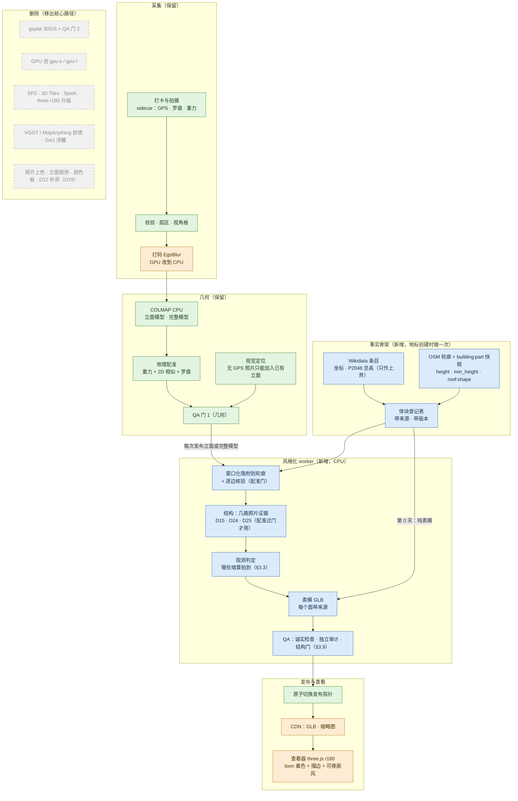

# Crowd3D 风格化模型：设计文档

> 版本：2026-11-03（按决定 D29 改写）。**决定 D29**（产品负责人，2026-11-03）：放弃给模型上色，删掉上色代码。风格化模型从此一律是素模：形状来自地图事实，照片只负责把模型放到对的位置，并在配准通过时给出核验过、量出来的数字（D15、D24、D25）。本文按删完以后的代码写。上色时代的设计、数字和评审只留一行历史说明，原文在 git 历史里（D29 之前的最后一版是提交 bc49e0d 里的本文）。
>
> **历史**（一行一条）：
> - 2026-10-22 定稿：从照片级转向风格化，合并了三份角色草案（几何与风格化、生成式模型政策、产品／美术／成本）和原型报告。
> - 同日修订 3：产品负责人拍板 D7（画风可换）、D8（接受"玩具"定位，配准门不放松）、D12（墙上的小洞用实测底色补齐，D29 撤销）。
> - 同日三轮复审：D12 补洞的形状规则、画风校验按查看器真实的光照算（D29 后只剩斜纹那一条）。
> - 2026-10-22 起结构优先（`docs/STRUCTURE_FIRST.md`）取代 §3.1 的实现部分和 §3.6 的屋顶部分。
> - 2026-10-23 至 10-30：配准门三轮修复和任务 #73（§3.2）。
> - 2026-11-03 D29：删掉照片上色、立面程序、调色板、D12 补洞、屋顶取色、解锁状态和"待解锁"牌子；观测判定只留下决定"哪些墙算拍到"的部分（§3.3）。
>
> **结构优先（2026-10-22 起）**：`docs/STRUCTURE_FIRST.md`（"参照 Hover 重做算法流程"）取代了本文 §3.1 的实现部分（形状来源和照片核对）和 §3.6 的屋顶部分。本文只在受影响的各节开头加一行"→ 结构优先"指过去。原型代码：
> - `crowd3d/structure.py`：OSM 分件 → 参数化积木、G10 支撑、地图值的合理性工单；
> - `crowd3d/skyline.py`：天空掩码、天空轮廓线剖面；
> - `crowd3d/judge.py`：坐标门、判定规则、工单；
> - `crowd3d/lines3d.py`：三维线段证据（FLD/LSD 线段、对极匹配加 SfM 深度先验、在另外 ≥ 2 张照片里验证、合并、SfM 点支撑，再按分件的地图边量檐口、顶点/屋脊和斜脊坡度）；
> - `crowd3d/stylize.py` 的 `build_massing_from_structure()` / `structure_gates()` / `finish_structure_gates()`：结构 QA 门 G1–G12 并入发布 QA；
> - `crowd3d/relief.py`：照片实测的立面结构，只在拍到的墙上、守卫 G-R1–G-R7 全过才建，来源 `photo-measured`；D24 已拍板并打开：直线处于偶然水平的墙上只凭点建，来源 `photo-measured (points, D24)`，见那份文档 §2.4.7 和 §6 D24；
> - `crowd3d/structmetrics.py`：结构细节指标。
>
> **数字的来源标注**（每个数字都来自下面某一种；没有标注的数字是对同一节里已标注数字的复述）：
>
> | 标注 | 含义 |
> |---|---|
> | 【原型】 | D29 前原型修复轮之后的最终运行，本容器（4 核 CPU、无 GPU），2026-10-22 |
> | 【原型 v1】 | 修复轮之前的第一版原型，2026-10-22（只在对比时引用） |
> | 【D29】 | D29 删代码时的核对运行（2026-11-03，提交 37f95d9 到 c552637，和删之前的基线逐项比较） |
> | 【几何】【ML】【产品】 | 对应草案作者在本容器上的实测 |
> | 【本文】 | 本文作者为写这份文档做的复核或计算 |
> | 【估算】 | 工程估计，没有实测 |
> | 【待核实】 | 只有二手来源，或来源互相冲突 |
>
> 法规和许可部分是工程整理，**不构成法律意见**。视觉定位的设计见 `docs/VISUAL_LOCALIZATION.md`，基准测试的说明见 `docs/BENCHMARK.md` 和 `eval/results/README.md`，画风见 `docs/ART_DIRECTION.md`。术语见附录 D。

---

## 0. 一句话与产品体验

**一句话**：我们没有 GPU 预算做照片级渲染，游客照片又少又偏，照片级模型本来就很难看稳。所以改做**卡通"玩具"模型**：楼的**形状**来自公开的事实数据（OpenStreetMap 的建筑分件和高度），照片只用来把模型放准，并在配准通过时核验或修正尺寸。整栋楼都是**素模**（没有贴图、浅冷灰色、带淡斜纹的体块），画风可以整套替换（D7，`docs/ART_DIRECTION.md`）。

D29 之前，拍到的墙按照片上色，没拍到的墙挂"待解锁"牌子，拍照片就是"解锁"。D29 起模型不上色，也没有解锁的玩法。

### 0.1 用户看到什么

| 时刻 | 用户看到的 | 背后发生的事 |
|---|---|---|
| 地标有 OSM 分件快照 | 一座能认出轮廓的素模：塔、穹顶、尖顶都在 | OSM 分件（`building:part`）变成参数化积木（§3.1、STRUCTURE_FIRST §2.4），不需要任何照片 |
| 发布了一个点云模型 | 几秒到几十秒后，地标页这个模型旁边出现链接"风格化模型 · 素模（照片未对齐）"或"风格化模型 · 素模（照片已对齐）"；生成中显示"风格化生成中" | 风格化作业（§1.3） |
| 照片的配准被接受 | 仍是素模；照片证据可能改了形状：D15 自动采用的高度、D24 量出的立面凹凸、D25 的纠正，每处都能撤销 | §3.2、STRUCTURE_FIRST §2.4 |
| 配准被拒（今天每个真实众包模型都这样） | OSM 分件的素模；D15 撤回、不建 D24，D25 按配准等级保留 | §3.2 |
| 点任意一块积木 | 来源卡片，例如"形状：OpenStreetMap 志愿者测绘"、"照片量出（自动采用）"、立面凹凸的证据 | 每个面都带来源（provenance，§3.9） |

**这个转向的好处**（数字见第 6 节）：

1. **便宜**：核心路径不用 GPU；每次浏览的下载约 0.2–0.3 MB。
2. **对稀疏照片更友好**：没有照片也有一个认得出的素模；照片多了、配准过了，才用它们核验和修正形状。
3. **诚实看得见**：每个面都记着形状来自哪里，没有事实也没有测量的东西不画（§3.9）。

**代价**（直说）：模型不是"真实记录"，只有形状。颜色、材质、门窗图案都不显示（D29）；靠颜色才认得出的地标（洗礼堂的黑白条纹，STRUCTURE_FIRST §0.4）只剩形状。曲面壳体（悉尼歌剧院）用拉伸体块表示不了。

---

## 1. 新流程（端到端）

### 1.1 流程图

→ 结构优先：风格化作业前多一个"结构"子图（坐标核对、几路证据、在地图值上剖面判定、工单），见 `docs/STRUCTURE_FIRST.md` §0.3 的流程图。

图例：绿色 = 保留，蓝色 = 新增，橙色 = 保留但改了，灰色虚线 = 删除（不在核心路径上）。



### 1.2 和旧架构比：保留、删除、新增

| 旧环节（ARCHITECTURE） | 处理 | 说明 |
|---|---|---|
| 采集、sidecar、校验、扇区、视角格、`plan_jobs`、作业调度 | **保留** | 风格化只改展示层，几何主干不变 |
| COLMAP 增量 / global、地理配准、QA 门 1、在线注册 | **保留** | 风格化的输入就是它们的输出 |
| 视觉定位（无 GPS 的照片） | **保留** | 定位成功的照片在风格化里就是一台普通的已注册相机，能给已有的墙加视角；它带不来新的点云，所以不能单独让一面没有点云支撑的墙算拍到（§3.3） |
| 打码 EgoBlur、语义掩码 | **改到 CPU** | 发布物里已经没有照片像素，但原图存储和人工审核仍要打码。EgoBlur 是人脸、车牌两个 Faster R-CNN 检测器（按其论文），官方 README 说在只能用 CPU 的 Mac 上推理"very slow"，推荐用 CUDA GPU；本文按 1600 px 时 10–70 CPU·s/张估算（原文的约 1 s/张偏乐观），S0 要在 4 核容器上实测，并对比更轻的人脸/车牌检测器【估算】。语义掩码 v0 不用模型（§2.3 ③） |
| ALIKED + LightGlue（GPU 特征） | **推迟** | 继续用 CPU SIFT。代价：原指望它改善的转角和夜景匹配问题继续存在（CPU SIFT 下亚琛 augmented 全景只注册了 38%，见 REAL_WORLD_EVAL §4.4） |
| MegaLoc 检索（GPU） | **改** | CPU 推理或 COLMAP 词汇树 |
| gsplat 3DGS、QA 门 2（PSNR/LPIPS）、`hd_eligible`/`hd` 扇区状态 | **删除** | 失去照片级真实感和"写实版制作中"的玩法 |
| VGGT / MapAnything 前馈、1 分钟即时预览 | **删除** | 预览由"第 0 天的事实骨架"代替；**稀疏、对称场景的兜底没有替代**（亚琛 real 模式仍然 0 个立面） |
| DA3 单目深度的 L1 浮雕 | **删除** | 1–3 张照片时改为"照片钉 + 视锥" |
| SPZ、3D Tiles、Spark、three r180 升级 | **删除** | 单个 GLB 几十 KB，不需要 LOD；three@0.160 已有 `MeshToonMaterial` |
| 外观嵌入的"夜景版、雪景版"变体 | **删除** | 起初改成"实测调色板变体"；D29 起模型不上色，这一项不再有 |
| PLY 点云查看器 | **降级** | 只当调试视图 |
| — | **新增** | OSM 分件导入与体块登记表、风格化 worker、诚实检查和独立审计（§3.9）、可换的画风文件（D7）、客户端分享卡。当初还列了立面程序、调色板和样式令牌，D29 删掉了 |

### 1.3 风格化作业什么时候跑

- **设计**：
  - 地标创建时导入 OSM 快照，生成体块登记表，直接发布一个全素模的 GLB（冷启动，§3.1）。
  - 每次有立面模型或完整模型通过 QA 门 1 并发布后，排一个 `stylize` 作业，产出一个新的风格化版本，走 QA（§3.9），通过才原子切换发布指针。优先级排在"首个立面"之后、"立面重建"之前；耗时几秒到两分钟，不需要单独的去抖。
  - 照片被撤回时，用到这张照片的风格化版本也标 `contains_deleted`，按 ARCHITECTURE §3.8 的 30 天规则重算。
  - D29 前的设计还有"按墙合并多个模型、已解锁的墙数不减"，是为上色设计的，随上色一起作废。
- **原型现在的做法**（比设计简单）：按模型做，不按地标合并。地标绑定了 OSM 分件快照时，每个发布的 COLMAP 模型排一个 `stylize` 作业（`crowd3d/jobs.py`，`Settings.stylize_published`）；重建作业优先，没有重建作业排队时才在子进程里跑 `crowd3d.structure_pipeline`（1200 s 上限、2 线程）。GLB 放在 PLY 旁边，由 `/files/models` 提供；`ModelInfo.stylized` 给出地址、配准结论和标签："素模（照片已对齐）"，或者配准被拒时的"素模（照片未对齐）"（D29 前前者叫"风格化（照片已对齐）"）。地标页在每个模型旁边链到 `stylized.html`。核心五栋 20 个最新发布的模型都出了 GLB，配准都被拒；每个子进程 CPU 中位 4.9 s、最多 19.7 s（STRUCTURE_FIRST §2.9）。目标显示了更新的模型时作业以说明结束；以前发布的模型要等重新发布才有 GLB。

---

## 2. 技术选型

### 2.1 选型总表

→ 结构优先：下表"体块"一行的点云高度场只留给没有 OSM 分件和高度标签的长尾地标（`StyleParams.massing_source`）；新增的天空掩码（A+R，经典方法，可商用）、FLD 线段、三维线段几行见 `docs/STRUCTURE_FIRST.md` §1、§2.3。FLD 在 OpenCV 的 contrib 包（`cv2.ximgproc`）里；仓库现在的依赖 `opencv-python-headless` 没有它，`crowd3d/lines3d.py` 就用核心 OpenCV 的 LSD（设计里写的备选），记录里写明用的是哪一个。

耗时都是 4 核 CPU 上的实测，除非另标。

| 阶段 | 选用 | 不选及原因 | 许可证 | CPU/GPU | 每栋或每面的耗时／成本 |
|---|---|---|---|---|---|
| 特征与匹配 | COLMAP SIFT（沿用原型） | ALIKED + LightGlue：要 GPU，推迟 | BSD | CPU | 特征 1.55 CPU·s/张（约 1000 px）；匹配 0.128 CPU·s/图对【产品】 |
| 位姿 | COLMAP 增量式（n < 300），global mapper（n ≥ 300） | 前馈模型：要 GPU，可商用权重有附加条件（ARCHITECTURE §4.2） | BSD | CPU | n = 25 / 50 / 100 张：合计 96 / 313 / 1973 CPU·s，其中建图 14.9 / 74.3 / 1186 CPU·s【产品】 |
| 吸附到轮廓 | 在配准偏航窗口内搜索的 2D 吸附（窗口由配准给出的偏航 σ 推出），再逐边核验、逐墙 RANSAC 拟合平面（§3.2） | 不加约束的全局 ICP：八角形上收敛到 −90.58° 的对称别名解【几何】；真实立面作业上也收敛到 79–93° 的别名（§3.2） | 自研 | CPU | 1.2 s / 2.5 s（洗礼堂 / 亚琛）【原型】 |
| 体块 | OSM Simple 3D Buildings 分件 + 体块登记表；没有分件时用轮廓 + 高度 | 点云凹包闭合：和 OSM 的 IoU 只有 0.22–0.57，等于捏造背面【几何】；点云高度场递归切块：亚琛出现乱块【原型】【几何】 | OSM：ODbL（署名，派生库要公开）；Wikidata：CC0 | CPU | 分件素模 GLB 5.4 KB / 31.5 KB、105 / 1,199 个三角形【几何】【本文】 |
| 多边形运算 | shapely（并、差、缓冲）、mapbox-earcut（带洞多边形三角化） | trimesh：不需要。它的 `export_glb` 默认不写法线（`include_normals` 默认只在法线已缓存时才写，要显式传 `True`），几何草案没传，toon 材质下整楼全黑【几何】 | BSD-3 / ISC | CPU | 毫秒级 |
| 观测判定（哪些墙算拍到） | 规则：视角 + 体块遮挡 + SfM 点遮挡 + 点支撑 + 多视角一致 + 天空植被（§3.3）。只决定哪些墙、墙上哪些纹素算拍到，给 D24 和结构指标用；照片的颜色不进模型 | 只看几何覆盖：洗礼堂南墙几何覆盖 95.7%，点支撑只有 3.4%，看到的是远处糊掉的背景【几何】 | 自研（OpenCV Apache-2.0） | CPU | 观测 1.2 s（10 面墙、107 台相机）/ 50.4 s（79 面墙、203 台相机）；观测用的立面正射图约 1.0–1.3 s/墙【原型】 |
| 网格与 GLB | 原型自带的 GLB 写出器（零依赖），没有贴图 | Draco / meshopt：几何量太小，不需要；3D Tiles：不需要 LOD | 自研 | CPU | 毫秒到秒级 |
| 查看器 | three@0.160 `MeshToonMaterial` + 反壳剪影 + `LineSegments2` 粗折痕线（§3.8） | Spark/SPZ：为 splat 设计 | MIT | 用户设备 | SwiftShader 软件渲染 640×480：5.6–18.2 ms/帧【几何】；390×844 @2x：51–79 ms/帧【产品】 |
| 可选：文案 | VLM（如 Claude Haiku 5.5）生成构件名称和导览文字，只进 UI | 用 VLM 输出驱动几何 | API | 云端 | Haiku 5.5 约 $0.0004–0.0007/立面（effort 设 `low`、`max_tokens` 1024；它默认开着自适应思考，思考输出也计费）【估算；判别效果未测】 |

D29 删掉的几行：立面简化（立面程序）、可选的区域标签（DINOv2 + CMP）和分割（SAM 2.1、SAM 3）、纹理风格化（调色板填色；扩散 img2img 早已否决，§2.3）。

**耗时**：D29 前每栋端到端风格化洗礼堂 21.9 s、亚琛 115 s，峰值内存 567 MB / 816 MB【原型】。D29 后去掉了正射图之后的上色和屋顶取色：亚琛参考场景的风格化一步从 167 s 降到 59 s，少的主要是屋顶取色（约 96 s）【D29】。产品的风格化子进程 CPU 中位 4.9 s、最多 19.7 s（核心五栋的 20 个模型，STRUCTURE_FIRST §2.9）。这些都远小于 SfM 本身。

### 2.2 新依赖

| 依赖 | 许可证 | 用途 | 状态 |
|---|---|---|---|
| shapely | BSD-3 | 分件的并、差、缓冲，轮廓包含关系过滤 | **建议进生产** |
| mapbox-earcut | ISC | 带洞多边形三角化（原型的耳切法不支持洞） | **建议进生产** |
| ~~onnxruntime~~ | MIT | 原来给可选的 DINOv2 标签、SAM 2.1 分割（立面程序用） | D29 后不需要 |
| ~~tokenizers~~ | Apache-2.0 | **不需要**：它只服务于开放词汇检测器（ML 草案试过 Grounding DINO、OWLv2），而本文没有选用任何开放词汇检测器（§2.1、§2.3 都没有）。以后要用时，检测器本身的许可证和权限类别要先补进 §2.1 和 §2.3 | 删除 |

风格化没有给 `requirements.txt` 加依赖（numpy、opencv-python-headless、pillow 本来就在）；shapely 和 mapbox-earcut 是设计建议，原型自带了多边形运算和三角化。草案作者的实验依赖都装在各自的临时目录里（附录 B）。

### 2.3 生成式模型：允许、有条件、禁止

**用户的规则**：生成式模型不得给没拍到的地方编造内容（不得编造看不见的立面和背面，不做图生 3D 补全，不修补未观测区域），但可以用来做简化和风格化。

**本文的执行方式**：规则管的是**结果**，不管用的是什么方法。所以下面这些规则对非生成式方法同样适用（例如把八角形一面的结构复制到对面，不用任何模型也是捏造）。D29 以后模型没有贴图，规则落在形状和数字上：每个形状和数字要么来自事实（OSM、约定），要么是照片量出来、带证据记录的（D15、D24、D25），要么是明确标出的占位（"高度待定"矮台，D13）。

**定义**：**观测掩码 M**：一面墙上满足 §3.3 全部条件、算"拍到了"的纹素。

| 类别 | 内容 | 护栏 |
|---|---|---|
| **默认（不用任何生成式模型）** | OSM 积木 → 经典方法的照片证据（天空掩码 A+R、SfM 点、三维线段）→ 判定规则 → 素模 GLB | §3.9 的检查 |
| **有条件允许** | ① 人、车、树、天空的分割，结果**只能用来从 M 里剔除像素**（代码里标 `GENERATIVE-OK` 的地方，例如 `clutter_mask()`）。v0 不用分割模型：人和车靠多视角一致和 SfM 点遮挡（§3.3）去掉，天空和植被靠 CPU 颜色、纹理规则。要加模型时，候选必须先过许可证（SegFormer、ADE20K 训练的权重、Ultralytics 的 AGPL 模型都不行）【待核实】；② 用点云拟合屋顶类型、简化形状（本身不是生成）；③ VLM 生成名称和导览文字，只进 UI，标"AI 生成说明"，不回流几何 | 模型输出只是"提议"；每次调用记录模型 id、版本、权重许可（谱系） |
| **禁止（与许可证无关）** | 未观测区域的 inpainting / outpainting，以及用邻近内容、别的墙或任何推测内容"补一下"的非生成式做法（D12 的封闭小洞补底色是唯一例外，D29 已撤销）；图生 3D、文生 3D、新视角合成（TRELLIS、Hunyuan3D、SAM 3D 等）；对称或重复补全超出已观测的实例；生成式矢量化（StarVector）；训练或使用品牌风格 LoRA；生成的视图当证据 | CI 里维护模型白名单 |
| **许可证不允许** | SegFormer 权重；ADE20K 训练的 Mask2Former / OneFormer 权重；FLUX.1-dev、FLUX.1-Kontext-dev；Depth Anything V2 Base/Large | 同上 |

**生成的内容永远不算证据，也永远不进模型**（REVIEW_ADOPTION 采纳表里"生成式世界模型"一行引用这一条）。

**历史**：
- D3（扩散风格化）：SD-Turbo img2img 实测会做语义替换（strength 0.5 时雕像变阳台、青铜门变木门），自动检查拦不住，所以默认路径不用【ML】。D29 后模型没有贴图，这一条自然成立。
- CMP 训练的立面解析器会把浅色大理石的盲拱标成"窗"，当时用"比周围暗 ≥ 4 L*"降级【ML】；立面程序删掉以后不再有这一步。

**合规**（工程整理，需律师确认）：

- 核心路径不用生成式图像模型。但中国《互联网信息服务深度合成管理规定》第二十三条把"三维重建"和"图像修复"也列为深度合成技术，第十九条要求具有舆论属性的服务做算法备案，**这可能与用不用扩散无关**【ML，待法务确认】。
- 中国《人工智能生成合成内容标识办法》（2025-09-01 施行）和配套的强制性国家标准 GB 45438-2025《网络安全技术 人工智能生成合成内容标识方法》规定了显式标识和隐式标识的格式，办法里明确列了"虚拟场景"（在起始画面或适当位置加显著提示）。如果我们的模型被认定为生成合成内容，GLB 和旁挂文件的元数据要按标准写隐式标识，至少包括：生成合成标签、内容生成服务提供者名称或编码、内容制作编号，传播时还有传播服务提供者名称或编码和内容传播编号【本文整理，字段名以标准正文为准，待法务确认】。
- 欧盟 AI Act 第 50 条已于 2026-08-02 适用，50(2) 对"不实质改变输入数据或其语义"的标准编辑辅助有豁免；风格化能不能适用，说不准【ML、产品，待核实】。
- 建议无论哪条路径都按"需要标识"设计：UI 显示"按地图和照片生成的素模"，查看器起始画面放显式标识；GLB 的 scene extras 写隐式标识，字段按 GB 45438-2025 的元数据格式（上面几项），另加 `ai_assisted` 和谱系。

---

## 3. 风格化算法

### 3.1 体块：形状来自事实

→ 结构优先：本节的实现部分（分件解析和过滤、屋顶原语和退化链、约定值 D17、空隙补体、冲突策略 D15）由 `docs/STRUCTURE_FIRST.md` §2.4 取代；参数化积木在 `crowd3d/structure.py`，判定规则在 `crowd3d/judge.py`。**D15 已拍板（产品负责人，2026-10-23）：至少两路照片证据一致就自动采用**（`judge.AUTO_ADOPT = True`，规则在 `judge.adoption_rule()` / `decide_frame()`，整个流程在 `judge.judge_landmark()`）。"一致"指：有争议的积木上 ≥ 2 路证据（天空轮廓线、SfM 点、三维线段）各自有 ≥ 3 张照片、各自给出数值（SfM 点永远不给"比地图低"的数，天空轮廓线给"比地图低"的数要上方是天空的照片 ≥ 3 张）；所有给出数值的路两两相差 ≤ max(1 m, 5%)，都在地图值的同一侧（有一路在另一侧或反向投票就是"矛盾"，只开工单）；都不撞拟合边界（天空剖面的上下界、三维线段搜索窗的边，`search_m` / `at_bound`），天空剖面满足核验的精度条件（两种掩码 ≤ 1.5 m、区间 ≤ 1.5 m、两种代价差 ≤ 1 格、不是平的）；不是细高构件；坐标工单已结（逐边残差门不过、或任何一路的整栋相似变换偏离 > 3% / 平移 > 1.5 m，都算坐标工单未结：`judge.frame_in_question()`，判定和开工单用同一条）；父件的改动已被接受。整体尺度没有确立时（`judge.scale_status()`：吸附尺度修正 > 3%，或者没有任何一路在四周墙面上量到 k 在 1 ± 3% 以内的整栋相似变换——吸附返回 ×1.00 本身不说明尺度对，单侧照片时它分不开尺度和平移），还要至少两路在尺度无关量上一致：各路量到的积木顶高 ÷ 同一路量到的主体（最大的落地分件）檐口高，相差 ≤ 5%，采用值 = 比值均值 × 地图上的主体檐口高（SfM 点量不到檐口，不能为尺度作保；主体本身是参照，这时不自动采用）。几路数值一致也挡不住的情况另有三条：有争议是"偏高"时，SfM 点（每点 ≥ 3 张照片）四周都到了地图顶高（容差内）而没有更高，说明墙面就停在地图高度，算一路反对（脚手架、树、后面的楼能让轮廓线和线段一起错）；三维线段的墙顶一簇如果高出这面墙自己的表面（墙带里 SfM 点最密的那个面）的点超过檐口容差，那一簇不是这面墙的顶（脚手架、前面的东西），这条边不出数；某一路把檐口量在地图檐口上（≤ max(1 m, 5%)）而顶高变了，说明变的是屋顶：改 `roof_height`、檐口不动（`judge.eave_rule()`），几路檐口说法不一就只开工单。父件先判定：父件被采用后，压在它上面的分件跟着移动（底和顶都移同样的量，自身高度不变，D16 ②），再在父件的新值上重新判定。坐标门（整栋楼的轮廓缩放和平移）按同一条规则自动采用：SfM 墙面平面和三维墙面线段各自求一个相似变换（`frame_similarity()` / `frame_similarity_lines()`），宽度和平移都相差 ≤ max(1 m, 5%)、同向、不撞边界，并且在采用后的轮廓上逐边残差门要通过；缩放偏离 > 3% 时还要过尺度无关核对（`judge.frame_scale_check()`）：在试采用的轮廓上，天空轮廓线和三维线段两路量到的主体檐口高都和地图檐口相差 ≤ max(1 m, 5%)（重建尺度就是地图的尺度），并且"轮廓宽 ÷ 檐口高"相对地图仍同向偏离 > 3%；否则开坐标工单（洗礼堂：檐口 18.6–18.8 m 对地图 18 m，通过）。限制：整体尺度误差小于这个容差加上地图檐口自身的误差时分不出来（例如重建 ×0.95、地图檐口又偏低 4%）。坐标门的两路证据不独立：三维线段只保留有 SfM 点支持的，所以墙面位置大体是同一批点再量一遍；设计 §2.2 里更独立的第二种方法（天空轮廓线在 (k, t) 上的网格搜索）还没有实现。采用的值来源记 `photo-fitted (auto)`，原地图值（`map_value`）和全部证据存进"可撤销"清单（`StructureModel.adoptions`，进 summary 的 `structure.adoptions` 和 GLB 的 `extras.structure.adoptions`；`judge.revert_adoption()` 撤销一条及依赖它的全部采用），查看器显示"照片量出（自动采用）"和地图原值（轮廓被采用时，每个节点的 extras 带 `outline_adopted`：采用编号、缩放、平移和地图原轮廓宽，查看器的形状一行注明"轮廓按照片整体缩放、平移"）；从不改写 OpenStreetMap。只有一路证据、或几路互相矛盾，照旧只开工单。"高度待定"矮台（D13）也可以这样得到照片量出的高度；没被采用时它永远是素模、状态永远是 `stub`（压在被采用的分件上时跟着移动，底高记"随下面的分件一起移动"，占位的顶高仍是 `default-style`、状态仍是 `stub`）；底面一半以上悬空的抬高分件（G10）开工单，碰得到支撑的留在地图位置，什么都碰不到的不画（`resolve_support()`）。地图值越过合理范围（分件顶 > 1000 m、> Wikidata 总高 × 1.1、> 其余分件最高顶 × 2.5）、数字标签解析不了、约定屋顶（没有 `roof:height`）占分件高度 70% 以上，都只开工单、不改值（`open_value_tickets()`）。采用的值会重画成实体（不会出现"已拟合"却画在地图值上的分件）。三维线段是第三路证据（`crowd3d/lines3d.py`，只当证据，永不变成几何）：它直接量高度，所以能投"偏高"也能投"偏低"；每条记录带区间、照片数和吸附尺度，吸附尺度修正 > 3% 时它不能单独决定（只在另一路强证据同向时才算一票）；少于 3 张照片不出数，没被线段覆盖的边列为"没拍到"、不出数；墙面自己的 SfM 点高过最高一簇水平线时那条边不出数（那是线脚，不是墙顶）。"照片核验"现在要两路证据一致：天空轮廓线（两种掩码）和三维线段量同一个量（檐口对檐口、顶点/屋脊对屋顶），彼此相差 ≤ max(1 m, 5%)，线段离地图值 ≤ 容差；发布门 `check_decisions()` 从记录里重算一遍。工单里带各路量到的值（SfM 点一路记成"地图顶高 + 点云比模型同区表面高出的量"，和顶高可比）、哪几路一致和 D15 的结论；被自动采用的积木，工单关闭并记下是哪一条采用解决的（撤销后重开）。发布门 `check_decisions()` 不相信写记录的代码：每个 `photo-fitted (auto)` 参数都从它自己的采用记录重算一遍 D15（`check_adoption_record()` / `check_frame_record()`），跟着父件移动的参数要和父件的采用对得上。

**裁决（体块来源）**：初始方向是"OSM 轮廓拉伸 + 用点云定高度"。三份草案和原型报告一致建议改为**优先用 OSM Simple 3D Buildings（S3DB）的分件**，点云只做核验。理由：

- **可用率很高**【本文复核产品草案的 OSM 快照】：评测目录 13 个地标全部有 `building:part`。按"分件中心落在主轮廓内（外扩 2 m）"过滤掉相邻建筑的分件后，每个地标有 4–132 个分件；12/13 的分件带 `height`（唯一例外是悉尼歌剧院，13 个分件都没有高度）；12/13 至少有一个分件带 `roof:shape`（例外是比萨斜塔：塔本身 29 个分件都没有；不过滤时唯一带 `roof:shape` 的 w265815356 离塔中心 42 m，是邻楼）。主轮廓本身带 `height` 的只有 4/13【几何】。
- **形状对**：分件带 `min_height`、`roof:shape`、`roof:height`，能直接搭出塔、穹顶、尖顶和门洞。亚琛的分件素模（西塔加尖顶、八角堂加穹顶、唱诗堂、小礼拜堂）一眼能认出来；原型从点云高度场切出来的体块是一团乱块，八角堂和哥特唱诗堂并成了一个 573 m² 的平顶块【原型 v1】【几何】，修复轮之后仍是一堆棱柱（D29 前的截图说明在 git 历史里）。
- **照片少时也稳**：洗礼堂只用 15 张真实照片时，屋顶没被拍到，模型退化成平顶八角"蛋糕"；OSM 写着金字塔顶（`roof:height=12`）加采光亭【产品】。
- 这些是人工测绘的事实数据，不是生成。用户的规则管的是"编造"，不是"引用事实"。

**来源优先级**：

| 优先级 | 来源 | 给出什么 | 来源标注 |
|---|---|---|---|
| 1 | OSM `building:part`（S3DB） | 分件轮廓、`height`、`min_height`、`roof:shape`、`roof:height` | `osm-s3db` |
| 2 | OSM 主轮廓 `height` / `building:levels`（× 3 m） | 单一高度 | `osm-height` |
| 3 | 点云：每条边墙带点 z 的 0.97 分位，再取各边中位数 | 檐口高度、屋顶形状核验 | `sfm-points` |
| 4 | Wikidata P2048 | **只作上界和核验，永远不直接当拉伸高度** | — |
| 5 | 风格默认值，同时开馆员工单 | 兜底；只用于有 OSM 轮廓、但没有任何高度事实也没有点云的体块（例如悉尼歌剧院的 13 个分件）。原文是 15 m 平顶，这也是编出来的尺寸，本文建议改成 3 m 高、顶边画虚线的"高度待定"矮台，由 §9 决定 D13 定。没有轮廓时不用（见下文"OSM 缺失时"） | `default-style` |

为什么 Wikidata 只作上界【几何】：P2048 是总高，含尖顶和穹顶。德累斯顿圣母教堂 P2048 = 91.24 m，而 OSM 主轮廓 40.65 m。拿总高拉伸整个轮廓，等于凭空造出一个 91 m 高的盒子。**导入时要按 rank 读**：圣家堂有 3 个值，但 172.5 m 是 preferred，138 m 和 162.91 m 是 deprecated（不同建造阶段的历史值）【本文核对条目】，导入器只取 preferred（没有 preferred 时取 normal 里最新的），并统一单位（双子塔的值是 1483 英尺）。

**做法**：

1. **取数**：建地标时按轮廓外扩 20 m 的范围取 OSM 快照（生产用 Overpass 或 Geofabrik 区域快照；本容器里 Overpass 连不上，草案用的是 OSM API v0.6 `/map`）。**要按包含关系过滤**：查询框会混进相邻建筑的分件。产品草案的查询框是轮廓外接尺寸的一半加 20 m，不过滤时各地标查出 4–134 个分件，按"分件中心在主轮廓内（外扩 2 m）"过滤后是 4–132 个；混进来最多的是勃兰登堡门（88 → 29）和圣家堂（70 → 26）【本文复核】。快照的 OSM 版本号和时间戳冻结进登记表。
2. **分件棱柱**：每个分件是一个从 `min_height` 到 `height − roof:height` 的棱柱，再加屋顶（S3DB 规定 `height` 量到屋顶顶部）。有分件时**不再渲染外轮廓体**（S3DB 惯例）。
3. **屋顶**（`roof:shape`）：按下表建，做不出来就按表里的顺序退，**不退成金字塔**（四坡顶、折线顶的屋脊退成尖顶，事实骨架就错了：匈牙利议会大厦有 56 个 hipped、10 个 mansard 分件）。每次退化都把原值写进来源记录（`roof.fallback_from`）。13 个地标过滤后的取值统计：flat 86、hipped 57、pyramidal 51、gabled 45、dome 10、mansard 10、round 5、onion 4、circular 3、spherical 3【本文复核】。

   | `roof:shape` | 做法 | 做不出来时 |
   |---|---|---|
   | flat | 平顶 | — |
   | pyramidal | 扇形三角面汇到质心 | flat |
   | gabled | 沿最小外接矩形长轴做屋脊 | 矩形度 ≤ 0.85：flat + 馆员工单 |
   | hipped、half-hipped、side_hipped | 四坡顶（直骨架，矩形可用最小外接矩形近似） | gabled，再不行 flat |
   | mansard、gambrel | 两段折线剖面 | hipped / gabled，再不行 flat |
   | skillion | 单坡，坡向按 `roof:direction`，没有就按长边 | flat |
   | dome、onion | 旋转体（6 环缩放） | flat |
   | cone | 圆锥 | pyramidal |
   | **round** | **沿长轴拉伸的半圆剖面（筒形拱顶）**，不是穹顶：OSM wiki 的定义是"横截面像半个圆，也叫 barrel roof"。原文按穹顶建是错的（圣母教堂有 1 个、悉尼歌剧院有 4 个 round 分件） | gabled，再不行 flat |
   | saltbox、crosspitched、sawtooth、butterfly、hipped-and-gabled、bellcast_gable、gabled_height_moved | v0 不实现 | gabled，再不行 flat |
   | many、circular、spherical、其他非标准值、缺失 | flat + 馆员工单；`roof:height` 只作核验 | — |
4. **简化**：轮廓用 Douglas-Peucker，容差逐步放大到 ≤ 32 个顶点且 Hausdorff ≤ 直径的 3%；接近正交的边吸附到主轴；正八边形这类真多边形保留（原型已实现：洗礼堂 13 → 10 个顶点，偏差 0.02 m；亚琛 200 → 30，偏差 1.92 m【原型】）。
5. **圆角**：转角倒圆，半径 = clamp(1.5% × 直径, 0.3 m, 1.2 m)，3 段（原型参数）。
6. **重叠分件**：分件交叠处会有共面闪烁的细线，要在体块阶段做布尔并，或给共面面做微小偏移【几何】。

**体块登记表**（`massing.json`，每个地标一份，带版本）：

```json
{"landmark": "florence-baptistery", "version": 3, "osm": {"snapshot": "2026-10-22T03:10Z", "elements": ["w166821303", "..."]},
 "parts": [{"id": "p0", "outline": [[x, y], "..."], "outline_source": "osm-s3db",
            "z0": {"value": 0.0, "source": "osm-s3db"},
            "eave": {"value": 18.0, "source": "osm-s3db", "sigma": 1.0,
                     "evidence": [{"model": "m42", "value": 18.17, "p10_p90": [18.09, 18.27], "verdict": "agrees"}]},
            "roof": {"shape": "pyramidal", "height": 12.0, "source": "osm-roof-shape"}}],
 "curator_overrides": [], "disputes": []}
```

**冲突策略**【几何，阈值为估算】：

- 只有 `georeg_level = full` 的模型能产生高度证据。原因：洗礼堂 NE 立面模型只有 6 张 GPS 照片（`prior_only`），它测出的檐口是 26.98 m，比实际高约 45%；其余模型在 17.9–19.0 m，OSM 是 18.0 m【几何】。
- 证据和 OSM 相差 ≤ max(2 m, 10%)：只记"已核验"，**不改值**。
- 冲突较大时，**不自动覆盖 OSM**：保留 OSM 的值，标"有争议"，开馆员工单。满足"完整模型、该件暴露区 ≥ 500 个点、bootstrap 区间（重采样估出的置信区间）宽 < 1 m、连续两个版本一致"的证据会排到工单前面，但改值要馆员批准，批准后来源记 `curator`（证据附在记录里）。理由：点云估计器本身可能有偏差，亚琛 14 个分件里 9 个比 OSM 高 7–16 m，谁对谁错还判不了（§9.3 第 2 条），这些分件大多能满足上面的点数和区间条件，自动覆盖会用一个有偏的估计替换可能正确的事实。
- **永不自动回馈 OSM**。馆员确认后的修正也只有在来源许可证允许向 ODbL 贡献时才回馈（§9 决定 D5）。
- **滞后**：已发布的体块，高度只有变化 > 2 m 且证据更强时才更新，避免版本之间模型来回跳（原型在 E 立面模型上算出 15.48 m 平顶、在完整模型上算出 18.71 m 金字塔顶，两版体块来回跳【几何】）。
- 细高结构信 OSM：亚琛西塔尖顶点云 q98 = 69.6 m，OSM 74 m，细尖顶点太少【几何】。

**OSM 缺失时不用点云闭合体块**。洗礼堂完整模型实测，点云凹包和 OSM 的 IoU 只有 0.22–0.57、Hausdorff 22.7 m：西侧没人拍，凹包就把背面"猜"成了别的形状【几何】。做法：

1. 名胜地标的 OSM 覆盖率很高（13/13）；建地标时把 OSM 轮廓列为必填，缺了由馆员手绘（约 2 分钟【估算】），来源记 `curator`。
2. 馆员画好之前，自动兜底**只显示已观测墙段**（来自平面拟合）加地面上一圈扁平的点云足迹线，**不画闭合体块**。半透明的"推断闭合体"和 15 m 的默认高度一样，都是给没人拍过、OSM 也没描述的部分编出来的几何，和点云凹包是同一类问题，只是轻一些，所以默认不做；要不要做由您决定（§9 决定 D13）。
   - 原型目前的做法（修复轮新增）是：没有可用轮廓时从点云描出轮廓、按普通体块拉伸，来源记 `sfm-points`。这比本条宽松，进生产前要按本条改。

### 3.2 吸附与坐标

→ 结构优先：加逐边残差门 G11（墙内侧 10 m 以内的点都算；不过就开坐标工单，那条边上的墙不算拍到、不用照片证据，发布时在 `structure_gates()` 里跑；只量配准通过的点，配准不过时整栋都不用照片证据，门不跑）；正多边形轮廓用整栋楼相似变换取代逐墙移动（`judge.frame_similarity()` 和三维线段的 `judge.frame_similarity_lines()`；两路一致时按 D15 自动采用，见 §3.1 的"结构优先"一段，否则开坐标工单交馆员；坐标工单里附"尺度假设"：照片点云高度 / 地图高度的中位数放在缩放 k 旁边，有 Wikidata 总高时也放上，因为 k 本身分不清是 OSM 轮廓画错还是重建尺度偏了）；第 4 条"尺度已修正"规则见 `docs/STRUCTURE_FIRST.md` §2.2、§2.4.2。

**坐标**：沿用地标 ENU（x 东、y 北、z 上，米）。GLB 用 glTF 的 y 朝上：ENU (x, y, z) → glTF (x, z, −y)，和 `web/viewer.js` 一致。地面取 z = 0（相机高度约定 1.6 m）；点云墙脚的低分位被人群和围栏挡住，不能用来定地面【几何】。

**吸附**：

1. **旋转只在配准偏航窗口内搜索**。窗口 = ±min(3σ_θ, P/2 − 5°)：σ_θ 是这个模型配准时报出的偏航不确定度（`reconstruct` 已经在日志里报，例如真实立面作业的"yaw ±4–6 deg"；模型 JSON 有地理锚点时取锚点的偏航 σ，`crowd3d/anchor.py`），P 是轮廓的旋转对称周期（正八边形 45°，矩形 180°，不对称取 360°）。窗口内多起点；最优解离窗口边 < 1° 就不吸附、打标记。
   - 为什么不用 ARCHITECTURE §3.5.7 的固定 ±10°：洗礼堂参考模型成功的吸附要转 −9.42°，已经用掉窗口的 94%【原型】；ARCHITECTURE §3.5.3 算出单个立面只靠 GPS 时 σ_θ ≈ 13°。固定 ±10° 会把很多正常的真实立面当成"落在窗口边上"拒掉。
   - 为什么一定要窗口【几何】：原型的全局 ICP 在洗礼堂完整模型上收敛到 −90.58° 的对称别名解，墙面中位距离 0.402 m，**比正确解附近的 0.44–0.48 m 还小**。护栏拒掉了这个解，模型因此偏 3.9 m 没吸附，南墙贴上了乔托钟楼的图像（D29 前，墙还按照片上色）。真实链路上也一样：3 个 6–7 张照片的立面作业，不加约束的 ICP 分别收敛到 92.5°、78.9°、88.7°【本文】。窗口不超过 P/2 只在真实误差落在窗口内时才挡得住别名：报出的 σ_θ 大或者没有时，3σ_θ 超过 P/2 − 5°，窗口被截短，一个周期之外的别名就在 3σ 之内，对抗用例里转错 44–180° 的解过了门（任务 #73，69 个错误通过）。所以现在【原型】：窗口被对称周期截短、或者模型没报偏航 σ 时，吸附直接拒绝；吸附后相机到自己 EXIF GPS 的中位距离超过 max(20 m, 3 × 地理锚点在相机处的水平 σ) 也拒绝（`StyleParams` 的 `snap_refuse_clipped_window`、`snap_max_gps_median_m`、`snap_use_anchor`）。对抗用例 69 个错误通过降到 0；没有配准先验的场景（GT 定位的参考模型、测试）照旧用默认窗口。
   - **近似旋转对称的轮廓**（圆形的比萨斜塔、16 边形等，P/2 − 5° 小于 3σ_θ 时）：偏航从轮廓上看不出来，只搜平移，偏航沿用配准结果。
2. **平移搜索 ±25 m，接受靠逐边核验，不靠"修正量小"**。单张照片的真实 GPS 误差 p90 在洗礼堂是 20.3 m、亚琛 55.0 m（REAL_WORLD_EVAL，对轮廓校正后的参考），模型配准把多张照片平均后小一些：真实立面模型相对轮廓校正参考的水平误差中位数 4.7–10.4 m【产品】，12 台相机的那个作业偏 17.8 m，所以 ARCHITECTURE §3.5.7 的 8 m 上限太紧（§8 已列）。接受条件（原型 `registration_check`）：吸附后，点数达到中位边 25% 的轮廓边每条一票，≥ 60% 的边中位距离 < 3 m，而且通过的边方向至少相差 30°（全平行时沿墙方向的平移看不出来）。
   - 只拍到一面墙的立面模型（例如矩形建筑的一面），沿墙方向的平移看不出来，核验过不了，就不用照片证据。宁可不用，也不把照片证据放歪 10 m。
   - 已实现（2026-10-23 第二轮，`stylize.snap_to_footprint`，替换了"不加约束的 ICP + 拒绝超过 20° / 20 m 的修正"）：
     - **σ_θ 和 P**：σ_θ 取模型 JSON 的 `yaw_sigma_deg`，即 `reconstruct` 报的 GPS/罗盘融合 σ 再平方和加 3° 的系统误差底（`Params.yaw_systematic_sigma_deg`）；模型没报时取 6.7°（即旧的 ±20°）。P 由 `outline_symmetry_period()` 从轮廓量出：洗礼堂 44°、圣母教堂 85°、勃兰登堡门 177°、亚琛 360°（无对称）、比萨斜塔 0°；规则正八边形量出 36°（采样点在 1 m 内落回轮廓的盆地从 36° 开始，比名义的 45° 保守）。窗口 < 2° 时只搜平移。
     - **粗搜索**（`_placement_grid`）：窗口内约每 2° 一个转角 × 平移 ±25 m 每 1.5 m 一格，在 300 个墙高点上算"截断在 3 m 的平均点距"，取最好的 8 个局部极小值，再加上配准原位，作为 ICP 起点。网格固定，不依赖配准原位：SfM 稍有变化，同一批盆地也都还能找到（验证者重跑洗礼堂 E#14 时，旧的"每 4° 一个转角、只从原位和质心出发"漏掉了 −1° 的更好盆地）。
     - **ICP**：只用最近的 70%、且离轮廓 ≤ max(1 m, 3 × 中位距离) 的点对。只按 70% 截断时，贴着轮廓的邻楼、树或穹顶（占点数 35%）会把合成墙的转角拉偏 3–7°。平移不在迭代里截断，只要求最终解的墙移动 ≤ 25 m（在吸附后落在轮廓 3 m 内的墙点处量，不在全部墙高点的中位数处量）。各个解按"截断在 3 m 的平均点距"排序，不按中位数：中位数看不见少数点，而一小段端墙常常正是区分柱廊相邻两跨的证据。
     - **歧义就拒绝**：(a) 另有一个解也通过逐边核验，截断平均距离在最优解的 125% + 0.1 m 以内，而且会把照片在墙上挪 ≥ 1.5 m（墙点位移的 90 分位）或转 ≥ 2°。轮廓能修尺度时（窗口模式，中位距离降 ≥ 10%），每个候选解再做一次有界的尺度修正（±15%），刚体版和缩放版一起排序、一起比：尺度不对的模型没有一个刚体解贴得好，它的几个刚体解转角、平移各不相同，却不是不同的位置（一个小了 12% 的盒子曾因此被当成歧义）。第一版试过"缩放顺带转了 > 2° 就拒绝"，它把小了 10% 的盒子也拒了，已删掉；它原本拦下的圣母教堂 SW#9 现在由下面的"贴得太松"拦下。(b) 把最优解绕墙转 ±2°、±3.5°、±5°（平移重新拟合）仍在这个余量内，并且照片挪 ≥ 1.5 m；或者转到 ±5° 还在余量内。这说明偏航谷太平，轮廓定不住偏航。(b) 是第二轮加的：圣母教堂 SW#24、#25（20–30 张照片）的最优解就在这样的平谷里，比参考多转了 3–4°，SW#24 当时给 12 面墙上了色；对的 SW#11/14/15 转 2.5° 以内拟合就出了余量。
     - **墙贴得太松也拒绝**：吸附后，落在轮廓 3 m 内的墙点到轮廓的平均距离（截断在 3 m）> 0.45 m，轮廓就定不住偏航。圣母教堂 SW#9（8 张照片，缩放 0.926 后转了 −2.2°）、#20、#24、#25 的这个值是 0.50–0.55 m，都比参考差 3–5°；对的 SW#11/14/15 是 0.30–0.34 m。这条门槛只在一栋建筑的 7 个模型（3 次 SfM）上标定过。
     - **其他拒绝**：最优解离窗口边 < 1°；吸附后相机到墙的距离与照片自己的 EXIF GPS 到墙的距离之比（逐相机中位数）偏离 1 超过 max(5%, 1.5 个标准误)；轮廓要的尺度修正顶到 ±15%；轮廓没修尺度、而 GPS 尺度不确定度 > 15%。
     - **只搜平移时**，3σ_θ > 5°、或 3σ_θ 让照片绕轮廓挪 > 1.5 m（半径 × 转角），就拒绝。这时轮廓查不了偏航，只能信配准报的 σ_θ；验证者的对抗用例里，近圆轮廓上 47 个通过有 34 个是错的，最大偏 21°。按 3° 的系统误差底，3σ_θ ≥ 9°，所以比萨斜塔现在一律被拒，要等更准的偏航来源（例如 VISUAL_LOCALIZATION 的视觉定位）。
   - **第三轮（2026-10-24）新增**，起因是验证者查出第二轮仅有的 3 个真实通过（圣母教堂 SW#11/#14/#15）里有 2 个按相机中心标准是错的，SW#14 当时的贴图还整体偏高 3–4 m：
     - **相机的位移也算**（`snap_ambiguity_cameras`）：上面 (a)(b) 里"把照片挪 ≥ 1.5 m"之外，再加"把相机挪 ≥ 1.5 m（中位数）"。转角谱另外试一个"让相机挪 1.5 m 的转角"（相机离墙 D 米时为 1.5/D 弧度，最多 2°）。相机离墙 70–90 m，转 1° 墙上几乎不动，相机却挪 1.2–1.6 m；对的配准要求相机在 1.5 m 内（见下面的判定），所以轮廓要能把偏航定到约 1°、把尺度定到约 2%，才敢用照片证据。圣母教堂 SW#11 转 −1.2° 后拟合 0.38 m（最优 0.30 m，仍在余量内），因此现在拒绝；勃兰登堡门 E#47（v0 那次 SfM）只有靠这条才拦得住：它的刚体解和缩放 0.924 的解在墙上只差 1.1 m，相机却差 3.2 m，按参考它的墙点偏 7.8 m。
     - **尺度谱**（`snap_scale_steps`, `snap_scale_gps_sigmas`）：把最优解绕墙缩放 ±3/6/10%（平移重新拟合），只试在 GPS 拟合尺度 σ 的 2 倍以内的那几档（σ 未知就都试）；拟合仍在余量内、又把照片或相机挪 ≥ 1.5 m，就算尺度没定住，拒绝。点到轮廓的距离对"缩短"几乎不敏感（墙点仍在边上），所以只拍到两面相邻墙的 L 形模型，尺度基本只能靠 GPS：34 m × 13 m 的 L 大 7% 时，最远端的照片偏 2 m（验证者 street_L：240 例里 76 个这样通过、全错）。按 2σ 判是因为 1σ 会放过 1.4σ 的误差（7% / 5%）。
     - **倾斜检查**（`camera_tilt_check`, `snap_max_tilt_shift_m` 1.5 m）：吸附只绕竖直轴转，模型若本来就倾斜，平面上的各项检查都看不见，照片却在 40–250 m 外的墙上整体偏高或偏低。拍照的人大致站在同一高度，所以对未标记相机的中心拟合一个稳健平面 z = a + g·(xy − c)（离群 > max(3×1.4826 MAD, 0.75 m) 的相机剔除：塔上、露台上拍的），它在墙点处推出的竖直偏移 |g·(墙 − c)| 的 90 分位，加 1 个标准误（高度离散下限 0.25 m），必须 ≤ 1.5 m；相机 < 5 台或排成一条线（测不出朝它的倾斜）也拒绝。圣母教堂 SW#14 推出 3.04 ± 0.27 m（对参考的实际倾斜 2.79°）、SW#15 2.55 ± 0.28 m（2.18°）、SW#11 0.47 ± 0.31 m（0.62°）。真的上坡的街道也会被读成倾斜而被拒，这是安全的一侧。洗礼堂立面模型的相机高度离散很大（拟合斜率中位数 8.4°，而对参考的倾斜中位数只有 0.86°），这条检查在那里会误拒，不过那些模型本来就因为别的原因被拒。
     - **没有相机看得见的面**（`registration_check` 的 `cameras_xy`、`unseen_points`）：一条有投票权的边，外侧 ≥ 1 m 处一台相机也没有时，检查它 3 m 内、墙高下半段的点：把点朝每台相机挪 3 m（允许立面在画到勒脚的轮廓里面 3 m），如果挪完仍在建筑内、或从那里到相机的视线穿过轮廓，这台相机就看不见它。这样的点 ≥ 20 个且 ≥ 该边点数的 30% 时，整次吸附直接拒绝：每台相机都得穿过整个体块才看得到它们（滑到体块背面、把街对面邻楼的立面挪到这面墙上）。只看下半段，是因为从墙外越过屋檐看到的屋顶点也会被判成"看不见"。
     - **σ_θ 的下限也在风格化里**（`snap_min_yaw_sigma_deg` = `Params.yaw_systematic_sigma_deg` = 3°）：模型 JSON 报的 σ_θ 比这小也按 3° 用。验证者把 σ 报小三分之一时，只搜平移的模式在近圆上放过了 12–16° 的偏航误差。
     - **被标记的相机不参与观测**：`load_job` 不再把模型 JSON 里带 `flags` 的相机交给观测判定（以前只在吸附先验里剔除）。SW#14 有一台离参考位置 154 m 的相机给当时 3 面上色的墙都贡献了像素。
     - **配准过的模型必须带相机**：模型 JSON 标了 `georegistered: true` 却没有任何相机位置时拒绝（相机位移、倾斜都没法查）。流水线的模型总是带相机。
     - 第三轮之后，在 4 次 SfM、229 个合格模型的离线重放里（缓存了相机朝向和 3-D 参考）：通过 4 个（都是合成的），0 个错，真实 Commons 模型 0 个通过；把"相机也算位移"关掉时通过 9 个、错 1 个（上面的 E#47），4 次 SW#11 是对的。§5.2 有基准数字。
   - **配准精度怎么算"对"**（基准的 `style_registration_right / wrong`，`metric_schema_version` 5）：取模型里有参考位姿的未标记相机（轮廓校正后的 MegaDepth-X 参考，≥ 3 台）。四条都满足才算对：(1) 吸附后相机的水平中心离参考位置的中位数 ≤ 1.5 m（用户定义的"相机中心误差"）；(2) 把相机中心挪到参考位置还需要的二维相似变换转角 ≤ 5°；(3) 尺度差 ≤ 10%（30 m 的立面尺度差 10%，两端的照片就偏 1.5 m）；(4) 模型墙点（吸附后落在轮廓 3 m 内的墙高点）还要挪动的 90 分位 ≤ 1.5 m，取二维和三维里大的那个：三维修正的旋转来自相机朝向（每台相机的 参考ᵀ·模型，取稳健的弦均值），尺度和平移来自相机中心，所以倾斜也算进去。只看相机中心看不出倾斜（它们几乎在一个水平面上），SW#14 正是这样：第二轮的吸附在水平上墙点 90 分位 1.17 m，按三维量是 3.78 m（竖直方向中位偏 3.49 m，和验证者按参考位姿重投影贴图量到的 3.2–4.1 m 一致），相机中位 2.2 m；SW#15 三维墙点 1.2 m、相机 2.33 m，按第 (1) 条算错；SW#11 三维 1.31 m、相机 0.93 m，算对。没通过时 `wrong_because` 记哪几条没满足（turn / walls / walls_3d / scale / cameras）；吸附前的同一判定记为 `placed_right_before`（`style_rejected_placed_right` 用它）。`style_ref_camera_median_worst_m` 是通过模型里最大的相机中位误差（第 4 版叫 `style_ref_camera_error_worst_m`，名字不准，已改名），`style_ref_camera_error_max_m` 是最差的单台相机，`style_ref_walls_p90_worst_m` 是最大的墙点位移。
     - 第 4 版只在墙上判（转角、二维墙点、尺度），理由是相机离墙远、绕墙转 1° 相机就挪很多而照片几乎不动；验证者指出用户要的是相机中心误差，而且 SW#14 的贴图按参考位姿重投影整体偏高 3–4 m，所以第 5 版两样都要。第一轮（schema 3）的规则是墙点中位处 ≤ 3 m、尺度 ≤ 15%，更松。
     - **参考本身也有误差**：圣母教堂参考的刚体轮廓残差 0.77 m，偏航主要靠 GPS + 罗盘（在 ±5° 内的拟合曲线很平，轮廓拟合把它转了 1.64°），尺度修正被 GPS 3σ 规则拒绝；它自己的偏航大约差 1–2°、尺度差几个百分点。相机离墙 80 m 时，这相当于参考自身 1.5–3 m 的相机位置误差，所以 1–2 m 量级的对错判定两个方向都会错。验证者按参考位姿重投影贴图（texcheck）时，被判为对的 SW#11 也有 1.43 m 中位、1.74 m 90 分位的贴图位移。三维墙点修正是这种位移的替代量；逐像素的重投影核查（墙面样本点按模型位姿投到照片、再按参考位姿投回墙面）没有进基准。
3. **逐墙平面对账**（原型修复轮已实现）：吸附之后，对每面墙附近 4 m 内的点做 RANSAC，拟合一个竖直平面（每面墙一个偏移和一个偏航，**不截断**）。
   - 拟合平面在面内侧 > 1 m 或转了 > 5°：把这条边移到拟合平面上（最多 5 m），来源记 `sfm-plane`（原型记 `sfm-points`），开馆员工单。往外移只允许在原始 OSM 轮廓之内（找回简化时丢掉的细节）。
   - 拟合平面在轮廓外 > 1.5 m：那是墙前面的别的东西（邻楼、小礼拜堂），这面墙不算拍到。
   - 附近的点只有 < 25% 落在同一个面上（没有明确的立面），这面墙不算拍到。
   - 移动之后，拟合平面和体块面的差必须 ≤ 1.5 m、≤ 8°，否则这面墙不算拍到。D29 前的最终运行里已贴图墙的最大差是 1.17 m / 4.3°（洗礼堂）、0.93 m / 3.7°（亚琛）【原型】。
   - 原文的"偏移 ≤ 1.5 m 时保留 OSM 边、平面偏移截断到 ±1 m"已废弃：原型 v1 正是这样做的，结果洗礼堂 4 面已观测墙里 2 面、亚琛 38 面里 9 面撞到 ±1 m 的截断，照片投到错的平面上，洗礼堂 wall 2 的正射图明显重影，而且没有任何标记【原型 v1】。
   - 未观测的边只跟随整体变换。
4. **带尺度的吸附**：原型修复轮对所有模型都开了有界的尺度修正（±15%），亚琛参考模型修正了 1.10（模型比 OSM 轮廓小约 10%，这也是 v1 大部分平面偏移的原因）【原型】。尺度修正会连带改变高度证据，所以尺度修正超过 ±3% 的模型，高度证据标"尺度已修正"，冲突策略里不能单独靠它（§3.1）。NE 立面模型（`prior_only`）带尺度的 ICP 只修到 0.923，檐口仍有 24.5 m，原因没查清【几何】；**查清之前，`prior_only` 的模型不贡献高度，也不贡献照片证据。**第二轮已在风格化里强制：模型 JSON 没写 `georegistered: true` 时既不吸附、也不过门，整栋不用照片证据（`SnapPrior.georegistered`）。圣母教堂 SW#17 是 `prior_only`，以前照样过门、当时给 4 面墙上了色，参考说它还要 1.19 倍尺度、相机偏 13 m。基准新增 `style_gate_passed_not_eligible`，必须为 0。
5. 每次吸附都把旋转、平移、尺度和吸附前后的中位距离写进来源记录（原型已写进 GLB 的 scene extras 和摘要；`--snap-from` 可以复用上一版的吸附，保证重发布不漂移）。复用前先核对【原型】：流水线模型（有配准先验的）按现在的代码重新吸附，新吸附被接受、并且离存下的吸附不超过 1.5 m（点的水平移动的 90 分位）时才原样复用，否则拒绝并写明原因；参考场景（`--scene`）没有配准先验，存下的吸附就是参考固定的摆放，原样复用，配准门仍逐边核对。

**任务 #73 的现状**（2026-10-30）：

- **已修**：报出的偏航 σ 大或者没有时接受对称别名解（第 1 条）。三个 `StyleParams` 开关默认都开：窗口被对称周期截短（3σ > P/2 − 5°）或者没报偏航 σ 就拒绝；吸附后相机到自己 EXIF GPS 的中位距离超过 max(20 m, 3 × 地理锚点在相机处的水平 σ) 就拒绝；模型 JSON 有地理锚点时偏航 σ 取锚点的。对抗用例的 69 个错误通过降到 0（只开 GPS 那一条就全拒，只开截短和缺 σ 那一条拒 59 个）。代价：误差为 0 的对抗用例里 78 个正确通过只剩 16 个，没报 σ、报 30° 或 90°、以及洗礼堂上报 6°（周期 44°，3σ = 18° > 17°）的都拒绝。锚点的偏航下限 7.35° 下，周期小于约 54° 的轮廓（八边形和更细的）永远过不了吸附门，洗礼堂的模型全部如此（它们之前也因为别的原因被拒）。
- **已修**：`--snap-from` 绕过新的检查（上面第 5 条的核对）。
- **dev 重放**（合成集和 mdx-two-v1 的 v1-merged、核心五栋的 v1-after-fixes，两次重复共 157 个模型）：开关关、开（旧的偏航 σ）、开（`--regeo` 补出的锚点 σ）三种都是同样 4 个通过（合成环的完整模型和合成两面的东南立面，各两次），全对，`style_registration_wrong` 为 0。真实照片的模型仍然一个都过不了门。
- **没做**：#73 里列的几处吸附门检查（决定能不能用照片证据）还没有回归测试。

**照片证据的前提**（D15、D24、D25；D29 前也是上色的前提）：吸附后墙点到体块的中位距离 ≤ 1.5 m（原型参数 `snap_max_residual_m`），**并且**通过第 2 条的逐边核验和上面各条拒绝检查。不满足时整栋不用照片证据：判定器的结论（D15 采用、照片核验）撤回，没有一面墙算拍到、不建 D24，D25 的纠正按配准等级保留（`correct.publish_grade`）；原因写进来源记录。D8 拍板接受"玩具"定位以后，这道门（1.5 m 吸附残差、逐边核验、逐墙 1.5 m / 8°）**不放松**：它管的是把照片证据放到对的墙上，不是测绘精度。

> **真实链路（历史）**：D29 前（2026-10-22）手上 5 个洗礼堂真实立面作业只有 1 个过门（15 张照片的 E 立面，吸附 2.61 → 0.16 m，逐边 4/4，2 面墙上色）；之后三轮修复把真实众包模型的通过数降到 0（§5.2）。逐墙对账在初始误差 ±3 m 以内能恢复到 0.44–0.57 m，超出 3 m 的墙就找不到点了【几何】，所以要"先粗后细"：先按第 1、2 条做窗口化的粗吸附，再逐墙对账。

### 3.3 观测判定：哪些墙、墙上哪些地方算"拍到了"

D29 起观测判定不再决定颜色，只决定两件事：**哪些墙算拍到**（`WallObservation.observed`，GLB 墙节点的 `observed`）和**墙上哪些纹素算拍到**（观测掩码 M，`observation_mask()`）。用到它的地方：

- D24 立面凹凸只在拍到的墙上量，只建在拍到的那一段里、观测纹素上（STRUCTURE_FIRST §2.4.7 的 G-R5）；
- 结构指标的拍到面积（`structmetrics` 的 `photographed_area_m2`，以及由它算出的 `detail_coverage`）；
- 查看器第一眼朝向哪一侧（§3.8）。

判定的算法和 D29 之前逐位相同：`tests/test_d29_pins.py` 钉住了掩码、每面墙的判定和墙段切分，删代码的每一步都和删之前的基线逐项比过【D29】。

**一面墙算拍到**（`observe_walls()`，再加两次掩码检查），下面几条都要满足：

1. ≥ 2 台已注册相机（`min_wall_cameras`）各看到这面墙 ≥ 15% 的可见格：相机在墙前方，视线和墙法向夹角 ≤ 72°，投影落在图像内，不被体块挡住；
2. 墙面 0.75 m 带内有 ≥ 20 个 SfM 点，且 ≥ 1 点/m²；
3. 拟合的墙面平面离这个面 ≤ 1.5 m、≤ 8°，而且不在轮廓外（§3.2 第 3 条）；
4. 不是"高度待定"矮台（D13）的墙，也不在逐边残差门 G11 超限的边上（STRUCTURE_FIRST §2.2）；
5. 几何掩码（下面第 1 步）覆盖 ≥ 10% 的墙（`min_observed_fraction`）；去掉天空、植被、整理以后的观测掩码仍覆盖 ≥ 10%。

配准被拒时没有一面墙算拍到。

**观测掩码**（每面候选墙一张，16 px/m，长边 ≤ 512 px）。每一步只会从掩码里去掉纹素，不会加：

1. **几何掩码**（`facade_orthophoto()`）：把这面墙最好的 ≤ 24 张照片投到拟合的墙面上。一台相机的样本在两种地方丢掉：体块挡住这面墙的地方；墙前 > 1.5 m 的 SfM 点挡在视线上的地方（每台相机一张深度格，长边 128 格，一格里 ≥ 3 个三角化质量好的点才算挡住；结构路径上每个点挡住半径 0.3 m 的圆）。然后每张照片一组曝光增益（向混合结果迭代 2 次，限 0.5–2.0），逐纹素取加权中值。一个纹素要 ≥ 2 张照片和混合结果一致（0.4 m 窗口平均后 RGB 距离 ≤ 60，且 ≥ 50% 的视角一致），并且墙面上有 SfM 点支撑（0.75 m 带内，膨胀 1.5 m）；再做 0.5 m 的开、闭运算。这一步用到照片的颜色，但只用来判断这些照片看到的是不是同一面墙：路人、视差重影、点云没抓到的遮挡物都对不上。颜色本身不进模型。
2. **场景归一**（`scene_observation_norm()`）：相信相机的白平衡。只有地标最浅的材料在曝光最好的四分之一视角里本身是中性色（C\* ≤ 4）时，才把白平衡调到让它保持中性（STRUCTURE_FIRST §2.5 第 7 条）；每面墙的混合先锚回原始视角的逐纹素中值（第 2 条）。曝光提升默认关（D21）。摘要的 `observation_norm` 记下用了哪些增益。
3. **去掉天空和植被**（`clutter_mask()`，在归一后的 CIELAB 里按 25 cm 平均判断）：又蓝又亮、或浅蓝而平滑，并且连到观测区上半部的块是天空；黄绿色的叶子（≥ 0.5 m²）和阴影里又暗、纹理又重的橄榄色叶子（≥ 1 m²）是植被。去掉以后做 0.5 m 的开运算。
4. **去掉漏网的天空**：在 8 px/m 的工作图上，彩度明显高于墙（≥ 14，且比墙高 8）的浅蓝"点缀"，如果墙本身不是蓝色，就算天空（从转角外、拱廊里看到的天空）。
5. **整理**（`tidy_mask()`）：去掉 < 1 m² 的孤岛，边缘用只减不加的模糊软化。< 0.5 m² 的洞只在模糊时临时桥接，免得洞边被吃掉；洞本身仍不算拍到。
6. 剩下的不到 max(20 个纹素, 0.5 m²)，或工作图上不到 8 个像素时，掩码为空，这面墙不算拍到。

**墙段**（`wall_pieces()`）：拍到的墙按掩码里有观测的列切成竖条。中间一段是"拍到的那一段"（节点 `observed: true`）；两端宽 ≥ 1 m（`strip_min_m`）的没拍到的竖条各成一个节点（`observed: false`）。两段拍到的墙段之间的倒角也标拍到。所有墙段都是素模，外观来源都是 `default-style`（§3.9）。

**独立复核**（`audit_model`，§3.9）：对观测掩码里抽样的纹素，用点和相机做线段遮挡检验（和建掩码用的深度格是两种方法）；被挡的比例全楼 ≤ 5%、每面墙 ≤ 20%，否则不发布。

**局限**：完全没有 SfM 点的遮挡物，几何掩码挡不住（D29 前的合成红棚子测试里约 20% 漏进了贴图【原型】）；它会让一小块其实被挡住的墙算拍到，影响的是 D24 能在哪里建、拍到面积有多大。常年站着人的墙脚（洗礼堂"天堂之门"下方）中值也去不掉，多视角一致那一条通常会把它判为没拍到。

**视觉定位的照片**：定位成功后就是一台普通的已注册相机，能增加看到墙的相机数；它带不来新的三角化点，第 2 条保证它不能单独让一面没有点云的墙算拍到。

**D29 删掉的**：D12 补洞；"锁定 / 部分解锁 / 已解锁"的墙状态和解锁计数；掩码外涂素模纹理的贴图；按掩码切出的"已拍条"贴图。

### 3.4 立面正射图（只用来定观测掩码）

1. 把墙面按纹素铺成网格（16 px/m，长边 ≤ 512 px），用已知相机位姿把每个纹素投到每张照片上取色（OpenCV `remap`）。
2. 曝光归一和混合见 §3.3 第 1 步；混合的权重 = 可见比例 × cos 视角 × 分辨率。
3. **正射图永不发布**：它只在风格化进程的内存里，用来定观测掩码，不写进 GLB，也不再写调试图（`scripts/stylize_model.py` 只出俯视草图）。D29 前它是墙面贴图的来源。

### 3.5 简化：立面程序（D29 删除）

立面程序（从照片里认出门窗、横带、条纹壁柱，再画成贴花和贴图）D29 前只做到"三层分解 + 门窗规整"，随上色一起删掉。立面上的结构现在只有几何：D24 量出的凹凸（`crowd3d/relief.py`，STRUCTURE_FIRST §2.4.7），每个元素都带证据记录，只建在拍到的墙上。

### 3.6 形状与屋顶

→ 结构优先：屋顶的形状来自地图积木（STRUCTURE_FIRST §2.4），不由覆盖率决定。

- **屋顶**：没有一个屋顶算拍到（D29）。每块积木的屋顶是一个素模节点（`roof-<i>-clay-<f0>`）；外轮廓拉伸路径上的金字塔顶，坡面和中性平盖各一个节点。每个屋面记点覆盖率（`roof_coverage()`：1 m 网格里有屋顶点的格子比例）和面积，只供查看，不决定外观。外轮廓拉伸路径上，覆盖 < 40% 的金字塔面不按点云造坡，改成中性平盖。
- **D29 前后的变化**：D29 前屋面按 SfM 点的颜色和覆盖率上色，拍到的屋顶块按颜色拆成单独的节点，还有贴在屋面上的颜色贴片（`roof-patch`）。删掉以后，只有照片对齐的参考场景有变化：屋顶节点合并（洗礼堂 corrected 8 → 3，亚琛 40 → 22，贴片节点 2 / 6 → 0），`photographed_area_m2` 只算墙（洗礼堂 corrected-d24 1519.5 → 1095.1 m²，`detail_coverage` 0.3088 → 0.4284；亚琛 corrected 1940.7 → 1285.7 m²）；墙、立面凹凸、D15、D25 和结构普查逐项不变【D29】。
- **圆角**：外轮廓拉伸路径上，体块转角倒圆，半径 = clamp(1.5% × 直径, 0.3 m, 1.2 m)，3 段。结构路径不倒角：积木的墙和屋顶原语要边对边地合上。
- **立面凹凸**：只有 D24 量出的几何（§3.5），凹进去的做成墙上的洞加侧面和背面（拱用 8 段半圆），凸出的做成盒子。
- **调色板**（D29 删除）：30 多种自有颜色、色族、洞口档和样式令牌都删了，GLB 的颜色表只剩三种素模色（§3.7）。

### 3.7 网格与 GLB

1. 原型自带零依赖的 GLB 写出器（`write_glb`），**写出时必须带 NORMAL**（几何草案用 trimesh 导出时没打开 `include_normals`，toon 材质下整楼全黑【几何】）。GLB 里**没有图片、贴图和纹理坐标**：`audit_glb` 见到任何一样都不发布。
2. **节点**：每组面一个节点。extras 带：
   - `kind`（`wall` / `corners` / `roof` / `roof-cut` / `base`）、`wall`、`part`；
   - `provenance` {`outline`, `height`, `appearance`}，`appearance` 恒为 `default-style`（§3.9）；
   - `observed`：只在墙段和两段拍到的墙之间的倒角上可能为 true（§3.3）；
   - 屋顶的 `coverage` 和 `area_m2`；结构积木的 `geometry`、D15 的采用和 D25 的纠正；立面凹凸的 `relief` 记录。

   材质是平涂的素模色，材质 extras 写颜色名（`clay`、`clay-roof`）。
3. **scene extras**：`generator`、`frame`、`landmark`、`attribution`（OSM 署名和照片署名：产品作业写"Placement and photo-measured detail from this landmark's check-in photos (Crowd3D contributors)"，脚本和基准写 Wikimedia Commons 照片的那一句）、`provenance_values`、`registration`、`snap`、`prior`、`style`（颜色表只有 `clay`、`clay-hatch`、`clay-roof` 三项，`STYLE_VERSION` 2）、结构优先时的 `structure`、`structure_lines`、`relief` 和 `structure_metrics`。
4. **体积和三角形预算**（设计；原型没有单独检查）：每个模型 gzip 后目标 ≤ 150 KB，硬上限 300 KB（Q13）；三角形 ≤ 20k（不含查看器生成的描边），这个量级不做 LOD，也不用 Draco、meshopt。D29 去掉贴图后 GLB 变小了：洗礼堂参考 corrected 的 GLB 79.6 → 58.2 KB；基准里合成集最好模型的 `style_glb_kb_gz` 汇总值 21.0 → 3.1 KB【D29】。每次浏览的下载按 0.2–0.3 MB 估（§6）。
5. **隐私**：GLB 里不放照片 id、用户 id 和相机位姿，只放计数。D29 前墙节点里调试用的贡献照片列表随上色删掉了。照片位姿另走接口（D30，任务 #87），要先定隐私规则。

### 3.8 查看器

`web/stylized.html`、`web/stylized.js`：

- **材质**：每种节点一个带斜纹的卡通素模材质（`MeshToonMaterial`，明暗档来自画风）。屋顶用画风的 `clay.roof`，其余（墙、倒角、屋顶切面、底面）用 `clay.wall`。GLB 里的材质颜色、贴图、纹理坐标和 `locked` / `observed` 标记都不用来上色，所以 D29 之前写的、带照片颜色的旧 GLB 也显示成素模；旧 GLB 里贴在屋顶上的颜色贴片（`roof-patch`）不画。
- **描边**：固定像素宽的反壳剪影，加 `LineSegments2` 粗折痕线；屋脊、斜脊按模型列出的结构线画，约定值的屋顶形状（D17）画虚线。颜色和粗细来自画风（或不要描边），地址参数 `outline=<px>` 可以覆盖宽度。
- **光照**：半球光加一盏主光，数值来自画风。
- **兜底**：没有法线时调用 `computeVertexNormals`。
- **取景**：第一眼朝向拍到的墙那一侧（`preferredBearing`，只读墙节点的 `observed`）；没有拍到的墙时朝 140°（`DEFAULT_BEARING`）。地址参数 `bearing`、`elev`、`zoom` 可以覆盖。
- **交互**：点一块积木出来源卡片：形状的状态（地图、约定、照片核验、照片量出（自动采用）、照片纠正（D25）、高度待定）、轮廓和高度的来源、立面凹凸的元素和证据（D24 写"照片点云量出（D24）"）、倾斜（D25-T）。卡片不再写外观（D29 后都是素模）；高度来源 `default-style` 写"默认样式（没有实测，也没有标注）"。OSM 署名常驻，不能藏在菜单里（OSMF 署名指南）。
- **面板**：墙数、屋顶面数、立面凹凸元素数（没有时不显示）。
- **画风**（D7，已拍板）：`web/themes/<id>.json`，地址参数 `theme=<id>`，面板里有下拉框。D29 后画风只有素模色（`clay.wall`、`clay.roof`、`hatch_shade`）、墨色 `ink`、描边、卡通明暗档、光、背景、地面和渐变；校验器只查斜纹看得见（ΔE00 ≥ 3，按查看器真实的光照算）和格式。参考画风 4 个：明快扁平（默认）、绘本粉彩、黄昏渐变、蓝图线稿。详见 `docs/ART_DIRECTION.md`。
- **默认画风的素模和 D29 前一样**：同一个素模 GLB 的截图逐像素相同，只少了"待解锁"牌子和墙上的虚线框【D29】。
- **留给照片位姿图层**（D30，任务 #87）：CSS2DRenderer 的 `.labels` 覆盖层、`bearingOf`、画风的 `ink`。
- **D29 删掉的**：贴图的按画风逐纹素换色、调色板规则、素模色对实拍色的 ΔE00 ≥ 7.5 校验、"待解锁"牌子和虚线框、补洞的卡片行、"屋顶已拍 X%"和"已解锁立面 N/M"的标签。

### 3.9 "不许猜"怎么强制执行

→ 结构优先：来源枚举加 `photo-fitted`、`photo-fitted (auto)`（D15 自动采用，查看器写"照片量出（自动采用）"）、`photo-corrected (auto)` 和 `photo-corrected (auto, lower bound)`（D25）、`s3db-shape-default`、`osm-s3db-support` 等；立面凹凸的元素记录另带 `photo-measured` 或 `photo-measured (points, D24)`。结构 QA 门 G1–G12 和这里的检查一起决定能不能发布（`qa.passed` 里的 `structure`）。见 `docs/STRUCTURE_FIRST.md` §2.7、§2.8。

**在代码里（构造保证）**：

1. **每个面都必须带来源**，三个维度，取值是封闭枚举（`stylize.PROVENANCES`）：

   | 维度 | 取值 |
   |---|---|
   | `outline` | `osm-footprint`、`osm-s3db`、`sfm-points`（没有可用轮廓时从点云描出；平面对账移动的边也记它）、`curator`、`photo-fitted (auto)`（D15 采用的整栋外框） |
   | `height` | `osm-s3db`、`osm-height`、`osm-levels`、`osm-roof-angle`、`s3db-shape-default`、`osm-s3db-support`、`osm-default-ground`、`sfm-points`、`wikidata-height`、`inferred`（这面墙没测到，沿用同一体块已测部分的高度）、`curator`、`photo-fitted`、`photo-fitted (auto)`、`photo-corrected (auto)`、`photo-corrected (auto, lower bound)`、`default-style` |
   | `appearance` | 只有 `default-style`：素模（D29）。`photo-observed`、`observed-fill`、`commons-blueprint` 都删了；节点里出现 `photo-observed` 会被当成未知来源，`check_honesty` 和 `audit_glb` 都不放行 |

   "拍到"不是外观，是墙节点的 `observed` 标记（§3.3），只说明照片看到了这面墙。
2. **没有对称传播的入口**：不存在"把墙 A 的东西复制到墙 B"的函数；D24 量到的节奏不复制到没拍到的墙。
3. **生成式模型**：核心路径不用。代码里标 `GENERATIVE-OK` 的地方只允许从观测掩码里去掉纹素（§2.3）。

**发布前的检查**（任何一项不过，整个版本不发布，线上保持上一版）：

| 检查 | 内容 | 不过时 |
|---|---|---|
| `check_honesty`（流程自己执行的约束） | `faces_without_provenance` = 0；`appearance_not_default` = 0；`observed_not_wall` 为空（只有墙段和倒角能标拍到，屋顶不行）；"高度待定"矮台的每个面都是素模、不标拍到（`stub_faces_not_clay` = 0）；每个立面凹凸元素都在拍到的墙上、带完整记录（`relief_unbacked` = 0） | 拒绝 |
| `audit_model`（用点和相机独立重算） | 拍到的墙段上，点到墙面距离的直方图峰值在 1.5 m + 0.25 m 以内（`wall_plane_mismatches` 为空）；观测掩码抽样纹素的线段遮挡检验（被挡全楼 ≤ 5%、每面墙 ≤ 20%，§3.3）；立面凹凸节点的几何和记录一致，每个元素 ≥ 50% 落在几何掩码上；D25 的记录完整、纠正值和记录相等；没有点时，任何节点都不许标拍到、不许带凹凸 | 拒绝 |
| `audit_glb`（只看发布出去的字节） | 没有图片、贴图和纹理坐标；"高度待定"矮台的节点全是素模；立面凹凸、积木框架、结构线和 D25 记录都和 scene extras 一致 | 拒绝 |
| 结构 QA 门 G1–G12、`struct_unbacked` | STRUCTURE_FIRST §2.8；每个照片数字都有证据 | 拒绝 |

这些检查用来抓程序的 bug：它们核对记录完整、和模型一致，但不用记录里的数字把判定规则重算一遍，所以挡不住自洽地伪造的记录（D26）。

设计里还有、原型没做的：Q12（体块稳定：高度变化 > 2 m 要有更强证据）、Q13（GLB 体积和三角形上限）。D29 删掉的：Q1–Q5、Q7–Q9、Q11、Q14、Q15（掩码外的非素模纹素、原语和证据、深色玻璃、锁定面贴图、调色板外颜色、墙级颜色一致率、天空色占比、立面纹理范围、贴花比对、版本抖动）和 D12 补洞的逐块检查。

**测试**（D29 之后，2026-11-03）：`tests/test_stylize.py` 69 个测试函数、`tests/test_structure_stylize.py` 17 个、`tests/test_d29_pins.py`（钉子测试，参数化后 11 个）；全量快速测试（`pytest -m "not slow"`）909 个通过、22 个慢测试不选；node 测试 89 个里 88 个通过、1 个跳过（glTF-Validator 那个只在指定了验证器路径时运行）。覆盖：观测掩码只减不加、拱廊里看到的天空离开掩码而窗户留下、剩得太少时掩码为空、小洞桥接；墙前的遮挡物、审计抓到掩码漏掉的遮挡物；半边被拍到的墙切段；吸附被拒时没有墙算拍到；逐边核验（不能只靠最好的那面）、平面拟合不截断、尺度修正、复用旧吸附、轮廓缺失或损坏、内院不封顶；声称照片外观的面、屋顶标拍到、没有点却标拍到都被拦下；`audit_glb` 拒绝图片、贴图和纹理坐标；画风只剩斜纹和格式的校验，旧格式的画风退回默认，旧的带颜色 GLB 显示成素模。

---

## 4. 美术风格指南

> **D7 已拍板**：画风由产品负责人定，写成一个 JSON 文件就能换，格式、校验和 4 个参考画风见 `docs/ART_DIRECTION.md`。D29 起画风只管素模色、描边、明暗、光和背景；形状语言（4.1、4.3）仍由风格化作业决定。

### 4.1 五条原则

1. **剪影优先**：认不认得出先看体块和屋顶，立面细节排第二。
2. **少即是多**：屏幕上小于 6 CSS px 的元素不画。
3. **全部圆润**：基本形只有圆角矩形、圆、圆角三角形。这和 Duolingo 公开描述的形状语言是同一种精神（用最少的形状，圆润友好），但**我们不用 Duolingo 的色值、角色、字体和素材，宣传里也不写"Duolingo 风格"**（画风本身一般不受保护，但商业外观和商标受保护）。
4. **颜色不来自照片**（D29）：整栋是素模，素模色由画风决定。
5. **看得出哪里是事实、哪里是照片量出的**：来源卡片写明每块积木的形状来自哪里；约定值的屋脊画虚线（D17），"高度待定"矮台是 3 m 高的占位（D13）。

### 4.2 素模色（调色板 D29 删除）

D29 删掉了自有调色板（30 多种颜色、色族、洞口档、样式令牌和它的校验）。剩下的只有素模色：

- GLB 的颜色表三项：墙 `clay` (228, 232, 238)、斜纹 `clay-hatch` (208, 215, 226)、屋顶 `clay-roof` (214, 220, 229)。
- 查看器按画风显示，不读 GLB 里的颜色。默认画风墙 #c8d1df、屋顶 #c9d2e2，斜纹 = 素模色 × 0.84（线性光），和 D29 前素模墙的样子一样（`docs/ART_DIRECTION.md` 第 1、3 节）。

### 4.3 形状语言

| 元素 | 规则 |
|---|---|
| 体块转角 | 外轮廓拉伸路径：圆角 r = clamp(1.5% × 体块直径, 0.3 m, 1.2 m)；结构路径不倒角（§3.6） |
| 屋顶 | 按 OSM `roof:shape` 的原语（STRUCTURE_FIRST §2.4.1），做不出来按退化链退 |
| 立面凹凸 | 只有 D24 量出的几何：横带、壁柱、退台、拱券开间、门窗洞等（STRUCTURE_FIRST §2.4.7） |
| 最小元素 | 默认取景下 ≥ 6 CSS px（设计目标） |

### 4.4 描边

| 描边 | 宽度和颜色 |
|---|---|
| 剪影 | 固定像素宽的反壳，宽度和颜色来自画风（`outline.width_px`、`silhouette_color`） |
| 折痕线（屋面之间、墙和屋顶之间的折边） | 默认是剪影宽度的 0.7 倍，至少 1 px（`crease_width_px`、`crease_color`） |
| 约定值的屋脊、斜脊（D17） | 虚线 |

### 4.5 光照

- 半球光加一盏主光，颜色和强度来自画风；卡通明暗 2–6 档（默认 3 档）。
- 设计目标：主光跟着相机走，保证任何视角下相邻面至少差一档明暗；手机上不开实时阴影贴图（软件渲染下占帧时间 22–33%【产品】），改为按轮廓烘焙一张地面软阴影。

### 4.6 各种状态长什么样

| 状态 | 条件 | 外观 | 地标页标签 |
|---|---|---|---|
| 事实骨架 | 有 OSM 分件快照 | 素模积木，屋顶按 OSM 形状 | — |
| 照片已对齐 | 配准门通过 | 素模；照片证据可能改了形状（D15、D24、D25），来源卡片写明 | "风格化模型 · 素模（照片已对齐）" |
| 照片未对齐 | 配准门不过 | 素模；只有 OSM 和约定的形状，D25 的纠正按配准等级保留 | "风格化模型 · 素模（照片未对齐）" |
| 高度待定 | OSM 没有高度 | 3 m 矮台（D13），永远素模 | — |

D29 删掉了和上色一起设计的状态和玩法：待解锁、部分解锁、已解锁、开放影像预览的"蓝图态"（D6）、解锁时的"滚刷"动画、贡献者小旗和"首亮"贴纸（D14）。底座的扇区进度环和拍摄任务和颜色无关，但都还没做。

---

## 5. 原型实测

本节大部分是 D29 之前的结果，只留一行历史说明；配准门的数字（§5.2 后半）和上色无关，照原样保留，`scripts/eval_real_landmark.py` 和 `eval/results/README.md` 引用它。

### 5.1 测了什么

- **D29 前的原型**（提交 8a60865，2026-10-22）：MegaDepth-X 参考模型（洗礼堂 107 台相机、亚琛 203 台相机，全部照片，按真实 EXIF GPS 配准再吸附到 OSM 轮廓）和 5 个洗礼堂真实立面作业；修复轮修了评审提的 11 个问题里的 9 个。之后接上了 OSM 分件（结构优先）和基准。
- **D29 的核对**（2026-11-03）：删代码前在 bc49e0d 上重跑洗礼堂（D15、D25，D24 关和开）、亚琛（D15、D25）、比萨倾斜和三个测试集的 `rescore --restylize`，存成基线；删代码的每一步都和基线逐项比较【D29】。

### 5.2 数字

**D29 前的上色结果**（历史，一行）：最终运行洗礼堂 5/10、亚琛 18/79 面墙贴图，GLB gzip 16 / 55 KB，用时 21.9 / 115 s，诚实 QA 全 0；真实链路 5 个洗礼堂立面作业里 1 个上色（15 张照片的 E 立面，2 面墙）。颜色质量（原型 v1 的区域色差 ΔE00 中位约 27、扣掉整体提亮后约 9–10）、贴花规整率和修复前后的对比表都在 git 历史里。

**和上色无关、至今成立的几条**【原型】：

- 把洗礼堂的轮廓平移 25 m、旋转或放大 1.25 倍，配准门全部拒绝（原型 v1 分别还给 6/17、5/21、5/17 面墙贴了图）。
- 轮廓缺失、为空或自相交时，从点云描出轮廓，来源标 `sfm-points`（§3.1 要求进一步收紧）。
- 墙面在多数相机里比 MVS 深度图靠前 ≥ 1.5 m 的掩码面积，亚琛从 23.3% 降到 5.4%（≥ 4 m：8.3% → 1.8%）；洗礼堂前后都是 0%。
- 拟合的墙面平面不再截断到 ±1 m：原型 v1 有洗礼堂 4 面里 2 面、亚琛 38 面里 9 面撞到截断。

**D29 的核对**【D29】：

- 洗礼堂和亚琛的参考场景、D24 链和比萨倾斜，删代码的每一步都和基线相同：观测掩码、墙的判定、墙段、立面凹凸记录、D15、D25、QA 结论和每个非屋顶节点的网格都逐项相同（洗礼堂 D15 轮廓 k 0.8178；D24 85 个数字里 36 个来自照片；亚琛 D25 一处，唱诗堂顶高至少 36.255 m；比萨倾斜 4.592°，朝 176.97°）。
- 只有照片对齐的参考场景上的屋顶变了（§3.6）。
- 三个测试集上的 `rescore --restylize`：配准、吸附、参考判定、最佳模型、结构指标都不变；只有 `style_glb_kb_gz`（贴图和颜色表没了）和耗时变了。

**10 栋建筑基准上的配准门**【fixer 第三轮，2026-10-24；`eval/results/*/v1-after-fixes.json`，代码指纹 5e84f665；"对"按 schema 5 判：相机水平中心离参考 ≤ 1.5 m（中位数）、转角 ≤ 5°、墙点挪动的 90 分位 ≤ 1.5 m（二维和三维取大）、尺度差 ≤ 10%，见 §3.2】：commons-ten-v1 核心五栋（洗礼堂、亚琛、勃兰登堡门、比萨斜塔、圣母教堂），每栋重复 2 次，SfM 也重跑；其余五栋没跑（两次重复的核心五栋就要约 5.5 h）。

- **结果**：commons 每次可参评 59 / 60 个，**通过 0 个**（v0 51 个里 31 个，第二轮 53 个里 3 个），所以 0 个对、0 个错，被拒但配准本来就对的 0 个（按 schema 5，没有一个 commons 模型单靠配准就放对了）。合成集每次 12 个通过 2 个（ring 的完整模型、two-sides 的 SE#2），都对；被拒但本来就对的每次 2 个（ring N#4 被尺度谱拒：GPS 尺度 σ 约 10–15%，缩 10% 仍拟合得一样好；two-sides E#1 只拍到一面墙）。mdx-two-v1 每次 2 个通过 0 个（歧义）。`prior_only` 却过门的 0 个；被跳过的（`style_incomplete`）0 个；诚实 QA、`audit_model`、`audit_glb` 全部通过，0 违规；被标记、没参与观测的相机 commons 共 185 台次。
- **commons 拒绝原因**（两次合计 119 个）：贴得太松 31、歧义 27、偏航谷平 15、超限缩放 14、点太少 8、偏航查不了（比萨）7、尺度没定住 7、窗口边 5、超出 25 m 4、残差 1。其中 24 个只因为相机那一条成立（照片在墙上挪 < 1.5 m、转角也不到门槛，相机却会挪 ≥ 1.5 m）：转角谱 11、竞争解 6、尺度谱 7。倾斜检查在跑到它的 111 个可参评模型里 55 个通过、56 个不通过（洗礼堂 11 个全不通过：那里的相机高度离散大）；它只在前面的检查都过了时才成为拒绝理由，这次一个也没轮到。相机离墙中位 44 m（8–93 m）。
- **用户看到的**（D29 前）：五栋都是 0 面上色墙（v0 16 面、第二轮 0 面）。
- **代价**：真实 Commons 模型一个也不用照片证据（D29 前：一面墙都不上色）。按用户的相机中心标准，相机离墙 40–90 m 时轮廓要把偏航定到约 1°、尺度定到约 2%；只靠 OSM 轮廓和 GPS（尺度 σ 2–20%、偏航 σ ≥ 3°）做不到。只拍到两面相邻墙的 L 形立面，尺度基本只能靠 GPS，所以按 2σ 判时尺度正确的也被拒。要用照片证据，需要不靠轮廓的偏航和尺度证据（VISUAL_LOCALIZATION 的视觉定位：拿新照片对已经配准好的地标级模型做绝对定位），这不在本轮范围内。
- **其他观察**：倾斜相对参考的中位数（未吸附）圣母教堂 1.40°（34% 超过 2°）、勃兰登堡门 3.36°（25 个模型都在 3–4°，和相机高度斜率负相关，可能是参考自己的"上"有偏）、比萨 0.64°、洗礼堂 0.24°；离线比较了几种更简单的"上"估计（只用右向量、只用水平相机分布、加重分布项），都不如流水线现在的 `estimate_up`，所以没有改配准。

**查看器**（无头 Chromium + SwiftShader 软件渲染，只能当 CI 回归代理，**不代表手机**）【产品，原型 v1】：390×844 @2x 下稳态帧时间开阴影 76 / 79 ms、关阴影 51 / 62 ms，首帧 6.8–7.3 s / 34–44 s。**真机帧率还没测**。

### 5.3 截图说明

截图由照片衍生，按 REAL_WORLD_EVAL §2.1 的理由不进仓库。D29 前的上色截图（洗礼堂、亚琛各 3 个角度，桌面和手机 UI）的说明在 git 历史里。D29 时的前后对比截图在本次会话的临时目录 `/tmp/claude-0/-home-user-temp/04ee4750-a5e3-5a4d-b130-9dfde89f5621/scratchpad/d29/2-viewer/`（会话结束后可能不在）：两个素模 GLB 在四个画风下和 D29 前的查看器（去掉虚线框和牌子）逐像素相同；一个带照片颜色的旧参考 GLB 显示成素模。

### 5.4 诚实的局限

1. **真实众包模型一个都过不了配准门**，所以产品里的 GLB 都是 OSM 分件的素模，不用照片证据（§5.2）。
2. **形状几乎全部来自 OSM**，照片的贡献很小（STRUCTURE_FIRST §2.9；洗礼堂参考场景开 D24 后 85 个数字里 36 个来自照片）。
3. **没有颜色**（D29）：靠颜色才认得出的地标只剩形状；"有颜色 = 有人拍过"这条视觉语言没有了，拍到哪里只在来源卡片和第一眼朝向里体现。
4. **没有 SfM 点的遮挡物**挡不住（§3.3），会让小块被挡住的墙算拍到。
5. **样本很小**：阈值（遮挡余量、平面容差、核验比例、吸附门）都在两座参考建筑和开发集上调的，属于样本内结果。
6. **和本文设计还不一致的地方**：没有轮廓时从点云描轮廓拉伸体块（§3.1 要求只显示已观测墙段）；Wikidata 高度仍会拉伸塔状轮廓；Q12、Q13 没做；体块登记表的冲突策略和滞后没做。
7. **还没做**：真机帧率、认得出度盲测。

## 6. 成本重算

> **D29 注**：本节是 D29 之前（2026-10-22）的估算，没有重算。D29 后风格化只剩体块、观测掩码、结构证据和 GLB：产品的风格化子进程 CPU 中位 4.9 s、最多 19.7 s（§2.1），比表里每次风格化 3–160 CPU·s 的估算还少；Q14/Q15 的人工审核和存储里的正射图约 5 MB 都不再有。CPU 的大头仍是照片入库和建图，量级不变。

修订 2 重写了成本模型：原文给每个地标每月 30 张上传、而且长尾地标每月重建一次（30 /(0.5 × 60) = 1），和它自己"长尾地标一生只有 90 张"以及引用的 ARCHITECTURE §9.4（每月约 5% 的地标重建）都对不上，结果 1 万个地标时一半的稳态 CPU（8,000 × 0.357 ≈ 2,856 / 5,714 vCPU·h）花在长尾上。每张照片的 CPU 也漏了打码、检索、掩码、NSFW 这些本文自己挪到 CPU 的环节。

### 6.1 假设

| 项目 | 取值 | 来源 |
|---|---|---|
| CPU 单价 | 按需 $0.0446 / vCPU·h，spot $0.0262（c7i.2xlarge，8 vCPU，$0.357/h、$0.2094/h） | Holori，2026-10-21【产品】 |
| GPU 单价（旧方案） | 混合 $1.5 / GPU·h，spot $0.9 | ARCHITECTURE §9.1 |
| CDN | $0.085/GB（CloudFront 前 10 TB 档），每月前 1 TB 免费 | CloudFront 定价【产品】 |
| 对象存储 | S3 标准 $0.023/GB·月 | ARCHITECTURE §9.1 |
| 每张照片的 CPU（1600 px） | **20–92 CPU·s**，逐项：校验 0.1；EgoBlur 人脸 + 车牌 10–70【估算，未实测，最大的不确定项】；SIFT 4.0（实测 1.55 s/张 @约 1000 px，按像素数折到 1600 px）；检索 0.5–3（词汇树到 CPU 上的 MegaLoc）【估算】；人/车/植被掩码 0.5–3（模型未选定）【估算】；NSFW 0.2–1【估算】；在线注册 30 个图对 3.8–9.6（实测 0.128 s/对，按 1600 px 特征放大 1–2.5 倍）；PnP/局部 BA 1【估算】。原文是 9.9 CPU·s | 【本文】按【产品】实测单价计算；S0 要在 4 核容器上实测 EgoBlur、检索和掩码 |
| 建图 | n ≤ 100：在实测点 25 / 50 / 100 张（14.9 / 74.3 / 1186 CPU·s，约 1000 px）之间按对数插值；n > 100：1186 × (n/100)^k，k = 2–3；再乘 1–2.5 折到 1600 px 特征。n ≥ 300 时 global mapper 应该更快，所以 k = 3 是上界 | 【产品】实测，外推为【估算】 |
| 重建用的照片数 | 每次重建最多用 300 张入选照片（上传超过 300 张的部分存着，但不进重建）。原文的稳态按 n = 450 重建，和这个上限矛盾，已改 | ARCHITECTURE §3.3.3 |
| 特征缓存 | MVP（S0–S2）**没有**地标级特征缓存：每次重建都重新提特征、重新匹配。成熟地标一生因此多 2.1–3.5 vCPU·h；本文建议把缓存提前到 S1（§9.1） | 【本文】 |
| 成熟地标一生 | 450 张上传、300 张入选；约 8 次完整模型重建（n = 24 → 300，几何增长）；约 32 次立面重建；每次风格化：完整模型 115–160 CPU·s、立面 3–15 CPU·s；每个发布版本一张缩略图 2–45 CPU·s | ARCHITECTURE §3.3.3、§9.1；风格化取亚琛最终 115 s【原型】、真实 15 张立面 2.8 s【本文】；缩略图见下 |
| 长尾地标一生 | 90 张上传、60 张入选；约 30% 跑出一次小规模完整模型（n ≈ 40）；12 次立面重建 | ARCHITECTURE §9.1 |
| 上传量（**一个模型通用**） | 1 万个地标时每月约 30 万张（ARCHITECTURE §9.4），按热度分：90% 给 20% 的成熟地标（每个每月 135 张），10% 给长尾（每个每月 3.75 张，约 24 个月攒满 90 张后基本不再增长）。100 个和 1,000 个地标按同样的每地标速率 | ARCHITECTURE §9.4；分配比例【假设】 |
| 重建频率 | 照片数长到 1.5 倍时重建（ARCHITECTURE §3.3.3）。成熟地标每月 135 张时，成熟后第 1 年每月 0.31 次、第 2 年 0.12 次完整重建；长尾每月 0.03 次完整重建、0.25–0.5 次立面重建。1 万个地标时每月约 5–9% 的地标有一次完整重建，和 ARCHITECTURE §9.4 的约 5% 同一量级 | 【本文】 |
| 缩略图 | 每个发布版本在服务端生成一张（约 40 KB）。首选在风格化 worker 里用一个小的 CPU 光栅化器直接画 GLB（平涂加描边），估 2–5 CPU·s；退路是无头浏览器，首帧 7–44 s【产品】。成本按 2–45 CPU·s 计 | 【估算】，S0 实测 |
| 人工审核（新增部分） | Q14/Q15 触发"转人工"的版本 2–10%，每次 3–5 分钟 | 【估算】，原型还没实现 Q14/Q15 |
| 每次浏览下载 | 新：0.2–0.3 MB（§3.7 第 3 条的预算：模型 ≤ 150 KB + 缩略图约 40 KB + UI JSON 约 20 KB + three.js 按 50% 缓存命中约 85 KB）；旧：约 15 MB | 新【估算】；旧 ARCHITECTURE §9.4 |
| 浏览量 | 100 个地标 2 万次/月；1,000 个 20 万次/月【假设】；1 万个 200 万次/月 | ARCHITECTURE §9.4 |
| 模型存储 | 新：每个成熟地标约 80 MB（稀疏模型 n = 100 实测 22.5 MB，外推到 300 张约 70 MB【估算】，加正射图约 5 MB，加 GLB 各版本）；旧：0.63 GB | 【产品】、ARCHITECTURE §9.1 |

计算脚本见附录 B（`lead2/cost3.py`），下表数字都是它的输出【本文】。每个范围的低端用各项的低估计和 k = 2，高端用高估计和 k = 3。

**单个地标一生的 CPU**（没有特征缓存）：成熟地标 12.6–63.0 vCPU·h（按需 $0.56–2.81），有缓存时 10.4–59.6 vCPU·h；长尾地标 0.74–2.81 vCPU·h。高端主要来自 EgoBlur 的估计（450 张 × 70 s ≈ 8.8 vCPU·h）和 n = 300 时 k = 3 的建图外推。旧方案每个成熟地标约 $7.5 GPU（ARCHITECTURE §9.3），**另外还有同样的 CPU 建图成本**，只是旧文没有计价。

### 6.2 三个规模

| 项目 | 100 个地标（全成熟） | 1,000 个（20% 成熟） | 10,000 个（20% 成熟） |
|---|---|---|---|
| 上传 / 月 | 1.35 万张 | 3 万张 | 30 万张 |
| **新：回填 CPU**（MVP，无特征缓存） | 1,263–6,295 vCPU·h，**$56–281**（spot $33–165） | 3,120–14,840 vCPU·h，**$139–662**（spot $82–388） | 31.2k–148.4k vCPU·h，**$1,392–6,623**（spot $817–3,884）；30 天回填要 6–26 台 8 vCPU 机器 |
| 新：回填 CPU（有特征缓存） | 1,037–5,962 vCPU·h，$46–266 | 2,586–14,148 vCPU·h，$115–631 | 25.9k–141.5k vCPU·h，$1,154–6,314 |
| 旧：回填 GPU | 约 500 GPU·h，$750 | 约 1,800 GPU·h，$2,700 | 约 1.8 万 GPU·h，$27,000 |
| **新：稳态 CPU / 月** | 118–1,074 vCPU·h，$5–48 | 261–2,248 vCPU·h，$12–100 | 2.6k–22.5k vCPU·h，**$116–1,003**（spot $68–588）；其中照片入库占 34–64%，长尾地标只占 4–9% |
| 旧：稳态 GPU / 月 | 很小 | — | 约 $450（3DGS）+ $80（逐张预处理）（ARCHITECTURE §9.4） |
| 新：风格化版本 / 月 | 12–31 | 248–487 | 2.5k–4.9k |
| **新：Q14/Q15 人工审核 / 月** | < 0.5 h | 0.2–4 h | 2.5–41 h（另加原有的照片审核约 50 h） |
| **新：CDN / 月** | 4–6 GB，$0（不计免费额度 ≤ $1） | 40–60 GB，$0（不计免费额度 $3–5） | 400–600 GB，**$0**（不计免费额度 $34–51） |
| 旧：CDN / 月 | 300 GB，约 $25（不计免费额度） | 3 TB，约 $170–255 | 30 TB，约 $1.5k–2.6k（ARCHITECTURE §9.4） |
| **新：存储** | 80 GB，$1.8/月 | 295 GB，$6.8/月 | 2.95 TB，$68/月 |
| 旧：存储 | 135 GB，$3.1/月 | 566 GB，$13/月 | 5.7 TB，$130/月 |
| 不变的成本 | — | — | 照片人工审核约 50 h/月；托管 Postgres $200–600/月（ARCHITECTURE §9.4） |

说明：

- 范围比原文宽很多（1 万个地标回填 $1.4k–6.6k，原文 $0.95k–1.96k），主要因为 EgoBlur 在 CPU 上还没实测：它一项就占每张照片 20–92 s 里的 10–70 s。S0 实测之后这个范围会大幅收窄；如果 EgoBlur 太慢，换更轻的人脸/车牌检测器（要先过许可证）。
- 稳态 CPU 的上界假设 n = 300 时仍用增量建图（k = 3）、特征放大 2.5 倍，实际会走 global mapper，所以偏高。
- 照片仍然占存储的大头：新方案里每个成熟地标约 0.72 GB 照片对约 0.08 GB 模型。
- **即使取高端，1 万个地标时算力每月也在 $1k 左右，流量接近 0；人工审核和数据库才是大头。**

**单位经济指标改为**："每个已发布立面的审核分钟数 + CPU 分钟数"，取代 ARCHITECTURE §10.1 的"每个已发布立面的 GPU 成本"。

**可选的额外算力（公司付费，都不含图像生成）**：SAM 3 概念分割 < $0.001/立面【估算，ML】（立面程序用，D29 后不需要）。VLM 文案：Claude Haiku 5.5（$0.10 / $0.50 每百万 token）默认开着自适应思考、effort 默认 medium，思考输出也按输出计费，所以调用时 effort 设 `low`、`max_tokens` 设 1024；按每次约 2k 输入 token（一张正射图加提示）算，每立面约 $0.0004–0.0007；用 Claude Sonnet 5.5（$2 / $10）约 $0.006–0.014。1 万个地标 × 平均 10 面墙 × 每月重算一次 = 每月 10 万次，约 **$40–70（Haiku）到 $600–1,400（Sonnet）**【估算】。

---

## 7. 基准测试新增的指标

→ 结构优先：加认得出度（盲测，主指标）、参数确定率、三维线段吻合、证据通道不一致率、馆员工单数，见 `docs/STRUCTURE_FIRST.md` §2.8。

### 7.1 怎么接到现有的 `eval/` 基准

已经接上了：`scripts/benchmark.py` 把测试集上每个发布的模型都风格化一次（地标有 OSM 分件快照时走 `crowd3d.structure_pipeline`，和产品的风格化作业是同一个入口），指标在 `scripts/eval_real_landmark.METRICS` 的 `style` 和 `struct` 两组，指标版本 7。每个指标的定义以 [BENCHMARK.md](BENCHMARK.md) 第 7.5 节（`style_*`）和第 7.8 节末尾（`struct_*`）为准，版本变化见第 7.6 节。截图仍不进仓库。

D29 前的设计里还有"参考模型上限"一列（用 Commons 参考模型算上色的上限）和合成集的立面真值（算编造率），都是为上色设计的，D29 后不再需要。

### 7.2 指标

**"对"的定义**（`style_registration_right / wrong`，指标第 5 版起）：过了配准门、并且至少 3 台相机有参考位姿的模型，四条都满足才算对：相机水平中心离参考的中位数 ≤ 1.5 m；还需要的转角 ≤ 5°；尺度差 ≤ 10%；墙点还要挪动的 90 分位 ≤ 1.5 m（取二维和三维里大的那个，倾斜也算）。细节和理由见 §3.2。

| 指标 | 方向 | 意思 | 门槛 |
|---|---|---|---|
| `style_registration_passed`、`style_registration_pass_rate` | ↑ | 可参评（`georeg_level = full`）的模型里过了配准门的个数和比例 | — |
| `style_registration_wrong` | ↓ | 过门却放错的：照片证据会落到错的墙上 | **必须为 0** |
| `style_registration_right` | ↑ | 过门而且放对的 | — |
| `style_rejected_placed_right` | ↓ | 被门拒了、但单靠地理配准其实已经放对的："宁可不用"的代价 | 只记录 |
| `style_gate_passed_not_eligible` | ↓ | 不可参评却过了门的 | **必须为 0** |
| `style_snap_residual_m` | ↓ | 吸附通过后墙点离轮廓的中位距离 | ≤ 1.5 m（门槛本身） |
| `style_ref_camera_median_worst_m` 等 | ↓ | 过门模型相对参考的相机和墙点误差 | ≤ 1.5 m 才算对 |
| `style_walls_total` | - | 每栋"最佳模型"的墙数（过门的优先，其次完整模型，再次注册照片最多） | — |
| `style_qa_failed` | ↓ | 没过 QA 的模型数（§3.9 的全部检查） | **必须为 0** |
| `style_glb_kb_gz` | ↓ | 最佳模型 GLB 压缩后的大小 | 目标 ≤ 150，硬上限 300（§3.7，设计） |
| `style_time_s` | ↓ | 风格化总耗时 | 只记录 |
| `struct_*` | | 结构：D15 采用、D25 记录、照片数字占比、能核对的和错的、无依据的数值、结构 QA | `struct_incorrect`、`struct_unbacked`、`struct_adopted_unregistered`、`struct_qa_failed` **必须为 0** |

**D29 删掉的指标**（原地删，指标版本仍是 7，BENCHMARK 第 7.6 节）：`style_coloured_walls_wrong`、`style_walls_coloured`、`style_walls_unlocked`、`style_observed_area`、`style_roof_observed_area`、`style_fill_m2`、`style_provenance_violations`。通过标准 `review-v1` 里 `style_coloured_walls_wrong` 那条硬守卫也原地删了（BENCHMARK 第 6.2 节）。D29 前设计里列过、一直没实现的上色指标（编造的原语、门窗召回、色差、提亮、色相保持、贴花规整、版本抖动）一并作废。

---

## 8. 对 docs/ARCHITECTURE.md 的修改清单

D29 前列给 ARCHITECTURE.md 的修改清单（3DGS → 风格化的转向），由它的负责人合入。D29 后和上色有关的几行作废，下表已经删掉或改写；原表在 git 历史里（提交 bc49e0d 里的本节）。

| 章节 | 要改什么 |
|---|---|
| 文首版本说明 | 加一句：2026-10-22 起展示层从照片级改为风格化，详见 `docs/STYLIZED_MODEL.md`；3DGS 相关内容保留为"已移出核心路径"的历史记录 |
| §0 一句话、§0.1 | 体验表加一行"第 0 天：事实骨架素模"；"点亮"只说照片覆盖，模型一律是素模（D29） |
| §0.3 关键决定 | 第 2 条（浮雕 → 立面卡片 → splat）改为"事实骨架素模 → 照片核验和量出的形状 → 完整模型"；第 4 条删去前馈的"即时预览"职责；第 7 条（gsplat 写实层）改为"风格化层：OSM 分件体块 + toon 着色，纯 CPU"；新增一条"生成式模型政策"（本文 §2.3） |
| §1 总体架构图 | 查看器"Spark 渲染 SPZ"改为"three.js r160 toon 渲染 GLB"；删除 GPU 池，CPU 池加"风格化 worker"和"打码（CPU）"；CDN 产物"SPZ · 3D Tiles"改为"GLB · 来源表 · 缩略图"；数据层加"体块登记表"；各层职责里删去"两个池分开扩缩" |
| §2 时序图 | QA 门 1 之后加"风格化 → QA → 发布" |
| §2.2 作业步骤与缓存 | 流程改为 `… → georegister → QA 门 1 → stylize → QA → export(GLB、缩略图) → 权利与合规门 → publish`；"特征(GPU)""匹配(GPU)"改为 CPU；缓存表删去 3DGS 行，加"风格化"行，缓存键 = (模型版本集合, 体块登记表版本, 风格参数版本) |
| §3.1 扇区状态 | 删除 `hd_eligible`、`hd`；状态图相应删两步；可加"细节星级"（按视角数和 px/m）作为展示属性 |
| §3.3.3 重建节奏 | 优先级表中"⑤ 3DGS"改为"风格化"，排在首个立面之后；删去"3DGS 单独排队"行 |
| §3.3.4 位姿后端路由 | 删去 n ≤ 12 时并行跑前馈、注册率 < 60% 时用前馈位姿重跑、"即时预览"三处；前馈模型降为研究对照 |
| §3.4.1 渐进式表示 | 整表重写：底座 = OSM 分件素模（第 0 天）；L0 照片卡片 + 视锥；L1 浮雕删除；L2 立面点云降为调试视图；L2.5 立面卡片改为"风格化立面"；L3 立面 3DGS 删除；L4 完整模型改为"风格化完整模型"；删掉 3DGS 门槛的裁决段 |
| §3.4.2 相邻立面怎么拼 | 风格化按模型做，每个模型先吸附到轮廓；"拼合预览"的接缝问题在体块上不存在（形状来自 OSM） |
| §3.4.3 不做生成式补全 | 保留，并指向本文 §2.3 的允许／禁止清单；补一句"规则管结果不管方法：对称传播和修补同样禁止" |
| §3.5.7 OSM 轮廓吸附 | 改为"偏航窗口 ±min(3σ_θ, 对称周期/2 − 5°) 内多起点搜索 + 平移搜索 ±25 m + 逐边核验 + 逐墙平面对账"；接受条件第 3 条的"θ 修正 ≤ 10°、t 修正 ≤ 8 m"删除，改为逐边核验（≥ 60% 的支撑边中位距离 < 3 m，且方向相差 ≥ 30°）和吸附后中位距离 ≤ 1.5 m；近似旋转对称的轮廓只搜平移；加对称别名实例（−90.58°，以及真实立面作业的 79–93°）；轮廓来源从 Nominatim 主轮廓扩展到 S3DB 分件（本文 §3.2） |
| §3.5.9 回退与配准等级 | 加："`prior_only` 的模型不贡献体块高度和立面" |
| §3.7 外观差异 | 风格化模型不显示外观（D29），第 2–4 层（外观嵌入、语义掩码、外观变体）对它都不需要；只留给照片级 3DGS 的本地实验 |
| §3.8 质量指标 | QA 门 2（PSNR/LPIPS、漂浮物）改为本文 §3.9 的检查（诚实检查、独立审计、发布字节审计、结构门）；不退化门里的"PSNR 下降 ≤ 0.5 dB"改为"新版本不比旧版本差"的比较（还没做）；删除触发的重建规则同样适用于风格化版本；评测集段落里参评后端删去前馈模型 |
| §3.9 拍摄任务 | v1 的"基于表面覆盖的 next-best-view"可以提前到 MVP：体块已经给出每面墙，没拍到的墙和积木就是任务目标 |
| §4.1 选型表 | 删除或标"已移出核心路径"：前馈 3D 基础模型、米制尺度与单目深度（DA3）、写实重建（gsplat）、网格（2DGS/TSDF、MVS）、分发格式（SPZ、3D Tiles）、Web 渲染（Spark、r180）；"隐私打码""语义与瞬态掩码""局部特征与匹配""全局描述子"改为 CPU 方案；新增"体块（OSM S3DB）""观测判定""多边形库（shapely、mapbox-earcut）" |
| §4.2 许可证表 | 新增：OSM S3DB（ODbL）、shapely（BSD-3）、mapbox-earcut（ISC）；SD-Turbo（Stability Community License）、FLUX.1-dev / Kontext-dev（非商用）、StarVector 记为否决；3DGS、SPZ、Spark、VGGT 等行标"不再使用"。D29 前为立面程序列的 SAM 3、CMP Facade 不再需要 |
| §4.3 许可政策 | 加生成式模型政策和模型白名单（本文 §2.3），加"谱系必填" |
| §5.2 部署形态 | 计算一行："1 台 GPU 服务器加 2 个 CPU worker"改为"2–3 个 CPU worker"；删除"GPU 选型"一行（或改为"不需要"）；打码一行注明 CPU |
| §5.3 组件职责 | "3DGS Worker"改为"风格化 Worker"；"QA 门"加风格化的检查；"地标目录"加 OSM 快照导入和体块登记表 |
| §5.4 API | `/v1/models/{id}/manifest` 的资源改为 GLB、缩略图；`level` 取值改为 `points \| stylized`；新增 `GET /v1/landmarks/{id}/massing`（公开派生体块，配合 ODbL）。D29 前设计的按墙贡献者接口（D14）作废 |
| §5.5 数据模型 | `jobs.kind` 加 `stylize`，`jobs.level` 去掉 `relief`、`splat`、`card`，加 `stylized`；`gpu_seconds` 改为 `cpu_seconds`；`model_versions.asset_keys` 改为 `ply \| glb \| thumb`；新增表 `landmark_massing(landmark_id, version, osm_snapshot, parts jsonb, disputes jsonb, created_at)` |
| §5.6 存储分层 | `public/` 改为 GLB、缩略图；`derived/` 加天空掩码和线段缓存（私有，永不公开） |
| §5.7 Worker 规格 | 删除 gpu-s、gpu-l；cpu-ingest 改为约 20–92 CPU·s/张（1600 px，含 EgoBlur 人脸 + 车牌、SIFT、检索、掩码、NSFW；EgoBlur 未实测，S0 实测后更新，本文 §6.1）；新增 cpu-stylize（单栋 1–120 s 墙钟，峰值内存 < 1 GB，另含缩略图） |
| §5.8 可观测性 | `job_gpu_seconds_total` 改为 `job_cpu_seconds_total`；`model_qa` 去掉 `psnr`，加 `style_qa_failed`、`style_registration_wrong`；SLO 删去"即时预览 p95 < 5 min"，加"立面发布后风格化版本 p95 < 5 min" |
| §5.9 故障处理 | 删除"GPU 显存不足""spot 抢占（gsplat checkpoint）"两行；加"风格化 QA 不过：保留上一版风格化" |
| §7.4 许可谱系 | 风格化模型不含照片像素和颜色（D29）；照片只决定位置和量出的数字，GLB 的署名清单写明（"Placement and photo-measured detail from …"）。用到 BY-SA 照片的数字要不要按 BY-SA 处理，转法务 |
| §7.5 删除 | 风格化版本同样适用 `contains_deleted` 和 30 天重算 |
| §7.8、§7.9 AI 标识 | 更新：核心路径不用生成式图像模型；但《深度合成管理规定》第二十三条把"三维重建"列为深度合成技术，是否需要备案转法务；第 50 条已于 2026-08-02 适用，更新原【待核实】的生效时间；加《人工智能生成合成内容标识办法》（2025-09-01 施行）和 GB 45438-2025 的显式、隐式标识要求（含虚拟场景），隐式标识字段写进 GLB 元数据（本文 §2.3） |
| §7.11 权利引擎 | 加一句：风格化模型仍是对建筑作品的三维复制，不能绕开权利引擎，`collect_only` 的地标照样不公开模型 |
| §8 冷启动 | 第 1 条"OSM 轮廓只在内部使用，不公开派生数据库"**要改**：我们会公开由 S3DB 分件和照片修正产生的模型，按 ODbL 4.6 要公开派生数据库或修改方法（本文 §9 决定 D5）；第 5 条"约 400 GPU 小时"删除；加"第 0 天发布素模骨架" |
| §9 成本 | 整节替换为本文第 6 节；§9.6 成本杠杆改为"重建调度、审核分钟数、数据库" |
| §10 路线图 | MVP-a 的"1 台 GPU 服务器""L1 浮雕和立面卡片"改为"CPU worker""风格化素模"；v1 删去前馈路由、DA3 尺度、gsplat、SPZ + Spark、3D Tiles，加 OSM 分件；"不做"加"扩散风格化、图生 3D、对称传播"；§10.1 质量指标"3DGS PSNR ≥ 18 dB"改为"风格化 QA 违规 = 0、认得出度 ≥ 0.7"，成本指标见本文 §6 |
| §11.1 模块对应 | 新增 `crowd3d/stylize.py`、`scripts/stylize_model.py`、`web/stylized.html`、`web/stylized.js` 四行；`web/viewer.js` 一行的"升级 three ≥ r180 并接入 Spark"改为"PLY 降为调试视图，主查看器为 stylized.js" |
| §11.2、§11.4 | §11.2 "只输出点云"改为"点云 + 风格化 GLB（原型）"；§11.4 第 7 条"新增 Trainer（3DGS）和 Exporter（SPZ、3D Tiles）"改为"新增 Stylizer 和 GLB Exporter" |
| §12.1 失败模式 | 删除 3DGS 漂浮物；新增：对称建筑吸附别名、树木和脚手架被当成墙、玻璃幕墙、`prior_only` 高度偏大、有机立面、曲面壳体、OSM 分件高度与点云估计不一致（见本文 §9.3）、没有 SfM 点的遮挡物让被挡的墙算拍到、只拍到一面墙时沿墙方向的平移看不出来 |
| §12.3 开放问题 | 第 6 条（ODbL）改写为本文决定 D5；第 11 条（`KHR_gaussian_splatting`）删除；加本文 §9.2 的新问题 |
| 附录 A | 加一行：照片级 → 风格化的转向，裁决与理由 |

另外，`docs/PHOTOREAL_LOCAL.md`（本地训练 3DGS 的指南）可以保留为"本地实验"，在文首注明它不在产品核心路径上。

---

## 9. 路线图与开放问题

### 9.1 路线图（时间都是【估算】）

D29 前的路线图（S0 打通与定风格、S1 MVP-a、S2 MVP-b、v1）里，立面程序、样式令牌、解锁状态、贡献者小旗、Commons 蓝图态和颜色指标都随 D29 作废；原表在 git 历史里。还成立的部分：

| 阶段 | 交付 | 状态 |
|---|---|---|
| S0 | 配准阻塞项：在真实链路上做偏航窗口 + ±25 m 平移 + 逐边核验 + 逐墙对账，在 ≥ 3 个地标上测通过率 | 做了（§3.2）；真实众包模型通过 0 个，要不靠轮廓的偏航和尺度来源（`docs/VISUAL_LOCALIZATION.md`） |
| S0 | 13 个地标导入 OSM 分件 | 做了（结构优先） |
| S0 | 指标接入 `benchmark.py` | 做了（§7） |
| S0 | 真机帧率基线（至少 2 台 Android 中端机 + 1 台较旧 iPhone）；认得出度盲测（OSM 素模 / 分件素模）；4 核容器上实测 EgoBlur、检索和掩码的 CPU 时间 | 没做 |
| S1 | 纯 CPU 风格化 worker；立面发布后自动排风格化作业；QA（§3.9） | 做了（原型） |
| S1 | 体块登记表的冲突策略和滞后；OSM 署名和派生体块公开页；许可谱系；地标级特征缓存 | 特征缓存做了（README），其余没做 |
| v1 | 1 万个地标；n ≥ 300 用 global mapper；AR"桌面模型" | 没做 |
| **不做** | 3DGS、前馈预览、扩散风格化、图生 3D、对称传播、修补、照片上色（D29）、美术手工建模的"明星地标"进模型层（可以做营销插画卡，不进模型） | — |

当前的下一步见 README"下一步"和 `docs/REVIEW_ADOPTION.md` 第 5、6 节。

### 9.2 需要用户决定的事项

→ 结构优先新增的 D15–D27 见 `docs/STRUCTURE_FIRST.md` 第 6 节（D15、D24、D25、D26、D27 已由产品负责人拍板）。

| # | 问题 | 现状 |
|---|---|---|
| **D29** | 要不要继续给模型上照片颜色？ | **已拍板（产品负责人，2026-11-03）：放弃上色，删掉上色代码**。模型一律是素模；照片只用来定位置和量形状（D15、D24、D25）。地标页的标签改为"素模（照片已对齐）"和"素模（照片未对齐）"。屋顶不再标"拍到"；外观来源一律 `default-style`，`observed` 只标拍到的墙（§3.3、§3.9）。七个上色指标原地删掉，指标版本仍是 7；通过标准 `review-v1` 原地删掉一条守卫（BENCHMARK 第 6.2、7.6 节） |
| D1 | 一面墙"已解锁"要不要 ≥ 2 位不同用户？ | D29 后作废（没有解锁） |
| D2 | 没拍到的面能不能按 OSM 的颜色和材质标签上色？ | D29 后作废（不上色） |
| D3 | 扩散模型风格化 | 不用；D29 后模型没有贴图，自然成立 |
| D4 | 可选的额外算力（公司付费，租 GPU 跑 SAM 3、VLM 文案）做不做？ | SAM 3 是给立面程序用的，D29 后不需要；VLM 文案 MVP 不做，做时只用 Haiku 5.5、effort `low`，1 万个地标每月约 $40–70（§6.2） |
| **D5** | ODbL：我们会公开由 OSM 分件和照片修正得到的模型。按 ODbL 4.6 要公开派生数据库（或修改方法），最好直接回馈 OSM。这推翻了 ARCHITECTURE §8 "只在内部使用"的立场。同意吗？ | 建议同意，并请律师确认 3D 模型算 Produced Work（ODbL 里"由数据库产出的作品"）。**回馈 OSM 只在两个条件下做**：馆员人工确认过（永不自动推送，§3.1）；修正所依据的照片，其许可证允许向 ODbL 贡献（用户照片按服务条款、Commons 的 CC BY-SA 照片都不一定兼容 OSM 的贡献者条款，要法务逐类确认）。D25 的 OSM 修正建议报告只给人看，不改 OSM |
| D6 | Commons 开放照片只显示"蓝图态"线稿还是完全不用？ | D29 后蓝图态作废；Commons 照片在基准里照样用于配准和结构证据 |
| D7 | 美术定稿 | **已拍板（产品负责人）**：画风由产品负责人定，做成可替换的文件（§3.8、`docs/ART_DIRECTION.md`）。D29 后画风只有素模色、描边、明暗、光和背景。已交 4 个参考画风，都是自有配色，按类型描述，不用任何品牌的色值和素材。吉祥物和字体仍待定 |
| D8 | 接受"模型是玩具，不是真实记录" | **已拍板（产品负责人）：接受**。配准门**不放松**（吸附残差 ≤ 1.5 m、逐边核验、逐墙 ≤ 1.5 m / 8°，§3.2）：它管的是把照片证据放到对的墙上，不是测绘精度 |
| D9 | 配准不达标时怎么办？ | D29 前问的是"大多数地标只显示素模、少数墙上色能不能接受"。D29 后模型总是素模，问题变成：真实众包模型过不了配准门、照片证据进不了模型，能不能接受。今天的答案是接受（产品给 OSM 分件的素模），出路是视觉定位 |
| D10 | 首发市场：中国大陆能否使用 OSM 数据做体块，涉及测绘法规【待核实】 | 若首发中国大陆，体块要换持证数据或馆员手绘，S0 前请法务确认 |
| D11 | 是否按"需要 AI 标识"来设计，以及《深度合成管理规定》下是否要算法备案 | 按需要标识设计（显式标识 + 按 GB 45438-2025 写隐式标识，§2.3）；备案问题转法务 |
| D12 | 墙上的封闭小洞能不能用实测底色补齐？ | 当时已拍板允许（≤ 0.5 m²，装不下一个可画元素）；**D29 撤销**，代码已删 |
| **D13** | 没人拍、OSM 也没描述的几何怎么兜底？（a）没有 OSM 轮廓时要不要画半透明的"推断闭合体"；（b）有轮廓但没有高度事实和点云时要不要按 15 m 拉伸 | （a）不画，只显示已观测墙段加地面足迹线，等馆员画轮廓（约 2 分钟）；（b）不按 15 m 拉伸，改成 3 m 高、顶边虚线的"高度待定"矮台，开馆员工单（结构优先已这样做） |
| D14 | 墙脚贡献者小旗、头像、"首亮"贴纸做不做？ | D29 后作废（它们挂在已解锁的墙上） |

### 9.3 开放的技术问题

1. **`prior_only` 模型的尺度和倾斜**：NE 立面模型带尺度吸附只修到 0.923，檐口仍 24.5 m，原因没查清【几何】。在查清之前，`prior_only` 模型不贡献高度和照片证据。
2. **OSM 分件高度与点云估计不一致**：亚琛 14 个有 ≥ 30 个点的分件里，5 个和 OSM 相差 ±4.5 m 以内，其余多数差 +7 到 +16 m，另有一个只有 37 个点的件差 −12 m【几何】。几何草案测得参考模型相对 OSM 的尺度是 1.022；但原型吸附到轮廓时测出亚琛模型比轮廓小约 10%（尺度修正 1.10）【原型】，两者对不上。结构优先的 D15、D25 有自己的尺度规则（STRUCTURE_FIRST §2.4.2、§2.4.8）。
3. **识别度**：曲面壳体（悉尼歌剧院：分件没有高度，`roof:shape` 是 round、circular、spherical，后两个不是标准值）、哥特镂空、雕塑型地标，用拉伸体块未必认得出；D29 后靠颜色认的地标也只剩形状。悉尼歌剧院这类只能由馆员按公开尺寸手工建模（来源 `curator`），或显示低体块加"特殊几何待定"，**不用图生 3D**。
4. **树、脚手架、玻璃幕墙**：树和脚手架会让墙算拍到、影响 D24（靠植被规则、点云和多视角一致去掉一部分）；玻璃幕墙没有特征点、没有点支撑，不算拍到。
5. **CPU 建图超线性**：50 张到 100 张建图时间涨了约 16 倍【产品】，成本上下界差约 2 倍；n ≥ 300 时 global mapper 的实际速度要测。
6. **真机性能**：只有软件渲染的数字。

---

## 附录 A：与编排者初始方向的分歧汇总

| 初始方向 | 本文裁决 | 理由 |
|---|---|---|
| 体块 = OSM 轮廓拉伸，高度来自点云 / OSM / Wikidata | **改**：优先 OSM S3DB 分件，点云只核验；Wikidata 只作上界 | 13/13 有分件、12/13 带高度；分件形状对；Wikidata 是含尖顶的总高（§3.1） |
| 屋顶：拍到用点云，否则中性平顶 | **改**：形状优先 OSM `roof:shape`；屋顶不是玩法单元 | 15 张时屋顶直接缺失；拍不到的东西拿来当任务只会让人挫败 |
| 颜色量化 + 保边简化 → 矢量区域 | **改**：结构驱动的立面程序；D29 后整个删掉 | 区域驱动实测像斑点、像迷彩；D29 放弃上色 |
| 品牌调色板 | **改**：自有调色板；D29 后删掉，只剩素模色 | 不能用 Duolingo 的色值；D29 放弃上色 |
| MeshToonMaterial + 反壳描边 | **改**（设计）：折痕线为主，反壳只给曲面件；手机不开实时阴影。原型现在仍对整栋用反壳剪影，加粗折痕线 | 反壳在平面多面体上有伪影；阴影占帧时间 22–33% |
| 生成式模型可以风格化观测纹理 | **收紧**：不用扩散风格化（D3）；D29 后没有纹理 | 实测会做语义替换，自动检查拦不住（§2.3） |
| 未观测面素模、逐面来源、QA | **同意并扩大**：每个面带来源，规则管结果，对称传播和修补也禁止。D29 后整栋都是素模，照片只给位置和量出的数字；照片证据的前提是配准 ≤ 1.5 m 且逐边核验通过（D8 拍板后也不放松） | §3.2、§3.3、§3.9 |
| 保留视觉定位 | **同意**；它能加视角，不能单独让没有点云的墙算拍到；它也是不靠轮廓的偏航和尺度来源 | §3.3、§3.2 |
| 删除 3DGS、GPU 池、SPZ/3D Tiles、前馈模型 | **同意**；打码和语义掩码一起搬到 CPU | 发布物没有照片像素，但原图存储和审核仍要打码 |

## 附录 B：复现、产物与依赖

所有由照片衍生的产物（GLB、截图、天空掩码和线段缓存）都留在仓库外，不进仓库（许可原因见 REAL_WORLD_EVAL §2.1）。

- **代码**：`crowd3d/stylize.py`（吸附和配准门、体块、观测判定、GLB、诚实检查和审计）、`crowd3d/structure_pipeline.py`（产品、命令行和基准共用的入口）、`scripts/stylize_model.py`、`web/stylized.html`、`web/stylized.js`、`web/themes.js`、`web/themes/*.json`；测试 `tests/test_stylize.py`、`tests/test_structure_stylize.py`、`tests/test_d29_pins.py`、`web/tests/stylized.test.mjs`、`web/tests/themes.test.mjs`。
- **复现一个模型**：README 的"风格化模型"一节（`scripts/stylize_model.py --job-dir …` 或 `--scene …`）；基准的重新风格化见 [BENCHMARK.md](BENCHMARK.md) 第 6.4 节（`rescore --restylize`）。
- **D29 前的产物**（原型、几何草案、ML 草案、产品草案、修订 3 和复审的脚本、GLB、正射图和截图）都在当时会话的临时目录里，路径列在 git 历史里提交 bc49e0d 的本附录。
- **D29 的核对**：基线和每一步的比较脚本、日志在本次会话的临时目录 `/tmp/claude-0/-home-user-temp/04ee4750-a5e3-5a4d-b130-9dfde89f5621/scratchpad/d29/`（`baseline/README.md` 是索引；会话结束后可能不在）。

**依赖**：风格化没有新依赖（numpy、opencv-python-headless、pillow 已在 `requirements.txt`）。草案作者的实验依赖只装在各自临时目录的 `pylib` 里，没有进项目 venv：几何草案用了 shapely 2.2.0（BSD-3）、trimesh 5.1.1（MIT）、scipy 1.18.1（BSD）、mapbox_earcut 2.1.0（ISC）、scikit-image 0.26.0（BSD）；ML 草案用了 onnxruntime 1.31.0（MIT）、tokenizers 0.23.3（Apache-2.0）、huggingface_hub 2.2.0（Apache-2.0），下载的模型权重已删除；截图用 Playwright（Apache-2.0）、Chromium（BSD）、three 0.160.0（MIT）。glTF-Validator（Apache-2.0）只在 node 测试用环境变量指到它时才用。

## 附录 C：主要外部来源

- OSM：[Simple 3D Buildings](https://wiki.openstreetmap.org/wiki/Simple_3D_Buildings)、[Key:roof:shape](https://wiki.openstreetmap.org/wiki/Key:roof:shape)、[roof:shape=round](https://wiki.openstreetmap.org/wiki/Tag:roof:shape%3Dround)、[版权与署名](https://www.openstreetmap.org/copyright)、[ODbL 1.0](https://opendatacommons.org/licenses/odbl/1-0/)、[OSMF Produced Work 指南](https://osmfoundation.org/wiki/Licence/Community_Guidelines/Produced_Work_-_Guideline)、[OSMF 署名指南](https://osmfoundation.org/wiki/Licence/Attribution_Guidelines)
- Wikidata：[P2048](https://www.wikidata.org/wiki/Property:P2048)、[Licensing](https://www.wikidata.org/wiki/Wikidata:Licensing)
- three.js：[MeshToonMaterial](https://threejs.org/docs/#api/en/materials/MeshToonMaterial)、[EdgesGeometry](https://threejs.org/docs/#api/en/geometries/EdgesGeometry)、[粗线示例](https://threejs.org/examples/#webgl_lines_fat)
- 模型许可：[SAM 2](https://github.com/facebookresearch/sam2/blob/main/LICENSE)、[SAM 3](https://github.com/facebookresearch/sam3/blob/main/LICENSE)、[DINOv2](https://github.com/facebookresearch/dinov2)、[CMP Facade Database](https://cmp.felk.cvut.cz/~tylecr1/facade/)、[SegFormer](https://github.com/NVlabs/SegFormer/blob/master/LICENSE)、[ADE20K 条款](https://ade20k.csail.mit.edu/terms)、[SD-Turbo](https://huggingface.co/stabilityai/sd-turbo/blob/main/LICENSE.md)、[FLUX.1-dev](https://huggingface.co/black-forest-labs/FLUX.1-dev)、[Depth-Anything-V2-Small](https://huggingface.co/depth-anything/Depth-Anything-V2-Small-hf)、[EgoBlur（README 关于 CPU 推理）](https://github.com/facebookresearch/EgoBlur)
- 工具：[trimesh `export_glb` 的 `include_normals`](https://github.com/mikedh/trimesh/blob/main/trimesh/exchange/gltf/__init__.py)
- 风格参考：[Duolingo 形状语言](https://blog.duolingo.com/shape-language-duolingos-art-style/)（只参考精神，不使用其素材）
- 价格：[Holori c7i.2xlarge](https://calculator.holori.com/aws/ec2/c7i.2xlarge/us-east-1)、[CloudFront 按量计费](https://aws.amazon.com/cloudfront/pricing/pay-as-you-go/)、[Claude 定价](https://claude.com/pricing)
- 法规：[AI Act 第 50 条](https://artificialintelligenceact.eu/article/50/)、[深度合成管理规定（网信办）](https://www.cac.gov.cn/2022-12/11/c_1672221949354811.htm)、[人工智能生成合成内容标识办法解读（普华永道）](https://www.pwccn.com/zh/tmt/method-identifying-synthetic-content-generated-ai-sep2025.pdf)、[标识办法和 GB 45438-2025 概述（Covington）](https://www.insideprivacy.com/international/china/china-releases-new-labeling-requirements-for-ai-generated-content/)、[GB 45438-2025 文本前部（Sidley 转载）](https://www.sidley.com/en/-/media/resource-pages/ai-monitor/20250314-china-standard-gb-454382025-labeling-method-for-content-generated-by-ai.pdf?la=en)（标准全文以国家标准全文公开系统为准）
- 仓库内：`docs/ARCHITECTURE.md`（§3.3、§3.4、§3.5.7、§3.8、§9）、`docs/REAL_WORLD_EVAL.md`、`eval/results/README.md`

## 附录 D：术语

每个术语一行，按在正文里第一次出现的大致顺序。

**本文自己的说法**

- **素模**：没有照片贴图的体块，浅冷灰色加淡斜纹（§4.2）。D29 起模型的每个面都是素模；原文有时说"陶土色""白坯""石膏模型"，都是指它。
- **观测掩码（M）**：一面墙上满足 §3.3 全部条件、算"拍到了"的那些纹素。只决定哪些墙、墙上哪些地方算拍到，不决定颜色。
- **纹素**：观测掩码（和它背后的正射图）上的一个像素，对应墙面上的一小块（原型是 1/16 m 见方）。
- **正射图**：把多张照片投到墙面平面上、拼成的一张"正对着墙拍"的图。只在风格化进程的内存里用来定观测掩码，永不发布。
- **拍到（`observed`）**：一面墙满足 §3.3 的条件，算照片拍到了；D24 只在这些墙上量，结构指标的拍到面积只算它们。屋顶从不算拍到（D29）。
- **配准门**：吸附到轮廓以后的一组检查（§3.2），通过了才用照片证据（D15、D24、D25）。地标页的"素模（照片已对齐）"/"素模（照片未对齐）"说的就是它。
- **吸附**：把重建出来的模型平移、旋转（必要时缩放）到 OSM 轮廓上。**逐边核验**：吸附后逐条轮廓边检查点云是不是真的贴在边上（§3.2）。
- **来源（provenance）**：每个面记下"轮廓、高度、外观分别来自哪里"（外观恒为 `default-style`）；照片量出的数字另带证据记录。
- **画风（主题）**：查看器怎么画一个模型：素模色、斜纹、墨色、描边、明暗档、光、背景、地面。一个画风就是 `web/themes/` 里的一个 JSON 文件（`docs/ART_DIRECTION.md`），只换外观，不改测到的东西。
- **【几何】【ML】【产品】**：三份草案作者（几何与风格化、生成式模型政策、产品／美术／成本）各自实测的数字；【原型】【原型 v1】【本文】【估算】【待核实】见文首。
- **原型里的英文名**：wall 3 = 原型按轮廓边编号的第 3 面墙。

**地图与数据**

- **OSM（OpenStreetMap）**：志愿者绘制的开放地图。**ODbL**：OSM 数据的许可证，用了要署名，派生出的数据库要按同样条款公开。**Produced Work**：ODbL 里"由数据库产出的作品"（比如一张地图、一个 3D 模型），规则比派生数据库宽松。
- **S3DB（Simple 3D Buildings）**：OSM 里描述建筑三维形状的一套标签，把一栋楼拆成多个**分件**（`building:part`），每个分件带高度和屋顶形状（`roof:shape`）。
- **Wikidata**：维基百科的结构化数据库；P2048 是"高度"这个属性；条目里的值有 rank（preferred 优先、normal 普通、deprecated 已弃用）。
- **ENU**：以地标为原点的局部坐标，x 向东、y 向北、z 向上，单位米。
- **georeg_level（配准等级）**：`full` 表示模型的位置、朝向、尺度都由 GPS 等定好了；`prior_only` 表示只有粗略先验，不可靠。
- **Commons（Wikimedia Commons）**：维基共享资源的开放照片库，每张照片有自己的许可证。**MegaDepth-X**：本项目评测用的一组带参考模型的照片集。

**重建与几何**

- **SfM（运动恢复结构）**：从多张照片同时算出相机位置和稀疏的三维点云；本项目用 COLMAP。**SIFT**：经典的图像特征点算法。**MVS（多视角立体）**：在 SfM 之后算稠密深度。
- **RANSAC**：反复随机抽样、找出"大多数点都同意"的那个模型（例如一个墙面平面），用来抵抗离群点。
- **ICP（迭代最近点）**：反复把一组点往另一组点或线上靠，求出最佳的平移和旋转。
- **IoU（交并比）**：两个区域重叠部分除以合起来的部分，1 表示完全重合。
- **Hausdorff 距离**：两条轮廓之间"最远的那一处"相差多少米。
- **bootstrap**：反复重采样数据、估计一个数的波动范围（置信区间）。
- **p95、p90**：第 95、90 百分位数，例如 p95 帧时间 = 95% 的帧比它快。
- **LOD（细节层次）**：远处用简化模型、近处用精细模型的做法；本文的模型小，不需要。

**颜色与渲染**

- **CIELAB、L\*、ΔL**：一种按人眼感受设计的颜色空间；L\* 是明度（0 黑到 100 白），ΔL 是两个颜色的明度差。
- **ΔE76、ΔE00**：两个颜色的感知差异。ΔE76 是 CIELAB 里的直线距离，ΔE00 是更贴近人眼的改进公式；大约 2 以下人眼难分辨，10 以上一眼能分开。
- **色度**：颜色的鲜艳程度，接近 0 就是灰色。**色相**：红、黄、绿、蓝这类"是什么颜色"。
- **glTF / GLB**：三维模型的开放格式，GLB 是它的单文件二进制版本。**extras**：glTF 里留给应用自己写附加信息的字段。
- **toon 着色、gradientMap**：卡通渲染，把连续的明暗压成几档；gradientMap 是规定这几档亮度的小贴图。
- **CSS px、DPR**：网页里的逻辑像素；DPR（设备像素比）是一个 CSS px 对应几个物理像素，手机通常是 2–3。
- **SwiftShader**：在 CPU 上模拟显卡的软件渲染器，CI 里用来跑查看器，速度不代表真机。
- **3DGS（3D 高斯泼溅）**：旧方案里的照片级渲染技术，要 GPU，本文把它移出了核心路径。

**模型与成本**

- **生成式模型**：能"画出"新内容的模型（扩散模型、图生 3D 等）。**inpainting / outpainting**：在图里补画缺失的部分 / 往图外扩画。**img2img**：以一张图为起点生成另一张图。
- **SAM（Segment Anything）**：Meta 的通用分割模型，给一个点或框就能圈出物体。**DINOv2**：Meta 的通用图像特征模型。**CMP**：一个带标注的立面数据集。**VLM**：能看图说话的语言模型。**EgoBlur**：Meta 的人脸和车牌打码模型。
- **vCPU·h**：一个虚拟 CPU 核跑一小时，云上按它计费。**spot**：云厂商的可被随时收回的便宜实例。**CDN**：内容分发网络，按流量计费。
