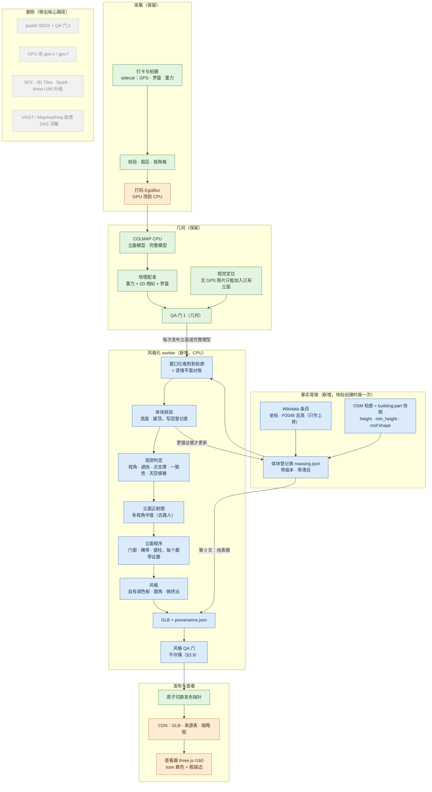

# Crowd3D 风格化模型：设计文档

> 版本：2026-10-22。本文是"从照片级转向风格化"这次转向的定稿设计，合并了三份角色草案（几何与风格化、生成式模型政策、产品／美术／成本）和一份原型报告（`crowd3d/stylize.py`）。三份草案有分歧的地方在正文里就地裁决，标"**裁决**"。
>
> **数字的来源标注**（每个数字都来自下面某一种；没有标注的数字是对同一节里已标注数字的复述）：
>
> | 标注 | 含义 |
> |---|---|
> | 【原型】 | 原型角色在本容器（4 核 CPU、无 GPU）上的最终运行，2026-10-22 05:13–05:19 UTC |
> | 【几何】【ML】【产品】 | 对应草案作者在本容器上的实测，脚本和数据见附录 B |
> | 【本文】 | 本文作者为写这份文档做的复核或计算（附录 B） |
> | 【估算】 | 工程估计，没有实测 |
> | 【待核实】 | 只有二手来源，或来源互相冲突 |
>
> 法规和许可部分是工程整理，**不构成法律意见**。本文**不直接修改** `docs/ARCHITECTURE.md`（另一个工作流正在编辑它），要改的地方列在第 8 节。视觉定位的设计见 `docs/VISUAL_LOCALIZATION.md`（另一个工作流在写），基准测试的说明见 `eval/results/README.md`。

---

## 0. 一句话与产品体验

**一句话**：我们没有 GPU 预算做照片级渲染，而且游客照片又少又偏，照片级模型本来就很难看稳。所以改做**卡通"玩具"模型**：楼的**形状**来自公开的事实数据（OpenStreetMap 的建筑分件和高度，由照片重建出的点云来核对），**颜色和门窗**只来自真实照片。没人拍过的面就是一块素模（陶土色），等玩家去拍来"解锁"。

**打个比方**：先给每座地标做一个白色的石膏模型（形状照着地图档案做，不靠猜）。有人在东边拍了照，东墙就按照片"上色"：照片里有几扇拱窗就画几扇，是什么颜色就用调色板里最接近的那种颜色。西边没人拍，西墙就一直是白坯，上面挂一个"待解锁"的小牌子。

### 0.1 用户看到什么

| 时刻 | 用户看到的 | 背后发生的事 |
|---|---|---|
| 地标第一天上线 | 一座能认出轮廓的素模：塔、穹顶、尖顶都在，全身陶土色，带淡斜纹 | 从 OSM 建筑分件（`building:part`）拉伸出的"事实骨架"（§3.1），不需要任何照片 |
| 拍了几张，还不够建模 | 被拍的那一面出现琥珀色虚线框和"照片钉" | 扇区暂定点亮（沿用 ARCHITECTURE §2.1） |
| 立面模型发布后几分钟 | 那面墙像被滚刷刷过一样上色：真实的拱窗、横带、门洞，扁平颜色、粗描边 | 立面作业 → 风格化作业 → 风格 QA → 发布（§1） |
| 只拍到一部分 | 拍到的部分上色，没拍到的部分仍是素模，中间一条圆角虚线 | "部分解锁"，按观测掩码算（§3.3） |
| 点任意一面 | 来源卡片："轮廓：OSM · 高度：照片实测 · 外观：12 位玩家的照片" | 每个面带来源标注（provenance，§3.9） |
| 点"待解锁"牌子 | 拍摄任务："站在西南侧 30–60 m 拍 4 张" | 牌子直接对应缺口任务（ARCHITECTURE §3.9） |

**这个转向的三个好处**（数字见第 6 节）：

1. **便宜**：核心路径不用 GPU。1 万个地标的回填算力从约 $2.7 万 GPU 降到约 $0.95k–1.96k CPU；每次浏览的下载从约 15 MB 降到约 0.26 MB。
2. **对稀疏照片更友好**：照片级 3DGS 要几十张照片才不过拟合（ARCHITECTURE §3.4.1 定的门槛是 ≥ 40 张）；风格化只要一面墙有 ≥ 2 个视角、有点云支撑就能上色。
3. **诚实看得见**：素模 = 事实骨架，彩色 = 有人拍过。"不捏造"变成了玩法本身。

**代价**（直说）：模型不再是"真实记录"。颜色和实物差得不少（区域色差中位数 ΔE00 约 27，§5.2），铜门浮雕会变成一个深色矩形，曲面壳体（悉尼歌剧院）用拉伸体块表示不了。

---

## 1. 新流程（端到端）

### 1.1 流程图

图例：绿色 = 保留，蓝色 = 新增，橙色 = 保留但改了，灰色虚线 = 删除（不在核心路径上）。



### 1.2 和旧架构比：保留、删除、新增

| 旧环节（ARCHITECTURE） | 处理 | 说明 |
|---|---|---|
| 采集、sidecar、校验、扇区、视角格、`plan_jobs`、作业调度 | **保留** | 风格化只改展示层，几何主干不变 |
| COLMAP 增量 / global、地理配准、QA 门 1、在线注册 | **保留** | 风格化的输入就是它们的输出 |
| 视觉定位（无 GPS 的照片） | **保留** | 定位成功的照片在风格化里就是一台普通的已注册相机，能给已有的墙加视角、提细节；它带不来新的点云，所以解锁不了没有点云支撑的墙（§3.3） |
| 打码 EgoBlur、语义掩码 | **改到 CPU** | 发布物里已经没有照片像素，但原图存储和人工审核仍要打码。EgoBlur CPU 约 1 s/张【估算，沿用 ARCHITECTURE M0.5】 |
| ALIKED + LightGlue（GPU 特征） | **推迟** | 继续用 CPU SIFT。代价：原指望它改善的转角和夜景匹配问题继续存在（CPU SIFT 下亚琛 augmented 全景只注册了 38%，见 REAL_WORLD_EVAL §4.4） |
| MegaLoc 检索（GPU） | **改** | CPU 推理或 COLMAP 词汇树 |
| gsplat 3DGS、QA 门 2（PSNR/LPIPS）、`hd_eligible`/`hd` 扇区状态 | **删除** | 失去照片级真实感和"写实版制作中"的玩法 |
| VGGT / MapAnything 前馈、1 分钟即时预览 | **删除** | 预览由"第 0 天的事实骨架"代替；**稀疏、对称场景的兜底没有替代**（亚琛 real 模式仍然 0 个立面） |
| DA3 单目深度的 L1 浮雕 | **删除** | 1–3 张照片时改为"照片钉 + 视锥" |
| SPZ、3D Tiles、Spark、three r180 升级 | **删除** | 单个 GLB 几十 KB，不需要 LOD；three@0.160 已有 `MeshToonMaterial` |
| 外观嵌入的"夜景版、雪景版"变体 | **改** | 变成"实测调色板变体"：只有真有夜间照片时，才出夜景配色 |
| PLY 点云查看器 | **降级** | 只当调试视图 |
| — | **新增** | OSM 分件导入与体块登记表、风格化 worker、立面程序、风格 QA 门、样式令牌（Python 和 JS 共用一份 JSON）、来源旁挂文件、客户端分享卡 |

### 1.3 风格化作业什么时候跑

- **地标创建时**：导入 OSM 快照，生成体块登记表 v0，直接发布一个全素模的 GLB（冷启动，§3.1）。
- **每次有立面模型或完整模型通过 QA 门 1 并发布后**：排一个 `stylize` 作业，按地标做，不按模型做。
  - 输入：该地标所有已发布模型里 `georeg_level = full` 的那些（有完整模型时只用完整模型），各自先吸附到轮廓，再合并相机和点。
  - 输出：一个新的风格化版本，走风格 QA 门，通过才原子切换发布指针。
  - 优先级排在"首个立面"之后、"立面重建"之前；耗时只有几秒到一分多钟（§5），不需要单独的去抖。
- **照片被撤回时**：用到这张照片的风格化版本也标 `contains_deleted`，按 ARCHITECTURE §3.8 的 30 天规则重算。重算只要 CPU 几十秒，没有理由拖。

---

## 2. 技术选型

### 2.1 选型总表

耗时都是 4 核 CPU 上的实测，除非另标。

| 阶段 | 选用 | 不选及原因 | 许可证 | CPU/GPU | 每栋或每面的耗时／成本 |
|---|---|---|---|---|---|
| 特征与匹配 | COLMAP SIFT（沿用原型） | ALIKED + LightGlue：要 GPU，推迟 | BSD | CPU | 特征 1.55 CPU·s/张（约 1000 px）；匹配 0.128 CPU·s/图对【产品】 |
| 位姿 | COLMAP 增量式（n < 300），global mapper（n ≥ 300） | 前馈模型：要 GPU，可商用权重有附加条件（ARCHITECTURE §4.2） | BSD | CPU | n = 25 / 50 / 100 张：合计 96 / 313 / 1973 CPU·s，其中建图 14.9 / 74.3 / 1186 CPU·s【产品】 |
| 吸附到轮廓 | 在配准偏航 ±10° 窗口内搜索的 2D 吸附，再逐墙 RANSAC 拟合平面（§3.2） | 不加约束的全局 ICP：八角形上收敛到 −90.58° 的对称别名解【几何】 | 自研 | CPU | 0.8–1.4 s/栋【原型】 |
| 体块 | OSM Simple 3D Buildings 分件 + 体块登记表；没有分件时用轮廓 + 高度 | 点云凹包闭合：和 OSM 的 IoU 只有 0.22–0.57，等于捏造背面【几何】；点云高度场递归切块：亚琛出现乱块【原型】【几何】 | OSM：ODbL（署名，派生库要公开）；Wikidata：CC0 | CPU | 0.14 s（洗礼堂）/ 1.13 s（亚琛）【原型】；分件素模 GLB 5.4 KB / 31.5 KB【几何】 |
| 多边形运算 | shapely（并、差、缓冲）、mapbox-earcut（带洞多边形三角化） | trimesh：不需要；它导出的 GLB 没有法线，toon 材质下整楼全黑【几何】 | BSD-3 / ISC | CPU | 毫秒级 |
| 观测判定 | 规则：视角 + 体块遮挡 + 稀疏深度遮挡 + 点支撑 + 多视颜色一致 + 天空植被（§3.3） | 只看几何覆盖：洗礼堂南墙几何覆盖 95.7%，点支撑只有 3.4%，贴上去的是远处糊掉的背景【几何】 | 自研 | CPU | 0.9 s（10 面墙、107 台相机）/ 30.6 s（69 面墙、203 台相机）【原型】 |
| 立面正射图 | 多视角加权中值 + 每张图的曝光增益 | CPU 稠密 MVS + 网格 + 纹理：慢，细节也不是目标；OpenMVS 是 AGPL-3.0【几何，版本未核对】 | 自研（OpenCV Apache-2.0） | CPU | 16 px/m 时 0.6–0.9 s/墙【原型】；5 cm 纹素加逐纹素遮挡测试时 16–32 s/墙（72 张照片）【几何】 |
| 立面简化 | **立面程序**：结构检测（行列剖面、暗块、周期条带）+ 有上限的规整 + 证据约束（§3.5） | 逐像素 k-means 加调色板：杂乱；粗色块：像迷彩【几何】【产品】 | 自研 | CPU | 语法拟合 0.06 s/墙【几何】；整栋风格化 0.1 s / 0.5 s【原型】 |
| 可选：区域标签 | DINOv2-small（ONNX）+ 在 CMP 立面库上训练的线性头，**只给已有区域贴标签** | SegFormer 权重：仅限非商用；ADE20K 训练的 Mask2Former/OneFormer 权重：ADE20K 图像仅限非商用研究【ML】 | 权重 Apache-2.0；CMP 为 CC BY-SA（训练出的权重算不算改编作品【待核实】） | CPU | 0.16–0.23 s/立面【ML】 |
| 可选：分割 | SAM 2.1-tiny（ONNX），框提示，只在观测掩码内 | SlimSAM-77：不比它快【ML】 | Apache-2.0 | CPU | 编码 3.5–3.8 s（1024²），解码 0.16–0.19 s/框【ML】 |
| 可选付费升级 | SAM 3 概念分割（租 GPU，按需） | — | SAM License：可商用，需申请下载，受出口管制条款约束【ML】 | 租 GPU | < $0.001/立面【估算，ML】 |
| 纹理风格化 | **调色板填色**（扁平色本身就是风格） | 扩散 img2img（SD-Turbo、SDXL + ControlNet、FLUX、托管图像编辑器）：实测会做语义替换，自动检查拦不住（§2.3） | — | — | SD-Turbo 每 512² 立面 16–37 s（被否决）【ML】 |
| 网格与 GLB | 原型自带的 GLB 写出器（零依赖）+ 微挤出几何 + 低分辨率调色板贴图 | Draco / meshopt：几何量太小，不需要；3D Tiles：不需要 LOD | 自研 | CPU | 0.7 s / 4.0 s【原型】；GLB gzip 后 11 KB / 46 KB【本文】 |
| 查看器 | three@0.160 `MeshToonMaterial`（3 阶）+ `EdgesGeometry` 粗折痕线 + 只在曲面件上用反壳剪影（§3.8） | Spark/SPZ：为 splat 设计；处处用反壳描边：平面多面体上屋顶变暗【几何】 | MIT | 用户设备 | SwiftShader 软件渲染 640×480：5.6–18.2 ms/帧【几何】；390×844 @2x：51–79 ms/帧【产品】 |
| 可选：文案 | VLM（如 Claude Haiku 5.5）生成构件名称和导览文字，只进 UI | 用 VLM 输出驱动几何或纹理 | API | 云端 | 约 $0.0004/立面【估算，ML；判别效果未测】 |

**每栋的端到端风格化耗时**：洗礼堂（107 台相机）10.3 s，亚琛（203 台相机）67.1 s，峰值内存 434 MB / 632 MB【原型】；产品真实链路里 15 张照片的立面只要 2.1 s【产品】。这些都远小于 SfM 本身（洗礼堂 20 张真实照片的整条链路 57 s【产品】）。

### 2.2 新依赖

| 依赖 | 许可证 | 用途 | 状态 |
|---|---|---|---|
| shapely | BSD-3 | 分件的并、差、缓冲，轮廓包含关系过滤 | **建议进生产** |
| mapbox-earcut | ISC | 带洞多边形三角化（原型的耳切法不支持洞） | **建议进生产** |
| onnxruntime | MIT | 可选的 DINOv2 标签、SAM 2.1 分割 | 可选，默认关 |
| tokenizers | Apache-2.0 | 只在启用开放词汇检测器时需要 | 可选，默认关 |

本文作者没有安装任何依赖，也没有改 `requirements.txt`。草案作者的实验依赖都装在各自的临时目录里（附录 B）。

### 2.3 生成式模型：允许、有条件、禁止

**用户的规则**：生成式模型不得给没拍到的地方编造内容（不得编造看不见的立面和背面，不做图生 3D 补全，不修补未观测区域），但可以用来做简化和风格化。

**本文的执行方式**：规则管的是**结果**，不管用的是什么方法。所以下面这些规则对非生成式方法同样适用（例如把八角形一面的立面复制到对面，不用任何模型也是捏造）。

**定义**：

- **观测掩码 M**：立面纹理上，满足 §3.3 全部条件的像素。
- **原语**：画到立面上的一个形状（矩形或拱形洞口、横带、壁柱、条纹、嵌板），或一块填色区域。
- **证据**：原语对应的正射图源区域 id，加上它的观测比例、规整前后的 IoU、移动距离、亮度差。

| 类别 | 内容 | 护栏 |
|---|---|---|
| **默认（不用任何生成式图像模型）** | 正射中值图 → 经典结构检测 → 有上限的规整 → 调色板 → GLB | §3.9 的 QA |
| **有条件允许** | ① 在**已观测的正射图**上做分割（SAM 2.1、SAM 3），提示点只放在 M 内；② 判别模型给已有区域贴标签（DINOv2 + CMP 线性头）；③ 人、车、树、天空的分割，结果**只能用来从 M 里剔除像素**；④ 用点云拟合屋顶类型、简化形状（本身不是生成）；⑤ VLM 生成名称和导览文字，只进 UI，标"AI 生成说明"，不回流几何和纹理 | 模型输出只是"提议"：必须再过规整上限和证据约束（§3.5），否则丢弃；每次调用记录模型 id、版本、权重许可（谱系） |
| **灰区，默认不用** | 单目深度（Depth Anything V2-Small，Apache-2.0）给已通过证据检查的原语提供 ≤ 0.3 m 的凹凸提示 | SfM 点已经给出墙面平面，收益很小 |
| **禁止（与许可证无关）** | 未观测区域的 inpainting / outpainting（包括 LaMa、SD-inpaint 这类"只是修一下小洞"的用法）；扩散超分；img2img 或图像编辑模型**直接产出发布纹理**；图生 3D、文生 3D、新视角合成（TRELLIS、Hunyuan3D、SAM 3D 等）；对称或重复补全超出已观测的实例；生成式矢量化（StarVector）；用生成式模型"清理"正射图；训练或使用品牌风格 LoRA | CI 里维护模型白名单；QA 检查 `lineage` 必填 |
| **许可证不允许** | SegFormer 权重；ADE20K 训练的 Mask2Former / OneFormer 权重；FLUX.1-dev、FLUX.1-Kontext-dev；Depth Anything V2 Base/Large | 同上 |

**裁决（扩散风格化）**：用户的规则本来允许用生成式模型"风格化已观测的纹理"。但实测表明，扩散模型在已观测区域里也会改内容，所以**本文建议默认路径和付费升级都不用扩散风格化**，需要用户确认（§9 决定 D3）。证据【ML】：

- SD-Turbo img2img（512²，CPU 每立面 16–37 s，速度可以接受）：
  - strength 0.25：基本只是把原图模糊一遍，没有风格化；
  - strength 0.5：洗礼堂的雕像变成阳台加铁栏杆，青铜门变成木门，未观测区域长出一座塔和一棵树；
  - strength 0.75：变成一栋普通欧式公寓，阳台上还站着人。
- **关键证据**：strength 0.5 那张明显有幻觉的图，**两项自动检查都通过了**（2 m 窗口结构相关性中"不相关窗口"只占 0.01–0.15，元素级检查报 0 个无支撑元素）。
- 事后图像比对本身就不可靠：在纹理很密的洗礼堂立面上，元素级检查只抓到 36/100 个人为加的假窗，同时误报 13/128 个正常元素；放宽到能抓全假窗时，误报升到 106/128。

所以"不许猜"只能**靠构造保证**：每个原语必须带着证据链接才能画出来（§3.5、§3.9）。扩散输出的像素没有证据链接，只能事后检查，而事后检查恰恰拦不住它最典型的错误。就算把扩散结果再量化到调色板、裁回已通过的原语里，它也只能在既有形状里换颜色，比调色板填色多不了什么。

**语义标签也要有像素证据**【ML】：CMP 训练的解析器会把洗礼堂浅色大理石的盲拱和嵌板标成"窗"。用一条规则"画成深色玻璃的窗，源区域必须比周围环带暗 ≥ 4 L*"，20 个窗/门判断里有 14 个被降级为浅色嵌板，人工核对全部正确。

**合规**（工程整理，需律师确认）：

- 核心路径不用生成式图像模型。但中国《互联网信息服务深度合成管理规定》第二十三条把"三维重建"和"图像修复"也列为深度合成技术，第十九条要求具有舆论属性的服务做算法备案，**这可能与用不用扩散无关**【ML，待法务确认】。
- 欧盟 AI Act 第 50 条已于 2026-08-02 适用，50(2) 对"不实质改变输入数据或其语义"的标准编辑辅助有豁免；风格化能不能适用，说不准【ML、产品，待核实】。
- 建议无论哪条路径都按"需要标识"设计：UI 显示"依据玩家照片风格化"，GLB 的 scene extras 写隐式标识（`ai_assisted` 和谱系）。

---

## 3. 风格化算法

### 3.1 体块：形状来自事实

**裁决（体块来源）**：初始方向是"OSM 轮廓拉伸 + 用点云定高度"。三份草案和原型报告一致建议改为**优先用 OSM Simple 3D Buildings（S3DB）的分件**，点云只做核验。理由：

- **可用率很高**【本文复核产品草案的 OSM 快照】：评测目录 13 个地标全部有 `building:part`，12/13 的分件带 `height`（唯一例外是悉尼歌剧院，13 个分件都没有高度）；13/13 至少有部分分件带 `roof:shape`；而主轮廓本身带 `height` 的只有 4/13【几何】。
- **形状对**：分件带 `min_height`、`roof:shape`、`roof:height`，能直接搭出塔、穹顶、尖顶和门洞。亚琛的分件素模（西塔加尖顶、八角堂加穹顶、唱诗堂、小礼拜堂）一眼能认出来；原型从点云高度场切出来的体块是一团乱块，八角堂和哥特唱诗堂并成了一个 573 m² 的平顶块【原型】【几何】。
- **照片少时也稳**：洗礼堂只用 15 张真实照片时，屋顶没被拍到，模型退化成平顶八角"蛋糕"；OSM 写着金字塔顶（`roof:height=12`）加采光亭【产品】。
- 这些是人工测绘的事实数据，不是生成。用户的规则管的是"编造"，不是"引用事实"。

**来源优先级**：

| 优先级 | 来源 | 给出什么 | 来源标注 |
|---|---|---|---|
| 1 | OSM `building:part`（S3DB） | 分件轮廓、`height`、`min_height`、`roof:shape`、`roof:height` | `osm-s3db` |
| 2 | OSM 主轮廓 `height` / `building:levels`（× 3 m） | 单一高度 | `osm-height` |
| 3 | 点云：每条边墙带点 z 的 0.97 分位，再取各边中位数 | 檐口高度、屋顶形状核验 | `sfm-points` |
| 4 | Wikidata P2048 | **只作上界和核验，永远不直接当拉伸高度** | — |
| 5 | 风格默认值 15 m、平顶，同时开馆员工单 | 兜底 | `default-style` |

为什么 Wikidata 只作上界【几何】：P2048 是总高，含尖顶和穹顶。德累斯顿圣母教堂 P2048 = 91.24 m，而 OSM 主轮廓 40.65 m；圣家堂有 3 个互相矛盾的值（162.91 / 172.5 / 138 m）；双子塔的单位是英尺。拿总高拉伸整个轮廓，等于凭空造出一个 91 m 高的盒子。

**做法**：

1. **取数**：建地标时按轮廓外扩 20 m 的范围取 OSM 快照（生产用 Overpass 或 Geofabrik 区域快照；本容器里 Overpass 连不上，草案用的是 OSM API v0.6 `/map`）。**要按包含关系过滤**：查询框会混进相邻建筑的分件（产品草案的查询框是轮廓外接尺寸的一半加 20 m，各地标查出 4–134 个分件【本文复核】，其中有多少属于邻楼没有逐个核对）。快照的 OSM 版本号和时间戳冻结进登记表。
2. **分件棱柱**：每个分件是一个从 `min_height` 到 `height − roof:height` 的棱柱，再加屋顶（S3DB 规定 `height` 量到屋顶顶部）。有分件时**不再渲染外轮廓体**（S3DB 惯例）。
3. **屋顶**（`roof:shape`）：flat；pyramidal（扇形三角面汇到质心）；dome、onion、round（6 环缩放）；gabled（最小外接矩形面积比 > 0.85 时做屋脊，否则退成 pyramidal）；hipped、mansard 暂时按 pyramidal 处理【几何】。
4. **简化**：轮廓用 Douglas-Peucker，容差逐步放大到 ≤ 32 个顶点且 Hausdorff ≤ 直径的 3%；接近正交的边吸附到主轴；正八边形这类真多边形保留（原型已实现：洗礼堂 13 → 10 个顶点，偏差 0.02 m；亚琛 200 → 30，偏差 1.92 m【原型】）。
5. **圆角**：转角倒圆，半径 = clamp(1.5% × 直径, 0.3 m, 1.2 m)，3 段（原型参数）。
6. **重叠分件**：分件交叠处会有共面闪烁的细线，要在体块阶段做布尔并，或给共面面做微小偏移【几何】。

**体块登记表**（`massing.json`，每个地标一份，带版本）：

```json
{"landmark": "florence-baptistery", "version": 3, "osm": {"snapshot": "2026-10-22T03:10Z", "elements": ["w166821303", "..."]},
 "parts": [{"id": "p0", "outline": [[x, y], "..."], "outline_source": "osm-s3db",
            "z0": {"value": 0.0, "source": "osm-s3db"},
            "eave": {"value": 18.0, "source": "osm-s3db", "sigma": 1.0,
                     "evidence": [{"model": "m42", "value": 18.17, "p10_p90": [18.09, 18.27], "verdict": "agrees"}]},
            "roof": {"shape": "pyramidal", "height": 12.0, "source": "osm-roof-shape"}}],
 "curator_overrides": [], "disputes": []}
```

**冲突策略**【几何，阈值为估算】：

- 只有 `georeg_level = full` 的模型能产生高度证据。原因：洗礼堂 NE 立面模型只有 6 张 GPS 照片（`prior_only`），它测出的檐口是 26.98 m，比实际高约 45%；其余模型在 17.9–19.0 m，OSM 是 18.0 m【几何】。
- 证据和 OSM 相差 ≤ max(2 m, 10%)：只记"已核验"，**不改值**。
- 冲突较大时，满足"完整模型、该件暴露区 ≥ 500 个点、bootstrap 区间宽 < 1 m、连续两个版本一致"才由点云覆盖，来源记 `sfm-points`，同时开馆员工单，并考虑把修正回馈 OSM。否则保留 OSM，只标"有争议"。
- **滞后**：已发布的体块，高度只有变化 > 2 m 且证据更强时才更新，避免版本之间模型来回跳（原型在 E 立面模型上算出 15.48 m 平顶、在完整模型上算出 18.71 m 金字塔顶，两版体块来回跳【几何】）。
- 细高结构信 OSM：亚琛西塔尖顶点云 q98 = 69.6 m，OSM 74 m，细尖顶点太少【几何】。

**OSM 缺失时不用点云闭合体块**。洗礼堂完整模型实测，点云凹包和 OSM 的 IoU 只有 0.22–0.57、Hausdorff 22.7 m：西侧没人拍，凹包就把背面"猜"成了别的形状【几何】。做法：

1. 名胜地标的 OSM 覆盖率很高（13/13）；建地标时把 OSM 轮廓列为必填，缺了由馆员手绘（约 2 分钟【估算】），来源记 `curator`。
2. 自动兜底只显示**已观测墙段**（来自平面拟合）。闭合部分画成半透明虚线体，来源记 `inferred-closure`，永不贴细节，不计入解锁进度。

### 3.2 吸附与坐标

**坐标**：沿用地标 ENU（x 东、y 北、z 上，米）。GLB 用 glTF 的 y 朝上：ENU (x, y, z) → glTF (x, z, −y)，和 `web/viewer.js` 一致。地面取 z = 0（相机高度约定 1.6 m）；点云墙脚的低分位被人群和围栏挡住，不能用来定地面【几何】。

**吸附**：

1. **旋转只在配准偏航 ±10° 的窗口内搜索**（和 ARCHITECTURE §3.5.7 一致），窗口内多起点，最优解落在窗口边上就不吸附、打标记。
   - 原因【几何】：原型的全局 ICP 在洗礼堂完整模型上收敛到 −90.58° 的对称别名解，墙面中位距离 0.402 m，**比正确解附近的 0.44–0.48 m 还小**。护栏拒掉了这个解，模型因此偏 3.9 m 没吸附，南墙贴上了乔托钟楼的图像。窗口内搜索时，n 重对称的轮廓（八边形是 45°）天然不会混进别名。
2. **逐墙对账**：窗口吸附之后，对每面点数够的墙做 RANSAC 平面拟合。实测洗礼堂三面已观测墙：内点 RMS 0.16–0.17 m，相对 OSM 边的角度差 −0.08° 到 −1.99°，中点偏移 −0.63 到 +0.33 m【几何】。
   - |偏移| ≤ 1.5 m 且 |角度| ≤ 5°：保留 OSM 的边，立面平面用拟合的偏移（限制在 ±1 m）。
   - 超出范围，且内点 ≥ 500、RMS ≤ 0.3 m：把这条边移到拟合平面，来源记 `sfm-plane`，开馆员工单。
   - 未观测的边只跟随整体变换。
3. **带尺度的吸附**只给 `georeg_level != full` 的模型试，尺度修正限制在 ±15%【估算】。但目前 NE 立面模型用带尺度的 ICP 只修到 0.923，檐口仍有 24.5 m，原因没查清【几何】。**查清之前，`prior_only` 的模型不贡献高度，也不贡献立面。**
4. 每次吸附都把旋转、平移、尺度和吸附前后的中位距离写进来源记录。

**上色的前提：吸附后墙点到体块的中位距离 ≤ 1.5 m**（原型参数 `snap_max_residual_m`）。不满足就整栋只出素模。

> **当前最大的阻塞**【原型】：在一个真实的 Crowd3D 作业（12 台相机、3,206 个点）上，模型离轮廓 17.8 m，吸附只能把它拉到 4.4 m，被拒，整栋出成素模。今天只有参考模型（MegaDepth-X）的场景满足 1.5 m。也就是说，**真实链路上要先把配准做准，风格化才能上线**。逐墙对账在初始误差 ±3 m 以内能恢复到 0.44–0.57 m，初始误差超出 3 m 的墙就找不到点了【几何】，所以需要"先粗后细"：先在较大平移范围内做窗口化吸附，再逐墙对账。这是 S0 的硬任务（§9）。

### 3.3 观测判定：哪些地方算"拍到了"

**一面墙的一个纹素，同时满足下面四条，才算已观测**（掩码 M）：

| # | 条件 | 参数（初值） | 为什么 |
|---|---|---|---|
| 1 | **≥ 2 个一致视角**：相机在墙前方、视线和墙法向夹角 ≤ 72°、投影落在图像内、不被体块挡住、通过稀疏深度遮挡测试 | `min_views = 2`；`max_view_angle_deg = 72` | 单张照片分不清墙上的东西和路过的东西 |
| 2 | **点云支撑**：墙面 0.75 m 带内有 SfM 点，膨胀 1.5 m；整面墙 ≥ 20 个点且 ≥ 1 点/m² | 原型参数 | 洗礼堂南墙：几何覆盖 95.7%，点支撑 3.4%。没有这一条，它就会被斜视的远景照片"解锁"【几何】。原型加上这条后，去掉了两面其实是邻楼屋顶的假墙【原型】 |
| 3 | **不是天空、不是植被** | 颜色偏蓝、纹理低、在墙顶以上 → 天空；绿色高纹理 → 植被（CPU 规则） | 原型早期版本在亚琛 43 面已观测墙里，有 23 面出现天空色，占纹素的 8.2%【几何】 |
| 4 | **墙级一致性**：一致纹素（≥ 3 个视角，且 ≥ 60% 的视角和中值差 ≤ 40 RGB）占比 ≥ 0.15 | 【估算阈值】 | 平面放对时一致率只有 0.31–0.45（众包照片光照差异大），外移 2 m 降到 0.06–0.07，外移 4 m 降到 0–0.04【几何】。所以它**不能单独当掩码**，只用来抓"平面放错、贴的是背景"的整面墙 |

**遮挡细节**：

- **稀疏深度遮挡测试**：用这张照片自己观测到的 3D 点，按 24 px 网格取 30% 分位深度。比墙面近 10% 以上视为前景遮挡（树、人、车），比墙面远 15% 以上视为"透视穿帮"。东墙因此剔除了 32,698 个纹素样本【几何】。
- **室内照片**：相机中心在轮廓内、低于屋顶时，不参与外立面。
- **常年被挡的区域**（东墙"天堂之门"下方约 0.5 m 总站着人）：中值也去不掉人头。规则禁止修补，所以这条底带判为未观测，保持素模【几何】。
- **墙内的小洞**（被一棵树挡住的一小块，≤ 4 m² 且四周都是已观测【估算】）：只填该墙**实测的底色**，不画任何细节，来源记 `neutral-fill`。洞更大或碰到墙边时，按"部分解锁"处理，露出素模。

**一面墙的状态**（阈值是初值，进基准校准）：

| 状态 | 条件 |
|---|---|
| 锁定（素模） | 不满足墙级条件：≥ 2 台相机各看到 ≥ 15% 的墙，点数和密度够，掩码 ≥ 10% |
| 部分解锁 | 掩码 20–60%，或掩码 ≥ 60% 但视角 < 3 |
| 已解锁 | 掩码 ≥ 60% 且视角 ≥ 3 |

是否还要求"照片来自 ≥ 2 位不同用户"（防止一个人刷解锁），是产品决定（§9 决定 D1）。

**视觉定位的照片**：定位成功后就是一台已注册相机，能增加视角数、把"部分"推到"已解锁"、提高细节；但它带不来新的三角化点，第 2 条（点云支撑）保证它不能单独解锁一面没有点云的墙。

### 3.4 立面正射图

1. 把墙面按纹素铺成网格，用已知相机位姿把每个纹素投到每张照片上取色（OpenCV `remap`）。
2. **曝光归一化**：每张照片一组 RGB 增益，向混合结果迭代 2 次，增益限制在 0.5–2.0（原型）。
3. **混合**：逐纹素按亮度取加权中值（权重 = 可见比例 × cos 视角 × 分辨率），路人基本被消掉。实测 5 cm 纹素下三面已观测墙每纹素中位视角数 29–62【几何】。
4. **分辨率**：工作分辨率 4–5 cm（原型为了速度用 16 px/m，长边 ≤ 512 px）；**发布的贴图降到 10 cm**。
5. **正射图永不发布**。它是照片的衍生物，只存在私有的 `derived/` 里，用来生成立面程序和调色。

### 3.5 简化：立面程序

**裁决（区域驱动还是结构驱动）**：初始方向是"颜色量化 + 保边简化 → 矢量区域 → 规整"。实测四条路线都不到 Duolingo 的水平【几何】【产品】：

| 路线 | 观感（如实评价） |
|---|---|
| 逐像素 k-means 加调色板 | 杂乱；灰色大理石被吸成 wood、pine 等假色 |
| 粗色块加圆角 | **像迷彩**，看不出建筑结构；每面墙的角色色还不一样 |
| 原型的三层分解（墙、局部更暗的点缀、彩色点缀）+ 门窗规整 | 洗礼堂能看出拱窗节奏，但很多是半截拱和断开的横带；亚琛是满墙深色碎斑。贴花里只有 68–71% 形状规整，每 100 m² 有 11.4 块【产品】 |
| 纯语法（楼层线 + 门窗） | 最干净、最"卡通"，但千篇一律，丢了洗礼堂绿白大理石条纹和三连拱的识别度；还**把门画到了右下角**（实际在底部正中），这是观测区内的错误细节 |

所以改为**结构驱动**：每面墙产出一份"**立面程序**"（结构化的矢量 JSON），它是规范产物，贴图和几何都由它生成。

```json
{"wall": "p0-e4", "observed_region": [[u, z], "..."],
 "palette_roles": {"wall": "lime-white", "trim": "grey-stone", "opening": "grey-stone.dark"},
 "base_colour": {"lab": [75.0, 0.1, 0.4], "source": "photo-observed"},
 "bands":     [{"kind": "course", "z": 8.35, "h": 0.25, "u0": 0.6, "u1": 13.6, "src": "w4/seg3", "support": 0.82}],
 "pilasters": [{"u": 0.0, "w": 0.6, "pattern": "stripes", "src": "w4/seg9", "support": 0.7}],
 "openings":  [{"kind": "arch", "cx": 4.4, "bottom": 9.3, "w": 1.1, "h": 2.4, "src": "w4/seg17",
                "observed_frac": 1.0, "evidence_iou": 0.71, "moved_m": 0.12, "darker_L": 11.4, "glass": true,
                "label": {"model": "dinov2-s+cmp-linear@v0", "p": 0.62}}],
 "poster_fallback": null,
 "provenance": {"views": 36, "users": 9, "texel_m": 0.05}}
```

**步骤**：

1. **结构检测**（经典方法，CPU）：
   - 行剖面的水平梯度峰 → 楼层线、横带；
   - 局部更暗的紧凑连通块 → 洞口候选（窗、门、拱、壁龛）；
   - 行、列剖面上周期性的明暗交替 → 条纹壁柱（洗礼堂的绿白大理石识别度靠它）；
   - 长而细的区域 → 横带、壁柱。
2. **可选的模型提议**（默认关）：SAM 2.1-tiny 用框提示细化候选的边界；DINOv2 + CMP 线性头给候选投票贴标签（窗、门、檐口、壁柱、装饰）。模型**只给已有区域贴标签或细化边界，不创造区域**。
3. **规整，有上限**：
   - 移动 ≤ max(0.15 m, 尺寸的 10%)，且永不超过 0.3 m；缩放 ≤ 15%；
   - 规整前后和源区域的 IoU ≥ 0.5；
   - 同一行的洞口顶、底对齐到 ±0.2 m 以内，宽度差 10% 以内的统一尺寸；
   - **等距化只在观测区内做**：一行里已观测的中心本来就接近等距（偏差 ≤ 步长的 12%）时才等距化；
   - **不得增加实例**：输出数 ≤ 源区域数。"这一排有 5 个窗，第 6 个被树挡住了"，就画 5 个。
   - 永不跨未观测区镜像或外推。
4. **语义要有像素证据**：标成窗或门、要画成深色玻璃的原语，源区域必须比周围环带暗 ≥ 4 L*；否则画成观测颜色的浅色嵌板。
5. **位置约束**：原语连同外框（0.12 m）必须**完全**落在 `observed_region` 内；不满足就丢弃，**不裁成半截**（"半截拱"正是原型看起来脏的原因之一）。
6. **最小尺寸**：≥ 0.6 m，且在默认取景下 ≥ 6 CSS px（40 m 宽的建筑占 350 px 时，0.7 m 约 6 px【估算】）。更小的不画。
7. **解释不了的部分**：已观测但不属于任何原语的区域，填该墙实测的底色。**宁缺毋滥**：规整不了的斑块一律不画。
8. **兜底：海报化贴图**。立面程序能解释的面积太少时（例如圣家堂这类有机立面，证据 IoU 普遍低），退到 ≤ 6 色、10 cm 的低色数海报化贴图，UI 上如实显示为"简化贴图"。实测这条兜底不会好看（就是上表第一、三条路线的样子）。

**识别度元素**（条纹壁柱、重复拱廊母题）是"像不像这座楼"的关键，**目前还没实测**，是 S0 最重要的实验（§9）。

### 3.6 风格：调色板、圆角、微挤出

**调色**：

1. **全楼一套颜色角色**：所有已观测墙一起聚类，最亮 → 墙，中间 → 饰带，最暗 → 洞口或点缀。原型和几何草案都发现，每面墙各自选色会让同一栋楼五颜六色。
2. **保色相族地吸附**：实测色度 < 4 的颜色保持中性（走中性色族）；色度 ≥ 4、跨 ≥ 3 张照片色相一致（圆周标准差 ≤ 25°）的区域，色度放大 × 1.3 后找最近色，色相偏移 ≤ 30°。
3. **提亮上限 +12 L\***。原型实测整体提亮了 +23 到 +26 L\*，画面发白【产品】。
4. **洞口不再统一用冷色**（slate、night），改用该墙色相族的暗档。原型把暖色小细节大量映射成冷色：按区域个数算，色相误差中位数 142–150°【产品】。
5. **屋顶**：颜色只取已观测屋顶点的中值；屋顶的明度下限高于描边墨色（原型把亚琛的板岩屋顶吸成 night，过黑）。没观测到的屋顶用素模屋顶色（是否改用 OSM `roof:colour` 标签，见 §9 决定 D2）。
6. **诚实的代价**：洗礼堂的绿色大理石在这批照片里几乎是中性灰（暗色簇色度约 2），所以它显示为灰，**不能凭常识涂成绿色**。

**形状**：

- 转角圆角（§3.1），洞口圆角半径 = 0.25 × min(宽, 高)，拱用半圆顶。
- **混合表示**：门窗、横带、檐口做成 5–15 cm 的**微挤出几何**（粗描边会自动勾出它们，任意缩放都清晰）；大面积色块用 10 cm/px、≤ 16 色的调色板 PNG（实测每面墙 2.6–3.0 KB【几何】）。矢量化后只多约 1.4k / 4.5k 个三角形（洗礼堂 / 亚琛，8 cm 容差【产品估算】）。

### 3.7 网格与 GLB

1. 体块 + 圆角 + 微挤出 + 调色板贴图，写成一个 GLB。原型自带零依赖的 GLB 写出器，**写出时必须带 NORMAL**（trimesh 导出的 GLB 没有法线，toon 材质下整楼全黑【几何】）。
2. **按材质合并节点**。原型亚琛有 89 个节点，每个都带完整的来源 extras，glTF JSON 占了 GLB 的 62%（洗礼堂 56%）【产品】。改成：
   - GLB 里每个面只留紧凑的 extras：`face_id`、`kind`、`state`（locked / partial / unlocked）；
   - 完整来源放进旁挂的 `<模型>.provenance.json`，用 `face_id` 关联。
3. **体积预算**：gzip 后目标 ≤ 150 KB，硬上限 300 KB；未压缩 ≤ 300 KB。实测原型 GLB 未压缩 27,432 B / 147,908 B，gzip 后 11,214 B / 46,037 B【原型】【本文】。5k 三角形以下不需要 LOD，Draco 和 meshopt 都不需要。
4. scene extras 写：原点经纬度（按地区降精度）、OSM 快照版本、样式令牌版本、谱系（用到的模型 id 和版本、权重许可）、`ai_assisted` 标记、署名清单。`asset.copyright` 写 OSM 署名。
5. **隐私**：GLB 和旁挂文件里不放照片 id、用户 id 和相机位姿，只放计数（视角数、贡献人数）。

### 3.8 查看器

在 `web/stylized.js`（原型已有）基础上：

- **材质**：文件里保留 PBR 材质（便于移植），加载时换成 `MeshToonMaterial`，3 阶 gradientMap，Nearest 采样，色阶 [0.55, 0.8, 1.0]。
- **描边**：
  - 折痕线：`EdgesGeometry`（折角 30–35°）+ `LineSegments2`，3 CSS px，墨色。我们的几何几乎全是平面，轮廓边基本都是折边，这条足够【几何】。
  - 剪影：原型对整栋楼用反壳（`BackSide`）描边；在平面多面体上它会让屋顶变暗【几何】。改为**只给曲面件（穹顶、洋葱顶、圆柱）加反壳剪影**，或者用屏幕空间的法线/深度边缘。
  - 所有描边宽度在任何 DPR 下都 ≥ 1 物理像素。
- **光照**：半球光加一盏主光；主光**跟着相机走**（相机方位 −35°、仰角 50°），保证任何视角下相邻面至少差一档明暗。**手机上不开实时阴影贴图**（软件渲染下占帧时间 22–33%【产品】），改为按轮廓烘焙一张地面软阴影。
- **兜底**：没有法线时调用 `computeVertexNormals`，同时上报 QA 错误。
- **交互**：点面 → 来源卡片；点锁形牌子 → 该扇区的拍摄任务；OSM 署名常驻角落，不能藏在菜单里（OSMF 署名指南）。
- **取景**：默认朝向观测最多的一侧（原型逻辑）；竖屏按水平视场贴合，留 12% 边距（原型的模型在竖屏上只占屏幕高度约四分之一【产品】）。

### 3.9 "不许猜"怎么强制执行

**在代码里（构造保证）**：

1. **每个面、每个原语都必须带来源**。来源分四个维度，取值是封闭枚举：

   | 维度 | 取值 |
   |---|---|
   | `outline` | `osm-footprint`、`osm-s3db`、`sfm-plane`、`curator`、`inferred-closure` |
   | `height` | `osm-s3db`、`osm-height`、`sfm-points`、`curator`、`default-style` |
   | `roof` | `osm-roof-shape`、`sfm-points`、`curator`、`default-style` |
   | `appearance` | `photo-observed`、`neutral-fill`、`default-style`（素模）、`commons-blueprint`（开放影像预览，只画线稿） |

   原型已有 `photo-observed`、`osm-footprint`、`sfm-points`、`osm-height`、`wikidata-height`、`default-style`。`wikidata-height` 按 §3.1 不再作为高度值使用，改为只出现在核验记录里。

2. **画原语的函数不接受没有证据的输入**：`src` 区域 id、`observed_frac`、`evidence_iou`、`moved_m` 是必填参数，任何一项不满足 §3.5 的上限，函数直接丢弃，不提供"强制画"的开关。
3. **锁定面的构造路径里没有贴图参数**：素模面只能拿到素模颜色和斜纹。
4. **生成式模型调用走白名单包装**：只能拿到正射图的掩码内部分，输出类型只能是"掩码"或"标签"，不能是"像素"；每次调用写谱系。
5. **对称传播在代码里没有入口**：不存在"把墙 A 的程序复制到墙 B"的函数。

**在风格 QA 门里（任何一项不过，这面墙退回素模，整栋照常发布；标"拒绝"的项不过则整个版本不发布）**：

| # | 检查 | 门槛 | 不过时 | 依据 |
|---|---|---|---|---|
| Q1 | `detail_pixels_outside_mask`：掩码外有细节的像素 | = 0 | 拒绝 | 原型已有；对"镜像补全"注入 2/2 抓到【ML】 |
| Q2 | `primitives_outside_region`：原语（含外框）越出观测区 | = 0 | 拒绝 | §3.5 |
| Q3 | `primitives_without_source`、`added_instances` | = 0 | 拒绝 | §3.5 |
| Q4 | `glass_without_darker_source` | = 0 | 拒绝 | §2.3 |
| Q5 | `textured_locked_faces`、`locked_faces_claiming_photos` | = 0 | 拒绝 | 原型已有 |
| Q6 | `faces_without_provenance`、`lineage` 缺失 | = 0 | 拒绝 | 原型已有 |
| Q7 | `off_palette_colors` | = 0 | 拒绝 | 原型已有 |
| Q8 | 墙级一致纹素占比 | ≥ 0.15【估算】 | 该墙退回素模 | §3.3 |
| Q9 | 天空色或植被色纹素占已观测面积 | ≤ 1%【估算】 | 该墙退回素模 | 原型早期 8.2% |
| Q10 | 平面支撑：点数 ≥ 200，平面 RMS ≤ 0.3 m；与 OSM 对账 ≤ 1.5 m、≤ 5° | — | 该墙退回素模；对账超限开工单 | §3.2 |
| Q11 | 立面纹理的竖直范围和体块墙高之差 | ≤ 10% | 该墙退回素模 | NE 立面 27 m 问题 |
| Q12 | 体块稳定：高度变化 > 2 m 要有更强证据 | — | 保持旧体块 | §3.1 |
| Q13 | GLB 有法线；gzip ≤ 300 KB | — | 拒绝 | §3.7 |
| Q14 | 结构相关性兜底：2 m 窗口里输出与源不相关（NCC < 0.2）的比例 | ≤ 0.5 | 转人工 | 能拦"整片重画"，拦不住局部替换【ML】 |
| Q15 | 版本抖动：相邻两版贴花 IoU 的补数 | ≤ 0.2【估算】 | 转人工 | 加 3 张照片不该把整面墙重画【产品】 |

Q14 只是兜底：正文已经说明，事后图像比对拦不住扩散的语义替换，真正的保证是 Q2–Q4 的构造式检查。

**测试**（原型已有 `tests/test_stylize.py` 19 个、`web/tests/stylized.test.mjs` 7 个）要加：

- 合成"只拍两面"的建筑（`synthetic-two-sides`）：没拍的墙必须全是素模，Q1–Q7 全为 0；
- 注入测试：把已观测立面镜像到未观测墙、在纯墙位置放假窗、复制已观测开口到别处，三种都必须被构造检查拦下（不靠 Q14）；
- GLB 往返：每个节点有法线、有 `face_id`，旁挂来源表能对上。

---

## 4. 美术风格指南

### 4.1 五条原则

1. **剪影优先**：认不认得出先看体块和屋顶，立面细节排第二。
2. **少即是多**：每面墙最多 6 种图案；屏幕上小于 6 CSS px 的元素不画。
3. **全部圆润**：基本形只有圆角矩形、圆、圆角三角形。哥特尖顶和尖拱保留轮廓，但尖端圆角 ≥ 0.2 m。这和 Duolingo 公开描述的形状语言是同一种精神（用最少的形状，圆润友好），但**我们不用 Duolingo 的色值、角色、字体和素材，宣传里也不写"Duolingo 风格"**（画风本身一般不受保护，但商业外观和商标受保护）。
4. **颜色来自观测**：只做吸附、限量提亮和饱和，不换色相族。
5. **看得出哪里是事实、哪里是照片**：素模 = 事实骨架，彩色 = 有人拍过。

### 4.2 调色板（自有，v0 草案）

每族三档：亮面、基色、暗部（也是该族的描边色）。样式令牌放在一份 JSON 里，Python 和 JS 共用；原型现有的 25 色调色板迁移到这套结构。

| 族 | 亮 | 基 | 暗 | 用途 |
|---|---|---|---|---|
| 石灰白 | #FBF7EE | #EDE4D3 | #C9BBA2 | 浅色石材、大理石 |
| 砂岩 | #F6DDB0 | #E7BE7E | #B88A4E | 砂岩 |
| 陶土砖 | #FFB59A | #E8735A | #A9483A | 砖、赤陶 |
| 灰石 | #E3E0DA | #B9B3AA | #857E75 | 花岗岩、混凝土 |
| 蛇纹绿 | #BFE6CF | #4FA37A | #2C6B53 | **只有实测为绿色时才用** |
| 铜绿 | #B8EBDD | #5FC2AC | #2F8576 | 铜屋顶 |
| 石板蓝 | #AFC4DA | #6E87A6 | #45597A | 石板瓦屋顶 |
| 金 | #FFE9A3 | #FFC93C | #D69A1A | 镀金、穹顶尖 |
| 木 | #E9C29A | #B97F4C | #7F5432 | 门、木构 |
| 玻璃 | #CDEBFF | #7CC3F2 | #3E86C2 | 实测偏蓝或反光的玻璃 |

固定色：描边墨色 #2D2A32（不用纯黑）；素模墙 #E9E2D6，素模屋顶 #DAD0C2，斜纹 #D3C8B6，虚线框 #9C8F7D（后四个沿用原型）；状态色暂定：点亮 #FFB547，已解锁 #43C46B，完成 #F2B705。

每座地标最多：墙 3 色 + 点缀 2 色；墙与洞口的明度差 ΔL ≥ 25。

### 4.3 形状语言

| 元素 | 规则 |
|---|---|
| 体块转角 | 圆角 r = clamp(1.5% × 体块直径, 0.3 m, 1.2 m) |
| 洞口 | 圆角 0.25 × min(宽, 高)；拱用半圆顶；圆窗用圆 |
| 对齐 | 同一行洞口顶、底对齐到 ±0.2 m；宽度差 10% 以内统一尺寸；观测区内 ≥ 3 个相似洞口时等距排列 |
| 浮雕 | 外凸 0.05–0.15 m；横带、壁柱用直条，不画曲线噪声 |
| 最小元素 | ≥ 0.6 m，且默认取景下 ≥ 6 CSS px |

### 4.4 描边

| 描边 | 宽度 | 颜色与条件 |
|---|---|---|
| 剪影 | 3 CSS px | 墨色；只在曲面件上用反壳（§3.8） |
| 折痕线（二面角 > 30°） | 3 CSS px（原型默认 2.5 px，在 390 px 宽的竖屏上偏细） | 墨色 |
| 贴花边 | 1.5 px | 该色族暗档，不用黑色 |
| 观测区边界 | 1.5 px 圆角虚线 | #9C8F7D |

### 4.5 光照

- 环境：半球光，天空 #FDFBFF，地面 #D5E6C4；
- 主光：单盏，跟相机走（方位 −35°、仰角 50°）；
- 色阶：3 档 [0.55, 0.8, 1.0]；
- 阴影：不用阴影贴图，地面放一张按轮廓烘焙的软阴影；
- 黄昏、夜晚主题只是样式；"夜景版"立面颜色必须来自实测的夜间照片（例如亮着的窗）。

### 4.6 各种状态长什么样

| 状态 | 条件 | 外观 | 文案示例 |
|---|---|---|---|
| 事实骨架 | 地标创建即有 | 素模体块，屋顶按 OSM 形状 | "模型骨架来自 OpenStreetMap" |
| 有照片、还没建模 | 扇区有 ≥ 1 张照片 | 该面琥珀色虚线框 + 照片钉（视锥，只对本人显示） | "已收到 3 张，还差约 2 张" |
| 待解锁 | 没有观测 | 素模 + 淡斜纹；锁形牌子只挂在面积最大的几面锁定墙上 | "待解锁 · 站在西南侧 30–60 m 拍 4 张" |
| 部分解锁 | §3.3 | 已观测区域上色；边界圆角虚线，不做渐隐 | "已点亮 45%" |
| 已解锁 | §3.3 | 全色 + 微挤出门窗 | "由 12 位玩家点亮" |
| 开放影像预览 | 只有 Commons 照片 | **蓝图态**：素模上画蓝色线稿，不上色，不计入玩法 | "开放影像预览，等你来点亮颜色" |
| 屋顶 | 不是玩法单元 | 形状来自事实；看到了就上色，没看到用素模屋顶色；**不挂"待解锁"**（地面玩家几乎拍不到屋顶，拿来当任务只会让人挫败） | — |

**进度怎么显示在模型上**：底座一圈 8 段环，颜色对应扇区状态（灰 → 琥珀 → 绿 → 金），和地图上的迷你罗盘一致；解锁时一条"滚刷"扫过墙面（约 0.8 s）；每面已解锁墙的墙脚插一面小旗，显示前 3 位贡献者头像；触发解锁那张照片的作者得"首亮"贴纸；"我的贡献"模式给有你照片的墙打星标；时间轴滑块看墙怎么一点点亮起来（每个旧版本 GLB 只有几十 KB）；分享卡在客户端渲染（服务端软件渲染首帧要 7–44 s【产品】）。

---

## 5. 原型实测

### 5.1 测了什么

- **代码**：仓库里的 `crowd3d/stylize.py`（WIP，未提交）和 `scripts/stylize_model.py`、`web/stylized.html`、`web/stylized.js`。
- **输入**：MegaDepth-X 的参考模型（全部照片，按真实 EXIF GPS 配准，再吸附到 OSM 轮廓），代表"照片充足"的最好情况；另有一次产品真实链路（只用带真实 GPS 的 20 张，取其中 15 张的立面模型）和一次真实 Crowd3D 作业。
- **机器**：4 核 CPU、`nice -n 19`，另外两个工作流同时在跑（负载 1.3–4.8）。

### 5.2 数字

| 指标 | 洗礼堂 | 亚琛 |
|---|---|---|
| 输入相机 / 点 | 107 / 366,897 | 203 / 568,557 |
| 轮廓顶点 OSM → 模型 | 13 → 10（偏差 0.02 m） | 200 → 30（偏差 1.92 m） |
| 吸附：旋转；墙面中位距离 前 → 后 | −9.4°；5.79 → 0.24 m | 1.0°；3.32 → 0.93 m |
| 体块 | 1 个棱柱，墙高 16.7 m，金字塔顶 32.5 m | 6 个棱柱，基座 19.5 m，塔到 60.7 m |
| 已观测墙 | 4/10 | 38/69 |
| 已观测墙面积占比（像素掩码下） | 46.8%（41.8%） | 50.4%（36.0%） |
| 已观测屋顶面 | 5/10 | 15/18 |
| 三角形 / 节点 / 图集 | 120 / 14 / 1 | 820 / 89 / 1 |
| GLB 未压缩 / gzip | 27,432 B / 11,214 B | 147,908 B / 46,037 B |
| 识别出的门窗 / 横带 | 51 / 3 | 240 / 12 |
| 用时（加载 / 观测 / 正射图 / 风格化 / GLB） | 10.3 s（4.2 / 0.9 / 3.5 / 0.1 / 0.7） | 67.1 s（6.4 / 30.6 / 23.0 / 0.5 / 4.0） |
| 峰值内存 | 434 MB | 632 MB |
| 诚实 QA（掩码外细节、锁定面贴图、缺来源、调色板外颜色） | 全 0，通过 | 全 0，通过 |

来源：GLB gzip 为【本文】复核，其余【原型】。

**颜色与贴花质量**【产品】：

| 指标 | 洗礼堂 | 亚琛 |
|---|---|---|
| 区域色差 ΔE00（面积加权中位数）：原始 / 扣掉整体提亮后 | 27.3 / 8.7 | 26.8 / 10.3 |
| 整体提亮 | +25.9 L\* | +23.2 L\* |
| 彩色区域色相误差 ≤ 30° 的面积占比 | 0.69 | 0.61 |
| 彩色区域色相误差中位数（按区域个数 / 按面积） | 142° / 18° | 150° / 23° |
| 贴花"规整"占比（矩形度 ≥ 0.8 或凸度 ≥ 0.92） | 0.68 | 0.71 |
| 每 100 m² 已观测面积的贴花块数 | 11.4 | 11.4 |
| 体块轮廓与 OSM 的 IoU | 0.999 | 0.933 |

**查看器**（无头 Chromium + SwiftShader 软件渲染，只能当 CI 回归代理，**不代表手机**）【产品】：390×844 @2x 下绘制调用 11 / 12，渲染三角形（含描边、线、地面）1,122 / 5,930，稳态帧时间开阴影 76 / 79 ms、关阴影 51 / 62 ms，首帧 6.8–7.3 s / 34–44 s。**真机帧率还没测**。

**测试**【原型】：`tests/test_stylize.py` 19 个（合成输入，1.9 s）；`web/tests/stylized.test.mjs` 7 个；全量快速测试 376 通过、1 跳过。

### 5.3 截图说明

截图由照片衍生，按 REAL_WORLD_EVAL §2.1 的理由不进仓库，路径见附录 B。

- **洗礼堂，3 个角度**：一眼能认出是"白色金字塔顶的八角楼"。东侧 4 面已拍的墙上有拱窗、横带、窗框，石灰白底上画灰蓝色（slate）细节，带墨色窗框；西半边 6 面没拍的墙（含后殿）是素模加斜纹、虚线框和"待解锁"牌子。
- **洗礼堂，手机竖屏 UI**：顶部三个标签"已解锁立面 4/10""素模 = 待解锁""屋顶 1/2"，一句说明"彩色立面只来自真实照片……"；模型只占屏幕高度约四分之一，下半屏空着。
- **洗礼堂，正射图前后对比**：上排是多视角中值正射图（洋红 = 未观测），下排是风格化结果。wall 3 的三连拱最清楚；wall 4 的雕像组和青铜门变成了几块深色斑；wall 2 大半是洋红（没拍到），只剩零星洞口。
- **亚琛，3 个角度**：一堆棱柱。八角堂和哥特唱诗堂并成一个平顶大块，屋顶是平的深灰板岩色，墙上多是抽象的深色碎片；只有少数窗出得干净（例如 wall 38 唱诗堂的高拱窗）。北半边（回廊）没人拍，是素模，高度 19.5 m 沿用已测墙的高度，来源卡片如实写了。
- **亚琛，桌面 UI**：左上角是 OSM 署名和"立面颜色来自 Wikimedia Commons 照片（逐张许可）"；点一个转角，右下角卡片写"轮廓：OSM 轮廓；高度：重建点云实测；外观：照片实拍"。
- **亚琛，OSM 分件素模**【几何】：西塔加尖顶、八角堂加穹顶、长条唱诗堂、几个小礼拜堂的尖顶和人字顶，一眼能认出是亚琛。穹顶有点像鸡蛋。
- **洗礼堂，15 张真实照片**【产品】：屋顶没拍到，变成平顶八角"蛋糕"，两面墙有细节。**这才是用户早期真正会看到的样子。**
- **几何细节版 GLB 的 toon 渲染**【几何】：整栋楼全黑，原因是导出时没有法线。
- **SD-Turbo strength 0.5**【ML】：洗礼堂 wall 4 变成带铁栏杆阳台和木门的公寓立面。

### 5.4 诚实的局限

1. **真实链路上目前只能出素模**：真实 Crowd3D 作业的配准误差 17.8 m，吸附后仍 4.4 m，超过 1.5 m 的上色前提（§3.2）。
2. **亚琛不像亚琛**：读起来像"灰色沙堡"。体块来自点云高度场切块（改用 OSM 分件后预计会好很多，但分件版还没接上立面）；立面是满墙碎斑；屋顶过黑。
3. **洗礼堂的屋顶太陡太高**：点云把采光亭并进了一个金字塔，顶点 32.5 m（OSM 灯笼顶 35 m，主屋顶到 30 m）；没有阁楼带。墙高 16.7 m，比 OSM 檐口 18 m 低（几何草案的高度估计器给 18.17 m）。
4. **画面发白、颜色单调**：洗礼堂只用了 2 种颜色（stone-light、slate）。欢快感来自光照、天空、地面、描边和屋顶，而不是颜色本身。
5. **形状**：屋顶只有平顶和金字塔，没有人字顶；门窗是平贴的贴花，不是微挤出几何；素模屋顶上的斜纹像波纹铁皮。
6. **样本很小**：两座建筑，阈值在它们上面调的，属于样本内结果。
7. **立面程序、识别度元素、OSM 分件 + 立面的合体版本、真机帧率、认得出度盲测，都还没做。**

---

## 6. 成本重算

### 6.1 假设

| 项目 | 取值 | 来源 |
|---|---|---|
| CPU 单价 | 按需 $0.0446 / vCPU·h，spot $0.0262（c7i.2xlarge，8 vCPU，$0.357/h、$0.2094/h） | Holori，2026-10-21【产品】 |
| GPU 单价（旧方案） | 混合 $1.5 / GPU·h，spot $0.9 | ARCHITECTURE §9.1 |
| CDN | $0.085/GB（CloudFront 前 10 TB 档），每月前 1 TB 免费 | CloudFront 定价【产品】 |
| 对象存储 | S3 标准 $0.023/GB·月 | ARCHITECTURE §9.1 |
| 每张照片的 CPU | 9.9 CPU·s：校验 0.1 + EgoBlur 1【估算】+ SIFT 4.0（实测 1.55 s/张 @1000 px，按像素数折到 1600 px）+ 在线注册 30 个图对 × 0.128 s + PnP/局部 BA 1【估算】 | 【本文】按【产品】实测单价计算 |
| 建图 | n ≤ 100：在实测点 25 / 50 / 100 张（14.9 / 74.3 / 1186 CPU·s）之间按对数插值；n > 100：1186 × (n/100)^k，k = 2–3。n ≥ 300 时 global mapper 应该更快，所以 k = 3 是上界 | 【产品】实测，外推为【估算】 |
| 成熟地标一生 | 450 张上传、300 张入选；约 8 次完整模型重建（n = 24 → 300，几何增长）；约 32 次立面重建；风格化每次完整模型 90 CPU·s、每次立面 15 CPU·s | ARCHITECTURE §3.3.3、§9.1；风格化取亚琛实测 89.5 CPU·s【产品】 |
| 长尾地标一生 | 90 张上传、60 张入选；约 30% 跑出一次小规模完整模型；12 次立面重建 | ARCHITECTURE §9.1 |
| 每次浏览下载 | 新：约 0.26 MB（GLB ≤ 50 KB + 缩略图约 60 KB + UI JSON 约 20 KB + JS 运行时按 50% 缓存命中折算）；旧：约 15 MB | 新【产品估算】；旧 ARCHITECTURE §9.4 |
| 浏览量 | 100 个地标 2 万次/月；1,000 个 20 万次/月【假设】；1 万个 200 万次/月 | ARCHITECTURE §9.4 |
| 上传量 | 每个地标每月 30 张；成熟地标照片增长到 1.5 倍时重建（ARCHITECTURE §3.3.3） | ARCHITECTURE §9.4 |
| 模型存储 | 新：每个成熟地标约 80 MB（稀疏模型 n = 100 实测 22.5 MB，外推到 300 张约 70 MB【估算】，加正射图约 5 MB，加 GLB 各版本）；旧：0.63 GB | 【产品】、ARCHITECTURE §9.1 |

计算脚本见附录 B（`cost.py`），下表数字都是它的输出【本文】。

**单个地标一生的 CPU**：成熟地标 9.1–20.4 vCPU·h（按需 $0.41–0.91）；长尾地标约 0.39 vCPU·h。旧方案每个成熟地标约 $7.5 GPU（ARCHITECTURE §9.3），**另外还有同样的 CPU 建图成本**，只是旧文没有计价。

### 6.2 三个规模

| 项目 | 100 个地标（全成熟） | 1,000 个（20% 成熟） | 10,000 个（20% 成熟） |
|---|---|---|---|
| **新：回填 CPU** | 913–2,044 vCPU·h，**$41–91**（spot $24–54） | 2,135–4,398 vCPU·h，**$95–196**（spot $56–115） | 21.4k–44.0k vCPU·h，**$953–1,963**（spot $559–1,151）；30 天回填约需 4–8 台 8 vCPU 机器 |
| 旧：回填 GPU | 约 500 GPU·h，$750 | 约 1,800 GPU·h，$2,700 | 约 1.8 万 GPU·h，$27,000 |
| **新：稳态 CPU / 月** | 143–610 vCPU·h，$6–27 | 571–1,505 vCPU·h，$26–67 | 5.7k–15.1k vCPU·h，**$255–672** |
| 旧：稳态 GPU / 月 | 很小 | — | 约 $450（3DGS）+ $80（逐张预处理）（ARCHITECTURE §9.4） |
| **新：CDN / 月** | 5 GB，$0（不计免费额度 $0.4） | 52 GB，$0（不计免费额度 $4） | 520 GB，**$0**（不计免费额度 $44） |
| 旧：CDN / 月 | 300 GB，约 $25（不计免费额度） | 3 TB，约 $170–255 | 30 TB，约 $1.5k–2.6k（ARCHITECTURE §9.4） |
| **新：存储** | 80 GB，$1.8/月 | 295 GB，$6.8/月 | 2.95 TB，$68/月 |
| 旧：存储 | 135 GB，$3.1/月 | 566 GB，$13/月 | 5.7 TB，$130/月 |
| 不变的成本 | — | — | 人工审核约 50 h/月；托管 Postgres $200–600/月（ARCHITECTURE §9.4） |

说明：

- 稳态 CPU 的上界假设成熟地标长到 450 张时仍用增量建图（k = 3），实际会走 global mapper，所以偏高。
- 照片仍然占存储的大头：新方案里每个成熟地标约 0.72 GB 照片对约 0.08 GB 模型。
- **1 万个地标时，算力和流量都不再是大头，人工审核和数据库才是。**

**单位经济指标改为**："每个已发布立面的审核分钟数 + CPU 分钟数"，取代 ARCHITECTURE §10.1 的"每个已发布立面的 GPU 成本"。

**可选付费升级**（都不含图像生成）：SAM 3 概念分割 < $0.001/立面，VLM 文案 Haiku 约 $0.0004/立面、Sonnet 约 $0.009/立面【估算，ML】。1 万个地标 × 平均 10 面墙 × 每月重算一次，也只是每月几十到几百美元的量级【估算】。

---

## 7. 基准测试新增的指标

### 7.1 怎么接到现有的 `eval/` 基准

现有基准（`scripts/benchmark.py`，指标定义在 `scripts/eval_real_landmark.METRICS`，`metric_schema_version = 1`）每栋建筑跑一遍产品链路，记录发布、配准和 GT 误差。风格化的接法：

1. `benchmark.py run` 加一个开关（例如 `--stylize`）：每栋建筑跑完产品链路后，对最终发布的模型跑一次风格化（等同 `scripts/stylize_model.py --job-dir`），产物写到仓库外的 `--work-root`。
2. 对有参考模型的测试集（`mdx-two-v1`），再跑一次"参考模型上限"模式（等同 `--scene`），分开记录：一个衡量"真实链路今天能做到什么"，一个衡量"风格化算法本身的上限"。
3. 新指标加进 `METRICS`，组名 `style`，`metric_schema_version` 升到 2。`compare` 本来就会拒绝跨版本比较，旧结果要重跑一次基线。
4. `LEADERBOARD.md` 增加风格化列；截图仍不进仓库。
5. `synthetic.py` 要**导出立面真值**（每面墙的窗、门矩形，它们本来就是程序生成的），这样合成集上能直接算"编造率"。
6. 新的 10 地标 Commons 集（`commons-ten-v1`）同样适用。`docs/BENCHMARK.md` 由另一个工作流在写，接入时要和它对齐。

### 7.2 指标

方向：↑ 越大越好，↓ 越小越好，"-" 只记录。

| 指标 | 单位 | 方向 | 汇总 | 定义 | 当前实测（洗礼堂 / 亚琛，参考模型） | 建议门槛 |
|---|---|---|---|---|---|---|
| `style_published` | 0/1 | ↑ | sum | 风格化版本通过风格 QA 并发布 | 1 / 1【原型】 | — |
| `style_provenance_violations` | count | ↓ | sum | Q1–Q7 违规总数，含对称传播 | 0 / 0【原型】 | **必须为 0** |
| `style_hallucinated_primitives` | count | ↓ | sum | 合成集：没有对应真值窗门的原语数 | 未测 | **必须为 0** |
| `style_opening_recall` | fraction | ↑ | mean | 合成集：已观测区内真值窗门被画出的比例 | 未测 | 只记录，再定 |
| `style_snap_residual_m` | m | ↓ | median | 吸附后墙点到体块的中位距离 | 0.24 / 0.93【原型】 | ≤ 1.5（上色前提） |
| `style_massing_footprint_iou` | fraction | ↑ | mean | 体块底面对 OSM 轮廓的 IoU | 0.999 / 0.933【产品】 | ≥ 0.9 |
| `style_height_error_vs_osm_m` | m | ↓（绝对值） | median | 檐口、顶点高度对 OSM 分件 | 洗礼堂檐口 −1.3【产品】 | ≤ max(2 m, 10%) |
| `style_walls_unlocked` | walls | ↑ | sum | 已解锁 + 部分解锁的墙数 | 4 / 38【原型】 | — |
| `style_observed_area` | fraction | ↑ | mean | 像素掩码下已观测墙面积 / 总墙面积 | 0.418 / 0.360【原型】 | 只记录 |
| `style_sky_veg_fraction` | fraction | ↓ | max | 已观测纹素里天空、植被色占比 | 未单独输出 | ≤ 0.01 |
| `style_colour_de00_after_lift` | ΔE00 | ↓ | mean | 区域实测色对风格色，扣掉整体提亮 | 8.7 / 10.3【产品】 | ≤ 12 |
| `style_lightness_lift` | ΔL\* | - | mean | 整体提亮 | +25.9 / +23.2【产品】 | ≤ +12 |
| `style_hue_preserved_area` | fraction | ↑ | mean | 彩色区域中色相误差 ≤ 30° 的面积占比 | 0.69 / 0.61【产品】 | ≥ 0.85 |
| `style_decal_clean_fraction` | fraction | ↑ | mean | 规整贴花占比 | 0.68 / 0.71【产品】 | ≥ 0.95（立面程序上线后） |
| `style_decal_density_per_100m2` | count | - | mean | 防"满墙斑点" | 11.4 / 11.4【产品】 | 只记录 |
| `style_version_churn` | fraction | ↓ | mean | 相邻两版贴花 IoU 的补数 | 未测 | ≤ 0.2 |
| `style_glb_bytes_gz` | KB | ↓ | max | — | 11 / 46【本文】 | ≤ 150 |
| `style_triangles` | count | ↓ | max | — | 120 / 820【原型】 | ≤ 30k（含描边） |
| `style_cpu_s` | s | ↓ | sum | 风格化用户 CPU 秒 | 13.6 / 89.5【产品】 | 只记录 |
| `style_frame_ms_swiftshader` | ms | ↓ | max | CI 代理，390×844 @2x | 76 / 79【产品】 | 回归不超过 +20% |
| `style_recognisability_top1` | fraction | ↑ | mean | 盲测四选一（约 20 人），**离线，不进自动基准** | 未测 | ≥ 0.7【目标】 |

`compare` 的"最小变化量"按指标定义给：比例类 0.02，米类 0.1 m，字节类 2 KB【估算，用 5 次重复的极差再校准，沿用 `eval/results/README.md` 的做法】。

---

## 8. 对 docs/ARCHITECTURE.md 的修改清单

本文不直接改 ARCHITECTURE.md。下面逐节列出要改什么，由它的负责人合入。

| 章节 | 要改什么 |
|---|---|
| 文首版本说明 | 加一句：2026-10-22 起展示层从照片级改为风格化，详见 `docs/STYLIZED_MODEL.md`；3DGS 相关内容保留为"已移出核心路径"的历史记录 |
| §0 一句话、§0.1 | "点亮"之后加"解锁的面按照片上色，没拍到的面是素模"；体验表加一行"第 0 天：事实骨架素模" |
| §0.3 关键决定 | 第 2 条（浮雕 → 立面卡片 → splat）改为"事实骨架素模 → 立面上色 → 完整模型"；第 4 条删去前馈的"即时预览"职责；第 7 条（gsplat 写实层）改为"风格化层：OSM 分件体块 + 立面程序 + toon 着色，纯 CPU"；新增一条"生成式模型政策"（本文 §2.3） |
| §1 总体架构图 | 查看器"Spark 渲染 SPZ"改为"three.js r160 toon 渲染 GLB"；删除 GPU 池，CPU 池加"风格化 worker"和"打码（CPU）"；CDN 产物"SPZ · 3D Tiles"改为"GLB · 来源表 · 缩略图"；数据层加"体块登记表"；各层职责里删去"两个池分开扩缩" |
| §2 时序图 | QA 门 1 之后加"风格化 → 风格 QA → 发布"；"推送 立面已解锁"保留 |
| §2.2 作业步骤与缓存 | 流程改为 `… → georegister → QA 门 1 → stylize → 风格 QA → export(GLB、provenance.json、缩略图) → 权利与合规门 → publish`；"特征(GPU)""匹配(GPU)"改为 CPU；缓存表删去 3DGS 行，加"风格化"行，缓存键 = (模型版本集合, 体块登记表版本, 样式令牌版本, 风格参数版本) |
| §3.1 扇区状态 | 删除 `hd_eligible`、`hd`；状态图相应删两步；可加"细节星级"（按视角数和 px/m）作为展示属性 |
| §3.3.3 重建节奏 | 优先级表中"⑤ 3DGS"改为"风格化"，排在首个立面之后；删去"3DGS 单独排队"行 |
| §3.3.4 位姿后端路由 | 删去 n ≤ 12 时并行跑前馈、注册率 < 60% 时用前馈位姿重跑、"即时预览"三处；前馈模型降为研究对照 |
| §3.4.1 渐进式表示 | 整表重写：底座 = OSM 分件素模（第 0 天）；L0 照片卡片 + 视锥；L1 浮雕删除；L2 立面点云降为调试视图；L2.5 立面卡片改为"风格化立面"；L3 立面 3DGS 删除；L4 完整模型改为"风格化完整模型"；删掉 3DGS 门槛的裁决段 |
| §3.4.2 相邻立面怎么拼 | 风格化按地标合并已发布模型，每个模型先吸附到轮廓；"拼合预览"的接缝问题在体块上不存在（形状来自 OSM），只影响相邻两面墙的配色是否一致 |
| §3.4.3 不做生成式补全 | 保留，并指向本文 §2.3 的允许／禁止清单；补一句"规则管结果不管方法：对称传播和修补同样禁止" |
| §3.5.7 OSM 轮廓吸附 | 改为"偏航 ±10° 窗口内多起点搜索 + 逐墙平面对账"，加对称别名实例（−90.58°）和上色前提（中位距离 ≤ 1.5 m）；轮廓来源从 Nominatim 主轮廓扩展到 S3DB 分件 |
| §3.5.9 回退与配准等级 | 加："`prior_only` 的模型不贡献体块高度和立面" |
| §3.7 外观差异 | 第 2 层（gsplat 外观嵌入）改为"正射图的逐图曝光增益 + 加权中值"；第 3 层的语义掩码改为 CPU 可选；第 4 层"外观变体"改为"实测调色板变体" |
| §3.8 质量指标 | QA 门 2（PSNR/LPIPS、漂浮物）改为"风格 QA 门"（本文 §3.9 的 Q1–Q15）；不退化门里的"PSNR 下降 ≤ 0.5 dB"改为"版本抖动 ≤ 0.2、已解锁墙数不减"；删除触发的重建规则同样适用于风格化版本；评测集段落里参评后端删去前馈模型 |
| §3.9 拍摄任务 | v1 的"基于表面覆盖的 next-best-view"可以提前到 MVP：体块已经给出每面墙，未观测的墙就是任务目标；锁形牌子直接链到任务 |
| §4.1 选型表 | 删除或标"已移出核心路径"：前馈 3D 基础模型、米制尺度与单目深度（DA3）、写实重建（gsplat）、网格（2DGS/TSDF、MVS）、分发格式（SPZ、3D Tiles）、Web 渲染（Spark、r180）；"隐私打码""语义与瞬态掩码""局部特征与匹配""全局描述子"改为 CPU 方案；新增"体块（OSM S3DB）""立面观测与正射图""立面程序""样式令牌与调色板""多边形库（shapely、mapbox-earcut）""可选分割与标签（SAM 2.1-tiny、DINOv2 + CMP）" |
| §4.2 许可证表 | 新增：OSM S3DB（ODbL）、shapely（BSD-3）、mapbox-earcut（ISC）、SAM 3（SAM License，需申请，出口管制条款）、CMP Facade（CC BY-SA）、SD-Turbo（Stability Community License，已否决）、FLUX.1-dev / Kontext-dev（非商用，已否决）、StarVector（否决）、Potrace（GPL，不链接）；3DGS、SPZ、Spark、VGGT 等行标"不再使用" |
| §4.3 许可政策 | 加生成式模型政策和模型白名单（本文 §2.3），加"谱系必填" |
| §5.2 部署形态 | 计算一行："1 台 GPU 服务器加 2 个 CPU worker"改为"2–3 个 CPU worker"；删除"GPU 选型"一行（或改为"不需要"）；打码一行注明 CPU |
| §5.3 组件职责 | "3DGS Worker"改为"风格化 Worker"；"QA 门"加风格 QA；"地标目录"加 OSM 快照导入和体块登记表；"模型注册表"加来源表和样式令牌版本 |
| §5.4 API | `/v1/models/{id}/manifest` 的资源改为 GLB、`provenance.json`、缩略图；`level` 取值改为 `points \| stylized`；新增 `GET /v1/landmarks/{id}/massing`（公开派生体块，配合 ODbL） |
| §5.5 数据模型 | `jobs.kind` 加 `stylize`，`jobs.level` 去掉 `relief`、`splat`、`card`，加 `stylized`；`gpu_seconds` 改为 `cpu_seconds`；`model_versions.asset_keys` 改为 `ply \| glb \| provenance \| thumb`；新增表 `landmark_massing(landmark_id, version, osm_snapshot, parts jsonb, disputes jsonb, created_at)` 和 `stylized_faces(model_version_id, face_id, state, provenance jsonb, views, users)` |
| §5.6 存储分层 | `public/` 改为 GLB、来源表、缩略图；`derived/` 加立面正射图和立面程序（私有，永不公开） |
| §5.7 Worker 规格 | 删除 gpu-s、gpu-l；cpu-ingest 改为约 10 CPU·s/张（含 EgoBlur、SIFT）；新增 cpu-stylize（单栋 2–90 s，峰值内存 < 1 GB） |
| §5.8 可观测性 | `job_gpu_seconds_total` 改为 `job_cpu_seconds_total`；`model_qa` 去掉 `psnr`，加 `style_provenance_violations`、`style_walls_unlocked`；SLO 删去"即时预览 p95 < 5 min"，加"立面发布后风格化版本 p95 < 5 min" |
| §5.9 故障处理 | 删除"GPU 显存不足""spot 抢占（gsplat checkpoint）"两行；加"风格化 QA 不过：保留上一版风格化，该墙退回素模" |
| §6 反作弊与激励 | 加"首亮"贴纸和解锁所需的用户数（本文 §9 决定 D1）；只有 `verified` 的照片能计入解锁 |
| §7.4 许可谱系 | 风格化立面的颜色和图元由照片衍生：只要用到 BY-SA 照片，该立面按 BY-SA 发布并附署名清单；NC 照片不进可商用构建 |
| §7.5 删除 | 风格化版本同样适用 `contains_deleted` 和 30 天重算 |
| §7.8、§7.9 AI 标识 | 更新：核心路径不用生成式图像模型；但《深度合成管理规定》第二十三条把"三维重建"列为深度合成技术，是否需要备案转法务；第 50 条已于 2026-08-02 适用，更新原【待核实】的生效时间 |
| §7.11 权利引擎 | 加一句：风格化模型仍是对建筑作品的三维复制，不能绕开权利引擎，`collect_only` 的地标照样不公开模型 |
| §8 冷启动 | 第 1 条"OSM 轮廓只在内部使用，不公开派生数据库"**要改**：我们会公开由 S3DB 分件和点云修正产生的模型，按 ODbL 4.6 要公开派生数据库或修改方法（本文 §9 决定 D5）；第 3 条 Commons 照片改为"蓝图态"展示；第 5 条"约 400 GPU 小时"删除；加"第 0 天发布素模骨架" |
| §9 成本 | 整节替换为本文第 6 节；§9.6 成本杠杆改为"重建调度、审核分钟数、数据库" |
| §10 路线图 | MVP-a 的"1 台 GPU 服务器""L1 浮雕和立面卡片"改为"CPU worker""风格化立面"；v1 删去前馈路由、DA3 尺度、gsplat、SPZ + Spark、3D Tiles，加 OSM 分件、立面程序 v1、可选 SAM；"不做"加"扩散风格化、图生 3D、对称传播"；§10.1 质量指标"3DGS PSNR ≥ 18 dB"改为"风格 QA 违规 = 0、认得出度 ≥ 0.7"，成本指标见本文 §6 |
| §11.1 模块对应 | 新增 `crowd3d/stylize.py`、`scripts/stylize_model.py`、`web/stylized.html`、`web/stylized.js` 四行；`web/viewer.js` 一行的"升级 three ≥ r180 并接入 Spark"改为"PLY 降为调试视图，主查看器为 stylized.js" |
| §11.2、§11.4 | §11.2 "只输出点云"改为"点云 + 风格化 GLB（原型）"；§11.4 第 7 条"新增 Trainer（3DGS）和 Exporter（SPZ、3D Tiles）"改为"新增 Stylizer 和 GLB Exporter" |
| §12.1 失败模式 | 删除 3DGS 漂浮物；新增：对称建筑吸附别名、天空和邻楼贴上立面、树木、脚手架、玻璃幕墙、`prior_only` 高度偏大、有机立面、曲面壳体、OSM 分件高度不准（见本文 §9.3） |
| §12.3 开放问题 | 第 6 条（ODbL）改写为本文决定 D5；第 11 条（`KHR_gaussian_splatting`）删除；加本文 §9.2 的新问题 |
| 附录 A | 加一行：照片级 → 风格化的转向，裁决与理由 |

另外，`docs/PHOTOREAL_LOCAL.md`（本地训练 3DGS 的指南）可以保留为"本地实验"，在文首注明它不在产品核心路径上。

---

## 9. 路线图与开放问题

### 9.1 路线图（时间都是【估算】）

| 阶段 | 时长 | 交付 | 退出标准 |
|---|---|---|---|
| **S0 打通与定风格** | 1–2 周 | ① **配准阻塞项**：在真实链路上做"先粗后细"的窗口化吸附 + 逐墙对账，看能否把 17.8 m 的作业拉进 1.5 m；② 13 个地标导入 OSM 分件，接上原型的立面；③ 立面程序 v0 + 识别度元素（条纹壁柱、拱廊母题）实验；④ 样式令牌 JSON 定稿；⑤ §7 的指标接入 `benchmark.py`；⑥ 真机帧率基线（至少 2 台 Android 中端机 + 1 台较旧 iPhone）；⑦ 认得出度盲测，三档：OSM 素模 / 分件素模 / 加立面 | 真实链路上 ≥ 1 个地标有 ≥ 1 面墙上色且 `style_snap_residual_m ≤ 1.5`；指标进排行榜；有真机 p95 帧时间；有认得出度基线 |
| **S1 MVP-a** | 4–6 周 | 纯 CPU 风格化 worker；立面发布后自动排风格化作业；体块登记表和冲突策略；立面程序 v1（窗、门、拱、横带、条纹壁柱；规整不了的不画）；风格 QA Q1–Q15；§4.6 全部状态；底座环、贡献者小旗、首亮；客户端分享卡；OSM 署名和派生体块公开页；许可谱系 | ≥ 6 个地标各有 ≥ 2 面已解锁；风格 QA 违规 = 0；`style_decal_clean_fraction ≥ 0.95`；`style_hue_preserved_area ≥ 0.85`；参考机 p95 ≤ 33 ms；认得出度 ≥ 0.7 |
| **S2 MVP-b** | 4–6 周 | 100 个地标；Commons 冷启动的蓝图态；实测夜景调色板；版本抖动门槛；审核台；成本看板（审核分钟数 + CPU 分钟数） | ≥ 30 个地标有 ≥ 50% 的可达立面解锁；每个已发布立面的审核 + 算力成本有基线 |
| **v1** | 3–4 个月 | 1 万个地标；n ≥ 300 用 global mapper；地标级特征缓存；可选 SAM 2.1（CPU）或 SAM 3（租 GPU）；AR"桌面模型" | SLO 达标；CPU 回填 30 天内、4–8 台机器完成 |
| **不做** | — | 3DGS、前馈预览、扩散风格化、图生 3D、对称传播、修补、美术手工建模的"明星地标"进模型层（可以做营销插画卡，不进模型） | — |

### 9.2 需要用户决定的事项

| # | 问题 | 本文建议 |
|---|---|---|
| **D1** | 一面墙"已解锁"是否要求照片来自 ≥ 2 位不同用户（防单人刷解锁）？ | 要。单人拍的最多到"部分解锁" |
| **D2** | 屋顶算不算玩法单元？没拍到的屋顶能否用 OSM `roof:colour`（事实标签）上色？ | 屋顶不挂"待解锁"；v0 不用 OSM 颜色标签，保持"有颜色 = 有人拍过"这条视觉语言纯粹，盲测后再议 |
| **D3** | 扩散模型风格化：您的规则允许"风格化已观测纹理"，但实测它会把青铜门变木门、雕像变阳台，自动检查拦不住。是否同意默认路径和付费升级都**不用**扩散风格化（比您的规则更严）？ | 同意不用 |
| **D4** | 付费升级（租 GPU 跑 SAM 3、VLM 文案）做不做？ | MVP 不做；S1 结束后看立面程序的召回率再定 |
| **D5** | ODbL：我们会公开由 OSM 分件和点云修正得到的模型。按 ODbL 4.6 要公开派生数据库（或修改方法），最好直接回馈 OSM。这推翻了 ARCHITECTURE §8 "只在内部使用"的立场。同意吗？ | 同意，并请律师确认 3D 模型算 Produced Work |
| **D6** | Commons 开放照片：只显示"蓝图态"线稿（不上色、不计入玩法）还是完全不用？用到 BY-SA 照片的立面要按 BY-SA 发布 | 蓝图态 |
| **D7** | 美术定稿：调色板、吉祥物、字体由谁定（内部还是外包插画师）？对外怎么描述画风（不能说"Duolingo 风格"） | S0 内定稿 |
| **D8** | 接受"模型是玩具，不是真实记录"：颜色会失真（洗礼堂绿大理石显示为灰），浮雕会变矩形 | 接受；在 UI 上明说"依据照片风格化" |
| **D9** | 配准不达标时：MVP 初期是否接受大多数地标只显示素模、少数墙上色？还是把配准改进作为上线前的硬门槛？ | 作为 S0 硬门槛先攻；攻不下就以"素模 + 少量参考场景上色"内测 |
| **D10** | 首发市场：中国大陆能否使用 OSM 数据做体块，涉及测绘法规【待核实】 | 若首发中国大陆，体块要换持证数据或馆员手绘，S0 前请法务确认 |
| **D11** | 是否按"需要 AI 标识"来设计，以及《深度合成管理规定》下是否要算法备案 | 按需要标识设计；备案问题转法务 |

### 9.3 开放的技术问题

1. **`prior_only` 模型的尺度和倾斜**：NE 立面模型带尺度吸附只修到 0.923，檐口仍 24.5 m，原因没查清【几何】。在查清之前，`prior_only` 模型不贡献高度和立面。
2. **OSM 分件高度本身不准**：亚琛 14 个有 ≥ 30 个点的分件里，5 个和 OSM 相差 ±4.5 m 以内，其余多数差 +7 到 +16 m，另有一个只有 37 个点的件差 −12 m【几何】。参考模型相对 OSM 的尺度是 1.022，不是尺度问题。没有独立测量，判不了谁对，需要一个有官方尺寸的地标做裁判。
3. **识别度**：曲面壳体（悉尼歌剧院：分件没有高度，`roof:shape` 是 round/spherical）、哥特镂空、雕塑型地标，用拉伸体块加立面程序未必认得出。悉尼歌剧院这类只能由馆员按公开尺寸手工建模（来源 `curator`），或显示低体块加"特殊几何待定"，**不用图生 3D**。
4. **立面程序和识别度元素的效果**：还没实测，这是"像不像 Duolingo"的关键。
5. **树、脚手架、玻璃幕墙**：树会被当成立面（多视颜色一致），要靠植被规则或分割剔除；脚手架中值去不掉，要靠"细线网格 + 低色度"规则或用户举报，标"施工中"或整面锁定；玻璃幕墙没有特征点、没有点支撑，保持素模，OSM 标了 `building:material=glass` 时可用"玻璃风格"材质（事实来源）。
6. **CPU 建图超线性**：50 张到 100 张建图时间涨了约 16 倍【产品】，成本上下界差约 2 倍；n ≥ 300 时 global mapper 的实际速度要测。
7. **真机性能**：只有软件渲染的数字，S0 要补真机。
8. **CMP 训练的权重**是否算 CC BY-SA 的改编作品【待核实】。

---

## 附录 A：与编排者初始方向的分歧汇总

| 初始方向 | 本文裁决 | 理由 |
|---|---|---|
| 体块 = OSM 轮廓拉伸，高度来自点云 / OSM / Wikidata | **改**：优先 OSM S3DB 分件，点云只核验；Wikidata 只作上界 | 13/13 有分件、12/13 带高度；分件形状对；Wikidata 是含尖顶的总高（§3.1） |
| 屋顶：拍到用点云，否则中性平顶 | **改**：形状优先 OSM `roof:shape`；屋顶不是玩法单元 | 15 张时屋顶直接缺失；拍不到的东西拿来当任务只会让人挫败 |
| 颜色量化 + 保边简化 → 矢量区域 | **改**：结构驱动的立面程序，每个原语带证据 | 区域驱动实测像斑点、像迷彩（§3.5） |
| 品牌调色板 | **改**：自有调色板，保色相族，提亮有上限 | 不能用 Duolingo 的色值；实测提亮过度、色相翻转 |
| MeshToonMaterial + 反壳描边 | **改**：折痕线为主，反壳只给曲面件；手机不开实时阴影 | 反壳在平面多面体上有伪影；阴影占帧时间 22–33% |
| 生成式模型可以风格化观测纹理 | **收紧**：默认路径和付费升级都不用扩散风格化（待用户确认 D3） | 实测会做语义替换，自动检查拦不住（§2.3） |
| 未观测面素模、逐面来源、QA | **同意并扩大**：来源到原语级；规则管结果，对称传播和修补也禁止；上色前提是配准 ≤ 1.5 m | §3.2、§3.9 |
| 保留视觉定位 | **同意**；它能加视角、提细节，不能单独解锁没有点云的墙 | §3.3 |
| 删除 3DGS、GPU 池、SPZ/3D Tiles、前馈模型 | **同意**；打码和语义掩码一起搬到 CPU | 发布物没有照片像素，但原图存储和审核仍要打码 |

## 附录 B：复现、产物与依赖

所有由照片衍生的产物（正射图、GLB、截图）都留在仓库外的临时目录，不进仓库（许可原因见 REAL_WORLD_EVAL §2.1）。下面的路径是本次会话的临时目录，会话结束后可能不存在。

- **原型**（原型角色）：
  - 代码（仓库内，WIP 未提交）：`crowd3d/stylize.py`、`scripts/stylize_model.py`、`tests/test_stylize.py`、`web/stylized.html`、`web/stylized.js`、`web/tests/stylized.test.mjs`
  - 产物：`/tmp/claude-0/-home-user-temp/04ee4750-a5e3-5a4d-b130-9dfde89f5621/scratchpad/stylize/proto/out/`（`florence-baptistery.glb/.json`、`aachen-cathedral.glb/.json`）
  - 截图：`/tmp/claude-0/-home-user-temp/04ee4750-a5e3-5a4d-b130-9dfde89f5621/scratchpad/stylize/proto/shots/`（`contact-sheet.png`、各角度、桌面和手机 UI、`orthophotos/`）
- **几何草案**：`/tmp/claude-0/-home-user-temp/04ee4750-a5e3-5a4d-b130-9dfde89f5621/scratchpad/stylize/geometry/`（`p/` 下的 p0–p9 脚本，`facts/` 下的 OSM 和 Wikidata 原始响应，`web/shots/` 下的截图）
- **ML 政策草案**：`/tmp/claude-0/-home-user-temp/04ee4750-a5e3-5a4d-b130-9dfde89f5621/scratchpad/stylize/mlpolicy/`（`src/` 脚本，`out/` 下的检测、扩散、守卫对比图和 `guard2.json`）
- **产品草案**：`/tmp/claude-0/-home-user-temp/04ee4750-a5e3-5a4d-b130-9dfde89f5621/scratchpad/stylize/product/`（`metrics_bapt.json`、`metrics_aachen.json`、`sfm/sfm_scale.json`、`osm/summary.json`、`shots/`、`tools/`）
- **本文**：`/tmp/claude-0/-home-user-temp/04ee4750-a5e3-5a4d-b130-9dfde89f5621/scratchpad/stylize/lead/cost.py` 和它的输出 `cost.json`（第 6 节）；GLB gzip 大小（`gzip -9`）和 OSM 分件统计是对上面产物的复核。

**依赖**：本文作者没有安装任何依赖。草案作者的实验依赖只装在各自临时目录的 `pylib` 里，没有进项目 venv：

- 几何草案：shapely 2.2.0（BSD-3）、trimesh 5.1.1（MIT）、scipy 1.18.1（BSD）、mapbox_earcut 2.1.0（ISC）、scikit-image 0.26.0（BSD）及其依赖 networkx（BSD-3）、imageio（BSD-2）、lazy_loader（BSD-3）、tifffile（BSD-3）；截图用 Playwright（Apache-2.0）、Chromium（BSD）、three 0.160.0（MIT）。
- ML 草案：onnxruntime 1.31.0（MIT）、tokenizers 0.23.3（Apache-2.0）、huggingface_hub 2.2.0（Apache-2.0），连带 flatbuffers（Apache-2.0）、protobuf（BSD-3）；下载的模型权重已删除（SD-Turbo 4.9 GB 等）。
- 原型：没有新依赖（numpy、opencv-python-headless、pillow 已在 `requirements.txt`）。

## 附录 C：主要外部来源

- OSM：[Simple 3D Buildings](https://wiki.openstreetmap.org/wiki/Simple_3D_Buildings)、[版权与署名](https://www.openstreetmap.org/copyright)、[ODbL 1.0](https://opendatacommons.org/licenses/odbl/1-0/)、[OSMF Produced Work 指南](https://osmfoundation.org/wiki/Licence/Community_Guidelines/Produced_Work_-_Guideline)、[OSMF 署名指南](https://osmfoundation.org/wiki/Licence/Attribution_Guidelines)
- Wikidata：[P2048](https://www.wikidata.org/wiki/Property:P2048)、[Licensing](https://www.wikidata.org/wiki/Wikidata:Licensing)
- three.js：[MeshToonMaterial](https://threejs.org/docs/#api/en/materials/MeshToonMaterial)、[EdgesGeometry](https://threejs.org/docs/#api/en/geometries/EdgesGeometry)、[粗线示例](https://threejs.org/examples/#webgl_lines_fat)
- 模型许可：[SAM 2](https://github.com/facebookresearch/sam2/blob/main/LICENSE)、[SAM 3](https://github.com/facebookresearch/sam3/blob/main/LICENSE)、[DINOv2](https://github.com/facebookresearch/dinov2)、[CMP Facade Database](https://cmp.felk.cvut.cz/~tylecr1/facade/)、[SegFormer](https://github.com/NVlabs/SegFormer/blob/master/LICENSE)、[ADE20K 条款](https://ade20k.csail.mit.edu/terms)、[SD-Turbo](https://huggingface.co/stabilityai/sd-turbo/blob/main/LICENSE.md)、[FLUX.1-dev](https://huggingface.co/black-forest-labs/FLUX.1-dev)、[Depth-Anything-V2-Small](https://huggingface.co/depth-anything/Depth-Anything-V2-Small-hf)
- 风格参考：[Duolingo 形状语言](https://blog.duolingo.com/shape-language-duolingos-art-style/)（只参考精神，不使用其素材）
- 价格：[Holori c7i.2xlarge](https://calculator.holori.com/aws/ec2/c7i.2xlarge/us-east-1)、[CloudFront 按量计费](https://aws.amazon.com/cloudfront/pricing/pay-as-you-go/)、[Claude 定价](https://claude.com/pricing)
- 法规：[AI Act 第 50 条](https://artificialintelligenceact.eu/article/50/)、[深度合成管理规定（网信办）](https://www.cac.gov.cn/2022-12/11/c_1672221949354811.htm)、[人工智能生成合成内容标识办法解读（普华永道）](https://www.pwccn.com/zh/tmt/method-identifying-synthetic-content-generated-ai-sep2025.pdf)
- 仓库内：`docs/ARCHITECTURE.md`（§3.3、§3.4、§3.5.7、§3.8、§9）、`docs/REAL_WORLD_EVAL.md`、`eval/results/README.md`
