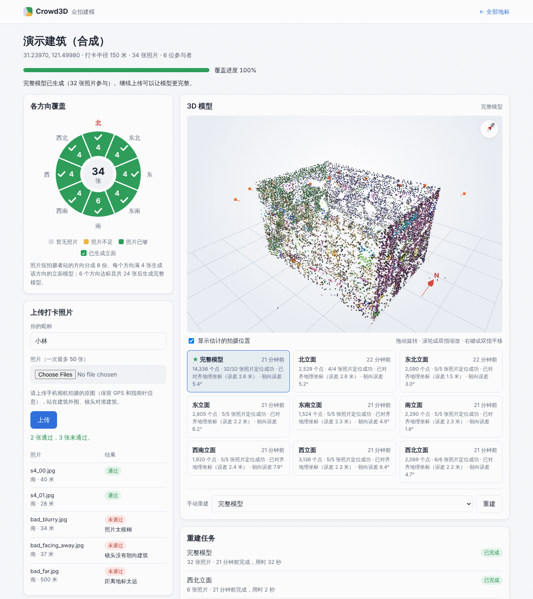
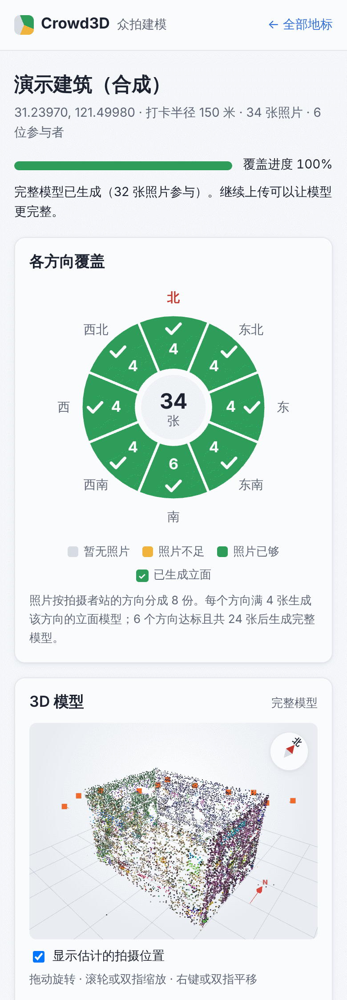
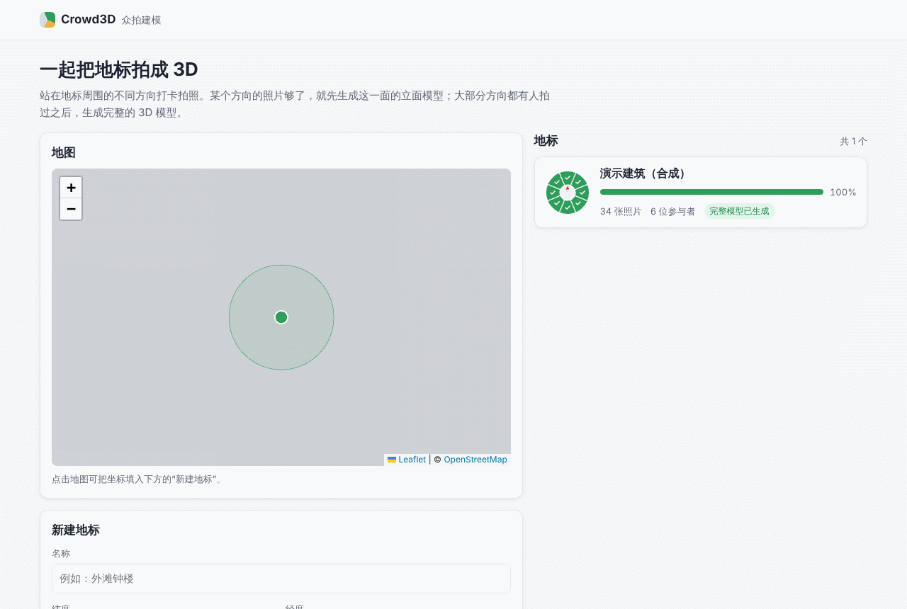

# 运行和使用

> 原来是 README"快速开始"的后半段、"风格化模型"和"截图"三段，D34 C 部分第 2 步（2026-11-13）搬到这里，文字没有改。安装和第一次运行见 [README](../README.md)，每个配置项见 [CONFIG.md](CONFIG.md)。

## 服务和演示的常用参数

常用参数：

- `python -m crowd3d.api`：`--data-dir DIR`（默认 `./data` 或 `$CROWD3D_DATA_DIR`）、`--reconstructor fake`（不跑 COLMAP，秒出假模型，适合调界面）、`--host`、`--port`。
  数据目录里的 `public_id.salt` 是公开 id 和撤回凭证的密钥，要和数据库一起备份，拷贝数据目录时也要一起拷。密钥和数据库对不上时（设了或改了 `$CROWD3D_PUBLIC_ID_SALT`、文件被删或被换），只要还有照片公开着，服务就拒绝启动，免得已经发出的撤回凭证全部失效、这些照片却继续公开。D32 起每张通过、没撤回的照片都算同意公开，所以有照片的数据目录基本都会拒绝。恢复原来的密钥即可；密钥确实丢了，就运行 `python -m crowd3d.consent forget-lost-salt --data-dir DIR`，它撤回所有照片的公开（位置和照片本身），再改用现在的密钥（D30）。
- `python scripts/demo.py`：`--users N`（参与的游客数）、`--size 800x600`（照片越大越慢，默认 640x480）、`--seed 1`（换一组照片；同一组照片重复上传会被判为重复）、`--landmark ID`（新建或使用另一个地标）、`--server URL`、`--photos DIR`。演示的每位游客先登记一次、同意用户协议（D33；D32 时是每次上传都同意），再用登记的凭证上传，所以通过的照片在下一次建模确定了位置和朝向后公开。
- 自己生成照片，再从网页手动上传：`python -m crowd3d.synthetic --out /tmp/photos --size 640x480`。照片的 EXIF 带 GPS 和指南针朝向，目录里有 `manifest.json` 记录真值。

> 网页用的 Leaflet 和 three.js 由服务自己提供（`web/vendor/`，D34），不依赖 CDN。只有首页的地图底图来自 OSM 的公共瓦片：浏览器不能访问外网时地图是空的，别的功能照常。

## 风格化模型

**服务会自动生成。** 地标满足下面三条时，每发布一个 COLMAP 模型，作业系统就排一个风格化作业：
- 地标目录（`Settings.structure_catalog`，默认 `eval/landmarks.json`）里有它的 OSM 分件快照和轮廓。目录里的 13 个地标都有。
- 地标 id 等于目录里的 slug（例如 `florence-baptistery`），或者在 `Settings.structure_bindings` 里绑定了 slug。
- 目录里的中心在地标的打卡半径内。

GLB 放在 PLY 旁边。地标页的模型列表里会出现"风格化模型 · 素模（照片未对齐）"或"风格化模型 · 素模（照片已对齐）"的链接（两种都是素模，区别是照片的配准有没有被接受），生成中显示"风格化生成中"。演示地标 `demo-building` 不在目录里，`--reconstructor fake` 也不写稀疏地图，所以演示不会生成 GLB。

**也可以用脚本处理单个模型。** 需要两样输入：
- 一个已重建的作业，或者 MegaDepth-X 格式的参考场景（`--scene DIR`）。作业目录默认会被清理。要保留，启动服务前设环境变量 `CROWD3D_KEEP_WORK_DIRS=1`（D34；也可以在代码里用 `Settings(keep_work_dirs=True)`），没有命令行参数。基准（`scripts/benchmark.py`）默认会保留作业目录。
- 地标在 `eval/landmarks.json` 里的条目：坐标、OSM 轮廓文件和分件快照（`osm_parts`）。外轮廓拉伸时，高度标签来自轮廓 GeoJSON；结构优先时，来自分件快照里每个分件的标签。条目里只有 Wikidata 编号，脚本用不到 Wikidata 的高度。

输出必须写到仓库外（或被 git 忽略的 `data/`）：GLB 里没有照片像素，但摆放位置和照片量出的数字来自有许可要求的照片，照片缓存里还有照片衍生的天空掩码和线段：

```bash
python scripts/stylize_model.py --job-dir data/work/<作业> --meta data/models/<地标>/<模型>.json \
    --landmark florence-baptistery --out data/stylized
```

地标有分件快照时（目录的 `osm_parts`，或用 `--osm-parts FILE` 指定别的快照），脚本默认走结构流水线 `crowd3d.structure_pipeline`。它和服务的风格化作业是同一个入口：
- OSM 分件做体块；
- 照片的配准被接受时，用 A+R 天空掩码、SfM 点和三维直线做 D15 判定；
- D25 按 `--d25` 执行：`auto`（默认）只在有两种可商用天空掩码时跑，所以今天不跑；`survey` 只量不改；`off` 不跑。

`--no-structure` 退回外轮廓拉伸。摘要 JSON 的 `structure_run` 写明跑了什么、没跑的原因。天空掩码和线段缓存在 `<out>/cache`。

crowd3d 只认 A+R 一种天空掩码（`structure_pipeline.PRODUCT_MASKS`），别的掩码名一律拒绝，没有绕过的开关。研究用的掩码（例如 Dm+R）只在仓库外的研究脚本里用，因为它们的许可没有确认可以商用（见 [docs/REVIEW_ADOPTION.md](REVIEW_ADOPTION.md) 第 1 节）。

`--snap-from <旧摘要或 GLB>` 复用旧版本的吸附，重新发布时模型不漂移。流水线模型（`--job-dir`）要先通过现在的吸附门重新核对；参考场景（`--scene`）存下的吸附原样复用。

输出包括 GLB、摘要 JSON 和调试用的俯视草图（`<slug>-topdown.png`，标出拍到的墙）；有 D25 纠正时另有一份 OSM 修正建议（`<slug>-osm_fix_suggestions.json`）。

查看方法：
- 查看器 `web/stylized.html?model=<GLB 的地址>&theme=<画风>` 只接受同源地址或相对路径。可选画风是 `default`、`storybook`、`dusk`、`blueprint`，画风只换素模色、描边和光影。D29 之前写的、带照片颜色的旧 GLB 也显示成素模。
- 加上 `&poses=<地标的 /poses 地址>`（同源，地标页的风格化链接自动带上）会在素模上画出公开的照片在哪儿拍、朝哪拍（D30，`web/photoposes.js`）：模型重建的照片画成视锥（橙色，要有测出的高度、俯仰、横滚和视角，否则只在地上画朝向扇形），手机 GPS + 罗盘的照片在地上画朝向扇形（黄色，标"手机 GPS + 罗盘（未经模型核对）"）。2σ 范围超过 10 米的照片一律在地上画出范围圆；点选一张看卡片（来源、离中心的位置、朝向、2σ 范围、这个来源实测落在范围内的比例、取整说明）。
- 卡片上的"从这张照片的角度看"（D32，`web/compare.js`）把照片和从照片位姿看到的素模放在一起：宽屏并排、窄屏上下，"叠加"模式把照片盖在素模上、用滑块调浓淡。只有测出了高度、俯仰、横滚和视角的照片才能对照；EXIF 照片和缺测量值的照片只有"看照片"，单独显示照片并写明为什么不能对照。照片来自 `/poses/<公开 id>/photo`。
- 其余参数：`photos=0`（先不显示）、`photo=<公开 id>`（选中）、`view=<公开 id>`（打开对照或"看照片"）、`cmp=pair|overlay`（并排 / 叠加）、`opacity=<0–100>`（叠加时照片的浓淡）、`err=1`（画出所有照片的范围）、`cluster=0`、`fit=model`。
- 服务生成的 GLB 在 `/files/models/<地标>/<模型>.glb`，地标页直接链过去。
- 脚本写出的 GLB 服务不提供（`/files/models` 只读 `data/models`）。可以在仓库根目录起一个静态服务器（例如 `python -m http.server`），再打开 `/web/stylized.html?model=/data/stylized/florence-baptistery.glb`。

## 截图

以下截图来自真实服务（COLMAP 重建）：先运行 `scripts/demo.py`，再在网页上传 2 张合格照片和 3 张不合格照片。截图环境不能访问外网，所以地图底图是灰色占位。截图比风格化链接和"GPS 对齐残差"的改名都早，也比 D32 和 D33 早：没有登记表单（用户协议的勾选框）、浅色 / 深色和语言的切换。

**地标页（桌面）**：
- 左侧是 8 个方向的覆盖罗盘：数字为照片数，✓ 表示已生成立面模型。下面是上传结果，未通过的照片逐张显示原因。
- 右侧是全景模型的点云，以地标中心为原点、北向对齐。红色 N 箭头和右上角的指南针指向北。截图里的橙色点是旧版画的重建估计拍摄位置；D30 起只画公开的照片（D32 起是每张通过、没撤回、确定了位置和朝向的照片；取整到 1 米、1°，可以关掉），"公开的拍摄位置"表也只列这些照片：来源、离中心的位置、朝向和 2σ 范围，不显示上传者和时间。



**手机版地标页（单列布局）** 和 **首页（地图、地标卡片、新建地标）**：

<p>
  
  
</p>
