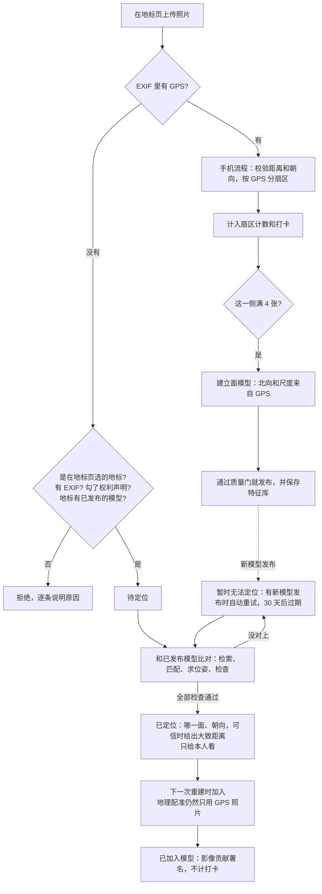
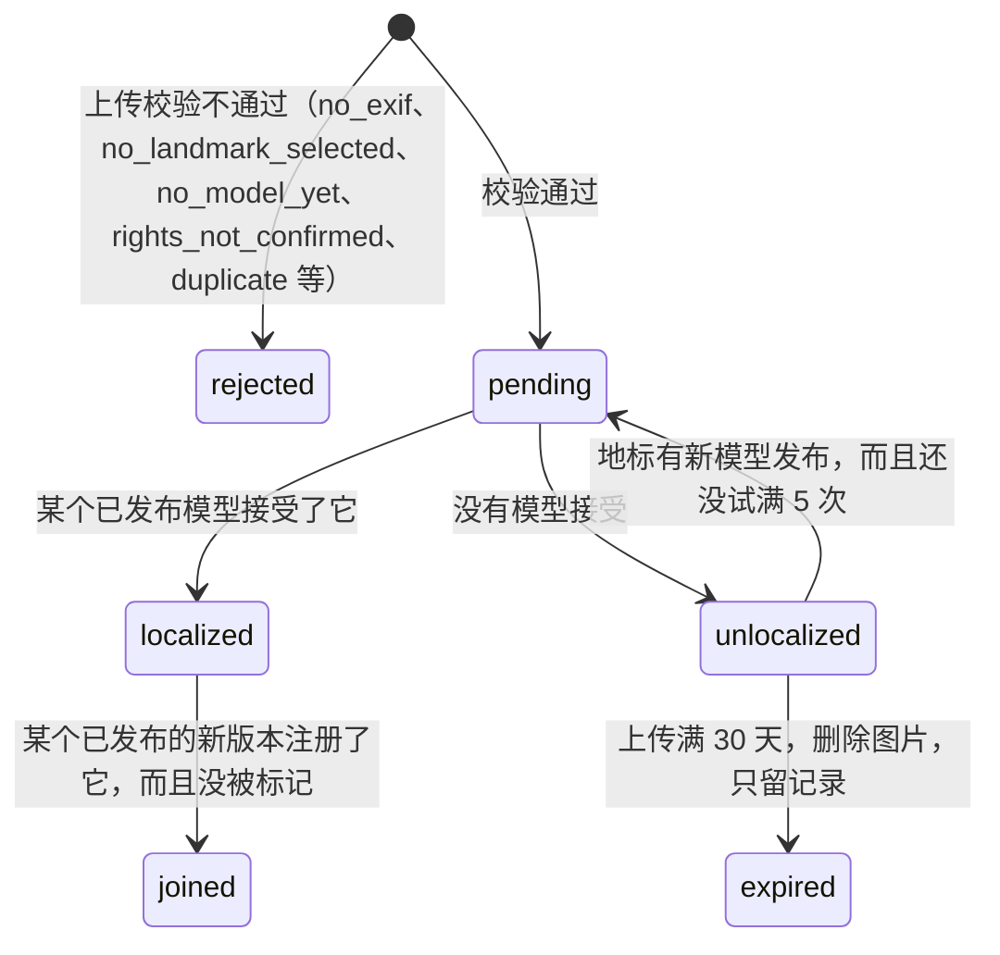

# 视觉定位：让没有 GPS 的相机照片加入地标模型（设计）

> 2026-10-22，主设计。合并了三份输入：可行性实验报告（`loc-feasibility`）、算法与系统草案（`vloc-algo`）、产品与信任草案（`vloc-product`）。另外我在可行性实验的原始记录上重新统计了一遍，没有重跑 COLMAP。
>
> - 代码基线：本仓库 `b129d0f`。可行性实验用的是冻结副本 `666494c`。另一个工作流正在改 `crowd3d/*`，实现时请以当时的代码为准，行号可能已经变了。
> - 数字标记：
>   - 【实测】：三份输入里的运行结果，出处见附录 B；
>   - 【重算】：我用可行性实验的原始记录重新统计的，脚本在附录 B；
>   - 【估算】：没测过，是推算；
>   - 【待校准】：阈值只在一栋楼上定过；
>   - 【需用户确认】：产品决定，我给了建议，等用户拍板。
> - 法律部分是工程角度的整理，不构成法律意见。

---

## 0. 一页摘要

**一句话**：手机照片带 GPS，用来建立面模型并确定北向和尺度；相机照片没有 GPS，就拿去和已经建好的模型比对，算出它是在哪里、朝哪个方向拍的，然后在下一次重建时加进模型，让模型更完整。相机照片不算打卡。

**结论（只有一栋楼的证据）**：

1. **在洗礼堂上可行，前提是知道焦距。** 80 张无 GPS 照片，用 3 个立面模型定位，按本文的接受规则（§3.6）：
   - 接受 51 张；
   - 相对模型 5 m / 10° 以内的占 63.7%；
   - 错误接受 0 张【重算】。
2. **不知道焦距时会出错，而且拦不住。** 接受的 52 张里有 11 张位置偏 5–42 m，全是沿视线方向的深度错误，朝向只差 ≤ 3.1°。阈值怎么调都去不掉这 11 张【实测】。所以没有可信焦距的照片可以加入重建，但不显示位置（§2.5 问题 1）。
3. **位置"相对模型很准，绝对精度看模型"。**
   - 相对模型：中位 1.56 m、0.51°；最好的东立面模型上中位只有 0.36 m。
   - 绝对位置（对按 OSM 轮廓校正过的参考）：中位 8.8 m，p90 16.6 m。三个模型分别约是 5.0 m、5.5 m、14.7 m，正好等于各自模型本身的地理配准误差【实测/重算】。
   - 所以不能对用户说"比 GPS 准得多"。
4. **只能用已发布的模型定位。** 亚琛的 29 张 GPS 照片一个模型都没建出来，所以无 GPS 照片无处可加。拿亚琛没通过质量门的 W 模型去定位：25 张通过阈值，只有 9 张是对的【实测】。
5. **拍错楼是安全的。** 148 张亚琛照片对 3 个洗礼堂模型，试了 444 次，一次都没被接受【实测】。
6. **加入重建能让模型变好，但不改北向和尺度。**
   - 三个立面的点数都涨到 3.5–10 倍（1474→8470、2796→9860、800→8168），轮廓覆盖率提高。
   - 全景模型因为有了这些照片才建得出来（72/73 注册）。
   - 东北立面仍然没有完成地理配准，东南立面仍偏 10°。这符合"北向和尺度只来自 GPS"的规则【实测】。
7. **对称建筑是最大风险。** 只按架构文档原来的阈值（≥ 50 内点、内点率 ≥ 0.2、≤ 4 px），会接受 11 个"定位到隔壁那一面"的错误位姿。本文用了两道互相独立的检查，在这栋楼上都能把错面拦干净：
   - 内点率 ≥ 0.75；
   - 次优位姿 / 最优位姿 ≤ 0.15。
   - 但两道检查的余量都很薄【实测/重算】。

**需要用户确认的决定**（详见 §2.5）：

1. 无 GPS 照片仍要求有 EXIF；没有可信焦距的，只加入重建、不显示位置（不拒收）。
2. 地标由用户在地标页手选，不做跨地标的图像检索。
3. 相机贡献者不得打卡积分，只有"影像贡献"署名和徽章。
4. 允许无 GPS 照片帮助凑够全景模型的照片总数，前提是不开启新的面。

另有 6 个小决定列在 §2.5 末尾。

---

## 1. 一句话与用户流程

### 1.1 两类用户

| | 手机打卡者 | 相机拍摄者 |
|---|---|---|
| 照片 | 手机原图，EXIF 带 GPS（以后改为页面采集的 sidecar） | 相机原图，EXIF 通常没有 GPS。洗礼堂附近，用户给的统计是有 EXIF 的 Commons 照片里只有 22% 带 GPS；产品草案统计的相机照片只有 5%【实测，产品草案 E1】 |
| 上传入口 | 地标页，或首页按 GPS 自动匹配地标 | **只能在地标页**（§2.5 问题 2） |
| 照片在哪一侧 | 先按 GPS 定暂定扇区，模型注册后再确认 | 定位成功后才知道 |
| 能不能开启新的面 | 能：一个扇区满 4 张就建立面模型 | **不能**，只能加入已有模型的面 |
| 打卡、到访、积分、排行 | 有 | **没有** |
| 署名 | 共同完成者 | 单列"影像贡献" |
| 自己的位置谁能看到 | 本人（生产版；原型目前公开，见 §6.4） | 只有本人 |

### 1.2 流程



### 1.3 相机照片的状态



`joined` 不单独存储，由"有没有已发布模型的相机列表里包含它"推出来（§8.6）。

### 1.4 用户看到的文字

| 状态 | 主文案 | 补充 |
|---|---|---|
| 待定位 | 待定位 | 正在和已有模型比对，通常几分钟 |
| 已定位，位置可信 | 已定位：东南侧，距地标中心约 70 米，朝向西北 | 只有本人能看到；"将在下一次重建时加入模型" |
| 已定位，位置不显示 | 已定位：东南侧，朝向西北 | "没有可信的焦距信息（或这个模型的北向不够准），所以不显示距离" |
| 已加入 | 已加入模型：东南立面 | 进入"影像贡献"名单 |
| 暂时无法定位 | 暂时无法定位：没有和现有模型对上 | "可能拍的是还没有模型的一面（已有：东北、东、东南），也可能画面里建筑太少，或者是特写、夜景。有新模型发布时会自动再试，截至 11 月 21 日。" |
| 已过期 | 30 天内没能定位，照片已删除 | — |
| `no_model_yet` | 这个地标还没有模型，相机照片暂时不能加入 | "先用手机拍几张带定位的照片，模型生成后就可以加入相机照片" |
| `no_landmark_selected` | 没有 GPS 的照片，请在地标页上传 | — |
| `rights_not_confirmed` | 请确认照片是你本人拍摄的 | — |

---

## 2. 规则

### 2.1 哪些照片可以不带 GPS 加入

全部满足才收：

1. 在某个地标的页面上传，请求带 `landmark_id`。
2. 有 EXIF：现有的 `no_exif` 拒绝不变（§2.5 问题 1）。
3. 上传者勾选了权利声明："这些照片是我本人拍摄的"（§6.1）。
4. 这个地标至少有一个**已发布、并且保存了特征库**的模型。
5. 照片本身合格：现有的 `too_small`、`too_blurry`、`duplicate` 检查照常；宽高比 ≥ 2.2 的全景图拒收（`panorama`）。可行性实验就是用 2.2 把亚琛的 5 张全景图排除掉的【实测】【待校准】。
6. 没有焦距、或者焦距和画面对不上的照片也收，但只加入重建，不显示位置（警告码 `no_focal_length`，定位标记 `position_withheld`）。

不检查 `too_far` 和 `facing_away`，因为没有 GPS 和罗盘可查。等定位成功后，用定位出的位置做合理性检查（§3.7）。

### 2.2 只能加入已有的面

- **扇区状态只由 GPS 照片决定**。锁定、部分、可建模这三种状态，以及"满 4 张触发立面"的计数，都只算 GPS 照片。相机照片永远不会让一个扇区变成可建模。
- 相机照片只有在**定位成功**后才有扇区。它只能进入这样的重建作业：
  - **立面作业**：目标扇区已有**已发布的立面模型**，而且照片的定位方位落在这个扇区及两侧各 10° 的余量内（沿用 `face_margin_deg`）；
  - **全景作业**：地标已有已发布的全景模型，或者按 §2.5 问题 4 的规则全景已就绪。
- 定位落在没有模型的扇区：照片保持"已定位"，但不进任何立面作业。等这一面由手机照片建出模型以后，它会自动进入下一次重建。
- **北向和尺度只来自 GPS**：重建时 `georegister` 只用 GPS 照片的相机（§3.12）。定位得到的位置**绝不写进** `lat/lon`，也不作为 BA 的位置先验，只用来给照片配对。

### 2.3 不计打卡积分

- 定位成功只能证明"照片拍的是这栋楼"，不能证明"上传的人去过"。在可行性实验里，这 80 张查询照片全部是从 Commons 下载的，照样定位成功。
- 所以相机照片不计入以下任何一项：
  - 打卡、到访、图鉴"已收集"；
  - 扇区点亮、进度条；
  - 共同完成者排行和人数（`num_contributors`）。
- 相机照片单独计入"影像贡献"（§6.5）。

### 2.4 地标必须有维基百科条目（Wikidata）

1. **创建方式**：只接受 Wikidata Q-id，或者能解析出 Q-id 的维基百科链接。服务器取出名称和坐标（P625），并检查有没有至少一个维基百科站点链接。Q-id 唯一，同一个 Q-id 再建返回 409 和已有的 id。
2. **中心点**：
   - 用 OpenStreetMap 上带同一 `wikidata=Q…` 标签的建筑轮廓的质心（`centre_source = osm_footprint`）；
   - 没有轮廓时退回 P625，并标 `centre_uncertain`，界面上的扇区标"大致"；
   - **不用维基百科条目页上的坐标**。
3. **为什么**：
   - `eval/landmarks.json` 的 13 座地标里，P625 到 OSM 轮廓质心的距离中位 10.8 m，有 6 座超过 15 m，最大 22.8 m【实测，可从该文件复核】。
   - 洗礼堂的维基百科条目坐标离轮廓中心 27.6–27.7 m（`eval/landmarks.json` 记为 27.6 m，`REAL_WORLD_EVAL.md` 记为 27.7 m），而它的 P625 只偏 10.8 m。
   - 扇区是从中心点量的。洗礼堂带 GPS 的照片离中心的中位距离是 48 m。中心偏 27.6 m、方向又和视线垂直时，方位最多偏 atan(27.6/48) ≈ 30°，差不多是一个扇区（45°）的宽度【估算】。
4. **偏差处理**：
   - 记下 `centre_offset_m`（P625 到所选中心的距离）。
   - 偏差超过 30 m、有多个候选轮廓、或者轮廓不是建筑类对象时，转人工。例如林肯纪念堂有一块公园用地也带着同一个 Q-id【实测，产品草案 E9】。
   - 创建时把坐标冻结。之后 Wikidata 的坐标变了，或者条目被合并，都只告警，不自动跟着改。
5. **以后修正中心点**：
   - 只用两种来源：覆盖 ≥ 3 个面的全景模型，或者和 OSM 轮廓的拟合。
   - 单个立面的点云中心偏向被拍的那一侧，不能用。
   - 工作区里有一份 `user_decisions.md` 记录了"用第一个模型的点云修正中心"，和这条不一致，**需用户确认**。
6. **半径**：原型保持 `default_radius_m = 150`，`eval/landmarks.json` 的 13 座地标用了 150–800 m。架构文档 §8 的半径规则（最远轮廓顶点 + 30 m）在洗礼堂只有约 51 m，而带 GPS 的照片离中心的中位距离是 48 m、p90 是 63 m，会误拒大约一半照片【实测，产品草案 E10】。这一条转给 §8 的负责人。

### 2.5 开放问题与建议（都需用户确认）

> 工作区的 `user_decisions.md` 记录了"用户已确认（都ok）"，内容和下面前 3 条大体一致，但我无法核实这条记录是谁写的。所以这里仍然全部标为**需用户确认**。

**问题 1：无 GPS 的照片还必须有 EXIF 吗？【需用户确认】**

建议：

- **EXIF 必须有**，`no_exif` 继续拒收。EXIF 能挡掉截图、聊天软件转发和社交平台压缩过的图，还能提供拍摄时间、机型和焦距。
- **焦距不强制，但它决定用户能看到什么**：
  - 有可信焦距（§3.5）：完整定位，可信时显示大致距离；
  - 没有焦距，或者焦距和画面对不上（多半是裁剪过）：照片照样加入重建，但只显示"哪一面、朝哪个方向"，不显示距离，也不在地图上打点。
- **证据**：
  - 不知道焦距时，接受的 52 张里有 11 张深度错误；知道焦距时 0 张【重算】。
  - 焦距偏 5% 时，就会多出 3–7 张错误【实测】。
  - 但那 11 张的朝向误差都 ≤ 3.1°，而且重建时 SfM 会自己重新估计位置。可行性实验的重建正好用的是这 53 张"不知道焦距"的照片，4 个模型全部通过质量门【实测】。
- **备选方案**：没有焦距就拒收（`no_focal_length`）。规则更简单，但代价不小：相机照片里只有 47% 带 35 mm 等效焦距【实测，产品草案 E2】。没有"机型 → 传感器尺寸"表时，大约一半的相机照片会被拒。这张表的许可还没核查。
- **局限**：EXIF 不能证明照片是上传者拍的。网上下载的原图 EXIF 往往是完整的：可行性实验的 87 张 Commons 照片全都有 EXIF 块【实测】。

**问题 2：没有 GPS 的照片怎么确定是哪个地标？【需用户确认】**

建议：**只能在地标页上传，由用户手选**，不做跨地标的检索。

- 选错是安全的：拍别的楼的照片匹配不上，会显示"暂时无法定位"，30 天后过期。148 张亚琛照片对洗礼堂模型，444 次尝试 0 次被接受，最多的一次也不到 6 个 2D-3D 匹配【实测】。
- 全库检索等于对外提供"这张照片是在哪拍的"服务，有被用来跟踪他人的风险。它的成本还随地标数线性增长。
- 以后可以做的：地标**内部**的检索（挑参考图，§3.3）；v2 可以给出"这几张可能是 X"的提示，但必须由用户确认。

**问题 3：相机贡献者得到什么？【需用户确认】**

建议：

- 不给打卡积分，不点亮"已到访"，不进排行，不计进度。
- 照片被注册进**已发布**的模型版本后，进入模型的"影像贡献"名单，并发一个不计分的"影像贡献"徽章。
- 署名是 CC BY 的义务，所以只要照片进了模型就必须署名，这一点和奖励无关。
- 徽章名称：`user_decisions.md` 里写的是"画质贡献"。但这个徽章衡量的是"照片被用进了模型"，不是"照片画质好"，所以我建议叫"影像贡献"，**需用户确认**。

**问题 4：靠无 GPS 照片凑够条件的全景模型，算不算"开启新的面"？【需用户确认】**

建议：**允许，不算开启新的面**。条件是：

- 全景模型需要的就绪扇区数 K，以及每个扇区是否就绪，都只按 GPS 照片算；
- 照片总数（`full_min_photos`，以及"≥ 48 张后，没人拍的方向算作拍不到"的规则）可以算上已定位的相机照片；
- 全景模型质量门里的"覆盖了几个就绪扇区"只数 GPS 照片。

依据：洗礼堂只有 20 张 GPS 照片，按现有规则永远建不出全景模型。加上 53 张已定位照片以后，全景模型注册了 72/73 张，3 个面都覆盖到了，通过质量门。它覆盖的东北、东、东南三面本来就都有 GPS 立面模型【实测】。

另一种选择是照片总数也只算 GPS 照片，那洗礼堂这种照片少的地标就没有全景模型。`Settings.vloc_counts_for_full` 用来切换这两种做法。

**其他需要确认的小决定**：

1. 地标还没有任何已发布模型时，相机照片直接拒收（`no_model_yet`），不先存起来等模型。
2. 定位失败的照片自动重试 30 天，过期后删除图片、只留记录。算法草案建议 90 天，产品草案建议 30 天，我选 30 天。
3. 地标页显示的距离量到中心点。有轮廓以后再改为量到建筑轮廓：对国会大厦这种 265 m 长的建筑，量到中心会误导人。
4. 中心点只能用全景模型或轮廓拟合来修正，不用单个立面（§2.4 第 5 条）。
5. 维基百科规则在中国大陆部署时是否也执行（架构文档 §7.8 要求那里只用持证 POI）。
6. 打卡升级路径（§6.6）默认关闭，升级后的积分可信度 V 先取 0.7。

---

## 3. 算法

### 3.1 总览

```
无 GPS 照片（处理图，长边 ≤ 1600 px）
  │ 1. 候选模型：这个地标每个目标（各立面、全景）最新的已发布模型，要有特征库
  │ 2. 检索：每个模型取最可能的参考图（图少就全用）
  │ 3. 匹配：SIFT + 两视图几何验证（和建图用同一套 pycolmap 设置）
  │ 4. 2D-3D：参考图的关键点 → 模型里的 3D 点，去重
  │ 5. 求位姿：焦距固定为 EXIF 值，LO-RANSAC + 精化；另外用自由焦距（P4Pf）再解一次做核对
  │ 6. 接受门槛：内点数、内点率、重投影、次优位姿比
  │ 7. 合理性检查：距离、高度、朝向、焦距
  │ 8. 选模型：内点最多的；另一个模型也接受而朝向差 > 25° 时判为歧义
  │ 9. 转 ENU → 扇区 → 显示质量 → 决定加入哪个作业
  ▼
已定位（只给本人看）→ 下一次重建时加入（地理配准只用 GPS 照片）
```

### 3.2 候选模型

- 只用**已发布**的模型（通过 `qa.assess`，点数 ≥ 300），取每个目标（各立面、全景）最新的一个，并且要求它保存了特征库（§5.1）。
- 没完成地理配准的模型（`georegistered = False`）也参加：
  - 它的**相对**位姿仍然可靠：东北立面模型上相对误差中位 2.66 m；
  - 没有它，照片就没处加入：东北立面这一次加入了 22 张；
  - 但它定出来的位置一律不显示距离（§3.11）。
- **不用没发布的模型**。亚琛 W 模型没过质量门，它自己 7 台相机里就有 2 台偏了 37–61 m。拿它定位：
  - 148 张里 37 张有匹配，25 张通过阈值，只有 9 张在 5 m / 10° 以内；
  - 错的位姿内点率也接近 1.0，阈值根本分不出来【实测】。

### 3.3 检索与匹配

- **参考图**：
  - 模型注册的图 ≤ 60 张（沿用 `exhaustive_max_images`）时，全部配对。
  - 更多时，取视觉词袋相似度前 20 的。词袋用模型自己的 SIFT 描述子做 k-means，256 个词，和可行性实验一样。
  - 证据：洗礼堂 3 个模型共 23 张注册图。全部配对时接受 51 张；每个模型只取前 5 张时也接受 51 张，正确率相同（63.7%）【重算】。
  - 前 20 张这个数字对大模型没测过【待校准】。生产上换成 GPU 全局描述子（架构文档 §3.3.5）。
- **特征**：`extract_features`，CPU SIFT，`max_image_size = processing_max_side_px`（1600），和建图时一致。特征提取参数写进模型的 `map.json`，保证查询和模型用同一套设置。
- **匹配**：用 `match_image_pairs` 加导入的配对列表（`query 模型图` 一行一对），两视图几何验证用默认参数，`ransac.random_seed = 0`。
  - 不要从 Python 调 `pycolmap.FeatureMatcher.match`：实测每对要 8–14 s，而走数据库的匹配加验证只要 64–79 ms【实测，算法草案】。

### 3.4 2D-3D 对应

- 只用通过两视图验证的内点匹配。
- 通过模型图的 `points2D[i].point3D_id` 映射到 3D 点，按"查询关键点 + 3D 点"去重。
- 对应少于 30 个（也就是不可能凑够 30 个内点）时，直接记为 `too_few_matches`。

### 3.5 位姿与焦距

- **焦距先验**（ingest 时算好存起来，§8.3）。按可信度依次取：
  1. `FocalLength`（毫米）× `FocalPlaneXResolution` 换算的像素焦距；
  2. 35 mm 等效焦距，按 COLMAP 的对角线公式 `f_px = f35 / 43.27 · hypot(w, h)`；
  3. 以后加"机型 → 传感器尺寸"表。
  - 注意：EXIF 的 `FocalLengthIn35mmFilm` 是整数毫米，26 mm 时取整误差最大约 1.9%。这一项的影响没测过，而 5% 的误差已经会多出 3–7 张错误，所以第 1 种来源排在前面【估算】。
- **主解**：焦距**固定**为先验值（`estimate_focal_length = False`、`refine_focal_length = False`、`refine_extra_params = False`），`SIMPLE_RADIAL` 相机，主点在图像中心。
  - RANSAC 阈值取长边的 1.2%：约 1000 px 的图上是 12 px，1600 px 的图上约 19 px。可行性实验比较了 4 px 和 12 px，推荐 12 px【实测】。1600 px 上的值是按比例换算的【待校准】。
- **焦距核对**：再用自由焦距（P4Pf）解一次。两个焦距相差超过 20% 时，标 `focal_mismatch`，按"没有焦距"处理：用自由焦距的解，不显示位置。
  - 依据：把焦距标签故意设成真值的 1/1.5（模拟裁剪后没更新），这个规则标出了 47 张里的 46 张【实测，算法草案】。
  - 代价：同一组数据里，焦距标签正确时，自由焦距落在真值 ±20% 以内的只有 37/47。所以约 1/5 本来正确的照片也会被标出来，失去显示位置的资格【实测，算法草案】。
- **没有焦距先验**：只用自由焦距的解，标 `no_focal_prior`，同样不显示位置。
- **不要"先验作初值再精化焦距"**：这样做和不给先验一样差，接受的 52 张里错 10 张【实测】。
- 协方差（`return_covariance=True`）只存作诊断，不作门槛。算法草案提过 σ_t ≤ 1 m 的门槛，但没在完整数据上验证过，而且这个协方差不含焦距的不确定性，会偏小。

### 3.6 接受门槛

单个模型上，下面全部满足才算这个模型"接受"：

| 检查 | 阈值 | 依据 |
|---|---|---|
| PnP 内点数 | ≥ 30 | 【实测】可行性实验的阈值搜索 |
| 内点率 = 内点 / 去重后的 2D-3D 对应数 | ≥ 0.75 | 错面位姿最高 0.68，正确位姿的 5 分位是 0.72。取 0.75 留一点余量，代价是少接受 1 张【实测/重算】【待校准】 |
| 内点的平均重投影误差 | ≤ 长边的 0.25%（1000 px 上 2.5 px，1600 px 上 4 px） | 【实测】透视校正过的照片 000054、000537 靠这一条拦下，它们本来会偏 16–25 m、16–24° |
| 次优位姿比 | ≤ 0.15 | 见 §3.8【重算】【待校准】 |

### 3.7 合理性检查

便宜的兜底检查。在洗礼堂上一次都没触发，前面的检查总是先拦住了问题【实测】：

- 离地标中心的水平距离 ≤ 地标半径；
- 高度在 −15 m 到 120 m 之间。允许塔楼和露台：参考相机最高约 70 m【实测，算法草案】；
- 相机光轴和"指向模型点云中位点"的方向夹角 ≤ 75°；
- 自由焦距 / 长边在 0.3–8 之间。算法草案遇到过一个焦距比 269、位置在 12 km 外的离谱解【实测】。

### 3.8 对称建筑的歧义检查

**问题**：八角形洗礼堂的几个面几乎一样。只建了一个面时，另一面的照片可能被"定位"到这个面上，整体转 45° 或 90°。这时模型里没有正确的那一面跟它竞争，所以"两个模型谁的内点多"的比较拦不住。

**两道检查，在这栋楼上都能单独拦住全部错面**（把每个模型当作这栋楼唯一的模型来测，焦距已知，RANSAC 12 px，只看内点 ≥ 30、重投影 ≤ 2.5 px 的位姿）：

1. **内点率 ≥ 0.75**。错面位姿的内点率最高 0.67，正确位姿最低 0.72【重算】。可行性报告在全部位姿上统计，给出的是错面最高 0.68、正确位姿 5 分位 0.72【实测】。
2. **次优位姿比 ≤ 0.15**。做法：去掉最优解的内点，剩下的对应再跑一次 RANSAC，得到次优解；次优解的内点数 > 0.15 × 最优解内点数，而且位置差 > 5 m 或朝向差 > 10° 时，判为歧义。
   - 37 个错面位姿的次优位姿比：最小 0.20，5 分位 0.22，中位 0.35，最大 0.60；
   - 74 个正确位姿：95 分位 0.096，最大 0.111；
   - 阈值 0.15 时拦下全部 37 个错面，不误伤正确位姿。不知道焦距时：36 个错面（次优位姿比最小 0.18）全部拦下，59 个正确位姿（最大 0.121）都保留【重算】。
   - 可行性报告说"次优位姿检查一个都没拦住"，是因为它的阈值是 0.5（次优解要有最优解一半的内点才算歧义）。按我的统计口径，在 0.5 下 37 个错面只拦下 3 个【重算】。算法草案用的 0.15 才是对的。

| 只用一个条件 | 接受的错面位姿 | 接受的正确位姿（共 74） |
|---|---|---|
| 内点率 ≥ 0.5 / 0.6 / 0.65 / 0.7 / 0.75 | 18 / 5 / 2 / 0 / 0 | 74 / 74 / 74 / 74 / 72 |
| 次优位姿比 ≤ 0.3 / 0.2 / 0.15 / 0.1 | 16 / 0 / 0 / 0 | 74 / 74 / 74 / 71 |

（内点率一行是可行性报告给的，次优位姿比一行是我重算的，两者用的是同一批 PnP 记录。）

- 两个条件同时用，在这栋楼上焦距已知时：接受 72 个位姿，错面 0，其他错误 0；不知道焦距时：接受 73 个，错面 0，深度错误 16【重算】。
- **余量很薄**（内点率 0.67 对 0.72；次优位姿比 0.12 对 0.18），而且只在一栋楼上定过。所以两道都用，并在 10 栋楼的测试集上重新校准（§7）。
- 按架构文档原来的阈值（≥ 50 内点、内点率 ≥ 0.2、≤ 4 px），会接受 11 个错面位姿【实测】：
  - 东北模型：000032、000051、000063、000474、000559；
  - 东模型：000051、000076；
  - 东南模型：000014、000074、000452、000560。

### 3.9 选模型

- 在接受这张照片的模型里，取内点最多的。内点数相同时优先全景模型。
- 另一个也接受的模型，内点数 ≥ 最优的一半，而且朝向差 > 25°：判为 `ambiguous_across_models`，这张照片不接受。
- 25° 留出了各模型之间本来就有的偏差，例如东南模型自己就偏了 10°。
- 有多个面的模型时，"取内点最多 + §3.6 的门槛"给出 0 个错面【实测】。

### 3.10 转 ENU、扇区、加入哪个作业

- 模型保存了 SfM → ENU 的相似变换 `T = (s, R, t)`（§5.1）。
  - 相机中心 `c_enu = s·R·c_sfm + t`；
  - 光轴 `d_enu = R·(R_cfwᵀ·e_z)`；
  - 朝向 = `heading_from_en(d_x, d_y)`；
  - 方位 = 从地标中心指向 `c_enu` 的方位；
  - 扇区 = `sector_for_bearing(方位)`。
- 模型没完成地理配准时，照片的扇区直接取这个模型的扇区，`bearing_deg` 和 `distance_m` 留空，所以它只会加入这个面的作业。
- 加入规则见 §2.2。所有判断都在纯函数里做（§8.5）。

### 3.11 相对很准，绝对精度继承模型的地理配准误差

用大白话说：照片在模型**里面**的位置很准，因为它是用几百个 3D 点算出来的；但模型**整体**放在地图上的哪个位置、朝哪个方向，是当初用几张手机 GPS 定的，本身就有几米到十几米、几度的误差。照片的绝对位置把这份误差原样继承了下来。

| 模型 | 照片相对模型的位置误差（中位） | 照片的绝对位置 / 朝向误差（中位） | 模型自身 GPS 相机的绝对误差 | 产品自己能看到的诊断 |
|---|---|---|---|---|
| 东（已配准，GPS 偏航 − 罗盘偏航 = −4°） | 0.36 m | 5.0 m / 2.5° | 4.7 m / 2.4° | 对齐 RMSE 6.7 m |
| 东北（**未配准**：罗盘定偏航，尺度是粗估的） | 2.66 m | 5.5 m / 0.4° | 5.5 m / 0.2° | 对齐 RMSE 11.7 m |
| 东南（已配准，GPS 偏航 − 罗盘偏航 = **31°**） | 1.62 m | **14.7 m / 10.4°** | 11.0 m / 10.1° | 对齐 RMSE 7.1 m |

（焦距已知，可行性报告的推荐规则；绝对误差是对按 OSM 轮廓校正过的参考算的。）【实测】

- 东南模型的对齐 RMSE 只有 7.1 m，看上去很好，但它整体转了 10°。所以**对齐 RMSE 不能代表模型的绝对误差**。真正的危险信号是"GPS 偏航和罗盘偏航相差 31°"。
- 误差主要沿视线方向：沿视线中位 1.3 m，横向 0.5 m【实测】。
- "相对误差"是把参考模型对齐到每个模型后算的。对齐本身的残差中位就有 0.26–0.58 m，所以 0.5 m 这一档实际上测不准【实测】。

**显示规则**：

- `abs_quality = good`：模型已完成地理配准、|GPS 偏航 − 罗盘（或伪罗盘）偏航| ≤ 20°、照片有可信焦距。显示"距地标中心约 X 米"，地图上打点并画不确定圈。
  - 距离取整：100 m 以内取整到 5 m，100–300 m 取整到 10 m，300 m 以上取整到 50 m；
  - 不确定圈半径取 max(10 m, 对齐 RMSE)【待校准】。
- 其他情况（`approximate` 或 `position_withheld`）：只显示"哪一面 + 8 个方位的朝向"，不显示距离，不打点。
- 本人在三维查看器里看到的视锥，按照片在模型里的位姿直接画，因为那是相对模型的，很准。
- 20° 这个阈值取自架构文档 §3.5.4 的"偏航冲突"。在洗礼堂上，它会把东南模型的 23 张照片（绝对误差 14.7 m）全部降为"不显示距离"，东模型的照片照常显示【实测，按这个规则推算】【待校准】。

### 3.12 加入重建：地理配准只用 GPS 照片

可行性实验用修改版的重建器验证过这种做法（附录 B 的 `reconstruct_loc.py`）：

- `ReconPhoto.lat/lon` 允许为空。定位出的 ENU 东/北坐标写进 `prior_en`，只用于空间配对（照片 > 60 张时）。
- `georegister` 的全部输入只取有 GPS 的相机，包括重力方向、2D 相似变换、偏航先验和回退尺度。
- 按 GPS 和罗盘做的逐相机检查跳过没有 GPS 的相机；新增一条只针对相机照片的检查（§8.9）。
- 反例：给已定位照片塞一个 σ = 1 km 的假 GPS 不行。`min_pair_distance` 取的是 σ 的中位数，会变成 1 km，产品代码直接报"0/35 consistent GPS fixes"【实测，算法草案】。

---

## 4. 实测

### 4.1 数据与方法

- **数据**：MegaDepth-X 的 `Baptistry_(Florence)/1`（107 张）和 `Aachen_Cathedral/1`（203 张）。
  - 都是 Wikimedia Commons 照片，长边约 1000 px；
  - 数据集去掉了焦距和机型，但保留了 GPS、罗盘和拍摄时间；
  - 每张照片都还有 EXIF 块，所以 `no_exif` 从来没触发过。
- **种子模型**：只用带 GPS 的照片，产品默认参数，按会话顺序到达，中心点用 OSM 轮廓质心。
- **查询**：不带 GPS 的照片，按产品规则去掉太小的和重复的。
  - 洗礼堂：87 张 − 4 张太小 − 3 张重复 = 80 张，其中 71 张有拍摄时间；
  - 亚琛：148 张，其中 127 张有拍摄时间。
- **"焦距已知"是模拟的**：用参考模型里这张图的焦距冒充 EXIF 焦距，所以代表的是"EXIF 焦距完全准确"的上限。
- **参考答案**：
  - 相对误差：用 Sim3 把参考模型对齐到每个模型，再比；
  - 绝对误差：和按 OSM 轮廓校正过的参考比，和 GPS 无关。
- **"错误接受"**：被接受，但相对误差 > 5 m 或 > 10°。召回率的分母是全部 80 张查询。
- **运行环境**：2 个 COLMAP 线程，`nice -n 19`；另一个工作流同时在跑，负载 2.5–4.6，所以耗时是上限。

### 4.2 种子模型（洗礼堂）

| 立面 | 输入 / 注册 | 点数 | 地理配准 | 它的 GPS 相机的绝对误差 |
|---|---|---|---|---|
| 东北 | 6 / 6 | 1474 | 否（罗盘定偏航，尺度粗估） | 5.5 m / 0.17° |
| 东 | 15 / 10 | 2796 | 是（偏航差 −4°） | 4.7 m / 2.4° |
| 东南 | 7 / 7 | 800 | 是（偏航差 31°） | 11.0 m / 10.1° |

三个都通过了质量门。没有全景模型，因为 20 张不够最低张数【实测】。

### 4.3 定位结果（洗礼堂，80 张查询，3 个模型）

| 条件 | 接受 | 0.5 m / 2° 内 | 2 m / 5° 内 | 5 m / 10° 内 | 错误接受 |
|---|---|---|---|---|---|
| **本文规则，焦距已知**【重算】 | 51 | 12.5% | 46.3% | **63.7%** | **0** |
| 本文规则，每个模型只取前 5 张参考图，焦距已知【重算】 | 51 | 10.0% | 47.5% | 63.7% | 0 |
| 本文规则，不知道焦距【重算】 | 52 | 13.8% | 31.2% | 51.2% | 11 |
| 可行性报告的规则（内点率 0.70），焦距已知【实测】 | 52 | 13.8% | 48.8% | 65.0% | 0 |
| 可行性报告的规则，不知道焦距【实测】 | 53 | 16.3% | 33.8% | 52.5% | 11 |

本文规则 = 内点 ≥ 30、内点率 ≥ 0.75、重投影 ≤ 2.5 px、次优位姿比 ≤ 0.15，加上合理性检查和跨模型歧义检查。

### 4.4 焦距的影响

| 焦距先验（本文规则）【重算】 | 接受 | 5 m / 10° 内 | 错误接受 |
|---|---|---|---|
| 准确 | 51 | 63.7% | 0 |
| 偏 +5% / −5% | 51 / 51 | 60.0% / 55.0% | 3 / 7 |
| 偏 +10% / −10% | 49 / 47 | 36.2% / 38.8% | 20 / 16 |
| 先验只作初值、再精化焦距（±5%、±10% 四种） | 51 | 51.2% | 10 |
| 没有先验 | 52 | 51.2% | 11 |

- 不知道焦距时，11 个错误全是沿视线方向的深度错误，朝向误差最多 3.1°。例如：
  - 000545 偏 42 m：估出的焦距是长边的 1.89 倍，真值 1.01；
  - 000458 偏 28 m，000064 偏 14.5 m，000085 偏 10.8 m。
- 位置误差和"焦距误差 × 相机距离"几乎成正比，相关系数 0.98。
- 自由估计的焦距，误差中位 5%，90 分位 14%。
- 在内点数、内点率、重投影误差上做阈值搜索，只要不知道焦距，就找不到"0 个错误接受"的组合【实测】。

### 4.5 精度：相对和绝对

| | 中位 | 90 分位 |
|---|---|---|
| 相对位置（本文规则，焦距已知） | 1.56 m | 3.19 m |
| 相对朝向 | 0.51° | 1.39° |
| 绝对位置（对轮廓校正参考） | 8.8 m | 16.6 m |
| 绝对朝向 | 3.0° | 10.5° |

分模型的数字见 §3.11 的表【重算；分模型的数字是可行性报告的规则下的实测】。

### 4.6 失败分类（焦距已知时被拒的 29 张）

| 原因 | 张数 | 例子 |
|---|---|---|
| 匹配太少 | 13 | 从钟楼或穹顶往下拍的：000024、000096；一张历史版画：000041；距东门 20–30 m 的铜门特写：000108、000112、000114、000115、000117、000122、000124、000126、000467；南面远处屋顶视角：000444 |
| 内点太少 | 10 | 蛋白印相老照片 000106；109 m 外的远景 000478；000102、000451、000465；特写 000111、000118、000119、000121、000471。其中 000121 和 000471 其实是对的 |
| 重投影误差 | 5 | 可行性报告点名的 4 张：透视校正过的 000054、000537（要是接受了，会偏 16–25 m、16–24°）；000109、000128 其实是对的，只是有畸变 |
| 内点率（本文规则多拦的） | 1 | — |

- 合理性检查一次都没触发【实测】。
- 补充：可行性报告说"被接受的例子里有一张版画和一张老照片"，这不准确。这两张（000041、000106）**通过了上传校验**，但在定位阶段被拒了【重算】。真正值得注意的是：80 张被接受和被拒的查询**全部**是网上下载的 Commons 照片。

### 4.7 双胞胎立面

见 §3.8。补充：在所有"查询 × 模型"的 PnP 解里，有 86 个转了 ≥ 30°（错面），其中 71 个内点 ≥ 12，最多 104 个内点【实测】。

### 4.8 负样本

- 148 张亚琛照片 × 3 个洗礼堂模型 = 444 次尝试，没有一次达到 6 个 2D-3D 匹配，接受 0 次【实测】。
- 算法草案另测了 40 张亚琛照片对东立面模型：通过验证的图对 0 个【实测，算法草案】。
- 没测相邻建筑（比如大教堂）的照片。

### 4.9 亚琛

- 29 张 GPS 照片建不出任何已发布的立面：
  - 东南：1 个点，被拦；
  - 西：210 个点，被拦（要求 ≥ 300）；
  - 南：两次都找不到起始像对。
- 改为一次全部上传，结果也一样：东南注册 4/8，西 210 个点。
- 所以无 GPS 照片无处可加，亚琛没有给出定位方面的证据。
- 只作参考：用没通过质量门的西立面模型定位，见 §3.2【实测】。

### 4.10 运行时间（2 线程，负载 2.5–4.6，是上限）

| 步骤 | 耗时 |
|---|---|
| 查询图提特征（约 1000 px） | 0.60 s/张 |
| 查询图提特征（1600 px，约 1.1 万个关键点） | 1.6–3.1 s/张，中位 2.4 s【实测，算法草案】 |
| 匹配 + 验证 | 0.074 s/对；算法草案测得 64–79 ms/对 |
| PnP（含精化） | 90 分位 0.02 s，最长 0.11 s |
| 每张查询合计（约 1000 px） | 和 23 张参考图全部配对约 2.3 s；每个模型只取前 5 张约 1.7 s |
| 每张查询合计（1600 px） | 约 4–5 s【估算，算法草案】 |

匹配耗时随参考图数线性增长，所以大模型必须先检索。

### 4.11 加入重建后模型怎么变（洗礼堂）

只用 GPS 照片做地理配准（修改版重建器）。加入的是"不知道焦距"条件下接受的 53 张。每格前一个数是只用 GPS 的模型，后一个是加入后的【实测】：

| | 东北（+22） | 东（+22） | 东南（+25） | 全景（20 + 53） |
|---|---|---|---|---|
| 注册 | 6 → 28 | 10 → 36（GPS 照片 10 → 14/15） | 7 → 32 | 72/73 |
| 点数 | 1474 → 8470 | 2796 → 9860 | 800 → 8168 | 19773 |
| 相机的方位跨度 | 33° → 50° | 46° → 78° | 26° → 37° | 96° |
| OSM 轮廓被覆盖的比例 | 0.27 → 0.31 | 0.22 → 0.27 | 0.13 → 0.36 | 0.40 |
| GPS 相机的绝对误差 | 5.5 m / 0.17° → 5.3 m / 0.19° | 4.7 m / 2.44° → 6.4 m / 2.41° | 11.0 m / 10.1° → 10.9 m / 9.9° | 5.3 m / 0.94° |
| GPS 照片在注册相机里的占比 | 6/28 = 21% | 14/36 = 39% | 7/32 = 22% | 20/72 = 28% |
| 错面相机 | 0 → 0 | 0 → 1 | 0 → 0 | 0 |
| 质量门 | 通过 → 通过 | 通过 → 通过 | 通过 → 通过 | 通过（3/3 个扇区） |
| 作业用时 | → 142 s | → 118 s | → 62 s | 221 s |

**变差的地方**：

1. **孪生面又出现了**：东立面重建时，GPS 照片 000025（已知的孪生面照片之一）被放到了错误的面上，偏 89°、70 m。现有的"GPS + 罗盘"检查标出并隐藏了它，模型仍然通过。要是这栋楼的照片没有罗盘，它就会显示出来。
2. **模型整体动了**：东立面的 GPS 相机绝对位置移动了 1.7 m，模型朝向转了 4.9°。朝向误差的大小没变（2.44° → 2.41°），只是方向反了。原因是多注册了 4 个有噪声的 GPS 定位，不是相机照片的几何造成的。4.9° 已经超过架构文档 §3.6 里"版本之间 > 3° 转人工复核"的阈值。
3. **北向和尺度没有被修正**：东北立面仍然没完成地理配准，东南立面仍偏 10°。这正是"北向和尺度只来自 GPS"规则的预期结果。
4. **重建变慢**：用时是原来的 2.3–14 倍，主要花在建图上。

**变好的地方**：

- 点数是原来的 3.5–10 倍，相机方位跨度变大，轮廓覆盖率提高。
- 全景模型的 GPS 相机朝向误差只有 0.94°，比三个立面都准，而它是靠相机照片才凑够条件的。
- 重建会纠正定位时的深度错误。算法草案的一次重建（东立面 + 24 张已定位照片）：
  - 注册 35/39；
  - 照片在新模型里的位置和定位时相比，中位相差 1.57 m，90 分位 2.69 m，最大 10.88 m；
  - 差得最多的两张，正是定位时的两个深度错误（5.3 m 和 10.9 m），重建把它们改对了；
  - 那次重建把绝对朝向误差从 2.40° 降到了 0.42°，和可行性实验的东立面（基本不变）不一样，说明这项变化不稳定，不能当作收益来宣传；
  - 重建后再拿剩下的 63 张定位一次，又接受了 11 张【实测，算法草案】。

### 4.12 注意事项

- 只有一栋楼（八角形，照片都从东侧拍），80 张查询，三个小模型。阈值也是在这批数据上定的，属于样本内结果。
- "焦距已知"用的是参考模型的焦距，代表 EXIF 焦距完全准确的上限。真实 EXIF 焦距的误差没测过。
- 查询都是约 1000 px 的 Commons 照片，不是 1600 px 的相机原图。
- 只跑了一次，没有重复运行，所以不知道运行间的噪声有多大。
- 亚琛没有提供任何定位方面的证据。
- 本文规则的数字是在可行性实验的同一批 PnP 记录上重新统计的，规则本身没有在新数据上跑过。

---

## 5. 系统

### 5.1 每个地标要持久保存什么

现状：作业结束后 `jobs.py` 会删掉 `work/<作业>/`，`ReconstructionResult` 里也没有 SfM → ENU 的变换，所以已发布的模型没法拿来定位。

每个**通过质量门**的模型保存到 `data/maps/<地标>/<模型 id>/`。这个目录不对外提供：`/files/models` 只提供 `.ply`。

| 文件 | 内容 | 大小 |
|---|---|---|
| `sparse/` | 作业 `work/<作业>/sparse/0` 的 `cameras.bin`、`images.bin`、`points3D.bin`、`frames.bin`、`rigs.bin` | 几 MB 以内 |
| `features.db` | 作业的 `database.db`，用 `clear_matches()` 和 `clear_two_view_geometries()` 删掉匹配后执行 VACUUM，只留相机、图像、关键点、描述子。图像 id 和 `sparse/` 一致。挑中的模型来自"切断孪生面"那次建图时也一样，因为 `cut.db` 是 `database.db` 的副本，关键点和描述子完全相同 | 建图的工作目录约 1.5 MB/张（含匹配，README）；删掉匹配后会小一些【估算，没测】 |
| `map.json` | `model_id`、`kind`、`sector`、`sfm_to_enu`（4×4）、`georegistered`、`yaw_conflict_deg`、`alignment_rmse_m`、注册图 → `photo_id`、点云中位点（SfM 坐标）、特征参数（SIFT、`max_image_size`、pycolmap 版本）、`created_at` | 几 KB |
| `vocab.npy`、`bow.npy` | 只在注册图 > 60 张时生成：256 个词的词表和每张图的词袋向量 | 很小 |

- 保留期：每个目标（各立面、全景）保留最新的已发布版本和上一个版本，用于回滚和正在跑的定位作业。更早的版本在下一次发布时删除。
- 文件按模型 id 命名、写完不再改，所以定位作业只读这些文件，不需要地标锁。
- 生产上对应架构文档 §2.2 的地标级 `colmap.db`。

### 5.2 作业类型与触发

| 作业 | 什么时候触发 | 做什么 |
|---|---|---|
| `localize`（新增） | ① 有相机照片上传成功；② 这个地标有模型发布；③ 服务启动时 | 取一批（≤ 50 张）待定位的照片，对当前全部候选模型定位，写回结果。然后处理过期，再重新规划重建 |
| 立面 / 全景重建（已有） | 现有规则；另外，**已定位相机照片的增长 ≥ `vloc_rebuild_growth`（10）** 也会触发【待校准】 | 输入里加上合格的相机照片（§2.2） |
| 过期（在 `localize` 作业和启动时顺带做） | `unlocalized` 或 `pending` 的照片上传已满 `vloc_retry_days`（30 天） | 删除原图和处理图，状态改为 `expired` |

- **定位不能排在 SfM 后面**：一次重建要 15–18 分钟（REAL_WORLD_EVAL §6）。所以 `JobRunner` 增加第二个后台线程，专门跑 `localize` 作业。这个线程用 2 个 COLMAP 线程。
- 每个地标同时最多一个排队中的 `localize` 作业。作业创建时把照片 id 记下来，之后新上传的照片等下一个作业。
- **重试规则**：
  - 一张照片对同一组候选模型（`maps_key` = 当前候选模型 id 排序后取 sha256）只试一次；
  - 最多试 `vloc_max_attempts`（5）次；
  - 只在 30 天之内重试。
- 已经定位成功的照片不重新定位。新版本模型把它注册进去以后，显示的位姿改用新模型里的。

### 5.3 对重建和地理配准的影响

1. **地理配准只用 GPS 相机**（§3.12）。重力方向也只从 GPS 相机估计，这是实测过的做法。改用全部相机估重力可能更稳，但没测过，以后再说。
2. **定位位姿只用于配对**，不作 BA 先验，否则会把旧模型的配准误差带进新模型。
3. **逐相机检查**：
   - 相机照片没有自己的 GPS 和罗盘，所以现有的 `gps_and_compass` 和 `far_from_gps` 检查管不到它。
   - 新增 `vloc_mismatch`：重建后的朝向和定位时的朝向差 > 10° 就标出来。错面至少差 30°；深度错误只差 ≤ 3.1°，而且通常是重建把它改对了，所以不按位置差来标【待校准】。
4. **质量门新增**：
   - 注册的 GPS 照片 ≥ 4 张，且 ≥ GPS 输入的 60%；
   - GPS 照片在注册相机里至少占 15%。洗礼堂四次重建的最低值是 21%。算法草案原来建议 30%，那会拦下 4 次里的 3 次【实测/推算】【待校准】；
   - 全景模型的"覆盖扇区"只数 GPS 照片。
5. **孪生面风险会增加**：相机照片把各个面连得更紧，GPS 照片更容易被放到隔壁的面上，§4.11 第 1 条就是一例。没有罗盘的楼目前没有保护。建议加一个 `version_jump` 标记：同一张照片在新旧两个已发布版本里的朝向相差 > 30° 时，不显示【未测】。
6. **版本连续性**：在模型的元数据里记录新旧版本共同相机的位移中位数和朝向变化。原型只记录，不拦。生产按架构文档 §3.6，超过 2 m 或 3° 转人工复核。
7. **单个用户的占比**：一次作业的输入里，同一个用户的相机照片最多 max(5, ⌊0.3 × 输入总数⌋) 张，多出的按上传时间丢掉最晚的。这是防投毒，没测过【待校准】。

### 5.4 成本

| | CPU（原型，2 线程） | GPU（生产）【估算】 |
|---|---|---|
| 每张查询 | 约 1000 px：约 2.3 s（23 张参考图）；1600 px：约 4–5 s，约 10 CPU 秒 | 局部特征约 0.05 s + 约 30 对 × 10 ms ≈ 0.35 s（架构文档 §9.1 的单价口径） |
| 每天 1000 张查询 | 约 3 CPU 小时（算法草案的估算）× 平均尝试次数（1–5） | 可以忽略 |
| 每个模型的特征库 | 约 1.5 MB/张（含匹配；删掉匹配后更小，没测） | 同左，放对象存储 |
| 重建 | 加入相机照片后，单次重建用时是原来的 2.3–14 倍（§4.11） | 生产用增量注册（架构文档 §3.6），不必每次从零重建 |

真正的大头是"每次发布都重试"和"重建变大"，所以要限制重试次数，并给相机照片单独设增长阈值。

---

## 6. 信任与合规

### 6.1 版权：网上下载的照片

- 定位成功并不说明照片是上传者拍的。可行性实验的 80 张查询照片全部来自 Commons。
- **上传时的权利声明**：
  - 原型：只对相机照片强制（表单字段 `rights_confirmed`），不勾选就拒收（`rights_not_confirmed`）；
  - 生产：对所有上传都要求，并记录同意的文案版本；
  - 文案："我确认这些照片是我本人拍摄的，并同意《贡献许可》。"
- **开放许可的照片不许用户代传**：CC BY 要求给真实作者署名，用户代传会让署名写错人。这类照片由平台按架构文档 §8 以 `source = commons` 直接导入。
- **识别网图**（生产，P5）：
  - 先用 dHash（含镜像图）在全索引里比对，再用全局描述子取前 20 个候选，最后对候选做"严格复制"验证（内点 ≥ 200、中位重投影 ≤ 0.5 px、NCC ≥ 0.95）。
  - 实测：240 张改过的网图全部识别出来；5,667 对不同的照片里只误判 1 对（两张相隔 7 秒的连拍）。
  - 架构文档 §6.1 现在的规则（单应内点 ≥ 50 且内点率 ≥ 0.6）在同一组数据上误判了 172/5,667 对，因为立面接近平面，同一面墙的不同照片也能拟合出单应【实测，产品草案 E5，只测了一栋楼】。这条要转给 §6.1 的负责人。
- **下架**：按产品草案的流程。收到通知 24 h 内停用照片，含这张照片的模型版本标 `contains_deleted` 并在 30 天内重建。美国 DMCA §512、欧盟 DSA 第 16 条、中国《民法典》第 1195 条的要求见产品草案的表。

### 6.2 去重

- 原型：dHash 汉明距离 ≤ 4，范围是同一地标内的全部照片，包括相机照片。这已经能挡住重复上传。
- 实测这条规则对镜像、裁剪 10%/25%、旋转 3° 的图一张都识别不出【实测，产品草案 E5】。改为"dHash ≤ 6（含镜像）或严格复制"，放在生产的 `found_online` 里做。

### 6.3 相机序列号一致性（生产，只当软信号）

- 读 `BodySerialNumber`，只存 HMAC（每个部署单元一把密钥），不存原文。
- 一个账号 90 天内出现 > 3 台机身、或 > 4 个机型时，转人工审核。依据：58 位页面上能看到序列号的 Commons 作者里，没有人超过 3 台机身；246 位作者里有 3% 用过 ≥ 4 个机型【实测，产品草案 E4】。
- 同一个序列号出现在两个账号，或者和网图索引里某位作者的序列号相同：暂扣，可以申诉。
- EXIF 可以随意改写，所以这些都不能当作证明。

### 6.4 隐私

- **定位推算出的位置要按 GPS 同等对待**：它加上拍摄时间，就是 PIPL 第 28 条说的"行踪轨迹"。
  - 只给本人看。原型通过上传时返回的 `status_token` 查询（§8.10）；生产放进加密列 `est_pose_enc`。
  - 地标详情里的 `photos[]`，对相机照片只给扇区：`bearing_deg`、`distance_m`、`estimated_*` 一律为 null。
- **原型现有的问题**：`api.photo_info` 把手机照片的估计位姿公开给所有人（架构文档 §11.3 第 6 条，至今没修）。开放相机上传**不能扩大这个问题**，所以相机照片从第一天起就不公开位姿。
- **防止被拿来跟踪他人**：
  - 只在用户选定的地标内匹配；
  - 结果只给上传者，而且是粗粒度的（哪一面、取整后的距离）；
  - 生产上人物占画面 > 40% 的照片不定位（架构文档 §3.2 的阈值）；
  - 限流：无 GPS 照片每人每天 50 张、每个地标每天 30 张（产品草案的建议值）【待校准】。
- **过期删除**：30 天内没定位成功的照片，删除原图和处理图，只留拒绝记录。
- **EXIF 里的身份字段**：Owner、Artist、Copyright 只记"有没有"，不存原文。

### 6.5 积分策略

| 得到什么 | 手机 GPS 照片 | 相机照片 | 相机照片 + 对时升级（v1，默认关闭） |
|---|---|---|---|
| 打卡、到访、图鉴"已收集" | 是 | **否** | 是 |
| 扇区点亮、开启立面、全景门槛里的扇区数 | 是 | **否** | 否（仍然不能开启新的面） |
| 全景门槛里的照片总数 | 是 | 是（§2.5 问题 4） | 是 |
| 积分 P（架构文档 §6.3） | V = 1.0 | **0** | V = 0.7【需用户确认】 |
| 排行、首位点亮者、补全者 | 是 | 否 | 否 |
| 模型版本的署名页 | 共同完成者 | 单列"影像贡献" | 共同完成者 |
| "影像贡献"徽章 | — | 照片注册进已发布版本后发放 | 是 |

不给积分，是因为只要有可兑换的价值，就会刺激用户从网上找图来上传。

### 6.6 可选的升级路径：打卡会话 + 对时（v1，默认关闭）

1. 用户在现场用手机打卡，手机全屏显示"相机对时码"：一个二维码，内含打卡 id、一次性随机数、服务器时间，每 2 s 刷新。
2. 用户用相机拍下这个对时码，然后和相机照片一起上传。
3. 服务器校验随机数属于这次打卡，算出这台相机（按序列号的 HMAC，没有就按机型）的时钟偏差，再把同一台相机的照片时间校正过来。
4. 一张相机照片要同时满足以下条件，才能升级为打卡：
   - 校正后的拍摄时间在打卡前后 30 min 以内；
   - 定位位置和同一时段手机 GPS 的差 ≤ max(30 m, 2.5 × GPS 精度)（架构文档 §6.2）；
   - 不是网图；
   - 机身和这个账号以前用的一致。
5. 为什么一定要拍对时码：相机时钟有 22% 偏了整小时，3% 偏了一天以上，而且 EXIF 时间可以随便改【实测，产品草案 E3】。真正起作用的是"相机在打卡期间拍到了只在现场生成的随机数"。
6. 局限：这只是提高了作弊成本。在家伪造手机 GPS 的人照样能拍下对时码。

---

## 7. 评测方案：新测试集 `mdx-loc-v1`

### 7.1 测试集构成

- **建筑**：`eval/landmarks.json` 里 10 座非备用地标（`reserve = false`）。它们都有 MegaDepth-X 场景，所以每张照片都有参考位姿。
  - 洗礼堂、亚琛大教堂、勃兰登堡门、比萨斜塔、德累斯顿圣母教堂、圣家堂、匈牙利国会大厦、林肯纪念堂、印度门、悉尼歌剧院。
  - 中心点和轮廓沿用 `eval/landmarks.json` 和 `eval/osm/`，也就是 OSM 轮廓质心，和 `mdx-two-v1` 一致。
- **每栋楼三种照片**，在 `photos[].role` 里标出：
  - `seed`：组件里 EXIF 带 GPS 的照片，最多 150 张。超过时按文件 sha256 排序取前 150 张。圣家堂有 401 张、圣母教堂有 342 张，必须截断，否则 CPU 上一次建图就超时。
  - `query`：组件里没有 GPS、但有参考位姿的照片，最多 100 张。按参考扇区轮流抽，同一扇区内按 sha256 排序。
  - `negative`：从测试集里另一栋楼（按列表循环取下一栋）抽 20 张 `query`，上传到这栋楼的页面。
- **每张查询照片附带**：参考焦距（`gt.focal_px`，取自参考相机）、参考扇区、文件 sha256、EXIF sha256，以及来源和许可（同 `mdx-two-v1`）。
- **冻结**：`eval/testsets/mdx-loc-v1/testset.json` 提交以后不再修改。要改就发 `mdx-loc-v2`。照片和由照片衍生的东西不进仓库（许可原因，见 REAL_WORLD_EVAL §2.1）。

### 7.2 运行流程（每栋楼一个子进程，沿用 `scripts/benchmark.py run`）

1. **建种子模型**：按会话顺序上传 `seed` 照片（现有协议），等所有作业跑完。
2. **第一轮定位**：
   - harness 先给 `query` 照片写一份模拟 EXIF：`FocalLength` 加 `FocalPlaneXResolution`（假设一块 36 mm 宽的传感器，使像素焦距正好等于参考焦距），删掉 GPS；
   - 按会话顺序带 `landmark_id` 和 `rights_confirmed=1` 上传；
   - 等 `localize` 作业跑完，记录指标 A。
3. **负样本**：上传 `negative` 照片，记录被接受的张数。
4. **重建**：等已经触发的重建跑完，记录模型变化指标 B。
5. **第二轮**：等重建发布后的重新定位跑完，记录新增接受数。

harness 新增两个选项（要加进 `load_pipeline_config` 的白名单）：

- `query_focal`：`reference`（默认）、`none`（不写焦距）、`reference_int35`（只写取整后的 `FocalLengthIn35mmFilm`，用来测取整误差的影响）；
- `query_focal_error`：给参考焦距乘上 (1 + e)，用来测焦距误差的影响。

### 7.3 新指标（加进 `scripts/eval_real_landmark.py` 的 `METRICS`，`metric_schema_version` 升到 2）

| 指标 | 单位 | 方向 | 跨建筑汇总 | 说明 |
|---|---|---|---|---|
| `loc_queries` | photos | - | sum | 上传的查询照片数 |
| `loc_queries_valid` | photos | - | sum | 通过上传校验的查询照片数（召回率的分母） |
| `loc_has_model` | 0/1 | ↑ | sum | 第一轮定位时有没有可用的已发布模型 |
| `loc_accepted` | photos | - | sum | 第一轮被接受的张数 |
| `loc_recall_0p5m_2deg` | fraction | ↑ | mean | 接受且相对误差 ≤ 0.5 m、2° 的比例（受参考对齐噪声限制，只作参考） |
| `loc_recall_2m_5deg` | fraction | ↑ | mean | 同上，2 m、5° |
| `loc_recall_5m_10deg` | fraction | ↑ | mean | 同上，5 m、10°（主指标） |
| `loc_false_accepts` | photos | ↓ | sum | 接受但相对误差 > 5 m 或 > 10° |
| `loc_wrong_face_accepts` | photos | ↓ | sum | 接受但朝向误差 ≥ 30° |
| `loc_rel_pos_median_m` | m | ↓ | median | 被接受照片的相对位置误差中位数 |
| `loc_rel_rot_median_deg` | deg | ↓ | median | 相对朝向误差中位数 |
| `loc_abs_pos_median_m` | m | ↓ | median | 对轮廓校正参考的绝对位置误差中位数 |
| `loc_abs_heading_median_deg` | deg | ↓ | median | 绝对朝向误差中位数 |
| `loc_shown_abs_pos_p90_m` | m | ↓ | median | 界面上会显示距离（`abs_quality = good`）的那些照片的绝对误差 90 分位 |
| `loc_negative_accepts` | photos | ↓ | sum | 别的楼的照片被接受的张数 |
| `loc_time_per_query_s` | s | ↓ | median | 每张查询的定位耗时 |
| `loc_round2_accepted` | photos | ↑ | sum | 重建后第二轮新增接受的张数 |
| `rebuild_visual_registered` | photos | ↑ | sum | 被已发布重建模型注册的相机照片数 |
| `rebuild_points_ratio` | ratio | ↑ | median | 重建后 / 重建前的点数，按目标取中位 |
| `rebuild_outline_coverage_gain` | fraction | ↑ | median | OSM 轮廓覆盖率的增加量 |
| `rebuild_gps_abs_pos_delta_m` | m | ↓ | median | GPS 相机绝对误差的变化（后 − 前） |
| `rebuild_full_enabled` | 0/1 | ↑ | sum | 有没有因为相机照片而建出全景模型 |
| `rebuild_visual_flagged_shown` | cameras | ↓ | sum | 重建后错面（≥ 30°）却没被标记、会显示出来的相机数，GPS 和相机照片都算 |

- 这些指标对没有 `query` 照片的测试集（`synthetic-v1`、`mdx-two-v1`）不出现，跟现有的"某次运行缺某个指标"处理方式一样。
- 升级 schema 版本后，`compare` 会拒绝比较 v1 和 v2 的结果。所以合入时要在新代码上把 `synthetic-v1`、`mdx-two-v1` 的基线各重跑一次（现有记录各约 1 分钟）。

### 7.4 怎么记录

- 结果：`eval/results/mdx-loc-v1/<运行名>.json`。和其他测试集一样，只存元数据；`details` 里加：
  - 漏斗（上传、校验、定位、加入）；
  - 拒绝原因的分布；
  - 错误接受的清单（照片 key、模型、误差）；
  - 每个目标重建前后的对比。
- 逐张查询的明细写到仓库外的 `--work-root/<建筑>/loc_queries.jsonl`。
- `python -I scripts/benchmark.py report` 重新生成 `LEADERBOARD.md`。

### 7.5 第一批要跑的配置和上线门槛

| 运行名 | 配置 | 回答什么问题 |
|---|---|---|
| `default-1..3` | `default` + `vloc_enabled=true`，`--repeat 3` | 基线和噪声 |
| `nofocal-1` | 加 `query_focal=none` | 没有焦距时，错误会有多少 |
| `int35-1` | 加 `query_focal=reference_int35` | EXIF 35 mm 值取整的影响 |
| `focal5-1` | 加 `query_focal_error=0.05` | EXIF 焦距偏 5% 的影响 |

建议的上线门槛：满足以下全部条件，才把 `Settings.vloc_enabled` 的默认值改为 True【需用户确认】：

- 在有已发布模型的建筑上，`loc_wrong_face_accepts = 0` 且 `loc_negative_accepts = 0`；
- `loc_false_accepts` ≤ 接受数的 2%；
- `loc_shown_abs_pos_p90_m` ≤ 20 m。

---

## 8. 实现计划（逐文件）

> 交给实现工作流。约定：
> - 只做加法，现有字段的含义不变；
> - 新阈值全部放进 `Settings` 或 `Params`；
> - 每一步都有单测；
> - COLMAP 相关的测试标 `slow`。
>
> 分阶段：P1 持久化 → P2 定位 → P3 加入重建 → P4 Wikidata 地标 → P5 评测集。P2 合入后 `vloc_enabled` 仍默认 False，测试和演示里显式打开。

### 8.1 `crowd3d/config.py`、`crowd3d/params.py`

`Settings` 增加（产品阈值）：

```python
# Visual localization (docs/VISUAL_LOCALIZATION.md)
vloc_enabled: bool = False             # 上线门槛见 §7.5
vloc_require_rights: bool = True       # 相机照片必须勾选 rights_confirmed
vloc_retry_days: float = 30.0
vloc_max_attempts: int = 5
vloc_batch_max_photos: int = 50
vloc_rebuild_growth: int = 10          # 已定位相机照片增长这么多张就重建
vloc_max_user_fraction: float = 0.3
vloc_counts_for_full: bool = True      # §2.5 问题 4
vloc_panorama_aspect: float = 2.2
qa_min_gps_registered: int = 4
qa_min_gps_share: float = 0.15
require_wikidata: bool = False         # P4 完成并改好网页后改为 True
landmark_resolver: str = "static"      # static | live；不可调（加进 SETTINGS_NOT_TUNABLE）
```

- 增加属性 `maps_dir = data_dir / "maps"`，并加进 `ensure_dirs`。

`Params` 增加（算法内部参数）：

```python
vloc_exhaustive_max_images: int = 60
vloc_retrieval_top_k: int = 20
vloc_vocab_words: int = 256
vloc_ransac_max_error_frac: float = 0.012   # × 长边
vloc_min_inliers: int = 30
vloc_min_inlier_ratio: float = 0.75
vloc_max_reproj_frac: float = 0.0025        # × 长边
vloc_max_second_ratio: float = 0.15
vloc_second_pos_m: float = 5.0
vloc_second_rot_deg: float = 10.0
vloc_cross_min_ratio: float = 0.5
vloc_cross_heading_deg: float = 25.0
vloc_max_look_deg: float = 75.0
vloc_z_min_m: float = -15.0
vloc_z_max_m: float = 120.0
vloc_free_focal_min: float = 0.3
vloc_free_focal_max: float = 8.0
vloc_focal_check_tol: float = 0.2
vloc_good_max_yaw_conflict_deg: float = 20.0
vloc_join_heading_tol_deg: float = 10.0
vloc_version_jump_deg: float = 30.0
```

- `params._coerce` 现在拒绝一切布尔值。要改为：默认值是 bool 时接受 bool，其他情况照旧。否则评测配置无法设置 `vloc_enabled`。
- 补单测：`settings_with(s, {"vloc_enabled": True})` 能成功；`{"num_sectors": True}` 仍然报错。

### 8.2 `crowd3d/records.py`、`crowd3d/store.py`

`records.py`：

```python
SOURCE_GPS = "gps"; SOURCE_VISUAL = "visual"
LOC_PENDING = "pending"; LOC_LOCALIZED = "localized"; LOC_UNLOCALIZED = "unlocalized"; LOC_EXPIRED = "expired"
JOB_LOCALIZE = "localize"
```

`Landmark` 增加字段（都有默认值）：

- `wikidata_qid: str | None = None`
- `centre_source: str | None = None`：`osm_footprint`、`wikidata_p625` 或 `manual`
- `wikidata_lat: float | None = None`、`wikidata_lon: float | None = None`
- `centre_offset_m: float | None = None`
- `footprint_path: str | None = None`：相对 `data_dir` 的路径

`PhotoRecord` 增加字段（都有默认值，旧代码构造 `PhotoRecord` 不受影响）：

```python
source: str = SOURCE_GPS
focal_mm: float | None = None
focal_source: str | None = None          # focal_plane | exif35 | none
make: str | None = None
model: str | None = None
owner_token_hash: str | None = None      # sha256(status_token)，只有相机照片有
loc_status: str | None = None            # GPS 照片为 None
loc_reason: str | None = None            # 最后一次失败的原因码
loc_model_id: str | None = None
loc_enu: list[float] | None = None       # 定位得到的 ENU（不是 GPS，永远不写进 lat/lon）
loc_heading_deg: float | None = None
loc_quality: str | None = None           # good | approximate
loc_flags: list[str] = field(default_factory=list)   # position_withheld, focal_mismatch, no_focal_prior, approximate_model
loc_stats: dict[str, Any] = field(default_factory=dict)  # num_corr, inliers, inlier_ratio, reproj_px, second_ratio, focal_px, focal_free_px, covariance_sigma_m
loc_attempts: int = 0
loc_maps_key: str | None = None
loc_updated_at: float | None = None
```

- 相机照片定位成功后，`sector` 照常写入。`bearing_deg` 和 `distance_m` 只在 `loc_quality == "good"` 时写入，否则留空（§3.10）。`lat`、`lon`、`heading_deg` 永远留空。

`store.py`：

- `_ADDED_COLUMNS["photos"]` 追加上面这些列。JSON 列必须带非空默认值，因为老行 ALTER 之后是 NULL，而 `_select` 对 JSON 列调用 `json.loads(None)` 会抛错：
  - `("loc_flags", "TEXT NOT NULL DEFAULT '[]'")`
  - `("loc_stats", "TEXT NOT NULL DEFAULT '{}'")`
  - `("loc_enu", "TEXT NOT NULL DEFAULT 'null'")`
  - `("source", "TEXT NOT NULL DEFAULT 'gps'")`
  - `("loc_attempts", "INTEGER NOT NULL DEFAULT 0")`
  - 其余列可空。
- `_ADDED_COLUMNS["landmarks"]` 追加 Landmark 的新字段。
- `_JSON_COLUMNS` 加 `loc_flags`、`loc_stats`、`loc_enu`。
- **在 ALTER 之后**执行 `CREATE UNIQUE INDEX IF NOT EXISTS landmarks_qid ON landmarks(wikidata_qid) WHERE wikidata_qid IS NOT NULL`，以及 `CREATE INDEX IF NOT EXISTS photos_loc ON photos(landmark_id, source, loc_status)`。
- 新增方法：
  - `update_photo(photo_id, **fields)`：白名单 `_PHOTO_UPDATABLE` = 全部 `loc_*`、`sector`、`bearing_deg`、`distance_m`、`original_path`、`processed_path`；
  - `find_landmark_by_qid(qid)`；
  - `list_photos(landmark_id, status=None, source=None)`。
- `contributors(landmark_id, source=SOURCE_GPS)` 加一个按来源过滤的条件。

### 8.3 `crowd3d/exif.py`

- `PhotoMeta` 增加：
  - `focal_plane_x_res: float | None`
  - `focal_plane_res_unit: int | None`（EXIF：2 = 英寸，3 = 厘米；4 = 毫米、5 = 微米是扩展值，也要认）
- 新函数 `focal_35mm_effective(meta) -> tuple[float | None, str]`：
  1. 有 `focal_mm` 和合法的焦平面分辨率时：
     - `f_px = focal_mm × 每毫米像素数`，`f35 = f_px / hypot(w, h) × 43.27`，来源记 `focal_plane`；
     - 如果同时有整数的 35 mm 值，两者相差 > 5%，就改用 35 mm 值，并加警告 `focal_inconsistent`。
  2. 否则有 `focal_35mm` 时，用它，来源记 `exif35`。
  3. 否则返回 `(None, "none")`。
  - 像素焦距不受旋转影响，对角线也不变，所以不用管 EXIF 方向。
- 序列号（`BodySerialNumber`）放到生产阶段再读（§6.3），原型不读。

### 8.4 `crowd3d/validation.py`、`crowd3d/ingest.py`

`validation.py` 新增结果码：

```python
R_NO_LANDMARK_SELECTED = "no_landmark_selected"
R_NO_MODEL_YET = "no_model_yet"
R_RIGHTS_NOT_CONFIRMED = "rights_not_confirmed"
R_PANORAMA = "panorama"
W_NO_FOCAL_LENGTH = "no_focal_length"
W_NO_CAPTURE_TIME = "no_capture_time"
W_FOCAL_INCONSISTENT = "focal_inconsistent"
```

`validate_photo(..., *, landmark_selected=False, models_available=False, rights_confirmed=False)` 新增三个关键字参数，默认值保证现有调用的行为不变：

- 有 GPS：完全走现有逻辑。
- 没 GPS、`settings.vloc_enabled` 为 False：照旧报 `no_gps`。
- 没 GPS、`vloc_enabled` 为 True：
  - 没选地标 → `no_landmark_selected`（替代 `no_gps`）；
  - 选了地标但 `models_available` 为 False → `no_model_yet`；
  - `vloc_require_rights` 为真且没勾选 → `rights_not_confirmed`；
  - 宽高比 ≥ `vloc_panorama_aspect` → `panorama`；
  - `no_exif`、`too_small`、`too_blurry`、`duplicate` 照常检查；
  - 不报 `no_heading`；
  - 没有焦距 → 警告 `no_focal_length`；没有拍摄时间 → 警告 `no_capture_time`。
- `ValidationResult` 增加 `source`。

`ingest.py`：

- `ingest_upload(..., landmark, rights_confirmed=False)`：
  - 在按 GPS 自动查找地标**之前**，先记下 `landmark_selected = landmark is not None`；
  - 没 GPS 且选了地标时，用 `localize.available_maps(store, settings, landmark.id)` 是否非空作为 `models_available`。
- 相机照片通过校验后：
  - `PhotoRecord` 写入 `source="visual"`、`loc_status="pending"`、`focal_35mm`（有效值）、`focal_source`、`focal_mm`、`make`、`model`；
  - 生成 `status_token = secrets.token_urlsafe(16)`，只存它的 sha256。
- `UploadOutcome` 增加 `status_token: str | None`。
- `make_processed_copy` 不变。处理图的 EXIF 仍然只留焦距和机型；重建和定位用 `PhotoRecord.focal_35mm`（浮点数）写焦距先验，不读处理图里取整后的值。

### 8.5 `crowd3d/coverage.py`

- `_usable`：只算 `source == SOURCE_GPS` 的照片。现有数据全是 GPS 照片，所以行为不变。
- 新增 `_visual_usable(photos, n)`：`source == visual`、`loc_status == localized`、有扇区。
- `SectorState` 增加 `visual_count`；`Coverage` 增加 `visual_counts` 和 `total_with_visual`。
- `full_sectors_required(counts, settings, total=None)`：
  - 是否达到 `full_reachability_min_photos`，用 `total`（为 None 时用 `sum(counts)`）判断；
  - 可达扇区数 A 仍然只按 GPS 计数；
  - `full_ready` 的照片总数条件：`vloc_counts_for_full` 为真时用 `total_with_visual`，否则用 GPS 总数。
- `plan_jobs(photos, jobs, settings, published=frozenset())`：`published` 是已发布目标的集合，元素是 `("face", s)` 或 `("full", None)`。默认空集，此时相机照片被忽略，所以现有调用和测试不受影响。
  - 立面作业的输入 = GPS 照片（现有的 `select_face_photos`）+ 合格的相机照片：
    - `("face", s)` 已发布；
    - 照片扇区 = s，或者方位在 s 两侧的余量内；
    - 每个用户的相机照片按 §5.3 第 7 条截断，保留最早上传的。
  - `_due` 分开数 GPS 和相机照片：新旧作业的照片 id 用 `photos` 建的 id → 来源字典查；查不到的 id 按 GPS 算。
    - GPS 增长 ≥ `face_rebuild_growth`，或者相机照片增长 ≥ `vloc_rebuild_growth`，就该重建；
    - 全景作业同理，GPS 阈值用 `full_rebuild_growth`。
  - 全景作业的输入 = 全部可用 GPS 照片 + 合格的相机照片。相机照片合格的条件：
    - `("full", None)` 已发布时：任何已定位的相机照片；
    - 还没有已发布的全景模型、但 `vloc_counts_for_full` 为真时：所在扇区已有已发布立面模型的相机照片；
    - 两者都不满足时：不加入。

### 8.6 新模块 `crowd3d/localize.py`

**纯函数和数据类**（快速测试覆盖这一部分）：

```python
@dataclass
class MapRef:            # 一个已发布模型的特征库
    model_id: str; landmark_id: str; kind: str; sector: int | None; dir: Path
    sfm_to_enu: np.ndarray            # 4x4
    georegistered: bool; yaw_conflict_deg: float | None; alignment_rmse_m: float | None
    image_photo_ids: dict[int, str]   # COLMAP 图像 id -> photo_id
    points_median_sfm: np.ndarray

@dataclass
class QueryPhoto:
    photo_id: str; image_path: Path; focal_35mm: float | None

@dataclass
class PoseStats:
    model_id: str; num_corr: int; num_inliers: int; inlier_ratio: float; reproj_mean_px: float
    second_inliers: int; second_pos_diff_m: float | None; second_rot_diff_deg: float | None
    focal_px: float; focal_free_px: float | None; focal_mode: str   # prior | free
    enu: list[float]; heading_deg: float; pitch_deg: float; dist_m: float; look_at_deg: float
    width: int; height: int

@dataclass
class LocResult:
    photo_id: str; status: str; reason: str | None; chosen: PoseStats | None
    candidates: list[PoseStats]; flags: list[str]; seconds: float

def maps_key(model_ids: Iterable[str]) -> str
def check_pose(s: PoseStats, radius_m: float, p: Params) -> str | None        # §3.6–3.7 的原因码
def choose(cands: list[PoseStats], reasons: dict[str, str | None], p) -> tuple[PoseStats | None, str | None]   # §3.9
def abs_quality(m: MapRef, flags: list[str], p) -> str                         # good | approximate（§3.11）
def display_distance_m(d: float) -> int                                         # 取整规则（§3.11）
def heading_label(deg: float) -> str                                            # 8 方位
def plan_localization(photos, current_key: str, now: float, settings) -> tuple[list[str], list[str]]   # (要试的, 要过期的)，§5.2
```

- 原因码：`too_few_matches`、`inliers`、`inlier_ratio`、`reprojection`、`ambiguous_in_model`、`implausible_focal`、`implausible_position`、`looks_away`、`ambiguous_across_models`、`pnp_failed`、`no_maps`。
- `joined` 不存储。API 判断照片是否出现在某个已发布模型 `meta["cameras"]` 里，而且没被标记。

**持久化**：

- `persist_map(result, work_dir, maps_dir, landmark_id, model_id, kind, sector) -> Path`：按 §5.1 复制、精简、写 `map.json`。注册图 > `vloc_exhaustive_max_images` 时，同时生成词表和词袋向量。
- `available_maps(store, settings, landmark_id) -> list[MapRef]`：取 `store.latest_models(landmark_id)` 里 `meta.get("map_path")` 指向的目录存在的那些。
- `cleanup_maps(store, settings, landmark_id)`：每个目标保留最新和上一个版本。

**`ColmapLocalizer.localize(landmark, queries, maps, work_dir) -> dict[str, LocResult]`**，步骤按可行性实验验证过的 pycolmap 4.2.1 调用：

```python
# 1) 查询特征：在 work_dir/query.db 里只导入、只提取查询图
pycolmap.import_images(qdb, qdir, camera_mode=pycolmap.CameraMode.PER_IMAGE, image_names=names)
eo = pycolmap.FeatureExtractionOptions(); eo.max_image_size = map_feature_max_size; eo.num_threads = 2
pycolmap.extract_features(qdb, qdir, image_names=names, camera_mode=pycolmap.CameraMode.PER_IMAGE,
                          extraction_options=eo, device=pycolmap.Device.cpu)
# 2) 每个模型：复制 features.db -> work_dir/<model>.db，导入查询图，写入查询的关键点和描述子
ldb.write_keypoints(iid, kp)
ldb.write_descriptors(iid, pycolmap.FeatureDescriptors(pycolmap.FeatureExtractorType.SIFT, desc_uint8))  # 必须用这个包装
# 3) 配对和匹配（pairs.txt 每行："<查询图名> <模型图名>"）
po = pycolmap.ImportedPairingOptions(); po.match_list_path = str(pairs_txt)
vo = pycolmap.TwoViewGeometryOptions(); vo.ransac.random_seed = 0
mo = pycolmap.FeatureMatchingOptions(); mo.num_threads = 2
pycolmap.match_image_pairs(ldb_path, matching_options=mo, pairing_options=po, verification_options=vo,
                           device=pycolmap.Device.cpu)
# 4) 2D-3D：db.exists_two_view_geometry(...)；m = db.read_two_view_geometry(model_id, query_id).inlier_matches
#    第 0 列是模型图的关键点，第 1 列是查询图的关键点
#    rec.images[model_id].points2D[i].has_point3D() / .point3D_id -> rec.points3D[id].xyz
# 5) PnP：先用固定的先验焦距解，再用自由焦距解一次核对
cam = pycolmap.Camera(model="SIMPLE_RADIAL", width=w, height=h, params=[f, w / 2, h / 2, 0.0])
est = pycolmap.AbsolutePoseEstimationOptions(); est.estimate_focal_length = free
est.ransac.max_error = p.vloc_ransac_max_error_frac * max(w, h); est.ransac.random_seed = 0
ref = pycolmap.AbsolutePoseRefinementOptions(); ref.refine_focal_length = free; ref.refine_extra_params = False
res = pycolmap.estimate_and_refine_absolute_pose(p2d, p3d, cam, est, ref, return_covariance=True)
# res: cam_from_world, num_inliers, inlier_mask, covariance；cam 会被就地精化
# 重投影用 cam.img_from_cam(points_in_camera) 算
# 6) 次优解：去掉 inlier_mask 里的对应，用同一个 focal_mode 再解一次
```

- 查询图用处理图（`photo.processed_path`），和建图时的输入一致。
- `FakeLocalizer(fn)`：`fn(photo_id) -> PoseStats | None`。`reconstructor == "fake"` 时，`get_localizer` 返回一个总是失败（`no_maps`）的 FakeLocalizer；测试里自己注入别的。

### 8.7 `crowd3d/reconstruct.py`

- `ReconPhoto`：
  - `lat: float | None`、`lon: float | None`；
  - 新增 `prior_en: tuple[float, float] | None = None`、`source: str = "gps"`、`loc_heading_deg: float | None = None`。
- `ReconstructionResult` 新增：
  - `sfm_to_enu: list[list[float]] | None`；
  - `gps_yaw_deg`、`prior_yaw_deg`、`yaw_conflict_deg`（取自 `Georegistration`）；
  - `num_gps_registered`、`num_visual_registered`。
  - 全部进 `to_meta()`。
- `ColmapReconstructor.reconstruct`：
  - `gps` 字典里没有 GPS 的照片写 NaN；
  - 空间配对用 `pair_prior`（GPS 或 `prior_en`）；
  - 成功时把 `best.geo.transform` 写进 `sfm_to_enu`。
- `_evaluate`：
  - `has_gps = isfinite(gps_en).all(1)`；
  - `use = sane & has_gps`；`use.sum() < MIN_REGISTERED` 时退为 `has_gps`；有 GPS 的相机 < 2 台时返回 None；
  - 照抄可行性实验的 `reconstruct_loc.py`。
- `check_cameras`：
  - 没有 GPS 的相机：`gps_residual_m = None`，只检查 `odd_focal`；
  - 记下 `source`；
  - 有 `loc_heading_deg` 时记下 `vloc_heading_offset_deg`。
- `FakeReconstructor`：没有 GPS 的照片用 `prior_en` 当位置。
- 注意：被选中的建图结果可能来自 `attempts/cut.db`，但关键点和描述子和 `database.db` 一样，所以持久化时复制 `database.db` 就可以。

### 8.8 `crowd3d/jobs.py`

- 第二个队列和线程 `crowd3d-loc`，专跑 `JOB_LOCALIZE`。
  - `_submit` 按作业类型分发。`inline_jobs` 时同步执行。
  - `start()` 把遗留的 `localize` 作业放回定位队列。
  - `drain()` 要等两个队列都空。
- `schedule(landmark_id)`：调用 `plan_jobs` 时传入 `published = {(m.kind, m.sector) for m in store.latest_models(lm)}`。
- 新增 `schedule_localize(landmark_id)`：
  - 用 `plan_localization` 算出要试的和要过期的照片；
  - 要过期的直接处理：删原图和处理图，清空路径，`loc_status = expired`；
  - 有要试的照片、而且这个地标没有排队或运行中的 `localize` 作业时，建一个作业（最多 `vloc_batch_max_photos` 张）。
- `run_localize(job)`：
  1. 取候选模型（在地标锁里读模型列表，复制 `features.db` 到 `work/<作业>/`，然后释放锁）；
  2. 调用 localizer；
  3. 逐张调用 `store.update_photo`；
  4. 删除工作目录；
  5. 依次调用 `schedule(lm)`（相机照片增长可能该触发重建了）和 `schedule_localize(lm)`（处理剩下的照片）。
  - 异常时作业记为 failed，照片保持 `pending`，等下一次触发。
- `_reconstruct`：
  - 构造 `ReconPhoto` 时，相机照片：`lat/lon = None`、`prior_en = loc_enu[:2]`、`focal_35mm`、`loc_heading_deg`、`source = "visual"`；
  - 删掉现在"没有 GPS 就抛错"的检查，只对 GPS 照片保留；
  - `report.passed` 时，在删工作目录**之前**调用 `persist_map`，把 `map_path` 写进模型元数据，再 `cleanup_maps`；
  - 作业结束后（后台线程里）调用 `schedule_localize`。
- `_minimum_message` 不变。

### 8.9 `crowd3d/qa.py`

- 新的相机标记：
  - `FLAG_VLOC_MISMATCH = "vloc_mismatch"`：相机照片重建后的朝向和 `loc_heading_deg` 相差 > `vloc_join_heading_tol_deg`；
  - `FLAG_VERSION_JUMP = "version_jump"`（P3b）：同一张照片在上一个已发布版本里的朝向和这次相差 > 30°。这需要 `assess` 多接收一个参数 `previous: dict[str, dict] | None`，由 `jobs` 传入上一版模型的相机。
- 新的不通过条件：
  - 注册的 GPS 照片 < `qa_min_gps_registered`，或者 < GPS 输入的 `qa_min_registered_fraction`；
  - 注册相机里 GPS 照片的占比 < `qa_min_gps_share`。
- 全景模型的扇区覆盖：只数 `source == gps` 的照片。
- `checks` 里加 `gps_registered`、`visual_registered`、`gps_share`。
- 没有罗盘时的 `FLAG_FACING_AWAY` 和 `FLAG_BEYOND_RADIUS`，对相机照片照常适用。

### 8.10 `crowd3d/api.py`：JSON 接口

**`POST /api/photos`**：

- 表单增加 `rights_confirmed: bool = False`。
- `UploadResult` 增加字段：

```json
{"filename": "DSC_0012.jpg", "photo_id": "…", "accepted": true, "reasons": [], "warnings": ["no_capture_time"],
 "landmark_id": "florence-baptistery", "sector": null, "bearing_deg": null, "distance_m": null,
 "source": "visual", "localization": {"status": "pending"}, "status_token": "Qm9v…"}
```

- GPS 照片：`source` 为 `"gps"`，`localization` 和 `status_token` 为 null。
- 规划时，对涉及的每个地标先调用 `runner.schedule`，再调用 `runner.schedule_localize`。

**`GET /api/photos/{photo_id}?token=…`**（新增）：

- `token` 的 sha256 和记录里的不一致时返回 404，不暴露照片是否存在。
- 返回：

```json
{"id": "…", "landmark_id": "…", "source": "visual", "uploaded_at": 1761100000.0, "warnings": [],
 "localization": {
   "status": "localized", "reason": null, "attempts": 1, "retry_until": 1763692000.0,
   "model_id": "…", "model_kind": "face", "model_sector": 3,
   "sector": 3, "sector_label": "SE", "abs_quality": "good", "flags": [],
   "enu": [52.5, -49.7, 3.2], "heading_deg": 302.3, "heading_label": "NW",
   "distance_display_m": 70, "uncertainty_m": 10, "joined_model_ids": ["…"]}}
```

- `abs_quality != "good"` 或带 `position_withheld` 时，`enu`、`distance_display_m`、`uncertainty_m` 为 null。
- 本人的视锥用 `enu` 和 `heading_deg` 画。

**`GET /api/landmarks/{id}`**：

- 下列字段只加不改：
  - `sectors[i].count`：只算 GPS 照片。现有数据全是 GPS 照片，所以数值不变；
  - 新增 `count_visual` 和 `accepts_visual`（这个扇区有已发布的立面模型）；
  - `num_photos` 和 `num_contributors`：只算 GPS 照片；
  - 新增 `num_visual_photos`（已定位）和 `num_imagery_contributors`；
  - `contributors`：只算 GPS 照片；新增 `imagery_contributors: [{user_id, photos}]`，只数注册进当前已发布模型、没被标记的相机照片；
  - `photos[]`：相机照片带 `"source": "visual"`，`bearing_deg`、`distance_m`、`heading_deg`、`estimated_heading_deg`、`estimated_enu` 一律为 null；
  - `models[]`：新增 `num_gps_registered`、`num_visual_registered`、`georegistered_quality`（`good` 或 `approximate`）；
  - `thresholds`：新增 `vloc_enabled`、`vloc_retry_days`。
- `camera_estimates()` 跳过 `source == "visual"` 的相机。

**`POST /api/landmarks`**（P4）：

- 请求体增加可选的 `wikidata`（`^Q[1-9][0-9]*$`）或 `wikipedia_url`。
- `require_wikidata` 为真时，必须给其中之一，`name/lat/lon` 由服务器解析得到；为假时，旧的请求体仍然有效。
- 422 的原因码：`not_found`、`no_wikipedia_article`、`no_coordinates`。
- 409：同一个 Q-id 已存在，返回已有 id。
- 返回值增加 `wikidata_qid`、`centre_source`、`centre_offset_m`。

**`JobInfo.kind`**：可以是 `"localize"`。

### 8.11 Web

- `web/api.js`：
  - `REASON_TEXT` 增加：
    - `no_landmark_selected`：没有 GPS 的照片，请在地标页上传
    - `no_model_yet`：这个地标还没有模型，相机照片暂时不能加入
    - `rights_not_confirmed`：请确认照片是你本人拍摄的
    - `panorama`：全景图暂时不能定位
  - `WARNING_TEXT` 增加：
    - `no_focal_length`：缺少焦距信息，只能加入模型，不显示位置
    - `no_capture_time`：缺少拍摄时间
    - `focal_inconsistent`：焦距信息前后不一致
  - 新增 `LOC_STATUS_TEXT = {pending: '待定位', localized: '已定位', unlocalized: '暂时无法定位', expired: '已过期'}`、`getPhotoStatus(id, token)`、`JOB_KIND_TEXT.localize = '定位相机照片'`。
- `web/landmark.html` 和 `landmark.js`：
  - 上传面板增加说明和权利声明勾选框。说明文案："相机照片没有 GPS 也可以上传，请上传相机原图。相机照片只能加入已经有模型的那几面（目前：…），不计打卡，会计入影像贡献。"
  - 上传结果里，相机照片显示"待定位"，并把 `{photo_id, token}` 存进 localStorage（只是本机的便利，读写都要包 try/catch）。
  - 新增"我的相机照片"区域：有待定位的照片时每 10 s 轮询一次，按 §1.4 的文案显示状态。
  - 照片表里的相机照片只显示扇区，标"相机"。
  - 进度说明加一行："照片 X 张：手机 A · 相机 B（已定位 C）"。
  - 共同完成者和"影像贡献"分两个列表。
- `web/compass.js`：
  - 每个扇区实心格的外面加一圈细描边，标已定位的相机照片数（`count_visual`）；
  - `accepts_visual` 的扇区画一个相机图标；
  - 图例："实心 = 手机照片（打卡），描边 = 相机照片（已定位）"。
- `web/viewer.js`：本人的相机照片视锥用另一种颜色，地图上画不确定圈（只在 `abs_quality = good` 时）。
- `web/index.html` 和 `index.js`（P4）："新建地标"改为"从维基百科添加"：输入链接或 Q-id，预览名称、坐标、中心点来源和偏差。
- `web/tests/*.test.mjs`：新文案、罗盘描边环、轮询节奏、隐藏他人位置。

### 8.12 Wikidata 地标（P4）：新模块 `crowd3d/landmarks_wikidata.py`

- `resolve(qid_or_url, settings) -> ResolvedLandmark(qid, name, lat, lon, centre_source, wikidata_lat, wikidata_lon, centre_offset_m, footprint_geojson | None, wikipedia: dict)`。
- `StaticResolver`：读 `eval/landmarks.json` 和 `eval/osm/*.geojson`，覆盖 13 座地标，用于测试和离线演示。
- `LiveResolver`：
  - 用 Wikidata `wbgetentities` 取 labels、sitelinks、P625、P31、P576；
  - 用 Overpass 查 `nwr["wikidata"="Q…"](around:500, P625)`，只要带 building、man_made 或 historic 标签的闭合面；
  - 设置 User-Agent，缓存结果，被限流时退避重试。本容器今天就被 Wikimedia 限流过【实测，产品草案】。
- 轮廓写到 `data/landmarks/<id>/footprint.geojson`，作为将来"距离量到轮廓"的基础。
- 演示地标（合成数据）仍然直接写进数据库，不受影响。

### 8.13 评测（P5）

- `scripts/benchmark.py prepare --testset mdx-loc-v1 --mdx-local <slug>=<目录> …`：按 §7.1 生成 `testset.json`（`schema_version: 2`，`photos[].role`、`gt.focal_px`）。不联网也能做，前提是有本地的 MegaDepth-X 解压目录。
- `scripts/eval_real_landmark.py`：
  - 实现 §7.2 的阶段；
  - 新增 §7.3 的指标，`METRIC_SCHEMA_VERSION = 2`；
  - `load_pipeline_config` 的 harness 白名单加 `query_focal`、`query_focal_error`。
- 新增 `eval/configs/vloc.json`（`default` + `vloc_enabled=true`）。
- `tests/test_benchmark.py` 和 `tests/test_eval_real.py`：新指标的计算，以及模拟 EXIF 的写法（用合成数字，不需要照片）。
- 另一个工作流正在改评测框架，实现时以当时的代码为准，并和它协调。

### 8.14 迁移

- 数据库：`Store.__init__` 通过 `_ADDED_COLUMNS` 自动加列，老照片默认 `source = gps`。老数据库打开后行为不变。
- 已有的已发布模型**没有特征库**（工作目录早就删了），无法用来定位，所以这些地标的相机上传会得到 `no_model_yet`。补救办法：对每个已发布目标调用一次 `POST /api/landmarks/{id}/rebuild`（不受增长阈值限制），重建通过后就有了特征库。
- 模型元数据新增的键（`sfm_to_enu`、`map_path`、`yaw_conflict_deg` 等），老模型上没有。读取时一律用 `meta.get(...)`。
- Web：新增的 JSON 字段全部可选，老页面不受影响。

### 8.15 测试计划

**快速测试**（`-m "not slow"`）：

| 文件 | 新测试 |
|---|---|
| `tests/test_params.py`（或现有位置） | 布尔值的转换 |
| `tests/test_store.py` | 老库加列后能打开，JSON 默认值；`update_photo` 白名单；Q-id 唯一索引 |
| `tests/test_geo_exif.py` | `focal_35mm_effective` 的三种来源和不一致时的处理 |
| `tests/test_validation.py` | 四个新拒绝码、三个新警告码；`vloc_enabled=False` 时完全是老行为 |
| `tests/test_ingest.py` | 相机照片的记录字段、只存令牌的哈希、`no_model_yet` 时不存文件 |
| `tests/test_coverage.py` | 计数只算 GPS；`plan_jobs` 不传 `published` 时完全是老行为；相机照片只加入已发布的面；相机照片的增长阈值；单个用户的占比上限；`vloc_counts_for_full` 的两种取值（用洗礼堂的扇区计数 NE 6、E 7、SE 7 加 53 张相机照片做例子） |
| `tests/test_localize.py`（新） | `check_pose` 每条门槛的边界；`choose` 的跨模型歧义；ENU 变换；`abs_quality`；距离取整；`plan_localization` 的状态转换（待定位 → 失败 → 换了模型集合后重试 → 过期；同一组模型不重复试；最多 5 次） |
| `tests/test_qa.py` | GPS 子集的注册门槛和占比门槛；`vloc_mismatch`；全景覆盖只数 GPS |
| `tests/test_jobs.py` | 定位作业走独立线程、不排在重建后面；发布后会重新定位；过期删除文件；持久化特征库，只保留两个版本（用假重建器写一个假的 sparse 目录） |
| `tests/test_api.py` | `UploadResult` 新字段；令牌接口（没有令牌或令牌错误都返回 404）；详情里不出现相机照片的位姿；贡献者分两个列表 |
| `web/tests` | 见 §8.11 |

**慢测试**（`-m slow`，真跑 COLMAP），新增 `tests/test_vloc_e2e.py`：

1. 用 `synthetic.generate_dataset` 生成合成建筑。上传北面 4 张带 GPS 的照片，得到已发布的北立面模型，并且有特征库。
2. 再上传北面 4 张**去掉 GPS、保留 EXIF 焦距**的合成照片（`build_exif_bytes` 不写 GPS），带 `landmark_id` 和 `rights_confirmed`。期望：
   - 至少 3 张被接受；
   - 位置和 manifest 真值相差 < 1 m、< 2°；
   - 错误接受 0 张；
   - 扇区是 N。
3. 南面 2 张去掉 GPS 的照片：南面没有模型，期望 `unlocalized`。合成建筑每一面的纹理都不同，所以也起到负样本的作用。
4. 测试里把 `vloc_rebuild_growth` 设为 3，触发重建。期望：
   - 新模型注册了相机照片；
   - 已完成地理配准，GPS 残差和重建前相差 < 1 m；
   - `num_gps_registered` 等于 4。

**评测**：§7.5 的四组运行。结果提交到 `eval/results/mdx-loc-v1/`。

### 8.16 这一版不做

- 跨地标检索、网图索引（`found_online`）、序列号 HMAC、对时升级、"这一面还没有模型"的提示（需要和未建模的手机照片做几何验证）。这些都放到生产阶段。
- GPU 特征（ALIKED + LightGlue）：本容器的 pycolmap 4.2.1 没带 ONNX，调用会报错【实测，算法草案】。
- 用 MapAnything 给定位不上的照片兜底：它的 README 没写可以对已知模型定位一张新图，需要先做实验。VGGT-1B-Commercial 和 map-anything-apache 目前都没有在代码或依赖里使用，只在架构文档里作为计划选项出现。

---

## 9. 风险与开放问题

| 风险 | 现有证据 | 应对 |
|---|---|---|
| 只在一栋楼上验证过，阈值是样本内的 | 洗礼堂 80 张查询；亚琛没有模型 | 先跑 `mdx-loc-v1`（§7），达到 §7.5 的门槛才默认开启 |
| 双胞胎立面的余量很薄 | 内点率 0.67 对 0.72；次优位姿比 0.18 对 0.12 | 两道检查都用；在对称建筑上专门校准；重建后加 `version_jump` |
| 真实 EXIF 焦距的误差不知道 | 5% 的误差就多出 3–7 张错误；35 mm 值是整数 | 优先用焦平面分辨率；做 `int35` 和 `focal5` 两组运行；P4Pf 核对 |
| 显示出来的距离偏差大 | 东南模型 14.7 m，而产品自己算的对齐 RMSE 只有 7.1 m | 偏航冲突 > 20° 时不显示距离；距离取整加不确定圈；用 `loc_shown_abs_pos_p90_m` 监控 |
| 没有罗盘的楼，重建后出现孪生面 | 000025 偏了 89°，这次是罗盘救回来的 | `vloc_mismatch`、`version_jump`；质量门里的孪生相机比例 |
| 模型版本之间整体转动 | 东立面转了 4.9° | 原型只记录；生产转人工复核（架构文档 §3.6） |
| 重建变慢 | 2.3–14 倍 | 相机照片单独设增长阈值；生产用增量注册 |
| 网图、投毒 | 全部查询都是网图，照样定位成功 | 不给积分；权利声明；GPS 照片占比门槛；单用户占比上限；生产加网图识别 |
| 隐私：推算出的精确位置 | — | 只给本人看（令牌）；公开列表里没有相机照片的位姿 |
| 特写、高处、夜景、老照片定位不上 | 29 张被拒里大多是这些；夜景没测 | 以后接 GPU 特征；等模型变大后重试 |
| 相机照片多的地标，特征库很大 | 约 1.5 MB/张（含匹配） | 删掉匹配；只留两个版本；生产放对象存储 |
| 已有模型没有特征库 | 旧作业的工作目录都删了 | 迁移时手动触发一次重建（§8.14） |

**开放问题**：

1. §2.5 的 4 个问题和 6 个小决定。
2. 0.75 和 0.15 这两个阈值在长条形建筑和不对称建筑上会不会误拒太多（洗礼堂上 0.75 只多拦了 1 张）。
3. 1600 px 原图上的 RANSAC 阈值和重投影阈值是按长边比例换算的，没有实测。
4. 用全部相机估重力，会不会比只用 GPS 相机更稳。
5. 词袋检索在几百张图的模型上够不够用，前 20 张够不够。

---

## 附录 A：三份输入的分歧与裁决

| 议题 | 可行性报告 | 算法草案 | 产品草案 | 本文的裁决 |
|---|---|---|---|---|
| 没有焦距的照片 | EXIF 焦距应当必需；没有焦距时只加入重建、不显示位置 | 先用 P4Pf 核对（±20%），再固定 EXIF 焦距 | 没有焦距就拒收（`no_focal_length`） | 固定 EXIF 焦距 + P4Pf 核对；没有焦距或核对不过时只加入重建，不拒收【需用户确认】 |
| 接受门槛 | 内点 ≥ 30、内点率 ≥ 0.75、重投影 ≤ 2.5 px | 内点 ≥ 50、次优位姿比 ≤ 0.15、σ_t ≤ 1 m、横滚、轮廓 | 内点 ≥ 30、内点率 ≥ 0.7、重投影 ≤ 2.5 px | 可行性报告的门槛 + 次优位姿比 ≤ 0.15。协方差和横滚只作诊断（没验证过）；轮廓检查等有轮廓以后再加 |
| 次优位姿检查有没有用 | 一个都没拦住（阈值 0.5） | 能全部拦住（阈值 0.15） | — | 重算结果：阈值 0.15 时拦下全部 37 个错面位姿，0.5 时只拦下 3 个。用 0.15 |
| 哪些模型能用来定位 | 只用已发布的 | 只用已发布且 `georeg_level = full` 的 | 未完成配准的也能用，但不显示距离 | 已发布、有特征库的都能用；显示规则按 §3.11 |
| 地标还没有模型时 | — | 先收下，标"待定位" | 拒收（`no_model_yet`） | 拒收【需用户确认】 |
| 相机照片能不能触发重建 | — | 增长阈值算全部照片 | 一般不能，除非积累 ≥ max(10, 上一版张数) 且 7 天内没有手机照片带来的重建 | 单独计数，增长 ≥ 10 就触发【待校准】 |
| 质量门里 GPS 照片的占比 | — | ≥ max(6, 30%) | 一个作业里同一用户 ≤ 30% | GPS 注册 ≥ 4 张且占比 ≥ 15%：30% 会拦下洗礼堂 4 次重建里的 3 次。单用户上限也保留 |
| 重试期限 | — | 90 天，每个模型版本试一次，最多 5 次 | 30 天 | 30 天，每组候选模型试一次，最多 5 次【需用户确认】 |
| 全景模型 | 只有靠相机照片才建得出来 | K 只按 GPS 就绪的扇区算 | — | K 和覆盖只按 GPS 算，照片总数可以算上相机照片【需用户确认】 |
| 中心点修正 | — | — | 只用全景模型或轮廓拟合 | 同产品草案；和 `user_decisions.md` 不一致【需用户确认】 |

## 附录 B：来源

**我自己的重算**（`/tmp/claude-0/-home-user-temp/04ee4750-a5e3-5a4d-b130-9dfde89f5621/scratchpad/lead-designer/`）：

- `final_rule.py`：在 `loc-feasibility` 的 `results.json` 和 `pnp_variants.json` 上评估本文的规则（§4.3、§4.4）；
- `second_ratio.py`：次优位姿比的分布（§3.8）；
- `check_q.py`：核对 000041、000106 等照片在定位阶段的结果（§4.6）。

**可行性实验**（`…/scratchpad/loc-feasibility/`）：

- `runs/florence-baptistery/report.txt`、`report.json`
- `runs/florence-baptistery/loc/results.json`、`loc/pnp_variants.json`
- `runs/florence-baptistery/rebuild/rebuild.json`、`rebuild/absolute.json`
- `runs/florence-baptistery/seed/summary.json`（偏航冲突 −4° 和 31°）
- `runs/aachen-cathedral/report.txt`
- `runs/negative/negative.json`
- `code/crowd3d/reconstruct_loc.py`（加入重建时用的修改版重建器）
- 脚本：`seed.py`、`localize.py`、`analyze.py`、`report.py`、`rebuild.py`、`absolute.py`、`pnp_variants.py`、`negative.py`
- 失败照片的拼图：`thumbs/fail_sheet.jpg`

**算法草案**（`…/scratchpad/vloc-algo/`）：`build_map.py`、`loc.py`、`analyze.py`、`analyze2.py`、`final_rule.py`、`rebuild.py`、`maps/*/map.json`、`loc/*/results.json`。

**产品草案**（`…/scratchpad/vloc-product/run2/`）：`exif_census.py/json`（E1–E3）、`focal_census.py`（E2）、`author_bodies.py/json`（E4）、`dedup_exp.py`、`dedup.json`（E5）、`verify_loc.py`。

**仓库内**：`README.md`、`docs/ARCHITECTURE.md`（§2–3、§5.7、§6、§9.1、§11）、`docs/REAL_WORLD_EVAL.md`、`eval/landmarks.json`、`eval/results/README.md`、`crowd3d/*.py`。

**外部**：

- [COLMAP CHANGELOG](https://github.com/colmap/colmap/blob/main/CHANGELOG.rst)
- [MegaDepth-X](https://huggingface.co/datasets/y-u-a-n-l-i/MegaDepth-X)
- [CC BY 4.0 §3(a)](https://creativecommons.org/licenses/by/4.0/legalcode.en)
- [17 U.S.C. §512](https://www.law.cornell.edu/uscode/text/17/512)
- [DSA](https://eur-lex.europa.eu/eli/reg/2022/2065/oj)
- [Wikidata P625](https://www.wikidata.org/wiki/Property:P625)
- [OSM Key:wikidata](https://wiki.openstreetmap.org/wiki/Key:wikidata)
- 法律条文的整理见产品草案。
