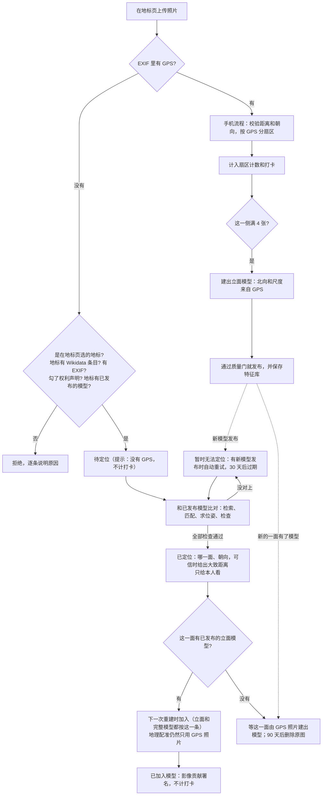
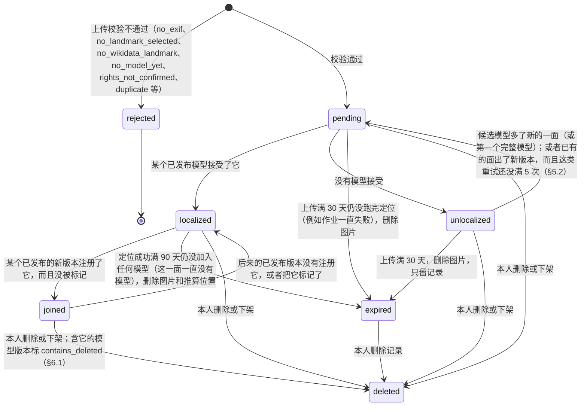

# 视觉定位：让没有 GPS 的相机照片加入地标模型（设计）

> 2026-10-22，主设计（评审后修订版）。合并了三份输入：可行性实验报告（`loc-feasibility`）、算法与系统草案（`vloc-algo`）、产品与信任草案（`vloc-product`）。另外我在可行性实验的原始记录上重新统计了一遍，没有重跑 COLMAP。
>
> - 代码基线：本仓库 `b129d0f`。可行性实验用的是冻结副本 `666494c`。另一个工作流正在改 `crowd3d/*`，实现时请以当时的代码为准，行号可能已经变了。
> - 数字标记：
>   - 【实测】：三份输入里的运行结果，出处见附录 B；
>   - 【重算】：我用可行性实验的原始记录重新统计或重新测量的，出处在附录 B；
>   - 【估算】：没测过，是推算；
>   - 【未测】：设计里的做法，还没有任何实验；
>   - 【待校准】：阈值只在一栋楼上定过，或者没有独立证据；
>   - 【已确认】：用户已经确认的产品决定（`user_decisions.md`，§2.5）；
>   - 【需用户确认】：产品决定，我给了建议，等用户拍板。
> - 术语表见附录 C。本文的"相机照片"一律指**没有 GPS 的照片，不论用什么设备拍**（§1.1）。
> - 法律部分是工程角度的整理，不构成法律意见。

---

## 0. 一页摘要

**一句话**：手机照片带 GPS，用来建出各个立面的模型，并确定模型的北向和尺度；相机照片没有 GPS，就拿去和已经建好的模型比对，算出它是在哪里、朝哪个方向拍的（这一步叫"视觉定位"，下文简称"定位"），然后在下一次重建时加进模型，让模型更完整。相机照片只能加入已经有模型的面，不算打卡。

几个反复出现的词（完整的术语表见附录 C）：

- **立面模型 / 完整模型**：只覆盖一个方向（扇区）的模型 / 把几面合在一起的模型，和网页上的叫法一致；
- **地理配准**：把模型摆到地图上，也就是确定它的位置、北向和尺度；
- **内点**：和算出来的拍摄位置对得上的那部分特征匹配；**内点率** = 内点 / 全部匹配；
- **错面**：对称建筑上，照片被定位到另一面长得一样的墙上，整体转了 45° 或 90°；
- **深度错误**：照片沿视线方向被放得太近或太远，朝向基本是对的。

**结论（只有一栋楼的证据）**：

1. **在洗礼堂上可行，前提是知道焦距。** 80 张无 GPS 照片，用 3 个立面模型定位，按本文的接受规则（§3.6）：
   - 80 张里接受 51 张（63.7%），这 51 张全部在模型的 5 m / 10° 以内，错误接受 0 张【重算】；
   - 这是上限："焦距已知"用的是参考模型里的真实焦距，冒充 EXIF 焦距。焦距偏 5% 时，就会有 3–7 张错误接受（§4.4）【重算】。
2. **不知道焦距时会出错，而且拦不住。** 接受的 52 张里有 11 张位置偏 5–42 m，全是深度错误，朝向只差 ≤ 3.1°。阈值怎么调都去不掉这 11 张【实测】。所以没有可信焦距的照片可以加入重建，但不显示位置（§2.5 小决定 5）。
3. **位置"相对模型很准，绝对精度看模型"。**
   - 相对模型（照片在模型里的位置）：中位 1.56 m、0.51°；最好的东立面模型上中位只有 0.36 m。
   - 绝对位置（在地图上的位置，对按 OSM 轮廓校正过的参考）：中位 8.8 m，p90 16.6 m。分模型和各自模型本身的配准误差同量级：东 5.0 对 4.7 m、东北 5.5 对 5.5 m、东南 14.7 对 11.0 m。东南模型上，照片比模型自己的 GPS 相机还差 33%【实测/重算】。
   - 所以不能对用户说"比 GPS 准得多"。
4. **只能用已发布的模型定位**（已发布 = 通过了质量门、网页上能看到的模型）。亚琛的 29 张 GPS 照片一个模型都没建出来，所以无 GPS 照片无处可加。拿亚琛没通过质量门的 W 模型去定位：25 张通过阈值，只有 9 张是对的【实测】。
5. **拍明显不同的楼，不会被接受；长得像的邻楼没测过。** 148 张亚琛大教堂照片对 3 个洗礼堂模型，试了 444 次，每一次的 2D-3D 对应都是 0 个，接受 0 次【实测】。没有测过相邻的、外观相似的建筑（比如旁边的佛罗伦萨大教堂）。
6. **加入重建能让模型变好，但不改北向和尺度。**
   - 三个立面的点数都涨到 3.5–10 倍（1474→8470、2796→9860、800→8168），轮廓覆盖率提高。
   - 可行性实验里，完整模型是靠这些照片才凑够条件的（72/73 注册）。按本文的默认规则不会这样做（§2.5 问题 4）。
   - 东北立面仍然没有完成地理配准，东南立面仍偏 10°。这符合"北向和尺度只来自 GPS"的规则【实测】。
7. **对称建筑是最大风险。** 只按架构文档原来的阈值（≥ 50 内点、内点率 ≥ 0.2、≤ 4 px），会接受 11 个错面位姿。本文用了两道互相独立的检查，在这栋楼上都能把错面拦干净：
   - 内点率 ≥ 0.75；
   - 次优位姿比 ≤ 0.15（去掉最优解用到的匹配后，剩下的匹配还能撑起一个多强的、位置不同的解；比值高说明另一面也说得通）。
   - 但两道检查的余量都很薄【实测/重算】。

**已确认的决定**【已确认】（`user_decisions.md`，用户回复"都ok"，详见 §2.5）：

1. 无 GPS 照片仍必须有 EXIF，`no_exif` 继续拒收。
2. 无 GPS 照片由用户在地标页手选地标，不做自动识别。
3. 相机贡献者不得打卡积分，另有一个不计分的徽章。
4. 地标只能从 Wikidata 条目或维基百科条目创建；中心点用 OSM 轮廓质心，没有时退回 Wikidata 坐标（P625）；以后用第一个模型的点云修正（本文提议修改这半句，见下）。
5. 采用视觉定位：无 GPS 照片只加入已经有模型的面，绝不开启新的面；地理配准只用 GPS 照片。

**需要用户确认的决定**（详见 §2.5）：

1. 问题 4：相机照片能不能计入"≥ 48 张后，没人拍的方向算作拍不到"的规则。计入会让完整模型因为相机照片而出现（洗礼堂上需要的就绪扇区数从 6 降到 3）。本文默认**不计入**。
2. 两条对已确认决定的修改提议：中心点只用完整模型或轮廓拟合来修正，不用第一个模型；徽章名称从"画质贡献"改为"影像贡献"。
3. §2.5 末尾的 9 个小决定，以及 §7.5 的上线门槛。

---

## 1. 一句话与用户流程

### 1.1 两类用户

**定义**：本文的"GPS 照片"指 EXIF 里有 GPS 的照片，"相机照片"指**没有 GPS 的照片，不论用什么设备拍**。代码只按 EXIF 里有没有 GPS 区分，不看机型。下表按典型用户来写；手机照片丢了 GPS（例如安卓网页上传，架构文档 §11.3 第 7 条），也按相机照片处理，见 §2.1 第 8 条。

| | 手机打卡者（GPS 照片） | 相机拍摄者（相机照片） |
|---|---|---|
| 照片 | 手机原图，EXIF 带 GPS（以后改为页面采集的 sidecar） | 相机原图，EXIF 通常没有 GPS。洗礼堂附近，用户给的统计是有 EXIF 的 Commons 照片里只有 22% 带 GPS。产品草案统计的 Commons 照片里，相机拍的约 25% 带 GPS（2790 张里 698 张），能对应到地标的相机照片里只有 17%（1849 张里 322 张）【实测，产品草案 E1，`run2/exif_census.json`】 |
| 上传入口 | 地标页，或首页按 GPS 自动匹配地标 | **只能在地标页**（§2.5 问题 2） |
| 照片在哪一侧 | 先按 GPS 定暂定扇区，模型注册后再确认 | 定位成功后才知道 |
| 能不能开启新的面 | 能：一个扇区满 4 张就建出立面模型 | **不能**，只能加入已有模型的面 |
| 打卡、到访、积分、排行 | 有 | **没有** |
| 署名 | 共同完成者 | 单列"影像贡献" |
| 自己的位置谁能看到 | 本人（生产版；原型目前公开，见 §6.4） | 只有本人 |

### 1.2 流程



### 1.3 相机照片的状态



- `joined` 不单独存储，由"当前已发布模型的相机列表里有没有它、有没有被标记"推出来（§8.6），所以 `joined → localized` 不需要写库，换版本时自动成立。
- `deleted` 是原型以后的状态：原型目前没有删除接口（架构文档 §11.3 第 6 条），实现删除时按 §6.1 的下架流程补上。

### 1.4 用户看到的文字

| 状态 | 主文案 | 补充 |
|---|---|---|
| 待定位 | 待定位 | 正在和已有模型比对，通常几分钟 |
| 已定位，位置可信 | 已定位：东侧，距地标中心约 50 米，朝向西 | 只有本人能看到；"将在下一次重建时加入模型" |
| 已定位，位置不显示 | 已定位：东南侧，朝向西北 | "没有可信的焦距信息（或这个模型的北向不够准），所以不显示距离" |
| 已定位，这一面还没有模型 | 已定位：南侧，朝向北 | "南面还没有模型，等有人用手机拍够 4 张、建出南立面后自动加入。90 天内没有加入，照片会被删除" |
| 已加入 | 已加入模型：东立面 | 进入"影像贡献"名单 |
| 暂时无法定位 | 暂时无法定位：没有和现有模型对上 | "可能拍的是还没有模型的一面（已有：东北、东、东南），也可能画面里建筑太少，或者是特写、夜景。有新的一面建出模型时一定会再试；已有模型更新时也会再试几次。截至 11 月 21 日。" |
| 已过期 | 30 天内没能定位，照片已删除 | — |
| 警告 `no_gps_no_checkin`（每张相机照片都有） | 这张照片没有 GPS，按相机照片处理：不计打卡 | "用手机拍的？打开相机的位置权限后重拍，照片就会带 GPS。有些安卓浏览器上传时会删掉 GPS，可以换一个浏览器上传原图" |
| `no_model_yet` | 这个地标还没有模型，相机照片暂时不能加入 | "先用手机拍几张带定位的照片，模型生成后就可以加入相机照片" |
| `no_landmark_selected` | 没有 GPS 的照片，请在地标页上传 | 同上一条警告的补充：如果是手机照片，说明它丢了 GPS |
| `no_wikidata_landmark` | 这个地标还没有关联维基百科条目，暂时不收相机照片 | — |
| `rights_not_confirmed` | 请确认照片是你本人拍摄的 | — |

上面"位置可信"一行的例子是可行性实验里用东立面模型定位的 000464（距中心 48.8 m，取整为 50 m）。东南立面模型的偏航冲突是 31°，按 §3.11 只能显示"位置不显示"那一行。

---

## 2. 规则

### 2.1 哪些照片可以不带 GPS 加入

全部满足才收：

1. 在某个地标的页面上传，请求带 `landmark_id`。
2. 这个地标有 Wikidata Q-id（`wikidata_qid` 非空，§2.4）。没有 Q-id 的旧地标拒收（`no_wikidata_landmark`），见 §8.14 的迁移。只有 `require_wikidata = False` 时（测试和合成数据演示）不查这一条。
3. 有 EXIF：现有的 `no_exif` 拒绝不变【已确认】。
4. 上传者勾选了权利声明："这些照片是我本人拍摄的"（§6.1）。
5. 这个地标至少有一个**已发布、并且保存了特征库**的模型。
6. 照片本身合格：现有的 `too_small`、`too_blurry`、`duplicate` 检查照常；宽高比**大于** 2.2 的超宽画幅照片（全景图）拒收（`panorama`），和可行性实验的代码（`> 2.2`）一致。这条规则**没有独立的证据**：可行性实验在亚琛用它标出的 5 张（000508、000702、000229、000483、000357）同时也都是太小的照片（`too_small`），去掉这条规则，结果一张不变【重算，`runs/aachen-cathedral/report.txt` 的漏斗】【待校准】。
7. 没有焦距、或者焦距和画面对不上的照片也收，但只加入重建，不显示位置（警告码 `no_focal_length`，定位标记 `position_withheld`；§2.5 小决定 5）。
8. **丢了 GPS 的手机照片**也走这条路，没有特殊处理：代码只看 EXIF 里有没有 GPS。产品草案的统计里，手机拍的 Commons 照片有 24% 没有 GPS（850 张里 204 张）【实测，产品草案 E1】；安卓网页上传还会删掉 GPS（架构文档 §11.3 第 7 条）。以前这类照片得到明确的 `no_gps`，现在会被当作相机照片收下：需要勾权利声明、不计打卡、不能开启新的面。所以每张通过校验的相机照片都带警告 `no_gps_no_checkin`，文案告诉手机用户怎样才能计入打卡（§1.4）。要不要这样做是 §2.5 小决定 9。

不检查 `too_far` 和 `facing_away`，因为没有 GPS 和罗盘可查。等定位成功后，用定位出的位置做合理性检查（§3.7）。

### 2.2 只能加入已有的面

- **扇区状态只由 GPS 照片决定**。锁定、部分、可建模这三种状态，以及"满 4 张触发立面"的计数，都只算 GPS 照片。相机照片永远不会让一个扇区变成可建模。
- 相机照片只有在**定位成功**后才有扇区。
- **一条资格规则管所有重建作业**：一张相机照片，只有当它的扇区（或者它的定位方位落在某个扇区两侧各 `face_margin_deg` = 10° 的余量内）已经有**已发布的立面模型**时，才能进入重建作业。立面作业和完整模型作业都用这一条，不管完整模型发布没有：
  - **立面作业 s**：`("face", s)` 已发布，而且照片对 s 合格（扇区 = s，或方位在 s 的余量内）；
  - **完整模型作业**：照片至少对一个已发布的立面合格。完整模型作业本身什么时候触发，见 §2.5 问题 4（默认只按 GPS 照片算）。
  - 为什么完整模型作业也要这一条：完整模型发布以后，一张南面的照片可能靠完整模型边缘的几何定位成功。要是它能进入下一版完整模型，模型就会长出一个没有任何 GPS 照片的面；更大的模型又能定位更偏的照片，一版一版往外蔓延。这就违反了"只加入已经有模型的面"【已确认】。
  - 用没有完成地理配准的完整模型定位时，照片没有方位（§3.10），也就判断不了扇区，所以不进任何作业。
- 定位落在没有立面模型的扇区：照片保持"已定位"，但不进任何作业（立面和完整模型都不进）。等这一面由手机照片建出模型以后，它会自动进入下一次重建；90 天内一直没有模型就删除原图（§5.2）。
- 验证：`tests/test_coverage.py` 测这条规则（§8.15）；评测指标 `rebuild_visual_outside_published_faces` 必须一直是 0（§7.3）。
- **北向和尺度只来自 GPS**：重建时 `georegister` 只用 GPS 照片的相机（§3.12）。定位得到的位置**绝不写进** `lat/lon`，也不作为 BA（光束法平差，附录 C）的位置先验，只用来给照片配对。

### 2.3 不计打卡积分

- 定位成功只能证明"照片拍的是这栋楼"，不能证明"上传的人去过"。在可行性实验里，这 80 张查询照片全部是从 Commons 下载的，照样定位成功。
- 所以相机照片不计入以下任何一项【已确认】：
  - 打卡、到访、图鉴"已收集"；
  - 积分 P（架构文档 §6.3）；
  - 扇区点亮、进度条；
  - 共同完成者排行和人数（`num_contributors`）。
- 没有任何升级路径能让相机照片变成打卡。曾经设想过的"对时码升级"已否决（§6.6）。
- 丢了 GPS 的手机照片同样适用（§2.1 第 8 条）。
- 相机照片单独计入"影像贡献"（§6.5）。
- 验证：一张相机照片从上传、定位到加入模型，上面每一项都不变（§8.15 的 `test_api.py`）。原型目前只有扇区计数、进度、`num_photos`、`num_contributors` 和 `contributors`；以后加了打卡、到访、收集和积分，同一条测试要扩展到这些字段。

### 2.4 地标必须有维基百科条目（Wikidata）

1. **创建方式**【已确认】：只接受 Wikidata Q-id，或者能解析出 Q-id 的维基百科链接。服务器取出名称和坐标（P625）。Q-id 唯一，同一个 Q-id 再建返回 409 和已有的 id。
   - API 从 P2 起（§8）就只走这条路：`require_wikidata` 默认为 True，旧的 `name/lat/lon` 请求体返回 422。只有测试和合成数据演示把它设为 False；演示地标由 `ensure_demo_landmark` 直接写库，不经过 API。
   - 只有有 Q-id 的地标才收相机照片（§2.1 第 2 条）。已有的、没有 Q-id 的地标怎么处理见 §8.14。
2. **"著名建筑"的判定**：只看"有没有维基百科条目"太松，非建筑条目、已拆除的建筑、只有一个小语种机器人条目的东西都能通过。所以要求全部满足：
   - 维基百科站点链接（sitelinks）≥ N 个。架构文档 §8 本来就用 sitelinks 数衡量知名度。N 建议取 10，**需用户确认**（§2.5 小决定 6）；实现时先核对 `eval/landmarks.json` 的 13 座地标都能通过【未核实】；
   - P31（是什么）是"建筑物"（Q41176）或"构筑物"（Q811979）的子类（沿 P279 往上找）；
   - 没有 P576（拆除或废止日期）。
   - 不满足时返回 422，原因码见 §8.10。
3. **中心点**：
   - 用 OpenStreetMap 上带同一 `wikidata=Q…` 标签的建筑轮廓的质心（`centre_source = osm_footprint`）；
   - 没有轮廓时退回 P625，并标 `centre_uncertain`，界面上的扇区标"大致"；
   - **不用维基百科条目页上的坐标**。
4. **为什么**：
   - `eval/landmarks.json` 的 13 座地标里，P625 到 OSM 轮廓质心的距离中位 10.8 m，有 6 座超过 15 m，最大 22.8 m【实测，可从该文件复核】。
   - 洗礼堂的维基百科条目坐标离轮廓中心 27.6–27.7 m（`eval/landmarks.json` 记为 27.6 m，`REAL_WORLD_EVAL.md` 记为 27.7 m），而它的 P625 只偏 10.8 m。
   - 扇区是从中心点量的。洗礼堂带 GPS 的照片离中心的中位距离是 48 m。中心偏 27.6 m、方向又和视线垂直时，方位最多偏 atan(27.6/48) ≈ 30°，差不多是一个扇区（45°）的宽度【估算】。
5. **偏差处理**：
   - 记下 `centre_offset_m`（P625 到所选中心的距离）。
   - 偏差超过 30 m、有多个候选轮廓、或者轮廓不是建筑类对象时，转人工。例如林肯纪念堂有一块公园用地也带着同一个 Q-id【实测，产品草案 E9】。
   - 创建时把坐标冻结。之后 Wikidata 的坐标变了，或者条目被合并，都只告警，不自动跟着改。
6. **以后修正中心点**（**提议修改已确认的决定**，§2.5 提议 A）：
   - 已确认的做法是"以后用第一个模型的点云修正中心"。
   - 我提议改为只用两种来源：覆盖 ≥ 3 个面的完整模型，或者和 OSM 轮廓的拟合。
   - 理由：第一个模型通常是单个立面，它的点云中心偏向被拍的那一侧。洗礼堂只用 GPS 照片的东立面模型，点云中位点离轮廓中心 20.9 m，东南立面 21.2 m（`seed/summary.json` 的 `points_centre_offset_m`；东北立面没完成地理配准，不算）【实测】，和 §2.4 第 4 条里"中心偏 27.6 m 会让方位偏差不多一个扇区"是同一个量级。
7. **半径**：原型保持 `default_radius_m = 150`，`eval/landmarks.json` 的 13 座地标用了 150–800 m。架构文档 §8 的半径规则（最远轮廓顶点 + 30 m）在洗礼堂只有约 51 m，而带 GPS 的照片离中心的中位距离是 48 m、p90 是 63 m，会误拒大约一半照片【实测，产品草案 E10】。这一条转给 §8 的负责人。

### 2.5 已确认的决定、修改提议与开放问题

> 工作区的 `user_decisions.md`（2026-10-22）记录了用户对下面问题 1–3、§2.4 的地标规则，以及"采用视觉定位：无 GPS 照片只加入已有模型的面，绝不开启新的面；地理配准只用 GPS 照片"的确认（"都ok"），和本任务给出的约束一致。所以问题 1–3 标为**已确认**，不再重新讨论；下面只保留理由，供实现时参考。
>
> 本文有两处和已确认的细节不同，单独列为"修改提议"（提议 A、B），需要用户明确同意才改。真正还开着的是问题 4 和末尾的小决定。

**问题 1：无 GPS 的照片还必须有 EXIF 吗？【已确认：必须有】**

- **EXIF 必须有**，`no_exif` 继续拒收。EXIF 能挡掉截图、聊天软件转发和社交平台压缩过的图，还能提供拍摄时间、机型和焦距。
- 下面关于焦距的处理是新的细节，不在已确认的范围内，列为小决定 5。
- **焦距不强制，但它决定用户能看到什么**：
  - 有可信焦距（§3.5）：完整定位，可信时显示大致距离；
  - 没有焦距，或者焦距和画面对不上（多半是裁剪过）：照片照样加入重建，但只显示"哪一面、朝哪个方向"，不显示距离，也不在地图上打点。
- **证据**：
  - 不知道焦距时，接受的 52 张里有 11 张深度错误；知道焦距时 0 张（上限，见 §0 第 1 条）【重算】。
  - 焦距偏 5% 时，就会多出 3–7 张错误【实测】。
  - 但那 11 张的朝向误差都 ≤ 3.1°，而且重建时 SfM 会自己重新估计位置。可行性实验的重建正好用的是这 53 张"不知道焦距"的照片，4 个模型全部通过质量门【实测】。
- **备选方案**：没有焦距就拒收（`no_focal_length`）。规则更简单，但代价不小：相机照片里只有 47% 带 35 mm 等效焦距【实测，产品草案 E2】。没有"机型 → 传感器尺寸"表时，大约一半的相机照片会被拒。这张表的许可还没核查。
- **局限**：EXIF 不能证明照片是上传者拍的。网上下载的原图 EXIF 往往是完整的：可行性实验的 87 张 Commons 照片全都有 EXIF 块【实测】。

**问题 2：没有 GPS 的照片怎么确定是哪个地标？【已确认：在地标页手选】**

**只能在地标页上传，由用户手选**，不做跨地标的检索。

- 选错到一栋明显不同的楼是安全的：匹配不上，会显示"暂时无法定位"，30 天后过期。148 张亚琛照片对洗礼堂模型，444 次尝试 0 次被接受，每一次的 2D-3D 对应都是 0 个【实测】。选到隔壁一栋长得像的楼会怎样，没测过（§4.8）。
- 全库检索等于对外提供"这张照片是在哪拍的"服务，有被用来跟踪他人的风险。它的成本还随地标数线性增长。
- 以后可以做的：地标**内部**的检索（挑参考图，§3.3）；v2 可以给出"这几张可能是 X"的提示，但必须由用户确认。

**问题 3：相机贡献者得到什么？【已确认：不得打卡积分，另发徽章】**

- 不给打卡积分，不点亮"已到访"，不进排行，不计进度。没有升级路径（§6.6 已否决）。
- 照片被注册进**已发布**的模型版本后，进入模型的"影像贡献"名单，并发一个不计分的徽章。
- **按张署名是产品政策，不是 CC BY 对上传者的法律义务**：按架构文档 §7.4，上传者授予平台一份许可；CC BY 的署名义务（"© Crowd3D contributors"，链接到署名页）约束的是下载、复用模型的人。只有输入本身是 CC BY 照片时（例如按 `capture_source = commons` 导入的 Commons 照片），才必须给原作者署名。本文仍建议照片进了模型就列进署名页，理由是对贡献者公平、和 GPS 照片一致，这一点和奖励无关。

**提议 A（修改已确认的决定 4 的后半句）：中心点怎样修正【需用户确认】**

- 已确认："以后用第一个模型的点云修正中心"。
- 提议：只用覆盖 ≥ 3 个面的完整模型，或者和 OSM 轮廓的拟合；不用单个立面。理由见 §2.4 第 6 条。

**提议 B（修改已确认的决定 3 的徽章名称）：徽章叫什么【需用户确认】**

- 已确认的名称是"画质贡献"。
- 提议改为"影像贡献"：这个徽章衡量的是"照片被用进了模型"，不是"照片画质好"。用户不同意时，本文和代码里的"影像贡献"一律换回"画质贡献"。

**问题 4：相机照片能不能计入完整模型的张数规则？【需用户确认】**

背景：完整模型要同时满足两条：

- 照片总数 ≥ `full_min_photos`（24）；
- 就绪扇区数 ≥ K。K 默认是 `full_min_sectors`（6）；照片总数 ≥ `full_reachability_min_photos`（48）以后，没人拍的方向算作拍不到，K 降为 max(⌈0.75 A⌉, A − 2, 2)，A 是有照片的扇区数（`coverage.full_sectors_required`）。

**相机照片计入 48 张这条规则，就会改变 K**。洗礼堂的 GPS 照片是东北 6、东 7、东南 7，共 20 张：

- 只算 GPS 照片：20 < 48，K = 6，只有 3 个就绪扇区，**没有完整模型**；
- 再算上 53 张已定位的相机照片：73 ≥ 48，K = max(⌈0.75 × 3⌉, 1, 2) = 3，3 个就绪扇区都满足，**完整模型出现了**。
- 也就是说，是相机照片把 K 从 6 降到了 3。这没有开启新的面（完整模型覆盖的东北、东、东南三面本来都有 GPS 立面模型），但它让一个新模型因为相机照片而出现，和"无 GPS 照片只加入已有模型的面"的精神有冲突。

只让相机照片计入 24 张那一条、48 张那一条只算 GPS，这种折中在默认参数下**不起任何作用**：K = 6 时 6 个就绪扇区本身就要 ≥ 6 × 4 = 24 张 GPS 照片；GPS 照片 ≥ 48 时更不用说。所以真正要选的只有两种：

- **不计入（默认，`vloc_counts_for_full = False`）**：完整模型的触发只看 GPS 照片。相机照片仍然可以加入已经触发的完整模型作业（按 §2.2 的资格规则）。洗礼堂这种目前只有 20 张 GPS 照片的地标，暂时没有完整模型；GPS 照片到了 48 张，K 自然降到 3。
- **计入（`vloc_counts_for_full = True`）**：相机照片计入 24 张和 48 张两条规则，K 可能因此变小。洗礼堂上可行性实验的结果是：完整模型注册了 72/73 张，通过质量门，GPS 相机的朝向误差 0.94°，比三个立面都准【实测】。代价就是上面说的冲突。

建议默认不计入，等用户决定。§7.5 加一组运行 `fullvis-1` 专门回答这个问题。

**其他需要确认的小决定**【需用户确认】：

1. 地标还没有任何已发布模型时，相机照片直接拒收（`no_model_yet`），不先存起来等模型。
2. 定位失败的照片自动重试 30 天，过期后删除图片、只留记录。算法草案建议 90 天，产品草案建议 30 天，我选 30 天。
3. 地标页显示的距离量到中心点。有轮廓以后再改为量到建筑轮廓：对国会大厦这种 265 m 长的建筑，量到中心会误导人。
4. 维基百科规则在中国大陆部署时是否也执行（架构文档 §7.8 要求那里只用持证 POI）。
5. 没有可信焦距的相机照片（没有焦距，或者 P4Pf 核对不过）照样收下、加入重建，但不显示距离、不在地图上打点（§2.1 第 7 条）。备选是拒收，见问题 1 的"备选方案"。
6. "著名建筑"的门槛：维基百科站点链接 ≥ N 个，建议 N = 10（§2.4 第 2 条）。
7. 已有的、没有 Q-id 的地标：保留，GPS 照片照收，但不收相机照片，页面标"未关联维基百科"；管理员补上 Q-id 后恢复（§8.14）。备选是直接冻结整个地标。
8. 已定位、但它那一面一直没有模型的相机照片，保留 90 天，之后删除原图、处理图和推算位置，只留扇区和记录（§5.2、§6.4）。
9. 丢了 GPS 的手机照片按相机照片收下，并提示 `no_gps_no_checkin`（§2.1 第 8 条）。备选是对看起来是手机拍的照片（按 EXIF 机型判断）仍然拒收 `no_gps`，让用户去找回 GPS。

---

## 3. 算法

### 3.1 总览

```
无 GPS 照片（处理图，长边 ≤ 1600 px）
  │ 1. 候选模型：这个地标每个目标（各立面、完整模型）最新的已发布模型，要有特征库
  │ 2. 检索：每个模型取最可能的参考图（图少就全用）
  │ 3. 匹配：SIFT + 两视图几何验证（和建图用同一套 pycolmap 设置）
  │ 4. 2D-3D：参考图的关键点 → 模型里的 3D 点，去重
  │ 5. 求位姿：焦距固定为 EXIF 值，LO-RANSAC + 精化；另外用自由焦距（P4Pf）再解一次做核对
  │ 6. 接受门槛：内点数、内点率、重投影、次优位姿比
  │ 7. 合理性检查：距离、高度、朝向、焦距
  │ 8. 选模型：内点最多的；另一个模型也接受而朝向差 > 25° 时判为歧义
  │ 9. 转 ENU → 扇区 → 显示质量 → 决定加入哪个作业
  ▼
已定位（只给本人看）→ 下一次重建时加入（地理配准只用 GPS 照片）
```

### 3.2 候选模型

- 只用**已发布**的模型（通过 `qa.assess`，点数 ≥ 300），取每个目标（各立面、完整模型）最新的一个，并且要求它保存了特征库（§5.1）。
- 没完成地理配准的模型（`georegistered = False`）也参加：
  - 它的**相对**位姿仍然可靠：东北立面模型上相对误差中位 2.66 m；
  - 没有它，照片就没处加入：东北立面这一次加入了 22 张；
  - 但它定出来的位置一律不显示距离（§3.11）。
- **不用没发布的模型**。亚琛 W 模型没过质量门，它自己 7 台相机里就有 2 台偏了 37–61 m。拿它定位：
  - 148 张里 37 张有匹配，25 张通过阈值，只有 9 张在 5 m / 10° 以内；
  - 错的位姿内点率也接近 1.0，阈值根本分不出来【实测】。

### 3.3 检索与匹配

- **参考图**：
  - 模型注册的图 ≤ 60 张（沿用 `exhaustive_max_images`）时，全部配对。
  - 更多时，取视觉词袋相似度前 20 的。词袋用模型自己的 SIFT 描述子做 k-means，256 个词，和可行性实验一样。
  - 证据：洗礼堂 3 个模型共 23 张注册图。全部配对时接受 51 张；每个模型只取前 5 张时也接受 51 张，正确率相同（63.7%）【重算】。
  - 前 20 张这个数字对大模型没测过【待校准】。生产上换成 GPU 全局描述子（架构文档 §3.3.5）。
- **特征**：`extract_features`，CPU SIFT，`max_image_size = processing_max_side_px`（1600），和建图时一致。特征提取参数写进模型的 `map.json`，保证查询和模型用同一套设置。
- **匹配**：用 `match_image_pairs` 加导入的配对列表（`query 模型图` 一行一对），两视图几何验证用默认参数，`ransac.random_seed = 0`。
  - 不要从 Python 调 `pycolmap.FeatureMatcher.match`：实测每对要 8–14 s，而走数据库的匹配加验证只要 64–79 ms【实测，算法草案】。

### 3.4 2D-3D 对应

- 只用通过两视图验证的内点匹配。
- 通过模型图的 `points2D[i].point3D_id` 映射到 3D 点，按"查询关键点 + 3D 点"去重。
- 对应少于 30 个（也就是不可能凑够 30 个内点）时，直接记为 `too_few_matches`。

### 3.5 位姿与焦距

- **焦距先验**（ingest 时算好存起来，§8.3）。按可信度依次取：
  1. `FocalLength`（毫米）× `FocalPlaneXResolution` 换算的像素焦距；
  2. 35 mm 等效焦距，按 COLMAP 的对角线公式 `f_px = f35 / 43.27 · hypot(w, h)`；
  3. 以后加"机型 → 传感器尺寸"表。
  - 注意：EXIF 的 `FocalLengthIn35mmFilm` 是整数毫米，26 mm 时取整误差最大约 1.9%。这一项的影响没测过，而 5% 的误差已经会多出 3–7 张错误，所以第 1 种来源排在前面【估算】。
- **主解**：焦距**固定**为先验值（`estimate_focal_length = False`、`refine_focal_length = False`、`refine_extra_params = False`），`SIMPLE_RADIAL` 相机，主点在图像中心。
  - RANSAC 阈值取长边的 1.2%：约 1000 px 的图上是 12 px，1600 px 的图上约 19 px。可行性实验比较了 4 px 和 12 px，推荐 12 px【实测】。1600 px 上的值是按比例换算的【待校准】。
- **焦距核对**：再用自由焦距（P4Pf）解一次。两个焦距相差超过 20% 时，标 `focal_mismatch`，按"没有焦距"处理：用自由焦距的解，不显示位置。
  - 依据：把焦距标签故意设成真值的 1/1.5（模拟裁剪后没更新），这个规则标出了 47 张里的 46 张【实测，算法草案】。
  - 代价：同一组数据里，焦距标签正确时，自由焦距落在真值 ±20% 以内的只有 37/47。所以约 1/5 本来正确的照片也会被标出来，失去显示位置的资格【实测，算法草案】。
- **没有焦距先验**：只用自由焦距的解，标 `no_focal_prior`，同样不显示位置。
- **不要"先验作初值再精化焦距"**：这样做和不给先验一样差，接受的 52 张里错 10 张【实测】。
- 协方差（`return_covariance=True`）只存作诊断，不作门槛。算法草案提过 σ_t ≤ 1 m 的门槛，但没在完整数据上验证过，而且这个协方差不含焦距的不确定性，会偏小。

### 3.6 接受门槛

单个模型上，下面全部满足才算这个模型"接受"：

| 检查 | 阈值 | 依据 |
|---|---|---|
| PnP 内点数 | ≥ 30 | 【实测】可行性实验的阈值搜索 |
| 内点率 = 内点 / 去重后的 2D-3D 对应数 | ≥ 0.75 | 错面位姿最高 0.68，正确位姿的 5 分位是 0.72。取 0.75 留一点余量，代价是少接受 1 张【实测/重算】【待校准】 |
| 内点的平均重投影误差 | ≤ 长边的 0.25%（1000 px 上 2.5 px，1600 px 上 4 px） | 【实测】透视校正过的照片 000054、000537 靠这一条拦下，它们本来会偏 16–25 m、16–24° |
| 次优位姿比 | ≤ 0.15 | 见 §3.8【重算】【待校准】 |

### 3.7 合理性检查

便宜的兜底检查。在洗礼堂上一次都没触发，前面的检查总是先拦住了问题【实测】：

- 离地标中心的水平距离 ≤ 地标半径；
- 高度在 −15 m 到 120 m 之间。允许塔楼和露台：参考相机最高约 70 m【实测，算法草案】；
- 相机光轴和"指向模型点云中位点"的方向夹角 ≤ 75°；
- 自由焦距 / 长边在 0.3–8 之间。算法草案遇到过一个焦距比 269、位置在 12 km 外的离谱解【实测】。

### 3.8 对称建筑的歧义检查

**问题**：八角形洗礼堂的几个面几乎一样。只建了一个面时，另一面的照片可能被"定位"到这个面上，整体转 45° 或 90°。这时模型里没有正确的那一面跟它竞争，所以"两个模型谁的内点多"的比较拦不住。

**两道检查，在这栋楼上都能单独拦住全部错面**（把每个模型当作这栋楼唯一的模型来测，焦距已知，RANSAC 12 px，只看内点 ≥ 30、重投影 ≤ 2.5 px 的位姿）：

1. **内点率 ≥ 0.75**。错面位姿的内点率最高 0.67，正确位姿最低 0.72【重算】。可行性报告在全部位姿上统计，给出的是错面最高 0.68、正确位姿 5 分位 0.72【实测】。
2. **次优位姿比 ≤ 0.15**。做法：去掉最优解的内点，剩下的对应再跑一次 RANSAC，得到次优解；次优解的内点数 > 0.15 × 最优解内点数，而且位置差 > 5 m 或朝向差 > 10° 时，判为歧义。
   - 37 个错面位姿的次优位姿比：最小 0.20，5 分位 0.22，中位 0.35，最大 0.60；
   - 74 个正确位姿：95 分位 0.096，最大 0.111；
   - 阈值 0.15 时拦下全部 37 个错面，不误伤正确位姿。不知道焦距时：36 个错面（次优位姿比最小 0.18）全部拦下，59 个正确位姿（最大 0.121）都保留【重算】。
   - 可行性报告说"次优位姿检查一个都没拦住"，是因为它的阈值是 0.5（次优解要有最优解一半的内点才算歧义）。按我的统计口径，在 0.5 下 37 个错面只拦下 3 个【重算】。算法草案用的 0.15 才是对的。

| 只用一个条件 | 接受的错面位姿 | 接受的正确位姿（共 74） |
|---|---|---|
| 内点率 ≥ 0.5 / 0.6 / 0.65 / 0.7 / 0.75 | 18 / 5 / 2 / 0 / 0 | 74 / 74 / 74 / 74 / 72 |
| 次优位姿比 ≤ 0.3 / 0.2 / 0.15 / 0.1 | 16 / 0 / 0 / 0 | 74 / 74 / 74 / 71 |

（内点率一行是可行性报告给的，次优位姿比一行是我重算的，两者用的是同一批 PnP 记录。）

- 两个条件同时用，在这栋楼上焦距已知时：接受 72 个位姿，错面 0，其他错误 0；不知道焦距时：接受 73 个，错面 0，深度错误 16【重算】。
- **余量很薄**（内点率：错面最高 0.67，正确最低 0.72；次优位姿比：错面最低 0.18，正确最高 0.12），而且只在一栋楼上定过。所以两道都用，并在 10 栋楼的测试集上重新校准（§7）。
- 按架构文档原来的阈值（≥ 50 内点、内点率 ≥ 0.2、≤ 4 px），会接受 11 个错面位姿【实测】：
  - 东北模型：000032、000051、000063、000474、000559；
  - 东模型：000051、000076；
  - 东南模型：000014、000074、000452、000560。

### 3.9 选模型

- 在接受这张照片的模型里，取内点最多的。内点数相同时优先完整模型。
- 另一个也接受的模型，内点数 ≥ 最优的一半，而且朝向差 > 25°：判为 `ambiguous_across_models`，这张照片不接受。
- 25° 留出了各模型之间本来就有的偏差，例如东南模型自己就偏了 10°。
- 有多个面的模型时，"取内点最多 + §3.6 的门槛"给出 0 个错面【实测】。

### 3.10 转 ENU、扇区、加入哪个作业

- 模型保存了 SfM → ENU 的相似变换 `T = (s, R, t)`（§5.1）。
  - 相机中心 `c_enu = s·R·c_sfm + t`；
  - 光轴 `d_enu = R·(R_cfwᵀ·e_z)`；
  - 朝向 = `heading_from_en(d_x, d_y)`；
  - 方位 = 从地标中心指向 `c_enu` 的方位；
  - 扇区 = `sector_for_bearing(方位)`。
- 模型没完成地理配准时，照片的扇区直接取这个模型的扇区，`bearing_deg` 和 `distance_m` 留空，所以它只会加入这个面的作业。
- 加入规则见 §2.2。所有判断都在纯函数里做（§8.5）。

### 3.11 相对很准，绝对精度继承模型的地理配准误差

用大白话说：照片在模型**里面**的位置很准，因为它是用几百个 3D 点算出来的；但模型**整体**放在地图上的哪个位置、朝哪个方向，是当初用几张手机 GPS 定的，本身就有几米到十几米、几度的误差。照片的绝对位置把这份误差原样继承了下来。

| 模型 | 照片相对模型的位置误差（中位） | 照片的绝对位置 / 朝向误差（中位） | 模型自身 GPS 相机的绝对误差 | 产品自己能看到的诊断 |
|---|---|---|---|---|
| 东（已配准，GPS 偏航 − 罗盘偏航 = −4°） | 0.36 m | 5.0 m / 2.5° | 4.7 m / 2.4° | 对齐 RMSE 6.7 m |
| 东北（**未配准**：罗盘定偏航，尺度是粗估的） | 2.66 m | 5.5 m / 0.4° | 5.5 m / 0.2° | 对齐 RMSE 11.7 m |
| 东南（已配准，GPS 偏航 − 罗盘偏航 = **31°**） | 1.62 m | **14.7 m / 10.4°** | 11.0 m / 10.1° | 对齐 RMSE 7.1 m |

（焦距已知，可行性报告的推荐规则；绝对误差是对按 OSM 轮廓校正过的参考算的。）【实测】

- 东南模型的对齐 RMSE 只有 7.1 m，看上去很好，但它整体转了 10°。所以**对齐 RMSE 不能代表模型的绝对误差**。真正的危险信号是"GPS 偏航和罗盘偏航相差 31°"。
- 误差主要沿视线方向：沿视线中位 1.3 m，横向 0.5 m【实测】。
- "相对误差"是把参考模型对齐到每个模型后算的。对齐本身的残差中位就有 0.26–0.58 m，所以 0.5 m 这一档实际上测不准【实测】。

**显示规则**：

- `abs_quality = good`：模型已完成地理配准、|GPS 偏航 − 罗盘（或伪罗盘）偏航| ≤ 20°、照片有可信焦距。显示"距地标中心约 X 米"，地图上打点并画不确定圈。
  - 距离取整：100 m 以内取整到 5 m，100–300 m 取整到 10 m，300 m 以上取整到 50 m；
  - 不确定圈半径取 max(15 m, 对齐 RMSE, d · sin|偏航冲突|)，d 是相机到地标中心的距离【待校准】。对齐 RMSE 不能单独用：东南模型的对齐 RMSE 只有 7.1 m，实际绝对误差中位是 14.7 m。15 m 取自洗礼堂全部照片绝对误差的 90 分位 16.6 m 附近（§4.5）；偏航冲突那一项给朝向转了的模型兜底。
- 其他情况（`approximate` 或 `position_withheld`）：只显示"哪一面 + 8 个方位的朝向"，不显示距离，不打点。
- **本人在三维查看器里看到的视锥**：
  - 照片有可信焦距（没有 `position_withheld`）时，接口另外返回照片**在定位用的那个模型里**的位姿（`model_pose`，§8.10），查看器只在打开这个模型时画视锥。它是相对这个模型的点云算的，所以很准，哪怕这个模型整体在地图上放得不准（`approximate`）也一样。
  - 没有可信焦距（`position_withheld`）时不画视锥：这时的相对位姿也可能有深度错误，例如 000545 偏了 42 m（§4.4）。
  - 视锥只画在模型里，不画在地图上；地图上的点和不确定圈只在 `abs_quality = good` 时出现。
- 20° 这个阈值取自架构文档 §3.5.4 的"偏航冲突"。在洗礼堂上，它会把东南模型的 23 张照片（绝对误差 14.7 m）全部降为"不显示距离"，东模型的照片照常显示【实测，按这个规则推算】【待校准】。

### 3.12 加入重建：地理配准只用 GPS 照片

可行性实验用修改版的重建器验证过这种做法（附录 B 的 `reconstruct_loc.py`）：

- `ReconPhoto.lat/lon` 允许为空。定位出的 ENU 东/北坐标写进 `prior_en`，只用于空间配对（照片 > 60 张时）。
- `georegister` 的全部输入只取有 GPS 的相机，包括重力方向、2D 相似变换、偏航先验和回退尺度。
- 按 GPS 和罗盘做的逐相机检查跳过没有 GPS 的相机；新增一条只针对相机照片的检查（§8.9）。
- 反例：给已定位照片塞一个 σ = 1 km 的假 GPS 不行。`min_pair_distance` 取的是 σ 的中位数，会变成 1 km，产品代码直接报"0/35 consistent GPS fixes"【实测，算法草案】。

---

## 4. 实测

### 4.1 数据与方法

- **数据**：MegaDepth-X 的 `Baptistry_(Florence)/1`（107 张）和 `Aachen_Cathedral/1`（203 张）。
  - 都是 Wikimedia Commons 照片，长边约 1000 px；
  - 数据集去掉了焦距和机型，但保留了 GPS、罗盘和拍摄时间；
  - 每张照片都还有 EXIF 块，所以 `no_exif` 从来没触发过。
- **种子模型**：只用带 GPS 的照片，产品默认参数，按会话顺序到达，中心点用 OSM 轮廓质心。
- **查询**：不带 GPS 的照片，按产品规则去掉太小的和重复的。
  - 洗礼堂：87 张 − 4 张太小 − 3 张重复 = 80 张，其中 71 张有拍摄时间；
  - 亚琛：148 张，其中 127 张有拍摄时间。
- **"焦距已知"是模拟的**：用参考模型里这张图的焦距冒充 EXIF 焦距，所以代表的是"EXIF 焦距完全准确"的上限。
- **参考答案**：
  - 相对误差：用 Sim3 把参考模型对齐到每个模型，再比；
  - 绝对误差：和按 OSM 轮廓校正过的参考比，和 GPS 无关。
- **"错误接受"**：被接受，但相对误差 > 5 m 或 > 10°。召回率的分母是全部 80 张查询。
- **运行环境**：2 个 COLMAP 线程，`nice -n 19`；另一个工作流同时在跑，负载 2.5–4.6，所以耗时是上限。

### 4.2 种子模型（洗礼堂）

| 立面 | 输入 / 注册 | 点数 | 地理配准 | 它的 GPS 相机的绝对误差 |
|---|---|---|---|---|
| 东北 | 6 / 6 | 1474 | 否（罗盘定偏航，尺度粗估） | 5.5 m / 0.17° |
| 东 | 15 / 10 | 2796 | 是（偏航差 −4°） | 4.7 m / 2.4° |
| 东南 | 7 / 7 | 800 | 是（偏航差 31°） | 11.0 m / 10.1° |

三个都通过了质量门。没有完整模型：20 张既不到 `full_min_photos`（24），也不到 48 张，所以需要 6 个就绪扇区，而只有 3 个【实测】。

### 4.3 定位结果（洗礼堂，80 张查询，3 个模型）

| 条件 | 接受 | 0.5 m / 2° 内 | 2 m / 5° 内 | 5 m / 10° 内 | 错误接受 |
|---|---|---|---|---|---|
| **本文规则，焦距已知**【重算】 | 51 | 12.5% | 46.3% | **63.7%** | **0** |
| 本文规则，每个模型只取前 5 张参考图，焦距已知【重算】 | 51 | 10.0% | 47.5% | 63.7% | 0 |
| 本文规则，不知道焦距【重算】 | 52 | 13.8% | 31.2% | 51.2% | 11 |
| 可行性报告的规则（内点率 0.70），焦距已知【实测】 | 52 | 13.8% | 48.8% | 65.0% | 0 |
| 可行性报告的规则，不知道焦距【实测】 | 53 | 16.3% | 33.8% | 52.5% | 11 |

本文规则 = 内点 ≥ 30、内点率 ≥ 0.75、重投影 ≤ 2.5 px、次优位姿比 ≤ 0.15，加上合理性检查和跨模型歧义检查。

### 4.4 焦距的影响

| 焦距先验（本文规则）【重算】 | 接受 | 5 m / 10° 内 | 错误接受 |
|---|---|---|---|
| 准确 | 51 | 63.7% | 0 |
| 偏 +5% / −5% | 51 / 51 | 60.0% / 55.0% | 3 / 7 |
| 偏 +10% / −10% | 49 / 47 | 36.2% / 38.8% | 20 / 16 |
| 先验只作初值、再精化焦距（±5%、±10% 四种） | 51 | 51.2% | 10 |
| 没有先验 | 52 | 51.2% | 11 |

- 不知道焦距时，11 个错误全是沿视线方向的深度错误，朝向误差最多 3.1°。例如：
  - 000545 偏 42 m：估出的焦距是长边的 1.89 倍，真值 1.01；
  - 000458 偏 28 m，000064 偏 14.5 m，000085 偏 10.8 m。
- 位置误差和"焦距误差 × 相机距离"几乎成正比，相关系数 0.98。
- 自由估计的焦距，误差中位 5%，90 分位 14%。
- 在内点数、内点率、重投影误差上做阈值搜索，只要不知道焦距，就找不到"0 个错误接受"的组合【实测】。

### 4.5 精度：相对和绝对

| | 中位 | 90 分位 |
|---|---|---|
| 相对位置（本文规则，焦距已知） | 1.56 m | 3.19 m |
| 相对朝向 | 0.51° | 1.39° |
| 绝对位置（对轮廓校正参考） | 8.8 m | 16.6 m |
| 绝对朝向 | 3.0° | 10.5° |

分模型的数字见 §3.11 的表【重算；分模型的数字是可行性报告的规则下的实测】。

### 4.6 失败分类（焦距已知时被拒的 29 张）

| 原因 | 张数 | 例子 |
|---|---|---|
| 匹配太少 | 13 | 从钟楼或穹顶往下拍的：000024、000096；一张历史版画：000041；距东门 20–30 m 的铜门特写：000108、000112、000114、000115、000117、000122、000124、000126、000467；南面远处屋顶视角：000444 |
| 内点太少 | 10 | 蛋白印相老照片 000106；109 m 外的远景 000478；000102、000451、000465；特写 000111、000118、000119、000121、000471。其中 000121 和 000471 其实是对的 |
| 重投影误差 | 5 | 可行性报告点名的 4 张：透视校正过的 000054、000537（要是接受了，会偏 16–25 m、16–24°）；000109、000128 其实是对的，只是有畸变 |
| 内点率（本文规则多拦的） | 1 | — |

- 合理性检查一次都没触发【实测】。
- 补充：可行性报告说"被接受的例子里有一张版画和一张老照片"，这不准确。这两张（000041、000106）**通过了上传校验**，但在定位阶段被拒了【重算】。真正值得注意的是：80 张被接受和被拒的查询**全部**是网上下载的 Commons 照片。

### 4.7 错面

见 §3.8。补充：在所有"查询 × 模型"的 PnP 解里，有 86 个转了 ≥ 30°（错面），其中 71 个内点 ≥ 12，最多 104 个内点【实测】。

### 4.8 负样本

- 148 张亚琛照片 × 3 个洗礼堂模型 = 444 次尝试，每一次的 2D-3D 对应和通过验证的图对都是 0 个，接受 0 次【实测，`runs/negative/negative.json`】。这个测试用的是"不知道焦距"的设置，但连对应都没有，焦距不起作用。
- 算法草案另测了 40 张亚琛照片对东立面模型：通过验证的图对 0 个【实测，算法草案】。
- 没测相邻建筑（比如旁边的佛罗伦萨大教堂、乔托钟楼）的照片。亚琛大教堂和洗礼堂外观差别很大，所以上面的结果只能说明"明显不同的楼不会被接受"，不能说明"拍错楼是安全的"。§7.1 的负样本也是别的城市的楼，同样测不到这一点；要测，需要专门挑同一街区、材质相近的建筑。

### 4.9 亚琛

- 29 张 GPS 照片建不出任何已发布的立面：
  - 东南：1 个点，被拦；
  - 西：210 个点，被拦（要求 ≥ 300）；
  - 南：两次都找不到起始像对。
- 改为一次全部上传，结果也一样：东南注册 4/8，西 210 个点。
- 所以无 GPS 照片无处可加，亚琛没有给出定位方面的证据。
- 只作参考：用没通过质量门的西立面模型定位，见 §3.2【实测】。

### 4.10 运行时间（2 线程，负载 2.5–4.6，是上限）

| 步骤 | 耗时 |
|---|---|
| 查询图提特征（约 1000 px） | 0.60 s/张 |
| 查询图提特征（1600 px，约 1.1 万个关键点） | 1.6–3.1 s/张，中位 2.4 s【实测，算法草案】 |
| 匹配 + 验证 | 0.074 s/对；算法草案测得 64–79 ms/对 |
| PnP（含精化） | 90 分位 0.02 s，最长 0.11 s |
| 每张查询合计（约 1000 px） | 和 23 张参考图全部配对约 2.3 s；每个模型只取前 5 张约 1.7 s |
| 每张查询合计（1600 px） | 约 4–5 s【估算，算法草案】 |

匹配耗时随参考图数线性增长，所以大模型必须先检索。

### 4.11 加入重建后模型怎么变（洗礼堂）

只用 GPS 照片做地理配准（修改版重建器）。加入的是"不知道焦距"条件下接受的 53 张。每格前一个数是只用 GPS 的模型，后一个是加入后的【实测】：

| | 东北（+22） | 东（+22） | 东南（+25） | 完整模型（20 + 53） |
|---|---|---|---|---|
| 注册 | 6 → 28 | 10 → 36（GPS 照片 10 → 14/15） | 7 → 32 | 72/73 |
| 点数 | 1474 → 8470 | 2796 → 9860 | 800 → 8168 | 19773 |
| 相机的方位跨度 | 33° → 50° | 46° → 78° | 26° → 37° | 96° |
| OSM 轮廓被覆盖的比例 | 0.27 → 0.31 | 0.22 → 0.27 | 0.13 → 0.36 | 0.40 |
| GPS 相机的绝对误差 | 5.5 m / 0.17° → 5.3 m / 0.19° | 4.7 m / 2.44° → 6.4 m / 2.41° | 11.0 m / 10.1° → 10.9 m / 9.9° | 5.3 m / 0.94° |
| GPS 照片在注册相机里的占比 | 6/28 = 21% | 14/36 = 39% | 7/32 = 22% | 20/72 = 28% |
| 错面相机 | 0 → 0 | 0 → 1 | 0 → 0 | 0 |
| 质量门 | 通过 → 通过 | 通过 → 通过 | 通过 → 通过 | 通过（3/3 个扇区） |
| 作业用时 | 7.5 s → 141.5 s | 32.2 s → 117.8 s | 8.6 s → 61.7 s | —（之前没有）→ 220.7 s |
| 用时构成（提特征 / 匹配 / 建图） | 18 / 21 / 102 s | 34 / 52 / 32 s | 19 / 26 / 16 s | 48 / 77 / 95 s |

（用时出自 `seed/summary.json` 的 `job_seconds` 和 `rebuild/rebuild.json` 的 `seconds`、`timings_s`。）

**变差的地方**：

1. **错面又出现了**：东立面重建时，GPS 照片 000025（已知的错面照片之一）被放到了错误的面上，偏 89°、70 m。现有的"GPS + 罗盘"检查标出并隐藏了它，模型仍然通过。要是这栋楼的照片没有罗盘，它就会显示出来。另外，质量门的错面比例现在是按全部相机算的（1/36 = 2.8%），只按 GPS 相机算是 1/14 = 7.1%，相机照片会稀释这道门槛，§5.3 第 4 条改为只按 GPS 相机算。
2. **模型整体动了**：东立面的 GPS 相机绝对位置移动了 1.7 m，模型朝向转了 4.9°。朝向误差的大小没变（2.44° → 2.41°），只是方向反了。原因是多注册了 4 个有噪声的 GPS 定位，不是相机照片的几何造成的。4.9° 已经超过架构文档 §3.6 里"版本之间 > 3° 转人工复核"的阈值。
3. **北向和尺度没有被修正**：东北立面仍然没完成地理配准，东南立面仍偏 10°。这正是"北向和尺度只来自 GPS"规则的预期结果。
4. **重建变慢**：用时是原来的 3.7–19 倍（东北 18.9 倍、东 3.7 倍、东南 7.2 倍）。只有东北主要花在建图上（102 / 141.5 s）；东和东南的大头是提特征加匹配（85 / 117.8 s、46 / 61.7 s），完整模型也是（125 / 220.7 s）【实测】。所以地标级的特征缓存（每张照片只提一次特征）能省下不少时间。

**变好的地方**：

- 点数是原来的 3.5–10 倍，相机方位跨度变大，轮廓覆盖率提高。
- 完整模型的 GPS 相机朝向误差只有 0.94°，比三个立面都准，而它是靠相机照片才凑够条件的。按本文的默认规则（§2.5 问题 4），这个完整模型不会被触发。
- 重建会纠正定位时的深度错误。算法草案的一次重建（东立面 + 24 张已定位照片）：
  - 注册 35/39；
  - 照片在新模型里的位置和定位时相比，中位相差 1.57 m，90 分位 2.69 m，最大 10.88 m；
  - 差得最多的两张，正是定位时的两个深度错误（5.3 m 和 10.9 m），重建把它们改对了；
  - 那次重建把绝对朝向误差从 2.40° 降到了 0.42°，和可行性实验的东立面（基本不变）不一样，说明这项变化不稳定，不能当作收益来宣传；
  - 重建后再拿剩下的 63 张定位一次，又接受了 11 张【实测，算法草案】。

### 4.12 注意事项

- 只有一栋楼（八角形，照片都从东侧拍），80 张查询，三个小模型。阈值也是在这批数据上定的，属于样本内结果。
- "焦距已知"用的是参考模型的焦距，代表 EXIF 焦距完全准确的上限。真实 EXIF 焦距的误差没测过。
- 查询都是约 1000 px 的 Commons 照片，不是 1600 px 的相机原图。
- 只跑了一次，没有重复运行，所以不知道运行间的噪声有多大。
- 亚琛没有提供任何定位方面的证据。
- 本文规则的数字是在可行性实验的同一批 PnP 记录上重新统计的，规则本身没有在新数据上跑过。

---

## 5. 系统

### 5.1 每个地标要持久保存什么

**现状**（持久地图第 1 步之后，ARCHITECTURE §2.2）：每个地标已经有一份持久地图，定位可以直接用它的两部分。

- **已发布模型的稀疏模型和 `map.json`**：每个发布的 COLMAP 模型存在 `data/maps/<地标>/models/<模型 id>/`（`landmark_map.save_map`：先写临时目录再改名，读的人看不到半份），每个目标留最新两个（`prune_maps`），不对外提供（`/files/models` 只提供 `.ply` 和风格化的 `.glb`）。`sparse/` 是作业的 `work/<作业>/sparse/0`。`map.json` 记 `model_id`、`landmark_id`、`kind`、`sector`、`job_id`、`created_at`、注册图 → `photo_id`（`images`）、特征版本 `feature_version`（pycolmap 版本和提取参数的哈希）、地理锚点 `anchor`（局部 → ENU 的相似变换和各分量 σ，ARCHITECTURE §3.5.9：就是下表原来设计的 `sfm_to_enu`，多了不确定度）、`georegistered`、`yaw_sigma_deg`、`scale_sigma`、输入版本 `inputs` 和续建的谱系（`mode`、`parent_model_id`、`n_scratch`、`continuations`）。
- **地标级特征缓存**（`data/maps/<地标>/cache.sqlite3`，`Params.feature_cache`，默认开）：每张处理图的关键点和描述子按处理图的 sha256 加特征版本只存一份，图像对的匹配和两视图几何也在里面。这就是下面"每张照片的特征只存一份"那个办法，它的前提已经验证：同一张处理图、同一套参数提出来的特征每次相同，用缓存的作业数据库和不用缓存的逐行相同（BENCHMARK 6.7：46 个作业、18,156 行）。实测每张照片 1.09–1.74 MB（核心五栋平均 1.39 MB，含匹配）。不淘汰；原型没有删照片的功能。

定位还要补的：

- **按模型取特征**：`map.json` 的 `images` 给出 `photo_id`，由它找到处理图、算 sha256，再按 `feature_version` 从缓存取关键点和描述子。只有 `feature_version` 等于现在的版本时，关键点的序号才和 `sparse/` 里的二维点对得上（续建用的也是这个条件）。所以不用再按模型存一份 `features.db`。
- 下表里还没有的：`alignment_rmse_m`（在模型 JSON 里）、点云中位点（PLY 在 ENU 里，`anchor.to_local` 能换回局部坐标）、`vocab.npy` 和 `bow.npy`（注册图 > 60 张时的检索）。
- **绝对精度**（§3.11）：定位出的相机在 ENU 里的误差，约等于模型的锚点在那个位置的水平 σ（`GeoAnchor.position_sigma_m`）再加上定位本身的相对误差。锚点的 σ 只在开发集上标定过，留出集上还没判。

下面是原设计（持久地图之前写的），按上面的现状读。

每个**通过质量门**的模型保存到 `data/maps/<地标>/models/<模型 id>/`（已实现，见上）。这个目录不对外提供：`/files/models` 只提供 `.ply` 和风格化的 `.glb`。

| 文件 | 内容 | 大小 |
|---|---|---|
| `sparse/` | 作业 `work/<作业>/sparse/0` 的 `cameras.bin`、`images.bin`、`points3D.bin`、`frames.bin`、`rigs.bin` | 几 MB 以内 |
| `features.db` | 作业的 `database.db`，用 pycolmap 的 `clear_matches()` 和 `clear_two_view_geometries()` 删掉匹配，再用 Python 的 `sqlite3` 执行 `VACUUM`（pycolmap 没有这个方法），只留相机、图像、关键点、描述子。图像 id 和 `sparse/` 一致。挑中的模型来自"切断错面"那次建图时也一样，因为 `cut.db` 是 `database.db` 的副本，关键点和描述子完全相同 | 实测 1.18 MB/张（约 1000 px，平均 7,700 个关键点）。1600 px 的原图约 1.1 万个关键点，按比例约 1.7 MB/张【估算】。删掉匹配几乎不省空间，见下 |
| `map.json` | `model_id`、`kind`、`sector`、`sfm_to_enu`（4×4）、`georegistered`、`yaw_conflict_deg`、`alignment_rmse_m`、注册图 → `photo_id`、点云中位点（SfM 坐标）、特征参数（SIFT、`max_image_size`、pycolmap 版本）、`created_at` | 几 KB |
| `vocab.npy`、`bow.npy` | 只在注册图 > 60 张时生成：256 个词的词表和每张图的词袋向量 | 很小 |

- 保留期：每个目标（各立面、完整模型）保留最新的已发布版本和上一个版本，用于回滚和正在跑的定位作业。更早的版本在下一次发布时删除（已实现：`prune_maps`）。
- 文件按模型 id 命名、写完不再改，所以定位作业只读这些文件，不需要地标锁。
- 生产上对应架构文档 §2.2 的地标级 `colmap.db`。

**特征库有多大**【重算】：

- 实测：复制可行性实验完整模型作业的 `database.db`（73 张，约 1000 px），删掉匹配和两视图几何后 VACUUM，从 92.6 MB 降到 86.0 MB，只小了 7%，合 1.18 MB/张。描述子占了大头：72 MB 描述子（56 万个关键点 × 128 字节），13.5 MB 关键点。
- 一张照片会被存好几份：它所在的立面、通过余量进入的相邻立面、完整模型，各一份；每个目标又保留 2 个版本。所以每张照片的实际占用约是单份的 4–6 倍（2–3 个目标 × 2 个版本），1600 px 时约 7–10 MB/张【估算】。容量预算要按"每张照片 × 目标数 × 2 个版本"算，不能按单份算。
- 能真正省空间的办法（都【未测】，P1 实现时选一个并测召回）：
  - 只保留有 3D 点的关键点的描述子。可行性实验的完整模型里，只有 21% 的关键点有 3D 点（55.5 万个里 11.8 万个），描述子能减到约 1/5。代价是查询图只能和这些关键点匹配，两视图验证的内点会变少；
  - 描述子改用更紧凑的格式（例如 PCA 降维或量化）；
  - 每张照片的特征只存一份（地标级特征缓存，按 `photo_id` 存），各个模型只存 `sparse/` 和图像 id 到 `photo_id` 的映射。前提是同一张处理图、同一套参数提出来的 SIFT 特征每次都一样，需要先验证。这也正好省掉 §4.11 里重建时重复提特征的时间。**已实现并验证**（见本节开头）：缓存按处理图的 sha256 加特征版本存，不按 `photo_id`；重建的作业 CPU 在核心五栋上少了 59%（BENCHMARK 6.7）。

### 5.2 作业类型与触发

| 作业 | 什么时候触发 | 做什么 |
|---|---|---|
| `localize`（新增） | ① 有相机照片上传成功；② 这个地标有模型发布；③ 服务启动时 | 取一批（≤ 50 张）待定位的照片，对当前全部候选模型定位，写回结果。然后处理过期，再重新规划重建 |
| 立面 / 完整模型重建（已有） | 现有规则；另外，**合格的已定位相机照片的增长 ≥ `vloc_rebuild_growth`（10）** 也会触发【待校准】 | 输入里加上合格的相机照片（§2.2） |
| 过期（在 `localize` 作业和启动时顺带做） | ① `unlocalized` 或 `pending` 的照片上传已满 `vloc_retry_days`（30 天）；② `localized` 但没有加入任何已发布模型的照片，定位成功已满 `vloc_unjoined_retention_days`（90 天，§2.5 小决定 8） | 删除原图和处理图，清空推算位置（`loc_enu`、`bearing_deg`、`distance_m`），状态改为 `expired`；查重时不再算它（§6.2） |

- **定位不能排在 SfM 后面**：一次重建要 15–18 分钟（REAL_WORLD_EVAL §6）。所以 `JobRunner` 增加第二个后台线程，专门跑 `localize` 作业。这个线程用 2 个 COLMAP 线程。
- 每个地标同时最多一个排队中的 `localize` 作业。作业创建时把照片 id 记下来，之后新上传的照片等下一个作业。
- **重试规则**：
  - 一张照片对同一组候选模型（`maps_key` = 当前候选模型 id 排序后取 sha256）只试一次。
  - 每次尝试时，同时记下当时的候选**目标**集合（`targets_key`：哪些立面、有没有完整模型，不含版本）。
  - 候选目标集合**多了新目标**（新的一面有了模型，或者第一个完整模型）时，一定重试，不计次数。
  - 只是已有目标出了新版本（例如别的面因为 `face_rebuild_growth` 重建，或者完整模型重建）时，也重试，因为更大的模型能定位更多照片（§4.11 末尾：重建后又接受了 11 张）。但这类重试最多 `vloc_max_attempts`（5）次。
  - 为什么这样分：`maps_key` 包含地标的全部候选模型，热门地标上任何一次发布都会改变它。要是每次都计数，一张拍南面的照片可能在别的面的几次重建里用完 5 次，等南面终于有了模型，反而不再试了，这就违背了 §1.4 对用户的说法。
  - 只在 30 天之内重试。
- 已经定位成功的照片不重新定位。新版本模型把它注册进去以后，显示的位姿改用新模型里的。

### 5.3 对重建和地理配准的影响

1. **地理配准只用 GPS 相机**（§3.12）。重力方向也只从 GPS 相机估计，这是实测过的做法。改用全部相机估重力可能更稳，但没测过，以后再说。
2. **定位位姿只用于配对**，不作 BA 先验，否则会把旧模型的配准误差带进新模型。
3. **逐相机检查**：
   - 相机照片没有自己的 GPS 和罗盘，所以现有的 `gps_and_compass` 和 `far_from_gps` 检查管不到它。
   - 新增 `vloc_mismatch`：重建后的朝向和定位时的朝向差 > 10° 就标出来。错面至少差 30°；深度错误只差 ≤ 3.1°，而且通常是重建把它改对了，所以不按位置差来标【待校准】。
4. **质量门**：
   - **错面比例、被标记比例、罗盘误差中位数，分母只用 GPS 相机**。相机照片永远拿不到 `gps_and_compass` 标记，却会算进分母，把这道门槛稀释掉：东立面重建有 1 台错面相机，按全部 36 台算是 2.8%，按 14 台 GPS 相机算是 7.1%。要是有 2 台 GPS 相机放错了面，今天的模型会被拦下（2/14 = 14% > `qa_max_twin_fraction` 10%），加上 22 张相机照片后反而能发布（2/36 = 5.6%）。相机照片自己的标记（`vloc_mismatch`、`version_jump`、`odd_focal` 等）单独统计，原型只记录，不拦【待校准】。
   - **只在作业输入里有相机照片时**，再加两条：注册的 GPS 照片 ≥ 4 张、且不少于 GPS 输入的 `qa_min_registered_fraction`（立面，60%）或 `qa_full_min_registered_fraction`（完整模型，70%）；GPS 照片在注册相机里至少占 15%。洗礼堂四次重建的最低值是 21%。算法草案原来建议 30%，那会拦下 4 次里的 3 次【实测/推算】【待校准】。
   - 只有 GPS 照片的作业，质量门**完全不变**：今天一个正好 4 张输入、注册 3 张的立面（`MIN_REGISTERED` = 3，3/4 ≥ 0.6）照样发布。否则 `synthetic-v1`、`mdx-two-v1` 的基线会变。
   - 完整模型的"覆盖扇区"只数 GPS 照片。
5. **错面风险会增加**：相机照片把各个面连得更紧，GPS 照片更容易被放到隔壁的面上，§4.11 第 1 条就是一例。第 4 条的"只按 GPS 相机算"保证质量门不被稀释，但没有罗盘的楼，单个错面的 GPS 相机仍然拦不住。建议加一个 `version_jump` 标记：同一张照片在新旧两个已发布版本里的朝向相差 > 30° 时，不显示【未测】。
6. **版本连续性**：在模型的元数据里记录新旧版本共同相机的位移中位数和朝向变化。原型只记录，不拦。生产按架构文档 §3.6，超过 2 m 或 3° 转人工复核。
7. **单个上传者的占比**：一次作业的输入里，同一个上传者的相机照片最多 max(5, ⌊0.3 × 这次作业的 GPS 照片数⌋) 张，多出的按上传时间丢掉最晚的。分母只用 GPS 照片，因为相机照片本身就是被截断的对象。这是防投毒，没测过【待校准】。
   - **原型里这条上限挡不住有心人**：原型没有鉴权，`user_id` 是表单里随便填的字段（架构文档 §11.3 第 6 条），换个名字就绕过去了。所以原型同时按上传时的客户端 IP（只存加盐哈希 `uploader_ip_hash`）计，两者取更严的。真正有效要等 M0.5 的会话令牌。§6.4 的每日限流和 §6.5 的署名同样如此。

### 5.4 成本

| | CPU（原型，2 线程） | GPU（生产）【估算】 |
|---|---|---|
| 每张查询 | 约 1000 px：约 2.3 s（23 张参考图）；1600 px：约 4–5 s，约 10 CPU 秒 | 局部特征约 0.05 s + 约 30 对 × 10 ms ≈ 0.35 s（架构文档 §9.1 的单价口径） |
| 每天 1000 张查询 | 约 3 CPU 小时（算法草案的估算）× 平均尝试次数（1–5） | 可以忽略 |
| 特征库 | 实测 1.18 MB/张（约 1000 px，已删匹配）；1600 px 约 1.7 MB/张；每张照片要存 2–3 个目标 × 2 个版本，约 7–10 MB/张【估算】（§5.1） | 同左，放对象存储；或者改成每张照片只存一份 |
| 重建 | 加入相机照片后，单次重建用时是原来的 3.7–19 倍（§4.11），提特征和匹配占了很大一部分 | 生产用地标级特征缓存和增量注册（架构文档 §2.2、§3.6），不必每次从零重建 |

真正的大头是"每次发布都重试"、"重建变大"和"特征库按目标和版本重复存"，所以要限制同一目标新版本触发的重试次数，给相机照片单独设增长阈值，并在 P1 选定一种省空间的特征库格式（§5.1）。

---

## 6. 信任与合规

### 6.1 版权：网上下载的照片

- 定位成功并不说明照片是上传者拍的。可行性实验的 80 张查询照片全部来自 Commons。
- **上传时的权利声明**：
  - 原型：只对相机照片强制（表单字段 `rights_confirmed`），不勾选就拒收（`rights_not_confirmed`）；
  - 生产：对所有上传都要求，并记录同意的文案版本；
  - 文案："我确认这些照片是我本人拍摄的，并同意《贡献许可》。"
- **开放许可的照片不许用户代传**：CC BY 要求给真实作者署名，用户代传会让署名写错人。这类照片由平台按架构文档 §8 以 `capture_source = commons`（架构文档 §5.5 的字段，和本文的 `position_source` 无关）直接导入。
- **识别网图**（生产阶段）：
  - 先用 dHash（含镜像图）在全索引里比对，再用全局描述子取前 20 个候选，最后对候选做"严格复制"验证（内点 ≥ 200、中位重投影 ≤ 0.5 px、NCC ≥ 0.95）。
  - 实测：240 张改过的网图全部识别出来；5,667 对不同的照片里只误判 1 对（两张相隔 7 秒的连拍）。
  - 架构文档 §6.1 现在的规则（单应内点 ≥ 50 且内点率 ≥ 0.6）在同一组数据上误判了 172/5,667 对，因为立面接近平面，同一面墙的不同照片也能拟合出单应【实测，产品草案 E5，只测了一栋楼】。这条要转给 §6.1 的负责人。
- **下架**：按产品草案的流程。收到通知 24 h 内停用照片，含这张照片的模型版本标 `contains_deleted` 并在 30 天内重建。美国 DMCA §512、欧盟 DSA 第 16 条、中国《民法典》第 1195 条的要求见产品草案的表。

### 6.2 去重

- 原型：dHash 汉明距离 ≤ 4，范围是同一地标内通过校验的照片，包括相机照片。这已经能挡住重复上传。
- **过期的照片不再参加查重**：`store.photo_hashes` 现在取的是 `status = accepted` 的全部照片，而过期照片的 `status` 仍是 `accepted`、`phash` 也还在。不排除的话，同一张图在这一面有了模型以后重新上传，会被当成重复拒掉。所以 `photo_hashes` 要排除 `loc_status = expired`（§8.2）。
- 实测这条规则对镜像、裁剪 10%/25%、旋转 3° 的图一张都识别不出【实测，产品草案 E5】。改为"dHash ≤ 6（含镜像）或严格复制"，放在生产的 `found_online` 里做。

### 6.3 相机序列号一致性（生产，只当软信号）

- 读 `BodySerialNumber`，只存 HMAC（每个部署单元一把密钥），不存原文。
- 一个账号 90 天内出现 > 3 台机身、或 > 4 个机型时，转人工审核。依据（产品草案 E4，`run2/author_bodies.json`）【实测】：
  - 至少 3 张照片、页面上能看到序列号的 Commons 作者共 59 位：47 位只用过 1 台机身，10 位 2 台，1 位 3 台，**1 位 ≥ 6 台**（另一项统计里，有 10 张以上照片的作者中有一位用过 7 台）。所以"> 3 台机身"在 Commons 上会标出 59 位里的 1 位（1.7%）；
  - 至少 3 张照片的作者共 247 位：9 位（3.6%）用过 ≥ 4 个机型，5 位（2.0%）用过 ≥ 5 个机型，后者就是"> 4 个机型"会标出的；
  - 这些是作者整个 Commons 历史的统计，不是 90 天内的，90 天窗口只会更少触发。这条只转人工、不自动处罚，误标 2% 左右可以接受，所以阈值保持不变【待校准】。
- 同一个序列号出现在两个账号，或者和网图索引里某位作者的序列号相同：暂扣，可以申诉。
- EXIF 可以随意改写，所以这些都不能当作证明。

### 6.4 隐私

- **定位推算出的位置要按 GPS 同等对待**：它加上拍摄时间，就是 PIPL 第 28 条说的"行踪轨迹"。
  - 只给本人看。原型通过上传时返回的 `status_token` 查询（§8.10）；生产放进加密列 `est_pose_enc`。
  - 地标详情里的 `photos[]`，对相机照片只给扇区：`bearing_deg`、`distance_m`、`estimated_*` 一律为 null。
- **原型现有的问题**：`api.photo_info` 把手机照片的估计位姿公开给所有人（架构文档 §11.3 第 6 条，至今没修）。开放相机上传**不能扩大这个问题**，所以相机照片从第一天起就不公开位姿。
- **防止被拿来跟踪他人**：
  - 只在用户选定的地标内匹配；
  - 结果只给上传者，而且是粗粒度的（哪一面、取整后的距离）；
  - 生产上人物占画面 > 40% 的照片不定位（架构文档 §3.2 的阈值）；
  - 限流：无 GPS 照片每个上传者每天 50 张、每个地标每天 30 张（产品草案的建议值）【待校准】。原型里"上传者"按 `user_id` 和客户端 IP 分别计，两个都不能超；`user_id` 可以随便填，所以单靠它没有用（§5.3 第 7 条）。
- **过期删除**：
  - 30 天内没定位成功的照片，删除原图和处理图，只留拒绝记录；
  - 定位成功、但 90 天内一直没加入任何模型（这一面没有模型）的照片，同样删除原图和处理图，并清空推算出的精确位置，只留扇区（§2.5 小决定 8）。否则这些照片的原图和精确位置会无限期留着，和"按 GPS 同等对待"不符。
- **EXIF 里的身份字段**：Owner、Artist、Copyright 只记"有没有"，不存原文。

### 6.5 积分策略

| 得到什么 | GPS 照片 | 相机照片（没有 GPS，不论设备） |
|---|---|---|
| 打卡、到访、图鉴"已收集" | 是 | **否** |
| 扇区点亮、开启立面、完整模型门槛里的扇区数 | 是 | **否** |
| 完整模型门槛里的照片总数 | 是 | 默认否（§2.5 问题 4，需用户确认） |
| 积分 P（架构文档 §6.3） | V = 1.0 | **0** |
| 排行、首位点亮者、补全者 | 是 | 否 |
| 模型版本的署名页 | 共同完成者 | 单列"影像贡献" |
| 徽章（名称见 §2.5 提议 B） | — | 照片注册进已发布版本后发放，不计分 |

- 不给积分，是因为只要有可兑换的价值，就会刺激用户从网上找图来上传【已确认】。
- 署名按 `user_id` 归属。原型的 `user_id` 可以冒用（§5.3 第 7 条），所以原型的"影像贡献"名单只是展示，不能当作身份证明；M0.5 有会话令牌后才可信。
- 按张署名是产品政策，不是 CC BY 对上传者的义务（§2.5 问题 3）。

### 6.6 已否决的方案：用对时码把相机照片升级为打卡

- **设想**：用户在现场用手机打卡时，手机显示一个一次性的"相机对时码"（二维码，每 2 s 刷新），用相机拍下它，和相机照片一起上传；服务器据此校正相机时钟，再把打卡前后 30 min 内、位置和手机 GPS 对得上的相机照片升级为打卡，积分可信度 V = 0.7。
- **为什么否决**：它和已确认的决定 3"相机贡献者不得打卡积分"直接冲突。哪怕默认关闭，把它写进设计和实现计划，也等于留了一条违反约束的路。
- **留作参考的事实**：相机时钟有 22% 偏了整小时（212 张里 46 张），3% 偏了一天以上，而且 EXIF 时间可以随便改【实测，产品草案 E3】。所以以后任何"用相机照片证明到访"的设想，都不能只靠 EXIF 时间。
- 实现计划（§8）里没有任何和它相关的字段或接口。将来用户改变决定 3，再重新设计。

---

## 7. 评测方案：新测试集 `mdx-loc-v1`

### 7.1 测试集构成

- **建筑**：`eval/landmarks.json` 里 10 座非备用地标（`reserve = false`）。它们都有 MegaDepth-X 场景，所以每张照片都有参考位姿。
  - 洗礼堂、亚琛大教堂、勃兰登堡门、比萨斜塔、德累斯顿圣母教堂、圣家堂、匈牙利国会大厦、林肯纪念堂、印度门、悉尼歌剧院。
  - 中心点和轮廓沿用 `eval/landmarks.json` 和 `eval/osm/`，也就是 OSM 轮廓质心，和 `mdx-two-v1` 一致。
- **每栋楼三种照片**，在 `photos[].role` 里标出：
  - `seed`：组件里 EXIF 带 GPS 的照片，最多 150 张。超过时按文件 sha256 排序取前 150 张。圣家堂有 401 张、圣母教堂有 342 张，必须截断，否则 CPU 上一次建图就超时。
  - `query`：组件里没有 GPS、但有参考位姿的照片，最多 100 张。按参考扇区轮流抽，同一扇区内按 sha256 排序。
  - `negative`：从测试集里另一栋楼（按列表循环取下一栋）抽 20 张 `query`，上传到这栋楼的页面。
- **每张查询照片附带**：参考焦距（`gt.focal_px`，取自参考相机）、参考扇区、文件 sha256、EXIF sha256，以及来源和许可（同 `mdx-two-v1`）。
- **冻结**：由维护者用新的子命令 `scripts/benchmark.py freeze-mdx-loc` 生成 `eval/testsets/mdx-loc-v1/testset.json`（仿照现有的 `freeze-mdx`；`prepare` 只负责把已冻结的测试集落到本地，不生成 `testset.json`）。提交以后不再修改，要改就发 `mdx-loc-v2`。照片和由照片衍生的东西不进仓库（许可原因，见 REAL_WORLD_EVAL §2.1）。

### 7.2 运行流程（每栋楼一个子进程，沿用 `scripts/benchmark.py run`）

1. **建种子模型**：按会话顺序上传 `seed` 照片（现有协议），等所有作业跑完。
2. **第一轮定位**：
   - harness 先给 `query` 照片写一份模拟 EXIF：`FocalLength` 加 `FocalPlaneXResolution` 和 `FocalPlaneResolutionUnit`（假设一块 36 mm 宽的传感器，使像素焦距正好等于参考焦距），删掉 GPS。现有的 `exif.build_exif_bytes` 写不了焦平面分辨率，要先扩展它（§8.3）；
   - 按会话顺序带 `landmark_id` 和 `rights_confirmed=1` 上传；
   - 等 `localize` 作业跑完，记录指标 A。
3. **负样本**：上传 `negative` 照片，记录被接受的张数。
4. **重建**：等已经触发的重建跑完，记录模型变化指标 B。
5. **第二轮**：等重建发布后的重新定位跑完，记录新增接受数。

harness 新增两个选项（要加进 `load_pipeline_config` 的白名单）：

- `query_focal`：`reference`（默认）、`none`（不写焦距）、`reference_int35`（只写取整后的 `FocalLengthIn35mmFilm`，用来测取整误差的影响）；
- `query_focal_error`：给参考焦距乘上 (1 + e)，用来测焦距误差的影响。

**算力预算**【估算】（2 个 COLMAP 线程，参照 REAL_WORLD_EVAL：100–200 张照片的地标建一遍要 15–18 分钟；本文 §4.10、§4.11 的单价）：

| 阶段（每栋楼） | 估计用时 |
|---|---|
| 1. 种子模型（≤ 150 张 GPS 照片） | 15–20 min |
| 2. 第一轮定位（≤ 100 张，1000–1600 px，每张 2–5 s） | 4–8 min |
| 3. 负样本（20 张） | 1–2 min |
| 4. 重建（各立面 + 可能的完整模型，输入多出几十张相机照片；§4.11 里 73 张就要约 9 分钟） | 15–30 min |
| 5. 第二轮定位 | 3–8 min |
| 合计 | 约 40–70 min |

- 一次运行 10 栋楼约 7–12 小时；§7.5 的 7 组运行合计约 50–80 小时。
- 省时的办法：`nofocal`、`int35`、`focal5`、`fullvis` 的第 1 步和 `default` 完全相同（第 1 步还没有相机照片），harness 把 `default-1` 第 1 步结束时的数据目录按（测试集、建筑、配置里影响第 1 步的部分）做快照，这 4 组直接复用。`default-1..3` 是用来量运行间噪声的，不复用。这样 7 组运行约 40–70 小时。
- 每次运行设时间上限：每栋楼 90 min、每个阶段 40 min；超时的建筑记为 `truncated`，和现有的截断处理一样。

### 7.3 新指标（加进 `scripts/eval_real_landmark.py` 的 `METRICS`，`metric_schema_version` 升到 2）

每个指标都要填全 `Metric` 的字段：`name, unit, direction, aggregate, group, description, min_delta, rel_floor`。方向用代码里的 `higher` / `lower` / `none`（表里写作 ↑ / ↓ / -）；`group` 新增 `loc` 和 `rebuild` 两个值；`min_delta` / `rel_floor` 是"多大的变化才算显著"，没写的取默认 0。

| 指标 | 单位 | 方向 | 跨建筑汇总 | 分组 | min_delta / rel_floor | 说明 |
|---|---|---|---|---|---|---|
| `loc_queries` | photos | - | sum | loc | 0 / 0 | 上传的查询照片数 |
| `loc_queries_valid` | photos | - | sum | loc | 0 / 0 | 通过上传校验的查询照片数（召回率的分母） |
| `loc_has_model` | 0/1 | ↑ | sum | loc | 0 / 0 | 第一轮定位时有没有可用的已发布模型 |
| `loc_accepted` | photos | - | sum | loc | 0 / 0 | 第一轮被接受的张数 |
| `loc_recall_0p5m_2deg` | fraction | ↑ | mean | loc | 0.02 / 0 | 接受且相对误差 ≤ 0.5 m、2° 的比例（受参考对齐噪声限制，只作参考） |
| `loc_recall_2m_5deg` | fraction | ↑ | mean | loc | 0.02 / 0 | 同上，2 m、5° |
| `loc_recall_5m_10deg` | fraction | ↑ | mean | loc | 0.01 / 0 | 同上，5 m、10°（主指标） |
| `loc_false_accepts` | photos | ↓ | sum | loc | 0 / 0 | 接受但相对误差 > 5 m 或 > 10° |
| `loc_wrong_face_accepts` | photos | ↓ | sum | loc | 0 / 0 | 接受但朝向误差 ≥ 30° |
| `loc_rel_pos_median_m` | m | ↓ | median | loc | 0.1 / 0 | 被接受照片的相对位置误差中位数 |
| `loc_rel_rot_median_deg` | deg | ↓ | median | loc | 0.05 / 0 | 相对朝向误差中位数 |
| `loc_abs_pos_median_m` | m | ↓ | median | loc | 0.2 / 0 | 对轮廓校正参考的绝对位置误差中位数 |
| `loc_abs_heading_median_deg` | deg | ↓ | median | loc | 0.2 / 0 | 绝对朝向误差中位数 |
| `loc_shown_abs_pos_p90_m` | m | ↓ | median | loc | 0.5 / 0 | 界面上会显示距离（`abs_quality = good`）的那些照片的绝对误差 90 分位 |
| `loc_negative_accepts` | photos | ↓ | sum | loc | 0 / 0 | 别的楼的照片被接受的张数 |
| `loc_time_per_query_s` | s | ↓ | median | runtime | 0.5 / 0.25 | 每张查询的定位耗时 |
| `loc_round2_accepted` | photos | ↑ | sum | loc | 0 / 0 | 重建后第二轮新增接受的张数 |
| `rebuild_visual_registered` | photos | ↑ | sum | rebuild | 0 / 0 | 被已发布重建模型注册的相机照片数 |
| `rebuild_visual_outside_published_faces` | photos | ↓ | sum | rebuild | 0 / 0 | 进入了重建作业（立面或完整模型）、但它的扇区和余量内都没有已发布立面模型的相机照片数。**必须一直是 0**（§2.2） |
| `rebuild_points_ratio` | ratio | ↑ | median | rebuild | 0.05 / 0 | 重建后 / 重建前的点数，按目标取中位 |
| `rebuild_outline_coverage_gain` | fraction | ↑ | median | rebuild | 0.01 / 0 | OSM 轮廓覆盖率的增加量 |
| `rebuild_gps_abs_pos_delta_m` | m | ↓ | median | rebuild | 0.2 / 0 | GPS 相机绝对误差的变化（后 − 前） |
| `rebuild_full_enabled` | 0/1 | - | sum | rebuild | 0 / 0 | 有没有因为相机照片而建出完整模型（默认规则下应为 0，`fullvis` 运行里才可能是 1） |
| `rebuild_visual_flagged_shown` | cameras | ↓ | sum | rebuild | 0 / 0 | 重建后错面（≥ 30°）却没被标记、会显示出来的相机数，GPS 和相机照片都算 |

- 这些指标对没有 `query` 照片的测试集（`synthetic-v1`、`mdx-two-v1`）不出现，跟现有的"某次运行缺某个指标"处理方式一样。
- 升级 schema 版本后，`compare` 会拒绝比较 v1 和 v2 的结果。所以合入时要在新代码上把 `synthetic-v1`、`mdx-two-v1` 的基线各重跑一次（现有记录各约 1 分钟）。
- **测试集的 schema**：`benchmark.load_testset` 现在只认 `TESTSET_SCHEMA_VERSION = 1`，别的一律拒绝。`mdx-loc-v1` 要用 `schema_version: 2`（多了 `photos[].role` 和 `gt.focal_px`）。做法是让 `load_testset` 接受 {1, 2}，v1 没有 `role` 的照片按 `seed` 处理；**不要**把常量直接改成 2，否则已冻结的 `synthetic-v1`、`mdx-two-v1` 读不进来。

### 7.4 怎么记录

- 结果：`eval/results/mdx-loc-v1/<运行名>.json`。和其他测试集一样，只存元数据；`details` 里加：
  - 漏斗（上传、校验、定位、加入）；
  - 拒绝原因的分布；
  - 错误接受的清单（照片 key、模型、误差）；
  - 每个目标重建前后的对比。
- 逐张查询的明细写到仓库外的 `--work-root/<建筑>/loc_queries.jsonl`。
- `python -I scripts/benchmark.py report` 重新生成 `LEADERBOARD.md`。

### 7.5 第一批要跑的配置和上线门槛

| 运行名 | 配置 | 回答什么问题 |
|---|---|---|
| `default-1..3` | `default` + `vloc_enabled=true`，`--repeat 3` | 基线和噪声 |
| `nofocal-1` | 加 `query_focal=none` | 没有焦距时，错误会有多少 |
| `int35-1` | 加 `query_focal=reference_int35` | EXIF 35 mm 值取整的影响 |
| `focal5-1` | 加 `query_focal_error=0.05` | EXIF 焦距偏 5% 的影响 |
| `fullvis-1` | 加 `vloc_counts_for_full=true` | §2.5 问题 4：相机照片计入完整模型的张数规则后，多出几个完整模型、质量如何 |

建议的上线门槛：满足以下全部条件，才把 `Settings.vloc_enabled` 的默认值改为 True【需用户确认】：

- 在有已发布模型的建筑上，`loc_wrong_face_accepts = 0` 且 `loc_negative_accepts = 0`；
- `loc_false_accepts` ≤ 接受数的 2%；
- `loc_shown_abs_pos_p90_m` ≤ 20 m；
- `rebuild_visual_outside_published_faces = 0`。

---

## 8. 实现计划（逐文件）

> 交给实现工作流。约定：
> - 只做加法，现有字段的含义不变；只有 GPS 照片的地标，行为和指标完全不变；
> - 新阈值全部放进 `Settings` 或 `Params`；
> - 每一步都有单测；
> - COLMAP 相关的测试标 `slow`；
> - 改了 JSON 契约（接口、字段、结果码、作业类型）的那一步，同时更新契约文档和架构文档（§8.17）。
>
> 分阶段：P1 持久化 → P2 Wikidata 地标 → P3 定位 → P4 加入重建 → P5 评测集。
> - Wikidata 地标排在定位前面：P2 合入后 `require_wikidata` 默认就是 True，网页同时改好，旧的 `name/lat/lon` 请求体不再接受；相机照片也只收有 Q-id 的地标（§2.1），所以不会出现"先开放相机上传、后补地标规则"的窗口。
> - P3 合入后 `vloc_enabled` 仍默认 False，测试和演示里显式打开，达到 §7.5 的门槛才改默认值。

### 8.1 `crowd3d/config.py`、`crowd3d/params.py`

`Settings` 增加（产品阈值）：

```python
# Visual localization (docs/VISUAL_LOCALIZATION.md)
vloc_enabled: bool = False             # 上线门槛见 §7.5
vloc_require_rights: bool = True       # 相机照片必须勾选 rights_confirmed
vloc_retry_days: float = 30.0
vloc_max_attempts: int = 5             # 只限制"已有目标出新版本"触发的重试（§5.2）
vloc_unjoined_retention_days: float = 90.0   # 已定位但没加入的照片保留多久（§2.5 小决定 8）
vloc_batch_max_photos: int = 50
vloc_rebuild_growth: int = 10          # 合格的已定位相机照片增长这么多张就重建
vloc_max_user_fraction: float = 0.3    # × 作业里的 GPS 照片数（§5.3 第 7 条）
vloc_max_user_min: int = 5
vloc_daily_max_per_uploader: int = 50  # 按 user_id 和客户端 IP 分别计（§6.4）
vloc_daily_max_per_landmark: int = 30
vloc_counts_for_full: bool = False     # §2.5 问题 4，用户决定前保持 False
vloc_panorama_aspect: float = 2.2      # 宽高比 > 这个值算全景图
qa_min_gps_registered: int = 4         # 只在作业里有相机照片时检查（§5.3 第 4 条）
qa_min_gps_share: float = 0.15         # 同上
require_wikidata: bool = True          # P2 起默认 True；只有测试和合成数据演示设为 False
wikidata_min_sitelinks: int = 10       # §2.4 第 2 条，需用户确认
landmark_resolver: str = "static"      # static | live；不可调（加进 SETTINGS_NOT_TUNABLE）
```

- 增加属性 `maps_dir = data_dir / "maps"`，并加进 `ensure_dirs`。
- `require_wikidata` 默认 True 以后，现有测试里用 `name/lat/lon` 建地标的地方，要显式用 `Settings(require_wikidata=False)`，或者改用 `StaticResolver` 里的地标。

`Params` 增加（算法内部参数）：

```python
vloc_exhaustive_max_images: int = 60
vloc_retrieval_top_k: int = 20
vloc_vocab_words: int = 256
vloc_ransac_max_error_frac: float = 0.012   # × 长边
vloc_min_inliers: int = 30
vloc_min_inlier_ratio: float = 0.75
vloc_max_reproj_frac: float = 0.0025        # × 长边
vloc_max_second_ratio: float = 0.15
vloc_second_pos_m: float = 5.0
vloc_second_rot_deg: float = 10.0
vloc_cross_min_ratio: float = 0.5
vloc_cross_heading_deg: float = 25.0
vloc_max_look_deg: float = 75.0
vloc_z_min_m: float = -15.0
vloc_z_max_m: float = 120.0
vloc_free_focal_min: float = 0.3
vloc_free_focal_max: float = 8.0
vloc_focal_check_tol: float = 0.2
vloc_good_max_yaw_conflict_deg: float = 20.0
vloc_join_heading_tol_deg: float = 10.0
vloc_version_jump_deg: float = 30.0
```

- `params._coerce` 现在拒绝一切布尔值。要改为：默认值是 bool 时接受 bool，其他情况照旧。否则评测配置无法设置 `vloc_enabled`。
- 补单测：`settings_with(s, {"vloc_enabled": True})` 能成功；`{"num_sectors": True}` 仍然报错。

### 8.2 `crowd3d/records.py`、`crowd3d/store.py`

`records.py`：

```python
POSITION_GPS = "gps"; POSITION_VISUAL = "visual"   # PhotoRecord.position_source
LOC_PENDING = "pending"; LOC_LOCALIZED = "localized"; LOC_UNLOCALIZED = "unlocalized"; LOC_EXPIRED = "expired"
JOB_LOCALIZE = "localize"
```

- 字段叫 `position_source`（位置从哪来），**不叫 `source`**：架构文档 §5.5 已经把 `source` / `capture_source` 用作"照片从哪来"（`in_app | gallery | commons`），§6.1 也用到它，两者不能混。

`Landmark` 增加字段（都有默认值）：

- `wikidata_qid: str | None = None`
- `centre_source: str | None = None`：`osm_footprint`、`wikidata_p625` 或 `manual`
- `wikidata_lat: float | None = None`、`wikidata_lon: float | None = None`
- `centre_offset_m: float | None = None`
- `footprint_path: str | None = None`：相对 `data_dir` 的路径

`PhotoRecord` 增加字段（都有默认值，旧代码构造 `PhotoRecord` 不受影响）：

```python
position_source: str = POSITION_GPS
focal_35mm_eff: float | None = None      # 有效 35 mm 焦距（浮点，§8.3），所有照片都写
focal_mm: float | None = None
focal_source: str | None = None          # focal_plane | exif35 | none
make: str | None = None
model: str | None = None
owner_token_hash: str | None = None      # sha256(status_token)，只有相机照片有
uploader_ip_hash: str | None = None      # 加盐哈希，只给相机照片的上限和限流用（§5.3 第 7 条），过期时清空
loc_status: str | None = None            # GPS 照片为 None
loc_reason: str | None = None            # 最后一次失败的原因码
loc_model_id: str | None = None
loc_enu: list[float] | None = None       # 定位得到的 ENU（不是 GPS，永远不写进 lat/lon）
loc_heading_deg: float | None = None
loc_quality: str | None = None           # good | approximate
loc_flags: list[str] = field(default_factory=list)   # position_withheld, focal_mismatch, no_focal_prior, approximate_model
loc_stats: dict[str, Any] = field(default_factory=dict)  # num_corr, inliers, inlier_ratio, reproj_px, second_ratio, focal_px, focal_free_px, covariance_sigma_m
loc_attempts: int = 0                    # 只数"已有目标出新版本"触发的尝试（§5.2）
loc_maps_key: str | None = None
loc_targets_key: str | None = None       # 上次尝试时的候选目标集合（不含版本）
loc_localized_at: float | None = None    # 算 90 天保留期用
loc_updated_at: float | None = None
```

- 相机照片定位成功后，`sector` 照常写入。`bearing_deg` 和 `distance_m` 只在 `loc_quality == "good"` 时写入，否则留空（§3.10）。`lat`、`lon`、`heading_deg` 永远留空。
- **现有的 `focal_35mm` 含义不变**：仍然是 EXIF 里的原始 35 mm 值，GPS 照片和相机照片都一样。新的有效焦距放在 `focal_35mm_eff`。重建时 GPS 照片暂时仍用 `focal_35mm`（保持基线不变），相机照片用 `focal_35mm_eff`（§8.8）；GPS 照片要不要也改用有效焦距，另做一次评测再定。

`store.py`：

- `_ADDED_COLUMNS["photos"]` 追加上面这些列。JSON 列必须带非空默认值，因为老行 ALTER 之后是 NULL，而 `_select` 对 JSON 列调用 `json.loads(None)` 会抛错：
  - `("loc_flags", "TEXT NOT NULL DEFAULT '[]'")`
  - `("loc_stats", "TEXT NOT NULL DEFAULT '{}'")`
  - `("loc_enu", "TEXT NOT NULL DEFAULT 'null'")`
  - `("position_source", "TEXT NOT NULL DEFAULT 'gps'")`
  - `("loc_attempts", "INTEGER NOT NULL DEFAULT 0")`
  - 其余列可空。
- `_ADDED_COLUMNS["landmarks"]` 追加 Landmark 的新字段。
- `_JSON_COLUMNS` 加 `loc_flags`、`loc_stats`、`loc_enu`。
- **在 ALTER 之后**执行 `CREATE UNIQUE INDEX IF NOT EXISTS landmarks_qid ON landmarks(wikidata_qid) WHERE wikidata_qid IS NOT NULL`，以及 `CREATE INDEX IF NOT EXISTS photos_loc ON photos(landmark_id, position_source, loc_status)`。
- 新增方法：
  - `update_photo(photo_id, **fields)`：白名单 `_PHOTO_UPDATABLE` = 全部 `loc_*`、`sector`、`bearing_deg`、`distance_m`、`original_path`、`processed_path`、`uploader_ip_hash`；
  - `find_landmark_by_qid(qid)`；
  - `list_photos(landmark_id, status=None, position_source=None)`。
- `contributors(landmark_id, position_source=POSITION_GPS)` 加一个按位置来源过滤的条件。
- `photo_hashes(landmark_id)` 排除 `loc_status = 'expired'` 的照片（§6.2）。

### 8.3 `crowd3d/exif.py`

- `PhotoMeta` 增加：
  - `focal_plane_x_res: float | None`
  - `focal_plane_res_unit: int | None`（EXIF：2 = 英寸，3 = 厘米；4 = 毫米、5 = 微米是扩展值，也要认）
- 新函数 `focal_35mm_effective(meta) -> tuple[float | None, str]`：
  1. 有 `focal_mm` 和合法的焦平面分辨率时：
     - `f_px = focal_mm × 每毫米像素数`，`f35 = f_px / hypot(w, h) × 43.27`，来源记 `focal_plane`；
     - 如果同时有整数的 35 mm 值，两者相差 > 5%，就改用 35 mm 值，并加警告 `focal_inconsistent`。
  2. 否则有 `focal_35mm` 时，用它，来源记 `exif35`。
  3. 否则返回 `(None, "none")`。
  - 像素焦距不受旋转影响，对角线也不变，所以不用管 EXIF 方向。
- `build_exif_bytes` 增加可选参数 `focal_plane_x_res`、`focal_plane_res_unit`，写 `FocalPlaneXResolution`（有理数）和 `FocalPlaneResolutionUnit`。§7.2 的 harness 和 §8.15 的端到端测试都要用；默认 None 时不写，现有调用不受影响。
- 序列号（`BodySerialNumber`）放到生产阶段再读（§6.3），原型不读。

### 8.4 `crowd3d/validation.py`、`crowd3d/ingest.py`

`validation.py` 新增结果码：

```python
R_NO_LANDMARK_SELECTED = "no_landmark_selected"
R_NO_WIKIDATA_LANDMARK = "no_wikidata_landmark"
R_NO_MODEL_YET = "no_model_yet"
R_RIGHTS_NOT_CONFIRMED = "rights_not_confirmed"
R_PANORAMA = "panorama"
W_NO_GPS_NO_CHECKIN = "no_gps_no_checkin"
W_NO_FOCAL_LENGTH = "no_focal_length"
W_NO_CAPTURE_TIME = "no_capture_time"
W_FOCAL_INCONSISTENT = "focal_inconsistent"
```

`validate_photo(..., *, landmark_selected=False, landmark_has_qid=False, models_available=False, rights_confirmed=False)` 新增四个关键字参数，默认值保证现有调用的行为不变：

- 有 GPS：完全走现有逻辑。
- 没 GPS、`settings.vloc_enabled` 为 False：照旧报 `no_gps`。
- 没 GPS、`vloc_enabled` 为 True：
  - 没选地标 → `no_landmark_selected`（替代 `no_gps`）；
  - 选了地标但 `require_wikidata` 为真、`landmark_has_qid` 为假 → `no_wikidata_landmark`；
  - `models_available` 为 False → `no_model_yet`；
  - `vloc_require_rights` 为真且没勾选 → `rights_not_confirmed`；
  - 宽高比 > `vloc_panorama_aspect` → `panorama`；
  - `no_exif`、`too_small`、`too_blurry`、`duplicate` 照常检查；
  - 不报 `no_heading`；
  - 通过时一律加警告 `no_gps_no_checkin`（§2.1 第 8 条）；没有焦距 → 警告 `no_focal_length`；没有拍摄时间 → 警告 `no_capture_time`。
- `ValidationResult` 增加 `position_source`。

`ingest.py`：

- `ingest_upload(..., landmark, rights_confirmed=False, client_ip=None)`：
  - 在按 GPS 自动查找地标**之前**，先记下 `landmark_selected = landmark is not None`；
  - 没 GPS 且选了地标时，`landmark_has_qid = landmark.wikidata_qid is not None`，用 `localize.available_maps(store, settings, landmark.id)` 是否非空作为 `models_available`；
  - 相机照片先查每日限流（§6.4，按 `user_id` 和 `client_ip` 分别计），超了返回 429，不落盘。
- 相机照片通过校验后：
  - `PhotoRecord` 写入 `position_source="visual"`、`loc_status="pending"`、`focal_35mm`（EXIF 原值，含义不变）、`focal_35mm_eff`（有效值）、`focal_source`、`focal_mm`、`make`、`model`、`uploader_ip_hash`；
  - 生成 `status_token = secrets.token_urlsafe(16)`，只存它的 sha256。
- GPS 照片也写 `focal_35mm_eff`，只是重建暂时不用（§8.2）。
- `UploadOutcome` 增加 `status_token: str | None`。
- `make_processed_copy` 不变。处理图的 EXIF 仍然只留焦距和机型；定位用 `PhotoRecord.focal_35mm_eff`（浮点数）作焦距先验，不读处理图里取整后的值。

### 8.5 `crowd3d/coverage.py`

- `_usable`：只算 `position_source == POSITION_GPS` 的照片。现有数据全是 GPS 照片，所以行为不变。
- 新增 `_visual_usable(photos, n)`：`position_source == visual`、`loc_status == localized`、有扇区。
- 新增纯函数 `visual_eligible_faces(photo, published_faces, settings) -> set[int]`：照片对哪些已发布立面合格（扇区 = s，或者方位在 s 两侧 `face_margin_deg` 内，而且 s 在 `published_faces` 里）。这是 §2.2 的唯一资格规则，立面作业和完整模型作业都只调用它。没有方位的照片（定位用的模型没完成地理配准）只对它的扇区判断。
- `SectorState` 增加 `visual_count`；`Coverage` 增加 `visual_counts` 和 `total_with_visual`。
- `full_sectors_required(counts, settings, total=None)`：
  - 是否达到 `full_reachability_min_photos`，用 `total` 判断（为 None 时用 `sum(counts)`，也就是现在的行为）；
  - 可达扇区数 A 仍然只按 GPS 计数；
  - `vloc_counts_for_full` 为 False（默认）：调用方不传 `total`，K 和 `full_ready` 的照片总数都只按 GPS 照片算，和现在完全一样；
  - 为 True：调用方传 `total = total_with_visual`，`full_ready` 的照片总数也用它。**这会改变 K**（洗礼堂上从 6 变成 3），这正是 §2.5 问题 4 要用户决定的。
- `plan_jobs(photos, jobs, settings, published_faces=frozenset())`：`published_faces` 是已发布立面模型的扇区集合。默认空集，此时没有相机照片合格，所以现有调用和测试不受影响。
  - 立面作业 s 的输入 = GPS 照片（现有的 `select_face_photos`）+ `s in visual_eligible_faces(p, ...)` 的相机照片。
  - 完整模型作业的输入 = 全部可用 GPS 照片 + `visual_eligible_faces(p, ...)` 非空的相机照片。不看完整模型发布没有。
  - 每个上传者的相机照片按 §5.3 第 7 条截断（分母 = 这个作业的 GPS 照片数；上传者按 `user_id` 和 `uploader_ip_hash` 分别算），保留最早上传的。
  - 作业输入 < `Params.focal_refine_min_images`（12）时，不加入焦距不可信（`focal_mismatch` 或 `no_focal_prior`）的相机照片：小作业靠固定焦距防止模型被压扁，一张没有焦距先验的照片会让整个作业放开焦距（§8.7）。
  - `_due` 分开数 GPS 和相机照片：新旧作业的照片 id 用 `photos` 建的 id → 位置来源字典查；查不到的 id 按 GPS 算。
    - GPS 增长 ≥ `face_rebuild_growth`，或者合格的相机照片增长 ≥ `vloc_rebuild_growth`，就该重建；
    - 完整模型作业同理，GPS 阈值用 `full_rebuild_growth`。
  - 完整模型作业**什么时候触发**只看 `full_ready`（上面），相机照片只是**加入**已经触发的作业。

### 8.6 新模块 `crowd3d/localize.py`

**纯函数和数据类**（快速测试覆盖这一部分）：

```python
@dataclass
class MapRef:            # 一个已发布模型的特征库
    model_id: str; landmark_id: str; kind: str; sector: int | None; dir: Path
    sfm_to_enu: np.ndarray            # 4x4
    georegistered: bool; yaw_conflict_deg: float | None; alignment_rmse_m: float | None
    image_photo_ids: dict[int, str]   # COLMAP 图像 id -> photo_id
    points_median_sfm: np.ndarray

@dataclass
class QueryPhoto:
    photo_id: str; image_path: Path; focal_35mm: float | None

@dataclass
class PoseStats:
    model_id: str; num_corr: int; num_inliers: int; inlier_ratio: float; reproj_mean_px: float
    second_inliers: int; second_pos_diff_m: float | None; second_rot_diff_deg: float | None
    focal_px: float; focal_free_px: float | None; focal_mode: str   # prior | free
    enu: list[float]; heading_deg: float; pitch_deg: float; dist_m: float; look_at_deg: float
    width: int; height: int

@dataclass
class LocResult:
    photo_id: str; status: str; reason: str | None; chosen: PoseStats | None
    candidates: list[PoseStats]; flags: list[str]; seconds: float

def maps_key(model_ids: Iterable[str]) -> str
def targets_key(maps: Iterable[MapRef]) -> str                                  # 只看 (kind, sector)，不含版本
def check_pose(s: PoseStats, radius_m: float, p: Params) -> str | None        # §3.6–3.7 的原因码
def choose(cands: list[PoseStats], reasons: dict[str, str | None], p) -> tuple[PoseStats | None, str | None]   # §3.9
def abs_quality(m: MapRef, flags: list[str], p) -> str                         # good | approximate（§3.11）
def display_distance_m(d: float) -> int                                         # 取整规则（§3.11）
def uncertainty_m(m: MapRef, dist_m: float) -> float                           # max(15, 对齐 RMSE, d·sin|偏航冲突|)（§3.11）
def heading_label(deg: float) -> str                                            # 8 方位
def plan_localization(photos, current_maps_key: str, current_targets: frozenset, now: float, settings
                      ) -> tuple[list[str], list[str]]   # (要试的, 要过期的)，§5.2
```

- `plan_localization` 的规则（§5.2）：
  - 从没试过的（`loc_maps_key` 为空）：试，不加 `loc_attempts`；
  - `loc_maps_key == current_maps_key` 的不试；
  - 当前目标集合里有上次尝试时没有的目标：试，不加 `loc_attempts`；
  - 只是版本变了：`loc_attempts < vloc_max_attempts` 时试，并加 1；
  - 上传满 `vloc_retry_days` 的 `pending` / `unlocalized` 照片、定位成功满 `vloc_unjoined_retention_days` 而且没加入任何已发布模型的 `localized` 照片：过期。
- 原因码：`too_few_matches`、`inliers`、`inlier_ratio`、`reprojection`、`ambiguous_in_model`、`implausible_focal`、`implausible_position`、`looks_away`、`ambiguous_across_models`、`pnp_failed`、`no_maps`。
- `joined` 不存储。API 判断照片是否出现在某个已发布模型 `meta["cameras"]` 里，而且没被标记。

**持久化**：

- `persist_map(result, work_dir, maps_dir, landmark_id, model_id, kind, sector) -> Path`：按 §5.1 复制、精简（`clear_matches()`、`clear_two_view_geometries()` 之后用 `sqlite3` 执行 `VACUUM`）、写 `map.json`。注册图 > `vloc_exhaustive_max_images` 时，同时生成词表和词袋向量。
- `available_maps(store, settings, landmark_id) -> list[MapRef]`：取 `store.latest_models(landmark_id)` 里 `meta.get("map_path")` 指向的目录存在的那些。
- `cleanup_maps(store, settings, landmark_id)`：每个目标保留最新和上一个版本。
- **假模式的特征库**：`FakeReconstructor` 不写 `database.db`，所以假模式下（演示和快速测试）`persist_map` 只写一个 `map.json`，带 `"fake": true`、`kind`、`sector`、单位矩阵的 `sfm_to_enu` 和图像 → `photo_id`，不写 `features.db` 和 `sparse/`。`available_maps` 在 `reconstructor == "fake"` 时接受这种目录，否则跳过。这样假模式也能走完相机照片的整个流程。

**`ColmapLocalizer.localize(landmark, queries, maps, work_dir) -> dict[str, LocResult]`**，步骤按可行性实验验证过的 pycolmap 4.2.1 调用：

```python
# 1) 查询特征：在 work_dir/query.db 里只导入、只提取查询图
pycolmap.Database.open(qdb).close()   # 必须先建库：import_images 遇到不存在的文件会报 "File ... does not exist"
pycolmap.import_images(qdb, qdir, camera_mode=pycolmap.CameraMode.PER_IMAGE, image_names=names)
eo = pycolmap.FeatureExtractionOptions(); eo.max_image_size = map_feature_max_size; eo.num_threads = 2
pycolmap.extract_features(qdb, qdir, image_names=names, camera_mode=pycolmap.CameraMode.PER_IMAGE,
                          extraction_options=eo, device=pycolmap.Device.cpu)
# 2) 每个模型：复制 features.db -> work_dir/<model>.db，导入查询图，写入查询的关键点和描述子
ldb.write_keypoints(iid, kp)
ldb.write_descriptors(iid, pycolmap.FeatureDescriptors(pycolmap.FeatureExtractorType.SIFT, desc_uint8))  # 必须用这个包装
# 3) 配对和匹配（pairs.txt 每行："<查询图名> <模型图名>"）
po = pycolmap.ImportedPairingOptions(); po.match_list_path = str(pairs_txt)
vo = pycolmap.TwoViewGeometryOptions(); vo.ransac.random_seed = 0
mo = pycolmap.FeatureMatchingOptions(); mo.num_threads = 2
pycolmap.match_image_pairs(ldb_path, matching_options=mo, pairing_options=po, verification_options=vo,
                           device=pycolmap.Device.cpu)
# 4) 2D-3D：db.exists_two_view_geometry(...)；m = db.read_two_view_geometry(model_image_id, query_image_id).inlier_matches
#    第 0 列是模型图的关键点，第 1 列是查询图的关键点
#    rec.images[model_image_id].points2D[i].has_point3D() / .point3D_id -> rec.points3D[id].xyz
#    （model_image_id 是模型里 COLMAP 图像的 id，不要和 MapRef.model_id 混）
# 5) PnP：先用固定的先验焦距解，再用自由焦距解一次核对
#    f = 先验焦距（像素）；自由焦距模式的初值 f = 1.2 * max(w, h)（COLMAP 的默认值，可行性实验也用它）
cam = pycolmap.Camera(model="SIMPLE_RADIAL", width=w, height=h, params=[f, w / 2, h / 2, 0.0])
est = pycolmap.AbsolutePoseEstimationOptions(); est.estimate_focal_length = free
est.ransac.max_error = p.vloc_ransac_max_error_frac * max(w, h); est.ransac.random_seed = 0
ref = pycolmap.AbsolutePoseRefinementOptions(); ref.refine_focal_length = free; ref.refine_extra_params = False
res = pycolmap.estimate_and_refine_absolute_pose(p2d, p3d, cam, est, ref, return_covariance=True)
# res: cam_from_world, num_inliers, inlier_mask, covariance；cam 会被就地精化
# 重投影用 cam.img_from_cam(points_in_camera) 算
# 6) 次优解：去掉 inlier_mask 里的对应，用同一个 focal_mode 再解一次
```

- 查询图用处理图（`photo.processed_path`），和建图时的输入一致。
- `FakeLocalizer(fn)`：`fn(photo_id, maps) -> PoseStats | None`。`reconstructor == "fake"` 时，`get_localizer` 返回一个确定性的默认 FakeLocalizer：按照片的 sha256 在假特征库对应的已发布立面里挑一个，位姿放在这个扇区的中线上、离中心 30 m、朝向中心，统计量取刚好通过门槛的固定值；sha256 落在某个区间时返回失败，用来演示"暂时无法定位"。测试里可以注入别的 `fn`。

### 8.7 `crowd3d/reconstruct.py`

- `ReconPhoto`：
  - `lat: float | None`、`lon: float | None`；
  - 新增 `prior_en: tuple[float, float] | None = None`、`position_source: str = "gps"`、`loc_heading_deg: float | None = None`、`focal_trusted: bool = True`、`focal_init_px: float | None = None`。
- `ReconstructionResult` 新增：
  - `sfm_to_enu: list[list[float]] | None`；
  - `gps_yaw_deg`、`prior_yaw_deg`、`yaw_conflict_deg`（取自 `Georegistration`）；
  - `num_gps_registered`、`num_visual_registered`。
  - 全部进 `to_meta()`。
- `ColmapReconstructor.reconstruct`：
  - `gps` 字典里没有 GPS 的照片写 NaN；
  - 空间配对用 `pair_prior`（GPS 或 `prior_en`）；
  - 成功时把 `best.geo.transform` 写进 `sfm_to_enu`。
- `_evaluate`：
  - `has_gps = isfinite(gps_en).all(1)`；
  - `use = sane & has_gps`；`use.sum() < MIN_REGISTERED` 时退为 `has_gps`；有 GPS 的相机 < 2 台时返回 None；
  - 照抄可行性实验的 `reconstruct_loc.py`。
- `check_cameras`：
  - 没有 GPS 的相机：`gps_residual_m = None`，只检查 `odd_focal`；
  - 记下 `position_source`；
  - 有 `loc_heading_deg` 时记下 `vloc_heading_offset_deg`。
- **焦距不可信的相机照片**（`focal_mismatch` 或 `no_focal_prior`）：
  - `ReconPhoto` 新增 `focal_trusted: bool = True`；这类照片 `focal_35mm = None`、`focal_trusted = False`，另带 `focal_init_px`（定位时的 P4Pf 焦距，换算到处理图）。
  - 光传 `None` 不够：处理图里仍留着 EXIF 的 `FocalLength` 和 `FocalLengthIn35mmFilm`（`make_processed_copy`），COLMAP 导入时会自己读出先验。所以 `_write_focal_priors` 对包含这种照片的 COLMAP 相机，把 `has_prior_focal_length` 设为 False，焦距初值改为 `focal_init_px`。这样 `_all_focal_priors` 为 False，焦距不会被固定，一张裁剪过的照片不会把小立面压扁或拉伸。
  - 代价是同一个作业里所有相机都放开焦距，所以输入 < 12 张的作业干脆不加入这类照片（§8.5）。
- `FakeReconstructor`：没有 GPS 的照片用 `prior_en` 当位置。
- 注意：被选中的建图结果可能来自 `attempts/cut.db`，但关键点和描述子和 `database.db` 一样，所以持久化时复制 `database.db` 就可以。

### 8.8 `crowd3d/jobs.py`

- 第二个队列和线程 `crowd3d-loc`，专跑 `JOB_LOCALIZE`。
  - `_submit` 按作业类型分发。`inline_jobs` 时同步执行。
  - `start()` 把遗留的 `localize` 作业放回定位队列。
  - `drain()` 要等两个队列都空。
- 新增 `_published_faces(landmark_id) -> frozenset[int]`：`{m.sector for m in store.latest_models(lm) if m.kind == "face"}`（只算已发布的）。
- `schedule(landmark_id)`：调用 `plan_jobs` 时传入 `published_faces = self._published_faces(lm)`。
- `submit_manual(landmark_id, kind, sector)`：现在调用的是 `plan_jobs(photos, [], settings)`，要改成同样传入 `published_faces`。否则手动重建会丢掉全部相机照片：已经加入的照片在新版本里被"退出"，`vloc_counts_for_full = True` 时靠相机照片才凑够条件的完整模型也没法手动触发。§8.14 的迁移正好依赖手动重建。
- `_minimum_message`：现在只按 GPS 照片报"还差几张"。改为和 `plan_jobs` 用同一份 `Coverage`（含 `visual_counts`、`total_with_visual` 和 `vloc_counts_for_full` 下的 K），报出的张数和 `full_ready` 一致；文案里分开写 GPS 照片和相机照片。
- 新增 `schedule_localize(landmark_id)`：
  - 用 `plan_localization` 算出要试的和要过期的照片；
  - 要过期的直接处理：删原图和处理图，清空路径、`loc_enu`、`bearing_deg`、`distance_m`、`uploader_ip_hash`，`loc_status = expired`；
  - 有要试的照片、而且这个地标没有排队或运行中的 `localize` 作业时，建一个作业（最多 `vloc_batch_max_photos` 张）。
- `run_localize(job)`：
  1. 取候选模型（在地标锁里读模型列表，复制 `features.db` 到 `work/<作业>/`，然后释放锁）；
  2. 调用 localizer；
  3. 逐张调用 `store.update_photo`；
  4. 删除工作目录；
  5. 依次调用 `schedule(lm)`（相机照片增长可能该触发重建了）和 `schedule_localize(lm)`（处理剩下的照片）。
  - 异常时作业记为 failed，照片保持 `pending`，等下一次触发。
- `_reconstruct`：
  - 构造 `ReconPhoto` 时，相机照片：`lat/lon = None`、`prior_en = loc_enu[:2]`、`loc_heading_deg`、`position_source = "visual"`；焦距可信时 `focal_35mm = focal_35mm_eff`，不可信时按 §8.7 传 `None`、`focal_trusted = False`、`focal_init_px`。GPS 照片照旧传 `focal_35mm`；
  - 删掉现在"没有 GPS 就抛错"的检查，只对 GPS 照片保留；
  - **调整顺序**：现在 `reconstruct()` 外面包着 `try/finally`，`finally` 里立刻 `rmtree(work_dir)`，然后才 `assess()`。要改成 `reconstruct()` → `assess()` → `report.passed` 时 `persist_map`（把 `map_path` 写进模型元数据）→ `cleanup_maps` → 最后在 `finally` 里 `rmtree`。`persist_map` 失败只记日志，模型照常发布（只是不能用来定位）；
  - 作业结束后（后台线程里）调用 `schedule_localize`。

### 8.9 `crowd3d/qa.py`

- 新的相机标记：
  - `FLAG_VLOC_MISMATCH = "vloc_mismatch"`：相机照片重建后的朝向和 `loc_heading_deg` 相差 > `vloc_join_heading_tol_deg`；
  - `FLAG_VERSION_JUMP = "version_jump"`（P4b）：同一张照片在上一个已发布版本里的朝向和这次相差 > 30°。这需要 `assess` 多接收一个参数 `previous: dict[str, dict] | None`，由 `jobs` 传入上一版模型的相机。
- **现有门槛改为只按 GPS 相机算**（§5.3 第 4 条）：`twins / n_gps_cams`（对 `qa_max_twin_fraction`）、`flagged / n_gps_cams`（对 `qa_max_flagged_fraction`）、罗盘误差中位数，都只用 `position_source == gps` 的相机。只有 GPS 照片的作业，结果和现在完全一样。
- 相机照片的标记单独统计：`checks` 里加 `visual_flagged`（以及按标记分的计数），原型只记录，不作为不通过条件【待校准】。
- 新的不通过条件，**只在作业输入里有相机照片时检查**：
  - 注册的 GPS 照片 < `qa_min_gps_registered`，或者 < GPS 输入的 `qa_min_registered_fraction`（立面）/ `qa_full_min_registered_fraction`（完整模型）；
  - 注册相机里 GPS 照片的占比 < `qa_min_gps_share`。
- 完整模型的扇区覆盖：只数 `position_source == gps` 的照片。
- `checks` 里加 `gps_registered`、`visual_registered`、`gps_share`、`gps_cameras`。
- 没有罗盘时的 `FLAG_FACING_AWAY` 和 `FLAG_BEYOND_RADIUS`，对相机照片照常适用。

### 8.10 `crowd3d/api.py`：JSON 接口

**`POST /api/photos`**：

- 表单增加 `rights_confirmed: bool = False`。客户端 IP 传给 `ingest_upload`，用于限流和单上传者上限（只存加盐哈希）。
- `UploadResult` 增加字段：

```json
{"filename": "DSC_0012.jpg", "photo_id": "…", "accepted": true, "reasons": [],
 "warnings": ["no_gps_no_checkin", "no_capture_time"],
 "landmark_id": "florence-baptistery", "sector": null, "bearing_deg": null, "distance_m": null,
 "position_source": "visual", "localization": {"status": "pending"}, "status_token": "Qm9v…"}
```

- GPS 照片：`position_source` 为 `"gps"`，`localization` 和 `status_token` 为 null。
- 规划时，对涉及的每个地标先调用 `runner.schedule`，再调用 `runner.schedule_localize`。
- 响应里的 `triggered_jobs` 只列重建作业，不列 `localize` 作业（见下面的作业列表）。

**`GET /api/photos/{photo_id}/status`**（新增），令牌放在请求头 `X-Status-Token` 里：

- 令牌是本人查看推算位置的唯一凭据，**不放在 URL 查询串里**：uvicorn 的访问日志和代理会记下完整 URL。
- 没有请求头，或者它的 sha256 和记录里的不一致，都返回 404，不暴露照片是否存在。
- 返回（例子是可行性实验里用东立面模型定位的 000464，`abs_quality = good`）：

```json
{"id": "…", "landmark_id": "…", "position_source": "visual", "uploaded_at": 1761100000.0,
 "warnings": ["no_gps_no_checkin"],
 "localization": {
   "status": "localized", "reason": null, "attempts": 0, "retry_until": 1763692000.0,
   "model_id": "…", "model_kind": "face", "model_sector": 2,
   "sector": 2, "sector_label": "E", "abs_quality": "good", "flags": [],
   "enu": [48.8, -1.6, 2.8], "heading_deg": 264.8, "heading_label": "W",
   "distance_display_m": 50, "uncertainty_m": 15,
   "model_pose": {"model_id": "…", "position": [48.8, -1.6, 2.8], "heading_deg": 264.8},
   "joined_model_ids": ["…"]}}
```

- `abs_quality != "good"` 或带 `position_withheld` 时，`enu`、`distance_display_m`、`uncertainty_m` 为 null。例如东南立面模型（偏航冲突 31°）上定位的照片：`abs_quality = "approximate"`，只有 `sector`、`sector_label`、`heading_label`，以及下面的 `model_pose`。
- `model_pose`：照片在定位用的那个模型里的位姿（模型自己的坐标系），只在没有 `position_withheld` 时返回，否则为 null。查看器只在打开这个模型时用它画本人的视锥（§3.11）。实现时再加俯仰角和横滚角（或者直接给旋转四元数），画视锥要用。

**`GET /api/landmarks/{id}`**：

- 下列字段只加不改：
  - `sectors[i].count`：只算 GPS 照片。现有数据全是 GPS 照片，所以数值不变；
  - 新增 `count_visual` 和 `accepts_visual`（这个扇区有已发布的立面模型）；
  - `num_photos` 和 `num_contributors`：只算 GPS 照片；
  - 新增 `num_visual_photos`（已定位）和 `num_imagery_contributors`；
  - `contributors`：只算 GPS 照片；新增 `imagery_contributors: [{user_id, photos}]`，只数注册进当前已发布模型、没被标记的相机照片；
  - `photos[]`：相机照片带 `"position_source": "visual"`，`bearing_deg`、`distance_m`、`heading_deg`、`estimated_heading_deg`、`estimated_enu` 一律为 null；
  - `models[]`：新增 `num_gps_registered`、`num_visual_registered`、`georegistered_quality`（`good` 或 `approximate`）；
  - `wikidata_qid`（没有时为 null，网页据此显示"未关联维基百科"）；
  - `thresholds`：新增 `vloc_enabled`、`vloc_retry_days`。
- `camera_estimates()` 跳过 `position_source == "visual"` 的相机。
- **作业列表不含 `localize` 作业**：`jobs` 表里会有很多定位作业（每批上传一个、每次发布一个）。详情现在只返回最新的 `DETAIL_MAX_JOBS = 20` 个作业，定位作业会把 `web/status.js` 要用的立面和完整模型作业挤出去。所以 `landmark_detail` 的 `jobs[]` 查询时就按 `kind IN ('face', 'full')` 过滤，再取最新 20 个；上传响应的 `triggered_jobs` 也一样。定位进度另给一个字段 `localize: {"pending": n, "running": bool}`。

**`POST /api/landmarks`**（P2）：

- 请求体：`wikidata`（`^Q[1-9][0-9]*$`）或 `wikipedia_url`，二选一；`name/lat/lon` 由服务器解析得到。
- `require_wikidata` 默认为真；为假（只给测试和合成数据演示）时，旧的 `name/lat/lon` 请求体仍然有效。为真时收到旧请求体返回 422 `wikidata_required`。
- 422 的原因码：`wikidata_required`、`not_found`、`no_wikipedia_article`、`too_few_sitelinks`、`not_a_building`、`demolished`、`no_coordinates`。
- 409：同一个 Q-id 已存在，返回已有 id。
- 返回值增加 `wikidata_qid`、`centre_source`、`centre_offset_m`、`sitelinks`。

**`JobInfo.kind`**：可以是 `"localize"`，但只出现在 `GET /api/jobs/{job_id}` 里，不出现在地标详情的 `jobs[]` 和 `triggered_jobs` 里。

### 8.11 Web

- `web/api.js`：
  - `REASON_TEXT` 增加：
    - `no_landmark_selected`：没有 GPS 的照片，请在地标页上传
    - `no_wikidata_landmark`：这个地标还没有关联维基百科条目，暂时不收相机照片
    - `no_model_yet`：这个地标还没有模型，相机照片暂时不能加入
    - `rights_not_confirmed`：请确认照片是你本人拍摄的
    - `panorama`：全景图（超宽画幅）暂时不能定位
  - `WARNING_TEXT` 增加：
    - `no_gps_no_checkin`：这张照片没有 GPS，按相机照片处理，不计打卡。用手机拍的？打开相机的位置权限后重拍；有些安卓浏览器上传时会删掉 GPS
    - `no_focal_length`：缺少焦距信息，只能加入模型，不显示位置
    - `no_capture_time`：缺少拍摄时间
    - `focal_inconsistent`：焦距信息前后不一致
  - 新增 `LOC_STATUS_TEXT = {pending: '待定位', localized: '已定位', unlocalized: '暂时无法定位', expired: '已过期'}` 和 `getPhotoStatus(id, token)`（令牌放在 `X-Status-Token` 请求头里）。
  - 现有代码里没有 `JOB_KIND_TEXT`：作业标题由 `landmark.js` 的 `buildTitle(d, kind, sector)` 生成，类型名用 `MODEL_KIND_TEXT`（`face: '立面模型', full: '完整模型'`）。接口已经不在 `jobs[]` 里返回定位作业，但为了防御，`buildTitle` 遇到 `kind === 'localize'` 时返回"定位相机照片"，`status.js` 的 `latestJobs` 和 `targetKey` 跳过 `localize` 作业（否则它会被当成 `face:null`）。
- `web/landmark.html` 和 `landmark.js`：
  - 上传面板增加说明和权利声明勾选框。说明文案："相机照片没有 GPS 也可以上传，请上传相机原图。相机照片只能加入已经有模型的那几面（目前：…），不计打卡，会计入影像贡献。手机照片请打开位置权限，带 GPS 才能计入打卡。"
  - 地标没有 Q-id（`wikidata_qid` 为 null）时，不显示相机照片的说明和勾选框，标"未关联维基百科"。
  - 上传结果里，相机照片显示"待定位"和 `no_gps_no_checkin` 的提示，并把 `{photo_id, token}` 存进 localStorage（只是本机的便利，读写都要包 try/catch）。
  - 新增"我的相机照片"区域：有待定位的照片时每 10 s 轮询一次，按 §1.4 的文案显示状态。
  - 照片表里的相机照片只显示扇区，标"相机"。
  - 进度说明加一行："照片 X 张：手机 A · 相机 B（已定位 C）"。
  - 共同完成者和"影像贡献"分两个列表。
- `web/compass.js`：
  - 每个扇区实心格的外面加一圈细描边，标已定位的相机照片数（`count_visual`）；
  - `accepts_visual` 的扇区画一个相机图标；
  - 图例："实心 = 手机照片（打卡），描边 = 相机照片（已定位）"。
- `web/viewer.js`：本人的相机照片视锥用另一种颜色，按 `model_pose` 画，只在打开 `model_pose.model_id` 那个模型时画；地图上的点和不确定圈只在 `abs_quality = good` 时画（§3.11）。
- `web/index.html` 和 `index.js`（P2）："新建地标"改为"从维基百科添加"：输入链接或 Q-id，预览名称、坐标、中心点来源和偏差，以及不满足"著名建筑"条件时的原因。和 `POST /api/landmarks` 的改动在同一次合入。
- `web/tests/*.test.mjs`：新文案、罗盘描边环、轮询节奏、隐藏他人位置；`buildTitle` 和 `latestJobs` 遇到 `localize` 作业的处理；`no_gps_no_checkin` 的提示；状态请求把令牌放在请求头里。

### 8.12 Wikidata 地标（P2）：新模块 `crowd3d/landmarks_wikidata.py`

- `resolve(qid_or_url, settings) -> ResolvedLandmark(qid, name, lat, lon, centre_source, wikidata_lat, wikidata_lon, centre_offset_m, footprint_geojson | None, wikipedia: dict, sitelinks: int)`。
- `check_famous(resolved, facts, settings) -> str | None`：纯函数，返回 §2.4 第 2 条的原因码（`too_few_sitelinks`、`not_a_building`、`demolished`、`no_wikipedia_article`）或 None。`facts` 是解析器取到的 sitelinks 数、P31 是否属于建筑物或构筑物、有没有 P576。
- `StaticResolver`：读 `eval/landmarks.json` 和 `eval/osm/*.geojson`，覆盖 13 座地标，用于测试和离线演示。这个文件没有 sitelinks 和 P31，所以静态数据里补上这三项事实（实现时从 Wikidata 取一次写进去），`check_famous` 照样跑。
- `LiveResolver`：
  - 用 Wikidata `wbgetentities` 取 labels、sitelinks、P625、P31、P576；P31 是否属于建筑物（Q41176）或构筑物（Q811979）的子类，用 Wikidata 查询服务的 `wdt:P31/wdt:P279*` 判断；
  - 用 Overpass 查 `nwr["wikidata"="Q…"](around:500, P625)`，只要带 building、man_made 或 historic 标签的闭合面；
  - 设置 User-Agent，缓存结果，被限流时退避重试。本容器今天就被 Wikimedia 限流过【实测，产品草案】。
- 轮廓写到 `data/landmarks/<id>/footprint.geojson`，作为将来"距离量到轮廓"的基础。
- 演示地标（合成数据）仍然直接写进数据库，不受影响。

### 8.13 评测（P5）

- 新子命令 `scripts/benchmark.py freeze-mdx-loc --testset-id mdx-loc-v1 --building <slug>=<MegaDepth-X 组件目录> …`（维护者用，仿照现有的 `freeze-mdx`）：按 §7.1 生成 `testset.json`（`schema_version: 2`，`photos[].role`、`gt.focal_px`）。不联网也能做，前提是有本地的 MegaDepth-X 解压目录。之后每个人照常用 `prepare` 把它落到本地。
- `benchmark.load_testset`：接受 `schema_version` ∈ {1, 2}；v1 的照片没有 `role`，按 `seed` 处理。`TESTSET_SCHEMA_VERSION` 只决定新冻结的测试集写哪个版本，已冻结的 v1 测试集不动。
- `scripts/eval_real_landmark.py`：
  - 实现 §7.2 的阶段，包括第 1 步的数据目录快照和每栋楼 / 每个阶段的时间上限；
  - 新增 §7.3 的指标，每个 `Metric` 填全 `group`、`min_delta`、`rel_floor`；`METRIC_SCHEMA_VERSION = 2`；
  - `load_pipeline_config` 的 harness 白名单（现在只有 `arrival` 和 `seed`）加 `query_focal`、`query_focal_error`；
  - 模拟 EXIF 用扩展后的 `exif.build_exif_bytes(focal_plane_x_res=…, focal_plane_res_unit=…)`（§8.3）。
- 新增 `eval/configs/vloc.json`（`default` + `vloc_enabled=true`）和 `eval/configs/vloc-fullvis.json`（再加 `vloc_counts_for_full=true`）。
- `tests/test_benchmark.py` 和 `tests/test_eval_real.py`：新指标的计算、v1 和 v2 测试集都能读、模拟 EXIF 的写法（用合成数字，不需要照片）。
- 另一个工作流正在改评测框架，实现时以当时的代码为准，并和它协调。

### 8.14 迁移

- 数据库：`Store.__init__` 通过 `_ADDED_COLUMNS` 自动加列，老照片默认 `position_source = gps`。老数据库打开后行为不变。
- **没有 Q-id 的旧地标**（P2 之前用 `name/lat/lon` 建的，`wikidata_qid` 为 null）：
  - 保留，详情照常显示，GPS 照片照常收，已有模型照常发布；
  - 不收相机照片（`no_wikidata_landmark`，§2.1 第 2 条），页面标"未关联维基百科"；
  - 新增管理命令 `python -m crowd3d.landmarks_wikidata attach <landmark_id> <Q-id>`：解析 Q-id、跑 §2.4 第 2 条的检查，通过后写入 `wikidata_qid`、`wikidata_lat/lon`、`centre_offset_m`。**不改已有地标的中心点**（扇区是按它算的），只记下偏差；偏差 > 30 m 时转人工；
  - 演示地标（`DEMO_LANDMARK_ID`）不需要 Q-id，只在 `require_wikidata = False` 的演示和测试里收相机照片；
  - 备选是直接冻结整个旧地标（连 GPS 照片也不收），列为 §2.5 小决定 7。
- 已有的已发布模型**没有特征库**（工作目录早就删了），无法用来定位，所以这些地标的相机上传会得到 `no_model_yet`。补救办法：对每个已发布目标调用一次 `POST /api/landmarks/{id}/rebuild`（不受增长阈值限制），重建通过后就有了特征库。这一步依赖 §8.8 里 `submit_manual` 传入 `published_faces` 的修改。
- 模型元数据新增的键（`sfm_to_enu`、`map_path`、`yaw_conflict_deg` 等），老模型上没有。读取时一律用 `meta.get(...)`。
- Web：新增的 JSON 字段全部可选，老页面不受影响。

### 8.15 测试计划

**快速测试**（`-m "not slow"`）：

| 文件 | 新测试 |
|---|---|
| `tests/test_params.py`（或现有位置） | 布尔值的转换 |
| `tests/test_store.py` | 老库加列后能打开，JSON 默认值；`update_photo` 白名单；Q-id 唯一索引；`photo_hashes` 不含过期照片 |
| `tests/test_geo_exif.py` | `focal_35mm_effective` 的三种来源和不一致时的处理；`build_exif_bytes` 写焦平面分辨率后能被 `focal_35mm_effective` 读回 |
| `tests/test_validation.py` | 五个新拒绝码、四个新警告码；`vloc_enabled=False` 时完全是老行为；宽高比正好 2.2 不算全景图；**去掉 GPS 的手机照片**（手机机型的 EXIF、没有 GPS）在 `vloc_enabled=True` 时被当作相机照片收下，并带 `no_gps_no_checkin` |
| `tests/test_ingest.py` | 相机照片的记录字段（`focal_35mm` 仍是 EXIF 原值，`focal_35mm_eff` 是有效值）、只存令牌的哈希、`no_model_yet` 和 `no_wikidata_landmark` 时不存文件；每日限流按 `user_id` 和 IP 分别计 |
| `tests/test_coverage.py` | 计数只算 GPS；`plan_jobs` 不传 `published_faces` 时完全是老行为；**资格规则**：相机照片只加入已发布的面；扇区没有已发布立面的照片**不进完整模型作业**，不管完整模型发布没有（例如定位在南面、只靠完整模型边缘定位成功的照片）；相机照片的增长阈值；单个上传者的上限（分母是 GPS 照片数）；小作业不加焦距不可信的照片；`vloc_counts_for_full` 的两种取值（用洗礼堂的扇区计数 NE 6、E 7、SE 7 加 53 张相机照片做例子：False 时 K = 6、没有完整模型；True 时 K = 3） |
| `tests/test_localize.py`（新） | `check_pose` 每条门槛的边界；`choose` 的跨模型歧义；ENU 变换；`abs_quality`；距离取整；不确定圈半径；`plan_localization` 的状态转换（待定位 → 失败 → 换了模型集合后重试 → 过期；同一组模型不重复试；已有目标出新版本最多重试 5 次；**用完 5 次以后，这张照片的那一面第一次有了模型，仍然会重试**；已定位满 90 天没加入的过期） |
| `tests/test_qa.py` | GPS 子集的注册门槛和占比门槛，只在有相机照片时检查；**回归**：只有 GPS 照片、4 张输入注册 3 张的立面照样发布；**错面比例只按 GPS 相机算**：同一组 GPS 相机，再加任意多台没有标记的相机照片，错面门槛的结果不变（例如 2/14 不通过，加 22 台相机照片后仍不通过）；`vloc_mismatch`；完整模型覆盖只数 GPS；完整模型用 `qa_full_min_registered_fraction` |
| `tests/test_reconstruct.py` | 焦距不可信的相机照片：它的 COLMAP 相机 `has_prior_focal_length` 为 False，初值是 `focal_init_px`，焦距不被固定；GPS 照片的焦距先验不变 |
| `tests/test_jobs.py` | 定位作业走独立线程、不排在重建后面；发布后会重新定位；过期删除文件；持久化特征库发生在 `assess` 之后、删工作目录之前，只保留两个版本（用假重建器写假特征库，§8.6）；**手动重建**带上已加入的相机照片；`_minimum_message` 和 `full_ready` 一致 |
| `tests/test_api.py` | `UploadResult` 新字段；状态接口（没有请求头、令牌错误、令牌放在查询串里，都返回 404）；`model_pose` 只在焦距可信时返回；详情里不出现相机照片的位姿；贡献者分两个列表；`jobs[]` 和 `triggered_jobs` 里没有 `localize` 作业，20 个定位作业之后立面作业仍在 `jobs[]` 里；**不计打卡**：一张相机照片从上传、定位到加入模型，`sectors[].count`、扇区状态、`progress`、`num_photos`、`num_contributors`、`contributors` 都不变（以后加了打卡、到访、收集、积分，同一条测试扩展到这些字段）；`require_wikidata=True` 时旧请求体返回 422，不满足"著名建筑"的返回对应原因码 |
| `web/tests` | 见 §8.11 |

**慢测试**（`-m slow`，真跑 COLMAP），新增 `tests/test_vloc_e2e.py`：

1. 用 `synthetic.generate_dataset` 生成合成建筑。上传北面 4 张带 GPS 的照片，得到已发布的北立面模型，并且有特征库。
2. 再上传北面 4 张**去掉 GPS、保留 EXIF 焦距**的合成照片（`build_exif_bytes` 不写 GPS，写焦平面分辨率），带 `landmark_id` 和 `rights_confirmed`。期望：
   - 至少 3 张被接受；
   - **相对误差**：把 manifest 真值用 Sim3 对齐到模型的 GPS 相机上（和 §4.1 的"相对误差"同一个口径），定位结果和对齐后的真值相差 < 1 m、< 2°；
   - **绝对误差**：直接和 manifest 真值比，不超过这个模型自己 GPS 相机的绝对误差 + 2 m。模型是用 4 张带 2 m 合成噪声的 GPS 照片配准的，绝对误差会原样继承（§3.11），所以不能要求 < 1 m；
   - 错误接受 0 张；
   - 扇区是 N。
3. 南面 2 张去掉 GPS 的照片：南面没有模型，期望 `unlocalized`。合成建筑每一面的纹理都不同，所以也起到负样本的作用。
4. 测试里把 `vloc_rebuild_growth` 设为 3，触发重建。期望：
   - 新模型注册了相机照片；
   - 已完成地理配准，GPS 残差和重建前相差 < 1 m；
   - `num_gps_registered` 等于 4。

**评测**：§7.5 的四组运行。结果提交到 `eval/results/mdx-loc-v1/`。

### 8.16 这一版不做

- 跨地标检索、网图索引（`found_online`）、序列号 HMAC、"这一面还没有模型"的提示（需要和未建模的手机照片做几何验证）。这些都放到生产阶段。
- 对时码升级打卡：已否决，不是推迟（§6.6）。
- GPU 特征（ALIKED + LightGlue）：本容器的 pycolmap 4.2.1 没带 ONNX，调用会报错【实测，算法草案】。
- 用 MapAnything 给定位不上的照片兜底：它的 README 没写可以对已知模型定位一张新图，需要先做实验。VGGT-1B-Commercial 和 map-anything-apache 目前都没有在代码或依赖里使用，只在架构文档里作为计划选项出现。

### 8.17 同步更新契约和架构文档

`crowd3d/api.py` 和 `web/api.js` 的文件头都说 JSON 契约写在原型规格（`PROTOTYPE_SPEC.md`）的"HTTP API"一节里。这份规格目前不在本仓库里，实现时先确认它在哪里；找不到就把契约搬进 `docs/`，并改这两个文件头。每个阶段合入时，在同一次改动里更新：

- 原型规格的"HTTP API"：`POST /api/photos` 的 `rights_confirmed` 和新字段、`GET /api/photos/{id}/status` 和 `X-Status-Token`、地标详情的新字段和 `jobs[]` 不含定位作业、`POST /api/landmarks` 的新请求体和原因码、新的拒绝码和警告码、作业类型 `localize`；
- 架构文档 §11.1（逐模块对应）：新模块 `localize.py`、`landmarks_wikidata.py`，`coverage`、`qa`、`jobs` 的新职责，新的 `Settings`；
- 架构文档 §11.3（已知问题）：第 6 条的隐私问题，写明相机照片从第一天起不公开位姿、推算位置只能凭令牌查看，而手机照片的 `photo_info` 仍然公开估计位姿；第 7 条（安卓上传丢 GPS）补上"现在会被当作相机照片收下，并提示 `no_gps_no_checkin`"；`user_id` 可冒用对 §5.3 第 7 条上限的影响。

---

## 9. 风险与开放问题

| 风险 | 现有证据 | 应对 |
|---|---|---|
| 只在一栋楼上验证过，阈值是样本内的 | 洗礼堂 80 张查询；亚琛没有模型 | 先跑 `mdx-loc-v1`（§7），达到 §7.5 的门槛才默认开启 |
| 错面检查的余量很薄 | 内点率：错面最高 0.67，正确最低 0.72；次优位姿比：错面最低 0.18，正确最高 0.12 | 两道检查都用；在对称建筑上专门校准；重建后加 `version_jump` |
| 真实 EXIF 焦距的误差不知道 | 5% 的误差就多出 3–7 张错误；35 mm 值是整数 | 优先用焦平面分辨率；做 `int35` 和 `focal5` 两组运行；P4Pf 核对 |
| 显示出来的距离偏差大 | 东南模型 14.7 m，而产品自己算的对齐 RMSE 只有 7.1 m | 偏航冲突 > 20° 时不显示距离；距离取整加不确定圈（下限 15 m）；用 `loc_shown_abs_pos_p90_m` 监控 |
| 没有罗盘的楼，重建后出现错面 | 000025 偏了 89°，这次是罗盘救回来的 | `vloc_mismatch`、`version_jump`；质量门里的错面比例只按 GPS 相机算，不被相机照片稀释 |
| 相机照片稀释质量门 | 东立面重建：错面 1/36 = 2.8%，按 GPS 相机算是 1/14 = 7.1% | 错面、被标记比例和罗盘中位数只按 GPS 相机算（§5.3 第 4 条） |
| 完整模型一版一版往外长 | 完整模型发布后，靠它边缘定位的照片可能来自没有立面模型的面 | 一条资格规则管所有作业（§2.2）；`rebuild_visual_outside_published_faces` 必须是 0 |
| 相机照片让完整模型提前出现 | 洗礼堂上计入相机照片会让 K 从 6 降到 3 | 默认不计入（`vloc_counts_for_full = False`），等用户决定（§2.5 问题 4） |
| 模型版本之间整体转动 | 东立面转了 4.9° | 原型只记录；生产转人工复核（架构文档 §3.6） |
| 重建变慢 | 3.7–19 倍，提特征和匹配占了很大一部分 | 相机照片单独设增长阈值；地标级特征缓存；生产用增量注册 |
| 网图、投毒 | 全部查询都是网图，照样定位成功 | 不给积分；权利声明；GPS 照片占比门槛；单上传者上限；生产加网图识别 |
| 原型的 `user_id` 可以随便填 | 架构文档 §11.3 第 6 条 | 单上传者上限和每日限流同时按 IP 计；M0.5 加会话令牌后才真正有效 |
| 隐私：推算出的精确位置 | — | 只给本人看（令牌放请求头）；公开列表里没有相机照片的位姿；没加入的照片 90 天后删除推算位置 |
| 特写、高处、夜景、老照片定位不上 | 29 张被拒里大多是这些；夜景没测 | 以后接 GPU 特征；等模型变大后重试 |
| 相机照片多的地标，特征库很大 | 实测 1.18 MB/张（删掉匹配只省 7%）；每张照片要存 2–3 个目标 × 2 个版本 | 只留有 3D 点的描述子，或者每张照片只存一份（§5.1）；只留两个版本；生产放对象存储 |
| 已有模型没有特征库 | 旧作业的工作目录都删了 | 迁移时手动触发一次重建（§8.14） |
| 丢了 GPS 的手机照片悄悄变成相机照片 | 手机拍的 Commons 照片 24% 没有 GPS；安卓网页上传会删 GPS | `no_gps_no_checkin` 提示，告诉用户怎样才能计入打卡（§2.1 第 8 条） |

**开放问题**：

1. §2.5 的问题 4、提议 A 和 B、9 个小决定，以及 §7.5 的上线门槛。
2. 0.75 和 0.15 这两个阈值在长条形建筑和不对称建筑上会不会误拒太多（洗礼堂上 0.75 只多拦了 1 张）。
3. 1600 px 原图上的 RANSAC 阈值和重投影阈值是按长边比例换算的，没有实测。
4. 用全部相机估重力，会不会比只用 GPS 相机更稳。
5. 词袋检索在几百张图的模型上够不够用，前 20 张够不够。

---

## 附录 A：三份输入的分歧与裁决

| 议题 | 可行性报告 | 算法草案 | 产品草案 | 本文的裁决 |
|---|---|---|---|---|
| 没有焦距的照片 | EXIF 焦距应当必需；没有焦距时只加入重建、不显示位置 | 先用 P4Pf 核对（±20%），再固定 EXIF 焦距 | 没有焦距就拒收（`no_focal_length`） | 固定 EXIF 焦距 + P4Pf 核对；没有焦距或核对不过时只加入重建，不拒收【需用户确认】 |
| 接受门槛 | 内点 ≥ 30、内点率 ≥ 0.75、重投影 ≤ 2.5 px | 内点 ≥ 50、次优位姿比 ≤ 0.15、σ_t ≤ 1 m、横滚、轮廓 | 内点 ≥ 30、内点率 ≥ 0.7、重投影 ≤ 2.5 px | 可行性报告的门槛 + 次优位姿比 ≤ 0.15。协方差和横滚只作诊断（没验证过）；轮廓检查等有轮廓以后再加 |
| 次优位姿检查有没有用 | 一个都没拦住（阈值 0.5） | 能全部拦住（阈值 0.15） | — | 重算结果：阈值 0.15 时拦下全部 37 个错面位姿，0.5 时只拦下 3 个。用 0.15 |
| 哪些模型能用来定位 | 只用已发布的 | 只用已发布且 `georeg_level = full` 的 | 未完成配准的也能用，但不显示距离 | 已发布、有特征库的都能用；显示规则按 §3.11 |
| 地标还没有模型时 | — | 先收下，标"待定位" | 拒收（`no_model_yet`） | 拒收【需用户确认】 |
| 相机照片能不能触发重建 | — | 增长阈值算全部照片 | 一般不能，除非积累 ≥ max(10, 上一版张数) 且 7 天内没有手机照片带来的重建 | 单独计数，增长 ≥ 10 就触发【待校准】 |
| 质量门里 GPS 照片的占比 | — | ≥ max(6, 30%) | 一个作业里同一用户 ≤ 30% | 只在作业里有相机照片时：GPS 注册 ≥ 4 张且占比 ≥ 15%（30% 会拦下洗礼堂 4 次重建里的 3 次）；错面比例等现有门槛只按 GPS 相机算。单上传者上限也保留，分母是 GPS 照片数 |
| 重试期限 | — | 90 天，每个模型版本试一次，最多 5 次 | 30 天 | 30 天；候选目标多了新的一面时一定重试，已有目标出新版本时最多重试 5 次【需用户确认】 |
| 完整模型 | 只有靠相机照片才建得出来 | K 只按 GPS 就绪的扇区算 | — | 默认完整模型的触发只按 GPS 照片算（`vloc_counts_for_full = False`）；相机照片计入张数规则会让 K 变小，是否允许【需用户确认】。相机照片加入任何作业都要求它的扇区已有已发布立面 |
| 中心点修正 | — | — | 只用完整模型或轮廓拟合 | 同产品草案；这是对已确认决定的修改提议（§2.5 提议 A）【需用户确认】 |

## 附录 B：来源

**我自己的重算**（`/tmp/claude-0/-home-user-temp/04ee4750-a5e3-5a4d-b130-9dfde89f5621/scratchpad/lead-designer/`）：

- `final_rule.py`：在 `loc-feasibility` 的 `results.json` 和 `pnp_variants.json` 上评估本文的规则（§4.3、§4.4）；
- `second_ratio.py`：次优位姿比的分布（§3.8）；
- `check_q.py`：核对 000041、000106 等照片在定位阶段的结果（§4.6）。
- 评审后补充的重算（没有写新脚本，命令都很短）：
  - 特征库大小（§5.1）：把 `loc-feasibility/runs/florence-baptistery/rebuild/work/full/database.db` 复制到 `…/scratchpad/review-vloc/dbsize/`，用 pycolmap 4.2.1 `clear_matches()`、`clear_two_view_geometries()`，再用 `sqlite3` 执行 `VACUUM`：92.6 MB → 86.0 MB；同一个模型的 `sparse/0` 里有 3D 点的关键点占 21%；
  - 用时（§4.11）：`seed/summary.json` 的 `job_seconds` 和 `rebuild/rebuild.json` 的 `seconds`、`timings_s`；
  - 模型自身的绝对误差（§0、§3.11）：`rebuild/absolute.json` 的 `seed-*`；
  - 负样本的对应数（§4.8）：`runs/negative/negative.json`，444 条的 `n_corr` 全是 0；
  - `import_images` 要求数据库先存在（§8.6）：在空目录里对 pycolmap 4.2.1 实测。

**可行性实验**（`…/scratchpad/loc-feasibility/`）：

- `runs/florence-baptistery/report.txt`、`report.json`
- `runs/florence-baptistery/loc/results.json`、`loc/pnp_variants.json`
- `runs/florence-baptistery/rebuild/rebuild.json`、`rebuild/absolute.json`
- `runs/florence-baptistery/seed/summary.json`（偏航冲突 −4° 和 31°）
- `runs/aachen-cathedral/report.txt`
- `runs/negative/negative.json`
- `code/crowd3d/reconstruct_loc.py`（加入重建时用的修改版重建器）
- 脚本：`seed.py`、`localize.py`、`analyze.py`、`report.py`、`rebuild.py`、`absolute.py`、`pnp_variants.py`、`negative.py`
- 失败照片的拼图：`thumbs/fail_sheet.jpg`

**算法草案**（`…/scratchpad/vloc-algo/`）：`build_map.py`、`loc.py`、`analyze.py`、`analyze2.py`、`final_rule.py`、`rebuild.py`、`maps/*/map.json`、`loc/*/results.json`。

**产品草案**（`…/scratchpad/vloc-product/run2/`）：`exif_census.py/json`（E1–E3）、`focal_census.py`（E2）、`author_bodies.py/json`（E4）、`dedup_exp.py`、`dedup.json`（E5）、`verify_loc.py`。

**用户决定**：`…/scratchpad/user_decisions.md`（2026-10-22，"都ok"），§2.5。

**仓库内**：`README.md`、`docs/ARCHITECTURE.md`（§2–3、§5.5、§5.7、§6、§7.4、§8、§9.1、§11）、`docs/REAL_WORLD_EVAL.md`、`eval/landmarks.json`、`eval/results/README.md`、`crowd3d/*.py`、`scripts/benchmark.py`、`scripts/eval_real_landmark.py`、`web/status.js`、`web/landmark.js`、`web/api.js`。

**外部**：

- [COLMAP CHANGELOG](https://github.com/colmap/colmap/blob/main/CHANGELOG.rst)
- [MegaDepth-X](https://huggingface.co/datasets/y-u-a-n-l-i/MegaDepth-X)
- [CC BY 4.0 §3(a)](https://creativecommons.org/licenses/by/4.0/legalcode.en)
- [17 U.S.C. §512](https://www.law.cornell.edu/uscode/text/17/512)
- [DSA](https://eur-lex.europa.eu/eli/reg/2022/2065/oj)
- [Wikidata P625](https://www.wikidata.org/wiki/Property:P625)
- [OSM Key:wikidata](https://wiki.openstreetmap.org/wiki/Key:wikidata)
- 法律条文的整理见产品草案。

## 附录 C：术语

每个概念只用一个名字。和架构文档附录 B 重复的词，以那边为准。

| 术语 | 大白话 |
|---|---|
| GPS 照片 | EXIF 里有 GPS 的照片，通常是手机拍的。只有它能开启立面、计入打卡、决定模型的北向和尺度 |
| 相机照片 | EXIF 里**没有** GPS 的照片，不论用什么设备拍（包括丢了 GPS 的手机照片） |
| 扇区 | 以地标中心为圆心，把四周按方位分成 8 份，每份 45°（北、东北、东……） |
| 立面模型 | 只用一个扇区（加两侧余量）的照片建的模型，网页上叫"立面模型" |
| 完整模型 | 把几个就绪扇区的照片合在一起建的模型，网页上叫"完整模型"。不要和"全景图"混 |
| 全景图 | 宽高比大于 2.2 的超宽画幅照片。和完整模型无关 |
| 已发布 | 模型通过了质量门，网页上能看到 |
| 质量门 | 发布前的一组自动检查（`qa.assess`）：注册了多少张、点数、重投影误差、错面比例等 |
| 特征库 | 为了以后定位而保存下来的模型数据：每张图的关键点和描述子，加上 3D 点 |
| 视觉定位（定位） | 把一张新照片和已有模型比对，算出它在哪里、朝哪个方向拍的 |
| 地理配准 | 把模型摆到地图上：确定它的位置、北向和尺度。只用 GPS 照片 |
| ENU | 以地标中心为原点的局部坐标：东、北、上，单位米 |
| SfM | 从一组照片同时算出相机位置和 3D 点的方法（这里用 COLMAP）；"建图"指的就是它 |
| BA（光束法平差） | SfM 里的整体优化：同时调整所有相机和 3D 点，让重投影误差最小 |
| 词袋 | 把每张图的特征归到 256 个"视觉词"里，按词频比较两张图像不像，用来挑参考图 |
| 2D-3D 对应 | 查询照片里的一个点，对上了模型里的一个 3D 点 |
| PnP | 已知一批 2D-3D 对应，求相机位置和朝向 |
| P4Pf | 焦距未知时的 PnP，同时把焦距也求出来；本文用它核对 EXIF 焦距 |
| RANSAC / LO-RANSAC | 反复随机抽一小组对应来求解、挑出最多对应支持的那个解；LO 版在找到好解后再局部优化一下 |
| 内点 / 内点率 | 和求出来的位姿对得上（重投影误差小于阈值）的对应 / 内点占全部对应的比例 |
| 重投影误差 | 3D 点按求出的位姿投回照片上，和实际位置差几个像素 |
| 次优位姿比 | 去掉最优解的内点后，剩下的对应再求一个解；它的内点数 ÷ 最优解的内点数。比值高，说明另一个位置（往往是另一面）也说得通 |
| 错面 | 对称建筑上，照片被放到另一面长得一样的墙上，整体转了 45° 或 90° |
| 深度错误 | 照片沿视线方向被放得太近或太远，朝向基本是对的；多半是焦距不准造成的 |
| 焦距先验 | 从 EXIF 算出来、求解时直接用的焦距 |
| 偏航冲突 | 模型的北向按 GPS 算和按罗盘算差了多少度。超过 20° 时不显示距离 |
| 对齐 RMSE | 把模型摆上地图时，GPS 位置的拟合残差。它小不代表模型摆得准（东南模型 7.1 m，实际偏 14.7 m） |
| 相对误差 / 绝对误差 | 照片在模型里的位置误差 / 照片在地图上的位置误差 |
| Sim3 | 带缩放的刚体变换（平移、旋转、统一缩放），用来把两个模型对齐 |
| 就绪扇区、K | GPS 照片 ≥ 4 张的扇区 / 完整模型需要的就绪扇区数 |
